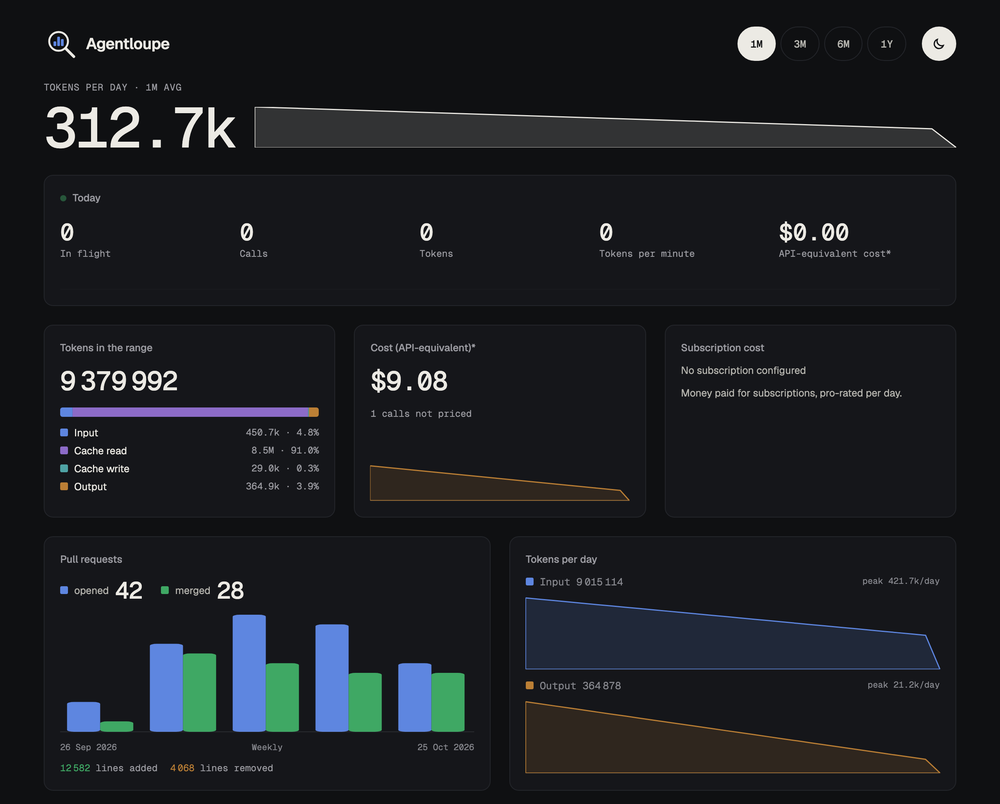

# Agentloupe

> A minimal AI gateway that gives you the illusion that you can keep up with your agents.

Agentloupe publishes a public, nightly record of the work that you do with AI coding agents. It
shows how many tokens the agents used, what those tokens cost at API list prices, how many pull
requests you opened and merged, how many lines changed, and one paragraph per day that describes
the kind of work.

No prompt, no code, and no detail that identifies a project leaves the machine. See
[Privacy model](docs/guide/privacy.md#privacy-model).

## Quickstart

Everything runs in one container on this machine. The full steps and the options are in
[Quickstart](docs/guide/quickstart.md#quickstart).

1. Copy `.env.example` to `.env`. Set `LOUPE_DATA_KEY` and `LOUPE_ACCOUNT_KEY`, each from `loupe gen-key`.
2. Start the container: `docker compose up -d --build`.
3. Check it: `curl -s http://127.0.0.1:8787/healthz`.
4. Make a proxy token into a file outside the repository. See [Proxy tokens](docs/guide/proxy-tokens.md#proxy-tokens).
5. Connect Claude Code: `eval "$(.agents/scripts/agent.connect.sh --agent claude-code --token-file ~/.config/agentloupe-token --check)"`.
6. Connect Pi the same way, with `--agent pi`.
7. Open the dashboard at `http://127.0.0.1:8787/`.

## Guides

The README and the guides under [`docs/guide/`](docs/guide/index.md) are the authority for the user.

| Guide | Topic |
|---|---|
| [Quickstart](docs/guide/quickstart.md) | All steps from an empty machine to the dashboard |
| [Overview](docs/guide/overview.md) | Status, scope, how it works, and the open work |
| [Install](docs/guide/install.md) | Release asset, registry image, source build, and the release check |
| [Connect the agents](docs/guide/connect-agents.md) | Claude Code and Pi through the proxy |
| [Proxy tokens](docs/guide/proxy-tokens.md) | Make, list, and revoke the proxy tokens |
| [The loupe binary](docs/guide/loupe-binary.md) | The subcommands of `loupe` |
| [Dashboard and private page](docs/guide/dashboard.md) | The public page, the live section, and the private page |
| [Accounts and cost](docs/guide/accounts-and-cost.md) | The accounts and the cost at API list prices |
| [GitHub](docs/guide/github.md) | The pull request counts and the token permissions |
| [Privacy model](docs/guide/privacy.md) | What leaves the machine and what stays |
| [Public hosting](docs/guide/public-hosting.md) | The public instance |

## Contributing

Read [CONTRIBUTING.md](CONTRIBUTING.md) before you open a pull request, and follow the
[Code of Conduct](CODE_OF_CONDUCT.md). Report a vulnerability in private as
[SECURITY.md](SECURITY.md) describes, never in a public issue.

## License

Agentloupe is MIT licensed, see [`LICENSE`](LICENSE). The vendored LiteLLM files are MIT licensed, and the vendored Geist fonts are under the SIL Open Font License (`web/assets/fonts/OFL.txt`). Each release archive and the release image carry `THIRD-PARTY-NOTICES`, with the licenses of the crates of the binary, the LiteLLM license, and the Geist font license.
