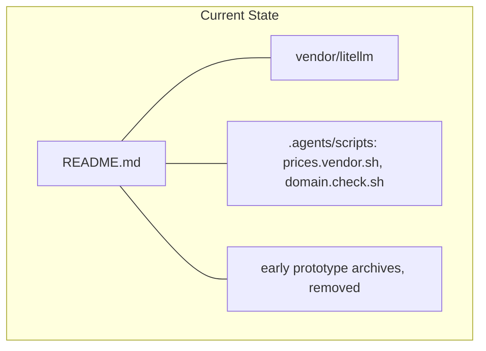
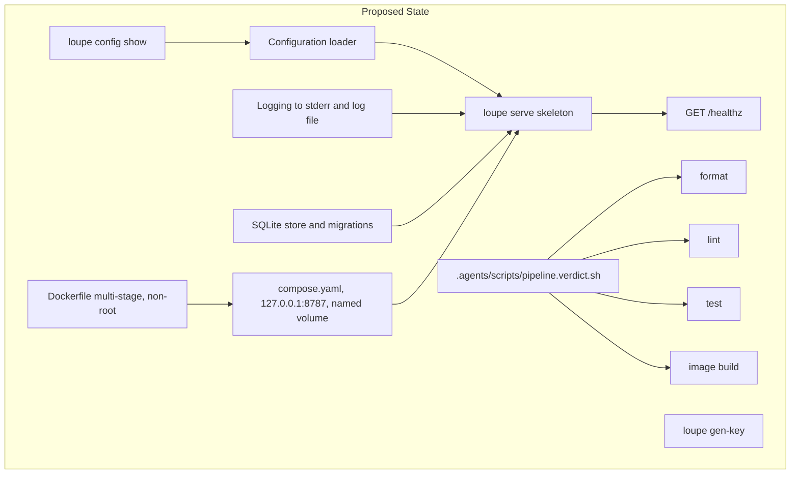
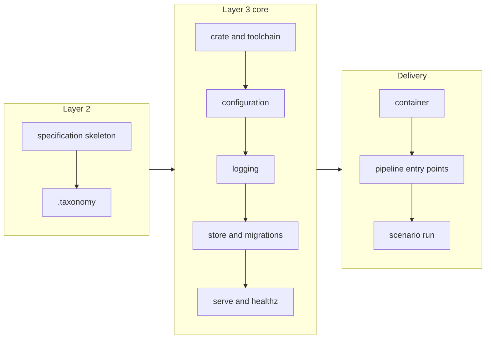
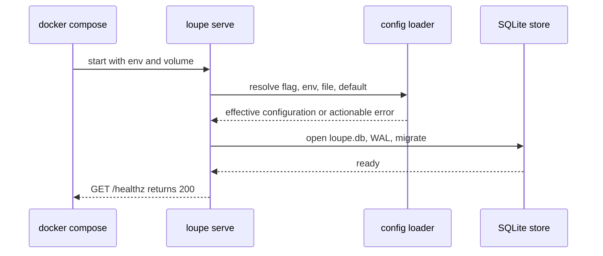

# Project foundation: crate, configuration, logging, storage, container, verdict pipeline

## Change Summary

The repository has a README, a vendored LiteLLM price file, and two scripts, but no code. This CR adds the foundation that all later CRs build on: the Rust crate `agent-loupe` with the binary `loupe`, a configuration loader, line-tagged logging, SQLite storage with migrations, a `loupe serve` skeleton with `GET /healthz`, a container that runs on macOS, and a set of pipeline entry points with one verdict command. It also makes the `docs/specification/` home for Layer 2 and the `.taxonomy` file.

## Motivation and Background

The human wants Claude Code and Pi to send model requests through a local container, and wants the dashboard to show the captured sessions. Every later CR in this set (CR-0002 to CR-0010) needs a binary to extend, a place to keep data, a container to run in, and one command that gives a verdict. If each CR adds these parts itself, the parts drift and the CRs conflict. This CR makes them one time, with no product behaviour, so each later CR adds only its own feature.

## Change Drivers

* The README states that one binary, `loupe`, holds the full product and runs as one container bound to `127.0.0.1`.
* The human's definition of done needs a container on macOS that Claude Code and Pi can reach.
* The `portable_pipeline` and `fast_feedback_loop` conventions need one local command for the verdict of the pipeline.
* The `logging_standard` and `actionable_errors` conventions must apply from the first line of code, not as a retrofit.
* No `.taxonomy` and no `docs/specification/` exist, so later CRs have no vocabulary and no Layer 2 home.

## Current State

The repository is on branch `main` at commit `adb479e`. It contains:

* `README.md`: the master document and the authority for intent.
* `vendor/litellm/`: the price file, its schema, `SOURCE.md`, and `LICENSE`.
* `.agents/scripts/prices.vendor.sh` and `.agents/scripts/domain.check.sh`.
* Two early prototype archives, removed, for reference only.

No Cargo manifest, no source code, no container files, no `docs/` directory, and no `.taxonomy` exist.

### Current State Diagram



## Proposed Change

Add a buildable Rust crate and the files around it. The binary starts, reads its configuration, writes logs, opens and migrates its database, and answers `GET /healthz`. It does not proxy, parse, price, summarize, publish, or serve the dashboard. Those features come in later CRs.

### Proposed State Diagram



## Requirements

### Functional Requirements

1. The repository **MUST** contain a Cargo crate named `agent-loupe` that builds one binary named `loupe`.
2. The repository **MUST** pin the Rust toolchain in one file, `rust-toolchain.toml`, with an exact version and the components `rustfmt` and `clippy`. The Dockerfile and every pipeline entry point **MUST** read the version from that file and **MUST NOT** state a version of their own.
3. The binary **MUST** have the subcommands `serve`, `gen-key`, and `config show`. Each subcommand **MUST** have a complete `--help`.
4. The configuration loader **MUST** resolve each value in this order of precedence: a command-line flag, then an environment variable, then the file for the environment, then the built-in default.
5. The name of the environment **MUST** come from the flag `--env` or the variable `LOUPE_ENV`, with the default `local`. The file for the environment **MUST** be `config/<env>.toml` in the repository, and it **MUST** hold only values that are not secret.
6. The loader **MUST** know every variable in the README configuration table (`LOUPE_DATA_KEY`, `LOUPE_ACCOUNT_KEY`, `LOUPE_BOOTSTRAP_TOKEN`, `LOUPE_GITHUB_TOKEN_<LABEL>`, `LOUPE_SUMMARY_API_KEY`, `LOUPE_SUMMARY_MODEL`, `LOUPE_TZ`, `LOUPE_PUBLISH_AT`, `LOUPE_IDLE_SECS`, `LOUPE_RAW_RETENTION_HOURS`) with the README defaults, plus `LOUPE_ENV`, `LOUPE_LISTEN` (default `0.0.0.0:8787` in the container), and `LOUPE_DATA_DIR` (default `/data` in the container, `./data` outside it). Values that only a later CR uses **MUST** be parsed and validated, but **MUST NOT** change behaviour in this CR.
7. `loupe config show` **MUST** print each effective value with its source, one of `flag`, `env`, `file`, or `default`. It **MUST** print every secret (`LOUPE_DATA_KEY`, `LOUPE_ACCOUNT_KEY`, `LOUPE_BOOTSTRAP_TOKEN`, each `LOUPE_GITHUB_TOKEN_<LABEL>`, `LOUPE_SUMMARY_API_KEY`) as `set` or `unset`, never as its value or a part of its value.
8. `loupe config show` **MUST** print a machine format (one JSON object per line) when stdout is not a terminal, and a table under `--human` or on a terminal, per `agent_first_cli`.
9. If a required value is missing or not valid, `loupe serve` **MUST** stop before it opens the port, with a non-zero exit code and an actionable error. The error **MUST** name the variable, give the labeled fixes (for a key: run `loupe gen-key` and put the value in `.env`), point to `.env.example`, and state what to verify (run `loupe config show` and see `set`). Required values in this CR are `LOUPE_DATA_KEY` and `LOUPE_ACCOUNT_KEY`.
10. A key value **MUST** be valid only if it decodes to exactly 32 bytes. The CR fixes the encoding as standard base64 with padding.
11. `loupe gen-key` **MUST** print one new random 32-byte key, encoded as in requirement 10, followed by a newline, from the operating system random source. It **MUST NOT** store the key.
12. The binary **MUST** write each log event as one line to stderr and to the file `<LOUPE_DATA_DIR>/logs/loupe.log`. Each line **MUST** carry the time in UTC, the level, the source location as `path/file.rs:LINE`, and the message with key fields. The file format **MUST** be one JSON object per line.
13. The binary **MUST NOT** write a secret value to a log line.
14. The binary **MUST** store its data in the SQLite file `<LOUPE_DATA_DIR>/loupe.db` with WAL journal mode.
15. The binary **MUST** apply versioned migrations from files in the repository, in order, at start, and record the applied versions in the database. A second start **MUST** apply no migration again. This CR **MUST** add only the migration that makes the version table, so later CRs own their tables.
16. `loupe serve` **MUST** listen on `LOUPE_LISTEN` and answer `GET /healthz` with status 200 and the JSON body `{"status":"ok"}` after the database is open and migrated.
17. `loupe serve` **MUST** stop cleanly on SIGTERM and SIGINT: it stops new connections, lets open requests finish within 10 seconds, closes the database, and exits with code 0.
18. The repository **MUST** contain a multi-stage `Dockerfile`. The build stage compiles a release binary with the pinned toolchain. The runtime stage **MUST** run as a user that is not root, **MUST** contain only the binary and its runtime files, and **MUST** have a `HEALTHCHECK` that calls `GET /healthz`.
19. The repository **MUST** contain `compose.yaml` with one service. It **MUST** bind the port as `127.0.0.1:8787:8787`, mount a named volume at `/data`, read secrets from `.env`, and set `LOUPE_ENV`.
20. The repository **MUST** contain `.env.example`, which lists every variable name of requirement 6 that `compose.yaml` passes, with no value. `.gitignore` **MUST** exclude `.env` and the local `data/` directory.
21. The repository **MUST** contain pipeline entry points under `.agents/scripts/`, one stage each: `pipeline.format.sh` (`cargo fmt --check`), `pipeline.lint.sh` (`cargo clippy` with warnings as errors), `pipeline.test.sh` (`cargo test`), and `pipeline.image.sh` (build the container image). Each **MUST** follow `agent_first_cli`: the top docstring with `@agents-index`, complete `--help`, a machine output by default, `--human` for the friendly view, actionable errors on stderr, and documented exit codes.
22. The repository **MUST** contain `.agents/scripts/pipeline.verdict.sh`, which runs the stages in the order format, lint, test, image, and only calls the stage entry points. It **MUST** print one result line per stage with the literal field `status: passed` or `status: failed`, and it **MUST** return a non-zero exit code if a stage fails. It **MUST** also measure and print the time of each stage and the total.
23. `pipeline.image.sh` **MUST** support `--dry-run`, which prints the build command and does not run it.
24. The repository **MUST** contain `docs/specification/` with an index file and one file per product area that the README names (proxy, tokens, accounts, parser and sessions, cost, summaries, days and public API, dashboard, GitHub, configuration, operations). In this CR only the configuration and operations files **MUST** have content: they describe the behaviour of requirements 3 to 23. The other files **MUST** state that a later change fills them.
25. The repository **MUST** contain `.taxonomy` in the four-column model of the `taxonomy` convention, with one row per README domain noun: proxy token, provider account, exchange, call, session, segment, day record, upstream, agent label, API-equivalent cost, unpriced call, GitHub token label, public API, dashboard, plus the foundation nouns configuration source, pipeline entry point, and verdict.
26. Every tracked source file and script that this CR adds **MUST** have exactly one `@agents-index` line.

### Non-Functional Requirements

1. The release image **MUST** build on macOS with Docker Desktop for the host architecture (arm64 on Apple silicon).
2. `loupe serve` **MUST** answer `GET /healthz` within 5 seconds of container start on the human's machine.
3. The source files **MUST** follow the small-file rule with hierarchical names, for example `src/config/loader.rs`, `src/config/show.rs`, `src/store/migrate.rs`, `src/serve/health.rs`.
4. Code, tests, and user-facing docs **MUST NOT** contain a CR, AC, or FR identifier. The identifier goes only in the commit message.
5. The pipeline stages that enter the verdict (format, lint, test) **MUST** be hermetic: no network after the dependencies are fetched, and no wall clock in an assertion.
6. The binary **MUST** log no warning and no error during a normal start with valid configuration.

## Affected Components

* New: `Cargo.toml`, `Cargo.lock`, `rust-toolchain.toml`, `src/`, `migrations/`, `config/local.toml`, `config/container.toml`.
* New: `Dockerfile`, `.dockerignore`, `compose.yaml`, `.env.example`.
* New: `.agents/scripts/pipeline.*.sh`.
* New: `docs/specification/`, `.taxonomy`, `.agents/scenarios/`.
* Changed: `.gitignore` (adds `.env`, `data/`, `target/`).
* Not changed: `README.md`, `vendor/litellm/`, `.agents/scripts/prices.vendor.sh`.

## Scope Boundaries

### In Scope

* The crate, the toolchain pin, and the three subcommands `serve`, `gen-key`, `config show`.
* The configuration loader, its precedence, the print of the effective configuration, and the actionable errors for missing values.
* Line-tagged logging to stderr and to the log file on the data volume.
* SQLite storage, WAL mode, and the migration runner with the version table only.
* `GET /healthz` and graceful shutdown.
* The Dockerfile, `compose.yaml`, `.env.example`, and `.gitignore` entries.
* The pipeline entry points and the verdict entry point.
* The `docs/specification/` skeleton, the `.taxonomy` file, and one scenario under `.agents/scenarios/`.

### Out of Scope ("Here, But Not Further")

* The proxy routes, `upstreams.toml`, capture, encryption of bodies, and credential redaction: CR-0002.
* Proxy tokens, `loupe token`, and `LOUPE_BOOTSTRAP_TOKEN` behaviour: CR-0003. This CR only parses the variable.
* The parser, calls, sessions, and provider accounts: CR-0004.
* Cost from the LiteLLM prices and the schema test of the price file: CR-0005.
* Session summaries and raw-body retention: CR-0006.
* `loupe aggregate`, day records, nightly publishing, `/v1/days`, and open CORS: CR-0007. `GET /healthz` here has no CORS header; CR-0007 adds it with the public API.
* The dashboard SPA at `/`: CR-0008.
* The GitHub worker: CR-0009.
* The end-to-end run with Claude Code and Pi on `claude-haiku-5-5`: CR-0010.
* A platform thin caller (for example a GitHub Actions workflow). No platform is chosen, and the entry points work without one.
* Public hosting and a license choice.

## Alternative Approaches Considered

* **Environment variables only, no file for the environment.** Rejected, because `portable_pipeline` requires a per-environment file in the repository for values that are not secret.
* **YAML or `.env` as the environment file.** Rejected for TOML, because `upstreams.toml` in the README is TOML and one format keeps the project simple.
* **An embedded migration library with its own state table, chosen per CR.** Rejected: one runner in this CR keeps the migration order in one place for all later CRs.
* **A distroless runtime with no shell.** Accepted as a candidate only if the `HEALTHCHECK` works without a shell; the implementer selects the smallest image that meets requirement 18 and states the choice in the operations spec.
* **One verdict script with all logic inline.** Rejected, because `portable_pipeline` requires one entry point per stage and a verdict script that only calls them.

## Impact Assessment

### User Impact

The human can build and start the container with `docker compose up -d`, see that it is healthy, and see the effective configuration. No agent traffic goes through it yet.

### Technical Impact

This CR fixes names that later CRs reuse: the subcommand structure, `LOUPE_DATA_DIR`, `LOUPE_LISTEN`, `LOUPE_ENV`, `config/<env>.toml`, the database path, the migration directory, the log file path, the port `8787`, and the script names `pipeline.*.sh`. A later CR that changes one of these names must state the change.

### Business Impact

No cost. All work runs locally. The foundation shortens every later CR, because each adds only its own feature and uses the same verdict command.

## Implementation Approach

1. Write the Layer 2 files first: `docs/specification/index.md`, `docs/specification/configuration.md`, `docs/specification/operations.md`, and the placeholder files. Write `.taxonomy`.
2. Add `rust-toolchain.toml`, `Cargo.toml`, and the subcommand skeleton.
3. Add the configuration loader, the source tracking, the secret masking, and `loupe config show`.
4. Add logging with the source location, to stderr and the log file.
5. Add the store, WAL mode, and the migration runner with the version table.
6. Add `loupe serve` with `GET /healthz` and graceful shutdown, and `loupe gen-key`.
7. Add the Dockerfile, `compose.yaml`, `.env.example`, and `.gitignore` entries.
8. Add the pipeline entry points and the verdict entry point. Measure the baseline.
9. Write the scenario under `.agents/scenarios/` and run it.

Commit after each coherent step, with `(CR-0001)` in the message.

### Implementation Flow



### Start sequence



## Measurable Targets

| Metric | Method | Baseline | Threshold |
|---|---|---|---|
| Verdict result | `.agents/scripts/pipeline.verdict.sh; echo $?` | none, no code exists | exit code 0, every stage `status: passed` |
| Time to a full verdict, warm cache | total time that `pipeline.verdict.sh` prints, second run | measured at the end of this CR and written to `docs/specification/operations.md` | at most 180 seconds on the human's machine |
| Time from container start to healthy | `docker compose up -d && time sh -c 'until curl -sf http://127.0.0.1:8787/healthz; do sleep 0.2; done'` | none | at most 5 seconds |

The time to a full verdict is the time of the local loop. The baseline is the first measured value; a later CR that makes it longer must state the reason.

## Test Strategy

### Tests to Add

| Test File | Test Name | Description | Inputs | Expected Output |
|-----------|-----------|-------------|--------|-----------------|
| `src/config/loader.rs` (unit) | `flag_overrides_env_file_and_default` | Precedence order | one key set at all four levels | the flag value, source `flag` |
| `src/config/loader.rs` (unit) | `env_overrides_file` | Precedence order | env and file set | env value, source `env` |
| `src/config/loader.rs` (unit) | `file_overrides_default` | Precedence order | file only | file value, source `file` |
| `src/config/loader.rs` (unit) | `default_when_unset` | Defaults from the README | nothing set | `LOUPE_TZ` is `Europe/Stockholm`, `LOUPE_IDLE_SECS` is `1800` |
| `src/config/loader.rs` (unit) | `missing_required_key_is_actionable` | Error content | no `LOUPE_DATA_KEY` | error names the variable, `loupe gen-key`, `.env.example`, `loupe config show` |
| `src/config/key.rs` (unit) | `rejects_key_not_32_bytes` | Key validation | base64 of 31 and 33 bytes, text not base64 | error |
| `src/config/show.rs` (unit) | `masks_every_secret` | Masking | all secrets set to known values | output has `set`, no substring of a secret |
| `src/config/loader.rs` (unit) | `collects_github_token_labels` | Dynamic names | `LOUPE_GITHUB_TOKEN_PERSONAL`, `LOUPE_GITHUB_TOKEN_ACME` | two labels, values masked |
| `src/cli/gen_key.rs` (unit) | `gen_key_is_32_bytes_and_unique` | Key generation | two calls | two values, each decodes to 32 bytes, different |
| `src/store/migrate.rs` (unit) | `migrations_apply_once` | Idempotent migration | start twice on one temp file | version table has one row per migration |
| `src/store/open.rs` (unit) | `opens_in_wal_mode` | Journal mode | temp data dir | `PRAGMA journal_mode` returns `wal` |
| `src/log/format.rs` (unit) | `line_has_source_location` | Log format | one event | JSON line with `file` matching `\.rs:\d+` |
| `tests/serve.health.rs` (integration) | `healthz_returns_ok` | HTTP surface | start on a free port with valid keys | 200, body `{"status":"ok"}` |
| `tests/serve.shutdown.rs` (integration) | `sigterm_exits_zero` | Graceful shutdown | SIGTERM to a running process | exit code 0 within 10 seconds |
| `tests/serve.config.rs` (integration) | `serve_without_keys_exits_nonzero` | Fail before the port opens | no keys | non-zero exit, port not bound, stderr names `LOUPE_DATA_KEY` |

The test names describe behaviour and carry no governance identifier.

### Tests to Modify

Not applicable: no tests exist before this CR.

### Tests to Remove

Not applicable: no tests exist before this CR.

## Model-Based Testing

| Scenario | User Goal | User Surface | Success Condition | Criteria Proved | Scenario Record |
|----------|-----------|--------------|-------------------|-----------------|-----------------|
| Start the container on macOS | Run Agentloupe locally and see that it is healthy | command line | `docker compose ps` shows the service `healthy`, and `curl -s http://127.0.0.1:8787/healthz` returns `{"status":"ok"}` | AC-6, AC-7 | `.agents/scenarios/foundation.container.start.md` |
| Start with a missing key | Learn what to fix when a secret is missing | command line | the container exits non-zero and its log names `LOUPE_DATA_KEY` and `loupe gen-key` | AC-3 | `.agents/scenarios/foundation.config.missing-key.md` |

## Acceptance Criteria

### AC-1: The crate builds with the pinned toolchain

```gherkin
Given a clean clone of the repository
When the reader runs "cargo build --release"
Then the build succeeds and makes the file "target/release/loupe"
  And "rustup show active-toolchain" names the version in "rust-toolchain.toml"
```

### AC-2: The precedence of configuration values is flag, env, file, default

```gherkin
Given "config/local.toml" sets LOUPE_IDLE_SECS to 600
  And the environment sets LOUPE_IDLE_SECS to 300
When the reader runs "loupe config show --idle-secs 120"
Then the line for LOUPE_IDLE_SECS shows the value 120 and the source "flag"
When the reader runs "loupe config show" without the flag
Then the line for LOUPE_IDLE_SECS shows the value 300 and the source "env"
```

### AC-3: A missing required key stops the start with an actionable error

```gherkin
Given LOUPE_DATA_KEY is not set
When the reader runs "loupe serve"
Then the process exits with a non-zero code before it opens the port
  And stderr names LOUPE_DATA_KEY, the fix "loupe gen-key", the file ".env.example", and the check "loupe config show"
```

### AC-4: The print of the configuration masks every secret

```gherkin
Given every secret variable is set to a known value
When the reader runs "loupe config show | grep -c '<known value>'"
Then the count is 0 for each known value
  And each secret line shows "set"
```

### AC-5: gen-key prints a valid key

```gherkin
Given the binary is built
When the reader runs "loupe gen-key | base64 -d | wc -c"
Then the output is 32
```

### AC-6: The container starts healthy on macOS

```gherkin
Given ".env" holds values from "loupe gen-key" for LOUPE_DATA_KEY and LOUPE_ACCOUNT_KEY
When the reader runs "docker compose up -d --build"
Then "docker compose ps" shows the service as "healthy" within 5 seconds of start
  And "curl -s http://127.0.0.1:8787/healthz" returns {"status":"ok"}
  And "docker compose exec loupe id -u" does not return 0
```

### AC-7: The port is bound to localhost only and data survives a restart

```gherkin
Given the container runs
When the reader runs "docker compose port loupe 8787"
Then the output is "127.0.0.1:8787"
When the reader runs "docker compose restart" and then reads the log of the container
Then the log shows that no migration ran again
  And the file "/data/loupe.db" and "/data/logs/loupe.log" exist on the named volume
```

### AC-8: Log lines carry the source location

```gherkin
Given the container ran one start
When the reader runs "docker compose exec loupe tail -n 5 /data/logs/loupe.log"
Then each line is one JSON object with a time, a level, a message, and a source location of the form "path/file.rs:LINE"
```

### AC-9: Graceful shutdown

```gherkin
Given the container runs
When the reader runs "docker compose stop"
Then "docker inspect --format '{{.State.ExitCode}}'" for the container returns 0
```

### AC-10: One command gives the verdict

```gherkin
Given the repository at the commit that completes this CR
When the reader runs ".agents/scripts/pipeline.verdict.sh"
Then it prints one line per stage, in the order format, lint, test, image, each with "status: passed" and a measured time
  And it exits with code 0
When a formatting error is put in one source file and the command runs again
Then the format stage prints "status: failed" and the command exits non-zero
```

### AC-11: Layer 2 home and vocabulary exist

```gherkin
Given the repository at the commit that completes this CR
When the reader runs "ls docs/specification" and "grep -F '**proxy token**' .taxonomy"
Then the specification index, configuration, and operations files exist
  And the grep returns one complete row with four columns
```

### AC-12: Index and identifier rules hold

```gherkin
Given the repository at the commit that completes this CR
When the reader runs "grep -rLn '@agents-index' src .agents/scripts migrations" 
Then the output is empty
When the reader runs "grep -rnE 'CR-[0-9]{4}|AC-[0-9]+' src tests migrations config docs/specification"
Then the output is empty
```

## Quality Standards Compliance

### Build & Compilation

- [ ] Code compiles without errors with the pinned toolchain
- [ ] No compiler warnings

### Linting & Code Style

- [ ] `cargo clippy --all-targets -- -D warnings` passes
- [ ] `cargo fmt --check` passes
- [ ] Any lint exception is documented next to the code with its reason

### Test Execution

- [ ] All tests of the Test Strategy pass
- [ ] No test is skipped or ignored

### Documentation

- [ ] Every file has one `@agents-index` line
- [ ] `docs/specification/configuration.md` and `docs/specification/operations.md` describe the behaviour that the code has
- [ ] README is not changed; no README behaviour changes in this CR

### Code Review

- [ ] Commits follow Conventional Commits with `(CR-0001)` in the message
- [ ] The reviewer agent checks the result against the acceptance criteria

### Verification Commands

```bash
# Full verdict (format, lint, test, image)
.agents/scripts/pipeline.verdict.sh

# Container
cp .env.example .env   # then put two values from: cargo run -q -- gen-key
docker compose up -d --build
curl -s http://127.0.0.1:8787/healthz
docker compose exec loupe /usr/local/bin/loupe config show --human
docker compose stop
```

## Risks and Mitigation

### Risk 1: A secret reaches a log line or the configuration print

**Likelihood:** medium
**Impact:** high
**Mitigation:** Secrets are held in a wrapper type whose debug and display forms print `set`. The test `masks_every_secret` checks the print, and a log test checks that no secret value occurs in the log file.

### Risk 2: The image does not build on Apple silicon

**Likelihood:** low
**Impact:** high
**Mitigation:** The build stage compiles for the host architecture. AC-6 runs on the human's machine.

### Risk 3: A file on the named volume is not writable by the non-root user

**Likelihood:** medium
**Impact:** medium
**Mitigation:** The Dockerfile makes `/data` and gives it to the runtime user before the volume is mounted, so Docker copies the ownership to a new named volume. The operations spec states the fix for an old volume.

### Risk 4: Names fixed here conflict with a later CR

**Likelihood:** low
**Impact:** medium
**Mitigation:** The Technical Impact section lists the fixed names. A later CR that must change one states the change.

## Dependencies

* None. This is the first CR of the set. CR-0002 to CR-0010 depend on it.
* Local tools (verified 2026-10-18): Docker Desktop 29.6.1, cargo and rustc 1.97.1.

## Estimated Effort

About one working day of agent time, in nine coherent commits.

## Decision Outcome

Chosen approach: "one small foundation CR with no product behaviour", because it fixes the shared names, the container, and the verdict command one time, and lets each later CR add only its own feature.

Reviewed and approved by an independent reviewer agent on 2026-10-18.

## Open Questions

1. **Encoding of keys.** The README says a 32-byte key and does not state the encoding. Provisional default: standard base64 with padding (requirement 10). Hex is the alternative.
2. **Format of the environment file.** Provisional default: TOML at `config/<env>.toml`, with `local` and `container` as the two environments.
3. **`GET /healthz` and CORS.** The README lists `/healthz` in the public API with open CORS. Provisional default: this CR adds no CORS header, and CR-0007 adds it to all public API routes.

## Related Items

* Master document: `README.md`
* Next CR: `docs/cr/CR-0002-pass-through-proxy-and-capture.md`
* Final acceptance: `docs/cr/CR-0010-macos-end-to-end-acceptance.md`
