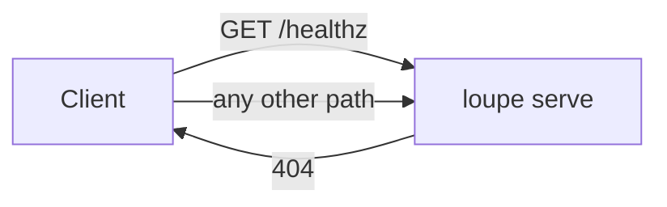
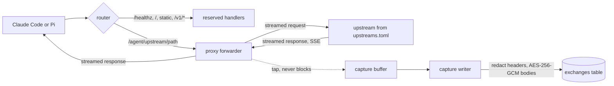
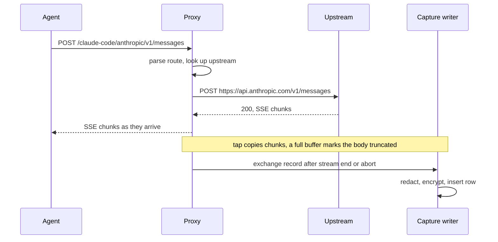
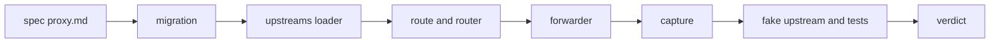

# Pass-through proxy with encrypted capture

## Change Summary

After CR-0001, the `loupe serve` command answers only `GET /healthz`. This CR adds the proxy. The proxy forwards each request on the route `/<agent>/<upstream>/<path>` to an upstream from the allowlist `upstreams.toml`, streams the response back without buffering, and stores each exchange. The stored exchange has redacted headers and bodies that are encrypted with AES-256-GCM under `LOUPE_DATA_KEY`.

## Motivation and Background

The full product depends on the record of each exchange between an agent and its provider. The parser (CR-0004), the cost (CR-0005), the summaries (CR-0006), and the day records (CR-0007) all read the stored exchanges. The proxy must be invisible to Claude Code and Pi: a request through the proxy must give the same result as a direct request. Capture must never make a request slower to start, fail, or change. The bodies hold prompts and code, so they must be encrypted at rest, and the credentials must never reach the disk.

## Change Drivers

* The README section "How it works" steps 1 and 2: forward unchanged, store the exchange, encrypt bodies, redact credentials.
* The README section "Privacy model": credentials redacted before storage and never logged, bodies encrypted with `LOUPE_DATA_KEY`.
* The definition of done for the CR set: `claude -p` and `pi -p` must work through the proxy with the anthropic provider and the model `claude-haiku-5-5`.

## Current State

* CR-0001 (approved) gives the crate `agent-loupe`, the binary `loupe`, the configuration loader with `LOUPE_DATA_KEY` validated as 32 bytes, line-tagged logging, SQLite at `<LOUPE_DATA_DIR>/loupe.db` with WAL and the migration runner, `loupe serve` on `LOUPE_LISTEN` (port `8787`) with `GET /healthz`, the container, and the pipeline entry points `.agents/scripts/pipeline.*.sh`.
* No route other than `/healthz` exists. No upstream is known. No exchange is stored.

### Current State Diagram



## Proposed Change

Add a router that sends reserved routes to their handlers and every other path to the proxy. Add the allowlist `upstreams.toml`. Add a forwarder that streams the request to the upstream and streams the response back. Add a capture tap on each direction that copies the bytes to a bounded capture buffer without delay to the stream. Add a capture writer that encrypts the bodies, redacts the headers, and writes one row per exchange in a new table `exchanges`. Add a fake upstream for the tests.

### Proposed State Diagram



### Request sequence



## Requirements

### Functional Requirements

1. The router **MUST** give reserved routes precedence over the proxy. The reserved routes are `GET /healthz`, `/`, the static files of the dashboard, and every path under `/v1/`. The router **MUST** keep one list of reserved first path segments in one source file, and the list **MUST** include `healthz`, `v1`, and the names of the static asset directories.
2. The agent label and the upstream name **MUST** match `^[a-z0-9][a-z0-9-]{0,31}$`. A name in the reserved list **MUST NOT** be accepted as an agent label or an upstream name.
3. The route parser **MUST** return a typed route value (agent label, upstream name, rest of the path, query). It **MUST** be one function behind one interface, so that CR-0003 can add an optional leading proxy token segment without a change to the forwarder or the capture.
4. The repository **MUST** contain `upstreams.toml` at its root, and the image **MUST** contain it. Each entry **MUST** map an upstream name to an `https` base URL. The file **MUST** contain at least `anthropic = "https://api.anthropic.com"`, `openai = "https://api.openai.com"`, and `chatgpt = "https://chatgpt.com"`. The variable `LOUPE_UPSTREAMS_FILE` **MUST** override the path of the file, and `loupe config show` **MUST** print it with its source.
5. `loupe serve` **MUST** load and validate `upstreams.toml` before it opens the port. A file that is missing, not valid TOML, has a name that does not match requirement 2, or has a base URL that is not `https` **MUST** stop the start with an actionable error that names the file, the entry, the fix, and the check (`loupe config show`). The only exception to `https` **MUST** be a host of `127.0.0.1` or `localhost`, which the tests use for the fake upstream.
6. A request for an upstream name that is not in the allowlist **MUST** get status 404 with a JSON error body that names the unknown upstream, lists the known names, and points to `upstreams.toml`. The proxy **MUST NOT** forward it, and it **MUST NOT** store an exchange for it.
7. The forwarder **MUST** send the request to `<base URL><rest of the path>?<query>` with the same method, the same path bytes, the same query bytes, the same headers, and the same body bytes. The only header changes **MUST** be: remove `accept-encoding`, remove the hop-by-hop headers (`connection`, `keep-alive`, `proxy-connection`, `te`, `trailer`, `transfer-encoding`, `upgrade`, and each header that `connection` names), and set `host` to the host of the base URL.
8. The forwarder **MUST** stream the request body to the upstream and the response body to the client chunk by chunk, with no buffer of the full body. Server-sent events (`text/event-stream`) **MUST** reach the client as each chunk arrives.
9. The forwarder **MUST** return the upstream status code and the upstream response headers unchanged, minus the hop-by-hop headers.
10. If the upstream cannot be reached (DNS, connect, TLS, or timeout before the response headers), the proxy **MUST** return status 502 with a JSON error body that names the upstream and the cause, and it **MUST** store an exchange with the status `502` and an error field.
11. The proxy **MUST** store one exchange for each forwarded request in a new table `exchanges`, added by a new migration. The row **MUST** hold: a unique id, the start time and the end time in UTC with millisecond resolution, the time to the first response byte, the agent label, the upstream name, the method, the path, the query, the response status, the request body size and the response body size in bytes as forwarded, the redacted request headers and response headers as JSON, the encrypted request body, the encrypted response body, an outcome (`complete`, `client_aborted`, `upstream_aborted`, or `upstream_unreachable`), and a flag for each body that shows whether the capture truncated it.
12. The capture **MUST** redact the value of each header whose lowercase name is `authorization`, `proxy-authorization`, `x-api-key`, `cookie`, `set-cookie`, or contains `key`, `token`, `secret`, or `session`. The stored value **MUST** be the literal `redacted`. The header name **MUST** stay, because CR-0004 reads which credential type a request used.
13. The capture **MUST** encrypt each body with AES-256-GCM under `LOUPE_DATA_KEY`, with a new random 96-bit nonce for each body. The additional authenticated data **MUST** be the exchange id plus the part name (`request` or `response`), so a body cannot be moved to another row without a decryption failure. The stored value **MUST** be one versioned blob: a version byte, the nonce, and the ciphertext with its tag.
14. The source **MUST** have one decrypt function that a later CR uses to read a body. A test **MUST** prove that the decrypt of a stored body gives the bytes that the client and the upstream sent.
15. Capture **MUST NOT** delay, block, change, or fail the forwarded stream. The tap **MUST** copy each chunk into a bounded buffer for each body. If a body is larger than the capture limit, the tap **MUST** stop the copy, set the truncated flag, and keep the size count. The capture limit **MUST** be the configuration value `LOUPE_CAPTURE_MAX_BYTES`, with the default 33554432 (32 MiB).
16. The hand-off from the forwarder to the capture writer **MUST** use a bounded queue that never waits. If the queue is full, the proxy **MUST** drop the exchange record, log one warning line with the count of dropped records, and increment a counter. The forwarded response **MUST** stay unchanged.
17. A failure of the capture writer (encryption, database, disk) **MUST** log an actionable error and **MUST NOT** stop `loupe serve` or change any later forwarded request.
18. If the client closes the connection during a streamed response, the proxy **MUST** close the upstream request and store the exchange with the bytes that it received and the outcome `client_aborted`. If the upstream closes during the response, the proxy **MUST** end the client stream and store the outcome `upstream_aborted`.
19. The proxy **MUST NOT** write a header value, a body, or a part of a body to a log line. A log line for an exchange **MUST** hold only the exchange id, the agent label, the upstream name, the method, the path, the status, the sizes, the timing, and the outcome.
20. The repository **MUST** contain a fake upstream for the tests, written in Rust inside the test tree, that serves a JSON response, an SSE stream of chunks with a set delay, a stream that it closes in the middle, a slow response, and an echo of the request method, path, query, headers, and body.
21. The Layer 2 document `docs/specification/proxy.md` **MUST** describe the routes, the allowlist, the forward rules, the capture record, the redaction rules, the encryption blob format, and the failure rules before the code is written.
22. `.taxonomy` **MUST** update the rows for exchange, upstream, and agent label so that their `Lives in` column names the new source files, and **MUST** add a row for the new noun capture limit.

### Non-Functional Requirements

1. The added time to the first byte of a streamed response through the proxy **MUST** be at most 20 milliseconds at the 95th percentile against the local fake upstream, measured by the command in "Measurable Targets".
2. The memory that capture uses **MUST** be bounded by the capture limit times the number of concurrent exchanges plus the queue size. No code path **MUST** hold a full body in memory outside the capture buffer.
3. No secret (`LOUPE_DATA_KEY`, a credential header value) **MUST** appear in the database file outside the encrypted blobs, in a log file, or on stderr.
4. The source files **MUST** follow the small-file rule with hierarchical names, for example `src/proxy/route.rs`, `src/proxy/upstreams.rs`, `src/proxy/forward.rs`, `src/proxy/headers.rs`, `src/capture/tap.rs`, `src/capture/redact.rs`, `src/capture/seal.rs`, `src/capture/writer.rs`, `src/serve/router.rs`.
5. Each new file **MUST** carry one `@agents-index` line. No governance identifier **MUST** appear in source, comments, test names, or `docs/specification/`.

## Affected Components

* New: `upstreams.toml`, `src/proxy/`, `src/capture/`, `src/serve/router.rs`, one migration in `migrations/` for `exchanges`, `tests/` files and the fake upstream, `docs/specification/proxy.md`, `.agents/scenarios/proxy.*.md`, `.agents/scripts/proxy.latency.sh`.
* Changed: `src/serve/` (mount the router), the configuration loader (`LOUPE_UPSTREAMS_FILE`, `LOUPE_CAPTURE_MAX_BYTES`), `Dockerfile` (copy `upstreams.toml`), `.env.example` (no new secret, only comments), `.taxonomy`.
* Not changed: `README.md`, `vendor/litellm/`, `compose.yaml` port binding.

## Scope Boundaries

### In Scope

* The router with the reserved routes and their precedence.
* The route `/<agent>/<upstream>/<path>` and a parser that CR-0003 extends.
* `upstreams.toml` as the allowlist, its validation, and its override variable.
* Streamed forwarding, SSE included, with the header rules of requirement 7.
* The `exchanges` table, redaction, AES-256-GCM encryption, the decrypt function, and the capture limit.
* Aborted streams and unreachable upstreams.
* The fake upstream and the tests.

### Out of Scope ("Here, But Not Further")

* Proxy tokens, the `/<token>/` segment, `loupe token`, and `LOUPE_BOOTSTRAP_TOKEN` behaviour: CR-0003. The `exchanges` table has no token column in this CR; CR-0003 adds it.
* The parser of model calls, the `calls` table, sessions, and provider account hashes: CR-0004.
* Cost: CR-0005.
* Summaries and deletion of raw bodies after `LOUPE_RAW_RETENTION_HOURS`: CR-0006. Bodies stay until then.
* Day records, publishing, `/v1/days`, and CORS: CR-0007. The `/v1/` prefix is only reserved here.
* The dashboard files at `/`: CR-0008. `/` returns 404 until then, but it is reserved.
* GitHub: CR-0009.
* The runs of `claude -p` and `pi -p` with the real Anthropic API: CR-0010. This CR proves the proxy only against the fake upstream and one manual check with `curl`.
* WebSocket upgrade. The `upgrade` header is removed, so a WebSocket request is not supported.

## Alternative Approaches Considered

* **Buffer the full response, then send it.** Rejected: it breaks SSE and adds the full generation time to the first byte.
* **Store bodies in files on the volume.** Rejected: one SQLite file keeps backup and deletion simple, and the bodies are bounded by the capture limit.
* **Capture in the request task with a database write before the response ends.** Rejected: a slow disk would then delay the client.
* **A queue that waits when full.** Rejected: it lets capture block forwarding. A dropped record is visible in the log and in the counter.
* **Keep `accept-encoding`.** Rejected per the README: the capture needs plain bytes for the parser, so the proxy asks for an uncompressed response.

## Impact Assessment

### User Impact

The user points an agent at `http://127.0.0.1:8787/<agent>/<upstream>` and sees no change in the agent behaviour. Until CR-0003 is active, anyone who can reach the port can use the proxy, and the port is bound to `127.0.0.1` only.

### Technical Impact

This CR fixes names that later CRs reuse: the table `exchanges` and its columns, the outcome values, the blob format, the decrypt function, `upstreams.toml`, `LOUPE_UPSTREAMS_FILE`, `LOUPE_CAPTURE_MAX_BYTES`, and the reserved segment list. New dependencies: an HTTP client with streamed bodies and TLS (rustls, so the image needs no system OpenSSL), and an AES-GCM crate from RustCrypto. The implementer must confirm the API of each crate at the installed version per `source_hierarchy`.

### Business Impact

This CR makes the first data that the product exists to show. Without it, no later CR has input.

## Implementation Approach

1. Write `docs/specification/proxy.md` (Layer 2) and commit it.
2. Add the migration for `exchanges`.
3. Add `upstreams.toml`, its loader, and its validation.
4. Add the route parser and the router with the reserved list.
5. Add the header rules and the streamed forwarder.
6. Add the tap, the bounded queue, the redaction, the seal (encryption) and open (decryption), and the writer.
7. Add the fake upstream and the tests.
8. Add `.agents/scripts/proxy.latency.sh` and the scenarios.
9. Run `.agents/scripts/pipeline.verdict.sh`.

### Implementation Flow



## Measurable Targets

| Metric | Method | Baseline | Threshold |
|---|---|---|---|
| Verdict | `.agents/scripts/pipeline.verdict.sh; echo $?` | exit 0 after CR-0001 | exit 0, every stage `status: passed` |
| Added time to first byte, p95 | `.agents/scripts/proxy.latency.sh --requests 200` (starts the fake upstream, sends 200 SSE requests direct and through the proxy, prints `p95_added_ms`) | none, no proxy | `p95_added_ms` at most 20 |
| Secrets on disk | `grep -c "<test key value>" <data dir>/loupe.db <data dir>/logs/loupe.log` after the capture test with a known `x-api-key` | none | 0 matches in each file |
| Capture during abort | `cargo test --test proxy_abort` | none | pass |

## Test Strategy

### Tests to Add

| Test File | Test Name | Description | Inputs | Expected Output |
|-----------|-----------|-------------|--------|-----------------|
| `src/proxy/route.rs` (unit) | `parses_agent_upstream_and_rest` | Route parse | `/claude-code/anthropic/v1/messages?beta=true` | agent `claude-code`, upstream `anthropic`, rest `/v1/messages`, query `beta=true` |
| `src/proxy/route.rs` (unit) | `rejects_reserved_and_invalid_names` | Name rules | `/v1/anthropic/x`, `/Bad/anthropic/x`, `/a/` | rejected |
| `src/proxy/upstreams.rs` (unit) | `rejects_http_except_loopback` | Allowlist validation | `http://example.com`, `http://127.0.0.1:9` | error, accepted |
| `src/proxy/upstreams.rs` (unit) | `invalid_file_is_actionable` | Error content | bad TOML | error names the file, the fix, and `loupe config show` |
| `src/proxy/headers.rs` (unit) | `drops_hop_by_hop_and_accept_encoding` | Header rules | headers with `connection: x-foo`, `x-foo`, `accept-encoding`, `te` | all four removed, others unchanged |
| `src/capture/redact.rs` (unit) | `redacts_credential_headers` | Redaction | `authorization`, `x-api-key`, `cookie`, `anthropic-session-id`, `x-goog-api-key` | value `redacted`, names kept |
| `src/capture/seal.rs` (unit) | `seal_then_open_round_trips` | Encryption | random bytes, id, part | same bytes |
| `src/capture/seal.rs` (unit) | `open_fails_on_wrong_id_or_part` | AAD binding | blob opened with another id or part | error |
| `src/capture/seal.rs` (unit) | `nonce_is_unique` | Nonce | 1000 seals of one body | 1000 different nonces |
| `src/capture/tap.rs` (unit) | `truncates_at_limit_and_counts_size` | Capture limit | 3 MiB body, limit 1 MiB | 1 MiB kept, flag set, size 3 MiB |
| `tests/proxy.forward.rs` (integration) | `forwards_request_unchanged` | Pass-through | POST with body, query, custom header to the echo route | echo shows the same method, path, query, header, body bytes |
| `tests/proxy.forward.rs` (integration) | `unknown_upstream_is_404` | Allowlist | `/claude-code/nope/x` | 404, body lists known names, no row |
| `tests/proxy.stream.rs` (integration) | `sse_chunks_arrive_before_stream_end` | Streaming | SSE of 5 chunks, 200 ms apart | first chunk at the client before 300 ms |
| `tests/proxy.capture.rs` (integration) | `stored_exchange_matches_traffic` | Capture | one JSON exchange with `x-api-key` | one row, header `redacted`, decrypted bodies equal the sent bytes, sizes and status match |
| `tests/proxy.abort.rs` (integration) | `client_abort_is_captured` | Abort | client drops after chunk 2 | row with outcome `client_aborted` and the received bytes |
| `tests/proxy.abort.rs` (integration) | `upstream_abort_is_captured` | Abort | fake upstream closes mid-stream | row with outcome `upstream_aborted` |
| `tests/proxy.failure.rs` (integration) | `unreachable_upstream_is_502` | Failure | upstream on a closed port | 502 JSON body, row `upstream_unreachable` |
| `tests/proxy.failure.rs` (integration) | `capture_failure_does_not_break_forwarding` | Isolation | database made read-only | client gets 200 and full body, error line in the log |
| `tests/serve.router.rs` (integration) | `reserved_routes_take_precedence` | Precedence | `/healthz`, `/v1/days`, `/` | health 200, others 404 from the router, no upstream request, no row |
| `tests/proxy.secrets.rs` (integration) | `no_secret_in_db_or_log` | Secrets | known key in `x-api-key` and in `LOUPE_DATA_KEY` | no match in the database file or the log file |

### Tests to Modify

| Test File | Test Name | Current Behavior | New Behavior | Reason for Change |
|-----------|-----------|------------------|--------------|-------------------|
| `src/store/migrate.rs` (unit) | `migrations_apply_once` | Version table only | Also applies the `exchanges` migration once | A new migration exists |

### Tests to Remove

Not applicable: no test covers removed behaviour.

## Model-Based Testing

| Scenario | User Goal | User Surface | Success Condition | Criteria Proved | Scenario Record |
|----------|-----------|--------------|-------------------|-----------------|-----------------|
| Stream through the proxy | Send a streamed model request through Agentloupe and get the same stream | HTTP request | `curl -N` through the proxy to the fake upstream SSE route prints each chunk as it arrives, and `sqlite3` shows one row with outcome `complete` | AC-2, AC-4 | `.agents/scenarios/proxy.stream.md` |
| Credentials stay off disk | Use the proxy with a key and know that the key is not stored | HTTP request | the row headers show `redacted`, and `grep` for the key in the data dir finds nothing | AC-5 | `.agents/scenarios/proxy.redaction.md` |

## Acceptance Criteria

### AC-1: An upstream outside the allowlist is refused

```gherkin
Given "loupe serve" runs with the default "upstreams.toml"
When the reader runs "curl -s -o /dev/stdout -w '%{http_code}' http://127.0.0.1:8787/claude-code/nope/v1/messages"
Then the status is 404
  And the body names "nope", lists "anthropic", and points to "upstreams.toml"
  And "sqlite3 <data dir>/loupe.db 'select count(*) from exchanges'" returns 0
```

### AC-2: The request reaches the upstream unchanged

```gherkin
Given the fake upstream runs on 127.0.0.1 and "upstreams.toml" maps "fake" to it
When the reader sends a POST with a body, a query, and the header "x-custom: 1" to "/claude-code/fake/echo"
Then the echo shows the same method, path, query, body bytes, and header "x-custom: 1"
  And the echo has no "accept-encoding" header
```

### AC-3: Reserved routes take precedence

```gherkin
Given "loupe serve" runs
When the reader requests "/healthz", "/v1/days", and "/"
Then "/healthz" returns {"status":"ok"}
  And no request reaches an upstream
  And the table "exchanges" has no new row
```

### AC-4: Server-sent events stream without buffering and the exchange is stored

```gherkin
Given the fake upstream sends 5 SSE chunks 200 ms apart
When the client requests the SSE route through the proxy
Then the client gets the first chunk before 300 ms
  And after the stream ends the table "exchanges" has one row with outcome "complete", status 200, and the agent label and upstream of the route
  And the decrypted response body equals the 5 chunks
```

### AC-5: Credentials are redacted and bodies are encrypted

```gherkin
Given a request through the proxy carries "x-api-key: sk-test-123" and a body with the text "secret-prompt"
When the exchange is stored
Then the stored request headers show "x-api-key" with the value "redacted"
  And "grep -c sk-test-123" and "grep -c secret-prompt" over the database file and the log file return 0
  And the decrypt function returns the body with "secret-prompt"
```

### AC-6: An aborted stream is still captured

```gherkin
Given the fake upstream streams slowly
When the client closes the connection after the second chunk
Then the table "exchanges" has one row with outcome "client_aborted"
  And the response size equals the bytes that the proxy received
```

### AC-7: Capture never breaks forwarding

```gherkin
Given the capture writer cannot write to the database
When the client sends a request through the proxy
Then the client gets the full upstream response with the upstream status
  And the log has one error line that names the failure and the fix
  And "loupe serve" keeps running
```

### AC-8: An unreachable upstream gives 502 with a captured exchange

```gherkin
Given "upstreams.toml" maps "dead" to a closed local port
When the client sends a request to "/claude-code/dead/x"
Then the status is 502 and the JSON body names "dead" and the cause
  And the table "exchanges" has one row with outcome "upstream_unreachable"
```

### AC-9: A bad allowlist stops the start

```gherkin
Given "LOUPE_UPSTREAMS_FILE" points to a file with "evil = \"http://example.com\""
When the reader runs "loupe serve"
Then the exit code is not 0 and the port is not bound
  And stderr names the file, the entry "evil", the fix, and "loupe config show"
```

### AC-10: The latency target holds

```gherkin
Given the release build
When the reader runs ".agents/scripts/proxy.latency.sh --requests 200"
Then the output has the field "p95_added_ms" with a value of at most 20
```

### AC-11: The verdict passes and the identifier rules hold

```gherkin
Given the change is complete
When the reader runs ".agents/scripts/pipeline.verdict.sh"
Then every stage shows "status: passed"
When the reader runs "grep -rnE 'CR-[0-9]{4}|AC-[0-9]+' src tests migrations config docs/specification"
Then the output is empty
```

## Quality Standards Compliance

### Build & Compilation

- [ ] Code compiles without errors with the pinned toolchain
- [ ] No new compiler warnings

### Linting & Code Style

- [ ] `cargo clippy` passes with warnings as errors
- [ ] `cargo fmt --check` passes

### Test Execution

- [ ] All existing tests pass
- [ ] All new tests pass

### Documentation

- [ ] `docs/specification/proxy.md` lands before the code
- [ ] Docstrings and one `@agents-index` line on each new file
- [ ] `.taxonomy` rows updated in the same change

### Code Review

- [ ] Conventional Commits with the governance ID in the message only
- [ ] Reviewer agent checks the diff against the spec diff

### Verification Commands

```bash
# Full verdict
.agents/scripts/pipeline.verdict.sh

# Latency
.agents/scripts/proxy.latency.sh --requests 200

# Manual check in the container
docker compose up -d --build
curl -s -o /dev/null -w '%{http_code}\n' http://127.0.0.1:8787/claude-code/nope/x   # 404
```

## Risks and Mitigation

### Risk 1: A credential header with an unusual name is stored

**Likelihood:** medium
**Impact:** high
**Mitigation:** The redaction rule matches substrings (`key`, `token`, `secret`, `session`) as well as fixed names, and a test lists the known Anthropic and OpenAI header names.

### Risk 2: The tap adds latency under load

**Likelihood:** low
**Impact:** medium
**Mitigation:** The tap only copies into a bounded buffer, and the hand-off never waits. The latency target measures it.

### Risk 3: Dropped capture records go unseen

**Likelihood:** low
**Impact:** medium
**Mitigation:** Each drop logs a warning with the count. The default queue size is large compared to the request rate of two local agents.

### Risk 4: An upstream sends a compressed response although `accept-encoding` is removed

**Likelihood:** low
**Impact:** low
**Mitigation:** The proxy forwards the bytes unchanged in all cases. The capture stores the `content-encoding` header, so CR-0004 can decode the body.

## Dependencies

* CR-0001 (approved): crate, configuration loader, logging, store and migrations, `loupe serve`, container, pipeline entry points, `.taxonomy`, `docs/specification/`.
* CR-0003 depends on this CR for the route parser interface and the `exchanges` table.
* CR-0004 depends on this CR for the decrypt function and the stored headers.

## Estimated Effort

About 2 to 3 person-days: 0.5 for the spec, 1 for the proxy and capture, 1 for the tests and the latency script.

## Decision Outcome

Chosen approach: "streamed pass-through with a non-blocking tap and an asynchronous encrypted writer", because it keeps the agent behaviour identical, keeps capture off the request path, and gives later CRs a complete encrypted record of each exchange.

## Open Questions

1. **Full capture queue.** Provisional default: drop the record and log a warning (requirement 16). The alternative is a spill to disk. The README says capture must never block, but it does not state the behaviour when capture falls behind.
2. **Capture limit.** Provisional default: `LOUPE_CAPTURE_MAX_BYTES` = 32 MiB per body, with a truncated flag. The README does not state a limit. A truncated response can lose the usage block that CR-0004 reads.
3. **Reserved static asset names.** Provisional default: CR-0008 adds its asset directory names to the reserved list, and the list here holds `healthz`, `v1`, `assets`, and `favicon.ico`.

## Related Items

* CR-0001 project foundation (dependency).
* CR-0003 proxy tokens (extends the route parser).
* CR-0004 parser, sessions, and accounts (reads the exchanges).
* README sections "How it works", "The `loupe` binary", "Privacy model".
