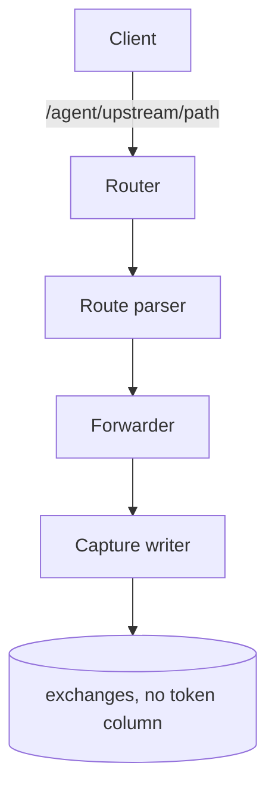
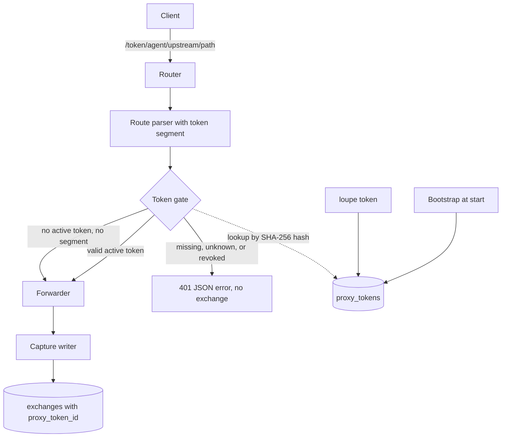
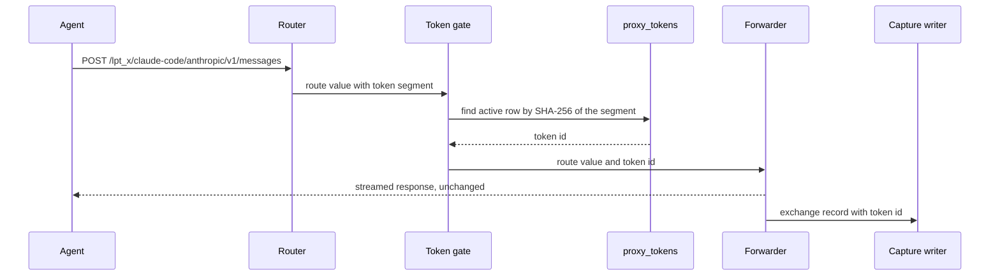
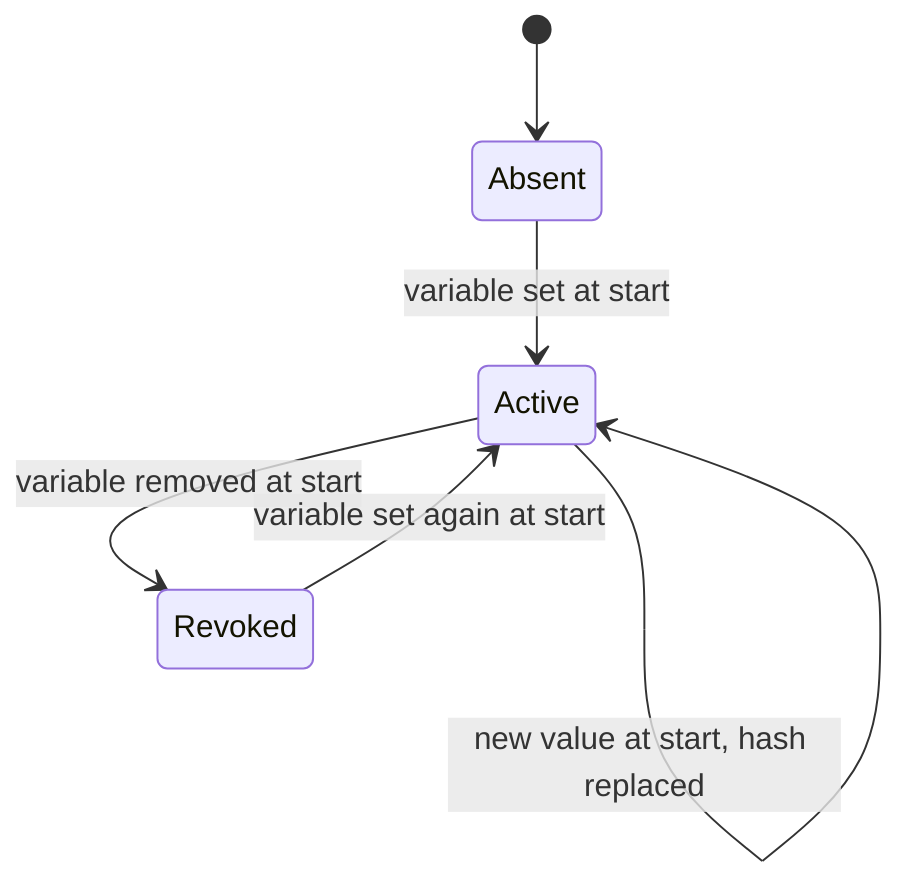
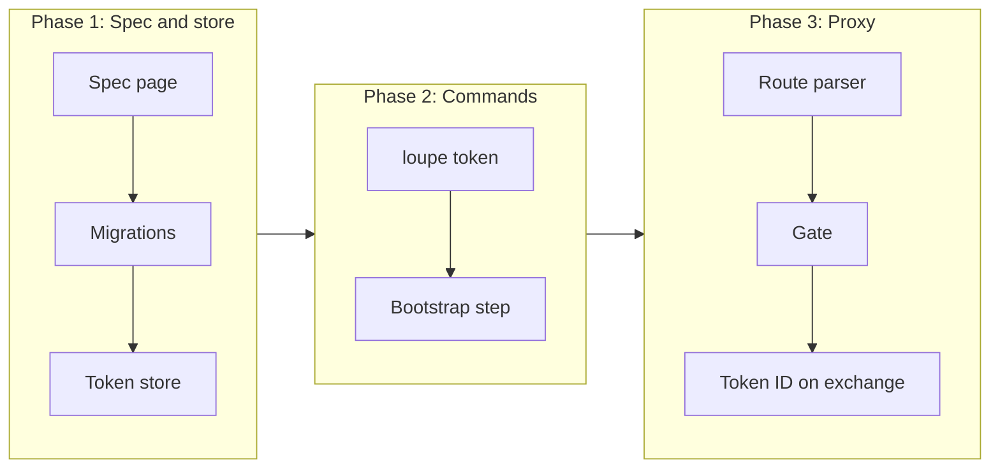

# Multiple proxy tokens with metadata and tracking

## Change Summary

After CR-0002, any client that can reach the port can use the proxy on the route `/<agent>/<upstream>/<path>`, and the stored exchange does not show which client sent it. This CR adds proxy tokens. An operator can make many tokens, each with a unique name, `key=value` tags, and dates. When at least one token is active, each proxied request must start with a valid token, and each exchange stores the ID of its token.

## Motivation and Background

The README section "Proxy tokens" states the behaviour. The port of the container is bound to `127.0.0.1`, but other processes on the machine, and a later deployment, can reach it. A token stops use by an unknown client. Many tokens, one for each machine, person, or pipeline, let a later analysis group the usage by token and by the tags of the token. The parser (CR-0004) copies the token ID from the exchange to the calls and the sessions, so the exchange must carry it first.

## Change Drivers

* README section "Proxy tokens": format, storage, metadata, tracking, privacy, use, bootstrap, and commands.
* README section "The `loupe` binary": the command `loupe token generate | create | list | revoke` and the route prefix `/<token>/`.
* README configuration table: `LOUPE_BOOTSTRAP_TOKEN`, which CR-0001 parses but does not use.
* README section "Privacy model": token names and tags stay in the database and never reach the public API.

## Current State

* CR-0001 (approved) gives the crate `agent-loupe`, the binary `loupe` with `serve`, `gen-key`, and `config show`, the configuration loader that parses `LOUPE_BOOTSTRAP_TOKEN` as a secret and prints it as `set` or `unset`, the logging to `<LOUPE_DATA_DIR>/logs/loupe.log`, SQLite at `<LOUPE_DATA_DIR>/loupe.db` with the migration runner, and the pipeline entry points `.agents/scripts/pipeline.*.sh`.
* CR-0002 (approved) gives the router with the reserved first path segments, the route parser that returns a typed route value behind one interface (CR-0002 requirement 3), the forwarder, the capture, and the table `exchanges`. The table has no token column.
* No token exists. Every proxied request is accepted. `LOUPE_BOOTSTRAP_TOKEN` has no effect.

### Current State Diagram



## Proposed Change

Add a table `proxy_tokens` and a store module for it. Add the subcommand group `loupe token` with `generate`, `create`, `list`, and `revoke`. Add the bootstrap step that `loupe serve` runs before it opens the port. Extend the route parser with an optional leading token segment. Add a token gate between the route parser and the forwarder. Add the column `proxy_token_id` to `exchanges`.

### Proposed State Diagram



### Request sequence



### Bootstrap states



## Requirements

### Functional Requirements

1. A new migration **MUST** add the table `proxy_tokens` with the columns `id` (integer primary key), `name` (text, unique), `token_hash` (text, unique, lowercase hex of the SHA-256 of the raw token), `tags` (text, a JSON object of string keys to string values), `created_at`, `last_used_at` (null until first use), and `revoked_at` (null while active). Times **MUST** be UTC in the RFC 3339 format with millisecond resolution, as in `exchanges`.
2. A raw token **MUST** be the prefix `lpt_` followed by the base64url encoding, with no padding, of 32 bytes from the random source of the operating system. The full token is 47 characters.
3. The binary **MUST** store only the SHA-256 hash of a token. The raw token **MUST NOT** be written to the database, a log line, stderr, or a file. It **MUST** appear only on stdout of the command that makes it, one time.
4. A token name **MUST** match `^[a-z0-9][a-z0-9-]{0,31}$`. The name `bootstrap` **MUST** be reserved for the bootstrap token of requirement 15, and `loupe token create` **MUST** refuse it.
5. A tag **MUST** have the form `KEY=VALUE`. The key **MUST** match `^[a-z0-9][a-z0-9_.-]{0,31}$`. The value **MUST** be 1 to 128 printable characters with no control character. A token **MUST** have at most 16 tags, and a repeated key **MUST** be refused.
6. `loupe token generate` **MUST** print one new raw token on stdout and **MUST NOT** open the database or store anything.
7. `loupe token create --name NAME [--tag KEY=VALUE]...` **MUST** make an active token, store its hash, name, tags, and `created_at`, and print the raw token one time. In the machine format the output **MUST** be one JSON object with the fields `name`, `token`, `tags`, and `created_at`.
8. `loupe token create` with a name that exists, active or revoked, **MUST** fail with a non-zero exit code and an actionable error. The error **MUST** give the labeled fixes (select another name, or revoke and use another name because a name is never reused) and the check (`loupe token list`). A revoked name **MUST NOT** be reused, so that past records keep one meaning for each name.
9. `loupe token list` **MUST** show, for each token, the name, the tags, `created_at`, `last_used_at`, `revoked_at`, and the status `active` or `revoked`. It **MUST NOT** show the raw token or the hash. The machine format **MUST** be one JSON object per line, and the human format **MUST** be a table under `--human` or on a terminal, per `agent_first_cli`.
10. `loupe token revoke NAME` **MUST** set `revoked_at` on the token. Revoke of a token that is already revoked **MUST** exit 0 and keep the first `revoked_at`. Revoke of an unknown name **MUST** fail with a non-zero exit code and an actionable error that points to `loupe token list`. The exchanges of a revoked token **MUST** stay unchanged.
11. `loupe token create` and `loupe token revoke` **MUST** support `--dry-run`, which validates the input and prints what the command would do with no write. Each subcommand **MUST** have a complete `--help`, and a missing required argument **MUST** name the flag.
12. The route parser **MUST** accept an optional first path segment that starts with `lpt_`. The route value **MUST** then carry the segment as the presented token, and the rest of the path **MUST** parse as `/<agent>/<upstream>/<path>` with the rules of CR-0002. Because the agent label pattern has no `_`, a first segment that starts with `lpt_` **MUST** never be read as an agent label.
13. The token gate **MUST** run after the route parser and before the forwarder. The gate **MUST** read the active token state from the database for each request, so that a `create` or a `revoke` from another process takes effect on the next request without a restart. A cache **MUST** be at most 5 seconds old.
14. When at least one token is active, the gate **MUST** refuse a request with no token segment, an unknown token, or a revoked token with status 401 and a JSON error body. The body **MUST** state what failed (`token_missing`, `token_unknown`, or `token_revoked`), the fix (put a valid token first in the base URL, as `/<token>/<agent>/<upstream>`), and the check (`loupe token list`). The body **MUST NOT** echo the presented token. The proxy **MUST NOT** forward a refused request, and **MUST NOT** store an exchange for it.
15. When no token is active, the gate **MUST** accept a request with no token segment. It **MUST** refuse a request with a token segment with status 401 and the error `token_mode_off`, because the client expects a check that the server does not do.
16. When no token is active, `loupe serve` **MUST** log one warning line at start that states that the proxy is open to every client that can reach the port, and that names the fix (`loupe token create` or `LOUPE_BOOTSTRAP_TOKEN`). The binary **MUST** also log this warning line when the last active token is revoked while it runs, at the first request after the change.
17. Before it opens the port, `loupe serve` **MUST** run the bootstrap step. If `LOUPE_BOOTSTRAP_TOKEN` is set, the value **MUST** be a valid raw token per requirement 2, else the start **MUST** stop with an actionable error that names the variable, the fix (`loupe token generate`), `.env.example`, and the check (`loupe config show`). If no row named `bootstrap` exists, the step **MUST** make it with no tags. If the row exists and its hash differs, the step **MUST** replace the hash, clear `revoked_at`, and keep the row ID. If the variable is not set and an active row named `bootstrap` exists, the step **MUST** set its `revoked_at`.
18. The bootstrap step **MUST** be idempotent: a second start with the same environment **MUST** make no change to `proxy_tokens`.
19. After a request passes the gate, `last_used_at` of its token **MUST** be updated. To keep the write load low, the update **MUST** happen at most one time per minute for each token, and **MUST NOT** delay or fail the forwarded request.
20. A new migration **MUST** add the column `proxy_token_id` (integer, nullable, a reference to `proxy_tokens.id`) to `exchanges`. The capture **MUST** store the ID of the token that passed the gate, and null for a request accepted in the no-token mode of requirement 15. CR-0004 reads this column; this CR adds no other column.
21. The log line of an exchange **MUST** add the token name, or `none`, and **MUST NOT** add the raw token or the hash.
22. The public API and the dashboard **MUST NOT** show a token name, a tag, a token ID, or a hash. No route under `/v1/` **MUST** read `proxy_tokens`.
23. `.taxonomy` **MUST** update the row for proxy token so that its `Lives in` column names the new source files, and **MUST** add rows for the new nouns bootstrap token and token gate.
24. `.env.example` **MUST** keep `LOUPE_BOOTSTRAP_TOKEN` with no value and a comment that names `loupe token generate`.
25. `docs/specification/proxy.tokens.md` **MUST** describe the token format, the table, the commands, the gate states, and the bootstrap rules before the code lands, per the operating model.

### Non-Functional Requirements

1. The compare of a presented token **MUST** use the lookup by its SHA-256 hash and a constant-time compare of the hash, so that the time of a refusal does not leak a part of a token.
2. The gate **MUST** add at most 2 ms to the p95 time to first byte, measured with the method in "Measurable Targets".
3. A raw token **MUST NOT** appear in the database file, in `<LOUPE_DATA_DIR>/logs/loupe.log`, or on stderr after any command of this CR.
4. Each new source file **MUST** carry one `@agents-index` line and follow the hierarchical names of the project (for example `src/token/store.rs`, `src/token/gate.rs`, `src/token/bootstrap.rs`, `src/cli/token.rs`).
5. Governance identifiers **MUST NOT** appear in code, test names, or user-facing documents.

## Affected Components

* New: one migration for `proxy_tokens`, one migration for `exchanges.proxy_token_id`, `src/token/` (format, store, gate, bootstrap), `src/cli/token.rs`, `docs/specification/proxy.tokens.md`, `tests/token.*.rs`, `.agents/scenarios/proxy.tokens.md`.
* Changed: the route parser of CR-0002 (optional token segment), the router (gate between parser and forwarder), the capture writer (token ID), `loupe serve` start (bootstrap step and warning), `.agents/scripts/proxy.latency.sh` (a `--with-token` flag), `.env.example` (comment), `.taxonomy`, `docs/specification/proxy.md` (link to the token page).

## Scope Boundaries

### In Scope

* The token format, SHA-256 storage, name, tags, and the three dates.
* `loupe token generate`, `create`, `list`, and `revoke`.
* `LOUPE_BOOTSTRAP_TOKEN`: make, replace the hash, and revoke at start.
* The route segment `/<token>/`, the token gate, the 401 errors, and the no-token mode with its warning.
* The column `proxy_token_id` on `exchanges`.
* The rule that the public API never shows token data.

### Out of Scope ("Here, But Not Further")

* The token ID on calls and sessions, and the rule that a session never mixes two tokens: CR-0004 reads `exchanges.proxy_token_id` and adds them.
* Provider accounts and their hash: CR-0002 computes the credential hash, and CR-0004 derives the accounts.
* An analysis view or report by token or tag: no CR in this set. The data stays in the database.
* A change of the tags of an existing token, a rename, or a delete of a token row: not in the README, so not in this set.
* An expiry date for a token: not in the README.
* The configuration of Claude Code and Pi with a token: CR-0010.

## Alternative Approaches Considered

* Token in a header, for example `x-loupe-token`: refused, because Claude Code and Pi can set only a base URL for each provider without a change to their settings, and the README puts the token in the route.
* HMAC under `LOUPE_ACCOUNT_KEY` in place of SHA-256: refused by the README, because the token is made from random bytes, so a plain hash has no dictionary risk, and a rotation of the account key must not break the tokens.
* One token from the environment only: refused, because the README needs many tokens with metadata.
* Load the tokens one time at start: refused, because a revoke must take effect while `serve` runs.

## Impact Assessment

### User Impact

An operator who makes a token must change the base URL of each client to start with `/<token>/`. A client without a token gets a 401 with the fix. With no token, the proxy keeps the behaviour of CR-0002 and logs a warning.

### Technical Impact

This CR fixes names that later CRs reuse: the table `proxy_tokens`, the column `exchanges.proxy_token_id`, the prefix `lpt_`, the name `bootstrap`, the gate error codes, and the subcommand `loupe token`. No new crate is needed other than a SHA-256 crate and a base64 crate from the RustCrypto and the common ecosystem. The implementer must confirm the API of each crate at the installed version per `source_hierarchy`. The CLI and `serve` share the SQLite file in WAL mode, so the CLI can write while `serve` runs.

### Business Impact

The tokens are the only access control of the proxy. They make it safe to run the container where other processes can reach the port, and they let the owner separate the usage of each machine.

## Implementation Approach

1. Write `docs/specification/proxy.tokens.md` and commit it.
2. Add the two migrations.
3. Add `src/token/` format and store, with unit tests.
4. Add `loupe token` and its four subcommands.
5. Add the bootstrap step and the start warning to `loupe serve`.
6. Extend the route parser and add the gate.
7. Add the token ID to the capture and the log line.
8. Extend `.agents/scripts/proxy.latency.sh` with `--with-token`.
9. Write the scenario `.agents/scenarios/proxy.tokens.md`, update `.taxonomy` and `.env.example`.
10. Run `.agents/scripts/pipeline.verdict.sh`.

### Implementation Flow



## Measurable Targets

| Metric | Method | Baseline | Threshold |
|---|---|---|---|
| Verdict | `.agents/scripts/pipeline.verdict.sh; echo $?` | exit 0 after CR-0002 | exit 0, every stage `status: passed` |
| Added time to first byte of the gate, p95 | `.agents/scripts/proxy.latency.sh --requests 200` then `.agents/scripts/proxy.latency.sh --requests 200 --with-token` (100 tokens in the table) | `p95_added_ms` of the run without a token | difference of the two `p95_added_ms` at most 2 |
| Raw token leak | `loupe token create --name leak-test` into `T`, send 10 requests, then `grep -c "$T" -r <data dir>` | none | 0 |

## Test Strategy

### Tests to Add

| Test File | Test Name | Description | Inputs | Expected Output |
|-----------|-----------|-------------|--------|-----------------|
| `src/token/format.rs` (unit) | `generated_token_has_prefix_and_length` | Format | 1000 tokens | each starts with `lpt_`, has 47 characters, all distinct |
| `src/token/format.rs` (unit) | `parse_rejects_bad_tokens` | Validation | `lpt_short`, `xyz_...`, padding `=` | each refused |
| `src/token/store.rs` (unit) | `create_stores_hash_only` | Storage | create `laptop` | row with SHA-256 hex, no raw value in any column |
| `src/token/store.rs` (unit) | `duplicate_name_is_refused` | Unique name | create `ci` two times, also after revoke | second create fails, error names `loupe token list` |
| `src/token/store.rs` (unit) | `tag_rules_hold` | Tags | 17 tags, repeated key, bad key, empty value | each refused |
| `src/token/store.rs` (unit) | `revoke_is_idempotent` | Revoke | revoke two times | exit 0, first `revoked_at` kept |
| `src/token/bootstrap.rs` (unit) | `bootstrap_create_replace_revoke` | Bootstrap | value A, then A, then B, then unset, then A | create, no change, hash B and same ID, revoked, active with hash A |
| `src/token/gate.rs` (unit) | `gate_states` | Gate | no token active with and without segment; one active with missing, unknown, revoked, valid | accept, `token_mode_off`, `token_missing`, `token_unknown`, `token_revoked`, accept with ID |
| `src/token/gate.rs` (unit) | `last_used_written_once_per_minute` | Write load | 50 requests in 10 seconds | one update of `last_used_at` |
| `tests/token.cli.rs` (integration) | `generate_stores_nothing` | Generate | `loupe token generate` with an empty data dir | one token on stdout, no database file made |
| `tests/token.cli.rs` (integration) | `list_never_shows_token_or_hash` | List | create two tokens, `loupe token list` | names, tags, dates, status; no `lpt_`, no hash |
| `tests/token.cli.rs` (integration) | `dry_run_writes_nothing` | Dry run | `create --dry-run`, `revoke --dry-run` | no change in `proxy_tokens` |
| `tests/token.proxy.rs` (integration) | `valid_token_forwards_and_records_id` | Tracking | active token, request to the fake upstream | 200, exchange row with `proxy_token_id` of the token |
| `tests/token.proxy.rs` (integration) | `refused_request_is_401_without_exchange` | Gate | missing, unknown, revoked token | 401 JSON with the code, no echo of the token, no row |
| `tests/token.proxy.rs` (integration) | `revoke_applies_without_restart` | Live state | `serve` runs, `loupe token revoke` from a second process | next request after 5 seconds is 401 |
| `tests/token.proxy.rs` (integration) | `no_token_mode_warns_and_forwards` | Open mode | no token | warning line at start, 200, `proxy_token_id` null |
| `tests/token.secrets.rs` (integration) | `raw_token_absent_from_disk` | Leak | create, use, bootstrap | no raw token in the data dir or stderr |
| `tests/api.privacy.rs` (integration) | `public_routes_have_no_token_data` | Privacy | tokens with tags, `GET /v1/...` routes that exist | no name, tag, or hash in a body |

### Tests to Modify

| Test File | Test Name | Current Behavior | New Behavior | Reason for Change |
|-----------|-----------|------------------|--------------|-------------------|
| `src/store/migrate.rs` (unit) | `migrations_apply_once` | Applies up to `exchanges` | Also applies the two new migrations once | New migrations |
| `tests/proxy.forward.rs` (integration) | `forwards_request_unchanged` | Route without token | Also with a token segment, and the token segment is not sent upstream | The token is not part of the upstream path |
| `tests/serve.router.rs` (integration) | `reserved_routes_take_precedence` | No token | Also with an active token: reserved routes need no token | Gate applies to proxy routes only |

### Tests to Remove

Not applicable: no test becomes obsolete, because the no-token mode keeps the behaviour of CR-0002.

## Model-Based Testing

| Scenario | User Goal | User Surface | Success Condition | Criteria Proved | Scenario Record |
|----------|-----------|--------------|-------------------|-----------------|-----------------|
| Token for one machine | Make a token for a machine, use it, and see the use recorded | command line and HTTP request | `loupe token list` shows the token with a `last_used_at`, and the exchange row has its `proxy_token_id` | AC-2, AC-3, AC-5 | `.agents/scenarios/proxy.tokens.md` |
| Revoke a token | Stop a leaked token at once | command line and HTTP request | after `loupe token revoke`, a request with the token gets 401 `token_revoked`, and the old exchange rows stay | AC-4 | `.agents/scenarios/proxy.tokens.md` |

## Acceptance Criteria

### AC-1: Generate prints a token and stores nothing

```gherkin
Given an empty data directory
When the reader runs "loupe token generate"
Then stdout holds one value that matches "^lpt_[A-Za-z0-9_-]{43}$"
  And the file "<data dir>/loupe.db" does not exist
```

### AC-2: Create shows the token one time and stores only its hash

```gherkin
Given "loupe serve" is stopped and the data directory has the migrated database
When the reader runs "loupe token create --name work-laptop --tag machine=work-laptop --tag owner=daniel" and keeps the token as T
Then the exit code is 0
  And "sqlite3 <data dir>/loupe.db 'select token_hash from proxy_tokens where name=\"work-laptop\"'" equals the SHA-256 hex of T
  And "grep -c T <data dir>/loupe.db" returns 0
  And "loupe token list" shows "work-laptop", the two tags, "active", and no value that starts with "lpt_"
```

### AC-3: A valid token is required and recorded

```gherkin
Given "loupe serve" runs with one active token T and the fake upstream
When the reader sends "curl http://127.0.0.1:8787/T/claude-code/anthropic/v1/messages"
Then the response status is the upstream status
  And the newest row of "exchanges" has "proxy_token_id" equal to the id of the token
  And the fake upstream received the path "/v1/messages" with no token segment
```

### AC-4: Missing, unknown, and revoked tokens get 401 with no exchange

```gherkin
Given "loupe serve" runs with one active token
When the reader sends a request with no token segment, then one with an unknown "lpt_" value, then runs "loupe token revoke work-laptop" and after 5 seconds sends one with the revoked token
Then each response is 401 with the JSON field "error" equal to "token_missing", "token_unknown", and "token_revoked"
  And no response body holds the presented token
  And the count of rows in "exchanges" did not change
```

### AC-5: Last use is recorded

```gherkin
Given a token that was never used
When one request with the token passes the gate
Then "loupe token list" shows a "last_used_at" after the time of the request start minus one second
```

### AC-6: No-token mode warns and forwards

```gherkin
Given "loupe serve" starts with no active token and no "LOUPE_BOOTSTRAP_TOKEN"
When the reader reads "<data dir>/logs/loupe.log"
Then it holds one warning line that names "loupe token create" and "LOUPE_BOOTSTRAP_TOKEN"
  And "curl http://127.0.0.1:8787/claude-code/anthropic/v1/messages" is forwarded
  And the new row of "exchanges" has "proxy_token_id" null
  And a request that starts with an "lpt_" segment gets 401 "token_mode_off"
```

### AC-7: The bootstrap token follows the variable

```gherkin
Given "LOUPE_BOOTSTRAP_TOKEN" is set to A from "loupe token generate"
When "loupe serve" starts, then starts again with the value B, then starts again with the variable removed
Then after the first start "loupe token list" shows "bootstrap" as "active" and A passes the gate
  And after the second start the row "bootstrap" has the same id, B passes, and A gets 401 "token_unknown"
  And after the third start "bootstrap" is "revoked"
  And a fourth start with no change makes no change to "proxy_tokens"
```

### AC-8: A bad bootstrap value stops the start

```gherkin
Given "LOUPE_BOOTSTRAP_TOKEN" is set to "not-a-token"
When the reader runs "loupe serve"
Then the exit code is not 0 and the port is not bound
  And stderr names "LOUPE_BOOTSTRAP_TOKEN", "loupe token generate", ".env.example", and "loupe config show"
  And stderr does not hold "not-a-token"
```

### AC-9: Command errors are actionable

```gherkin
Given a token named "ci" exists
When the reader runs "loupe token create --name ci", "loupe token create --name bootstrap", and "loupe token revoke nope"
Then each exit code is not 0
  And each stderr names the cause and the check "loupe token list"
```

### AC-10: Token data never reaches the public API

```gherkin
Given tokens with tags exist and exchanges reference them
When the reader requests every route under "/v1/" that exists
Then no body holds a token name, a tag key, a tag value, or a token hash
```

### AC-11: No raw token on disk

```gherkin
Given the reader made T with "loupe token create" and sent 10 requests with it
When the reader runs "grep -rc T <data dir>"
Then every count is 0
```

### AC-12: The latency target and the verdict pass

```gherkin
Given the repository at the commit of this change
When the reader runs ".agents/scripts/proxy.latency.sh --requests 200" and the same with "--with-token"
Then the difference of the two "p95_added_ms" values is at most 2
  And ".agents/scripts/pipeline.verdict.sh" exits 0 with every stage "status: passed"
  And "grep -rnE '(CR|AC|FR|NFR)-[0-9]+' src tests" returns no line
```

## Quality Standards Compliance

### Build & Compilation

- [ ] Code compiles/builds without errors
- [ ] No new compiler warnings introduced

### Linting & Code Style

- [ ] All linter checks pass with zero warnings/errors
- [ ] Code follows project coding conventions and style guides
- [ ] Any linter exceptions are documented with justification

### Test Execution

- [ ] All existing tests pass after implementation
- [ ] All new tests pass
- [ ] Test coverage meets project requirements for changed code

### Documentation

- [ ] `docs/specification/proxy.tokens.md` lands before the code
- [ ] Each new file has one `@agents-index` line
- [ ] `.taxonomy` and `.env.example` updated

### Code Review

- [ ] Changes submitted via pull request
- [ ] PR title follows Conventional Commits format
- [ ] Code review completed and approved
- [ ] Changes squash-merged to maintain linear history

### Verification Commands

```bash
.agents/scripts/pipeline.verdict.sh
.agents/scripts/proxy.latency.sh --requests 200
.agents/scripts/proxy.latency.sh --requests 200 --with-token
grep -rnE '(CR|AC|FR|NFR)-[0-9]+' src tests
```

## Risks and Mitigation

### Risk 1: Revoke of the last token opens the proxy

**Likelihood:** medium
**Impact:** high
**Mitigation:** The README states that the routes have no token part when no token is active, so this CR follows it, logs the warning of requirement 16, and records the risk as open question 1.

### Risk 2: A token leaks through a log or an error body

**Likelihood:** low
**Impact:** high
**Mitigation:** Requirements 3, 14, and 21, and the tests `raw_token_absent_from_disk` and `refused_request_is_401_without_exchange`.

### Risk 3: The base URL of a client holds the token in its own logs

**Likelihood:** medium
**Impact:** medium
**Mitigation:** The `lpt_` prefix lets secret scanners find it. Revoke is immediate. CR-0010 keeps the token out of tracked files.

### Risk 4: Per-request lookup slows the proxy

**Likelihood:** low
**Impact:** medium
**Mitigation:** A unique index on `token_hash`, a cache of at most 5 seconds, and the 2 ms threshold.

## Open Questions

1. When an operator revokes the last active token, the proxy goes back to no-token mode and accepts every client. Provisional default: follow the README literally, with the warning of requirement 16. The alternative is to stay closed (refuse all proxied requests) once any token row exists. This is a question for the human.
2. In no-token mode, a request with a token segment gets 401 `token_mode_off` (requirement 15). Provisional default: refuse, so a client never thinks that it is protected. The alternative is to strip the segment and forward.

## Dependencies

* CR-0001 (approved): crate, configuration loader with `LOUPE_BOOTSTRAP_TOKEN`, logging, SQLite and migrations, pipeline scripts.
* CR-0002 (approved): router, reserved segments, route parser interface, forwarder, capture, `exchanges`, fake upstream, `proxy.latency.sh`.
* CR-0004 depends on this CR for `exchanges.proxy_token_id`. CR-0010 depends on this CR for the token in the base URL of Claude Code and Pi.

## Estimated Effort

About 2 days for one implementer: half a day for the spec and the store, half a day for the commands and bootstrap, one day for the gate, the capture change, and the tests.

## Decision Outcome

Chosen approach: "a token segment in the route, checked against SHA-256 hashes in SQLite for each request", because it is the README design, it needs no change to the clients other than the base URL, and a revoke takes effect while the server runs.

## Implementation Status

* **Started:** not started
* **Completed:** not started
* **Deployed to Production:** not applicable
* **Notes:** Reviewed and approved by an independent reviewer agent on 2026-10-18.

## Related Items

* CR-0001, CR-0002 (earlier), CR-0004, CR-0010 (later).
* README sections "Proxy tokens", "The `loupe` binary", "Privacy model".
