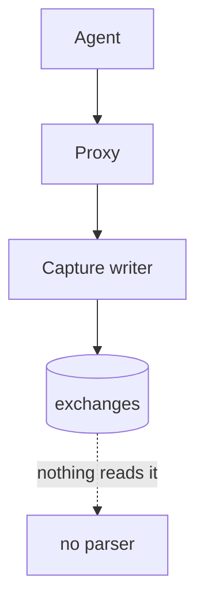
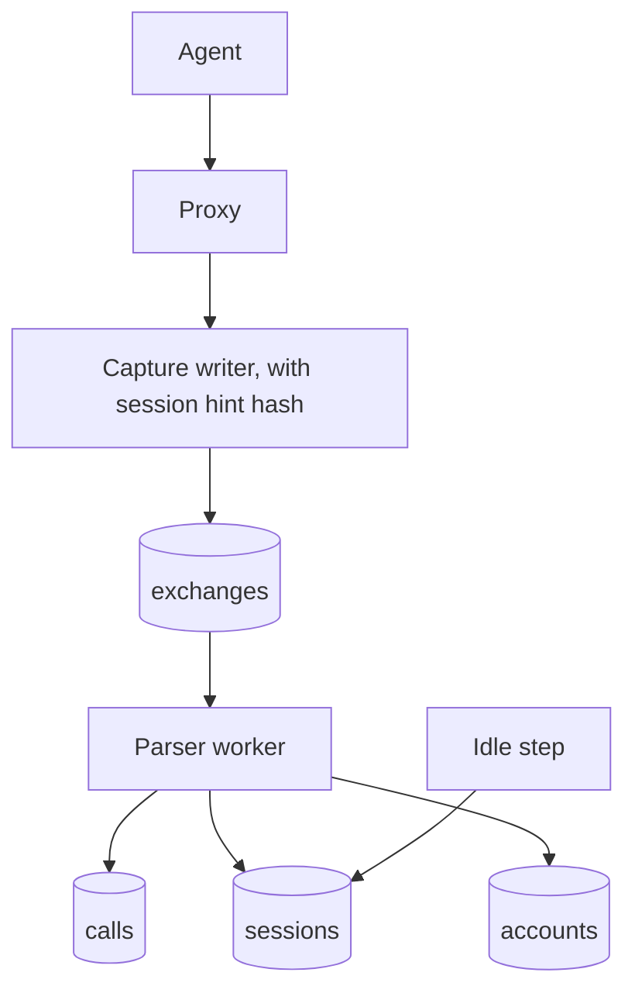
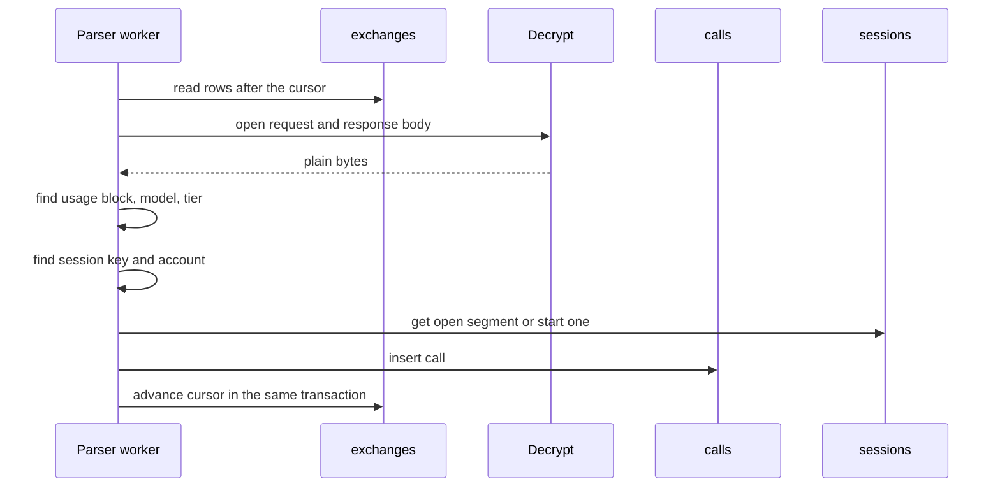
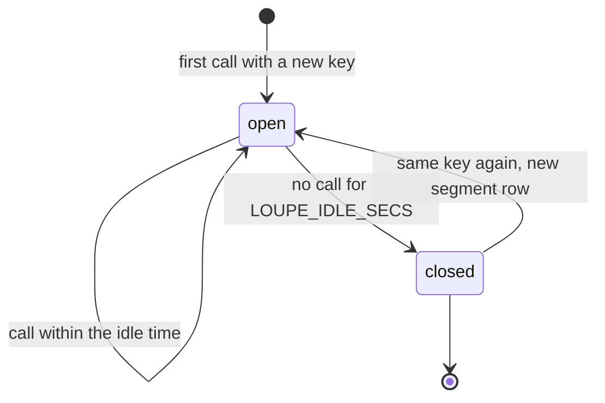
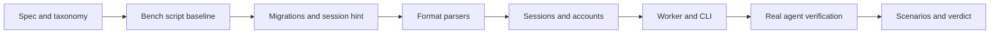

# Model-call parser, sessions, and provider accounts

## Change Summary

After CR-0003, the proxy stores each exchange with redacted headers, encrypted bodies, a credential hash, an account ID header hash, and a proxy token ID, but nothing reads the exchanges. This CR adds a parser worker inside `loupe serve`. The worker finds the model calls in new exchanges, records their token counts in a new table `calls`, groups the calls into sessions and segments, and gives each call a provider account. The capture path gains one step: a hash of the session header before the redaction removes it.

## Motivation and Background

Every public figure of Agentloupe (tokens, calls, sessions, cost, summaries) is derived from the calls. The README section "How it works" steps 3 and 5 state that a parser finds model calls from the usage block and groups them into sessions that close after `LOUPE_IDLE_SECS`. The README section "Proxy tokens" states that each call and session stores its proxy token ID and that a session never mixes two tokens. The README section "Accounts" states the account identity rules and states that the account ID sources are not verified yet. This CR makes all three true, and it does the verification that the README section "Open work" asks for.

## Change Drivers

* README "How it works" steps 3 and 5: parse calls, group into sessions.
* README "Proxy tokens", bullet "Tracking": token ID on each call and session.
* README "Accounts" and "Open work": derive accounts, verify the account ID sources with real captures.
* CR-0005 (cost), CR-0006 (summaries), and CR-0007 (day records) read the `calls` and `sessions` tables.

## Current State

* The table `exchanges` holds one row per forwarded request (CR-0002 requirement 11), with `credential_hash`, `credential_source`, `account_id_hash`, `account_id_source` (CR-0002 requirements 22 and 24) and `proxy_token_id` (CR-0003).
* The capture redacts every request header whose name contains `session` (CR-0002 requirement 12). A session ID in a header is therefore lost after the capture.
* The source has one decrypt function for a stored body (CR-0002 requirement 14).
* No table `calls`, `sessions`, or `accounts` exists. No worker runs in `loupe serve`.

### Current State Diagram



## Proposed Change

1. Extend the capture with a session hint: before the redaction, compute the HMAC-SHA256 under `LOUPE_ACCOUNT_KEY` of the first session header that is present, and store the hash and the header name in `exchanges`.
2. Add a parser worker in `loupe serve`. It reads new exchanges in id order from a stored cursor, opens the bodies with the decrypt function, and finds the usage block.
3. Add the table `calls`: one row per model call, with the token counts in separate columns.
4. Add the table `sessions`: one row per segment, keyed by agent label, proxy token ID, and session key.
5. Add the table `accounts`: one row per provider account hash, with its source.
6. Add an idle step that closes a session after `LOUPE_IDLE_SECS` with no calls.
7. Do a verification task against real captures from Claude Code 2.1.302 and Pi 1.3.0, record the result, and correct the account ID sources and the session sources.

### Proposed State Diagram



### Parse Sequence



### Session States



## Requirements

### Functional Requirements

**Capture extension**

1. Before the capture redacts the request headers, it **MUST** read the first present header of an ordered list of session headers. The list **MUST** live in one source file. Its initial value **MUST** be `x-claude-code-session-id`, `x-session-id`, `session_id`, `session-id`, and the verification task (requirement 30) **MUST** correct it.
2. The capture **MUST** store the HMAC-SHA256 under `LOUPE_ACCOUNT_KEY` of that value as lowercase hex in a new column `exchanges.session_hint_hash`, and the lowercase header name in `exchanges.session_hint_source`. Both **MUST** be null when no listed header is present. A new migration **MUST** add both columns.
3. The capture extension **MUST** keep every rule of CR-0002: no delay to the stream, the redaction of the header value, and no header value in a log line.

**Parser worker**

4. `loupe serve` **MUST** start one parser worker. The worker **MUST** wake at an interval of `LOUPE_PARSE_INTERVAL_SECS` (default `5`) and **MUST** read the exchanges with an id above its cursor, in id order, in batches of at most 100.
5. The worker **MUST** store its cursor in a new table `worker_cursors` (name, last id, updated time). The insert of the calls of an exchange, the session changes, and the cursor advance **MUST** be in one transaction, so a restart neither loses nor repeats a call.
6. The parse **MUST** be idempotent: `calls` **MUST** have a unique key on (exchange id, call index), and a parse of the same exchange again **MUST NOT** add a row.
7. The worker **MUST** detect the format from the upstream path and the response `content-type`:
   - Anthropic Messages, JSON: path ends with `/v1/messages`, body with a `usage` object.
   - Anthropic Messages, SSE: the same path with `text/event-stream`. The input counts **MUST** come from `message_start`, and the output count **MUST** be the last `usage.output_tokens` of a `message_delta`.
   - OpenAI Responses: path ends with `/responses`, JSON or SSE. The usage **MUST** come from the `response.completed` event or the top-level `usage`.
   - OpenAI Chat Completions: path ends with `/chat/completions`, JSON or SSE. The usage **MUST** come from the `usage` object of the body or of the last chunk that has one.
8. An exchange with no usage block (for example `count_tokens`, a model list, an error, a truncated body) **MUST NOT** make a call. The worker **MUST** advance the cursor past it and **MUST** record the reason in a column `exchanges.parse_outcome` (`call`, `no_usage`, `truncated`, `decrypt_failed`, `unknown_format`).
9. Each call row **MUST** hold these columns: `id`, `exchange_id`, `call_index`, `started_at` (the time of the exchange start), `agent_label`, `upstream`, `proxy_token_id`, `session_id`, `account_id`, `model`, `service_tier`, `status` (the response status), and the token counts of requirement 10.
10. The token counts **MUST** be separate integer columns: `input` (not cached), `cache_read`, `cache_write_5m`, `cache_write_1h`, and `output`. For Anthropic, `cache_write_5m` and `cache_write_1h` **MUST** come from `usage.cache_creation.ephemeral_5m_input_tokens` and `ephemeral_1h_input_tokens`. If only `cache_creation_input_tokens` is present, the whole value **MUST** go to `cache_write_5m`. For OpenAI, `cache_read` **MUST** be the cached tokens of the input details, `input` **MUST** be the input total minus `cache_read`, and both cache write columns **MUST** be 0.
11. The model **MUST** be the `model` field of the response. If it is absent, the model **MUST** be the `model` field of the request. The service tier **MUST** be `usage.service_tier` or the top-level `service_tier`, else null.
12. A decrypt failure **MUST** log one actionable error line with the exchange id, the fix (check `LOUPE_DATA_KEY` against the key of the stored rows), and the check (`loupe config show`), and **MUST NOT** stop the worker.

**Sessions**

13. The session key **MUST** be the first present source, in this order: (a) `session_hint_hash` with source `header`; (b) the session ID in `metadata.user_id` of the request body, with source `metadata`; (c) `prompt_cache_key` of the request body, with source `cache_key`; (d) the SHA-256 of the system prompt or `instructions` plus the first message of the request, with source `opening`.
14. The worker **MUST** store the key as an HMAC-SHA256 under `LOUPE_ACCOUNT_KEY` of the value of the source. The raw session ID, cache key, or prompt **MUST NOT** be stored outside the encrypted bodies.
15. The scope of a session **MUST** be (agent label, proxy token ID, key). Two calls with the same key but a different agent label or a different proxy token ID **MUST** be in different sessions. A session **MUST NOT** hold calls of two proxy tokens.
16. Each `sessions` row **MUST** be one segment and **MUST** hold these columns: `id`, `agent_label`, `proxy_token_id`, `key_hash`, `key_source`, `segment` (1 for the first), `started_at`, `last_call_at`, `closed_at` (null while open), `state` (`open` or `closed`), `call_count`, and `account_id` (the account of the first call).
17. A call **MUST** join the open segment of its scope. If no segment is open, the worker **MUST** start a new segment with the next segment number for that scope. A resumed conversation after a close **MUST** therefore start a new segment, and never reopen a closed one.
18. Close on a gap: when the parser appends a call to its scope and the gap from `last_call_at` of the open segment to the `started_at` of the call is more than `LOUPE_IDLE_SECS`, the parser **MUST** close that segment with `closed_at = last_call_at + LOUPE_IDLE_SECS` and **MUST** start a new segment for the call. The idle time **MUST** be read from configuration, so a short value (for example `60`) closes sessions quickly for a test.
19. Close on idle: an idle step **MUST** run with the parser worker. It **MUST** close an open segment only when `last_call_at + LOUPE_IDLE_SECS` is before the parse watermark, and **MUST** set `closed_at = last_call_at + LOUPE_IDLE_SECS`. The parse watermark is the `started_at` of the oldest unparsed exchange, or the current time when no backlog exists. Thus a backlog that the worker parses late gives the same segments as a live parse.
20. The close of a segment **MUST** be the only event that a later CR (CR-0006 summaries) reads to start its work. This CR **MUST** add a column `sessions.closed_at` and an index on (state, closed_at), and **MUST NOT** add the summary step.

35. A subagent is a session. The calls of a subagent inside one agent run **MUST** form their own session, separate from the session of the main agent. The session key rule **MUST** give a subagent a key that differs from the key of its parent. The verification of requirement 30 **MUST** find and record in `docs/specification/parser.md` which request field or header separates subagent calls from main calls (for example the session hint, `metadata.user_id`, or the opening hash), and **MUST** correct requirement 13 if the listed sources join them.
36. The default of `LOUPE_IDLE_SECS` **MUST** be `3600` (60 minutes). This change **MUST** update the row for `LOUPE_IDLE_SECS` in the configuration table of the README to `3600`, and **MUST** change the CR-0001 unit test `default_when_unset` to expect `3600`.
38. The day count rule for a session that spans midnight is in CR-0007: the session counts on each day that has a call. Each call row keeps its own `started_at`, so CR-0007 can read the days of the calls of a session.

**Provider accounts**

21. The account of a call **MUST** come from the first present source, per README section "Accounts": (a) `exchanges.account_id_hash` (header account ID, source `header:<name>`); (b) the account UUID in `metadata.user_id` of the request body, hashed by the worker with HMAC-SHA256 under `LOUPE_ACCOUNT_KEY`, source `metadata.user_id`; (c) `exchanges.credential_hash`, source `credential:<header name>`.
22. The worker **MUST NOT** compute a credential hash again. It **MUST** use only the columns that the capture wrote (CR-0002 requirements 22 and 24).
23. A new table `accounts` **MUST** hold one row per (hash, source): id, hash, source, first seen, last seen. Each call **MUST** store the account id. A call with no source **MUST** store a null account id.
24. The proxy token ID and the account id **MUST** be independent columns on `calls`, so an analysis can group by token, by account, or both.
25. A route under `/v1/` **MUST NOT** read `accounts`, a key hash, or a proxy token ID. The count of provider accounts is private: a public route and a day record **MUST NOT** show it.

**Retention**

37. The parser and every later step **MUST** keep the rows of `calls` and `sessions` forever. A step **MUST NOT** delete them by age. The deletion of raw bodies after `LOUPE_RAW_RETENTION_HOURS` (CR-0006) **MUST NOT** delete a call or a session row.

**Commands and configuration**

26. `loupe config show` **MUST** print `LOUPE_IDLE_SECS` (default `3600`, 60 minutes) and `LOUPE_PARSE_INTERVAL_SECS` with their sources.
27. A command `loupe parse --once` **MUST** run one parse pass and one idle step, then print one summary line per stage on stdout (`exchanges_read`, `calls_added`, `sessions_opened`, `sessions_closed`, as `key: value`), and exit 0. It **MUST** be safe to run again and **MUST** support `--dry-run`, which reports the counts and writes nothing.
28. The Layer 2 document `docs/specification/parser.md` **MUST** describe the formats, the token columns, the session key order, the segment rules, and the account sources before the code lands.
29. `.taxonomy` **MUST** update the rows for call, session, and provider account, and **MUST** add rows for segment, session key, and session hint.

**Verification of the sources**

30. Before the account and session source lists are final, the implementer **MUST** capture real requests through the proxy from `claude -p` (Claude Code 2.1.302, model `claude-haiku-5-5`) and from `pi -p` (Pi 1.3.0, provider `anthropic`, model `claude-haiku-5-5`), with the setup of "Implementation Approach".
31. The verification **MUST** read the header names (never the values) and the field paths of the request body, and **MUST** record in `docs/specification/parser.md`, per agent and version: which session header is present, the shape of `metadata.user_id`, whether `prompt_cache_key` is present, and which account source applies.
32. If a listed source does not exist in the capture, or a new stable source exists, the implementer **MUST** correct the lists of requirements 1, 13, and 21 in code and in the Layer 2 document. The credential hash **MUST** stay the last fallback.
33. The verification **MUST NOT** write a header value, a body, or a credential to the repository, a log file, or the report. It **MUST** write only names, paths, and booleans.
34. After the verification of requirement 31, the implementer **MUST** update the README section "Accounts" to state the verified account and session sources per agent version. This CR **MUST NOT** edit other README sections, except the row for `LOUPE_IDLE_SECS` in the configuration table (requirement 36).

### Non-Functional Requirements

1. The parse of 1000 stored exchanges (mixed JSON and SSE) **MUST** finish in at most 10 seconds in the container on this machine, measured with `.agents/scripts/parser.bench.sh`.
2. The parser **MUST NOT** hold more than one decrypted body pair in memory per exchange in the batch, and **MUST** drop the plain bytes after the parse.
3. A log line of the parser **MUST NOT** hold a body, a header value, a session ID, an account ID, or a hash. A log line **MUST** hold only the exchange id, the format, the parse outcome, and the counts.
4. The parser **MUST NOT** change the time to first byte of the proxy. The proxy latency target of CR-0002 **MUST** still pass.
5. Source files **MUST** follow the small-file rule with hierarchical names, for example `src/parse/worker.rs`, `src/parse/format.rs`, `src/parse/anthropic.json.rs`, `src/parse/anthropic.sse.rs`, `src/parse/openai.responses.rs`, `src/parse/openai.chat.rs`, `src/session/key.rs`, `src/session/segment.rs`, `src/session/idle.rs`, `src/account/source.rs`, `src/account/store.rs`, `src/capture/session_hint.rs`, `src/cli/parse.rs`. Each file **MUST** carry one `@agents-index` line.
6. Governance identifiers **MUST NOT** appear in code, test names, or `docs/specification/`.

## Measurable Targets

| Metric | Method | Baseline | Threshold |
|---|---|---|---|
| Verdict | `.agents/scripts/pipeline.verdict.sh; echo $?` | exit 0 after CR-0003 | exit 0, every stage `status: passed` |
| Parse time, 1000 exchanges | `.agents/scripts/parser.bench.sh --exchanges 1000` prints `parse_secs` | none, new measurement, added before the parser | `parse_secs` at most 10 |
| Proxy time to first byte, p95 | `.agents/scripts/proxy.latency.sh --requests 200 --with-token` | `p95_added_ms` after CR-0003 | at most 20, and at most 2 above the baseline |
| Real call capture | the scenario `.agents/scenarios/parser.real-agents.md` | 0 rows in `calls` | 1 or more rows per agent, each with `input + cache_read + output > 0` |

## Affected Components

* New: migrations for `calls`, `sessions`, `accounts`, `worker_cursors`, and the new `exchanges` columns; `src/parse/`, `src/session/`, `src/account/`, `src/capture/session_hint.rs`, `src/cli/parse.rs`; `docs/specification/parser.md`; `tests/parse.*.rs`; `.agents/scripts/parser.bench.sh`; `.agents/scenarios/parser.*.md`; fixtures under `tests/fixtures/parse/`.
* Changed: the capture writer (session hint), `loupe serve` (start the worker), the configuration loader (two variables), `.env.example` (comments only), `.taxonomy`, `docs/specification/proxy.md` (link to the session hint).
* Changed after the verification: README.md, section "Accounts" (requirement 34).
* Changed: README.md, the row for `LOUPE_IDLE_SECS` in the configuration table, and the CR-0001 unit test `default_when_unset` (requirement 36).
* Not changed: other README sections, `vendor/litellm/`, the public API, the dashboard.

## Scope Boundaries

### In Scope

* The session hint hash in the capture.
* The parser worker, the four formats, the token columns, model and service tier.
* The `calls`, `sessions`, `accounts`, and `worker_cursors` tables.
* Session keys, scope per agent and proxy token, segments, and the idle close.
* Provider accounts from the stored hashes and from `metadata.user_id`.
* `loupe parse --once`.
* The verification of the sources with Claude Code 2.1.302 and Pi 1.3.0.

### Out of Scope ("Here, But Not Further")

* Cost, prices, and unpriced calls: CR-0005. `calls` has no cost column in this CR.
* Session summaries, the scrubber, and the deletion of raw bodies after `LOUPE_RAW_RETENTION_HOURS`: CR-0006. This CR only sets `closed_at`.
* Day records, `agg_queue`, publishing, `loupe aggregate`, and `/v1/days`: CR-0007.
* The dashboard: CR-0008. GitHub: CR-0009.
* The full end-to-end acceptance on macOS with the dashboard: CR-0010. This CR uses real agents only for the verification of requirement 30.
* Codex. The `chatgpt-account-id` header stays in the list from CR-0002, but this CR verifies only Claude Code and Pi.
* An edit of a README section other than "Accounts", except the row for `LOUPE_IDLE_SECS` in the configuration table (requirement 36).
* A delete of call or session rows by age.

## Alternative Approaches Considered

* **Parse inline in the capture writer.** Rejected: it couples the parse to the hot path and to the writer queue, and a parser defect then loses exchanges.
* **Reopen a closed session when the key returns.** Rejected: the README calls for idle close, and CR-0006 summarizes a closed segment once. A new segment keeps that summary stable.
* **Store the raw session ID in clear.** Rejected: an ID can link a session to a person. The HMAC gives the same grouping.
* **Compute the account hash of `metadata.user_id` in the capture.** Rejected: the body is encrypted and stays in the database, so the worker can read it later with no new step on the hot path. Headers are different, because the redaction removes their values.

## Impact Assessment

### User Impact

No change for Claude Code or Pi. The operator gets `loupe parse --once` and two new variables.

### Technical Impact

Five migrations. One background task in `loupe serve`. The decrypt function gets its first caller. No breaking change to the stored data of CR-0002 and CR-0003; old rows have a null session hint and fall back to the body sources.

### Business Impact

This CR is the first step that gives figures. It unblocks CR-0005 to CR-0007.

## Implementation Approach

1. Layer 2: write `docs/specification/parser.md` and update `.taxonomy`. Commit.
2. Add `.agents/scripts/parser.bench.sh` with a fixture generator, before the parser exists, and record its baseline (`status: not_implemented`).
3. Add the migrations and the session hint in the capture.
4. Add the four format parsers with fixture tests.
5. Add the session key, segment, idle, and account modules.
6. Add the worker, the cursor, and `loupe parse --once`.
7. Run the verification of requirement 30 with this setup, then correct the lists:
   - Start the container with `docker compose up -d`, `LOUPE_IDLE_SECS=60`, and one proxy token from `loupe token create --name verify`.
   - Claude Code: `ANTHROPIC_BASE_URL=http://127.0.0.1:8787/<proxy-token>/claude-code/anthropic claude -p "say hi" --model claude-haiku-5-5`. Do not change `~/.claude/settings.json`.
   - Pi: make a temporary agent dir in the scratchpad, write `models.json` with `{"providers":{"anthropic":{"baseUrl":"http://127.0.0.1:8787/<proxy-token>/pi/anthropic"}}}`, then run `PI_CODING_AGENT_DIR=<dir> pi -p "say hi" --provider anthropic --model claude-haiku-5-5`. The credential **MUST** reach Pi through the environment variable `ANTHROPIC_OAUTH_TOKEN`. It holds the subscription token that the human makes one time with `claude setup-token`. The implementer **MUST NOT** copy, link, or read a file from `~/.pi/agent`, and **MUST NOT** print a credential.
   - Read the header names and body field paths with a script that decrypts inside the container and prints names only.
8. Write the scenarios and run them. Run the verdict.

### Implementation Flow



## Test Strategy

### Tests to Add

| Test File | Test Name | Description | Inputs | Expected Output |
|-----------|-----------|-------------|--------|-----------------|
| `src/parse/anthropic.json.rs` (unit) | `reads_usage_with_split_cache_writes` | JSON usage | fixture with 5m and 1h writes | five counts in the right columns |
| `src/parse/anthropic.json.rs` (unit) | `legacy_cache_write_goes_to_5m` | Old field only | `cache_creation_input_tokens: 40` | `cache_write_5m = 40`, `cache_write_1h = 0` |
| `src/parse/anthropic.sse.rs` (unit) | `takes_input_from_start_and_output_from_last_delta` | SSE usage | stream fixture with two deltas | output of the last delta |
| `src/parse/openai.responses.rs` (unit) | `reads_completed_event_usage` | Responses SSE | fixture | input minus cached, cached in `cache_read` |
| `src/parse/openai.chat.rs` (unit) | `reads_usage_from_last_chunk` | Chat SSE | fixture | counts from the last chunk |
| `src/parse/format.rs` (unit) | `no_usage_gives_no_call` | count_tokens, error, truncated | three fixtures | outcomes `no_usage`, `no_usage`, `truncated` |
| `src/session/key.rs` (unit) | `key_source_order` | Order of sources | header, metadata, cache key, none | sources `header`, `metadata`, `cache_key`, `opening` |
| `src/session/segment.rs` (unit) | `resume_after_close_starts_new_segment` | Segments | key, close, same key | segment 2, segment 1 stays closed |
| `src/session/segment.rs` (unit) | `same_key_other_token_is_other_session` | Token scope | same key, two token IDs | two sessions |
| `src/session/idle.rs` (unit) | `idle_uses_last_call_time` | Backlog | calls 2 hours old, parse now | segment closed at last call plus idle |
| `src/session/idle.rs` (unit) | `backlog_gap_within_idle_keeps_one_segment` | Watermark | two calls 30 s apart, idle 60 s, the second unparsed, now 2 hours later | the idle step does not close; after the parse, one segment with 2 calls |
| `src/account/source.rs` (unit) | `account_source_order` | Account order | header hash, metadata uuid, credential | sources in README order |
| `src/capture/session_hint.rs` (unit) | `hashes_first_session_header` | Session hint | two session headers; none | hash of the first; null |
| `tests/parse.worker.rs` | `restart_does_not_lose_or_repeat_calls` | Cursor transaction | kill the worker mid batch, restart | each call once |
| `tests/parse.worker.rs` | `parse_twice_adds_nothing` | Idempotence | `loupe parse --once` twice | `calls_added: 0` on the second run |
| `tests/parse.end_to_end.rs` | `proxied_sse_call_becomes_call_row` | Proxy to call | fake upstream SSE through proxy with token | one call row with token ID, session, account |
| `tests/parse.secrets.rs` | `no_raw_ids_in_db_or_logs` | Privacy | known session ID, account UUID, key | none of them in the database file outside blobs, nor in the log |

### Tests to Modify

| Test File | Test Name | Current Behavior | New Behavior | Reason for Change |
|-----------|-----------|------------------|--------------|-------------------|
| `tests/proxy.capture.rs` | the capture row test of CR-0002 | checks the CR-0002 columns | also checks `session_hint_hash` and `session_hint_source` | new columns |
| `tests/proxy.secrets.rs` | the secret scan of CR-0002 | scans for credentials | also scans for a session header value | the session hint |

### Tests to Remove

Not applicable: no test covers removed behaviour.

## Model-Based Testing

| Scenario | User Goal | User Surface | Success Condition | Criteria Proved | Scenario Record |
|----------|-----------|--------------|-------------------|-----------------|-----------------|
| Fake upstream calls become sessions | The operator sees each proxied call as a row and a session | command line | after `loupe parse --once`, `sqlite3` shows the calls with token ID and a closed segment after the idle time | AC-1, AC-3, AC-4 | `.agents/scenarios/parser.sessions.md` |
| Real agents through the proxy | The operator sees the calls of `claude -p` and `pi -p` | command line | one or more `calls` rows per agent label, model `claude-haiku-5-5`, account source recorded, subagent calls in their own session | AC-6, AC-7, AC-9 | `.agents/scenarios/parser.real-agents.md` |

## Acceptance Criteria

### AC-1: An Anthropic SSE call becomes one call row

```gherkin
Given loupe serve runs with one proxy token and the fake upstream
When a client sends one streamed /v1/messages request through the proxy
  And the operator runs "loupe parse --once"
Then "sqlite3 <db> 'select count(*) from calls'" prints 1
  And the row holds the proxy token ID, the model, and the five token counts of the fixture
```

### AC-2: Cache writes stay separate

```gherkin
Given a stored response with ephemeral_5m_input_tokens 30 and ephemeral_1h_input_tokens 70
When the parser reads it
Then the call row has cache_write_5m 30 and cache_write_1h 70
```

### AC-3: A session never mixes tokens

```gherkin
Given two proxy tokens send requests with the same session header value
When the parser reads them
Then "select count(distinct id) from sessions" prints 2
  And each session holds calls of one proxy token only
```

### AC-4: Idle close and new segment

```gherkin
Given LOUPE_IDLE_SECS is 60
  And one session has its last call more than 60 seconds ago
When the idle step runs
Then the session state is closed and closed_at is set
When a new call with the same key arrives
Then a new sessions row exists with segment number 2

Given LOUPE_IDLE_SECS is 60
  And two stored exchanges with the same key start 30 seconds apart, two hours ago
  And only the first exchange is parsed
When the idle step runs and then "loupe parse --once" runs
Then "select segment, call_count from sessions" shows one row with segment 1 and call_count 2
```

### AC-5: Parse is idempotent

```gherkin
Given 50 stored exchanges
When the operator runs "loupe parse --once" two times
Then the second run prints "calls_added: 0"
  And the count of calls equals the count of exchanges with parse_outcome "call"
```

### AC-6: Account sources follow the README order

```gherkin
Given exchanges with a header account ID, with only metadata.user_id, and with only a credential
When the parser reads them
Then the accounts rows have sources "header:chatgpt-account-id", "metadata.user_id", and "credential:<header>"
  And no raw account ID or credential is in the database file outside the encrypted blobs
```

### AC-7: Real agents are captured and the sources are verified

```gherkin
Given the container runs with one proxy token and LOUPE_IDLE_SECS 60
When the operator runs "claude -p" and "pi -p" with model claude-haiku-5-5 through the proxy
  And runs "loupe parse --once"
Then "select agent_label, count(*) from calls group by agent_label" shows claude-code and pi with 1 or more rows each
  And docs/specification/parser.md records the verified session and account sources per agent version
  And the README section "Accounts" states the verified sources per agent version
```

### AC-9: A subagent is its own session

```gherkin
Given a Claude Code run that starts one subagent through the proxy
When the operator runs "loupe parse --once"
Then the subagent calls are in a sessions row that holds no call of the main agent
  And docs/specification/parser.md records the field that separates subagent calls
```

### AC-10: Calls and sessions stay

```gherkin
Given calls and sessions older than LOUPE_RAW_RETENTION_HOURS
When the raw body deletion runs
Then the counts of rows in calls and sessions do not change
```

### AC-8: No secret in logs

```gherkin
Given the scenarios above ran
When the operator searches <LOUPE_DATA_DIR>/logs/loupe.log for the session ID, the account UUID, and the credential
Then no match is found
```

## Quality Standards Compliance

### Build & Compilation

- [ ] `cargo build --release` passes with no warnings

### Linting & Code Style

- [ ] `cargo clippy -- -D warnings` and `cargo fmt --check` pass

### Test Execution

- [ ] All tests of CR-0001 to CR-0003 pass
- [ ] All new tests pass

### Documentation

- [ ] `docs/specification/parser.md` lands before the code
- [ ] Each new file has one `@agents-index` line
- [ ] `.taxonomy` updated in the same change

### Code Review

- [ ] Conventional Commits with the CR ID in the message only

### Verification Commands

```bash
.agents/scripts/pipeline.verdict.sh
.agents/scripts/parser.bench.sh --exchanges 1000
.agents/scripts/proxy.latency.sh --requests 200 --with-token
grep -rnE "CR-[0-9]{4}|AC-[0-9]+" src tests docs/specification && exit 1 || true
```

## Risks and Mitigation

### Risk 1: The agents do not send the expected sources

**Likelihood:** high
**Impact:** medium
**Mitigation:** Requirement 30 verifies with real captures. The opening hash and the credential hash are catch-all fallbacks.

### Risk 2: The opening hash splits or joins conversations wrongly

**Likelihood:** medium
**Impact:** low
**Mitigation:** It is the last session source. The scope per agent and token limits a false join. The verification records which source each agent uses.

### Risk 3: A subscription token refresh makes new accounts

**Likelihood:** high for Pi with a subscription login
**Impact:** low
**Mitigation:** Known limit in README "Accounts". `metadata.user_id` comes before the credential.

### Risk 4: The parser falls behind under load

**Likelihood:** low
**Impact:** low
**Mitigation:** The idle step uses call times, so late parse gives the same segments. The bench target bounds the speed.

## Dependencies

* CR-0001: crate, configuration loader, storage and migrations, logging, verdict pipeline.
* CR-0002: `exchanges`, the decrypt function, the credential and account ID header hashes, the redaction.
* CR-0003: `proxy_tokens` and `exchanges.proxy_token_id`.
* An Anthropic credential in the shell of the human for requirement 30.

## Estimated Effort

About 3 to 4 days of agent work: 1 day for formats, 1 day for sessions and accounts, 1 day for the worker and tests, half a day for the verification.

## Decision Outcome

Chosen approach: "a separate parser worker with a transactional cursor, HMAC session keys scoped per agent and proxy token, append-only segments, and accounts from stored hashes", because it keeps the hot path unchanged except for one header hash, it gives the same result for a live parse and a late parse, and it follows the README rules for tokens and accounts.

## Open Questions

1. **Session hint header list.** The initial list comes from the prototype and is not verified. Provisional default: the list of requirement 1, corrected by the verification of requirement 30.
2. **The shape of `metadata.user_id` in Claude Code 2.1.302.** It can hold an account UUID and a session ID. Provisional default: parse it as JSON first, then as the `user_<hash>_account_<uuid>_session_<uuid>` string, and record the verified shape.

### Decided

* **Idle time** (Q15). Decided by the human on 2026-10-20: `LOUPE_IDLE_SECS` default is `3600` (60 minutes). Requirements 26 and 36. The README configuration row and the CR-0001 test `default_when_unset` change to `3600`. A session that spans midnight counts on each day that has a call; CR-0007 owns that rule (requirement 38).
* **Subagent calls** (Q17). Decided by the human on 2026-10-20: a subagent is a session. The detection rule is verified at capture time. Requirement 35, AC-9.
* **Provider account count** (Q18). Decided by the human on 2026-10-20: the count stays private. Requirement 25.
* **README change** (Q19, former open question 3). Decided by the human on 2026-10-20: the README section "Accounts" can change after the verification. Requirement 34.
* **Retention of calls and sessions** (Q45). Decided by the human on 2026-10-20: kept forever. Requirement 37, AC-10.

* **Pi credential for the verification** (former open question 4). Decided by the human on 2026-10-19: Pi gets its credential from the environment variable `ANTHROPIC_OAUTH_TOKEN`. It holds the subscription token that the human makes one time with `claude setup-token`. Nothing is copied or linked from `~/.pi/agent`. CR-0010 uses the same credential.

## Related Items

* CR-0001, CR-0002, CR-0003 (dependencies); CR-0005, CR-0006, CR-0007 (readers of the new tables); CR-0010 (end-to-end).
* README sections "How it works", "Proxy tokens", "Accounts", "Privacy model", "Open work".

## Approval

Reviewed and approved by an independent reviewer agent on 2026-10-18.
Re-approved by an independent reviewer agent on 2026-10-19 after the human decisions were recorded.
