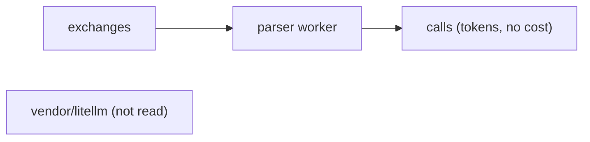
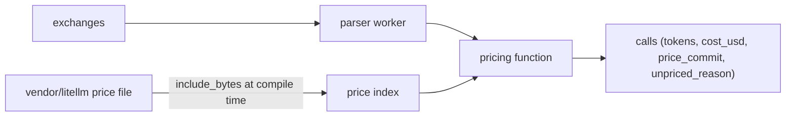
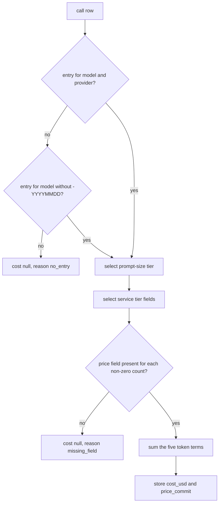
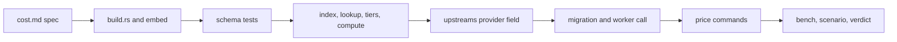

# API-equivalent cost from the vendored LiteLLM prices

## Change Summary

After CR-0004, the parser writes one row in `calls` for each model call, with the model, the service tier, and five token columns, but no call has a cost. This CR builds the vendored LiteLLM price file into the binary at compile time, adds a test that validates the file against the vendored schema, and prices each call with the six rules of the README section "Cost". Each call then stores its API-equivalent cost in US dollars, or `null` as an unpriced call, together with the commit of the price file.

## Motivation and Background

The README section "Cost" states that Agentloupe shows what each call costs at the list price of the provider API, also when the agent uses a subscription. The day records (CR-0007) and the dashboard (CR-0008) show this figure, so it must exist on each call before they can sum it. The README also states that a later refresh of the prices must not change past days. This is only true if the cost is computed one time and stored with the commit of the price file that produced it.

## Change Drivers

* The README section "Cost" defines six pricing rules and a refresh path that no code implements yet.
* CR-0007 needs a stored cost per call and a count of unpriced calls to build `cost` and `unpriced_calls` for a day.
* The schema uses Python regex syntax such as `(?i)`, which the default ECMA-262 dialect of JSON Schema rejects. The test must use a dialect that accepts it.

## Current State

* `vendor/litellm/` holds `model_prices_and_context_window.json`, its schema, `LICENSE`, and `SOURCE.md` at commit `cfee0ffe4186e2ac36cfaee4c4e10f6c3daafd2f` (4220 entries).
* `.agents/scripts/prices.vendor.sh` refreshes the four files from one pinned commit and validates them with `check-jsonschema==0.33.0 --regex-variant python` before it writes.
* The binary does not read the price file. `calls` has no cost column (CR-0004, out of scope list).
* `calls` already holds `model`, `upstream`, `service_tier`, `input`, `cache_read`, `cache_write_5m`, `cache_write_1h`, and `output` (CR-0004 requirements 9 and 10).
* `upstreams.toml` maps each upstream name to a base URL string (CR-0002 requirement 4). It does not name a LiteLLM provider.

### Current State Diagram



## Proposed Change

1. Embed the price file and the commit from `SOURCE.md` in the binary at compile time.
2. Load the embedded file one time at start into an index by model name and provider.
3. Change each entry of `upstreams.toml` from a string to a table with `base_url` and `litellm_provider`, so the parser can match a price entry to the upstream of the call. This changes CR-0002 requirements 4 and 5 (see requirement 5).
4. Add a pricing function that applies the six rules to one call and returns either a cost or the reason why the call has no price.
5. Call the pricing function in the parser worker, in the same transaction that writes the call row.
6. Add the columns `cost_usd`, `price_commit`, and `unpriced_reason` to `calls`.
7. Add a command `loupe price backfill` that prices the calls that CR-0004 wrote before this CR.
8. Add a test that validates the embedded file against the embedded schema with a regex dialect that accepts `(?i)`.

### Proposed State Diagram



### Pricing Flow



## Requirements

### Functional Requirements

1. The binary **MUST** embed `vendor/litellm/model_prices_and_context_window.json` at compile time. It **MUST NOT** read the price file from the file system at run time.
2. The build **MUST** embed the value of the `Commit` row of `vendor/litellm/SOURCE.md` as the price commit. The build **MUST** fail with an actionable error if `SOURCE.md` has no `Commit` row of 40 lowercase hex characters. The error **MUST** name `.agents/scripts/prices.vendor.sh` as the fix.
3. The build **MUST** be rerun when a file in `vendor/litellm/` changes (a `cargo:rerun-if-changed` line for each file).
4. At start, `loupe serve` **MUST** parse the embedded file one time into a price index keyed by model name and `litellm_provider`. The key `sample_spec` **MUST** be skipped.
5. **Change of the `upstreams.toml` format.** CR-0002 requirement 4 makes each entry a string (`anthropic = "https://api.anthropic.com"`). A string cannot carry a second field, so this CR **MUST** change each entry to a table with two keys: `base_url` and `litellm_provider`, for example `[anthropic]` with `base_url = "https://api.anthropic.com"` and `litellm_provider = "anthropic"`. An inline table (`anthropic = { base_url = "...", litellm_provider = "anthropic" }`) is the same TOML value and **MUST** also load. This replaces the entry shape of CR-0002 requirement 4; the names and the URLs of that requirement do not change. The shipped file **MUST** set `litellm_provider = "anthropic"` for `anthropic`, and `litellm_provider = "openai"` for `openai` and for `chatgpt`. The loader of CR-0002 requirement 5 **MUST** also reject, before the port opens, an entry that is a string (the old shape), an entry with no `base_url` or no `litellm_provider`, an entry with an unknown key, and a `litellm_provider` that is not a non-empty string. Each rejection **MUST** be an actionable error that names the file, the upstream, the key, the expected shape, and the check (`loupe config show`). The `https` rule and the localhost exception of CR-0002 requirement 5 **MUST** apply to `base_url` unchanged. The same change **MUST** be made in the test fixtures that write an `upstreams.toml` for the fake upstream.
6. **Find the entry.** The pricing function **MUST** look up the model name of the call with the `litellm_provider` of its upstream. If no entry matches, it **MUST** remove one trailing `-YYYYMMDD` (a hyphen and eight digits) from the name and look up again. It **MUST NOT** match an entry of a different provider, and it **MUST NOT** match by prefix or by similarity.
7. **Add the token costs.** The cost **MUST** be the sum of: `input` × `input_cost_per_token`; `cache_read` × `cache_read_input_token_cost`; `cache_write_5m` × `cache_creation_input_token_cost`; `cache_write_1h` × `cache_creation_input_token_cost_above_1hr`; `output` × `output_cost_per_token`. The `output` column already includes the reasoning tokens (CR-0004), so the function **MUST NOT** add them a second time.
8. **Apply the prompt-size tier.** The prompt size **MUST** be `input + cache_read + cache_write_5m + cache_write_1h`. For each field with the suffix `_above_<N>k_tokens`, the threshold **MUST** be N × 1000 tokens. For each token term, the function **MUST** select the field of the highest threshold that the prompt size is above, and use it in place of the base field. If the prompt size is above no threshold of that term, the term **MUST** use its base price. A term with no tier field **MUST** keep its base price.
9. **Apply the service tier.** If `service_tier` of the call is `priority` or `flex`, the function **MUST** use the field with the suffix `_priority` or `_flex` in place of the base field for each term that has one. A term with no such field **MUST** keep its base price. Any other service tier value **MUST** use the base fields.
10. When both a prompt-size tier and a service tier apply, the function **MUST** first select the service tier field, then the prompt-size tier of that field if the entry has one, else the service tier field.
11. **Do not guess.** If no entry matches, the cost **MUST** be `null` and `unpriced_reason` **MUST** be `no_entry`. If a price field is missing for a token count that is not zero, the cost **MUST** be `null` and `unpriced_reason` **MUST** be `missing_field:<field name>`. A missing field for a token count of zero **MUST NOT** make the call unpriced.
12. The function **MUST** compute in exact decimal arithmetic (for example the `rust_decimal` crate), not in binary floating point. It **MUST** store `cost_usd` as a decimal text with at most 12 fraction digits, so the sum of many calls in CR-0007 does not drift.
13. **Keep history stable.** A new migration **MUST** add to `calls` the columns `cost_usd` (text, nullable), `price_commit` (text, nullable), and `unpriced_reason` (text, nullable). The parser worker **MUST** write all three in the same transaction as the call row. `price_commit` **MUST** be set for a priced call and for an unpriced call; it is null only for a call that no pricing pass has seen.
14. The parser worker **MUST NOT** change `cost_usd` or `price_commit` of a call that already has a `price_commit`.
15. `loupe price backfill` **MUST** price only the calls with a null `price_commit`. It **MUST** print `calls_priced`, `calls_unpriced`, and `price_commit` as `key: value` lines on stdout and exit 0. It **MUST** be safe to run again and **MUST** support `--dry-run`, which prints the counts and writes nothing.
16. `loupe price show --model <name> --upstream <name>` **MUST** print the matched entry key, the provider, and the price fields that the function reads, as `key: value` lines, or `match: none` with exit code 0. It reads only the embedded index.
17. `loupe config show` **MUST** print `price_commit` and the number of entries in the price index.
18. Each unpriced call **MUST** log one line at level `warn` with the call id, the model, the upstream, the reason, and the fix: run `.agents/scripts/prices.vendor.sh` and rebuild. The line **MUST** also state that new prices apply only to new calls and to calls with a null `price_commit`.
19. The price fields that the binary reads **MUST** use the names that the vendored schema defines. A test **MUST** fail if one of the names in requirements 7 to 9 is not a property of the schema.
20. A test **MUST** validate the embedded price file against the embedded schema. The test **MUST** use a JSON Schema validator whose regex dialect accepts the Python inline flag `(?i)`. The chosen approach is the `jsonschema` crate as a dev-dependency with its Rust regex engine, because the Rust `regex` syntax accepts inline flags such as `(?i)`. The implementer **MUST** confirm at tier 1 (the installed crate source) that the pinned version compiles every `pattern` of the schema. If one pattern does not compile, the test **MUST** fail with an actionable error that names the pattern; the test **MUST NOT** skip or rewrite it.
21. The refresh path **MUST** stay: run `.agents/scripts/prices.vendor.sh`, rebuild, run the verdict. This CR **MUST NOT** change `prices.vendor.sh` or the files in `vendor/litellm/`.
22. The Layer 2 document `docs/specification/cost.md` **MUST** describe the embedding, the provider match, the six rules, the order of tiers, the unpriced reasons, and the refresh path before the code lands. `docs/specification/parser.md` **MUST** link to it.

### Non-Functional Requirements

1. The pricing function **MUST** be a pure function of the call row and the price index, with no I/O, so its tests are hermetic.
2. The load of the price index **MUST** take at most 500 ms at start on the human's machine, and the pricing of one call **MUST** take at most 50 µs (median), measured by `.agents/scripts/cost.bench.sh`.
3. Source files **MUST** follow the small-file rule with hierarchical names, for example `build.rs`, `src/price/embed.rs`, `src/price/index.rs`, `src/price/lookup.rs`, `src/price/tier.rs`, `src/price/compute.rs`, `src/price/unpriced.rs`, `src/cli/price.rs`. Each file **MUST** carry one `@agents-index` line.
4. Governance identifiers **MUST NOT** appear in source code, comments, test names, or user-facing docs.
5. Logs **MUST** follow the `logging_standard` (one JSON line with `file:line`). Errors **MUST** follow `actionable_errors`.
6. The `.taxonomy` rows for API-equivalent cost and unpriced call **MUST** name `src/price/` and `docs/specification/cost.md` in `Lives in`. A new row **MUST** be added for price commit.

## Measurable Targets

| Metric | Method | Baseline | Threshold |
|---|---|---|---|
| Verdict result | `.agents/scripts/pipeline.verdict.sh; echo $?` | exit 0 after CR-0004 | exit 0, every stage `status: passed` |
| Schema validation in the test | `cargo test price_file_matches_schema` | none | passes |
| Cost of the fixture calls | `cargo test --test price.fixtures` | none | every expected cost equal to the hand-computed value, as decimal text |
| Index load and price time | `.agents/scripts/cost.bench.sh` | none | load at most 500 ms, price at most 50 µs median |
| Time to a full verdict, warm cache | total time that `pipeline.verdict.sh` prints | value after CR-0004 in `docs/specification/operations.md` | at most 180 s, and a stated reason for any increase above 10 s |

## Affected Components

* New: `build.rs`, `src/price/`, `src/cli/price.rs`, a migration for the three `calls` columns, `docs/specification/cost.md`, `tests/price.*.rs`, fixtures under `tests/fixtures/price/`, `.agents/scripts/cost.bench.sh`, `.agents/scenarios/cost.call.md`.
* Changed: the parser worker (one call to the pricing function), `upstreams.toml` and its loader (entry shape changes from a string to a table with `base_url` and `litellm_provider`), `docs/specification/proxy.md` (the entry shape), the test fixtures that write `upstreams.toml`, `loupe config show`, `Cargo.toml` (`rust_decimal`, `serde_json`, dev-dependency `jsonschema`), `.taxonomy`, `docs/specification/parser.md`, `docs/specification/operations.md`.
* Not changed: `vendor/litellm/`, `.agents/scripts/prices.vendor.sh`, `README.md`.

## Scope Boundaries

### In Scope

* Embedding the price file and the price commit in the binary.
* The schema validation test with a dialect that accepts `(?i)`.
* The provider field in `upstreams.toml` and the entry lookup with the date fallback.
* The token terms, including 1-hour cache writes, the prompt-size tiers, and the service tiers.
* Null cost and `unpriced_reason` for an unpriced call.
* The three new `calls` columns, `loupe price backfill`, and `loupe price show`.
* The refresh path through `.agents/scripts/prices.vendor.sh`, documented in `docs/specification/cost.md`.

### Out of Scope ("Here, But Not Further")

* Day totals, `cost`, and `unpriced_calls` of a day record: CR-0007.
* The cost on the dashboard and the label "API-equivalent": CR-0008.
* Session summaries: CR-0006.
* A change to the token columns or the session rules: CR-0004 owns them.
* Automatic refresh of prices, network access at run time, or any price source other than the vendored file.
* A reprice of calls that already have a `price_commit` after a refresh.
* Currencies other than US dollars.

## Alternative Approaches Considered

* **Read the price file at run time from a volume.** Rejected, because the README states that the binary builds the price file in, and a missing volume would give silent null costs.
* **Use the ECMA-262 dialect and rewrite `(?i)` patterns in the test.** Rejected, because the test would then validate a schema that differs from the vendored one.
* **Call `check-jsonschema` from the Rust test.** Rejected, because it needs Python and network for `uvx`, so the test stage would not be hermetic.
* **Store cost as a floating-point number.** Rejected, because sums over many calls drift, and the dashboard shows totals.
* **Map upstream to provider in code.** Rejected, because `upstreams.toml` is already the configuration source for upstreams, and a new upstream would need a code change.

## Impact Assessment

### User Impact

No change for Claude Code or Pi. The operator gets a cost per call, two commands, and a warning line per unpriced call.

### Technical Impact

One migration with three nullable columns, so the rows of CR-0004 stay valid. The binary grows by about 3 MB for the embedded file. The parser worker adds one pure call per row. A refresh of prices now needs a rebuild, as the README states.

### Business Impact

No cost. All work runs locally. The figure is an estimate at list price, not a bill, and CR-0008 labels it as such.

## Implementation Approach

1. Write `docs/specification/cost.md` and the link from `parser.md`. Commit.
2. Add `build.rs` for the price commit and the rerun lines. Add `src/price/embed.rs`.
3. Add the schema validation test and the schema field-name test. Confirm the regex engine at tier 1.
4. Add the index, the lookup, the tiers, and the compute function with unit tests from hand-computed fixtures.
5. Change the entries of `upstreams.toml` to tables with `base_url` and `litellm_provider`, update the loader, its tests, and the test fixtures, and update `docs/specification/proxy.md`.
6. Add the migration and the call from the parser worker.
7. Add `loupe price backfill`, `loupe price show`, and the `config show` lines.
8. Add `cost.bench.sh`, write the scenario, run it, and run the verdict.

### Implementation Flow



## Test Strategy

### Tests to Add

| Test File | Test Name | Description | Inputs | Expected Output |
|-----------|-----------|-------------|--------|-----------------|
| `tests/price.schema.rs` | `price_file_matches_schema` | The vendored file is valid against the vendored schema | embedded file and schema | no errors; every pattern compiles |
| `tests/price.schema.rs` | `read_fields_exist_in_schema` | Field names come from the schema | the field names of the rules | each is a schema property |
| `src/price/embed.rs` (unit) | `price_commit_is_40_hex` | Commit from SOURCE.md | build output | 40 lowercase hex chars |
| `src/price/lookup.rs` (unit) | `exact_model_and_provider` | Rule 1 | `claude-haiku-4-5`, `anthropic` | entry found |
| `src/price/lookup.rs` (unit) | `date_suffix_fallback` | Rule 1 fallback | a fixture model `m-20250101` with only `m` in the index | entry `m` |
| `src/price/lookup.rs` (unit) | `other_provider_does_not_match` | Rule 1 provider | model only under `bedrock` | `no_entry` |
| `src/price/compute.rs` (unit) | `five_terms_sum` | Rule 2 | fixture entry, counts 100, 200, 300, 400, 500 | hand-computed decimal |
| `src/price/compute.rs` (unit) | `one_hour_writes_use_1hr_field` | Rule 2 | only `cache_write_1h` non-zero | count × `cache_creation_input_token_cost_above_1hr` |
| `src/price/tier.rs` (unit) | `prompt_above_threshold_uses_tier` | Rule 3 | prompt 200001 tokens, field `_above_200k_tokens` | tier price for every token |
| `src/price/tier.rs` (unit) | `two_tiers_selects_highest_exceeded` | Rule 3 | fields `_above_128k_tokens` and `_above_200k_tokens`, prompt sizes 150000 and 200001 | the 128k tier price for 150000, the 200k tier price for 200001 |
| `src/price/tier.rs` (unit) | `prompt_at_threshold_uses_base` | Rule 3 edge | prompt 200000 tokens | base price |
| `src/price/tier.rs` (unit) | `priority_and_flex_fields` | Rule 4 | tiers `priority`, `flex`, `default` | the matching fields, base for default |
| `src/price/tier.rs` (unit) | `service_then_size_tier` | Requirement 10 | priority and large prompt | the priority tier field of that size |
| `src/price/unpriced.rs` (unit) | `missing_field_nonzero_is_unpriced` | Rule 5 | `cache_write_1h > 0`, no 1hr field | null, `missing_field:cache_creation_input_token_cost_above_1hr` |
| `src/price/unpriced.rs` (unit) | `missing_field_zero_is_priced` | Rule 5 edge | same field missing, count 0 | priced |
| `tests/price.fixtures.rs` | `fixture_calls_match_hand_costs` | Real vendored prices | three Anthropic fixtures including `claude-haiku-5-5` if present in the file | the hand-computed costs or `no_entry` |
| `tests/price.worker.rs` | `worker_writes_cost_in_same_transaction` | Rule 6 | fake upstream call through proxy | call row with `cost_usd` and `price_commit` |
| `tests/price.worker.rs` | `backfill_twice_prices_nothing_new` | Idempotence | rows with null commit, run twice | `calls_priced: 0` on the second run |
| `tests/price.worker.rs` | `backfill_dry_run_writes_nothing` | Dry run | rows with null commit | counts printed, rows unchanged |
| `tests/upstreams.rs` | `missing_litellm_provider_is_actionable` | Config error | entry with no field | error names upstream and field |
| `tests/upstreams.rs` | `string_entry_is_actionable` | Config error | entry in the old string shape | error names upstream and the table shape |
| `tests/upstreams.rs` | `inline_table_entry_loads` | Format | inline table entry | loads with both keys |
| `tests/upstreams.rs` | `unknown_key_is_actionable` | Config error | entry with an extra key | error names upstream and key |

### Tests to Modify

| Test File | Test Name | Current Behavior | New Behavior | Reason for Change |
|-----------|-----------|------------------|--------------|-------------------|
| `tests/parse.end_to_end.rs` | `proxied_sse_call_becomes_call_row` | checks tokens, token ID, session, account | also checks `price_commit` is set | the worker prices each call |
| `tests/upstreams.rs` | the CR-0002 loader tests (valid file, invalid TOML, bad name, non-`https` URL, localhost exception) | entries are strings | entries are tables with `base_url` and `litellm_provider` | the entry shape changes (requirement 5) |
| test fixtures and helpers that write `upstreams.toml` for the fake upstream (CR-0002 proxy, capture, and parse tests) | write `name = "http://127.0.0.1:<port>"` | write a table with `base_url` and `litellm_provider` | the old shape now fails the start |
| `src/config/show.rs` (unit) | the CR-0001 masking test | checks masked secrets | also checks `price_commit` and the entry count lines | new output |

### Tests to Remove

Not applicable. This CR adds behaviour and removes none.

## Model-Based Testing

| Scenario | User Goal | User Surface | Success Condition | Criteria Proved | Scenario Record |
|----------|-----------|--------------|-------------------|-----------------|-----------------|
| A real Haiku call gets a cost | The operator sees the API-equivalent cost of a call that Claude Code made | command line | after `claude -p` through the proxy and `loupe parse --once`, `sqlite3` shows the call with a non-null `cost_usd` equal to the value from `loupe price show` and the token counts, or `unpriced_reason` `no_entry` if the vendored file has no entry for the model | AC-4, AC-6 | `.agents/scenarios/cost.call.md` |

## Acceptance Criteria

### AC-1: The price file is in the binary and valid

```gherkin
Given the repository at the commit of this change
When the operator runs "cargo test price_file_matches_schema"
Then the test passes
  And no schema pattern is skipped or rewritten
```

### AC-2: The price commit is visible

```gherkin
Given a built loupe binary
When the operator runs "loupe config show"
Then the output has a line "price_commit: " with the Commit value of vendor/litellm/SOURCE.md
  And a line with the number of entries in the price index
```

### AC-3: The lookup uses the provider and the date fallback

```gherkin
Given the unit tests of the lookup
When the operator runs "cargo test --lib price::lookup"
Then exact_model_and_provider, date_suffix_fallback, and other_provider_does_not_match pass
```

### AC-4: The cost has all five terms and the tiers

```gherkin
Given fixture calls with each of the five token counts, a prompt above a size threshold, and the priority and flex service tiers
When the operator runs "cargo test price"
Then each cost equals the hand-computed decimal text in the fixture
```

### AC-5: An unpriced call has a null cost

```gherkin
Given loupe serve runs with one proxy token and the fake upstream
  And the fake upstream returns a JSON response with model "no-such-model-x" for one call through the proxy
When the operator runs "loupe parse --once"
Then "sqlite3 data/loupe.db 'select cost_usd, unpriced_reason from calls where id = <id>'" shows an empty cost and "no_entry"
  And the log has one warn line with the call id and the fix
```

### AC-6: The cost is stored with the commit and is stable

```gherkin
Given a priced call with price_commit C
When the operator runs "loupe price backfill" two times
Then the second run prints "calls_priced: 0"
  And cost_usd and price_commit of the call stay unchanged
```

### AC-7: The refresh path works

```gherkin
Given a refreshed vendor/litellm from ".agents/scripts/prices.vendor.sh" with the output "validation: passed"
When the operator rebuilds and runs ".agents/scripts/pipeline.verdict.sh"
Then the exit code is 0
  And "loupe config show" prints the Commit value of vendor/litellm/SOURCE.md as price_commit
```

### AC-8: The verdict passes

```gherkin
Given the change is complete
When the operator runs ".agents/scripts/pipeline.verdict.sh"
Then every stage prints "status: passed" and the exit code is 0
```

## Quality Standards Compliance

### Build & Compilation

- [ ] Code compiles without errors
- [ ] No new compiler warnings

### Linting & Code Style

- [ ] `cargo clippy` with warnings as errors passes
- [ ] `cargo fmt --check` passes

### Test Execution

- [ ] All existing tests pass
- [ ] All new tests pass

### Documentation

- [ ] `docs/specification/cost.md` lands before the code
- [ ] `docs/specification/proxy.md` shows the new entry shape of `upstreams.toml` before the code
- [ ] `@agents-index` on every new file
- [ ] `.taxonomy` updated in the same change

### Code Review

- [ ] Commits follow Conventional Commits with the CR ID in the message only

### Verification Commands

```bash
.agents/scripts/pipeline.verdict.sh
cargo test price
.agents/scripts/cost.bench.sh
loupe config show | grep price_commit
```

## Risks and Mitigation

### Risk 1: The Rust regex engine rejects a schema pattern

**Likelihood:** low
**Impact:** medium
**Mitigation:** Requirement 20 makes the test fail loud with the pattern name. The implementer returns the doubt to the supervisor and does not skip the pattern.

### Risk 2: The vendored file has no entry for `claude-haiku-5-5`

**Likelihood:** medium
**Impact:** medium
**Mitigation:** Rule 5 gives `null` and `no_entry`, which CR-0007 counts in `unpriced_calls`. The fix is a refresh through `prices.vendor.sh` and a rebuild; the calls with a stored commit keep their null cost by rule 6.

### Risk 3: The tier field names change upstream

**Likelihood:** low
**Impact:** medium
**Mitigation:** The field-name test of requirement 19 fails the build on a refresh that renames a field.

### Risk 4: A wrong provider in `upstreams.toml` prices against another vendor

**Likelihood:** low
**Impact:** medium
**Mitigation:** The start stops on a missing field, and `loupe price show` lets the operator check the match.

## Dependencies

* CR-0001: crate, configuration loader, migrations, logging, verdict pipeline.
* CR-0002: `upstreams.toml` and its loader. This CR changes the entry shape of CR-0002 requirement 4 and extends the validation of requirement 5.
* CR-0004: the `calls` table, its token columns, `service_tier`, the parser worker, and `loupe parse --once`.
* The vendored files in `vendor/litellm/` at the commit in `SOURCE.md`.

## Estimated Effort

About 2 working days for one implementer: 0.5 day for the spec and the build, 1 day for the rules and the tests, 0.5 day for the worker, the commands, and the scenario.

## Decision Outcome

Chosen approach: "embed the vendored file, match by model and the provider in `upstreams.toml`, compute in exact decimals, and store the cost with the price commit", because it follows the README rules, keeps the test stage hermetic, and keeps past days stable.

## Open Questions

1. **Provider for the upstream `chatgpt` (https://chatgpt.com).** The README lists it as an OpenAI upstream that a subscription uses. Provisional default: `litellm_provider = "openai"`, so the call gets the API-equivalent cost of the OpenAI API.
2. **Unit and precision of `cost_usd`.** Provisional default: US dollars as decimal text with at most 12 fraction digits (requirement 12).

## Related Items

* CR-0004 (calls), CR-0007 (day totals), CR-0008 (dashboard).
* README sections "Cost" and "How it works" step 4.
* `vendor/litellm/SOURCE.md`, `.agents/scripts/prices.vendor.sh`.
