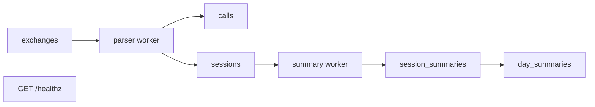
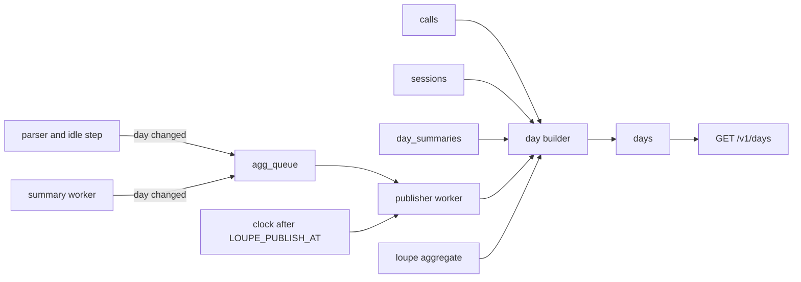
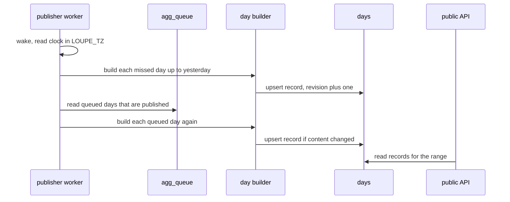
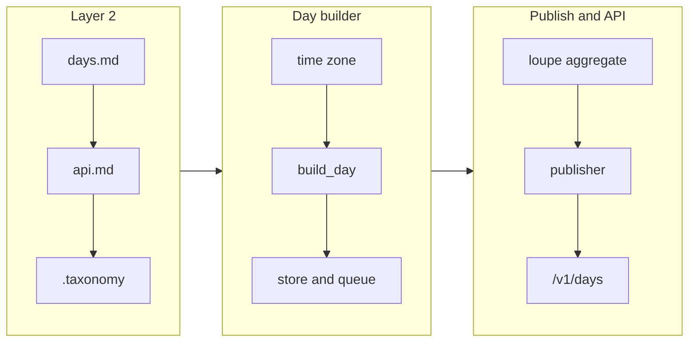

# Day aggregation, nightly publishing, and the public API

## Change Summary

After CR-0006, the binary stores calls with token counts and cost, sessions as segments, and one scrubbed day line per day. No part of the system makes a day record, and no route publishes data. This CR adds the day record of the README, an `agg_queue` table that marks days to build again, a publisher worker that publishes the previous day after `LOUPE_PUBLISH_AT` in `LOUPE_TZ`, the command `loupe aggregate [--date YYYY-MM-DD]`, and the public API `GET /v1/days` and `GET /v1/days/{day}` with open CORS. It also adds a day review (`LOUPE_DAY_REVIEW`), the commands `loupe day approve`, `loupe day edit`, `loupe day delete`, and `loupe day restore`, and the subscription cost of each day.

## Motivation and Background

The README states the product goal: a public, nightly record of the work with AI coding agents. The day record is the only data that leaves the machine. The dashboard of CR-0008 reads only the public API, and the acceptance of CR-0010 needs a captured session to appear in the dashboard. Thus the day record and the public API are the bridge between the private tables of CR-0002 to CR-0006 and the public surface.

The README fixes the shape of the day record with an example, the time zone and the publish time with `LOUPE_TZ` and `LOUPE_PUBLISH_AT`, and the routes. The README does not state what happens when the container is stopped at the publish time, or when a session that started on one day closes on the next day. This CR specifies both.

## Change Drivers

* The README "How it works" step 8: at 01:00 (Europe/Stockholm) the binary builds the previous day and publishes it on `GET /v1/days`.
* The README "The `loupe` binary" section: `loupe aggregate [--date YYYY-MM-DD]` builds one day now, and the public API has open CORS.
* The README "Privacy model": only daily totals, totals per agent and per model, PR and line counts, and one summary line per day are public.
* The definition of done of the CR set: sessions from `claude -p` and `pi -p` are available in the dashboard. A same-day check needs `loupe aggregate` for today.

## Current State

The repository is on branch `main` at commit `54778f2`. The CRs CR-0001 to CR-0006 are approved. When they are implemented, the state is:

* `exchanges` holds the encrypted bodies and the metadata (CR-0002, CR-0004, CR-0006).
* `proxy_tokens` holds the proxy tokens as hashes with metadata (CR-0003).
* `calls` holds one row per model call with `started_at`, `agent_label`, `upstream`, `proxy_token_id`, `session_id`, `account_id`, `model`, the token columns `input`, `cache_read`, `cache_write_5m`, `cache_write_1h`, `output`, and `cost_usd`, `price_commit`, `unpriced_reason` (CR-0004, CR-0005).
* `sessions` holds one row per segment with `started_at`, `closed_at`, and `state` (CR-0004).
* `session_summaries` and `day_summaries` hold the scrubbed lines, and `build_day_line(day)` returns `not_ready` while a segment of the day is open or pending (CR-0006).
* `GET /healthz` is the only route outside the proxy routes (CR-0001, CR-0002).
* No route under `/v1/` exists. No table `days` or `agg_queue` exists.

### Current State Diagram



## Proposed Change

The change adds five parts:

1. A day builder. It is a function that reads `calls`, `sessions`, and `day_summaries` for one day in `LOUPE_TZ` and returns one day record.
2. The queue `agg_queue`. The parser, the idle step, and the summary worker put a day into the queue when a change affects that day.
3. A publisher worker. It publishes each day that is complete and not yet published, from the oldest missed day to the previous day. It also builds again each published day that is in the queue.
4. The public API. It reads only the table `days`, and only the rows with state `published`.
5. The day review and the commands `loupe day`. A day can wait for an approval, and the operator can edit the summary, delete a day with a tombstone, or restore it. The table `day_overrides` keeps each edit, so a rebuild keeps it.

### Proposed State Diagram



### Day record sequence



## Requirements

### Functional Requirements

**Day boundaries**

1. A day **MUST** be a calendar date in the time zone `LOUPE_TZ` (default `Europe/Stockholm`). A day **MUST** start at 00:00 local time and end before 00:00 of the next local date, so a day with a daylight saving change has 23 or 25 hours.
2. The binary **MUST** carry its own time zone database, so the container works with no `/usr/share/zoneinfo`. The implementer **MUST** confirm at tier 1 (the installed crate source) that the selected crate embeds the database. Provisional default: the `jiff` crate with its bundled database (see Open Questions, item 1).
3. An invalid `LOUPE_TZ` **MUST** stop `loupe serve` and `loupe aggregate` at start with an actionable error that names the variable, an example value (`Europe/Stockholm`), and the check `loupe config show`.
4. A call **MUST** belong to the day of its `started_at` in `LOUPE_TZ`. A segment **MUST** count on each day in `LOUPE_TZ` that has one or more of its calls. Thus a segment that spans midnight counts on each of those days. Decided by the human on 2026-10-20. A subagent session is its own segment (CR-0004), so it counts as one session. The session line of CR-0006 keeps its own rule.

**Day record**

5. The day builder **MUST** be a function `build_day(day)` that reads only `calls`, `sessions`, `day_summaries`, and `day_overrides`, and returns one record with exactly these top-level fields, in this order: `day`, `input_total`, `input`, `cache_read`, `cache_write`, `output`, `calls`, `sessions`, `cost_usd`, `unpriced_calls`, `subscription_cost_usd`, `prs_opened`, `prs_merged`, `lines_added`, `lines_removed`, `summary`, `detail`.
6. The token fields **MUST** be integer sums over the calls of the day: `input` is the sum of `input`; `cache_read` is the sum of `cache_read`; `cache_write` is the sum of `cache_write_5m` plus `cache_write_1h`; `output` is the sum of `output`; `input_total` is `input + cache_read + cache_write`. With the README example, `21000 + 1250000 + 12200` gives `1283200`.
7. `calls` **MUST** be the number of call rows of the day. `sessions` **MUST** be the number of distinct segments that have one or more calls on the day (requirement 4).
8. `cost_usd` **MUST** be the exact decimal sum of `cost_usd` of the priced calls of the day, rounded half to even to 4 fraction digits, and written as a JSON number. `unpriced_calls` **MUST** be the number of calls of the day with a null `cost_usd`. A day with no priced call **MUST** have `cost_usd` `0`.
8a. `subscription_cost_usd` **MUST** be the result of `subscription_cost_for_day(day, subscriptions)` of CR-0005 requirement 27, rounded half to even to 4 fraction digits, and written as a JSON number. It **MUST** be `0` when no subscription is configured. It **MUST NOT** hold a subscription name. A subscription cost alone **MUST NOT** give a day activity (requirement 15). Decided by the human on 2026-10-20.
8b. The builder **MUST** take the subscriptions as an input, so it stays a pure function (Non-Functional Requirement 4). A change of `LOUPE_SUBSCRIPTION_<NAME>` changes only the records that are built after the change; see Risks.
9. `prs_opened`, `prs_merged`, `lines_added`, and `lines_removed` **MUST** be JSON `null` in this CR. CR-0009 sets them. The record **MUST** keep the keys, so the shape does not change when CR-0009 lands.
10. `summary` **MUST** be the `summary` of the `day_overrides` row of the day when one exists. Else it **MUST** be the `line` of the `day_summaries` row of the day when its status is `done` or `fallback`, and `null` in all other cases.
11. Before the builder reads `day_summaries`, it **MUST** call `build_day_line(day)` of CR-0006. A result `not_ready` **MUST NOT** stop the build. The builder **MUST** write the record with the current summary state and **MUST** put the day in `agg_queue` with reason `summary_not_ready`.
12. `detail.by_agent` **MUST** be an object keyed by agent label (for example `claude-code`, `pi`). Each value **MUST** hold `input_total`, `input`, `cache_read`, `cache_write`, `output`, `calls`, `sessions`, `cost_usd`, and `unpriced_calls` for the calls and segments of that agent label, with the rules of requirements 6 to 8.
13. `detail.by_model` **MUST** be an object keyed by the model name of the call. Each value **MUST** hold `input_total`, `input`, `cache_read`, `cache_write`, `output`, `calls`, `cost_usd`, and `unpriced_calls`. It **MUST NOT** hold `sessions`, because one segment can use more than one model.
14. The keys of `by_agent` and `by_model` **MUST** be sorted in byte order, so two builds of the same data give the same bytes.
15. A day **MUST** get a record only when it has activity: one or more calls, or GitHub activity (pull requests opened or merged) that an activity source reports. A day with no activity **MUST NOT** get a record. The API returns only the days that have a record, and the dashboard shows a day with no record as zero. Decided by the human on 2026-10-19.
15a. One source file **MUST** define the activity source interface, with two functions for each source: `has_activity(day)` returns `true` or `false`, and `first_activity_day()` returns the oldest day with activity or none. This CR **MUST** register one source, the calls source, which reads `calls` only. A day has activity when one or more registered sources return `true`. CR-0009 registers a GitHub source through this interface, and **MUST NOT** need a change to the publisher.
15b. A source that gets new data for a day **MUST** put that day in `agg_queue` with a reason that names the source (CR-0009 uses `github`). This is the interface that CR-0009 uses to create or update the record of a day with GitHub activity and no call: requirement 27 creates the record when the day is due and has no `days` row, and requirement 28 updates it when the row exists.

**Privacy of the record**

16. Model names, agent labels, and exact token counts per day are public. Decided by the human on 2026-10-20. The record **MUST NOT** hold a count of provider accounts, a proxy token ID, a proxy token name or tag, an account ID or hash, a session ID, a session key hash, an upstream base URL, a credential, a price commit, an unpriced reason, or a body.
17. One source file **MUST** hold the allowlist of the field names of the record, at every level except the keys of `by_agent` and `by_model`. The allowlist **MUST** also name the fields of the envelope of requirement 38, `subscription_cost_usd` included. A test **MUST** fail if a built record holds a field name outside the allowlist.

**Storage**

18. A new migration **MUST** add a table `days` with the columns `day` (text `YYYY-MM-DD`, primary key), `record` (text, the JSON of the record), `content_hash` (SHA-256 of `record`, lowercase hex), `revision` (integer, 1 for the first write), `built_at`, `state` (`pending_review`, `published`, or `deleted`), and `published_at` (the first time that the state became `published`, unchanged by later writes, null before).
19. A write of a record **MUST** be an upsert. If the new `content_hash` is equal to the stored one, the write **MUST NOT** change `revision` or `built_at`. Else it **MUST** add 1 to `revision` and set `built_at`. A rebuild **MUST NOT** change `state`.
20. A new migration **MUST** add a table `agg_queue` with the columns `day` (primary key), `reason`, and `queued_at`. A second put of the same day **MUST** keep one row and update `reason` and `queued_at`.
20a. A new migration **MUST** add a table `day_overrides` with the columns `day` (primary key), `summary` (text, null when no edit), `deleted_at` (null when the day is not deleted), and `updated_at`. Only the commands `loupe day` write it.

**Queue writers**

21. The parser worker **MUST** put the day of each new call in `agg_queue` with reason `call`, in the same transaction as the call row.
22. The idle step and the close on a gap **MUST** put the day of each closed segment in `agg_queue` with reason `session_closed`, in the same transaction as the close.
23. The summary worker **MUST** put the day of a segment in `agg_queue` with reason `summary_final` when the segment gets a final status in `session_summaries`, in the same transaction.
24. The queue writes **MUST NOT** add a network call or a lock that the proxy waits on. The proxy latency target of CR-0002 **MUST** still pass.

**Publisher worker**

25. `loupe serve` **MUST** start one publisher worker. It **MUST** wake at an interval of `LOUPE_PUBLISH_INTERVAL_SECS` (default `60`) and once at start.
26. A day D is due when the local time in `LOUPE_TZ` is at or after `LOUPE_PUBLISH_AT` (default `01:00`, format `HH:MM`) on the date D plus one. An invalid `LOUPE_PUBLISH_AT` **MUST** stop start with an actionable error, as in requirement 3.
27. On each wake, the worker **MUST** build and write each due day that has activity (requirement 15) and no `days` row, oldest first. The first write **MUST** set `state` to `published` when `LOUPE_DAY_REVIEW` is `auto`, and to `pending_review` when it is `manual` (requirement 37a). The first day to check **MUST** be the oldest `first_activity_day()` of all registered sources. Thus the worker catches up each day that it missed while the container was stopped, and a restart repeats no work.
28. On each wake, the worker **MUST** then build again each day in `agg_queue` that has a `days` row, and **MUST** delete the queue row in the same transaction as the write, unless requirement 11 puts the day back.
29. A queued day that is not yet due **MUST** stay in the queue and **MUST NOT** get a record from the worker. The worker publishes it when it is due (requirement 27).
30. Thus a late session updates its day: a segment that starts on day D and closes after D is published puts D in the queue (requirement 22), and the next wake writes a new revision of D.
30a. A late update of a published day **MUST** be silent: the record **MUST NOT** hold a revision or an update marker, and the dashboard shows no marker. Decided by the human on 2026-10-20.
31. Each publish and each update **MUST** log one line with the day, the revision, the reason, `calls`, `sessions`, and `unpriced_calls`. The line **MUST NOT** hold the summary or a hash.

**Command `loupe aggregate`**

32. `loupe aggregate` **MUST** build one day now with `build_day(day)` and write it to `days` with requirement 19, also when the day is not due. With no `--date`, the day **MUST** be the previous day in `LOUPE_TZ`. `--date today` **MUST** select the current day in `LOUPE_TZ`, so a reader can see a session of today.
33. A record of today that `loupe aggregate` writes **MUST** be visible in the public API. The publisher **MUST** build that day again when it is due, because the parser puts the day in the queue for each later call.
34. `loupe aggregate` **MUST** print `key: value` lines on stdout: `day`, `calls`, `sessions`, `cost_usd`, `unpriced_calls`, `summary` (the literal `present` or `absent`, never the line), `revision`, and `written` (`true` or `false`). It **MUST** exit 0 on success.
35. `loupe aggregate --dry-run` **MUST** print the same lines with `written: false` and **MUST NOT** write `days`, `agg_queue`, or `day_summaries`. In dry-run, the builder **MUST** read `day_summaries` as it is and **MUST NOT** call `build_day_line`.
36. `--date` with a value that is not a valid `YYYY-MM-DD` date and not `today` **MUST** exit with code 2 and an actionable error on stderr that names the flag and an example. A day with no activity (requirement 15) **MUST** print `calls: 0` and `written: false`, and exit 0. A day with activity and no call **MUST** be written, with `calls: 0`.
37. `loupe aggregate --help` **MUST** list each flag and the exit codes (0 success, 2 bad input, 1 internal error). A first write by `loupe aggregate` **MUST** set `state` with the rule of requirement 27.

**Day review and the commands `loupe day`**

37a. `LOUPE_DAY_REVIEW` **MUST** accept `auto` (default) or `manual`. Any other value **MUST** stop start with an actionable error, as in requirement 3. In `manual`, a new day stays `pending_review` and is not public until the operator approves it. Decided by the human on 2026-10-20.
37b. `loupe day approve --date D` **MUST** set the state of a `pending_review` day to `published` and set `published_at`. On a `published` day it **MUST** change nothing and exit 0. On a `deleted` day it **MUST** change nothing and exit with code 2 and an actionable error that names `loupe day restore --date D`.
37c. `loupe day edit --date D --summary TEXT` **MUST** write `TEXT` to `day_overrides.summary`, build the day again, and write the record. The edit **MUST** survive each later rebuild (requirement 10). An empty `TEXT` **MUST** exit with code 2. On a day with no `days` row, the command **MUST** write the override only, and the next build of the day uses it.
37d. `loupe day delete --date D` **MUST** set `day_overrides.deleted_at` and the `days` state `deleted`. The row of `days` stays as a tombstone, so the publisher (requirement 27) and the catch-up never create the day again. A day with no `days` row **MUST** get a tombstone row too. That row **MUST** hold `record` null, `content_hash` null, and `revision` 0.
37e. `loupe day restore --date D` **MUST** clear `day_overrides.deleted_at` and set the state to `published`, or to `pending_review` when `LOUPE_DAY_REVIEW` is `manual` and the day was never approved. Before it sets the state, the command **MUST** build the day with `build_day(day)` and write the record with requirement 19. When the day has no activity (requirement 15), the command **MUST** exit with code 2 and an actionable error, and the tombstone stays.
37f. Each `loupe day` command **MUST** support `--dry-run`, print `key: value` lines (`day`, `state`, `summary` as `present` or `absent`, `written`), never print the summary text, and use the exit codes of requirement 37. A bad `--date` **MUST** exit 2 with an actionable error, as in requirement 36. A re-run of a command **MUST** give the same end state.

**Public API**

38. `GET /v1/days?from=YYYY-MM-DD&to=YYYY-MM-DD` **MUST** return `200` with `content-type: application/json` and the body `{"from": ..., "to": ..., "updated_at": ..., "subscription_cost_usd": ..., "days": [...]}`. `subscription_cost_usd` **MUST** be the sum of `subscription_cost_for_day` of CR-0005 requirement 27 over each day from `from` to `to`, both ends included, days with no record included, rounded half to even to 4 fraction digits and written as a JSON number. Decided by the human on 2026-10-20 (A15). `days` **MUST** hold the records of the `published` rows of `days` in the range, both ends included, sorted by `day` ascending. `updated_at` **MUST** be the latest `built_at` of the `published` rows of `days` as RFC 3339 in UTC, or `null` when the table is empty.
39. Without `to`, `to` **MUST** be the current day in `LOUPE_TZ`. Without `from`, `from` **MUST** be `to` minus 365 days.
40. A value of `from` or `to` that is not a valid `YYYY-MM-DD` date, a `from` after `to`, a range of more than 400 days, or an unknown query parameter **MUST** return `400` with the body `{"error": {"code": ..., "message": ..., "fix": ...}}`, where `fix` names a valid example query. The codes **MUST** be `invalid_date`, `inverted_range`, `range_too_long`, and `unknown_parameter`.
41. `GET /v1/days/{day}` **MUST** return `200` with the record alone when a `published` row exists, `404` with `{"error": {"code": "not_found", ...}}` when it does not, and `400` with `invalid_date` when `{day}` is not a valid date.
42. The API **MUST** return the stored `record` text, and **MUST NOT** build a record in the request path.
43. Every response under `/v1/` and of `GET /healthz` **MUST** carry `access-control-allow-origin: *`. An `OPTIONS` request under `/v1/` **MUST** return `204` with `access-control-allow-methods: GET, OPTIONS` and `access-control-allow-headers: content-type`. A method other than `GET` and `OPTIONS` **MUST** return `405` with `allow: GET, OPTIONS`.
44. The API **MUST NOT** read a cookie or an `authorization` header, and **MUST NOT** set a cookie.
45. Every API response **MUST** carry `cache-control: public, max-age=60`. A `404` or `400` **MUST** carry `cache-control: no-store`.
46. The routes under `/v1/` **MUST NOT** read `proxy_tokens`, `accounts`, `exchanges`, `calls`, `sessions`, or the summary tables. They **MUST** read only `days`, so CR-0004 requirement 25 stays true. A row with state `pending_review` or `deleted` **MUST NOT** appear in a response.
47. The routes under `/v1/` **MUST** be reached without a proxy token. A path `/<token>/v1/days` **MUST NOT** serve the API.
47a. The path prefix `/v1/` is the version policy: a change within `/v1/` **MUST** only add fields or routes. A change that removes or changes a field or a route **MUST** use a new prefix, such as `/v2/`. This CR publishes no JSON Schema or OpenAPI file. Decided by the human on 2026-10-20 (the CR defaults).

**Configuration, documents, and vocabulary**

48. `loupe config show` **MUST** print `LOUPE_TZ`, `LOUPE_PUBLISH_AT`, `LOUPE_PUBLISH_INTERVAL_SECS`, and `LOUPE_DAY_REVIEW` with their sources, and the next due publish time in `LOUPE_TZ` and in UTC.
49. The implementation **MUST** update README.md in the same change: the configuration table gains rows for `LOUPE_PUBLISH_INTERVAL_SECS` and `LOUPE_DAY_REVIEW`, the command list gains `loupe day approve`, `edit`, `delete`, and `restore`, the example day record shows `subscription_cost_usd` and `null` for the PR and line fields until GitHub counts land, and the public API line states the response envelope and the error codes. This CR document does not edit README.md.
50. The Layer 2 document `docs/specification/days.md` **MUST** describe the day boundaries, the record fields and sums, the queue reasons, the due rule, the catch-up, the late update, the day review, the states, the overrides, the tombstone, `loupe aggregate`, and `loupe day` before the code lands.
51. The Layer 2 document `docs/specification/api.md` **MUST** describe the routes, the parameters, the envelope with its `subscription_cost_usd` range field, the error codes, the CORS and cache headers, and the field allowlist before the code lands.
52. `.taxonomy` **MUST** update the rows for day record and public API, and **MUST** add rows for aggregation queue, publisher, due day, revision, day review, day override, and tombstone.

### Non-Functional Requirements

1. `build_day(day)` for a day with 10000 calls **MUST** finish in at most 2 seconds in the container on the human's machine, measured with `.agents/scripts/days.bench.sh`.
2. `GET /v1/days` for a range of 400 stored days **MUST** have a p95 latency of at most 50 ms over 200 requests from the host, measured with `.agents/scripts/api.bench.sh`.
3. The record bytes **MUST** be deterministic: two builds of the same rows **MUST** give the same `content_hash`.
4. The day builder **MUST** be a pure function of the rows that it reads and the time zone, with no clock read, so its tests are hermetic. The publisher reads the clock through one injected clock, so tests can set the time.
5. Log lines **MUST** follow the `logging_standard` (one JSON line with `file:line`), and errors **MUST** follow `actionable_errors`.
6. Source files **MUST** follow the small-file rule with hierarchical names, for example `src/day/boundary.rs`, `src/day/build.rs`, `src/day/sum.rs`, `src/day/record.rs`, `src/day/allowlist.rs`, `src/day/store.rs`, `src/day/queue.rs`, `src/publish/worker.rs`, `src/publish/due.rs`, `src/api/days.list.rs`, `src/api/days.get.rs`, `src/api/query.rs`, `src/api/error.rs`, `src/api/cors.rs`, `src/cli/aggregate.rs`, `src/day/override.rs`, `src/day/state.rs`, `src/cli/day.approve.rs`, `src/cli/day.edit.rs`, `src/cli/day.delete.rs`, `src/cli/day.restore.rs`. Each file **MUST** carry one `@agents-index` line.
7. Governance identifiers **MUST NOT** appear in code, comments, test names, `docs/specification/`, or README.md.

## Measurable Targets

| Metric | Method | Baseline | Threshold |
|---|---|---|---|
| Verdict | `.agents/scripts/pipeline.verdict.sh; echo $?` | exit 0 after CR-0006 | exit 0, every stage `status: passed` |
| Build time, 10000 calls | `.agents/scripts/days.bench.sh --calls 10000` prints `build_secs` | none, new measurement, added before the builder | `build_secs` at most 2 |
| API latency, 400 days | `.agents/scripts/api.bench.sh --days 400 --requests 200` prints `p95_ms` | none, new measurement, added before the routes | `p95_ms` at most 50 |
| Same-day record of a real session | the scenario `.agents/scenarios/days.same-day.md` | `curl -s http://127.0.0.1:8787/v1/days/<today>` returns 404 | returns 200 with `calls` 1 or more and `by_agent` with the key `claude-code` |
| Privacy of the API | `cargo test --test api.allowlist` | none | passes |
| Proxy time to first byte, p95 | `.agents/scripts/proxy.latency.sh --requests 200 --with-token` | value after CR-0006 | at most 20, and at most 2 above the baseline |

## Affected Components

* New: `src/day/`, `src/publish/`, `src/api/`, `src/cli/aggregate.rs`, `src/cli/day.*.rs`, three migrations under `migrations/`.
* Changed: the parser worker, the idle step, the summary worker (queue writes); the router of `loupe serve`; `loupe config show`; the configuration loader.
* New documents: `docs/specification/days.md`, `docs/specification/api.md`.
* Changed: `.taxonomy`, README.md (requirement 49), `.env.example` if it lists variables with defaults.
* New scripts: `.agents/scripts/days.bench.sh`, `.agents/scripts/api.bench.sh`.
* New scenarios: `.agents/scenarios/days.same-day.md`, `.agents/scenarios/days.catch-up.md`, `.agents/scenarios/api.cors-and-validation.md`.

## Scope Boundaries

### In Scope

* The day record with its token totals, counts, cost, unpriced calls, summary, and detail per agent and per model.
* The tables `days` and `agg_queue`, and the queue writes in the parser, idle step, and summary worker.
* The publisher worker with the due rule, catch-up, and late update.
* `loupe aggregate [--date YYYY-MM-DD|today] [--dry-run]`.
* `LOUPE_DAY_REVIEW`, the table `day_overrides`, and `loupe day approve|edit|delete|restore`.
* The subscription cost of each day (`subscription_cost_usd`).
* `GET /v1/days`, `GET /v1/days/{day}`, CORS, cache headers, validation, and errors.
* The time zone database in the binary and the validation of `LOUPE_TZ` and `LOUPE_PUBLISH_AT`.

### Out of Scope ("Here, But Not Further")

* GitHub counts: CR-0009 fills `prs_opened`, `prs_merged`, `lines_added`, `lines_removed`. This CR keeps them `null`.
* The dashboard and `GET /`: CR-0008. This CR adds no static file.
* A change to the token columns, the session rules, or the pricing: CR-0004 and CR-0005 own them.
* A change to the summary rules or the day line: CR-0006 owns them. This CR only calls `build_day_line(day)`.
* The full end-to-end acceptance with Claude Code and Pi and the dashboard: CR-0010.
* Public hosting, a CDN, rate limits, and authentication of the public API.
* A change of `LOUPE_TZ` after days are published. The days that exist keep their old boundaries; see Risks.
* A history of revisions. Only the latest revision of a day is stored.
* A JSON Schema or OpenAPI file for the API.
* A mark of a late update on the public page.

## Alternative Approaches Considered

* Build the record in the request path from `calls`. Rejected: the API then reads private tables, the latency grows with the data, and the record changes during the day, which the README "nightly" rule does not permit.
* Publish only at the exact time `LOUPE_PUBLISH_AT` with a cron-like timer. Rejected: a stopped container misses the day for ever. The due rule with catch-up gives the same result and survives a restart.
* Wait for every segment of the day to close before the first publish. Rejected: one segment that stays open blocks the day. The late update through `agg_queue` gives a correct day later.
* Store a zero record for each day with no activity. Rejected by the human on 2026-10-19: the API stays small, and the dashboard shows a missing day as zero.
* Publish only days with calls. Rejected by the human on 2026-10-19: a day with pull requests and no agent call is real work, so it gets a record.

## Impact Assessment

### User Impact

The human gets a public, read-only API with the daily records. Other sites can read it, because of open CORS. The human can check a session of today with `loupe aggregate --date today`.

### Technical Impact

Two new tables and two migrations. The parser, idle step, and summary worker get one more write in their transactions. The router gets the first public routes. The binary grows by the time zone database.

### Business Impact

This CR makes the first public data of the product. A defect in the allowlist can publish private data, so requirements 16, 17, and 46 and the allowlist test are the most important checks of this CR.

## Implementation Approach

1. Write `docs/specification/days.md` and `docs/specification/api.md`, and update `.taxonomy`. Commit.
2. Add `days.bench.sh` and `api.bench.sh` with a seed of synthetic rows, and record that no builder exists yet. Commit.
3. Add the time zone crate, the day boundaries, and the validation of `LOUPE_TZ` and `LOUPE_PUBLISH_AT`. Confirm the bundled database at tier 1.
4. Add the migrations, `build_day`, the sums, the allowlist, and the store. Add the unit tests.
5. Add the queue writes to the parser, idle step, and summary worker.
6. Add `loupe aggregate`.
7. Add the publisher worker with the injected clock.
8. Add the API routes, CORS, cache headers, and errors.
9. Update README.md and `loupe config show`.
10. Run the verdict, the benches, and the scenarios. Record the measured values in `docs/specification/operations.md`.

### Implementation Flow



## Test Strategy

### Tests to Add

| Test File | Test Name | Description | Inputs | Expected Output |
|-----------|-----------|-------------|--------|-----------------|
| `tests/day.boundary.rs` | `day_of_utc_instant_uses_local_zone` | Day cut in `LOUPE_TZ` | `2026-10-17T22:30:00Z`, `Europe/Stockholm` | `2026-10-18` |
| `tests/day.boundary.rs` | `dst_day_has_25_hours` | DST end day | `2026-10-25`, `Europe/Stockholm` | span of 25 hours |
| `tests/day.build.rs` | `record_matches_readme_example_sums` | Token sums and `input_total` | calls with the README counts | `input_total` 1283200 |
| `tests/day.build.rs` | `cache_write_is_sum_of_both_columns` | `cache_write` rule | 5m 100, 1h 50 | `cache_write` 150 |
| `tests/day.build.rs` | `cost_rounds_half_even_to_four_digits` | Decimal sum and rounding | three calls with 12-digit costs | exact 4-digit value |
| `tests/day.build.rs` | `unpriced_calls_counted_and_excluded_from_cost` | Unpriced calls | one null cost | `unpriced_calls` 1 |
| `tests/day.build.rs` | `pr_fields_are_null` | PR keys present and null | any day | four `null` values |
| `tests/day.build.rs` | `session_counts_on_each_day_with_a_call` | Segment day rule | segment with calls before and after midnight | `sessions` 1 on both days |
| `tests/day.build.rs` | `subscription_cost_is_prorated` | Subscription cost | `claude_max` 200, a day in October | `subscription_cost_usd` 6.4516 |
| `tests/day.build.rs` | `override_summary_survives_rebuild` | Edit rule | override row, new call | `summary` is the override |
| `tests/cli.day.rs` | `manual_review_hides_until_approve` | Day review | `manual`, due day | `404`, then `200` after approve |
| `tests/cli.day.rs` | `delete_tombstone_blocks_catch_up` | Tombstone | deleted due day, worker wakes | state `deleted`, `404` |
| `tests/cli.day.rs` | `restore_publishes_again` | Restore | deleted day | `200` |
| `tests/day.build.rs` | `by_model_has_no_sessions_field` | Detail shape | two models | no `sessions` key |
| `tests/day.build.rs` | `record_bytes_are_deterministic` | Same rows give same hash | rows in two orders | equal `content_hash` |
| `tests/day.build.rs` | `summary_not_ready_requeues_day` | Day line not ready | open segment | `summary` null, queue row `summary_not_ready` |
| `tests/publish.activity.rs` | `day_without_activity_gets_no_record` | Activity rule | due day, no source reports activity | no `days` row |
| `tests/publish.activity.rs` | `source_activity_without_calls_publishes_day` | Activity source interface | test source reports a due day with no call | one `days` row, `calls` 0 |
| `tests/publish.activity.rs` | `source_queue_put_updates_published_day` | Queue put by a source | published day, source puts it with its reason | `revision` 2 |
| `tests/day.store.rs` | `same_content_keeps_revision` | Upsert rule | two equal builds | `revision` 1 |
| `tests/day.store.rs` | `changed_content_bumps_revision` | Upsert rule | new call, build again | `revision` 2, `published_at` unchanged |
| `tests/publish.due.rs` | `day_not_due_before_publish_at` | Due rule | local 00:59 on D+1 | not due |
| `tests/publish.due.rs` | `day_due_at_publish_at` | Due rule | local 01:00 on D+1 | due |
| `tests/publish.worker.rs` | `catch_up_publishes_missed_days_in_order` | Catch-up | calls on 3 days, clock 3 days later | 3 rows, oldest first |
| `tests/publish.worker.rs` | `late_session_updates_published_day` | Late update | segment closes after publish | `revision` 2 |
| `tests/publish.worker.rs` | `queued_future_day_waits` | Not due day | today in queue | no write, row kept |
| `tests/cli.aggregate.rs` | `aggregate_today_writes_record` | `--date today` | one call today | `written: true` |
| `tests/cli.aggregate.rs` | `aggregate_dry_run_writes_nothing` | `--dry-run` | one call | no row in `days` |
| `tests/cli.aggregate.rs` | `aggregate_bad_date_exits_2` | Input check | `--date 2026-13-01` | exit 2, stderr names `--date` |
| `tests/api.days.rs` | `list_returns_range_sorted` | List route | 3 rows | 3 records ascending |
| `tests/api.days.rs` | `list_rejects_bad_input` | Validation | each error code case | `400` and the code |
| `tests/api.days.rs` | `get_missing_day_is_404` | Get route | no row | `404` `not_found` |
| `tests/api.days.rs` | `cors_headers_present` | CORS | `GET` and `OPTIONS` | `*`, `204` |
| `tests/api.days.rs` | `post_returns_405` | Method check | `POST /v1/days` | `405`, `allow` header |
| `tests/api.days.rs` | `token_prefixed_api_path_not_served` | Route isolation | `/<token>/v1/days` | not the API body |
| `tests/api.allowlist.rs` | `record_fields_within_allowlist` | Privacy | record with all detail | no field outside the allowlist |
| `tests/api.allowlist.rs` | `api_routes_read_only_days_table` | Privacy | API under a database role that sees only `days` | all routes pass |

### Tests to Modify

| Test File | Test Name | Current Behavior | New Behavior | Reason for Change |
|-----------|-----------|------------------|--------------|-------------------|
| parser worker tests of CR-0004 | the transaction test | call, session, and cursor in one transaction | also the `agg_queue` row in the same transaction | requirement 21 |
| idle step tests of CR-0004 | the close tests | close sets `closed_at` | close also puts the day in the queue | requirement 22 |
| summary worker tests of CR-0006 | the final status tests | final status written | the day is also queued | requirement 23 |
| config show tests of CR-0001 | the variable list test | lists the earlier variables | also lists the publish variables, `LOUPE_DAY_REVIEW`, and the next due time | requirement 48 |

### Tests to Remove

Not applicable. This CR removes no behaviour.

## Model-Based Testing

| Scenario | User Goal | User Surface | Success Condition | Criteria Proved | Scenario Record |
|----------|-----------|--------------|-------------------|-----------------|-----------------|
| Same-day record | See a session of today in the public API | command line and HTTP request | `curl -s http://127.0.0.1:8787/v1/days/<today>` returns 200 with `calls` 1 or more and the key `claude-code` in `detail.by_agent` | AC-1, AC-4 | `.agents/scenarios/days.same-day.md` |
| Catch-up after downtime | Get the missed days after the container was stopped | command line | after a restart with a clock past the due time, `GET /v1/days` lists each day with calls, and no day twice | AC-5 | `.agents/scenarios/days.catch-up.md` |
| CORS and validation | Read the API from another site and get clear errors | HTTP request | the responses carry `access-control-allow-origin: *` and bad input gives `400` with the named code | AC-7, AC-8 | `.agents/scenarios/api.cors-and-validation.md` |

## Acceptance Criteria

### AC-1: A record of today is built on demand

```gherkin
Given the container runs with a proxy token and LOUPE_IDLE_SECS=60
  And one "claude -p" run with "--model claude-haiku-5-5" went through the proxy today
When the reader runs "docker compose exec loupe loupe aggregate --date today"
Then stdout has "calls: " with a value of 1 or more and "written: true"
  And "curl -s http://127.0.0.1:8787/v1/days/<today>" returns 200 with that "calls" value
```

### AC-2: The record has the README shape

```gherkin
Given a day with calls of two agent labels and two models
When the reader runs "curl -s http://127.0.0.1:8787/v1/days/<day> | jq -c 'keys_unsorted'"
Then the output is the field list of requirement 5 in that order
  And "input_total" equals "input + cache_read + cache_write"
  And "prs_opened", "prs_merged", "lines_added", and "lines_removed" are null
```

### AC-3: No private field is public

```gherkin
Given the database holds proxy tokens, accounts, and session key hashes
When the reader runs "cargo test --test api.allowlist"
Then the tests pass
  And "curl -s http://127.0.0.1:8787/v1/days | grep -Ec 'proxy_token|account|key_hash|price_commit'" prints 0
```

### AC-4: The previous day is published after the publish time

```gherkin
Given calls exist on day D
  And the local time in LOUPE_TZ is at or after LOUPE_PUBLISH_AT on day D plus one
When the publisher worker wakes
Then "sqlite3 /data/loupe.db \"select revision from days where day='D'\"" prints 1
  And the log has one publish line for day D
```

### AC-5: Missed days are caught up

```gherkin
Given calls exist on three days and the container was stopped over all three publish times
When the container starts
Then "GET /v1/days" lists the three days in ascending order
  And each day has one row in "days"
```

### AC-6: A late session updates its day

```gherkin
Given day D is published with revision 1
  And a segment that started on day D closes after the publish
When the publisher worker wakes after the close
Then the row of day D has revision 2
  And "published_at" of day D is unchanged
```

### AC-7: Open CORS on the public API

```gherkin
Given the container runs
When the reader runs "curl -si -X OPTIONS http://127.0.0.1:8787/v1/days"
Then the status is 204
  And the headers include "access-control-allow-origin: *" and "access-control-allow-methods: GET, OPTIONS"
```

### AC-8: Bad input gets an actionable error

```gherkin
Given the container runs
When the reader requests "/v1/days?from=2026-10-18&to=2026-10-01"
Then the status is 400
  And the body has "error.code" "inverted_range" and an "error.fix" with an example query
```

### AC-9: The aggregate command checks its input

```gherkin
Given the container runs
When the reader runs "docker compose exec loupe loupe aggregate --date 2026-02-30; echo $?"
Then stderr names "--date" and an example value
  And the exit code is 2
```

### AC-10: A dry run writes nothing

```gherkin
Given a day with calls and no row in "days"
When the reader runs "loupe aggregate --date <day> --dry-run"
Then stdout has "written: false"
  And "sqlite3 /data/loupe.db \"select count(*) from days where day='<day>'\"" prints 0
```

### AC-11: Configuration is visible

```gherkin
Given LOUPE_PUBLISH_AT=02:30 is set in the environment
When the reader runs "loupe config show"
Then the output has "LOUPE_PUBLISH_AT" with value "02:30" and source "env"
  And it shows the next due publish time in LOUPE_TZ and in UTC
```

### AC-12: An invalid time zone stops the start

```gherkin
Given LOUPE_TZ=Mars/Olympus
When the reader runs "docker compose up"
Then the container exits non-zero
  And its log names "LOUPE_TZ", the example "Europe/Stockholm", and "loupe config show"
```

### AC-13: Only a day with activity gets a record

```gherkin
Given day D1 has no call and no GitHub activity
  And day D2 has no call and a test activity source reports activity for D2
  And D1 and D2 are due
When the publisher worker wakes
Then "GET /v1/days/D1" returns 404
  And "GET /v1/days/D2" returns 200 with "calls" 0
```

### AC-14: Manual review holds a day until approval

```gherkin
Given LOUPE_DAY_REVIEW=manual and calls on day D
  And day D is due and the publisher worker woke
When the reader requests "/v1/days/D"
Then the status is 404
When the reader runs "loupe day approve --date D"
Then "/v1/days/D" returns 200
```

### AC-15: An edit survives a rebuild

```gherkin
Given day D is published
When the reader runs "loupe day edit --date D --summary 'Neutral text.'"
  And then runs "loupe aggregate --date D"
Then "/v1/days/D" returns "summary" "Neutral text."
```

### AC-16: A deleted day stays deleted until restore

```gherkin
Given day D is published
When the reader runs "loupe day delete --date D" and restarts the container
Then "/v1/days/D" returns 404 after the publisher worker wakes
When the reader runs "loupe day restore --date D"
Then "/v1/days/D" returns 200
```

### AC-17: A session over midnight counts on both days

```gherkin
Given one segment has calls at 23:50 on day D and at 00:10 on day D plus one
When both days are built
Then "sessions" is 1 on day D and 1 on day D plus one
```

### AC-18: The subscription cost is in the record

```gherkin
Given LOUPE_SUBSCRIPTION_CLAUDE_MAX=200 and calls on 2026-10-15
When the reader runs "loupe aggregate --date 2026-10-15"
Then "/v1/days/2026-10-15" has "subscription_cost_usd" 6.4516
```

### AC-19: The range holds the subscription cost of every day

```gherkin
Given LOUPE_SUBSCRIPTION_CLAUDE_MAX=200 and calls on 2026-10-15 only
When the reader requests "/v1/days?from=2026-10-01&to=2026-10-31"
Then the body has "subscription_cost_usd" 200
  And "days" holds one record
```

## Quality Standards Compliance

### Build & Compilation

- [ ] Code compiles/builds without errors
- [ ] No new compiler warnings introduced

### Linting & Code Style

- [ ] `cargo clippy` passes with zero warnings
- [ ] `cargo fmt --check` passes
- [ ] Each new file has one `@agents-index` line

### Test Execution

- [ ] All existing tests pass after implementation
- [ ] All new tests pass
- [ ] The benches meet their thresholds

### Documentation

- [ ] `docs/specification/days.md` and `docs/specification/api.md` land before the code
- [ ] README.md is updated per requirement 49
- [ ] `.taxonomy` is updated per requirement 52

### Code Review

- [ ] Changes submitted via pull request
- [ ] PR title follows Conventional Commits format
- [ ] Code review completed and approved
- [ ] Changes squash-merged to maintain linear history

### Verification Commands

```bash
.agents/scripts/pipeline.verdict.sh
.agents/scripts/days.bench.sh --calls 10000
.agents/scripts/api.bench.sh --days 400 --requests 200
.agents/scripts/proxy.latency.sh --requests 200 --with-token
cargo test --test api.allowlist
```

## Risks and Mitigation

### Risk 1: Private data reaches the public API

**Likelihood:** low
**Impact:** high
**Mitigation:** The allowlist in one file, the allowlist test, the rule that the API reads only `days`, and the test with a database role that sees only `days`.

### Risk 2: Wrong day boundaries at a daylight saving change

**Likelihood:** medium
**Impact:** medium
**Mitigation:** The bundled time zone database and the DST tests with the dates of the human's zone.

### Risk 3: A change of `LOUPE_TZ` moves the boundaries of new days only

**Likelihood:** low
**Impact:** medium
**Mitigation:** `docs/specification/days.md` states that the operator runs `loupe aggregate --date <day>` for each day to build again. This CR adds no automatic rebuild.

### Risk 4: The queue grows without end when a day line stays not ready

**Likelihood:** low
**Impact:** low
**Mitigation:** The queue holds one row per day. A day stays only while a segment is open or a summary is pending, and CR-0006 gives each summary a final status after its retries.

### Risk 5: A today record looks final in the API

**Likelihood:** medium
**Impact:** low
**Mitigation:** The parser queues today for each later call, and the publisher builds the day again when it is due. The dashboard of CR-0008 can mark today as partial.

### Risk 6: A change of a subscription price changes later builds only

**Likelihood:** medium
**Impact:** low
**Mitigation:** `docs/specification/days.md` states that the operator runs `loupe aggregate --date <day>` to build a day again with the new price.

## Dependencies

* CR-0001: crate, configuration loader, logging, SQLite migrations, container, verdict.
* CR-0002: the router of `loupe serve` and the proxy latency script.
* CR-0003: proxy token routes, which the API must not share (requirement 47).
* CR-0004: `calls`, `sessions`, the parser worker, and the idle step.
* CR-0005: `cost_usd` as decimal text and the unpriced calls.
* CR-0006: `build_day_line(day)`, `day_summaries`, and the summary worker.

## Estimated Effort

About 2 to 3 days of agent work: 0.5 day for the documents and benches, 1 day for the builder, store, and queue, and 1 day for the publisher, command, and API.

## Decision Outcome

Chosen approach: "store a deterministic day record in `days`, written by a due-rule publisher with catch-up and a day queue, and serve only that table", because it keeps the public surface apart from the private tables, survives a stopped container, and gives a correct record for late sessions.

## Open Questions

1. **Time zone crate.** Provisional default: `jiff` with the bundled database. The implementer confirms at tier 1. Another crate with an embedded database (for example `chrono-tz`) is acceptable if `jiff` fails the check. The behaviour does not change.

## Related Items

* Earlier CRs: CR-0001 to CR-0006.
* Later CRs: CR-0008 (dashboard), CR-0009 (GitHub counts), CR-0010 (end-to-end acceptance).
* README sections: "How it works", "The `loupe` binary", "Privacy model".

## Decisions

* **Days with no call.** Decided by the human on 2026-10-19: a day gets a record when it has calls or GitHub activity (pull requests opened or merged). A day with neither gets no record, and the dashboard shows it as zero. Requirements 15, 15a, 15b, 27, and 36 state the rule.
* **Day review.** Decided by the human on 2026-10-20 (A5): `LOUPE_DAY_REVIEW=auto|manual`, default `auto`, and `loupe day approve`. Requirements 27 and 37a to 37b.
* **Edit, delete, and restore.** Decided by the human on 2026-10-20 (A6): `loupe day edit`, `delete` with a tombstone, and `restore`. Edits survive rebuilds. Requirements 10, 20a, and 37c to 37f.
* **Session count.** Decided by the human on 2026-10-20 (A9): a segment counts on each day that has a call. Requirements 4 and 7.
* **Subscription cost.** Decided by the human on 2026-10-20 (A15): each record holds `subscription_cost_usd`, and the envelope of `GET /v1/days` holds the sum over each day of the range, days with no record included, so it agrees with CR-0005 requirement 27. Requirements 5, 8a, 8b, 17, 38, and 51.
* **Time.** Decided by the human on 2026-10-20 (A17): the defaults of `LOUPE_TZ` and `LOUPE_PUBLISH_AT` stay, and a late update is silent. Requirement 30a.
* **API version.** Decided by the human on 2026-10-20 (A19): the `/v1/` prefix policy, and no schema file. Requirement 47a.
* **Public detail.** Decided by the human on 2026-10-20 (A3): model names, agent labels, and exact token counts are public; the count of provider accounts is private. Requirement 16.

## Approval

Reviewed and approved by an independent reviewer agent on 2026-10-18.

Re-approved by an independent reviewer agent on 2026-10-19 after the human decisions were recorded.
