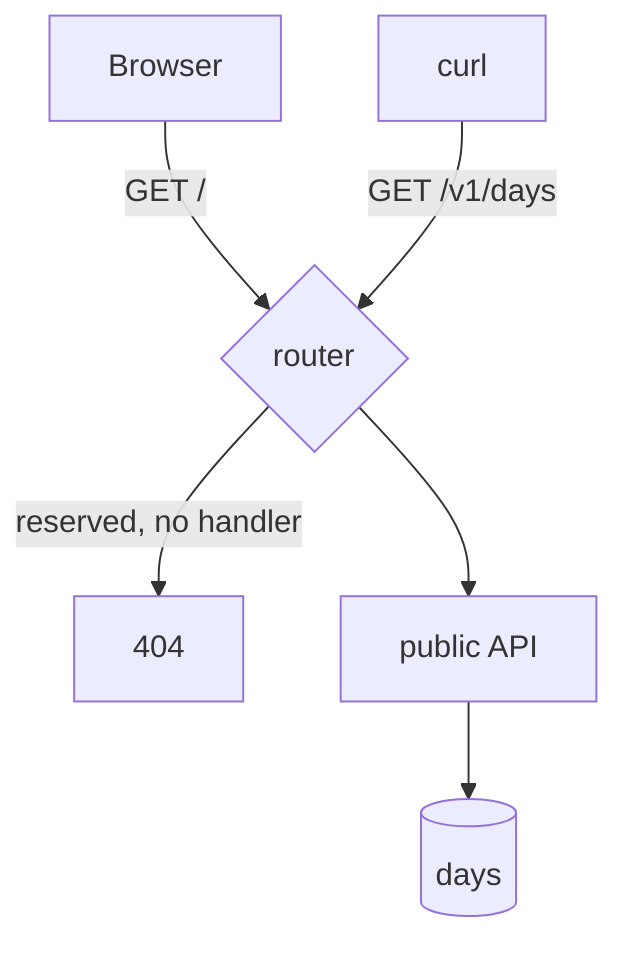
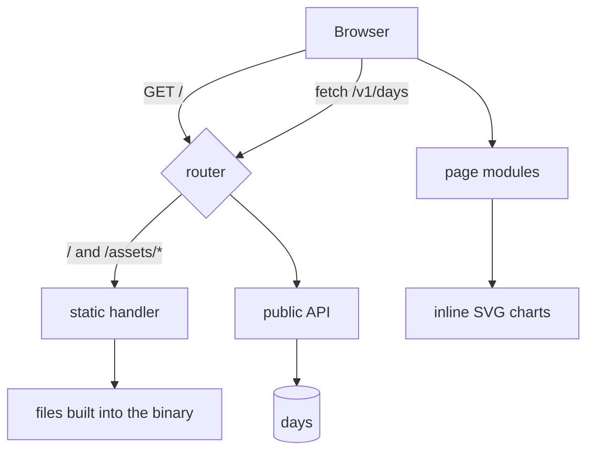
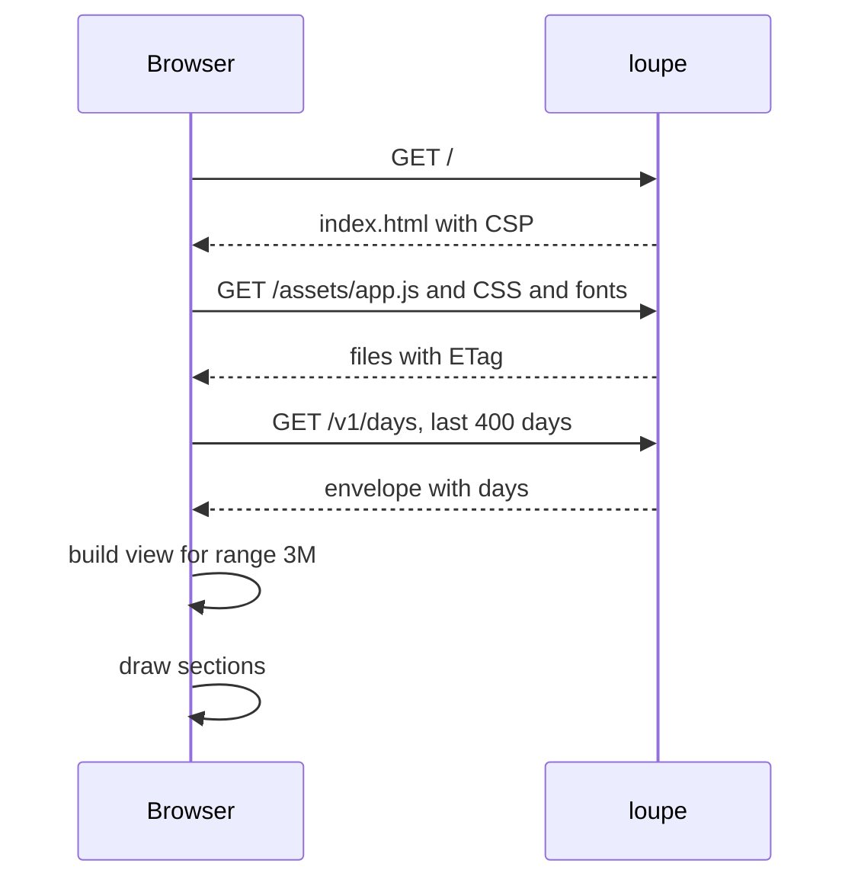
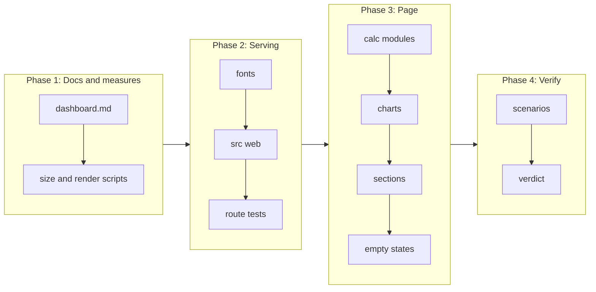

# Stateless dashboard SPA built into the binary

## Change Summary

After CR-0007, the binary publishes day records on `GET /v1/days`, but `GET /` serves nothing and no person can see the data. This CR adds the dashboard of the README: a stateless single-page app that the `loupe` binary serves at `/` from static files built into the binary. The page reads only the public API and shows the header, the pull requests, the lines changed in the range, the tokens per day, the API-equivalent cost, the 12-month heatmap, the daily log, and the footer, with the design values of the mockup.

## Motivation and Background

The README states that one artifact ships the full product, and that the dashboard is the surface where a reader sees the work. The definition of done of the CR set requires that sessions from `claude -p` and `pi -p` are "available in the Agentloupe dashboard". Without this CR, the data stops at a JSON API.

The human decided that the dashboard is a stateless SPA, that it gets data only through the public API, and that the framework is open. The mockup `Main.dc.html` carries the design values in inline styles, but the README prohibits a copy of its runtime (`support.js`, `vendor/`). The container runs offline on the human's machine, so the page must not load a font or a script from a remote host.

## Change Drivers

* README section "Dashboard": the section table, the fonts Geist and Geist Mono, and the rule to replicate the mockup values without its runtime.
* README section "The `loupe` binary": "Dashboard: `GET /` and its static files", and one binary holds the full product.
* README section "Privacy model": the page shows only public data, so it has no login, no cookie, and no state on the server.
* The definition of done of the CR set: the sessions are available in the dashboard.
* `local_first`: the page must work with no network access outside `localhost`.

## Current State

* CR-0002 adds the router. Its list of reserved first path segments holds `healthz`, `v1`, `assets`, and `favicon.ico` (CR-0002 open question 3), and `/` is reserved. Today a reserved route with no handler returns `404` from the router.
* CR-0007 adds `GET /v1/days?from=&to=` with the envelope `{"from", "to", "updated_at", "days"}`, a range limit of 400 days, open CORS, and `cache-control: public, max-age=60`. A day with no call has no record (CR-0007 open question 2, provisional).
* The day record carries `prs_opened`, `prs_merged`, `lines_added`, and `lines_removed` as `null` until CR-0009.
* No static file, no HTML, no CSS, and no JavaScript exists in the repository.

### Current State Diagram



## Proposed Change

Add a directory `web/` with the source of the page: one `index.html`, small CSS files, and small JavaScript modules, in plain HTML, CSS, and ES modules with no build step and no framework. Vendor the Geist and Geist Mono font files under `web/assets/fonts/` with their license and a source record. Add a Rust module that builds every file of `web/` into the binary at compile time and serves it at `/` and `/assets/...` with the correct content type, an ETag, and a strict Content Security Policy.

The page fetches the public API on the same origin, keeps all state in memory, and draws every chart as inline SVG. It shows each README section, a clear empty state when no day exists, and a clear "not collected yet" state when the GitHub fields are `null`.

### Proposed State Diagram



### Page load sequence



## Requirements

### Functional Requirements

**Serving**

1. `GET /` **MUST** return `200` with `content-type: text/html; charset=utf-8` and the page `web/index.html`.
2. `GET /assets/<path>` **MUST** return the file `web/assets/<path>` with a content type from its extension: `.js` `text/javascript; charset=utf-8`, `.css` `text/css; charset=utf-8`, `.woff2` `font/woff2`, `.svg` `image/svg+xml`. `GET /favicon.ico` **MUST** return the favicon file. A path that does not match a built-in file **MUST** return `404` with no body from the file system.
3. The binary **MUST** contain every file of `web/` at compile time. At run time, the static handler **MUST NOT** read the file system. A change to a file of `web/` **MUST** change the binary after `cargo build`.
4. The static handler **MUST** reject a path that holds `..`, a backslash, or a percent-encoded slash with `404`.
5. Every static response **MUST** carry an `etag` header made from a hash of the file content at compile time, and `cache-control: no-cache`. A request with a matching `if-none-match` **MUST** return `304`.
6. The `GET /` response **MUST** carry `content-security-policy: default-src 'none'; script-src 'self'; style-src 'self'; font-src 'self'; img-src 'self' data:; connect-src 'self'; base-uri 'none'; form-action 'none'; frame-ancestors 'none'`, `x-content-type-options: nosniff`, and `referrer-policy: no-referrer`.
7. The static routes **MUST NOT** read a cookie or an `authorization` header, **MUST NOT** set a cookie, and **MUST NOT** read a table of the database.
8. A method other than `GET` and `HEAD` on `/` or `/assets/...` **MUST** return `405` with `allow: GET, HEAD`.
9. A path `/<token>/` or `/<token>/assets/...` **MUST NOT** serve the page. The static files are reached without a proxy token, the same rule as CR-0007 requirement 47.
10. The router list of reserved first path segments of CR-0002 **MUST** hold `assets` and `favicon.ico`. If CR-0002 shipped other names, this CR **MUST** set the list to the names that the static handler serves, in that one file.

**Page technology**

11. The page **MUST** use plain HTML, CSS, and JavaScript ES modules, with no framework, no bundler, no transpiler, and no package manager.
12. The page **MUST NOT** load a file from a host other than its own origin. It **MUST NOT** contain an inline script, an inline style attribute that the CSP blocks, or an `eval`.
13. The page **MUST NOT** use a cookie, `localStorage`, `sessionStorage`, or IndexedDB. The selected range **MUST** live in the URL fragment (`#range=3M`, `#range=6M`, `#range=1Y`), so a reload or a shared link keeps it. A missing or unknown fragment **MUST** select `3M`.
14. The page **MUST** get data only from `GET /v1/days` on the same origin. It **MUST NOT** call another route of the binary, except the static files.
15. JavaScript **MUST** be split into small single-purpose modules with hierarchical names under `web/assets/js/`, for example `api.days.js`, `range.select.js`, `view.build.js`, `stats.quartiles.js`, `chart.line.js`, `chart.bars.js`, `chart.heatmap.js`, `section.header.js`, `section.prs.js`, `section.lines.js`, `section.tokens.js`, `section.cost.js`, `section.heatmap.js`, `section.log.js`, `section.footer.js`, `format.number.js`, `format.date.js`, and `app.js`. Each file **MUST** carry one `@agents-index` line in its top comment. The calculation modules (`view.*`, `stats.*`, `format.*`, `range.*`) **MUST NOT** touch the DOM, so they are testable without a browser.
16. Each chart **MUST** be inline SVG that the page draws. The page **MUST NOT** use a chart library.

**Fonts**

17. The repository **MUST** vendor the Geist and Geist Mono font files as `.woff2` under `web/assets/fonts/`, with the license file `web/assets/fonts/OFL.txt` and a source record `web/assets/fonts/SOURCE.md` that names the upstream repository, the release tag, the date of the fetch, and the SHA-256 hash of each file.
18. The repository **MUST** contain `.agents/scripts/fonts.vendor.sh`, which fetches the files of one stated release tag, writes their hashes to `SOURCE.md`, and supports `--dry-run` and `--check` (verify the hashes of the files on disk against `SOURCE.md`). It **MUST** follow `agent_first_cli`. The verdict pipeline **MUST NOT** call the fetch, because the verdict is hermetic.
19. The CSS **MUST** declare the fonts with `@font-face` and `font-display: swap`, and **MUST** name the fallbacks `system-ui, sans-serif` for Geist and `ui-monospace, monospace` for Geist Mono.
20. The implementer **MUST** confirm at tier 1 (the upstream repository at the stated tag) that the license of the font files permits a copy in the repository and in the binary. If it does not, the implementer **MUST** stop and return the doubt.

**Data and range**

21. On load, the page **MUST** fetch `GET /v1/days?from=<today minus 399 days>` and **MUST NOT** send `to`, so the server default of CR-0007 (today in `LOUPE_TZ`) sets the end of the range. The page **MUST** compute `from` as the browser date minus 399 days, and the server limit of 400 days stays met because a browser date is never more than one day from the date in `LOUPE_TZ`; if the server refuses the range, the page **MUST** retry once with `from` one day later. The page **MUST NOT** make a second request for a change of range.
22. The ranges **MUST** be: `3M` the last 91 days, `6M` the last 182 days, and `1Y` the last 365 days, each ending on the `to` value of the response, both ends included.
23. A day inside the range with no record **MUST** count as zero for every sum and **MUST** draw as zero in a chart. This follows the rule of CR-0007, decided by the human on 2026-10-19: a day has a record only when it has agent calls or GitHub activity.
24. The page **MUST** keep the record fields that it does not show out of the DOM, and **MUST** show only fields of the CR-0007 allowlist.

**Sections**

25. **Header.** The page **MUST** show the title "Agentloupe", the time of the last update from `updated_at` as a local date and time with the time zone name, and the range selector with the three buttons `3M`, `6M`, and `1Y`. The selected button **MUST** carry `aria-pressed="true"`. When `updated_at` is `null`, the header **MUST** show "No update yet".
26. **Pull requests.** The page **MUST** show the sum of `prs_opened` and the sum of `prs_merged` for the range, and a bar chart per ISO week with two bars per week, opened and merged, in the mockup colors.
27. **Lines changed in the range.** The page **MUST** show the sum of `lines_added`, the sum of `lines_removed`, and the net value (added minus removed) over the records of the selected range (`3M`, `6M`, or `1Y`), like the other cards. A change of range **MUST** change these figures. The API does not change. This was decided by the human on 2026-10-19.
28. **Tokens per day.** The page **MUST** show two line charts for the range, one for `input_total` and one for `output`, each with its own vertical scale, and the sum of each for the range.
29. **Cost (API-equivalent).** The page **MUST** show a card in the totals row with the sum of `cost_usd` for the range in US dollars with two decimals, and a daily line chart in the style of the token charts. The card label **MUST** be "Cost (API-equivalent)" and the card **MUST** show the text "List price of the tokens, not money paid." When the sum of `unpriced_calls` for the range is more than zero, the card **MUST** show "<n> calls not priced".
30. **Token usage, last 12 months.** The page **MUST** show a heatmap of the last 365 days, one cell per day, in columns of weeks from Monday to Sunday. The value of a cell **MUST** be `input_total + output`. The levels **MUST** be five: level 0 for a value of zero, and levels 1 to 4 from the quartiles of the values above zero in the 365 days. Each cell **MUST** carry a `title` with the date and the token count. The heatmap **MUST NOT** change with the range selector.
31. **Daily log.** The page **MUST** show one row per record in the range, newest first, with the date, the `summary` text, the PR count (`prs_opened`), and the token count (`input_total + output`). A record with `summary` `null` **MUST** show "No summary". The page **MUST** insert the summary as text, never as HTML.
32. **Footer.** The page **MUST** name the covered sources "Claude Code and Pi", and **MUST** state that claude.ai chats are not covered.

**Empty and error states**

33. When the response holds no record, the page **MUST** show the header, the footer, and one empty state with the text "No days published yet" and the hint "Days appear after the nightly publish, or after `loupe aggregate --date today`." It **MUST NOT** draw an empty chart with axes and no data.
34. When `prs_opened`, `prs_merged`, `lines_added`, and `lines_removed` are `null` in every record of the response, the pull request and lines sections **MUST** show "GitHub not connected" in place of the figures and charts. A `null` in some records **MUST** count as zero, and the section **MUST** show "Partial GitHub data".
35. When the fetch fails or returns a status other than `200`, the page **MUST** show "Data not available" with the HTTP status or the error name, and a button "Try again" that fetches again. The page **MUST** show the `error.message` of a `400` body when one exists.
36. Number formats **MUST** be deterministic: integers with a thin space as the group mark in the totals, and the short forms `k` and `M` with one decimal in chart labels.

**Documents and vocabulary**

37. The Layer 2 document `docs/specification/dashboard.md` **MUST** describe the routes, the headers, the CSP, the files, the data request, the ranges, each section with its formula, the empty states, the font delivery, and the design tokens, before the code lands.
38. The design values of `Main.dc.html` **MUST** be written as CSS custom properties in `web/assets/css/tokens.css`, and `docs/specification/dashboard.md` **MUST** list each token with its value. The page **MUST NOT** contain `support.js` or a file from the mockup `vendor/` directory.
39. `.taxonomy` **MUST** gain rows for `dashboard`, `range`, `heatmap level`, and `empty state`, and **MUST** reuse the rows for `day record`, `API-equivalent cost`, and `public API`.
40. README.md **MUST** be updated only where the behaviour differs from its text. The ranges of requirement 22 are an addition, and the section "Dashboard" **MUST** state them. The README dashboard row "Lines changed, all time" **MUST** change to state that the lines card shows lines added, removed, and net for the selected range.

### Non-Functional Requirements

1. The total size of the files of `web/` without the fonts **MUST** be at most 100 KiB, and with the fonts at most 400 KiB, measured with `.agents/scripts/web.size.sh`.
2. With 400 stored days, the time from navigation start to the first draw of all sections **MUST** be at most 500 ms in a headless browser on the human's machine against the container, measured with `.agents/scripts/web.render.sh`.
3. The page **MUST** work at a width of 360 px with no horizontal scroll, and at 1440 px.
4. Color contrast of text on its background **MUST** be at least 4.5 to 1. The range buttons **MUST** be reachable and usable with the keyboard.
5. The page **MUST** follow the color scheme of the mockup (dark). A light theme is out of scope.
6. Every Rust source file and every file of `web/` that permits a comment **MUST** carry one `@agents-index` line. Rust files **MUST** follow the small-file rule, for example `src/web/embed.rs`, `src/web/serve.rs`, `src/web/headers.rs`, `src/web/etag.rs`, `src/web/path.rs`.
7. An identifier of a governance document **MUST NOT** appear in `web/`, `src/`, `tests/`, or the scenario files.
8. The repository **MUST** contain `.tool-versions` with the exact line `nodejs 22.20.0`. `.agents/scripts/pipeline.web.sh` **MUST** read the Node version from that file and **MUST** stop with a non-zero exit code and an `actionable_errors` payload when `node` is missing or its version differs from the pin. The thin caller **MUST** install Node from this file and **MUST NOT** state a Node version itself.

## Measurable Targets

| Metric | Method | Baseline | Threshold |
|---|---|---|---|
| Node pin | `.agents/scripts/pipeline.web.sh --check-toolchain; echo $?` | none, new pin | exit 0 when `node --version` equals the `.tool-versions` entry, non-zero otherwise |
| Verdict | `.agents/scripts/pipeline.verdict.sh; echo $?` | exit 0 after CR-0007 | exit 0, every stage `status: passed`, with the new stage `web` |
| Web size | `.agents/scripts/web.size.sh` prints `code_kib` and `total_kib` | none, new measurement, added before the page | `code_kib` at most 100, `total_kib` at most 400 |
| First full draw, 400 days | `.agents/scripts/web.render.sh --days 400` prints `draw_ms` | none, new measurement, added before the sections | `draw_ms` at most 500 |
| Remote requests | `.agents/scripts/web.render.sh --days 400` prints `remote_requests` | none | `remote_requests: 0` |
| Proxy time to first byte, p95 | `.agents/scripts/proxy.latency.sh --requests 200 --with-token` | value after CR-0007 | at most 20, and at most 2 above the baseline |
| Time to a full verdict, warm cache | total time of `pipeline.verdict.sh`, second run | value after CR-0007 | at most 180 seconds |

## Affected Components

* New: `web/` (page, CSS, JS modules, fonts), `src/web/`, `docs/specification/dashboard.md`.
* New: `.tool-versions` (Node pin, extends the toolchain pin of CR-0001).
* Changed: the router of CR-0002 (static handler for `/`, `/assets/`, `/favicon.ico`), the reserved list, `.agents/scripts/pipeline.verdict.sh` (new stage `web`), `Dockerfile` (no change to the runtime files, because the files are in the binary; the build stage copies `web/`), `.taxonomy`, README.md.
* New scripts: `.agents/scripts/fonts.vendor.sh`, `.agents/scripts/web.size.sh`, `.agents/scripts/web.render.sh`, `.agents/scripts/pipeline.web.sh`, `.agents/scripts/days.seed.sh`.
* New scenarios: `.agents/scenarios/dashboard.sections.md`, `.agents/scenarios/dashboard.empty.md`, `.agents/scenarios/dashboard.offline.md`.

## Scope Boundaries

### In Scope

* The static handler and the files built into the binary.
* The page with all README sections, the range selector, and the empty and error states.
* The vendored Geist fonts and the vendor script.
* The design tokens from the mockup.
* Unit tests for the calculation modules, integration tests for the routes, and browser scenarios.
* A seed script that writes test day records to a local database, for the scenarios and the render measurement.

### Out of Scope ("Here, But Not Further")

* A new field in the public API or a change to the day record: CR-0007 owns them. If a section needs a field that the record does not have, the implementer returns the doubt.
* GitHub collection: CR-0009 fills the PR and line fields. This CR only shows them, or the "GitHub not connected" state.
* The end-to-end acceptance with `claude -p` and `pi -p`: CR-0010.
* Public hosting, a CDN, and a separate deploy of the page.
* A light theme, translations, and a page per day.
* claude.ai chats.
* A login, an admin view, or a view of private data such as proxy tokens or accounts.

## Alternative Approaches Considered

* **A framework with a build step (React, Svelte, Solid with Vite).** Rejected: it adds Node to the build of the binary, a lock file, and a supply chain, for a page with eight read-only sections. The supervisor recommended no build step, and the human left the choice open.
* **Server-side HTML from Rust templates.** Rejected: the human decided that the page is a stateless SPA that reads the public API, so another site can build the same view.
* **A chart library (Chart.js, uPlot) vendored.** Rejected: line, bar, and heatmap charts are small in SVG, and a library adds size and a CSP exception risk.
* **Fonts from Google Fonts or a CDN.** Rejected: the container runs offline, and a remote font leaks the reader to a third party.
* **System fonts only.** Rejected: the README names Geist and Geist Mono.
* **Read the files from disk at run time.** Rejected: the README requires one artifact, and a disk read adds a path traversal surface.
* **A crate such as `rust-embed`.** Considered. `include_bytes!` from a generated list in `build.rs` has no new dependency. The implementer selects one and records the reason in `dashboard.md`; the behaviour is the same.

## Impact Assessment

### User Impact

The human and any reader open `http://127.0.0.1:8787/` and see the work of the agents. A session of today shows after `loupe aggregate --date today`.

### Technical Impact

The binary grows by the size of `web/` (at most 400 KiB). The router gains a handler. The pipeline gains a `web` stage that runs `node --test` over the calculation modules, so the local toolchain needs Node. CR-0001 pins only Rust in `rust-toolchain.toml`, and that file cannot hold a Node version. This CR therefore extends the toolchain pin of CR-0001 to a second file, `.tool-versions`, with the exact entry `nodejs 22.20.0`. `pipeline.web.sh` reads the version from that file, and stops with an actionable error when `node` is missing or `node --version` differs from the pin. The reason for a second file is that `rust-toolchain.toml` is read only by rustup. The container build does not need Node.

### Business Impact

This CR delivers the visible product. It is a precondition of CR-0010.

## Implementation Approach

1. Write `docs/specification/dashboard.md` with the tokens from `Main.dc.html`, and update `.taxonomy`. Commit.
2. Add `web.size.sh`, `web.render.sh`, and `days.seed.sh`, and record the baselines. Commit.
3. Vendor the fonts with `fonts.vendor.sh`. Confirm the license. Commit.
4. Add `src/web/` with the embed, the path check, the ETag, the headers, and the route tests. Commit.
5. Add `tokens.css`, `index.html`, and the calculation modules with `node --test` tests and `pipeline.web.sh`. Commit.
6. Add the chart modules and the section modules, one section per commit.
7. Add the empty and error states.
8. Write and run the scenarios with the browser driver. Commit.
9. Update README.md. Run the verdict and the measurements. Commit.

### Implementation Flow



## Test Strategy

### Tests to Add

| Test File | Test Name | Description | Inputs | Expected Output |
|---|---|---|---|---|
| `tests/web.serve.rs` | `root_serves_index_html` | Root route | `GET /` | `200`, `text/html`, body holds "Agentloupe" |
| `tests/web.serve.rs` | `asset_content_types` | Types | each extension | the type of requirement 2 |
| `tests/web.serve.rs` | `unknown_asset_is_404` | Miss | `/assets/none.js` | `404` |
| `tests/web.serve.rs` | `traversal_rejected` | Path check | `..`, `%2f`, backslash | `404` |
| `tests/web.serve.rs` | `etag_and_304` | Cache | `if-none-match` with the ETag | `304` |
| `tests/web.serve.rs` | `security_headers_on_root` | Headers | `GET /` | CSP, nosniff, referrer policy |
| `tests/web.serve.rs` | `post_is_405` | Method | `POST /` | `405`, `allow: GET, HEAD` |
| `tests/web.serve.rs` | `token_prefix_does_not_serve_page` | Isolation | `/<token>/` | not the page |
| `tests/web.serve.rs` | `no_cookie_set` | Privacy | each route | no `set-cookie` |
| `tests/web.embed.rs` | `every_web_file_is_embedded` | Embed | list of `web/` | each path served |
| `tests/web.embed.rs` | `no_mockup_runtime` | Rule | file list | no `support.js`, no mockup `vendor/` |
| `web/test/range.select.test.js` | `fragment_selects_range` | Range | `#range=6M`, `#x` | `6M`, `3M` |
| `web/test/view.build.test.js` | `missing_days_are_zero` | Gaps | 3 records in 91 days | 91 points, 88 zero |
| `web/test/view.build.test.js` | `range_lengths` | Ranges | `to` date | 91, 182, 365 days |
| `web/test/view.build.test.js` | `week_buckets_iso` | PR bars | days across a year end | ISO weeks |
| `web/test/api.days.test.js` | `request_omits_to` | Time zone | browser time zone `America/Los_Angeles`, server zone `Europe/Stockholm` | the request URL has `from` and no `to`; the view ends on the `to` of the response |
| `web/test/view.build.test.js` | `lines_follow_range` | Lines card | seeded lines, `3M` then `1Y` | sums of the 91 and 365 last days |
| `web/test/view.build.test.js` | `github_null_states` | States | all null, some null | `not_connected`, `partial` |
| `web/test/stats.quartiles.test.js` | `five_levels` | Heatmap | known values | levels 0 to 4 at the quartiles |
| `web/test/stats.quartiles.test.js` | `all_zero_is_level_zero` | Edge | zeros | all level 0 |
| `web/test/format.number.test.js` | `short_and_grouped` | Format | 1283200, 0.0049 | `1.3M`, `$0.00` |
| `web/test/section.log.test.js` | `summary_is_text` | XSS | summary `` | text node, no element |

The JS tests run with `node --test web/test/` under `.agents/scripts/pipeline.web.sh`, with no network and no npm package.

### Tests to Modify

| Test File | Test Name | Current Behavior | New Behavior | Reason for Change |
|---|---|---|---|---|
| `tests/serve.router.rs` | `reserved_routes_take_precedence` | `/` gives `404` from the router | `/` gives `200` with the page | The static handler now exists |

### Tests to Remove

Not applicable: no test covers removed behaviour.

## Model-Based Testing

| Scenario | User Goal | User Surface | Success Condition | Criteria Proved | Scenario Record |
|---|---|---|---|---|---|
| Sections | See the agent work for a range | browser | with seeded days, each section shows the seeded sums, and `6M` changes the totals and the URL fragment | AC-1, AC-3, AC-4, AC-5, AC-6 | `.agents/scenarios/dashboard.sections.md` |
| Empty | Understand a new install | browser | with an empty `days` table, the page shows "No days published yet" and no chart | AC-7, AC-8 | `.agents/scenarios/dashboard.empty.md` |
| Offline | Use the page with no internet | browser | with the network outside `127.0.0.1` blocked, every font and script loads and zero remote requests occur | AC-2, AC-9 | `.agents/scenarios/dashboard.offline.md` |

## Acceptance Criteria

### AC-1: The page is served from the binary

```gherkin
Given the container runs with "docker compose up -d"
When the reader runs "curl -si http://127.0.0.1:8787/"
Then the status is 200 and the content type is "text/html; charset=utf-8"
  And the body holds "Agentloupe"
  And the headers hold the content-security-policy of requirement 6
  And the headers hold no "set-cookie"
```

### AC-2: No file is read from disk or a remote host

```gherkin
Given the runtime image
When the reader runs "docker compose exec loupe ls /app" and "grep -c 'https://' web/index.html"
Then no "web" directory exists in the image
  And index.html holds no remote URL
  And ".agents/scripts/web.render.sh --days 400" prints "remote_requests: 0"
```

### AC-3: Every README section shows

```gherkin
Given ".agents/scripts/days.seed.sh --days 400" wrote day records
When the reader opens "http://127.0.0.1:8787/" in a browser
Then the page shows the header, pull requests, lines changed in the range, tokens per day, cost, heatmap, daily log, and footer
  And the footer names "Claude Code and Pi"
```

### AC-4: The range selector changes the view

```gherkin
Given seeded day records
When the reader presses "6M"
Then the URL fragment is "#range=6M"
  And the totals equal the sums of the last 182 days that "curl /v1/days" returns
  And the lines added, removed, and net equal the sums of the last 182 days
  And the heatmap does not change
  And no new request to "/v1/days" occurs
```

### AC-5: The cost card says it is a list price

```gherkin
Given seeded day records with cost_usd and one record with unpriced_calls 2
When the reader views the cost card for "1Y"
Then the label is "Cost (API-equivalent)"
  And the text "List price of the tokens, not money paid." shows
  And the total equals the sum of cost_usd with two decimals
  And the card shows "2 calls not priced"
```

### AC-6: The heatmap has five levels

```gherkin
Given 365 seeded days with known token counts
When the reader views the heatmap
Then 365 cells show
  And a day with zero tokens is level 0
  And the other days have levels 1 to 4 from the quartiles that "node --test web/test/stats.quartiles.test.js" asserts
```

### AC-7: An empty database shows a clear state

```gherkin
Given an empty days table
When the reader opens the page
Then the page shows "No days published yet" and the hint that names "loupe aggregate --date today"
  And no chart axis shows
  And the header shows "No update yet"
```

### AC-8: Missing GitHub data is stated

```gherkin
Given seeded day records with all GitHub fields null
When the reader opens the page
Then the pull request and lines sections show "GitHub not connected"
  And no zero figure shows in those sections
```

### AC-9: Fonts load from the binary

```gherkin
Given the container
When the reader runs "curl -sI http://127.0.0.1:8787/assets/fonts/Geist-Regular.woff2"
Then the status is 200 and the content type is "font/woff2"
  And ".agents/scripts/fonts.vendor.sh --check" exits 0
```

### AC-10: The static routes are safe

```gherkin
Given the container
When the reader runs "curl -si http://127.0.0.1:8787/assets/..%2f..%2fetc/passwd" and "curl -si -X POST http://127.0.0.1:8787/"
Then the first status is 404
  And the second status is 405 with "allow: GET, HEAD"
```

### AC-11: A summary cannot inject HTML

```gherkin
Given a seeded record with summary ""
When the reader opens the page
Then the daily log shows the literal text
  And no img element exists in the log
```

### AC-12: The verdict and the targets pass

```gherkin
Given the change is complete
When the reader runs ".agents/scripts/pipeline.verdict.sh", ".agents/scripts/web.size.sh", and ".agents/scripts/web.render.sh --days 400"
Then every stage prints "status: passed", including "web"
  And code_kib is at most 100, total_kib at most 400, and draw_ms at most 500
```

## Quality Standards Compliance

### Build & Compilation

- [ ] `cargo build --release` passes with no warning
- [ ] A change to a file of `web/` changes the binary

### Linting & Code Style

- [ ] `cargo fmt --check` and `cargo clippy -- -D warnings` pass
- [ ] Each file carries one `@agents-index` line

### Test Execution

- [ ] `cargo test` passes
- [ ] `node --test web/test/` passes with no network

### Documentation

- [ ] `docs/specification/dashboard.md` lands before the code
- [ ] `.taxonomy` and README.md are updated in the same change

### Code Review

- [ ] Commits follow Conventional Commits on main, one commit per coherent step
- [ ] Code review completed and approved

### Verification Commands

```bash
.agents/scripts/pipeline.verdict.sh
.agents/scripts/web.size.sh
.agents/scripts/days.seed.sh --days 400
.agents/scripts/web.render.sh --days 400
.agents/scripts/fonts.vendor.sh --check
.agents/scripts/proxy.latency.sh --requests 200 --with-token
```

## Risks and Mitigation

### Risk 1: The font license does not permit a copy

**Likelihood:** low
**Impact:** medium
**Mitigation:** Requirement 20 makes the check a tier 1 step. The fallbacks of requirement 19 keep the page usable.

### Risk 2: The lines card loses the all-time view

**Likelihood:** certain, by design
**Impact:** low
**Mitigation:** The human decided on 2026-10-19 that the lines card follows the range. The README row changes in the same change (requirement 40).

### Risk 3: A summary injects markup

**Likelihood:** low, because CR-0006 scrubs the line
**Impact:** high
**Mitigation:** Requirement 31, the CSP, and the test `summary_is_text`.

### Risk 4: The browser date differs from `LOUPE_TZ`

**Likelihood:** medium
**Impact:** low
**Mitigation:** The request omits `to` (requirement 21), so the API computes the end in `LOUPE_TZ`, and the ranges end on the `to` value of the response (requirement 22). The test `request_omits_to` uses a browser time zone west of the server zone.

### Risk 5: Node in the pipeline breaks hermetic runs

**Likelihood:** low
**Impact:** medium
**Mitigation:** The tests use only `node:test` and `node:assert`, and no package. Open question 1 names the alternative.

## Dependencies

* CR-0001: the crate, the pipeline scripts, the toolchain file, the container.
* CR-0002: the router and the reserved list.
* CR-0007: `GET /v1/days`, its envelope, and the field allowlist.
* CR-0004, CR-0005, CR-0006: the token fields, `cost_usd` and `unpriced_calls`, and `summary`.
* CR-0009 fills the GitHub fields later; this CR does not depend on it.

## Estimated Effort

About 16 to 24 agent hours: 3 for the spec and the measurements, 4 for serving and fonts, 10 for the page, 4 for the scenarios and the verdict.

## Decision Outcome

Chosen approach: "plain HTML, CSS, and ES modules with no build step, inline SVG charts, vendored Geist fonts, all files built into the binary", because it keeps one artifact, works offline, has no supply chain beyond the fonts, and meets the size and draw targets.

## Decided Questions

1. **Lines card range.** Decided by the human on 2026-10-19: the lines card follows the selected range (`3M`, `6M`, `1Y`) and shows lines added, removed, and net for the range, like the other cards. No API change. Requirements 27 and 40 and AC-3 and AC-4 state it.
2. **End of the requested range.** Judgement call of the supervisor on 2026-10-19: the page omits `to`, so the server default of CR-0007 (today in `LOUPE_TZ`) applies. A browser west of `LOUPE_TZ` then does not miss the record of today. Requirement 21 states it.

## Open Questions

1. **JS unit tests with Node.** Provisional default: `node --test` in a `web` stage, with Node pinned in `.tool-versions` (`nodejs 22.20.0`). The alternative is tests in the browser scenarios only, which is slower and not hermetic.
2. **Embed mechanism.** Provisional default: `include_bytes!` from a file list that `build.rs` makes. `rust-embed` is acceptable; the behaviour does not change.

## Related Items

* Earlier CRs: CR-0001 to CR-0007.
* Later CRs: CR-0009 (GitHub counts), CR-0010 (end-to-end acceptance).
* README sections: "Dashboard", "The `loupe` binary", "Privacy model".
* Mockup: `Main.dc.html` in `brainstorm/dashboard.grenemark.se-html.zip`.

## Approval

Reviewed and approved by an independent reviewer agent on 2026-10-18. Revised on 2026-10-19 to record the decisions of the human; the revision needs a new review.
