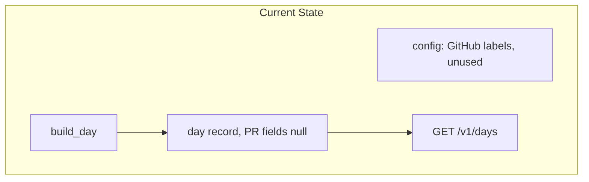
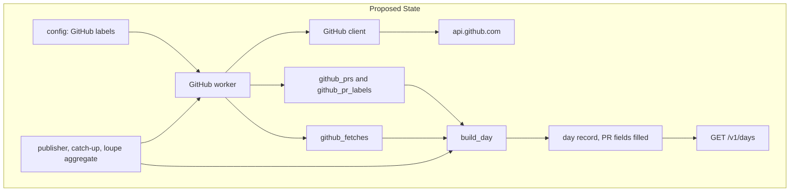
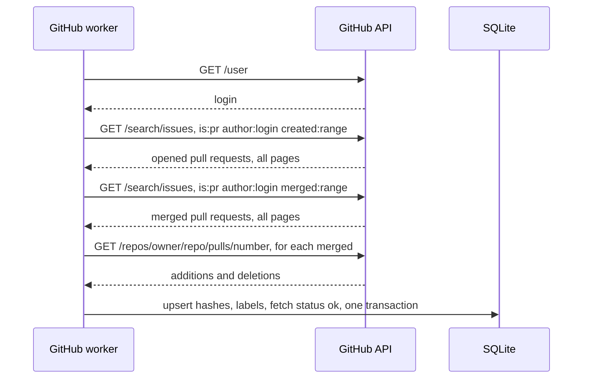
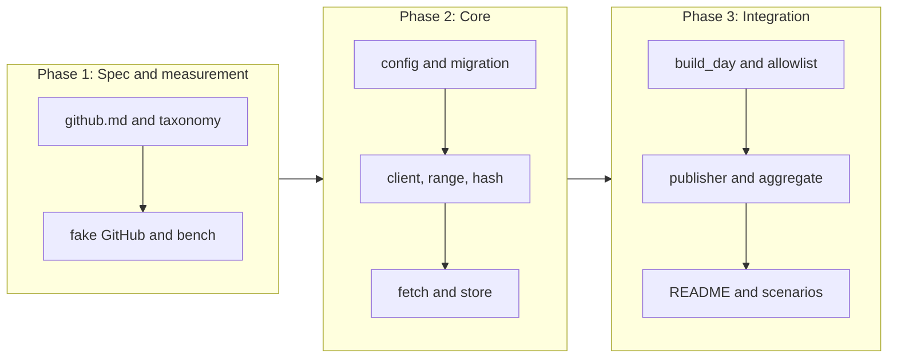

# GitHub pull request and line counts with multiple tokens

## Change Summary

After CR-0008, the day record has the keys `prs_opened`, `prs_merged`, `lines_added`, and `lines_removed`, but their values are always `null` (CR-0007 requirement 9). This CR adds the GitHub worker of the README section "GitHub". For each GitHub token label, the worker finds the user of the token, searches the pull requests that the user opened and merged on the day, gets the line counts of each merged pull request, and stores one hashed row per pull request. The day builder then fills the four fields. GitHub tokens are optional: without a token, every other part of the product works as before.

## Motivation and Background

The README states that the public record shows "how many pull requests I opened and merged, how many lines changed". The token counts of CR-0004 to CR-0007 show the effort of the agents. The pull request counts show the result of the work. The human owns repositories under more than one owner, and a fine-grained token reaches one owner only, so the product needs more than one token. Two tokens can see the same pull request, so the worker must count each pull request one time.

The human rejected the detection of pull requests from the session traffic. The GitHub API is the only source of pull request data in this CR.

## Change Drivers

* README section "GitHub": tokens, counts, no double counts, day fields, failures.
* README section "Privacy model": pull requests are stored as an HMAC-SHA256 hash, token label, dates, and line counts, never the repository, number, or URL.
* CR-0007 requirement 9 reserves the four fields for this CR.
* The dashboard of CR-0008 shows the PR and line figures from the public API.

## Current State

* CR-0001 parses each `LOUPE_GITHUB_TOKEN_<LABEL>` into a list of labels with masked values (`collects_github_token_labels`). No code uses the list.
* CR-0007 builds the day record in `build_day(day)`, which reads only `calls`, `sessions`, and `day_summaries`. The four GitHub fields are `null`.
* CR-0007 publishes each due day with calls, with catch-up, and builds a day again through `agg_queue`.
* No code calls the GitHub API. No table holds pull request data.

### Current State Diagram



## Proposed Change

Add a GitHub client, a GitHub worker, two tables, and a change to the day builder.

1. The GitHub client sends `GET /user`, `GET /search/issues`, and `GET /repos/{owner}/{repo}/pulls/{pull_number}` with one token. Its base URL is `https://api.github.com`, and a configuration value can change it to a local fake for the tests.
2. The GitHub worker runs a fetch of one day for each label. It runs in the publisher of CR-0007 before the first build of a due day, in catch-up, and in `loupe aggregate`.
3. The table `github_prs` holds one row per pull request hash. The table `github_pr_labels` holds the labels that saw each hash. The table `github_fetches` holds the result of each fetch of one day and one label.
4. `build_day(day)` also reads the GitHub tables and fills the four fields, and puts the missing labels in `detail.github`.

### Proposed State Diagram



### Fetch of one day for one label



## Requirements

### Functional Requirements

Tokens and configuration

1. The worker **MUST** use each label that CR-0001 collects from `LOUPE_GITHUB_TOKEN_<LABEL>`. The label **MUST** be the part after `LOUPE_GITHUB_TOKEN_`, in uppercase, as CR-0001 parses it.
2. If no GitHub token is set, the worker **MUST NOT** start, **MUST NOT** call the network, and **MUST** log one line `github: disabled, no token` at start. Every other worker and route **MUST** work as in CR-0008. The four day fields **MUST** stay `null` in this case.
3. The token values **MUST** stay in memory only. No table, log line, error, or `loupe config show` output **MUST** hold a token value or a part of it.
4. A new variable `LOUPE_GITHUB_API_URL` **MUST** set the base URL of the GitHub API, with the default `https://api.github.com`. The value **MUST** be `https`, except a host of `127.0.0.1` or `localhost`, the same rule as `upstreams.toml` in CR-0002. `loupe config show` **MUST** print it with its source.

GitHub client

5. Each request **MUST** send `Authorization: Bearer <token>`, `Accept: application/vnd.github+json`, `X-GitHub-Api-Version: 2022-11-28`, and a `User-Agent` of `agent-loupe/<crate version>`.
6. The client **MUST** get the login of the token user from `GET /user` one time per fetch.
7. The day range **MUST** be the start and the end of the day in `LOUPE_TZ`, written as ISO 8601 with the UTC offset of that moment, for example `2026-10-17T00:00:00+03:00..2026-10-17T23:59:59+03:00`. On a day with a change of the UTC offset, each end **MUST** carry its own offset. The client **MUST** use the day boundary function of CR-0007 for the two ends.
8. The client **MUST** search with the query `is:pr author:<login> created:<range>` for the opened pull requests and `is:pr author:<login> merged:<range>` for the merged pull requests, with `per_page=100`, and **MUST** follow every page until a page has fewer than 100 items.
9. If `total_count` of a search is more than 1000, the fetch **MUST** fail with the cause `search_limit`, because the search API returns at most 1000 results and a part count is wrong.
10. For each merged pull request, the client **MUST** get `additions` and `deletions` from `GET /repos/{owner}/{repo}/pulls/{pull_number}`. It **MUST** take `owner`, `repo`, and `number` from the `repository_url` and `number` fields of the search item.
11. On a `403` or `429` response with `retry-after` or `x-ratelimit-remaining: 0`, the client **MUST** wait the stated time, at most 120 seconds, and try again at most 3 times. After that the fetch **MUST** fail with the cause `rate_limited`.

De-duplication and storage

12. The worker **MUST** identify a pull request by the HMAC-SHA256 of the text `owner/repo#number`, in lowercase `owner` and `repo`, under `LOUPE_ACCOUNT_KEY`, written as lowercase hex.
13. The worker **MUST NOT** store, log, or return the repository name, the owner, the number, the title, the URL, or the login. These values **MUST** stay in memory only for the fetch.
14. A new migration **MUST** add the table `github_prs` with the columns `pr_hash` (primary key), `opened_day` (text `YYYY-MM-DD` or null), `merged_day` (text or null), `additions` (integer or null), `deletions` (integer or null), and `updated_at`.
15. A new migration **MUST** add the table `github_pr_labels` with the columns `pr_hash` and `label`, with the pair as the primary key. Each label that saw a pull request **MUST** have one row.
16. A new migration **MUST** add the table `github_fetches` with the columns `day`, `label`, `status` (`ok` or `failed`), `cause` (null on `ok`), `fetched_at`, and the pair `day`, `label` as primary key. A new fetch **MUST** replace the row.
17. A fetch **MUST** write its rows for the pull requests and its `github_fetches` row in one transaction. A failed fetch **MUST** write only its `github_fetches` row, so a part result never changes a count.
18. A second fetch of the same day and label **MUST** give the same rows. Thus a fetch is idempotent.

Failures

19. If `GET /user` returns `401` or `403`, the fetch **MUST** fail with the cause `unauthorized`. A network error **MUST** give `network`, and any other status **MUST** give `http_<status>`.
20. On each failure the worker **MUST** log one line at level `warn` with the fields `github_label`, `day`, and `cause`, plus the fix: renew or approve the token, then run `loupe aggregate --date <day>`, and verify that `github_fetches` has `status: ok`. Per `actionable_errors`, the line **MUST** name the canonical fix, the README section "GitHub" for the permissions.
21. A failure of one label **MUST NOT** stop the fetches of the other labels or the build of the day.

Day record

22. `build_day(day)` **MUST** read `github_prs` and `github_fetches` in addition to the tables of CR-0007.
23. If no GitHub token is set, the four fields **MUST** be `null`. Otherwise `prs_opened` **MUST** be the count of distinct `pr_hash` with `opened_day` equal to the day, `prs_merged` the count with `merged_day` equal to the day, and `lines_added` and `lines_removed` the sums of `additions` and `deletions` of the pull requests merged on the day.
24. If at least one label has no `github_fetches` row with `status: ok` for the day, the record **MUST** hold `detail.github.missing_labels` with the sorted list of those labels. If no label is missing, the record **MUST** hold `detail.github.missing_labels` as an empty list. The field allowlist of CR-0007 requirement 17 **MUST** gain `github` and `missing_labels`.
25. The record **MUST NOT** hold a count per label. Per-label analysis stays in the private table `github_pr_labels`.

Schedule and catch-up

26. Before the publisher of CR-0007 makes the first `days` row of a due day, it **MUST** run the fetch of that day for each label. Catch-up **MUST** run the fetch for each day that it publishes, oldest first.
27. On each wake, the publisher **MUST** run the fetch again for each published day of the last 7 days that has a label with no `status: ok` row, and **MUST** put each such day in `agg_queue` with reason `github` after a fetch that changes a row.
28. `loupe aggregate --date <day>` **MUST** run the fetch of that day for each label before it builds the day. `loupe aggregate --date <day> --dry-run` **MUST NOT** call GitHub and **MUST** build from the stored rows.
29. The GitHub worker **MUST NOT** publish a day that the rule of CR-0007 does not publish. A day with pull requests and no calls gets no record in this CR (see Open Questions).

Documentation

30. The implementation **MUST** update README.md in the same change: the configuration table gains a row for `LOUPE_GITHUB_API_URL`, the example day record shows `detail.github.missing_labels`, and the section "GitHub" states the 7-day retry and the `search_limit` cause. This CR document does not edit README.md.
31. The Layer 2 document `docs/specification/github.md` **MUST** describe the tokens, the queries, the day range, the hash, the tables, the failure causes, the schedule, and the retry before the code lands.
32. The file `.env.example` **MUST** list `LOUPE_GITHUB_TOKEN_PERSONAL` with no value and a comment that points to the README permissions table.

### Non-Functional Requirements

1. A fetch of one day for one label with 50 merged pull requests **MUST** finish in at most 10 seconds against the local fake GitHub, measured with `.agents/scripts/github.bench.sh`.
2. The GitHub client **MUST** have a timeout of 30 seconds per request.
3. The tests **MUST NOT** call `api.github.com`. They **MUST** use a local fake GitHub through `LOUPE_GITHUB_API_URL`.
4. Governance identifiers **MUST NOT** appear in code, test names, or user-facing docs.
5. Source files **MUST** follow the small-file rule with hierarchical names, for example `src/github/client.rs`, `src/github/user.rs`, `src/github/search.rs`, `src/github/pull.rs`, `src/github/range.rs`, `src/github/hash.rs`, `src/github/store.rs`, `src/github/fetch.rs`, `src/github/retry.rs`, `src/day/github.rs`. Each file **MUST** carry one `@agents-index` line.
6. Each log line **MUST** follow the logging standard of CR-0001, with `file:line`.
7. The proxy latency of CR-0002 **MUST NOT** change, because the worker runs in its own task.

### Measurable Targets

| Metric | Method | Baseline | Threshold |
|---|---|---|---|
| Verdict | `.agents/scripts/pipeline.verdict.sh; echo $?` | exit 0 after CR-0008 | exit 0, every stage `status: passed` |
| Fetch time, 50 merged | `.agents/scripts/github.bench.sh --merged 50` prints `fetch_secs` | none, new measurement, added before the worker | `fetch_secs` at most 10 |
| Privacy of the tables | `cargo test --test github.privacy` | none | passes |
| Proxy time to first byte, p95 | `.agents/scripts/proxy.latency.sh --requests 200 --with-token` | value after CR-0008 | at most 2 ms above the baseline |

## Affected Components

* New: `src/github/`, `src/day/github.rs`, three tables in one migration under `migrations/`.
* Changed: `src/day/build.rs`, `src/day/allowlist.rs`, `src/publish/worker.rs`, `src/cli/aggregate.rs`, the configuration loader (one variable).
* New test helper: `tests/support/fake_github.rs`.
* New scripts: `.agents/scripts/github.bench.sh`.
* New scenarios: `.agents/scenarios/github.counts.md`, `.agents/scenarios/github.no-token.md`, `.agents/scenarios/github.failed-token.md`.
* Docs: `docs/specification/github.md`, `README.md`, `.env.example`, `.taxonomy`.

## Scope Boundaries

### In Scope

* The tokens `LOUPE_GITHUB_TOKEN_<LABEL>`, the user of each token, the searches, and the line counts.
* The HMAC hash, the three tables, and the label per pull request.
* The failure causes, the log lines, and `detail.github.missing_labels`.
* The fetch in publish, catch-up, retry, and `loupe aggregate`.
* The four day fields.

### Out of Scope ("Here, But Not Further")

* Detection of pull requests from the session traffic. The human rejected it.
* The dashboard figures for PRs and lines: CR-0008 shows the fields when they are not `null`. This CR changes no dashboard file.
* The end-to-end run on macOS with Claude Code and Pi: CR-0010. A GitHub token is not a condition of CR-0010.
* GitHub Enterprise Server, GitHub Apps, and OAuth app flows.
* Commits, reviews, issues, and lines of pull requests that are not merged.
* A public count per label.
* Records for days without calls: CR-0007 decides.

## Alternative Approaches Considered

* **One search per token for the full history.** Rejected: the search API has a limit of 1000 results, and the counts of a day must come from the day.
* **The GraphQL API.** Rejected: one query can give the line counts, but a classic token and a fine-grained token need different setups, and the README names the REST endpoints and their permissions.
* **Store the repository name encrypted.** Rejected: the README privacy model forbids the repository name in storage.
* **Count each pull request per label.** Rejected: the README requires that a pull request counts one time.
* **Detect pull requests from the session traffic.** Rejected by the human.

## Impact Assessment

### User Impact

The human sets one or more tokens in `.env`. The public record then shows the PR and line counts. A failed token shows as a missing label in the record, and the log names the fix.

### Technical Impact

One migration with three tables. The publisher gets one more step before a build. The binary gets an HTTP client to GitHub, which can reuse the TLS stack of CR-0002. The day builder reads two more tables. No change to the proxy path.

### Business Impact

The public record shows the result of the work, not only the cost. This is part of the README product goal.

## Implementation Approach

1. Write `docs/specification/github.md` and update `.taxonomy` (`GitHub token label`, `pull request hash`, `GitHub fetch`).
2. Add `tests/support/fake_github.rs` and `.agents/scripts/github.bench.sh` before the client, so the measurement exists first.
3. Add the variable `LOUPE_GITHUB_API_URL` and the migration.
4. Add the client, the day range, the hash, the retry.
5. Add the fetch and the store.
6. Change `build_day`, the allowlist, the publisher, and `loupe aggregate`.
7. Update README.md and `.env.example`.
8. Run the verdict, the bench, and the scenarios. Record the values in `docs/specification/operations.md`.

### Implementation Flow



## Test Strategy

### Tests to Add

| Test File | Test Name | Description | Inputs | Expected Output |
|-----------|-----------|-------------|--------|-----------------|
| `src/github/range.rs` (unit) | `range_has_offset_of_each_end` | Day range | `2026-10-17`, `Europe/Stockholm` | `2026-10-17T00:00:00+03:00..2026-10-17T23:59:59+03:00` |
| `src/github/range.rs` (unit) | `range_on_offset_change_day` | Offset change | `2026-10-25`, `Europe/Stockholm` | start `+03:00`, end `+02:00` |
| `src/github/hash.rs` (unit) | `hash_is_hmac_of_lowercase_ref` | Hash | `Owner/Repo#7` and `owner/repo#7` | same 64-char hex |
| `src/github/search.rs` (unit) | `query_text_for_opened_and_merged` | Queries | login `u`, range | `is:pr author:u created:...`, `is:pr author:u merged:...` |
| `tests/github.fetch.rs` | `fetch_follows_all_pages` | Pages | fake with 230 items | 230 hashes |
| `tests/github.fetch.rs` | `fetch_fails_over_search_limit` | Limit | fake `total_count` 1001 | `failed`, `search_limit`, no `github_prs` rows |
| `tests/github.fetch.rs` | `fetch_is_idempotent` | Idempotence | two fetches of one day | same rows |
| `tests/github.fetch.rs` | `two_labels_same_pr_count_once` | De-duplication | labels `A` and `B` see the same pull request | one `github_prs` row, two `github_pr_labels` rows, `prs_merged` 1 |
| `tests/github.fetch.rs` | `unauthorized_token_is_recorded` | Failure | fake `401` on `/user` | `github_fetches` `failed`, `unauthorized`, warn line with label and fix |
| `tests/github.fetch.rs` | `rate_limit_retries_then_fails` | Retry | fake `429` with `retry-after: 1` four times | 4 requests, cause `rate_limited` |
| `tests/github.fetch.rs` | `one_failed_label_does_not_stop_others` | Isolation | `A` fails, `B` passes | `B` rows stored, day built |
| `tests/github.privacy.rs` | `tables_hold_no_repo_number_url_or_token` | Privacy | fake with known owner, repo, number, title, login, token | no table, no log line holds any of them |
| `tests/day.github.rs` | `fields_null_without_token` | Optional tokens | no token | four fields `null`, no request to the fake |
| `tests/day.github.rs` | `lines_count_on_merge_day` | Day fields | opened on day 1, merged on day 2 | day 1 `prs_opened` 1, day 2 `prs_merged` 1 and the lines |
| `tests/day.github.rs` | `missing_labels_in_detail` | Failure in record | `A` failed | `detail.github.missing_labels` `["A"]` |
| `tests/publish.github.rs` | `catch_up_fetches_each_day_oldest_first` | Catch-up | 3 due days | fetches in day order, before each first build |
| `tests/publish.github.rs` | `retry_failed_label_within_7_days` | Retry | day with `A` failed, then fake passes | `agg_queue` row `github`, record with empty `missing_labels` |
| `tests/cli.aggregate.rs` | `dry_run_does_not_call_github` | Dry run | `--dry-run` | zero requests to the fake |

### Tests to Modify

| Test File | Test Name | Current Behavior | New Behavior | Reason for Change |
|-----------|-----------|------------------|--------------|-------------------|
| `tests/day.build.rs` (CR-0007) | the record shape test | four fields always `null` | `null` without token, numbers with token | requirement 23 |
| `tests/api.allowlist.rs` (CR-0007) | `api_routes_read_only_days_table` | allowlist without `github` | allowlist with `github` and `missing_labels` | requirement 24 |

### Tests to Remove

Not applicable. No test covers removed behaviour.

## Model-Based Testing

| Scenario | User Goal | User Surface | Success Condition | Criteria Proved | Scenario Record |
|----------|-----------|--------------|-------------------|-----------------|-----------------|
| PR counts for a day | See the PR and line counts of a day | HTTP request | after `loupe aggregate --date <day>` with a real fine-grained token, `GET /v1/days/<day>` shows `prs_opened` and `prs_merged` that match the counts that `gh search prs` gives for the same range, and the database has no repository name | AC-1, AC-2 | `.agents/scenarios/github.counts.md` |
| No token | Run the product without GitHub | HTTP request | with no GitHub token, `GET /v1/days/<day>` returns the record with the four fields `null` | AC-3 | `.agents/scenarios/github.no-token.md` |
| Failed token | Find out that a token does not work | command line | with a revoked token, the log has a warn line with the label and the fix, and the record holds the label in `detail.github.missing_labels` | AC-4 | `.agents/scenarios/github.failed-token.md` |

## Acceptance Criteria

### AC-1: Counts for one day with one token

```gherkin
Given the fake GitHub has, for the token user, 2 pull requests opened on 2026-10-17 and 1 merged on 2026-10-17 with 40 additions and 5 deletions
  And LOUPE_GITHUB_TOKEN_PERSONAL is set and the day has calls
When the reader runs "loupe aggregate --date 2026-10-17" and "curl -s http://127.0.0.1:8787/v1/days/2026-10-17"
Then the record has "prs_opened": 2, "prs_merged": 1, "lines_added": 40, "lines_removed": 5
  And "detail.github.missing_labels" is an empty list
```

### AC-2: No double count and no repository data

```gherkin
Given LOUPE_GITHUB_TOKEN_PERSONAL and LOUPE_GITHUB_TOKEN_ACME both see one merged pull request "acme/app#12"
When the reader runs "loupe aggregate --date 2026-10-17"
Then "prs_merged" is 1
  And "sqlite3 data/loupe.db 'select count(*) from github_pr_labels'" prints 2
  And "sqlite3 data/loupe.db .dump | grep -ci 'acme/app\|#12'" prints 0
```

### AC-3: Tokens are optional

```gherkin
Given no LOUPE_GITHUB_TOKEN_<LABEL> is set
When the reader starts "loupe serve" and runs "loupe aggregate --date 2026-10-17"
Then the log has one line "github: disabled, no token"
  And the record has "prs_opened", "prs_merged", "lines_added", and "lines_removed" as null
  And the fake GitHub received zero requests
```

### AC-4: A failed token is recorded

```gherkin
Given LOUPE_GITHUB_TOKEN_ACME is revoked and LOUPE_GITHUB_TOKEN_PERSONAL works
When the reader runs "loupe aggregate --date 2026-10-17"
Then the log has a warn line with "github_label":"ACME", "cause":"unauthorized", and the fix text
  And the record has "detail.github.missing_labels" equal to ["ACME"]
  And the counts of PERSONAL are in the record
```

### AC-5: Catch-up fetches missed days

```gherkin
Given the container was stopped for 3 due days with calls
When the container starts and the publisher wakes
Then "github_fetches" has a row for each of the 3 days and each label
  And each record holds the counts of its day
```

### AC-6: A failed label is retried

```gherkin
Given a published day of yesterday with ACME in "missing_labels"
  And the ACME token now works
When the publisher wakes
Then the day is built again and "missing_labels" is an empty list
```

### AC-7: Day range uses the offset of LOUPE_TZ

```gherkin
Given LOUPE_TZ is "Europe/Stockholm"
When the worker fetches 2026-10-17
Then the fake GitHub log shows the query range "2026-10-17T00:00:00+03:00..2026-10-17T23:59:59+03:00"
```

### AC-8: No token value is stored

```gherkin
Given LOUPE_GITHUB_TOKEN_PERSONAL has the value "ghp_testvalue123"
When the reader runs a fetch and "loupe config show"
Then "grep -r ghp_testvalue data/ logs/" finds nothing
  And "loupe config show" prints LOUPE_GITHUB_TOKEN_PERSONAL as "set"
```

### AC-9: Verdict and measurements pass

```gherkin
Given the change is complete
When the reader runs ".agents/scripts/pipeline.verdict.sh" and ".agents/scripts/github.bench.sh --merged 50"
Then the verdict exits 0 with every stage "status: passed"
  And "fetch_secs" is at most 10
```

## Quality Standards Compliance

### Build & Compilation

- [ ] Code compiles without errors
- [ ] No new compiler warnings introduced

### Linting & Code Style

- [ ] `cargo fmt --check` and `cargo clippy -- -D warnings` pass
- [ ] Code follows the small-file rule and `@agents-index`
- [ ] Any linter exception is documented with justification

### Test Execution

- [ ] All existing tests pass after implementation
- [ ] All new tests pass
- [ ] No test calls `api.github.com`

### Documentation

- [ ] `docs/specification/github.md` lands before the code
- [ ] README.md, `.env.example`, and `.taxonomy` are updated
- [ ] No governance identifier in code, tests, or user-facing docs

### Code Review

- [ ] Changes submitted via pull request
- [ ] PR title follows Conventional Commits format
- [ ] Code review completed and approved
- [ ] Changes squash-merged to maintain linear history

### Verification Commands

```bash
.agents/scripts/pipeline.verdict.sh
cargo test --test github.fetch --test github.privacy --test day.github --test publish.github
.agents/scripts/github.bench.sh --merged 50
.agents/scripts/proxy.latency.sh --requests 200 --with-token
```

## Risks and Mitigation

### Risk 1: The search index lags behind a merge

**Likelihood:** medium
**Impact:** low
**Mitigation:** The fetch runs after `LOUPE_PUBLISH_AT` for the previous day, so the index has at least one hour. `loupe aggregate --date` fetches the day again.

### Risk 2: The search rate limit (30 requests per minute)

**Likelihood:** medium during catch-up
**Impact:** medium
**Mitigation:** Requirement 11 waits and tries again. A failed label is retried for 7 days (requirement 27).

### Risk 3: A label name identifies a company in the public record

**Likelihood:** medium
**Impact:** medium
**Mitigation:** Open question 1. The human chooses the label names, and the README already says "the day records which labels are missing".

### Risk 4: A repository name leaks to a log line

**Likelihood:** low
**Impact:** high
**Mitigation:** Requirement 13 and the test `tables_hold_no_repo_number_url_or_token`, which also reads the log file.

## Dependencies

* CR-0001: configuration loader with the GitHub labels, logging, migrations, verdict.
* CR-0002: the `https` rule with the localhost exception, and the TLS client.
* CR-0007: `build_day`, the day boundary function, the allowlist, `agg_queue`, the publisher with catch-up, and `loupe aggregate`.
* CR-0008: the dashboard that shows the four fields. No change in this CR.
* CR-0010 depends on this CR only for a full verdict, not for a token.

## Estimated Effort

About 2 days: 0.5 day for the spec, the fake GitHub, and the bench; 1 day for the client, the fetch, and the store; 0.5 day for the day builder, the publisher, the docs, and the scenarios.

## Decision Outcome

Chosen approach: "a REST worker per token label that stores hashed pull requests and fetch results, runs before each first build and in catch-up, and fills the day record from the stored rows", because it follows the README endpoints and privacy model, keeps tokens optional, and gives correct counts after a restart or a failed token.

## Open Questions

1. **Missing labels in the public record.** Provisional default: `detail.github.missing_labels` holds the label names, as the README says "the day records which labels are missing". A label such as `ACME` can identify a company in public. The alternative is a count `detail.github.missing_tokens` in public and the names in `github_fetches` only. This is a question about what the human wants, so it goes to the human.
2. **Days with pull requests and no calls.** Provisional default: no record, the CR-0007 rule. The alternative is to publish a record for such a day. This follows the human answer to CR-0007 open question 2.
3. **Retry window.** Provisional default: 7 days (requirement 27). A pull request that is merged after publish is counted on its own merge day, so the window only covers failed tokens.

## Related Items

* CR-0001, CR-0002, CR-0007, CR-0008, CR-0010.
* README sections "GitHub", "Privacy model", "The `loupe` binary".
* GitHub REST API: search issues and pull requests, get a pull request, version `2022-11-28`. The implementer confirms the query qualifiers `created:` and `merged:` with offsets at tier 3 before the code.
