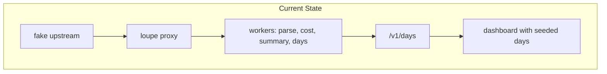
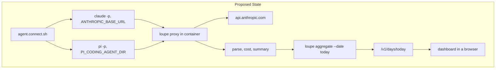
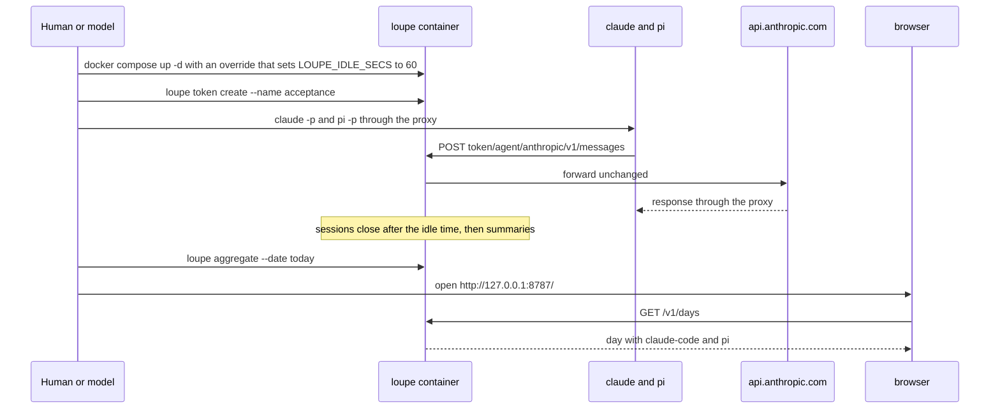
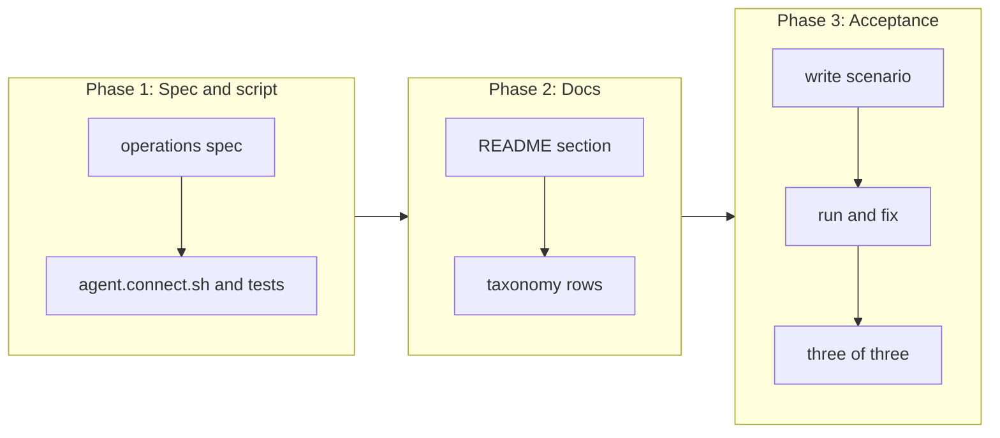

# End-to-end acceptance on macOS with Claude Code and Pi

## Change Summary

CR-0001 to CR-0009 specify each part of Agentloupe and prove each part against a fake upstream or seeded data. No CR proves the full chain with the real agents and the real Anthropic API. This CR adds the means to point Claude Code and Pi at the proxy for one invocation, without a change to the global settings of the agents. It also adds a user scenario that drives the real CLIs and the dashboard in a browser, and grades the run on the end state that the human stated as the definition of done.

## Motivation and Background

The human stated the definition of done for the full CR set: "the solution is completely implemented when it runs in a container on the human's macOS machine, and `claude -p <prompt>` and `pi -p <prompt>` work using the anthropic provider with the model `claude-haiku-5-5`, and the sessions are captured, processed, and available in the Agentloupe dashboard."

Each earlier CR proves its own part. A defect can still exist only in the connection between the parts: a base URL that the agent joins in a different way, a header that the real API needs, a session that does not close in time, or a day that the dashboard does not read. Only a run with the real agents finds these defects. This CR is that run, written so that a human or a model can repeat it and get the same verdict.

## Change Drivers

* The definition of done of the human needs a real run, not a fake upstream.
* The human must not change `~/.claude/settings.json` or `~/.pi/agent` to use the proxy.
* The testing rules of the project need a persisted scenario through the user surface for every user-facing change.
* Pi has no base URL flag; its override lives in `models.json` of an agent directory, so the steps are not obvious and need a script.

## Current State

After CR-0009, the repository holds the `loupe` binary with the proxy (CR-0002), proxy tokens (CR-0003), the parser, sessions, and accounts (CR-0004), the cost (CR-0005), the summaries (CR-0006), day publishing and the public API (CR-0007), the dashboard (CR-0008), and the GitHub worker (CR-0009). `compose.yaml` (CR-0001) binds `127.0.0.1:8787:8787` and reads secrets from `.env`.

The README does not say how to point Claude Code or Pi at the proxy. No script exists to do it. No scenario exists that runs the real agents through the proxy and checks the dashboard.

### Current State Diagram



## Proposed Change

1. A new script `.agents/scripts/agent.connect.sh` prints the environment and the files that point one invocation of Claude Code or Pi at the proxy. It never edits a global setting of an agent.
2. For Claude Code, the script prints `ANTHROPIC_BASE_URL=http://127.0.0.1:8787/<proxy-token>/claude-code/anthropic`. The human runs `claude -p` with that variable and `--model claude-haiku-5-5`.
3. For Pi, the script makes an isolated agent directory outside the repository, with a `models.json` that overrides only the `baseUrl` of the built-in `anthropic` provider to `http://127.0.0.1:8787/<proxy-token>/pi/anthropic`. It prints `PI_CODING_AGENT_DIR=<that directory>`. The human runs `pi -p --provider anthropic --model claude-haiku-5-5`.
4. The README gains a section "Connect the agents" with these steps.
5. A new user scenario `.agents/scenarios/acceptance.macos.end-to-end.md` drives the full chain and is graded on the end state.

### Proposed State Diagram



### Sequence of one acceptance run



## Requirements

### Functional Requirements

1. The repository **MUST** contain `.agents/scripts/agent.connect.sh`. It **MUST** follow the `agent_first_cli` rules: the `@agents-index` line, a docstring with purpose, usage, and parameters, a complete `--help`, a machine format on stdout when stdout is not a terminal, errors on stderr, and documented exit codes.
2. The script **MUST** take `--agent claude-code|pi`, `--token-file PATH` (a file that holds the proxy token) or the variable `LOUPE_PROXY_TOKEN`, and `--base http://127.0.0.1:8787` as the default proxy base. A missing token **MUST** stop the script with a non-zero exit code and an actionable error that names the flag, the fix `docker compose exec loupe loupe token create --name NAME`, and the check `loupe token list`.
3. The script **MUST NOT** take the token as a command-line argument value, because the shell history and the process list keep arguments.
4. For `--agent claude-code`, the script **MUST** print `ANTHROPIC_BASE_URL=<base>/<token>/claude-code/anthropic` as one `export` line, and the model hint `--model claude-haiku-5-5`.
5. For `--agent pi`, the script **MUST** make the directory `${XDG_STATE_HOME:-$HOME/.local/state}/agentloupe/pi-agent` with mode `0700`, and write `models.json` in it with mode `0600` and the content `{"providers":{"anthropic":{"baseUrl":"<base>/<token>/pi/anthropic"}}}`. It **MUST** print `PI_CODING_AGENT_DIR=<that directory>` as one `export` line.
6. The script **MUST NOT** write to `~/.claude`, to `~/.pi/agent`, or to any file in the repository.
7. The script **MUST NOT** copy, read, or print a provider credential. Pi in the isolated directory has no `auth.json`. The README **MUST** state that Pi then reads the Anthropic credential from the environment of the human (`ANTHROPIC_API_KEY`, `ANTHROPIC_OAUTH_TOKEN`, or `ANTHROPIC_AUTH_TOKEN`), and **MUST** state the open question of this CR about the credential (see "Open Questions").
8. The script **MUST** be idempotent: a second run with the same inputs **MUST** give the same `models.json` bytes and the same output. It **MUST** support `--dry-run`, which prints the planned file path and content with the token masked as `lpt_…` and writes nothing.
9. The script **MUST** support `--check`, which sends one `GET <base>/healthz` and stops with an actionable error if the container is not reachable.
10. The README **MUST** gain a section "Connect the agents" after "Proxy tokens". The section **MUST** give, as numbered steps: start the container, make a proxy token into a file outside the repository, run the script for each agent, run `claude -p` and `pi -p` with the model `claude-haiku-5-5`, and open the dashboard. The README update is a stated requirement of this CR; this CR document does not edit README.md.
11. The README section **MUST** state that, to see the day before the nightly publish, the human runs `docker compose exec loupe loupe aggregate --date YYYY-MM-DD`, and that a short `LOUPE_IDLE_SECS` makes the sessions close sooner.
12. The repository **MUST** contain the user scenario `.agents/scenarios/acceptance.macos.end-to-end.md`, made and graded through the `user-scenario` skill. The scenario **MUST** state the user goal, the steps, and the success condition before its first run.
13. The scenario **MUST** drive the real `claude` and `pi` CLIs and the real `api.anthropic.com`, and **MUST** read the dashboard in a real browser through the browser driver. It **MUST NOT** use the fake upstream of CR-0002 or the seed script of CR-0008.
14. The scenario **MUST** set `LOUPE_IDLE_SECS` to `60` for the run through an untracked `compose.override.yaml` with `services.loupe.environment.LOUPE_IDLE_SECS: "60"`. A shell variable on `docker compose up` **MUST NOT** be used, because `compose.yaml` (CR-0001 requirement 19) does not interpolate `LOUPE_IDLE_SECS`, so the variable does not reach the container. `.gitignore` **MUST** list `compose.override.yaml`. It **MUST NOT** change the default of `LOUPE_IDLE_SECS` in the code or in `compose.yaml`.
15. The success condition of the scenario **MUST** be the end state of AC-1 to AC-7. The scenario record **MUST** hold the number of attempts and the number of successes, for at least three runs.
16. The scenario **MUST** not depend on a GitHub token. With no `LOUPE_GITHUB_TOKEN_<LABEL>`, the run **MUST** still pass, and the four PR fields of the day record are `null` (CR-0007 requirement 9, CR-0009 requirements 2 and 23), and the dashboard shows "GitHub not connected" (CR-0008 requirement 34).
17. The prompts of the scenario **MUST** be short and neutral, for example "Reply with the word ok.", so that no project detail goes to the provider or into a summary.
18. A defect that the scenario finds in an earlier CR **MUST** be fixed under the rules of that CR's area: a reproduction first, then the fix, then the identical scenario again. The fix **MUST** update the Layer 2 document that describes the changed behaviour before the code.
19. If the real capture shows that an account ID source in the README "Accounts" list is wrong for Claude Code 2.1.302 or Pi 1.3.0, the implementation **MUST** update the README list and `docs/specification/` in the same change, as the README requires.
20. `.taxonomy` **MUST** gain rows for the new nouns connect script and isolated agent directory, with `Lives in` that names the script and the README section.
21. Governance identifiers **MUST NOT** appear in the script, the scenario file, or the README section.

### Non-Functional Requirements

1. The connect script **MUST** run with the `/bin/bash` 3.2 of macOS and the tools of a default macOS install plus `curl`. It **MUST NOT** need `jq`.
2. A run of `claude -p` through the proxy **MUST** give the same exit code and the same kind of answer as a direct run with the same prompt.
3. The time from the last agent call to the day on the dashboard **MUST** be at most 5 minutes with `LOUPE_IDLE_SECS=60` (see "Measurable Target").
4. No provider credential and no proxy token **MUST** appear in the scenario record, in a log line of the container, or in a tracked file. The check is a `grep` for `lpt_` with more than four characters after it, and for `sk-ant-`, over the scenario record and `docker compose logs`.
5. The scenario **MUST** keep its evidence (the command output, a screenshot of the dashboard, the JSON of `/v1/days/<today>`) under the scenario directory, with the tokens masked.

## Measurable Target

| Metric | Method | Baseline | Threshold |
|---|---|---|---|
| Acceptance pass rate | Run `.agents/scenarios/acceptance.macos.end-to-end.md` three times; count runs that meet AC-1 to AC-7 | 0 of 0 (no run exists) | 3 of 3 |
| Time from the last call to the day on the dashboard | `date +%s` after the last `pi -p` returns, then poll `curl -s http://127.0.0.1:8787/v1/days/$(date +%F)` after `loupe aggregate` until `by_agent` holds both keys; report the difference | not measured | at most 300 seconds with `LOUPE_IDLE_SECS=60` |
| Secret leak count | `grep -rEc 'lpt_[A-Za-z0-9]{5,}\|sk-ant-' .agents/scenarios/acceptance.macos.end-to-end* ; docker compose logs \| grep -Ec 'lpt_[A-Za-z0-9]{5,}\|sk-ant-'` | not measured | 0 |

The day in the method is the date in `LOUPE_TZ`. If the local time zone of the Mac differs from `LOUPE_TZ`, the scenario **MUST** compute the date with `TZ=Europe/Stockholm date +%F`.

## Affected Components

* New: `.agents/scripts/agent.connect.sh`, `.agents/scenarios/acceptance.macos.end-to-end.md` and its evidence directory.
* Changed: `README.md` (new section "Connect the agents"), `.taxonomy` (two rows), `docs/specification/operations.md` (the connect steps as the system behaviour).
* Changed only if the run finds a defect: the module of the earlier CR that owns the defect, with its Layer 2 document.

## Scope Boundaries

### In Scope

* The connect script for Claude Code and Pi.
* The README section "Connect the agents".
* The acceptance scenario on the human's Mac with Docker Desktop, the real CLIs, the real Anthropic API, and the model `claude-haiku-5-5`.
* Fixes for defects that only the real run finds, under the rules of requirement 18.

### Out of Scope ("Here, But Not Further")

* Public hosting of the dashboard or the API. It stays out of scope for the CR set.
* claude.ai chats on the web, desktop, or mobile.
* Providers other than `anthropic` for the acceptance run. The OpenAI upstreams of the README are not part of this run.
* GitHub tokens. The GitHub worker is proven by CR-0009 against its fake API; this run passes with no token.
* New features of the proxy, the parser, the cost, the summaries, the days, or the dashboard. Each belongs to CR-0002 to CR-0009.
* A change to the defaults in `compose.yaml` or in the code.
* Automation of the scenario in CI. The scenario needs a real credential and real cost, so it stays a manual or model-driven run on the Mac.

## Alternative Approaches Considered

* **Edit `~/.claude/settings.json` and `~/.pi/agent/models.json`.** Rejected. The human stated that global settings must not change, and an edit sends every agent session through the proxy.
* **Put the Pi agent directory in the repository.** Rejected. The `models.json` holds the proxy token, and a tracked path risks a commit of the token.
* **No script, only README steps.** Rejected. The Pi steps need a JSON file with the token; a script makes it the same each time and keeps the token out of the shell history.
* **Prove with the fake upstream.** Rejected. CR-0002 already does this; the definition of done needs the real API.

## Impact Assessment

### User Impact

The human can send one invocation of each agent through the proxy and see it on the dashboard the same day. The normal use of the agents does not change.

### Technical Impact

No change to the binary is planned. A defect that the run finds causes a change in the module that owns it. The run costs a small amount of real API usage for each attempt (a few Haiku calls and one summary for each session).

### Business Impact

This CR closes the CR set. After it passes, the human has a working local product that records the agent work.

## Implementation Approach

1. Update `docs/specification/operations.md` with the connect steps and the isolated agent directory.
2. Write `.agents/scripts/agent.connect.sh` and its tests.
3. Update the README section and `.taxonomy`.
4. Write the scenario through the `user-scenario` skill, with the goal and the success condition first.
5. Run the scenario. Fix each defect under requirement 18. Run again until three of three pass.
6. Record the measured values next to the thresholds in the scenario record.

### Implementation Flow



## Test Strategy

### Tests to Add

| Test File | Test Name | Description | Inputs | Expected Output |
|-----------|-----------|-------------|--------|-----------------|
| `tests/scripts/agent.connect.test.sh` | `claude_code_prints_base_url` | Claude Code output | `--agent claude-code`, token file with `lpt_test` | one line `export ANTHROPIC_BASE_URL=http://127.0.0.1:8787/lpt_test/claude-code/anthropic`, exit 0 |
| `tests/scripts/agent.connect.test.sh` | `pi_writes_models_json` | Pi file | `--agent pi`, `HOME` in a temp dir | `models.json` with the `anthropic` `baseUrl` only, mode `0600`, directory mode `0700` |
| `tests/scripts/agent.connect.test.sh` | `pi_is_idempotent` | Two runs | same inputs twice | same bytes, same output |
| `tests/scripts/agent.connect.test.sh` | `missing_token_is_actionable` | Error | no token | exit non-zero, stderr names `--token-file`, `loupe token create`, `loupe token list` |
| `tests/scripts/agent.connect.test.sh` | `dry_run_writes_nothing_and_masks` | Dry run | `--dry-run --agent pi` | no file, output shows `lpt_…` and not the token |
| `tests/scripts/agent.connect.test.sh` | `never_touches_global_dirs` | Isolation | temp `HOME` with `.claude` and `.pi/agent` | both directories unchanged after a run |
| `tests/scripts/agent.connect.test.sh` | `check_fails_when_down` | Health | `--check --base http://127.0.0.1:1` | exit non-zero, stderr names `docker compose up -d` |

### Tests to Modify

Not applicable. This CR changes no behaviour of the binary. A fix under requirement 18 changes the tests of the owning area by the rules of that area.

### Tests to Remove

Not applicable. No test becomes redundant.

## Model-Based Testing

| Scenario | User Goal | User Surface | Success Condition | Criteria Proved | Scenario Record |
|----------|-----------|--------------|-------------------|-----------------|-----------------|
| End-to-end on macOS | See today's work of Claude Code and Pi on the dashboard | command line and browser | `/v1/days/<today>` holds `by_agent` keys `claude-code` and `pi` with `calls` 1 or more each, and the dashboard in the browser shows today in the daily log with the token count | AC-1 to AC-7 | `.agents/scenarios/acceptance.macos.end-to-end.md` |

## Acceptance Criteria

### AC-1: The container runs on the Mac

```gherkin
Given Docker Desktop runs on the human's Mac
  And ".env" holds LOUPE_DATA_KEY and LOUPE_ACCOUNT_KEY
  And an untracked "compose.override.yaml" sets LOUPE_IDLE_SECS to "60" in the environment of the service "loupe"
When the reader runs "docker compose up -d --build"
Then "docker compose exec loupe printenv LOUPE_IDLE_SECS" prints 60
Then "docker compose ps" shows the service "healthy"
  And "curl -s http://127.0.0.1:8787/healthz" returns {"status":"ok"}
```

### AC-2: A proxy token exists

```gherkin
Given the container is healthy
When the reader runs "docker compose exec loupe loupe token create --name acceptance" and saves the token in a file outside the repository
Then "docker compose exec loupe loupe token list" shows the name "acceptance" and no token value
```

### AC-3: Claude Code works through the proxy

```gherkin
Given the reader ran "eval $(.agents/scripts/agent.connect.sh --agent claude-code --token-file <file>)"
When the reader runs "claude -p 'Reply with the word ok.' --model claude-haiku-5-5"
Then the command exits 0 and prints an answer
  And "~/.claude/settings.json" has the same checksum as before the run
```

### AC-4: Pi works through the proxy

```gherkin
Given the reader ran "eval $(.agents/scripts/agent.connect.sh --agent pi --token-file <file>)"
  And an Anthropic credential is in the environment of the reader
When the reader runs "pi -p --provider anthropic --model claude-haiku-5-5 'Reply with the word ok.'"
Then the command exits 0 and prints an answer
  And every file under "~/.pi/agent" has the same checksum as before the run
```

### AC-5: The sessions are captured and processed

```gherkin
Given AC-3 and AC-4 passed
  And 60 seconds and one summary interval passed with no calls
When the reader runs "docker compose exec loupe loupe aggregate --date <today>"
Then "curl -s http://127.0.0.1:8787/v1/days/<today>" returns 200
  And "detail.by_agent" holds the keys "claude-code" and "pi", each with "calls" 1 or more
  And "cost_usd" is more than 0 and "unpriced_calls" is 0
  And "summary" is a non-empty line
```

### AC-6: The dashboard shows the day

```gherkin
Given AC-5 passed
When the reader opens http://127.0.0.1:8787/ in a browser
Then the daily log shows a row for <today> with a token count more than 0
  And the footer names Claude Code and Pi
  And the screenshot is kept in the scenario evidence
```

### AC-7: No secret leaks

```gherkin
Given AC-1 to AC-6 passed
When the reader runs the secret leak check of the measurable target
Then the count is 0
```

### AC-8: The connect script is safe to re-run

```gherkin
Given the reader ran the script for Pi one time
When the reader runs the same command again
Then "models.json" has the same checksum as after the first run
  And "--dry-run" prints the plan with "lpt_…" and writes no file
```

### AC-9: The README tells the steps

```gherkin
Given the change is merged
When the reader runs "grep -n '^## Connect the agents' README.md"
Then the command prints one line
  And the section names "agent.connect.sh", "PI_CODING_AGENT_DIR", "ANTHROPIC_BASE_URL", "claude-haiku-5-5", and "loupe aggregate --date"
```

## Quality Standards Compliance

### Build & Compilation

- [ ] `cargo build --release` passes with no warnings
- [ ] `docker compose build` passes

### Linting & Code Style

- [ ] `shellcheck .agents/scripts/agent.connect.sh` passes with zero findings
- [ ] `cargo clippy -- -D warnings` passes

### Test Execution

- [ ] `.agents/scripts/pipeline.verdict.sh` passes
- [ ] `bash tests/scripts/agent.connect.test.sh` passes
- [ ] The acceptance scenario passes three of three

### Documentation

- [ ] README section "Connect the agents"
- [ ] `docs/specification/operations.md` updated before the script
- [ ] `.taxonomy` rows added

### Code Review

- [ ] Changes go through review
- [ ] Commit messages follow Conventional Commits with the CR ID in the message only

### Verification Commands

```bash
.agents/scripts/pipeline.verdict.sh
shellcheck .agents/scripts/agent.connect.sh
bash tests/scripts/agent.connect.test.sh
printf 'services:\n  loupe:\n    environment:\n      LOUPE_IDLE_SECS: "60"\n' > compose.override.yaml
docker compose up -d --build
docker compose exec loupe printenv LOUPE_IDLE_SECS
.agents/scripts/agent.connect.sh --check
curl -s http://127.0.0.1:8787/v1/days/$(TZ=Europe/Stockholm date +%F)
```

## Risks and Mitigation

### Risk 1: Pi has no credential in the isolated directory

**Likelihood:** high
**Impact:** high
**Mitigation:** The README states the environment variables that Pi reads. The open question below decides the default route; the scenario records which credential kind it used, never the value.

### Risk 2: The real API rejects a request that the fake upstream accepted

**Likelihood:** medium
**Impact:** high
**Mitigation:** Requirement 18 routes the defect to its owning area with a reproduction first.

### Risk 3: The day boundary splits the run

**Likelihood:** low
**Impact:** medium
**Mitigation:** The scenario computes the day in `LOUPE_TZ` and does not start within 10 minutes of midnight in that zone.

### Risk 4: The summary does not exist in time

**Likelihood:** medium
**Impact:** medium
**Mitigation:** The scenario waits for the idle time plus the summary interval of CR-0006 before `loupe aggregate`. If no summary credential is set, AC-5 fails with a named cause, because the definition of done includes "processed".

### Risk 5: A token leaks into the shell history

**Likelihood:** medium
**Impact:** medium
**Mitigation:** Requirement 3 forbids the token as an argument value; the token comes from a file or a variable.

## Open Questions

1. **Credential for Pi in the isolated directory.** The options are: (a) the human exports `ANTHROPIC_API_KEY` (a Console key) for the run; (b) the human exports `ANTHROPIC_OAUTH_TOKEN` with the subscription token from `claude setup-token`; (c) the script links `~/.pi/agent/auth.json` into the isolated directory. Option (c) reads a credential file of the human. Provisional default: (b), because it needs no new paid key and Haiku works on the subscription path; the scenario records which option it used. This question goes to the human.
2. **Summary credential for the run.** CR-0006 accepts `LOUPE_SUMMARY_API_KEY` or `LOUPE_SUMMARY_OAUTH_TOKEN`. Provisional default: `LOUPE_SUMMARY_OAUTH_TOKEN` in `.env`, for the same reason.

## Dependencies

* CR-0001: container, `compose.yaml`, `.env.example`, `loupe config show`, `pipeline.verdict.sh`.
* CR-0002: proxy routes `/<agent>/<upstream>/<path>` and the `anthropic` upstream.
* CR-0003: `loupe token create` and token routes.
* CR-0004: parser, sessions, `LOUPE_IDLE_SECS`.
* CR-0005: `cost_usd` and `unpriced_calls`, with a price for `claude-haiku-5-5` in the vendored file.
* CR-0006: summaries and the OAuth credential.
* CR-0007: `loupe aggregate --date` and `/v1/days/{day}`.
* CR-0008: the dashboard at `/`.
* CR-0009: not needed for the pass; the run proves the zero PR case only.

## Estimated Effort

About 1 day: 2 hours for the spec, script, and tests; 1 hour for the README and taxonomy; the rest for the runs and any fixes. Fixes that the run finds can add time in the owning area.

## Decision Outcome

Chosen approach: "a connect script that prints per-invocation environment and an isolated Pi agent directory, plus a persisted end-to-end scenario on the real agents", because it proves the definition of done of the human without a change to the global agent settings, and it keeps the proxy token out of the repository and the shell history.

## Related Items

* Change requests: CR-0001 to CR-0009.
* Pi docs (installed 1.3.0): `docs/providers.md`, `docs/models.md`, `docs/environment-variables.md`, `docs/cli.md`.
* README sections: "The `loupe` binary", "Proxy tokens", "Accounts", "Dashboard".

## Change Log

* Reviewed and approved by an independent reviewer agent on 2026-10-18.
