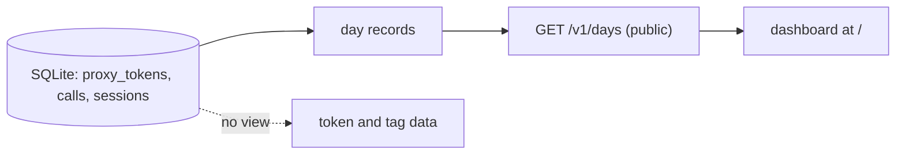
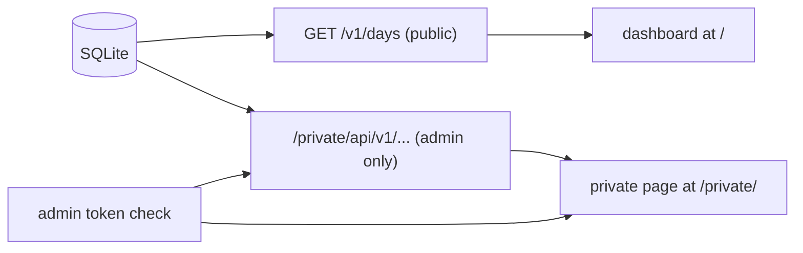
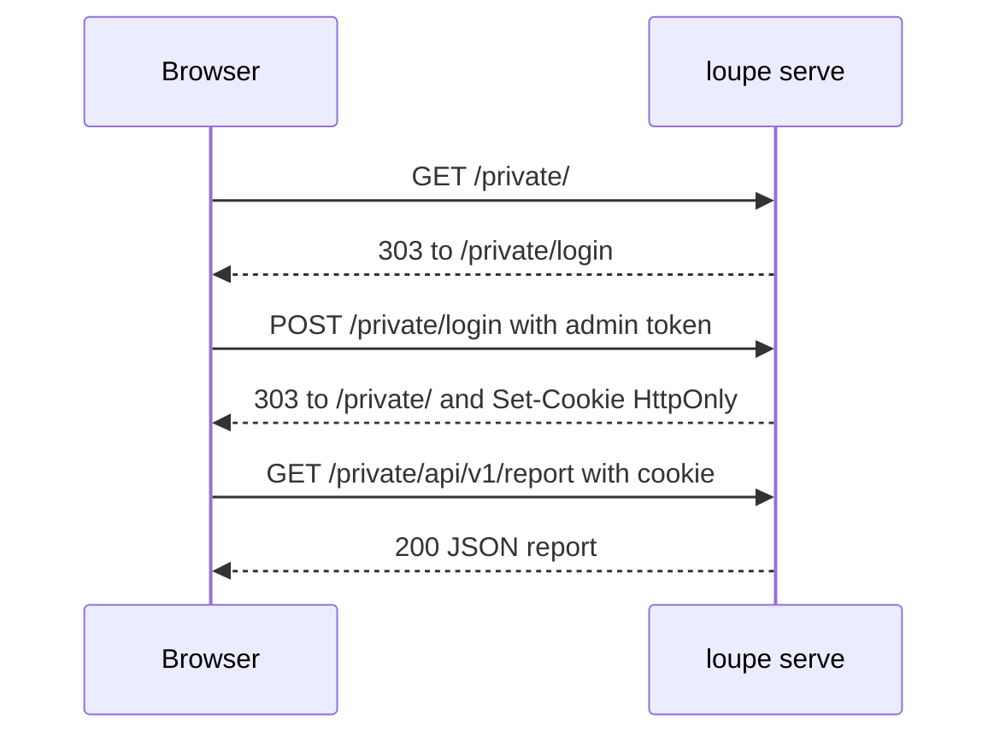
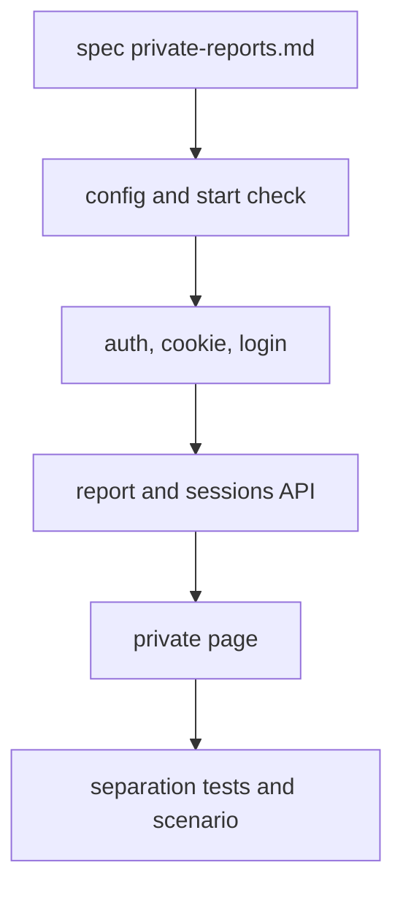

# Private reports page per proxy token and tag

## Change Summary

After CR-0010, the database holds the proxy token of each call and each session, and the tags of each proxy token. No view shows this data, and CR-0003 keeps it out of the public API. This CR adds a private page at `/private/` and a private API under `/private/api/`. They show tokens, calls, API-equivalent cost, and sessions per proxy token and per tag, for a selected range. A separate secret, the admin token `LOUPE_ADMIN_TOKEN`, protects them. If the admin token is not set, the private routes do not exist.

## Motivation and Background

The human answered question Q22 (A12): "private page". Tags have no use without a view. The operator wants to see which machine, person, or pipeline used the proxy, and what it cost. The public page is "scrubbed radical transparency" (A1), so this data must stay private. A separate secret keeps the private view apart from the proxy tokens, which clients hold.

## Change Drivers

* Answer A12 of `docs/questions/2026-10-19-open-questions.xlsx`: a private page with reports per proxy token and per tag, protected by `LOUPE_ADMIN_TOKEN` (header, or a login form that sets a cookie). Private data never appears in the public API.
* CR-0003 requirement 22: no route under `/v1/` reads `proxy_tokens`. This CR keeps that rule.
* CR-0003 out of scope: "An analysis view or report by token or tag". This CR is that view.

## Current State

* CR-0003: the table `proxy_tokens` with `name`, `tags` (a JSON object), `created_at`, `last_used_at`, `revoked_at`. Tokens have no expiry, and the name and the tags do not change after creation (A11).
* CR-0004: `calls.proxy_token_id`, `sessions.proxy_token_id`, sessions as segments, a subagent is a session (A9).
* CR-0005: `calls.cost_usd` in exact decimal text, `unpriced_reason` for an unpriced call.
* CR-0007: the public API `GET /v1/days`, the subscription cost from `LOUPE_SUBSCRIPTION_<NAME>`, the day in `LOUPE_TZ`.
* CR-0008: the dashboard, served from files built into the binary, dark only, with the design values of the mockup.

### Current State Diagram



## Proposed Change

Add a private area to `loupe serve`:

1. A login page at `/private/login` with a form that posts the admin token.
2. A session cookie that the server signs, `HttpOnly`, `SameSite=Strict`, and `Secure` when the request uses HTTPS.
3. A private page at `/private/` built from files in `web/private/`, built into the binary like the dashboard, with the same design values.
4. A private API: `GET /private/api/v1/report?from=&to=&group=token|tag[&tag_key=KEY]` and `GET /private/api/v1/sessions?from=&to=&token=NAME`.

### Proposed State Diagram



### Sequence of one login



## Requirements

### Functional Requirements

1. The configuration **MUST** add `LOUPE_ADMIN_TOKEN` (secret, no default). `loupe config show` **MUST** show only whether it is set.
2. If `LOUPE_ADMIN_TOKEN` is not set or is empty, every path under `/private/` **MUST** return `404` with the same body as any unknown path. The private page is then off.
3. If the value is set and is shorter than 32 characters, `loupe serve` **MUST** stop before it opens the port, with an actionable error that names the variable, the fix (`loupe token generate`), `.env.example`, and the check (`loupe config show`).
4. A request to `/private/api/...` **MUST** be authorized if the header `Authorization: Bearer <admin token>` matches, or if a valid session cookie is present.
5. The server **MUST** compare the admin token in constant time, on the SHA-256 digests of the two values.
6. A proxy token **MUST NOT** authorize a private route, and the admin token **MUST NOT** authorize a proxied request.
7. `GET /private/login` **MUST** return a form with one password field. `POST /private/login` with a correct token **MUST** set the cookie `loupe_admin` and redirect with `303` to `/private/`. A wrong token **MUST** return `401` and the form with a neutral message.
8. The cookie **MUST** be `HttpOnly`, `SameSite=Strict`, `Path=/private`, with `Max-Age` 43200 (12 hours). It **MUST** carry `Secure` when the request uses HTTPS or `X-Forwarded-Proto: https`. Its value **MUST** be an expiry time and an HMAC-SHA-256 over that time, keyed with a key derived from the admin token, so a change of the admin token makes every cookie invalid.
9. `POST /private/logout` **MUST** clear the cookie and redirect to `/private/login`.
10. A private request without valid authorization **MUST** return `401` (API) or `303` to `/private/login` (page). The server **MUST** log each failed login with the remote address and no token value.
11. After 10 failed logins from one remote address in 10 minutes, the server **MUST** return `429` to that address for 10 minutes.
12. `GET /private/api/v1/report` **MUST** take `from` and `to` (dates in `LOUPE_TZ`, same defaults and 400-day limit as `/v1/days`) and `group` (`token` or `tag`). With `group=tag`, `tag_key` **MUST** select one tag key; a token without that key **MUST** count in the group `(none)`.
13. Each group row **MUST** hold `group`, `input_tokens`, `output_tokens`, `cache_read_tokens`, `cache_write_tokens`, `total_tokens`, `calls`, `sessions`, `api_equivalent_cost_usd` (exact decimal text), `unpriced_calls`, and `days` (one entry per day with a call, with the same fields). With `group=token` each row **MUST** also hold the tags, `created_at`, `last_used_at`, and the status `active` or `revoked`.
14. Calls with no proxy token (from before CR-0003) **MUST** count in the group `(no token)`.
15. A session **MUST** count on each day that has a call of it, per A9. A session counts in a group if a call of it is in that group.
16. `GET /private/api/v1/sessions` **MUST** list the sessions of one proxy token in the range: `agent_label`, `started_at`, `last_call_at`, `call_count`, `total_tokens`, `api_equivalent_cost_usd`, and the session day summary of the start day of the segment in LOUPE_TZ (amended on 2026-10-21 by CR-0014: the session summary of CR-0006 gets no new rows). It **MUST** return at most 200 rows and a `next` cursor.
17. The private page **MUST** show the range selector (3M, 6M, 1Y), a group selector (token, tag with a tag key list), a table of the groups, tokens per day for the selected group, and the session list of a selected proxy token.
18. The private page **MUST** use the design values, the fonts, and the dark theme of the dashboard (CR-0008), and **MUST** be built into the binary at compile time, as the dashboard is.
19. The private page **MUST** get data only from `/private/api/v1/...` on the same origin.

### Non-Functional Requirements

1. No route under `/v1/` and no file of the public dashboard **MUST** read `proxy_tokens` or return a token name, a tag, or a token ID. CR-0003 requirement 22 stays true.
2. Private responses **MUST** carry `cache-control: no-store`, no CORS header, `X-Frame-Options: DENY`, and a strict Content Security Policy.
3. `POST /private/login` and `POST /private/logout` **MUST** refuse a request whose `Origin` header is present and is not the same origin.
4. The admin token, the cookie value, and the HMAC key **MUST NOT** appear in a log line, in the database, or in a response.
5. The report for 400 days over 100 000 calls **MUST** return in less than 1 second on the Mac of CR-0010.
6. The private page files **MUST** be at most 200 KiB, apart from the shared fonts.
7. Code **MUST** follow `documentation_standards`, `logging_standard`, `actionable_errors`, and the small-file rule, for example `src/private/auth.rs`, `src/private/cookie.rs`, `src/private/report.rs`.

## Measurable Target

* Metric: the result of the acceptance criteria below, and the time of the report request.
* Method: `scripts/pipeline.verify.sh`, then `curl -s -o /dev/null -w '%{time_total}' -H "Authorization: Bearer $LOUPE_ADMIN_TOKEN" 'http://127.0.0.1:<port>/private/api/v1/report?group=token&from=<today minus 399>'` on the test data set.
* Baseline: no private route exists.
* Threshold: every AC passes; time_total below 1.0 seconds.

## Affected Components

* `src/config/`: `LOUPE_ADMIN_TOKEN`.
* `src/private/`: authorization, cookie, login, report queries, routes.
* `web/private/`: the private page.
* `.env.example`: the variable name with no value.
* `docs/specification/private-reports.md`: new Layer 2 document.
* README: the section "Privacy model" **MUST** state that a private page exists behind `LOUPE_ADMIN_TOKEN` and that its data never reaches the public API. A separate step does this edit.

## Scope Boundaries

### In Scope

* The admin token, login, cookie, logout, and failed login limit.
* The private report per proxy token and per tag, and the session list per proxy token.
* The private page in the style of the dashboard, built into the binary.

### Out of Scope ("Here, But Not Further")

* More than one admin user, roles, or accounts. Hosting stays single-user (A22).
* A change of token names or tags from the page. A11 forbids changes after creation.
* Token creation or revocation from the page. The CLI of CR-0003 stays the only way.
* Export to CSV, alerts, or budgets.
* Provider account counts on the private page: a later CR.
* The subscription cost per token or per tag: a subscription is not tied to a proxy token.

## Alternative Approaches Considered

* **A CLI report only.** Rejected: the human selected "private page" in Q22.
* **Use a proxy token as the login.** Rejected: clients hold proxy tokens; A12 asks for a separate secret.
* **Private fields in `/v1/days` behind a header.** Rejected: A12 says private data never appears in the public API.
* **A JWT or a server-side session table.** Rejected: an HMAC cookie with an expiry needs no storage and no new dependency of size.

## Impact Assessment

### User Impact

The operator can see usage and API-equivalent cost per machine, person, or pipeline. The public reader sees no change.

### Technical Impact

The router gains a `/private/` subtree that exists only when the admin token is set. The binary grows by at most 200 KiB. Read-only queries on `calls`, `sessions`, and `proxy_tokens`; no migration, apart from an index on `calls(proxy_token_id, started_at)` if the time target needs it.

### Business Impact

No cost. A wrong configuration can expose private data, so the tests check the off state and the separation.

## Implementation Approach

1. Write `docs/specification/private-reports.md`. Commit.
2. Add the configuration and the start check. Commit.
3. Add the authorization, the cookie, the login, the logout, and the limit, with tests. Commit.
4. Add the report and the session queries and routes, with tests. Commit.
5. Add `web/private/` and the embed. Commit.
6. Add the separation tests and the user scenario. Commit.

### Implementation Flow



## Test Strategy

### Tests to Add

| File | Test | Checks |
|------|------|--------|
| `tests/private.off.rs` | `no_admin_token_means_404` | every `/private/` path returns 404 |
| `tests/private.auth.rs` | `bearer_header_authorizes` | 200 with header, 401 without |
| `tests/private.auth.rs` | `proxy_token_is_refused` | a proxy token gets 401 |
| `tests/private.cookie.rs` | `cookie_flags_and_expiry` | HttpOnly, SameSite=Strict, Path, Max-Age |
| `tests/private.cookie.rs` | `admin_token_change_invalidates_cookie` | old cookie gets 401 |
| `tests/private.login.rs` | `failed_login_limit` | 11th try gets 429 |
| `tests/private.report.rs` | `group_by_token_and_tag` | sums equal the calls of the fixture |
| `tests/private.report.rs` | `no_token_and_none_groups` | `(no token)` and `(none)` |
| `tests/private.separation.rs` | `public_api_has_no_token_data` | no name, tag, or ID in `/v1/` |
| `tests/private.logs.rs` | `no_secret_in_logs` | admin token absent in the log file |

### Tests to Modify

None.

### Tests to Remove

None.

## Model-Based Testing

The user surface is the private page in a browser. The scenario `.agents/scenarios/private-reports-page.md` states the goal "see the tokens and the cost of one proxy token for 3M". The success condition is that the table row of that token shows the same `total_tokens` and `api_equivalent_cost_usd` as the private API returns.

## Acceptance Criteria

### AC-1: The private page is off without an admin token

```gherkin
Given loupe serve runs with no LOUPE_ADMIN_TOKEN
When a client requests "/private/", "/private/login", and "/private/api/v1/report"
Then each response has status 404
```

### AC-2: A short admin token stops the start

```gherkin
Given LOUPE_ADMIN_TOKEN has 10 characters
When the operator runs "loupe serve"
Then the process exits with a non-zero code before it opens the port
And stderr names LOUPE_ADMIN_TOKEN and "loupe token generate"
```

### AC-3: The header authorizes the private API

```gherkin
Given LOUPE_ADMIN_TOKEN is set and two proxy tokens have calls today
When a client requests "/private/api/v1/report?group=token" with "Authorization: Bearer <admin token>"
Then the status is 200 and the body has one row per proxy token
And the same request with a proxy token as the bearer has status 401
```

### AC-4: The login form sets a safe cookie

```gherkin
Given LOUPE_ADMIN_TOKEN is set
When a browser posts the correct admin token to "/private/login"
Then the response is 303 to "/private/"
And the cookie "loupe_admin" has HttpOnly, SameSite=Strict, Path=/private, and Max-Age=43200
And a request to "/private/api/v1/report" with that cookie has status 200
```

### AC-5: A wrong login is refused and limited

```gherkin
Given LOUPE_ADMIN_TOKEN is set
When one address posts a wrong token 11 times in 10 minutes
Then the first 10 responses have status 401
And the 11th response has status 429
And no log line contains the posted values
```

### AC-6: The report groups by tag

```gherkin
Given token "laptop" has the tag "owner=daniel" and token "ci" has no "owner" tag
When a client requests "/private/api/v1/report?group=tag&tag_key=owner"
Then the body has the groups "daniel" and "(none)"
And the sums of the groups equal the sums of all calls in the range
```

### AC-7: Private data stays out of the public API

```gherkin
Given proxy tokens with names and tags have calls
When a client requests "/v1/days" for 400 days
Then the body contains no token name, no tag key, no tag value, and no token ID
And the response of "/private/api/v1/report" has "cache-control: no-store" and no CORS header
```

### AC-8: The private page has the dashboard style

```gherkin
Given the operator is logged in
When the operator opens "/private/" and selects "3M"
Then the page shows the group table, the tokens per day, and the session list of a selected token
And the page uses the fonts and the dark colors of the dashboard
And the page makes requests only to "/private/api/v1/" and its own static files
```

## Quality Standards Compliance

### Build & Compilation

* `cargo build --release` passes with no warnings.

### Linting & Code Style

* `cargo fmt --check` and `cargo clippy -- -D warnings` pass.

### Test Execution

* `scripts/pipeline.verify.sh` passes, with the new tests.

### Documentation

* `docs/specification/private-reports.md` exists before the code. `.taxonomy` gains the rows admin token and private page.

### Code Review

* A reviewer agent checks the separation and the constant-time compare.

### Verification Commands

```bash
# Build verification
cargo build --release

# Lint verification
cargo fmt --check && cargo clippy -- -D warnings

# Test execution
scripts/pipeline.verify.sh
```

## Risks and Mitigation

### Risk 1: private data leaks to the public API

Mitigation: the separation test of AC-7, and the private queries live only in `src/private/`.

### Risk 2: the admin token is guessed

Mitigation: a minimum length of 32 characters, the failed login limit, and the constant-time compare.

### Risk 3: the cookie is stolen by a script

Mitigation: `HttpOnly`, `SameSite=Strict`, a strict Content Security Policy, and an expiry of 12 hours.

## Dependencies

* CR-0001 to CR-0010: the foundation, the proxy, the proxy tokens, the parser and sessions, the cost, the summaries, the publishing, the dashboard style and embed, and the macOS acceptance.

## Estimated Effort

About 3 days for one implementation agent, in 6 commits.

## Decision Outcome

Approved by an independent reviewer agent on 2026-10-20 after the answered questions were recorded.

## Implementation Status

Not started.

## Related Items

* CR-0003 (proxy tokens and tags), CR-0004 (sessions), CR-0005 (cost), CR-0008 (dashboard style and embed).
* `docs/questions/2026-10-19-open-questions.xlsx`, Q22 and answer A12.

## More Information

The values 32 characters, 12 hours, and 10 failed logins in 10 minutes are judgment calls of the supervisor. The human can change them before approval.
