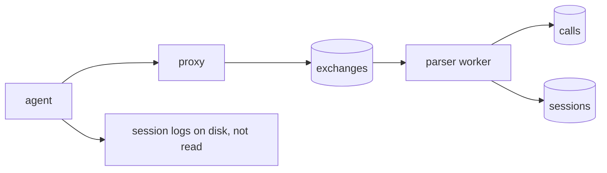
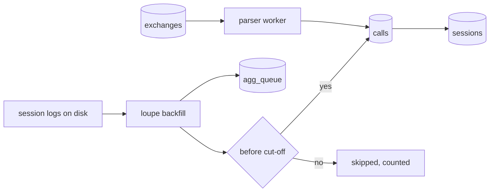
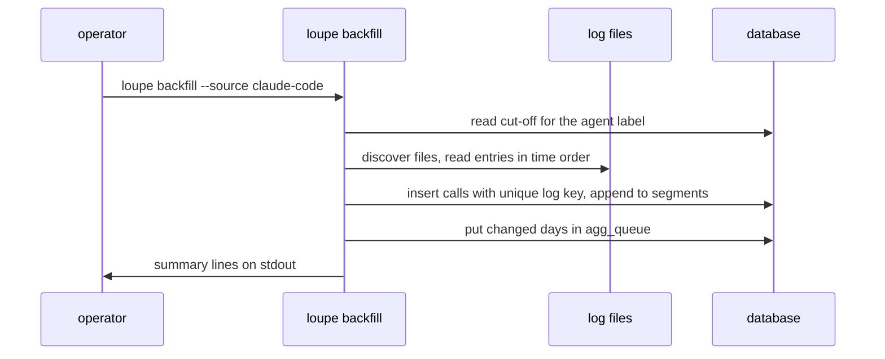
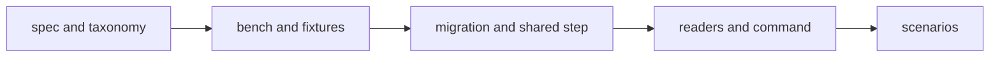

# Backfill of calls and sessions from the agent session logs

## Change Summary

After CR-0004, the parser writes calls and sessions only from exchanges that the proxy captured. The history therefore starts on the day that the proxy started. Claude Code and Pi also write a session log on disk for each conversation, and each assistant entry in these logs holds the model and the usage block. This CR adds the command `loupe backfill`. It reads the logs of one log source, finds one call per assistant message (and per Pi usage entry), and writes the calls and sessions with the same columns, the same segment rule, and the same prices as a proxied call. A cut-off at the first proxied exchange of the agent label prevents a double count. The published history then starts earlier.

## Motivation and Background

The README section "How it works" derives every public figure from the calls. A call that the proxy did not see is not in a day record, so the token velocity and the cost of the months before the proxy are zero. The session logs of the two agents already hold the token counts of these months. A backfill makes the history complete without a change to the hot path of the proxy.

## Change Drivers

* The owner asks for the history before the proxy (request of 2026-10-20).
* README "How it works": figures come from calls and sessions. A backfilled call must be a normal call for CR-0005, CR-0006, and CR-0007.
* README "Privacy model": no prompt, body, or path may be stored in plain form. The backfill reads files that hold prompts, so the rule must be explicit.

## Current State

* `calls` (migration `0008_calls.sql`) requires `exchange_id NOT NULL` with a unique key on (`exchange_id`, `call_index`). A call without an exchange cannot be stored.
* `sessions` (migration `0007_sessions.sql`) holds segments per scope (`agent_label`, `proxy_token_id`, `key_hash`), with `key_source` from the list of `docs/specification/parser.md`.
* The parser reads only `exchanges`. No command reads a file outside the data directory.
* Claude Code writes `~/.claude/projects/<cwd slug>/<session uuid>.jsonl`. Subagent transcripts are in `~/.claude/projects/<cwd slug>/<session uuid>/subagents/*.jsonl`. Field names that this CR uses (names only, checked on files of this machine on 2026-10-20): `type`, `uuid`, `sessionId`, `timestamp`, `isSidechain`, `requestId`, `version`, `message.id`, `message.model`, `message.usage.input_tokens`, `message.usage.cache_read_input_tokens`, `message.usage.cache_creation_input_tokens`, `message.usage.cache_creation.ephemeral_5m_input_tokens`, `message.usage.cache_creation.ephemeral_1h_input_tokens`, `message.usage.output_tokens`, `message.usage.service_tier`. One assistant message can occupy more than one line (one line per content block) with the same `message.id` and a repeated usage block.
* Pi 1.3.0 writes `~/.pi/agent/sessions/<cwd slug>/<timestamp>_<session id>.jsonl`, documented in `docs/session-format.md` and `docs/message-types.md` of the installed package. The first line has `type: session` with `id`. An entry of `type: message` with `message.role: assistant` holds `message.provider`, `message.model`, `message.responseId`, and `message.usage` with `input`, `output`, `cacheRead`, `cacheWrite`, `cacheWrite1h`, `totalTokens`, and `cost`. An entry of `type: usage` holds `kind`, `provider`, `model`, and `usage` outside the conversation (for example `cache_warm`). The `compaction` and `branch_summary` entries can carry a `usage` field.

### Current State Diagram



## Proposed Change

1. A new command `loupe backfill` with two log sources, `claude-code` and `pi`.
2. A schema change that lets a call come from a log entry: a nullable `exchange_id`, a column for the origin of the call, and a unique key per log entry.
3. One shared step that appends a call to its session with the segment rule of CR-0004, so a backfilled call and a proxied call follow the same rule.
4. A cut-off per agent label at the first proxied exchange.
5. The price of CR-0005 and a day rebuild through `agg_queue` of CR-0007 for each day that the backfill changes.

### Proposed State Diagram



### Backfill Sequence



## Requirements

### Functional Requirements

**Command surface**

1. The binary **MUST** add the command `loupe backfill --source claude-code|pi [--path DIR] [--from YYYY-MM-DD] [--to YYYY-MM-DD] [--cutoff-label LABEL] [--include-after-cutoff] [--dry-run]`. The flag names `--cutoff-label` and `--include-after-cutoff` and the counter `calls_after_cutoff` are identifiers; the prose term is cut-off.
2. `--source` **MUST** be required. A missing or unknown value **MUST** fail with exit code 2 and an actionable error that names the flag and the two valid values.
3. `--path` **MUST** default to `~/.claude/projects` for `claude-code` and to `~/.pi/agent/sessions` for `pi`. A missing or unreadable directory **MUST** fail with exit code 3 and an actionable error: what failed, the fixes (pass `--path`, check the permissions), and the check (`ls` of the directory). The error **MAY** print the `--path` value or the default directory, because the operator gave it or the binary owns it. It **MUST NOT** print a path from inside a log.
4. `--from` and `--to` **MUST** be dates in `LOUPE_TZ`, inclusive. They **MUST** filter the calls by the timestamp of the entry. Without them, the range **MUST** be all entries before the cut-off of requirement 22. The cut-off **MUST** always apply unless `--include-after-cutoff` is given, also when `--to` is after the cut-off.
5. The command **MUST** print one `key: value` line per counter on stdout when stdout is not a terminal: `files_read`, `entries_read`, `calls_added`, `calls_existing`, `calls_after_cutoff`, `calls_out_of_range`, `entries_skipped`, `sessions_opened`, `days_queued`, `cutoff`. `--human` **MAY** print a table. Errors **MUST** go to stderr.
6. `--dry-run` **MUST** read the files and print the same counters, and **MUST NOT** write to the database. In a dry run, `calls_added` **MUST** count the calls that a real run would add.
7. A malformed line **MUST NOT** stop the run. The command **MUST** count it in `entries_skipped` and **MUST** log the file index and line number, never the line or the path inside the log.
8. The command **MUST** exit 0 when it completes, also when it adds no call.

**Log sources and discovery**

9. For `claude-code`, the backfill **MUST** read every `*.jsonl` file directly under each project directory of `--path` as a main session file, and every `*.jsonl` file under `<session uuid>/subagents/` as a subagent file.
10. For `pi`, the backfill **MUST** read every `*.jsonl` file directly under each directory of `--path`. It **MUST NOT** read any other file under `~/.pi/agent`.
11. The backfill **MUST** read the entries of each file in line order, then **MUST** sort all calls of the run by timestamp before the session step of requirement 21, so the segments do not depend on the order of the files.

**Field mapping, Claude Code**

12. A Claude Code call **MUST** be one assistant message: the lines with `type: assistant` and a `message.usage` object, grouped by `message.id`. When more than one line has the same `message.id`, the backfill **MUST** take the usage of the last line of the group and **MUST** add one call only.
13. The token columns **MUST** follow requirement 10 of CR-0004: `input` from `input_tokens`, `cache_read` from `cache_read_input_tokens`, `cache_write_5m` and `cache_write_1h` from `cache_creation.ephemeral_5m_input_tokens` and `ephemeral_1h_input_tokens`, or the whole `cache_creation_input_tokens` in `cache_write_5m` when the split is absent, and `output` from `output_tokens`. `model` **MUST** come from `message.model`, `service_tier` from `usage.service_tier`, `started_at` from the `timestamp` of the first line of the `message.id` group, `upstream` **MUST** be `anthropic`. A message with the model `<synthetic>` or with all five counts at 0 **MUST NOT** make a call.

**Field mapping, Pi**

14. A Pi call **MUST** be one entry of `type: message` with `message.role: assistant` and a `message.usage` object, one entry of `type: usage`, or one `compaction` or `branch_summary` entry that carries a `usage` field.
15. The token columns **MUST** be: `input` from `input`, `cache_read` from `cacheRead`, `cache_write_1h` from `cacheWrite1h` (0 when absent), `cache_write_5m` from `cacheWrite` minus `cache_write_1h` when `cacheWrite1h` is present, else from `cacheWrite`, and `output` from `output`. The implementer **MUST** verify against the Pi source of version 1.3.0 whether `cacheWrite` includes `cacheWrite1h`, and **MUST** record the result in the Layer 2 document. `model` **MUST** come from `model`, `upstream` from `provider`, `started_at` from the entry `timestamp` (ISO 8601), and `service_tier` **MUST** be null.
16. The `cost` field of Pi **MUST NOT** be stored and **MUST NOT** be used as the cost of the call (requirement 25).

**Origin, idempotence, and labels**

17. A migration **MUST** change `calls` so that `exchange_id` is nullable, and **MUST** add `origin` (`proxy` or `log`, not null, default `proxy`) and `log_key` (nullable text) with a unique index on `log_key`. A check **MUST** require exactly one of `exchange_id` and `log_key`. The unique key on (`exchange_id`, `call_index`) **MUST** stay. The migration **MUST** let `sessions.key_source` hold the new value `log` (requirement 20), and `docs/specification/parser.md` and `docs/specification/backfill.md` **MUST** list it. Every existing reader of `calls` that joins `exchanges` (the parse worker and every query in `src/`) **MUST** use a left join or filter on `origin`, so that a log call is not dropped.
18. The `log_key` **MUST** be the HMAC-SHA256 under `LOUPE_ACCOUNT_KEY` of the log source plus the stable ID of the entry: for Claude Code the `sessionId` and `message.id`, for Pi the session `id` of the file and the entry `id`. A second run over the same files **MUST** add no call and **MUST** count the entry in `calls_existing`.
19. A backfilled call **MUST** have `agent_label` equal to the log source (`claude-code` or `pi`), `proxy_token_id` null, `status` 200, `origin` `log`, and `account_id` per requirement 24.

**Sessions**

20. The session key of a backfilled call **MUST** be the HMAC-SHA256 under `LOUPE_ACCOUNT_KEY` of the session ID of the log, with `key_source` `log`: for Claude Code the `sessionId` for a main file, and the file name stem of the subagent file for a subagent file (the key is the HMAC of the stem, never the stem), so a subagent is its own session. A line with `isSidechain: true` inside a main file **MUST** take the key of its file. The implementer **MUST** return as a doubt, not decide, if such lines occur on this machine with usage; for Pi the session `id` of the first line. The scope **MUST** be (agent label, null proxy token ID, key).
21. The backfill **MUST** append each call to its scope with the shared session step that the parser uses, with the gap rule of CR-0004 requirement 18 and `LOUPE_IDLE_SECS`. At the end of the run, it **MUST** close every open backfilled segment whose `last_call_at + LOUPE_IDLE_SECS` is before the cut-off, with `closed_at = last_call_at + LOUPE_IDLE_SECS`. A backfilled call that is older than a closed segment of its scope **MUST** start a new segment and **MUST NOT** reopen the closed one.

**Double count**

22. Pending the human (Open Question 1); provisional answer: the cut-off of an agent label **MUST** be the `started_at` of the oldest exchange with the cut-off label. The cut-off label **MUST** be the value of `--cutoff-label`, with the log source as the default, because the agent label is free text from the proxy route. With no exchange of that label, the cut-off **MUST** be the start time of the run. When no exchange has the cut-off label but other exchanges exist, the command **MUST** print one warning line on stderr that names `--cutoff-label` and the agent labels that exist. The backfill **MUST** add only calls with a timestamp before the cut-off, and **MUST** count the others in `calls_after_cutoff`.
23. The flag `--include-after-cutoff` **MUST** turn the cut-off off. The command **MUST** then print one warning line on stderr that says that calls can count twice. A double count that an override run makes is accepted and is not reversible: this CR adds no removal path, and a later run cannot remove a log call that a proxied call duplicates.

**Accounts**

24. Pending the human (Open Question 2); provisional answer: a backfilled call **MUST** have a null `account_id`, because the logs hold no account ID and no credential. The Layer 2 document **MUST** state this, and `docs/specification/accounts.md` **MUST** list `none` as the account of a call with origin `log`.

**Price and days**

25. A backfilled call **MUST** get its cost from the embedded prices of CR-0005 with the same rules as a proxied call, and **MUST** be an unpriced call when no price matches. If the backfill runs before CR-0005 lands, the price pass of CR-0005 **MUST** price the existing log calls the same as the existing proxied calls; the backfill does not need to run again.
26. When CR-0007 exists, the backfill **MUST** put each day in `LOUPE_TZ` that holds a new call into `agg_queue` in the same transaction as the calls, and **MUST** count the days in `days_queued`. Before CR-0007 exists, `days_queued` **MUST** be 0, and the initial build of CR-0007 **MUST** queue every day that holds a call of either origin, because a second backfill run adds no call and queues no day.
27. Each file **MUST** be one transaction (calls, segments, queue rows), so an interrupted run leaves whole files and a run again completes the rest.

**Privacy**

28. The backfill **MUST NOT** store or log a prompt, a content block, a tool input or output, a `cwd`, a file path from inside a log, a `gitBranch`, a raw session ID, a raw message ID, a `uuid`, a `requestId`, a `version`, a file name, a directory name (the cwd slug is a path in clear text), or any log field that is not in the column list of requirements 13 and 15. It **MUST** store only the columns of requirements 13, 15, 17 to 20.
29. A log line of the backfill **MUST** hold only counters, the log source, a file index, and a line number. An error on stderr **MAY** also hold the value of `--path` or the default directory (requirement 3), and nothing else from the file system.

**Configuration and documents**

30. The backfill **MUST** use `LOUPE_ACCOUNT_KEY`, `LOUPE_IDLE_SECS`, and `LOUPE_TZ`, and **MUST NOT** add a configuration variable. A missing `LOUPE_ACCOUNT_KEY` **MUST** fail with the actionable error of the configuration loader.
31. A new Layer 2 document `docs/specification/backfill.md` **MUST** describe the log sources, the discovery, the field mapping, the session key, the cut-off, the idempotent key, and the privacy rule, with field names only, before the code lands. `docs/specification/parser.md` **MUST** link to it for the `origin` column.
32. `.taxonomy` **MUST** add rows for **backfill run** (one run of `loupe backfill` over one log source), **log source** (an agent whose session logs on disk the backfill reads: `claude-code` or `pi`), **cut-off** (the oldest proxied exchange of the cut-off label), **log key** (the HMAC of the log source and the stable entry ID that makes a log call unique), and **origin** (where a call comes from: `proxy` or `log`), and **MUST** update the row of call to state that a call comes from an exchange or from a log entry.

### Non-Functional Requirements

1. A backfill of 10000 log entries **MUST** finish in at most 15 seconds in the container on this machine, measured with `.agents/scripts/backfill.bench.sh`.
2. The backfill **MUST** read a file as a stream of lines and **MUST NOT** hold more than one file of entries in memory.
3. Source files **MUST** follow the small-file rule with hierarchical names, for example `src/backfill/run.rs`, `src/backfill/discover.rs`, `src/backfill/claude_code.rs`, `src/backfill/pi.rs`, `src/backfill/cutoff.rs`, `src/backfill/key.rs`, `src/cli/backfill.rs`, and the shared session step in `src/session/append.rs`. Each file **MUST** carry one `@agents-index` line.
4. Governance identifiers **MUST NOT** appear in code, test names, or `docs/specification/`.

## Measurable Targets

| Metric | Method | Baseline | Threshold |
|---|---|---|---|
| Verdict | `.agents/scripts/pipeline.verdict.sh; echo $?` | exit 0 after CR-0004 | exit 0, every stage `status: passed` |
| Backfill time, 10000 entries | `.agents/scripts/backfill.bench.sh --entries 10000` prints `backfill_secs` | none, new measurement, added before the backfill | `backfill_secs` at most 15 |
| Idempotence | run `loupe backfill --source claude-code` twice on the fixtures | none | `calls_added: 0` on the second run |
| Real logs | `loupe backfill --source claude-code --dry-run` and `--source pi --dry-run` on this machine | 0 calls with origin `log` | `calls_added` above 0 for each source (in a dry run, the calls that a real run would add), `entries_skipped` at most 1 percent of `entries_read` |

## Affected Components

* New: a migration for `calls.origin`, `calls.log_key`, and the nullable `exchange_id`; `src/backfill/`; `src/cli/backfill.rs`; `src/session/append.rs` (shared step, moved from the parser); `docs/specification/backfill.md`; `tests/backfill.*.rs`; fixtures under `tests/fixtures/backfill/` (synthetic, no real log content); `.agents/scripts/backfill.bench.sh`; `.agents/scenarios/backfill.*.md`.
* Changed: the parser (uses the shared session step), `docs/specification/parser.md`, `docs/specification/accounts.md`, `.taxonomy`, the README section "The loupe binary" (one command line).
* Not changed: the proxy, the capture, `exchanges`, the public API, the dashboard.

## Scope Boundaries

### In Scope

* The two log sources of Claude Code and Pi, at the formats of Claude Code 2.1.304 and Pi 1.3.0.
* Calls, segments, prices, and the day queue for backfilled calls.

### Out of Scope ("Here, But Not Further")

* Summaries of backfilled sessions (CR-0006 reads bodies, and a log call has no body). A backfilled session has no summary.
* Other agents (Codex, Cursor) and other log formats.
* A watch mode or a scheduled backfill.
* A backfill of GitHub activity.

## Alternative Approaches Considered

* **Replay the logs through the proxy as fake exchanges.** Rejected: it writes encrypted bodies that hold prompts and it invents headers.
* **Use the cost that Pi recorded.** Rejected as the default: the history then has two price sources (Decision Outcome).
* **Dedupe by matching a log message to a proxied response.** Rejected as the default: the response ID is in the encrypted body, and a match needs a decrypt of every exchange. The cut-off is simpler (Open Question 1).

## Impact Assessment

### User Impact

The dashboard shows days before the proxy start. These days have no summaries and no account.

### Technical Impact

`calls.exchange_id` becomes nullable. Every reader of `calls` that joins `exchanges` **MUST** use a left join or filter on `origin`. The session step moves into a shared file.

### Business Impact

None outside the project.

## Implementation Approach

1. Write `docs/specification/backfill.md` and the taxonomy rows.
2. Add the bench script and synthetic fixtures, and record the baseline.
3. Add the migration and the shared session step, and keep the parser tests green.
4. Add the two readers, the cut-off, and the command.
5. Run the scenarios on this machine with `--dry-run`, then for real.

### Implementation Flow



## Test Strategy

### Tests to Add

| Test File | Test Name | Description | Inputs | Expected Output |
|-----------|-----------|-------------|--------|-----------------|
| `src/backfill/claude_code.rs` (unit) | `one_call_per_message_id` | Repeated lines | three lines with one `message.id` | one call with the usage of the last line |
| `src/backfill/claude_code.rs` (unit) | `split_and_legacy_cache_writes` | Cache columns | fixtures with split and with legacy field | counts in the right columns |
| `src/backfill/claude_code.rs` (unit) | `synthetic_or_zero_usage_gives_no_call` | Skip rule | `<synthetic>` model, all zero | no call |
| `src/backfill/pi.rs` (unit) | `maps_message_usage_and_usage_entry` | Pi entries | assistant message, `usage` entry, `compaction` with usage | three calls |
| `src/backfill/pi.rs` (unit) | `cache_write_1h_is_split_out` | 1h writes | `cacheWrite` and `cacheWrite1h` | columns per requirement 15 |
| `src/backfill/discover.rs` (unit) | `finds_main_and_subagent_files` | Discovery | temp tree | main and subagent files, nothing else |
| `src/backfill/key.rs` (unit) | `log_key_is_stable_and_hashed` | Key | same entry twice | same key, no raw ID in it |
| `src/backfill/cutoff.rs` (unit) | `cutoff_is_oldest_exchange_of_label` | Cut-off | exchanges of two labels | oldest of the label; run start when none |
| `src/session/append.rs` (unit) | `log_and_proxy_calls_share_gap_rule` | Shared step | calls with a gap above idle | two segments in both origins |
| `tests/backfill.cli.rs` | `backfill_twice_adds_nothing` | Idempotence | fixtures, two runs | `calls_added: 0` on the second |
| `tests/backfill.cli.rs` | `calls_after_cutoff_are_skipped` | Double count | fixture across a proxied exchange | later calls in `calls_after_cutoff` |
| `tests/backfill.cli.rs` | `missing_source_flag_names_the_flag` | Errors | no `--source`, bad `--path` | exit 2 and 3, fix on stderr |
| `tests/backfill.cli.rs` | `dry_run_writes_nothing` | Dry run | fixtures | counters printed, database unchanged |
| `tests/backfill.cli.rs` | `subagent_file_is_own_session` | Subagents | main file and subagent file | two sessions |
| `tests/backfill.secrets.rs` | `no_prompt_path_or_raw_id_stored` | Privacy | fixture with known marker strings in content, cwd, ids, file and directory names | no marker in the database file, the log, or stderr of an error |
| `tests/backfill.cli.rs` | `unknown_source_value_fails` | Req 2 | `--source codex` | exit 2, both valid values on stderr |
| `tests/backfill.cli.rs` | `missing_path_exits_3` | Req 3 | `--path` to a missing directory | exit 3, the `--path` value and no log path on stderr |
| `tests/backfill.cli.rs` | `malformed_line_is_counted` | Req 7 | file with one broken line | `entries_skipped: 1`, other calls added, log line has index and line number only |
| `src/backfill/discover.rs` (unit) | `pi_reads_only_sessions_dir` | Req 10 | temp `~/.pi/agent` tree with other files | only session files opened |
| `src/backfill/run.rs` (unit) | `calls_sorted_across_files` | Req 11 | two files with interleaved times | same segments in both file orders |
| `tests/backfill.cli.rs` | `closed_segment_not_reopened` | Req 21 | closed segment, then an older call | new segment; open segments closed at end of run |
| `tests/backfill.cli.rs` | `unpriced_model_is_unpriced_call` | Req 25 | unknown model | unpriced call |
| `tests/backfill.cli.rs` | `interrupted_run_keeps_whole_files` | Req 27 | failure injected in the second file | first file complete, second absent, rerun completes |
| `tests/backfill.cli.rs` | `missing_account_key_fails` | Req 30 | no `LOUPE_ACCOUNT_KEY` | actionable error of the loader, non-zero exit |
| `tests/backfill.cli.rs` | `include_after_cutoff_warns` | Req 23 | `--include-after-cutoff` | one warning line on stderr |
| `tests/backfill.cli.rs` | `cutoff_label_unmatched_warns` | Req 22 | exchanges only under label `cc` | warning names `--cutoff-label`; with `--cutoff-label cc` the cut-off is the `cc` exchange |
| `tests/backfill.cli.rs` | `to_after_cutoff_still_cut` | Req 4 | `--to` after the cut-off | later calls in `calls_after_cutoff` |
| `tests/calls.schema.rs` | `exchange_or_log_key_required` | Req 17 | insert with both and with neither | both rejected by the check |
| `tests/calls.readers.rs` | `readers_keep_log_calls` | Req 17 | one log call | every reader that joins `exchanges` returns it |

### Tests to Modify

| Test File | Test Name | Current Behavior | New Behavior | Reason for Change |
|-----------|-----------|------------------|--------------|-------------------|
| `tests/parse.worker.rs` | `parse_twice_adds_nothing` | checks proxied calls | also checks `origin = proxy` | new column |

### Tests to Remove

Not applicable: no test covers removed behaviour.

## Model-Based Testing

| Scenario | User Goal | User Surface | Success Condition | Criteria Proved | Scenario Record |
|----------|-----------|--------------|-------------------|-----------------|-----------------|
| Backfill real Claude Code logs | The operator sees calls from before the proxy | command line | after `loupe backfill --source claude-code`, `sqlite3` shows calls with `origin = 'log'`, all before the cut-off, and a second run prints `calls_added: 0` | AC-1, AC-4, AC-5 | `.agents/scenarios/backfill.claude-code.md` |
| Backfill real Pi logs | The same for Pi | command line | calls with `agent_label = 'pi'` and `origin = 'log'` exist, `entries_skipped` at most 1 percent | AC-2, AC-5 | `.agents/scenarios/backfill.pi.md` |

## Acceptance Criteria

### AC-1: A Claude Code message becomes one call

```gherkin
Given a Claude Code log with one assistant message on three lines with the same message id
When the operator runs "loupe backfill --source claude-code --path <fixture dir>"
Then one call row exists with origin "log" and agent label "claude-code"
And its token columns equal the usage of the last line
```

### AC-2: Pi entries become calls

```gherkin
Given a Pi log with one assistant message entry and one usage entry of kind "cache_warm"
When the operator runs "loupe backfill --source pi --path <fixture dir>"
Then two call rows exist with agent label "pi" and a null proxy token id
And no call stores the cost that Pi recorded
```

### AC-3: A subagent is its own session

```gherkin
Given a Claude Code session file and a subagent file of that session
When the operator runs the backfill
Then the calls of the subagent file are in a session with a different key hash
```

### AC-4: No double count

```gherkin
Given a proxied exchange of agent label "claude-code" at time T
And a Claude Code log with calls before and after T
When the operator runs the backfill without --include-after-cutoff
Then only the calls before T are added
And "calls_after_cutoff" counts the others
```

### AC-5: The backfill is idempotent

```gherkin
Given a completed backfill run
When the operator runs the same command again
Then "calls_added: 0" is printed
And the count of rows in calls and sessions does not change
```

### AC-6: Segments follow the idle rule

```gherkin
Given LOUPE_IDLE_SECS is 60
And a log session with two calls 120 seconds apart
When the operator runs the backfill
Then the session has two closed segments
```

### AC-7: Errors carry the fix

```gherkin
Given no --source flag
When the operator runs "loupe backfill"
Then the exit code is 2
And stderr names the flag "--source" and the values "claude-code" and "pi"
```

### AC-8: No prompt, path, or raw id is stored

```gherkin
Given a fixture log whose content, cwd, and ids hold known marker strings
When the operator runs the backfill
Then no marker string is in the database file or in the log file
```

### AC-10: A malformed line does not stop the run

```gherkin
Given a log file with one malformed line between two valid calls
When the operator runs the backfill
Then two calls are added
And "entries_skipped: 1" is printed
```

### AC-11: A closed segment is not reopened

```gherkin
Given a closed backfilled segment of a scope
When the backfill adds an older call of that scope
Then a new segment holds the call
And the closed segment does not change
```

### AC-12: An interrupted run keeps whole files

```gherkin
Given a run that stops during the second file
When the operator runs the same command again
Then the calls of the first file exist once
And the calls of the second file are added
```

### AC-13: A cut-off label with no exchange warns

```gherkin
Given proxied exchanges only with agent label "cc"
When the operator runs "loupe backfill --source claude-code"
Then stderr holds one warning that names "--cutoff-label"
And with "--cutoff-label cc" the cut-off is the oldest "cc" exchange
```

### AC-9: Changed days are queued

```gherkin
Given CR-0007 is implemented
When the backfill adds calls on two days in LOUPE_TZ
Then agg_queue holds those two days
And "days_queued: 2" is printed
```

## Quality Standards Compliance

### Build & Compilation

The crate builds with no warnings through the verdict pipeline.

### Linting & Code Style

`cargo fmt --check` and `cargo clippy -D warnings` pass.

### Test Execution

All tests of the table pass in the verdict pipeline.

### Documentation

`docs/specification/backfill.md` lands before the code. Each new file has one `@agents-index` line.

### Code Review

A reviewer agent reviews the diff against this CR.

### Verification Commands

```bash
.agents/scripts/pipeline.verdict.sh
.agents/scripts/backfill.bench.sh --entries 10000
loupe backfill --source claude-code --dry-run
loupe backfill --source pi --dry-run
```

## Risks and Mitigation

### Risk 1: The log formats change

The formats are not a public contract. Mitigation: the readers skip unknown entries and count them, and the Layer 2 document records the verified agent versions.

### Risk 2: A log holds usage that the proxy also saw

Mitigation: the cut-off of requirement 22 with `--cutoff-label`, and a warning when the label has no exchange. The override prints a warning. A double count that an override run makes is accepted and is not reversible (requirement 23).

### Risk 3: Claude Code repeats or rewrites usage across lines

Mitigation: one call per `message.id` with the last usage (requirement 12), and a unit test.

### Risk 4: Old logs were deleted

Claude Code deletes old logs after a retention period. Mitigation: none in this CR. The history starts at the oldest kept log.

## Dependencies

* CR-0004 (implemented): `calls`, `sessions`, the segment rule, the parser.
* CR-0005: prices. Before CR-0005, backfilled calls have no cost, the same as proxied calls. CR-0005 prices the existing log calls (requirement 25).
* CR-0007: `agg_queue` and the day records. Before CR-0007, requirement 26 queues nothing, and the initial build of CR-0007 queues the days of the existing log calls (requirement 26).

## Estimated Effort

About 2 days of agent work.

## Decision Outcome

Decided by a stated default (not open):

* Price source: the embedded prices of CR-0005 for every call (requirement 16, 25). Source: the README section "Cost" and the delegation of 2026-10-20, so the history has one price source.
* Default range: all entries before the cut-off (requirement 4). Source: the request of 2026-10-20, which asks for the full history before the proxy.

Chosen approach: "a separate command that reads the logs into the existing calls and sessions tables, with a per-entry hashed key, a cut-off at the first proxied exchange, and the shared segment step", because it gives one history with one price source and one session rule, and it does not change the proxy.

## Open Questions

1. **Double-count rule** (requirement 22, pending the human). Options: a cut-off at the first proxied exchange of the cut-off label (simple, but a log call after the cut-off that the proxy did not see is lost); a per-message match against proxied responses (exact, but it decrypts every exchange). Recommendation: the cut-off with `--cutoff-label` and the override flag, because it needs no decrypt and the proxy sees every later call of a configured agent.
2. **Account of a backfilled call** (requirement 24, pending the human). Options: null; one synthetic account per log source; an account that the operator names with a flag. Recommendation: null, because the logs hold no account identity and an invented account changes the account count.
3. **Summaries of backfilled sessions** (Out of Scope, pending the human). Options: none; a summary from the log content in a later CR. Recommendation: none in this CR, because a summary needs the prompts and the privacy rule of a later CR.

## Related Items

* CR-0004, CR-0005, CR-0007 (dependencies); CR-0006 (summaries, not for backfilled sessions).
* README sections "How it works", "The loupe binary", "Accounts", "Cost", "Privacy model".

## Approval

Not approved. Waiting for the reviewer agent.
