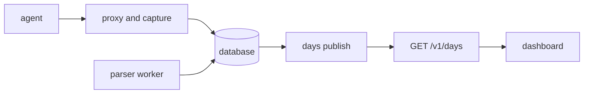
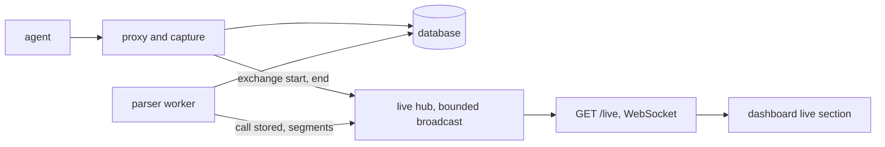
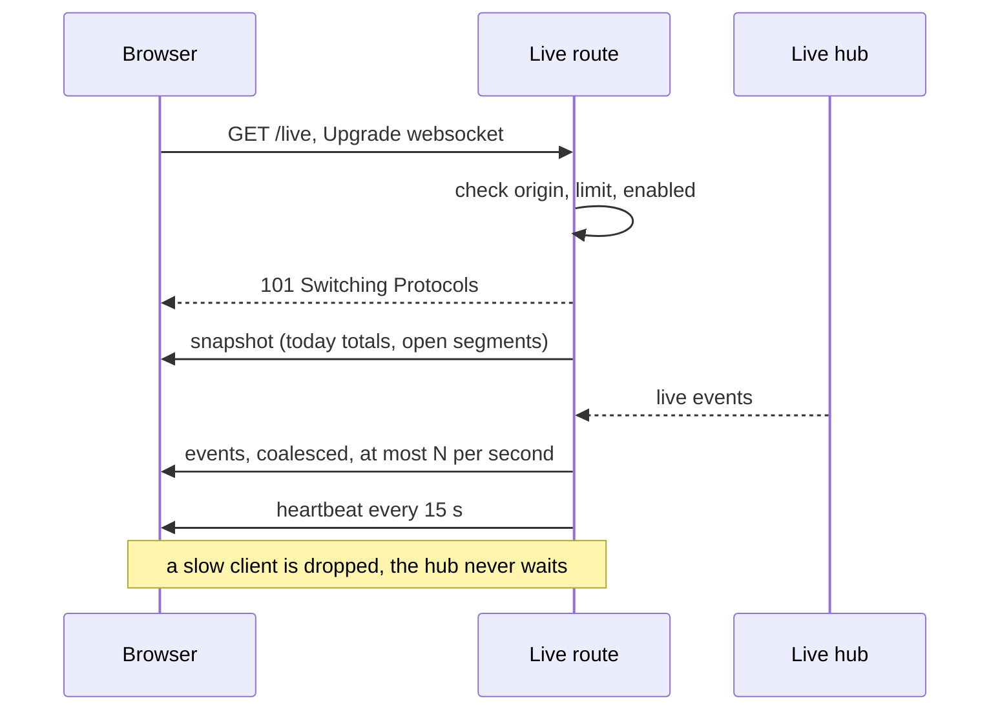
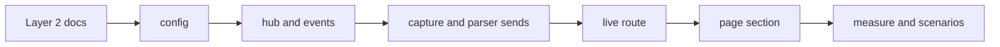

# Live metrics over a WebSocket on the dashboard

## Change Summary

The dashboard shows published days. It does not show the work that occurs now. This CR adds a live route, `GET /live`, that upgrades to a WebSocket. The binary sends live events through it: an exchange starts, an exchange ends, the parser stores a call with its token counts, and the count of open segments changes. A live section on the dashboard, under the headline, shows the calls, the tokens, the open segments, and the API-equivalent cost of the current day, and a rolling chart of the last 10 minutes.

## Motivation and Background

The owner wants to follow the turns, the tokens, and other metrics of the agents in real time. The binary already sees each exchange when it starts and ends, and the parser finds each call a few seconds later. These facts are in the database, but no surface shows them before the day is published. A WebSocket from the same binary gives the data with a delay of seconds and adds no external service.

The word "turn" in the request has no exact meaning that the binary can observe. One turn of an agent is one or more model calls. This CR therefore uses the call as the unit and does not promise a count of turns.

## Change Drivers

1. The request of the owner: follow calls, tokens, and other metrics in real time.
2. The dashboard (CR-0008) shows only published days, with a delay of up to one publish interval.
3. The binary has the events in memory at the moment they occur, so a live feed costs little.

## Current State

- The router serves the reserved first path segments `healthz`, `v1`, `assets`, `favicon.ico` (`src/serve/router.rs`, `RESERVED`) and proxies every other path.
- The forwarder removes the `upgrade` header, so the proxy does not support a WebSocket (`docs/specification/proxy.md`).
- The capture stores each exchange with sizes and timing. The parser worker runs every `LOUPE_PARSE_INTERVAL_SECS` (default 5) and stores calls and segments (`docs/specification/parser.md`).
- The dashboard reads only `GET /v1/days` and has the CSP `connect-src 'self'` (`docs/specification/dashboard.md`).

### Current State Diagram



## Proposed Change

1. A **live hub** in the binary: one bounded `tokio::sync::broadcast` channel. The capture sends an event at exchange start and at exchange end. The parser sends an event when it stores a call and when the count of open segments changes.
2. A **live route** `GET /live` that upgrades to a WebSocket, sends a snapshot, then forwards live events with a rate limit and a heartbeat.
3. A **live section** on the dashboard under the headline that opens the socket, shows the counters and a rolling chart, and reconnects with backoff.

### Proposed State Diagram



### Connect sequence



## Requirements

### Functional Requirements

**Live route**

1. The binary **MUST** serve `GET /live` as a WebSocket upgrade route. A request without a valid upgrade **MUST** return `426` with a JSON error body and `upgrade: websocket`.
2. The router **MUST** add `live` to the list of reserved first path segments. The name `live` **MUST NOT** be a valid agent label or upstream name. A path under `/live/` other than `/live` **MUST** return `404`.
3. The route **MUST** accept the upgrade only when the `origin` header is absent, or when the `host:port` of the `origin` header equals the `Host` header of the request (a default port is made explicit on both sides before the comparison, and the scheme is ignored, because a front proxy can end TLS). If `LOUPE_LIVE_ALLOWED_ORIGIN` is set, an `origin` equal to that value **MUST** also be accepted. Another origin **MUST** return `403`. A request with no `origin` header (a non-browser client) **MUST** be accepted.
4. The route **MUST NOT** set or read a cookie. The route **MUST NOT** accept a proxy token in the path or in a query parameter. A query string **MUST** be ignored.
5. The route **MUST** answer a client ping control frame with a pong and **MUST** answer a client close control frame with a close. The route **MUST** discard each client text or binary data frame of 1 KiB or less. The route **MUST** close the socket with code `1009` on a client data frame larger than 1 KiB.
6. If `LOUPE_LIVE_ENABLED` is `false`, `GET /live` **MUST** return `404`, and the hub **MUST NOT** start.

**Live hub and live events**

7. The binary **MUST** hold one live hub: a `tokio::sync::broadcast` channel with a capacity of `LOUPE_LIVE_BUFFER` (default 1024).
8. The capture **MUST** send `exchange.start` when it forwards a request and `exchange.end` when the response ends, with or without an error. A send **MUST NOT** wait. A send with no receiver **MUST** be a no-op.
9. The parser **MUST** send `call.stored` for each call that it stores and `segments.open` when the count of open segments changes after a parse pass.
10. **Named parameter `live_access`, decided: option (c) (Decision 1).** The live route `/live` is public and sends only counts and token sums. The full allowlist applies only to a later private feed on the private page of CR-0011. Each live event **MUST** hold only the fields of the column for its route:

| Kind | Public route `/live` (this CR) | Private feed (later, when CR-0011 lands) |
|---|---|---|
| `exchange.start` | `ts` | `ts`, `agent` |
| `exchange.end` | `ts`, `status` | `ts`, `agent`, `status`, `ttfb_ms`, `duration_ms` |
| `call.stored` | `ts`, the five token counts, `cost_usd` | `ts`, `agent`, `model`, `input`, `output`, `cache_read`, `cache_write`, `reasoning`, `cost_usd` |
| `segments.open` | `ts`, `count` | same as public |
| `heartbeat` | `ts` | same as public |
| `snapshot` | `date`, `calls`, `tokens` (five counts), `cost_usd`, `segments_open`, `in_flight`, `live_enabled` | same as public |
| `calls.batch` | `ts`, `calls`, the five token counts, `cost_usd` | as public, plus `by_agent` (per agent label: `calls`, five token counts, `cost_usd`) |
| `exchanges.batch` | `ts`, `started`, `ended`, `in_flight` | same as public |

`status` is the HTTP status. The five token counts are `input`, `output`, `cache_read`, `cache_write`, `reasoning`. `cost_usd` is the API-equivalent cost from CR-0005 pricing, `null` if no price. The public route **MUST** use the public column and **MUST NOT** require authentication. The private column is out of scope of this CR; it applies only on the private page of CR-0011, in a later change.

11. A live event **MUST NOT** hold a prompt, a body, a path, a query, a header, a session key, a segment ID, an account, a proxy token, a token ID, a token name, an upstream URL, or a summary. A serializer test **MUST** prove the allowlist for each kind of the table of requirement 10, including `snapshot`, `calls.batch`, and `exchanges.batch`.
12. This requirement applies only to the later private feed of requirement 10, not to the public route of this CR. Where an allowlist holds `agent` or `by_agent`, the value **MUST** be the agent label of the exchange, the same value that `by_agent` in the public API shows.

**Envelope and snapshot**

13. Each frame **MUST** be one JSON text frame: `{"v":1,"kind":"<kind>","data":{...}}`. A change that removes or renames a field **MUST** increment `v`.
14. After the upgrade, the route **MUST** send one `snapshot` frame first: `{"v":1,"kind":"snapshot","data":{"date":"YYYY-MM-DD","calls":N,"tokens":{five counts},"cost_usd":X,"segments_open":N,"in_flight":N,"live_enabled":true}}`. `segments_open` is the count of segments with the state open. The date and totals **MUST** be the current day in `LOUPE_TZ` from the `calls` table, computed with the same rules as the day records of `docs/specification/days.md`.

**Rate and coalescing**

15. The route **MUST** send at most `LOUPE_LIVE_MAX_RATE` frames per second to one client (default 10). Above the rate, the route **MUST** coalesce: it sums `call.stored` counts into one `calls.batch` frame (`ts`, `calls`, five token counts, `cost_usd`; no per-agent sums on the public route) and keeps only the last `segments.open`. Exchange start and end above the rate **MUST** become one `exchanges.batch` frame with `started`, `ended`, and `in_flight`.
16. The route **MUST** send a `heartbeat` frame every 15 seconds when it sends no other frame.

**Connections and back-pressure**

17. The route **MUST** accept at most `LOUPE_LIVE_MAX_CONNECTIONS` sockets at one time (default 32). The next upgrade **MUST** return `503` with `retry-after: 30`.
18. A client whose receiver lags (the broadcast returns `Lagged`) or whose write does not complete in 5 seconds **MUST** be closed with code `1008`. The capture, the proxy, and the parser **MUST NOT** wait for a client.

**Live section on the page**

19. The dashboard **MUST** show a live section under the headline with four figures for the current day: calls, tokens (sum of the five counts), open segments, and API-equivalent cost, plus a count of exchanges in flight. This metric set is decided: named parameter `live_metrics`, option (a) (Decision 2).
20. The live section **MUST** show a rolling chart of tokens per 10-second bucket for the last 10 minutes, in inline SVG, with the design tokens of CR-0008 (`docs/specification/dashboard.md`).
21. The page **MUST** open the socket at `ws://` or `wss://` of the page origin, path `/live`. On a close, the page **MUST** reconnect with backoff of 1, 2, 4, 8, 16, and 30 seconds, and **MUST** reset the backoff after a snapshot.
22. When the socket is closed, the section **MUST** show the state "Live feed paused, reconnecting" and keep the last figures in a muted style. Because a browser WebSocket cannot read the HTTP status of a failed upgrade, the page **MUST** hide the section when 3 connects in a row fail with no `snapshot` frame received since the page load. The section **MUST** stay hidden until a reload. A browser that blocks the connection (for example a browser below the baseline of CR-0008) therefore shows the paused state and then hides the section.
23. The page **MUST NOT** use `localStorage`, `sessionStorage`, IndexedDB, or a cookie for the live section. The page **MUST** stop the socket when the document is hidden and reopen it when it is visible.
24. The page modules **MUST** be plain ES modules with no framework and no build step, as in CR-0008.

**CSP, configuration, and taxonomy**

25. The CSP `connect-src 'self'` covers a same-origin `ws:` and `wss:` in the CSP Level 3 browsers of the baseline of CR-0008 (`docs/specification/dashboard.md`). Older Safari versions did not match `ws:` to `'self'`; in such a browser the page shows the behaviour of requirement 22. The CSP **MUST NOT** change. A test **MUST** assert the header and a browser scenario **MUST** prove the connection under it.
26. The configuration **MUST** add `LOUPE_LIVE_ENABLED` (default `true`), `LOUPE_LIVE_ALLOWED_ORIGIN` (optional, an origin, default unset), `LOUPE_LIVE_MAX_RATE` (1 to 50, default 10, named parameter `live_max_rate_default`, decided in Decision 3), `LOUPE_LIVE_MAX_CONNECTIONS` (1 to 1024, default 32), and `LOUPE_LIVE_BUFFER` (64 to 65536, default 1024). A value out of range **MUST** stop the start-up with an actionable error that names the variable.
27. `loupe config show` **MUST** print `live_enabled`, `live_allowed_origin`, `live_max_rate`, `live_max_connections`, and `live_buffer`, each with its source.
28. The `.taxonomy` **MUST** get these four rows in the category of the dashboard:

| Term | Means | Not | Lives in |
|---|---|---|---|
| live event | One JSON frame that the live route sends, with an envelope `v`, `kind`, `data`, and only the fields of the allowlist for its kind; kinds are snapshot, exchange.start, exchange.end, call.stored, segments.open, calls.batch, exchanges.batch, heartbeat. | A call or an exchange record in the database; a day record of the public API. | `docs/specification/live.md` |
| live route | The reserved route `GET /live` of the binary that upgrades to a WebSocket and sends live events with a rate limit and a heartbeat. | A proxied path, which the proxy forwards to an upstream and which never upgrades; the public API under `/v1`. | `docs/specification/live.md`, `docs/specification/proxy.md`, `src/serve/router.rs` |
| live hub | The one bounded broadcast channel in the binary to which the capture and the parser send live events without a wait. | The database; the live route, which reads from the hub for each client. | `docs/specification/live.md` |
| live section | The section of the dashboard under the headline that shows the figures of the current day and a rolling chart from the live route. | The headline and the sections of published days, which read `GET /v1/days`. | `docs/specification/dashboard.md` |

29. Layer 2 **MUST** add `docs/specification/live.md` and **MUST** update `docs/specification/dashboard.md` (live section, states) and `docs/specification/proxy.md` (reserved list with `live`). README.md **MUST** describe the live section in the Dashboard section and the live feed in the Privacy model section.

### Non-Functional Requirements

1. **Latency.** The p95 time from exchange end to the `exchange.end` frame on the client **MUST** be at most 250 ms. The p95 time from response end to `call.stored` **MUST** be at most `LOUPE_PARSE_INTERVAL_SECS` plus 1 second.
2. **No proxy cost.** The proxy time to first byte **MUST NOT** increase by more than 1 ms p95 with 32 live clients connected.
3. **Size.** The added page code (JavaScript and CSS, before compression) **MUST** be at most 12 KiB.
4. **Memory.** The hub and 32 clients **MUST** add at most 8 MiB of resident memory.

## Measurable Targets

| Metric | Method | Baseline | Threshold |
|---|---|---|---|
| Event latency, exchange end to client | `cargo test --test live.latency -- --nocapture` (1000 exchanges, local WebSocket client) | none (new) | p95 at most 250 ms |
| Proxy time to first byte | `cargo bench --bench proxy.ttfb` with 0 and 32 clients | the value with 0 clients | difference p95 at most 1 ms |
| Added page code | `wc -c web/assets/live.*.js web/assets/live.css` | 0 | at most 12288 bytes |
| Resident memory | `tests/live.memory.rs` reads RSS before and after 32 clients | before value | difference at most 8 MiB |

## Affected Components

- `src/serve/router.rs`: reserved list and the live route.
- A new live module for the hub, the route, the envelope, and the rate limit.
- The capture and the parser: send events to the hub.
- The configuration and `loupe config show`.
- `web/index.html` and new `web/assets/live.*.js` modules and CSS.
- `docs/specification/live.md` (new), `dashboard.md`, `proxy.md`, README.md, `.taxonomy`.

## Scope Boundaries

### In Scope

- The live route, the hub, the events, the snapshot, the rate limit, the connection limit, the page section, the configuration, Layer 2, tests.

### Out of Scope ("Here, But Not Further")

- A count of agent turns. The binary observes calls, not turns.
- Per-token streaming of a response, or any content of a prompt or response.
- History older than the snapshot of the current day; the rolling chart starts empty on load.
- A live feed through the GitHub-published site (CR-0009); the static site has no socket.
- Authentication of the live route, and the private feed with the full allowlist; the private feed follows CR-0011 (Decision 1).

## Alternative Approaches Considered

1. **Server-Sent Events** on `/v1/live`. Simpler, and one direction is sufficient. The request names WebSockets, and axum 0.8 has the `ws` feature, so this CR uses a WebSocket. SSE stays a fallback if the review prefers it.
2. **Page polling of `/v1/days`.** Days are published on an interval, so the delay stays in minutes. Rejected.
3. **Database triggers or a poll of `calls`.** Adds load and a delay. The in-memory channel is cheaper.

## Impact Assessment

### User Impact

The reader sees the activity as it occurs. A public reader also sees when the owner works, which the daily records do not show. The public feed holds no agent label and no model, so it does not show which agent works (Decision 1).

### Technical Impact

A new dependency feature (`axum` `ws`) and a new reserved segment. An agent label named `live` becomes invalid; the start-up check for labels covers it.

### Business Impact

None. No new paid service.

## Implementation Approach

1. Layer 2: write `docs/specification/live.md`, update `dashboard.md`, `proxy.md`, README.md, `.taxonomy`.
2. Add the configuration and `loupe config show` lines.
3. Add the hub and the event types with the allowlist serializer and its tests.
4. Send events from the capture and the parser.
5. Add the route: upgrade, origin, limit, snapshot, rate, heartbeat, back-pressure.
6. Add the page modules and the section.
7. Run the measurements and the browser scenarios.

### Implementation Flow



## Test Strategy

### Tests to Add

| Test File | Test Name | Description | Inputs | Expected Output | Requirement |
|---|---|---|---|---|---|
| `tests/live.route.rs` | `upgrade_returns_101_and_snapshot` | Connect | WebSocket client to `/live` | `101`, first frame `kind: snapshot`, `v: 1` | 1, 13, 14 |
| `tests/live.route.rs` | `plain_get_is_426` | No upgrade | `GET /live` | `426` | 1 |
| `tests/live.route.rs` | `foreign_origin_is_403` | Origin | `origin: https://evil.example` | `403` | 3 |
| `tests/live.route.rs` | `absent_origin_is_accepted` | Origin | upgrade with no `origin` header | `101` | 3 |
| `tests/live.route.rs` | `origin_matches_host_any_scheme` | Origin | `origin: https://h:8787`, `Host: h:8787`; and `LOUPE_LIVE_ALLOWED_ORIGIN` set | `101` in both cases | 3, 26 |
| `tests/live.route.rs` | `live_subpath_is_404` | Router | `GET /live/x` | `404` | 2 |
| `tests/live.route.rs` | `agent_label_live_refused` | Router | agent label `live` in configuration | start-up refuses the label | 2 |
| `tests/live.route.rs` | `query_and_token_ignored` | Privacy | `/live?token=abc&x=1` | `101`, same snapshot as `/live`, no token read | 4 |
| `tests/live.route.rs` | `ping_pong_and_close` | Frames | client ping, then client close | pong, then close | 5 |
| `tests/live.route.rs` | `small_data_frame_discarded` | Frames | client text frame of 100 bytes | no reply, socket stays open | 5 |
| `tests/live.route.rs` | `large_data_frame_closes_1009` | Frames | client binary frame of 2 KiB | close `1009` | 5 |
| `tests/live.route.rs` | `disabled_is_404` | Config | `LOUPE_LIVE_ENABLED=false` | `404`, no hub | 6 |
| `tests/live.route.rs` | `connection_limit_is_503` | Limit | 33 clients, limit 32 | 33rd gets `503`, `retry-after: 30` | 17 |
| `tests/live.route.rs` | `no_cookie_set` | Privacy | upgrade | no `set-cookie` | 4 |
| `tests/live.events.rs` | `exchange_events_in_order` | Capture | one proxied exchange | `exchange.start` then `exchange.end` with `ts` and `status` only | 8 |
| `tests/live.events.rs` | `call_stored_after_parse` | Parser | one exchange with usage | `call.stored` with five counts equal to the `calls` row | 9 |
| `tests/live.events.rs` | `segments_open_after_parse` | Parser | one segment opens, then closes on idle | `segments.open` with count 1, then 0 | 9 |
| `tests/live.events.rs` | `allowlist_per_kind` | Privacy | each kind of requirement 10 (also `snapshot`, `calls.batch`, `exchanges.batch`) for the public column of `live_access` option (c), seeded secrets in body, path, token | keys equal the allowlist, no seeded secret in any frame | 10, 11 |
| `tests/live.events.rs` | `snapshot_matches_day_rules` | Snapshot | seeded calls across midnight in `LOUPE_TZ` | totals of the current day only | 14 |
| `tests/live.rate.rs` | `coalesces_above_rate` | Rate | 500 calls in 1 s, rate 10 | at most 10 frames per second, sums equal 500 calls | 15 |
| `tests/live.rate.rs` | `heartbeat_when_idle` | Heartbeat | 16 s idle (paused clock) | one `heartbeat` | 16 |
| `tests/live.backpressure.rs` | `slow_client_dropped` | Lag | client that does not read, buffer 64 | close `1008`, proxy exchange completes | 7, 18 |
| `tests/live.latency.rs` | `exchange_end_latency_p95` | Target | 1000 exchanges | p95 at most 250 ms | NFR 1 |
| `tests/live.memory.rs` | `rss_delta_32_clients` | Target | 32 clients | at most 8 MiB | NFR 4 |
| `tests/config.live.rs` | `live_config_ranges_and_show` | Config | out-of-range values, `loupe config show` | actionable error names the variable; five lines printed | 26, 27 |
| `tests/web.serve.rs` | `csp_connect_src_self_unchanged` | CSP | `GET /` | CSP equal to the value of `docs/specification/dashboard.md` | 25 |
| `web/tests/live.socket.test.js` | `reconnect_backoff_sequence` | Page | closes in a row | delays 1, 2, 4, 8, 16, 30, 30 s; reset after snapshot | 21 |
| `web/tests/live.socket.test.js` | `hides_after_three_failed_connects` | Page | 3 failed connects, no snapshot | section hidden | 22 |
| `web/tests/live.socket.test.js` | `paused_state_keeps_figures` | Page | snapshot, then close | paused text, last figures muted | 22 |
| `web/tests/live.socket.test.js` | `stops_when_hidden_reopens_when_visible` | Page | `visibilitychange` to hidden, then visible | socket closed, then a new socket | 23 |
| `web/tests/live.state.test.js` | `applies_snapshot_and_events` | Page | snapshot, events, batches | figures equal the sums | 19 |
| `web/tests/live.chart.test.js` | `rolling_buckets_10_minutes` | Page | events over 12 min | 60 buckets, oldest dropped | 20 |
| `web/tests/live.chart.test.js` | `chart_is_inline_svg_with_tokens` | Page | render the chart | one inline `svg`, colours only from `var(--...)` design tokens | 20 |
| `web/tests/live.storage.test.js` | `no_storage_access` | Page | run the module | no access to storage APIs or `document.cookie` | 23 |
| `web/tests/live.modules.test.js` | `plain_es_modules` | Page | read the module files | ES `import` only, no framework import | 24 |

### Tests to Modify

| Test File | Test Name | Change |
|---|---|---|
| `tests/serve.router.rs` (or the current router test) | reserved list test | add `live` |

### Tests to Remove

None.

## Model-Based Testing

| Scenario | User Goal | User Surface | Success Condition | Criteria Proved | Scenario Record |
|---|---|---|---|---|---|
| Live follow | Follow the calls and tokens as they occur | browser | with the page open, one agent call through the proxy raises the calls figure by 1 and the tokens figure by the stored sum within parse interval plus 1 s, with no reload | AC-1, AC-3 | `.agents/scenarios/dashboard.live.follow.md` |
| Reconnect | Keep the view when the binary restarts | browser | after a restart of the container, the section shows the paused state, then the figures return within 35 s with no reload | AC-6 | `.agents/scenarios/dashboard.live.reconnect.md` |
| Disabled | Run without a live feed | browser | with `LOUPE_LIVE_ENABLED=false`, the page shows no live section after 3 failed connects | AC-7 | `.agents/scenarios/dashboard.live.disabled.md` |
| CSP | Connect under the CSP | browser of the CR-0008 baseline | the socket opens and the console shows no CSP violation | AC-9 | `.agents/scenarios/dashboard.live.follow.md` |

Criteria with no user surface are proved by the Rust tests: AC-2 by `allowlist_per_kind`, AC-4 by `coalesces_above_rate`, AC-5 by `slow_client_dropped`, AC-8 by `connection_limit_is_503`, `foreign_origin_is_403`, and `large_data_frame_closes_1009`, and AC-10 by the commands of the Measurable Targets.

## Acceptance Criteria

### AC-1: The live route sends a snapshot

```gherkin
Given the container runs with "docker compose up -d"
When a WebSocket client connects to "ws://127.0.0.1:8787/live"
Then the upgrade returns 101
  And the first frame has "v" 1 and "kind" "snapshot"
  And the snapshot totals equal the calls of the current day in LOUPE_TZ
```

### AC-2: Live events hold only allowlisted fields

```gherkin
Given an exchange whose body, path, and headers hold a seeded secret
When the exchange passes the proxy and the parser stores its call
Then each frame on the socket holds only the fields of the public allowlist for its kind
  And no frame holds an agent label, a model, or a by_agent split
  And no frame holds the seeded secret, a session key, an account, or a token name
```

### AC-3: A call reaches the page in time

```gherkin
Given the dashboard is open in a browser
When one model call ends through the proxy
Then the calls figure increases by 1 within LOUPE_PARSE_INTERVAL_SECS plus 1 second
  And the exchanges in flight return to 0 within 250 ms of the response end
```

### AC-4: The rate is bounded

```gherkin
Given LOUPE_LIVE_MAX_RATE is 10
When 500 calls are stored in one second
Then the client receives at most 10 frames in that second
  And the sum of the frames equals 500 calls and their tokens
```

### AC-5: A slow client never blocks the proxy

```gherkin
Given a client that connects and does not read
When 10000 events pass the hub
Then the server closes that client with code 1008
  And each proxied exchange completes with no added wait
```

### AC-6: The page reconnects

```gherkin
Given the dashboard is open and the socket is open
When the binary restarts
Then the live section shows "Live feed paused, reconnecting"
  And the page reconnects with backoff and shows new figures after the snapshot
```

### AC-7: The feed can be switched off

```gherkin
Given LOUPE_LIVE_ENABLED is "false"
When the reader opens the dashboard
Then "GET /live" returns 404
  And the page shows no live section after 3 failed connects
```

### AC-8: Origin and limits are enforced

```gherkin
Given LOUPE_LIVE_MAX_CONNECTIONS is 32 and 32 clients are connected
When a 33rd client connects
Then the response is 503 with "retry-after: 30"
When a client connects with origin "https://evil.example"
Then the response is 403
```

### AC-9: The CSP is unchanged and sufficient

```gherkin
Given the CSP of the dashboard has "connect-src 'self'"
When the page opens the socket at the page origin
Then the browser console shows no CSP violation
  And the CSP header equals the value of docs/specification/dashboard.md
```

### AC-10: The targets pass

```gherkin
Given the build of this change
When the commands of the Measurable Targets run
Then each measured value meets its threshold
```

## Quality Standards Compliance

### Build & Compilation

- `cargo build --release` passes with the `axum` `ws` feature.

### Linting & Code Style

- `cargo clippy -- -D warnings` and `cargo fmt --check` pass. Page modules follow the CR-0008 style.

### Test Execution

- `cargo test` and the node tests in `web/tests/` pass.

### Documentation

- Layer 2 documents of requirement 29 land before the code. Each new file has its `@agents-index` line.

### Code Review

- A reviewer agent reviews the diff against `docs/specification/live.md`.

### Verification Commands

```bash
cargo test --test live.route --test live.events --test live.rate --test live.backpressure
cargo test --test live.latency -- --nocapture
node --test web/tests/
for t in 'live event' 'live route' 'live hub' 'live section'; do grep -cF "**$t**" .taxonomy; done  # each prints 1 (requirement 28)
test -f docs/specification/live.md && grep -c 'live' docs/specification/dashboard.md docs/specification/proxy.md README.md  # each count is 1 or more (requirement 29)
```

## Risks and Mitigation

### Risk 1: A public feed reveals the work hours of the owner in real time

Mitigation: the field allowlist, the switch `LOUPE_LIVE_ENABLED`, and the public allowlist of Decision 1, which holds only counts and token sums.

### Risk 2: A burst of calls floods the clients

Mitigation: coalescing at `LOUPE_LIVE_MAX_RATE` and the connection limit.

### Risk 3: The hub slows the proxy

Mitigation: non-blocking `broadcast::send`, a lagged client is dropped, and the time-to-first-byte target.

### Risk 4: A reverse proxy in front of the binary drops the upgrade

Mitigation: the page shows the paused state; README.md states the upgrade headers that a front proxy must pass.

## Dependencies

- CR-0008 (dashboard) implemented: the page, the CSP, the design tokens.
- CR-0005 (pricing) implemented: `cost_usd`.
- CR-0011 (private reports page): this CR does not depend on it. Only the later private feed, the private column of requirement 10, depends on it (Decision 1).
- Cargo: enable the `ws` feature of `axum` 0.8 in `Cargo.toml`.

## Estimated Effort

Medium: about 3 to 4 units of work (Layer 2, hub and events, route, page).

## Decision Outcome

Pending the reviewer agent. The human answered the three open questions on 2026-10-20 (see Decisions).

## Judgement Calls

The supervisor made these calls. The human did not answer them.

- **Unit of "turn".** The binary observes calls, not turns, so the live metric is the call. Judgement call of the supervisor from the observable data.
- **WebSocket over SSE.** The request names WebSockets. Judgement call.
- **Scheme ignored in the origin check.** A front proxy can end TLS, so the host and port decide; `LOUPE_LIVE_ALLOWED_ORIGIN` covers a proxy that changes `Host`. Judgement call.

## Decisions

Answered by the human on 2026-10-20. Each answer equals the recommendation of the draft.

1. **Public or private feed?** (named parameter `live_access`, requirement 10). Answer: option (c). The live route is public and sends only counts and token sums, with no agent label and no model. The full per-agent and per-model feed goes on the private page when CR-0011 lands.
2. **Which metrics in the first version?** (named parameter `live_metrics`, requirement 19). Answer: option (a): calls, tokens, open segments, cost, and exchanges in flight.
3. **Update rate?** (named parameter `live_max_rate_default`, requirement 26). Answer: 10 frames per second for each client by default, configurable through `LOUPE_LIVE_MAX_RATE`.

## Open Questions

None is open.

## Implementation Status

Not started.

* **Approval:** reviewed and approved by an independent reviewer agent on 2026-10-20, after the human decisions were recorded.

## Related Items

- `docs/cr/CR-0007-day-publishing-and-public-api.md`, `docs/cr/CR-0008-dashboard-spa.md`, `docs/cr/CR-0011-private-reports-page.md`.
- `docs/specification/dashboard.md`, `proxy.md`, `parser.md`, `days.md`, `api.md`.

## More Information

The defaults 1024 events for the buffer, 32 connections, 15 seconds for the heartbeat, and 5 seconds for a write are judgement calls of the supervisor. The human can change them before approval.

## Approval

- [ ] Reviewer agent (separate from the author)
