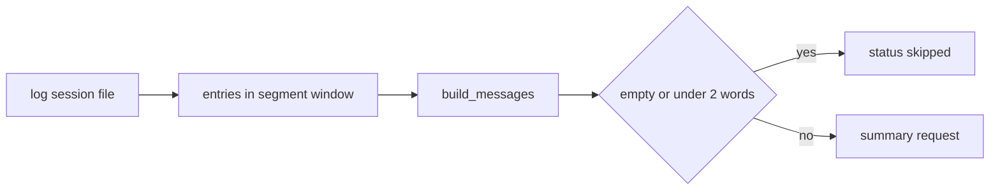
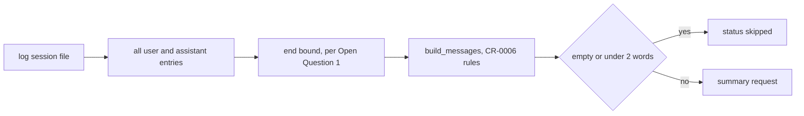
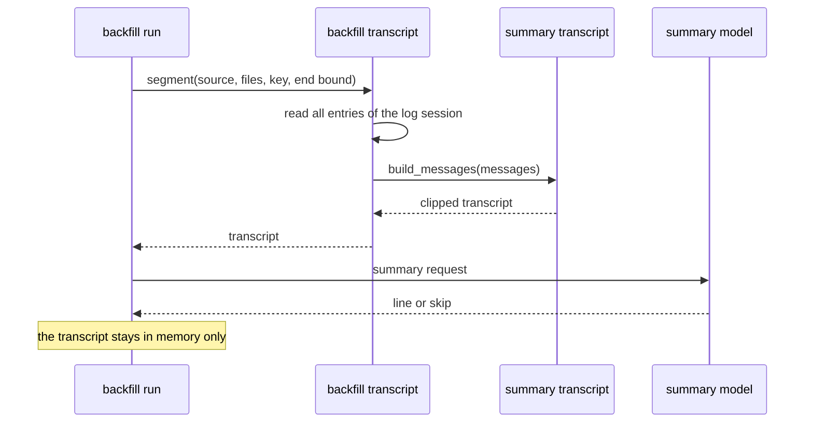
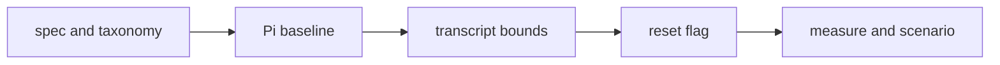

# Whole-session transcript for a backfilled segment

## Change Summary

After CR-0012, the transcript of a backfilled segment holds only the log entries of the segment window, from the first entry of the segment up to its last call. In the real two-day run, 171 of 248 Claude Code segments got the status `skipped`, because the window held no text or a line under 2 words. This CR widens the source of the transcript of a backfilled segment to the whole log session. The rules of CR-0006 then apply to the whole session file: the longest message history, the 24000-character clip that keeps the first 6000 and the last 18000 characters, the clip of tool parts, and no system prompt or `<system-reminder>` block. This is the counterpart of the proxy path, which takes the request body with the longest message history.

## Motivation and Background

A proxied request body holds the full message history of the conversation, so a proxied segment sees the context that came before it. A backfilled segment sees only its own window. A segment that starts after an idle gap often holds one short user turn and tool calls, so its transcript is empty or too short. The summary model then returns no usable line and the row gets `skipped`. The human decided on 2026-10-21 to widen the transcript to the whole log session.

## Change Drivers

* 171 of 248 Claude Code segments (69 percent) got `skipped` in the real two-day run.
* The proxy path and the backfill path give different context for the same conversation. One input rule for both paths makes the lines comparable.
* The published day line reads the session lines. Many `skipped` rows leave gaps in the published history.

## Current State

`src/backfill/transcript.rs` filters the entries of a log session with `inside(e, after, until)`. `claude_messages` and `pi_messages` keep only the entries in the window of the segment. `segment` passes the messages to `crate::summary::transcript::build_messages`, which applies the CR-0006 rules (`clip`, `strip_reminders`, `turn`, `cut`). `docs/specification/backfill.md` (section on summaries, around line 169) states the window rule.

### Current State Diagram



## Proposed Change

The transcript of a backfilled segment comes from the user and assistant messages of the whole log session, in line order. The window filter no longer limits the start of the transcript. The CR-0006 rules then clip the result to 24000 characters. The end of the transcript is a parameter that waits for the human (Open Question 1): the end of the session file, or the last call of the segment.

### Proposed State Diagram



### Transcript Sequence



## Requirements

### Functional Requirements

1. The transcript of a closed backfilled segment **MUST** come from the user and assistant messages of the whole log session in line order, from the first entry of the log session. This replaces the start bound of CR-0012 requirement 33.
2. The end bound of the transcript **MUST** follow the answer of the human to Open Question 1. Provisional value (the recommendation): the last call of the segment, so the transcript of each segment holds the history up to that segment.
3. For Claude Code, a subagent file **MUST** give the transcript of its own session, as in CR-0012 requirement 33. The transcript of a main session **MUST NOT** include the entries of a subagent file.
4. The transcript **MUST** follow the CR-0006 rules of requirements 5 to 10: no system prompt, no tool definition, and no `<system-reminder>` block; each tool result and tool input clipped to 300 characters with `[clipped]`; the 24000-character clip that keeps the first 6000 and the last 18000 characters with `[... earlier turns omitted ...]`; one `user:` or `assistant:` line per turn and `[attachment]` for a binary part; and the status `skipped` for an empty transcript.
5. The backfill **MUST** apply the rules of requirement 4 through `crate::summary::transcript::build_messages`, so the proxy path and the backfill path use one implementation of the rules.
6. The transcript **MUST** exist only in memory during the run, as in CR-0012 requirement 28. The backfill **MUST NOT** store or log any part of the transcript.
7. The change **MUST NOT** change the calls, the segments, the log keys, the processed-session rule, or the day rule of a backfilled segment.
8. The treatment of a backfilled segment that already has a `done` or `skipped` row **MUST** follow the answer of the human to Open Question 2. Provisional value (the recommendation): a flag `loupe backfill --resummarize skipped` sets each `skipped` row of a backfilled segment of the selected log source back to `pending`, and the run then builds the new transcript for it. A `done` row **MUST NOT** change.
9. The flag of requirement 8, if the human approves it, **MUST** support `--dry-run`, which prints the count of rows that a real run would reset in the counter `summaries_reset` and changes nothing.
10. The command **MUST** print the counter `summaries_reset` with the other counters of CR-0012 requirement 5.
11. A missing or bad value of the flag of requirement 8 **MUST** fail with exit code 2 and an actionable error on stderr that names the valid values.
12. `docs/specification/backfill.md` **MUST** state the new transcript rule before the code changes. `.taxonomy` **MUST** update the `transcript` row in the same change.

### Non-Functional Requirements

1. The backfill time of the bench **MUST** stay within the CR-0012 threshold: `backfill_secs` at most 15 for 10000 entries in a dry run.
2. Governance identifiers **MUST NOT** appear in code, test names, or `docs/specification/`.
3. Each changed or new source file **MUST** keep one `@agents-index` line and the small-file rule.
4. Errors **MUST** follow the `actionable_errors` rule: what failed, the labeled fixes, the canonical fix, and what to verify.

## Measurable Targets

| Metric | Method | Baseline | Threshold |
|---|---|---|---|
| Skipped rate, Claude Code | On a copy of the database before the real two-day run, run `loupe backfill --source claude-code` over the same two-day window, then read `summaries_skipped` and the count of backfilled segments | 171 of 248 segments `skipped` (69 percent), window rule | at most 25 percent `skipped` over the same window |
| Skipped rate, Pi | Same method with `--source pi` | measure before the change, new measurement | not above the baseline |
| Verdict | `.agents/scripts/pipeline.verdict.sh; echo $?` | exit 0 | exit 0, every stage `status: passed` |
| Backfill time | `.agents/scripts/backfill.bench.sh --entries 10000 --dry-run` prints `backfill_secs` | the value after CR-0012 | at most 15 |
| Privacy | `tests/backfill.secrets.rs` `no_prompt_path_or_raw_id_stored` | passes | passes with a marker before the segment window |

The threshold of 25 percent is a provisional value. A segment with only tool calls and no text in the whole session can still get `skipped`. The implementation agent measures the Pi baseline before it changes the code.

## Affected Components

* `src/backfill/transcript.rs`: `inside`, `claude_messages`, `pi_messages`, `segment` (the start bound and, per Open Question 1, the end bound).
* `src/summary/transcript.rs`: `build_messages` (read only, no change expected).
* `src/backfill/run.rs` and `src/cli/backfill.rs`: the flag and the counter of requirements 8 to 11, if the human approves them.
* `docs/specification/backfill.md`: the section on the summaries of backfilled segments.
* `.taxonomy`: the `transcript` row.
* `tests/backfill.summary.rs`, `tests/backfill.cli.rs`, `tests/backfill.secrets.rs`.

## Scope Boundaries

### In Scope

* The start and end bounds of the transcript of a backfilled segment.
* The re-summary of earlier `skipped` backfilled rows, per Open Question 2.
* The specification and taxonomy text for the new rule.

### Out of Scope ("Here, But Not Further")

* The transcript of a proxied segment.
* The summary prompt, the model, the scrubber, and the retry rules of CR-0006.
* The rule of 2 words that gives `skipped`.
* A cache of transcripts or of summary responses between segments.

## Alternative Approaches Considered

* **Keep the window, lower the skip threshold.** Rejected: the window holds no text, so a lower threshold gives lines with no content.
* **Merge the segments of one log session into one summary.** Rejected: it breaks one `session_summaries` row per segment.
* **Add the previous segment window only.** Rejected: it is a partial context and differs from the proxy path.

## Impact Assessment

### User Impact

More backfilled segments get a session line, so the published history has fewer gaps.

### Technical Impact

The transcript reads more entries per segment. The clip limits the request to 24000 characters. With the whole-session end bound, each segment of one log session sends the same request.

### Business Impact

More summary requests return a line, and each request can be longer, so the cost of a backfill run increases. The clip sets the upper limit per request.

## Implementation Approach

1. Update `docs/specification/backfill.md` and the `transcript` row of `.taxonomy`.
2. Measure the Pi baseline of the skipped rate.
3. Change the bounds in `src/backfill/transcript.rs`.
4. Add the flag and the counter of requirements 8 to 11, if the human approves them.
5. Run the tests, the bench, and the measurement of the skipped rate.

### Implementation Flow



## Test Strategy

### Tests to Add

| Test File | Test Name | Description | Inputs | Expected Output |
|---|---|---|---|---|
| `src/backfill/transcript.rs` (unit) | `transcript_starts_at_first_session_entry` | Start bound | log session with text before the segment window and only tool calls in the window | the transcript holds the earlier text |
| `src/backfill/transcript.rs` (unit) | `transcript_end_follows_end_bound` | End bound | log session with two segments | the transcript of each segment follows the end bound of requirement 2 |
| `src/backfill/transcript.rs` (unit) | `subagent_entries_stay_out_of_main_transcript` | Subagent | main file and subagent file | no subagent text in the main transcript |
| `src/backfill/transcript.rs` (unit) | `long_session_keeps_first_and_last_parts` | Clip | session of 60000 characters | 6000 first, `[... earlier turns omitted ...]`, 18000 last |
| `tests/backfill.summary.rs` | `window_without_text_gets_line` | Skip rate | fake upstream, segment with tool calls only after a text turn | row `done`, not `skipped` |
| `tests/backfill.cli.rs` | `resummarize_resets_skipped_rows` | Reset | database with `skipped` and `done` backfilled rows | `skipped` rows summarized again, `done` rows unchanged |
| `tests/backfill.cli.rs` | `resummarize_dry_run_changes_nothing` | Dry run | same database | `summaries_reset` printed, database unchanged |
| `tests/backfill.cli.rs` | `resummarize_bad_value_names_valid_values` | Error | `--resummarize all` | exit 2, the valid values on stderr |

The tests of the reset flag apply only if the human approves requirement 8.

### Tests to Modify

| Test File | Test Name | Change |
|---|---|---|
| `src/backfill/transcript.rs` (unit) | `log_transcript_follows_summary_rules` | Use the whole-session input |
| `tests/backfill.secrets.rs` | `no_prompt_path_or_raw_id_stored` | Add a marker before the segment window |

### Tests to Remove

None.

## Model-Based Testing

The user surface is the command `loupe backfill` and the session lines on the dashboard. A scenario under `.agents/scenarios/backfill.whole-session-transcript.md` runs the backfill on synthetic logs with a fake summary upstream. The success condition is the end state: each backfilled segment that has text anywhere in its log session has a `session_summaries` row with status `done`, and the database holds no transcript text. The state model has the row states `pending`, `done`, `skipped`, `failed`, and `disabled`, and the transitions of a first run, a re-run, and a reset run.

## Acceptance Criteria

### AC-1: A segment without text in its window gets a line

```gherkin
Given a log session with a user text turn before the segment window
  And the segment window holds only tool calls
When the backfill run closes the segment
Then the transcript holds the earlier user text
  And the session_summaries row has the status done
```

### AC-2: The CR-0006 rules apply to the whole session

```gherkin
Given a log session of 60000 characters with a system-reminder block and a tool result of 1000 characters
When the backfill builds the transcript
Then the transcript holds no system-reminder block
  And the tool result is clipped to 300 characters with [clipped]
  And the transcript keeps the first 6000 and the last 18000 characters
```

### AC-3: The end bound follows the decision

```gherkin
Given a log session with two segments
When the backfill builds the transcript of the first segment
Then the transcript ends at the end bound that the human decided
```

### AC-4: A subagent keeps its own transcript

```gherkin
Given a main session file and a subagent file
When the backfill builds the transcript of the main session
Then the transcript holds no entry of the subagent file
```

### AC-5: No transcript is stored

```gherkin
Given a fixture with a marker string before the segment window
When the backfill run completes
Then the database file, the log, and stderr hold no marker string
```

### AC-6: Earlier skipped rows are summarized again

```gherkin
Given a backfilled segment with a skipped row and another with a done row
When the human runs the re-summary that the human decided
Then the skipped row is built again with the new transcript
  And the done row does not change
```

### AC-7: The skipped rate goes down

```gherkin
Given a copy of the database before the real two-day run
When the backfill runs over the same two-day window with the new rule
Then at most 25 percent of the Claude Code segments have the status skipped
```

## Quality Standards Compliance

### Build & Compilation

`cargo build` passes with no warning.

### Linting & Code Style

`cargo clippy -- -D warnings` and `cargo fmt --check` pass.

### Test Execution

`cargo test` passes, with the tests of the Test Strategy.

### Documentation

`docs/specification/backfill.md` and `.taxonomy` state the new rule before the code changes.

### Code Review

A reviewer agent reads the diff against the spec diff.

### Verification Commands

```bash
.agents/scripts/pipeline.verdict.sh; echo $?
.agents/scripts/backfill.bench.sh --entries 10000 --dry-run
loupe backfill --source claude-code --dry-run
```

## Risks and Mitigation

### Risk 1: Higher cost of the summary requests

Each request can be up to 24000 characters, and with the whole-session end bound the same request repeats per segment. Mitigation: the recommendation of Open Question 1 bounds the transcript at the last call of the segment.

### Risk 2: Two segments get similar lines

Segments of one session share their early history. Mitigation: the clip keeps the last 18000 characters, which hold the latest turns of the segment.

### Risk 3: More log content goes to the summary model

The model sees text from outside the segment window. Mitigation: the scrubber and the in-memory rule of CR-0012 stay, and the privacy test adds a marker before the window.

### Risk 4: The reset changes rows that the human expects to keep

Mitigation: the reset touches only `skipped` rows of backfilled segments, and `--dry-run` prints the count first.

## Dependencies

* CR-0006 (transcript and summary rules), implemented.
* CR-0012 (backfill), implemented.

## Estimated Effort

About half a day for the code, the tests, the spec, and the measurement.

## Decision Outcome

Pending the reviewer agent.

## Decisions

1. Decided by the human on 2026-10-21: widen the transcript of a backfilled segment to the whole log session under the CR-0006 rules.

## Open Questions

1. **The end bound of the transcript.** Context: segments of one log session can share one transcript (the whole session file), or each segment can get the history up to its last call. The whole file repeats the same request per segment, at more cost, and gives the same line for each segment. Recommendation: the history up to the last call of the segment, because it matches the proxy path, where a request body holds the history up to that request, and each segment gets its own line. Alternative: the whole session file for each segment. Status: pending the human.
2. **The re-summary of earlier backfilled rows.** Context: the real two-day run left 171 `skipped` rows. A re-run of CR-0012 retries only `pending` rows. Options: (a) a flag `--resummarize skipped` that resets the `skipped` backfilled rows to `pending` and leaves `done` rows; (b) a one-time migration that resets the rows; (c) no reset, so only new segments use the new rule. Recommendation: (a), because it is explicit, supports `--dry-run`, and runs again for a later rule change. Status: pending the human.

## Related Items

* `docs/cr/CR-0006-session-summaries.md` requirements 5 to 10.
* `docs/cr/CR-0012-session-log-backfill.md` requirements 33 to 37.
* `docs/specification/backfill.md`, `docs/specification/summaries.md`.

## Approval

* Reviewer agent: pending.
