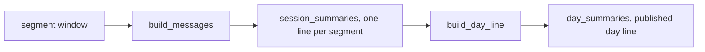
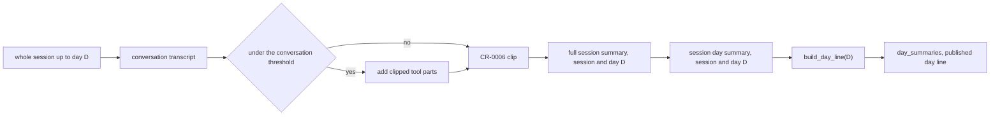
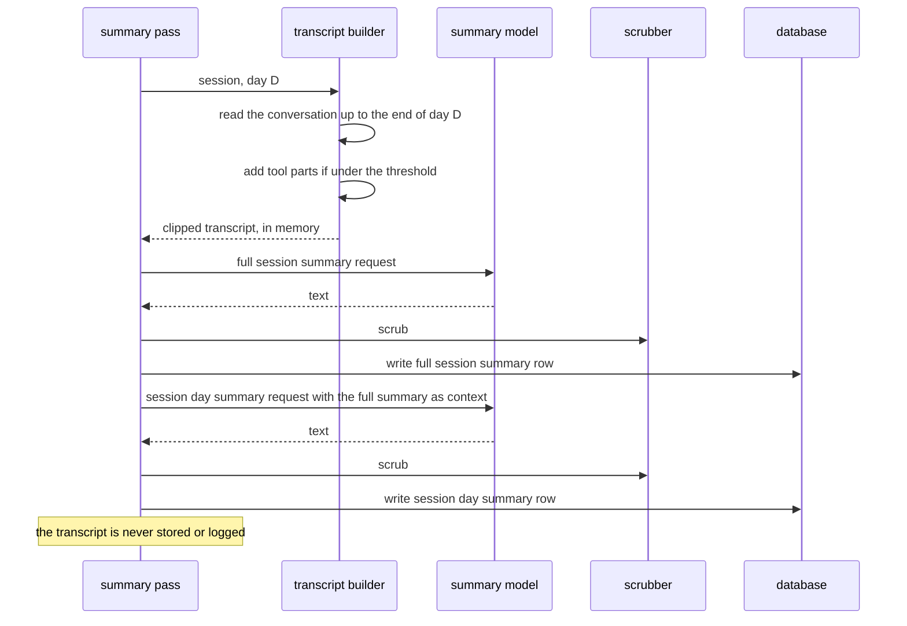
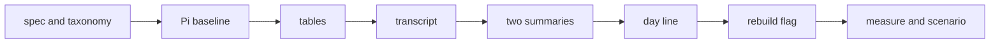

# Session summary model

## Change Summary

This CR changes how loupe understands a session. The transcript of a session is the whole session, read conversation first: the user and assistant text, and the tool inputs and results only when the conversation text is not sufficient. A session that has calls on several days gets one **full session summary** per day, which covers the session from its first day up to that day, and one **session day summary** per day that has a call of that session. The builder writes each session day summary with the full session summary of the same day as context. Both texts go in the database, scrubbed. The day line of a day is then built from the session day summaries of that day, not from the one-line session summaries of CR-0006. The privacy rules, the clip rules, and the scrubber of CR-0006 stay in force.

## Motivation and Background

After CR-0012, the transcript of a backfilled segment holds only the log entries of the segment window. In the real two-day run, 171 of 248 Claude Code segments (69 percent) got the status `skipped`, because the window held no text or a line under 2 words. The first draft of this CR widened the window to the whole log session and asked the human where the transcript must end.

The human answered on 2026-10-21 with a decision that changes the model (see Decisions). A session can only be understood when it is read in whole. The conversation usually is sufficient, so the reader starts with it and reads tool calls only if necessary. A session that spans 5 days gets 1 full session summary and 5 session day summaries. On day 3, the full session summary covers days 1 to 3 and gives the context for the session day summary of day 3. These texts are stored for later reference and for correctness, and they are not the same text as the published day line.

## Change Drivers

* 69 percent of the backfilled Claude Code segments got `skipped` in the real two-day run.
* A segment window gives no context about the work that came before it, so a line for a resumed segment is often empty or wrong.
* A session that spans several days has one line per segment today. No text states what the session did on a given day with the context of the earlier days.
* The day line reads one-line session summaries. A day line built from per-day texts that know the whole session is more correct.
* The human wants the texts stored for later reference and for a check of correctness.

## Current State

* `src/backfill/transcript.rs` filters the entries of a log session with `inside(e, after, until)`. `claude_messages` and `pi_messages` keep only the entries of the segment window. `segment` passes them to `crate::summary::transcript::build_messages`.
* `src/summary/transcript.rs` applies the CR-0006 rules: no system prompt, no tool definitions, no `<system-reminder>` block, tool parts clipped to 300 characters, the 24000-character clip that keeps the first 6000 and the last 18000 characters.
* `session_summaries` holds one line per segment (`docs/specification/summaries.md`, section on session summaries).
* `build_day_line(day)` in `src/summary/day.rs` reads the `done` session lines of the day and writes `day_summaries` (`docs/specification/summaries.md`, section "Day line"; `docs/specification/days.md` reads it).

### Current State Diagram



## Proposed Change

1. **Whole-session transcript, conversation first.** The builder reads every entry of the session from its first entry up to the end of the day under summary. It makes the conversation transcript first: the user and assistant text only. If the conversation transcript has fewer than `LOUPE_SUMMARY_MIN_CONVERSATION_CHARS` characters (provisional default 400), the builder adds the tool inputs and tool results, clipped to 300 characters each. The CR-0006 removals and the 24000-character clip apply to the result.
2. **Full session summary.** For each session and each day with a call of that session, the builder writes one full session summary that covers the session from its first entry up to the end of that day.
3. **Session day summary.** For the same session and day, the builder writes one session day summary that states what the session did on that day. The request holds the full session summary of that day as context, and the transcript of that day.
4. **Storage.** Two new tables hold the texts, one row per session and day, with the status, the scrubbed text, the model, and the times.
5. **Day line.** `build_day_line(day)` reads the `done` session day summaries of the day in place of the session summaries.

### Proposed State Diagram



### Summary Sequence



## Requirements

### Functional Requirements

**Transcript**

1. The transcript of a session for a day D **MUST** hold the entries of the whole session, in line order, from the first entry of the session up to the last entry whose time is on or before the end of day D in `LOUPE_TZ`.
2. The builder **MUST** make the conversation transcript first, from the user and assistant text only.
3. If the conversation transcript has fewer than `LOUPE_SUMMARY_MIN_CONVERSATION_CHARS` characters (default 400), the builder **MUST** add the tool inputs and the tool results, each clipped to 300 characters with `[clipped]`, in line order. Otherwise the builder **MUST NOT** add them.
4. A bad value of `LOUPE_SUMMARY_MIN_CONVERSATION_CHARS` (not an integer, or below 0) **MUST** stop the start of `loupe serve` and of `loupe backfill` with exit code 2 and an actionable error that names the variable and the valid range.
5. The transcript **MUST** follow CR-0006 requirements 5 to 10: no system prompt, no tool definition, no `<system-reminder>` block; one `user:` or `assistant:` line per turn; `[attachment]` for a binary part; and the 24000-character clip that keeps the first 6000 and the last 18000 characters with `[... earlier turns omitted ...]`.
6. The builder **MUST** apply the rules of requirements 2 to 5 through one implementation in `src/summary/transcript.rs`, for each source of the transcript.
7. For Claude Code, a subagent file **MUST** give the transcript of its own session. The transcript of a main session **MUST NOT** include the entries of a subagent file.
8. The transcript **MUST** exist only in memory. Loupe **MUST NOT** store or log any part of it.
8a. For a proxied session, the transcript source **MUST** be the stored request bodies of the exchanges of every segment of the session, from the first segment up to the last call whose start time is on or before the end of day D. The builder **MUST** take the longest message history from those bodies and apply requirements 2 to 5 to it.
8b. If a request body that requirement 8a needs is already deleted, the builder **MUST** use the bodies that remain, and **MUST** log the error kind `bodies_missing` with the session key and the day only.

**Full session summary**

9. For each session and each day D that has a call of that session, loupe **MUST** write one full session summary that describes the session from its first entry up to the end of day D.
9a. The request for a full session summary **MUST** hold the rule text of requirement 10 and the transcript of requirement 1 for day D, made under requirements 2 to 5.
10. The rule text of the full session summary **MUST** follow the rules of CR-0006 requirement 14, with a paragraph of at most 8 sentences in place of the one-line and 12-word rules, and **MUST** live in the one rule source file of CR-0006 requirement 16.
11. A full session summary **MUST** be written only after every segment of the session that has a call on day D is closed.

**Session day summary**

12. For each session and each day D that has a call of that session, loupe **MUST** write one session day summary that describes what the session did on day D.
13. The request for a session day summary **MUST** hold the scrubbed full session summary of the same session and day as context, and the day transcript of day D. The day transcript of day D **MUST** hold only the entries whose time is on day D in `LOUPE_TZ`, and **MUST** be made under requirements 2 to 5: the conversation-first rule, the threshold of requirement 3 measured on the day transcript, and the 24000-character clip. A session day summary **MUST NOT** be requested before the full session summary of the same session and day has a final status.
13a. For a proxied session, the stored request bodies have no time for each message. The day transcript of day D **MUST** hold the messages that the longest message history of the calls that started on day D adds beyond the longest message history of the calls that started before day D. If no call of the session started before day D, the day transcript **MUST** hold the whole longest history of the calls of day D.
14. The rule text of the session day summary **MUST** follow CR-0006 requirement 14, with a paragraph of at most 4 sentences, and **MUST** live in the same rule source file.
15. If the full session summary of the same session and day has the status `skipped`, `failed`, or `disabled`, the session day summary **MUST** get the same status with no model request.

**Storage**

16. A new table `session_full_summaries` **MUST** hold one row per session and day: the session key, the day (`YYYY-MM-DD` in `LOUPE_TZ`), the status, the scrubbed text, the model, the attempt count, the kind of the last error, the time of the next attempt, the created time, and the updated time. The session key and the day **MUST** be unique together.
17. A new table `session_day_summaries` **MUST** hold one row per session and day with the same columns as requirement 16.
18. Both tables **MUST** use the statuses `pending`, `done`, `skipped`, `failed`, and `disabled` with the meanings and the retry rules of CR-0006. The text **MUST** be null unless the status is `done`.
19. A new migration **MUST** add both tables. The migration **MUST NOT** delete or change rows of `session_summaries`.
20. The stored text **MUST** be the scrubbed text only. The scrubber **MUST** apply the paragraph rules of `docs/specification/summaries.md` (section "Scrubber") to each sentence.
21. A text with fewer than 2 words after the scrub **MUST** give the status `skipped`.
22. The public API **MUST NOT** publish a full session summary or a session day summary. They are for reference and for a check of correctness.

**Day line**

23. `build_day_line(day)` **MUST** read the `done` session day summaries of the day in place of the `done` session summaries, and **MUST** keep the statuses `empty`, `done`, `fallback`, and `not_ready` of CR-0006 requirements 32 to 36.
24. `build_day_line(day)` **MUST** return `not_ready` while a session day summary of that day is `pending`, or while a segment with a call on that day is open.
25. The `fallback` status **MUST** use the session day summaries of the day as sentences, the session with the most calls on that day first, at most 8.
26. The column `session_lines` of `day_summaries` **MUST** hold the count of the session day summaries that the build read.

**Scope and re-summary**

27. The model **MUST** apply to backfilled sessions and to proxied sessions, one model for every session.
27a. The raw-body retention **MUST NOT** delete the bodies of an exchange until the session day summary of each day of the session of each of its calls has a final status. A final status is `done`, `skipped`, `failed`, or `disabled`. While a segment of the session stays open, the bodies of the session stay, with no time limit; Risk 4 accepts this hold. The other conditions of the retention stay in force.
27b. The retention worker **MUST** log the count of the exchanges whose bodies it keeps under requirement 27a, as the counter `bodies_held`, on each run.
28. A flag `loupe summarize --rebuild-days FROM..TO` **MUST** make or reset the rows of `session_full_summaries` and `session_day_summaries` for each day in the range to `pending`, and then **MUST** rebuild the day line of each day in the range. The flag **MUST NOT** change rows of `session_summaries` or rows outside the range.
29. The flag `--rebuild-days` **MUST** support `--dry-run`, which prints the counter `summaries_reset` and changes nothing.
30. A missing or bad value of that flag **MUST** fail with exit code 2 and an actionable error on stderr that names the valid form.

**Documents**

31. `docs/specification/summaries.md` (including the section "Raw-body retention") and `docs/specification/backfill.md` **MUST** state the new rules before the code changes. `docs/specification/days.md` does not describe the input of the day line or `session_lines`, so it does not change.
32. `.taxonomy` **MUST** add rows for `full session summary` and `session day summary`, and **MUST** update the rows `transcript`, `day line`, `session summary`, `segment`, `backfill run`, and `raw-body retention` in the same change. The Not cells **MUST** separate the three texts: a session summary is one line per segment, a full session summary covers a session up to day D, and a session day summary covers one session on one day. The `segment` row **MUST** state that the summaries of a session wait until each segment with a call on day D is closed. The `backfill run` row **MUST** state that a run adds the rows of the two new tables.

### Non-Functional Requirements

1. The backfill time of the bench **MUST** stay within the CR-0012 threshold: `backfill_secs` at most 15 for 10000 entries in a dry run.
2. Governance identifiers **MUST NOT** appear in code, test names, or `docs/specification/`.
3. Each changed or new source file **MUST** keep one `@agents-index` line and the small-file rule.
4. Errors **MUST** follow the `actionable_errors` rule.
5. A log line of the summary pass **MUST** hold only the session key, the day, the status, the attempt count, the kind of error, and the duration.

## Measurable Targets

| Metric | Method | Baseline | Threshold |
|---|---|---|---|
| Skipped rate, Claude Code | On a copy of the database before the real two-day run, run `loupe backfill --source claude-code` over the same two-day window, then count `skipped` rows of `session_day_summaries` against all rows | 171 of 248 segments `skipped` (69 percent), window rule | at most 25 percent |
| Request count | Count of model requests that the fake upstream records, `loupe backfill` over the two-day window on a copy of the database | 249 requests (248 Claude Code segments and 1 Pi segment under the window rule) | at most 2 times the count of distinct (session key, day of a call) pairs |
| Characters per request | Maximum and median of the request characters that the fake upstream records, same run | measure before the change | maximum at most 24000 plus the rule text and the full session summary; median reported |
| Skipped rate, Pi | Same method with `--source pi` | measure before the change | not above the baseline |
| Day coverage | `sqlite3` count of `session_day_summaries` rows against the count of distinct (session key, day of a call) pairs in `calls`, over the two-day window | no table | equal counts |
| Full coverage | Same count for `session_full_summaries` | no table | equal counts |
| Verdict | `.agents/scripts/pipeline.verdict.sh; echo $?` | exit 0 | exit 0, every stage `status: passed` |
| Backfill time | `.agents/scripts/backfill.bench.sh --entries 10000 --dry-run` prints `backfill_secs` | the value after CR-0012 | at most 15 |
| Privacy | `tests/backfill.secrets.rs` `no_prompt_path_or_raw_id_stored` | passes | passes with a marker on day 1 of a two-day session |

The threshold of 25 percent and the conversation threshold of 400 characters are provisional values. The implementation agent measures the Pi baseline and the cost baseline before it changes the code.

Rule for the conversation threshold: the implementation agent measures the Claude Code skipped rate and the median characters per request at 200, 400, and 800. It selects the lowest value whose skipped rate is at most 25 percent. If two or more values meet the threshold within 2 percentage points of each other, it selects the value with the lower median characters per request. If no value meets 25 percent, the target stays at 25 percent, the result is a failed target, and the question goes to the oracle with the measurements. The 25 percent target **MUST NOT** change to make a result pass.

## Affected Components

* `src/summary/transcript.rs`: conversation-first rule and the threshold.
* `src/backfill/transcript.rs`: whole-session read up to the end of a day.
* `src/summary/worker.rs`, `src/summary/store.rs`, `src/summary/rules.rs`: the two new texts, the tables, and the rule text.
* `src/summary/day.rs`: `build_day_line` reads the session day summaries.
* `src/backfill/summary.rs`, `src/backfill/run.rs`: the backfill writes the new rows.
* `src/summary/transcript.proxied.rs` (new): the proxied transcript source, the whole-session read and the day transcript of requirement 13a from the stored request bodies. `src/summary/transcript.rs` applies the rules of requirements 2 to 5 to it.
* `src/retention/worker.rs`: the retention waits for a final status of the session day summaries.
* A new migration for the two tables.
* `docs/specification/summaries.md` (with the section "Raw-body retention"), `backfill.md`, and `.taxonomy`.

## Scope Boundaries

### In Scope

* The transcript rule, the two new texts, their storage, and the input of the day line.
* Backfilled and proxied sessions, and the change to the raw-body retention.
* The re-summary of earlier days through the flag `loupe summarize --rebuild-days FROM..TO` (Decision 4).

### Out of Scope ("Here, But Not Further")

* The publication of a full session summary or a session day summary.
* The model, the retry rules, and the token removals of the scrubber of CR-0006.
* The removal of `session_summaries`. The table stays; a later CR can retire it.
* A cache of summary responses.

## Alternative Approaches Considered

* **Keep the window, widen it to the whole log session only.** The first draft. Rejected by the human decision: one line per segment does not give a per-day text with the context of the session.
* **One summary per session, no per-day text.** Rejected: the day line needs a text per day.
* **Per-day text without a full session summary.** Rejected: the day text then has no context of the earlier days.
* **Always include tool parts.** Rejected: the human stated that the conversation is usually sufficient, and tool parts use most of the 24000 characters.

## Impact Assessment

### User Impact

The published day line comes from texts that know the whole session, so it is more correct and has fewer gaps.

### Technical Impact

Two requests per session and day in place of one per segment. Two new tables. The day line changes its input.

### Business Impact

A session of N days makes 2N requests of at most 24000 characters each. The clip sets the upper limit per request.

## Implementation Approach

1. Update the two specifications and `.taxonomy`.
2. Measure the Pi baseline.
3. Add the migration and the store.
4. Change the transcript builder.
5. Add the two summary requests and the rule text.
6. Change `build_day_line`.
7. Add the flag of requirement 28, if the human approves it.
8. Run the tests, the bench, and the measurements.

### Implementation Flow



## Test Strategy

### Tests to Add

| Test File | Test Name | Description | Inputs | Expected Output |
|---|---|---|---|---|
| `src/summary/transcript.rs` (unit) | `conversation_only_when_above_threshold` | Requirements 2 and 3 | 2000 characters of conversation and tool results | no tool part in the transcript |
| `src/summary/transcript.rs` (unit) | `tool_parts_added_below_threshold` | Requirement 3 | 100 characters of conversation and a tool result of 1000 characters | the tool result clipped to 300 with `[clipped]` |
| `src/summary/transcript.rs` (unit) | `long_session_keeps_first_and_last_parts` | Requirement 5 | 60000 characters | 6000 first, marker, 18000 last |
| `src/backfill/transcript.rs` (unit) | `transcript_ends_at_end_of_day` | Requirement 1 | session with entries on days 1 to 3, day 2 | entries of days 1 and 2 only |
| `src/backfill/transcript.rs` (unit) | `subagent_entries_stay_out_of_main_transcript` | Requirement 7 | main file and subagent file | no subagent text |
| `tests/summary.session_days.rs` | `five_day_session_gets_five_of_each` | Requirements 9, 12, 16, and 17 | fake upstream, one session with calls on 5 days | 5 rows in each new table |
| `tests/summary.session_days.rs` | `day_summary_request_holds_full_summary` | Requirement 13 | fake upstream that records requests | the day request holds the full summary text of the same day |
| `tests/summary.session_days.rs` | `skipped_full_summary_skips_day_summary` | Requirements 15 and 21 | fake upstream that returns one word | both rows `skipped`, one request |
| `tests/summary.day_line.rs` | `day_line_reads_session_day_summaries` | Requirements 23 and 26 | two `done` session day summaries on one day | `session_lines` is 2, the request holds both texts |
| `tests/summary.session_days.rs` | `tool_only_segment_gets_day_text` | Requirement 12, AC-1 | session with a user text turn on day 1 and a tool-only segment on day 1 | session day summary of day 1 `done` |
| `tests/summary.session_days.rs` | `failed_and_disabled_full_summary_chain` | Requirement 15 | fake upstream with a non-retryable error; no credential | day row `failed`, then `disabled`, no day request |
| `tests/summary.session_days.rs` | `open_segment_blocks_full_summary` | Requirement 11 | open segment with a call on day D | no request, no final row for day D |
| `tests/summary.session_days.rs` | `proxied_session_reads_all_segments` | Requirement 8a | proxied session with segments on days 1 and 2 | the day 2 full request holds text of day 1 |
| `tests/summary.session_days.rs` | `missing_bodies_use_remaining_and_log` | Requirement 8b | proxied session on days 1 and 2, one day 1 request body deleted before the build | the full request of day 2 holds the remaining bodies; one log line with `bodies_missing`, the session key, and the day only |
| `tests/summary.session_days.rs` | `proxied_day_transcript_holds_new_messages` | Requirement 13a | proxied session with calls on days 1 and 2, the day 2 bodies repeat the day 1 history | the day 2 day request holds the day 2 messages only |
| `tests/retention.session_days.rs` | `bodies_held_counter_logged` | Requirement 27b | exchange held under requirement 27a | the log line holds `bodies_held` 1 |
| `tests/summary.session_days.rs` | `full_request_holds_transcript_to_day` | Requirement 9a | session on days 1 to 3, day 2 | full request holds days 1 and 2, day request holds day 2 only |
| `tests/retention.session_days.rs` | `bodies_wait_for_session_day_summaries` | Requirement 27a | exchange past the retention hours, session day summary `pending` | bodies kept; deleted after `done` |
| `tests/api.public.rs` | `public_api_hides_session_texts` | Requirement 22 | done rows with a marker | no marker in any public response |
| `tests/summary.day_line.rs` | `day_line_not_ready_while_pending_or_open` | Requirement 24 | a `pending` day row; an open segment | `not_ready` in each case |
| `tests/summary.day_line.rs` | `fallback_orders_by_calls_at_most_eight` | Requirement 25 | 10 done day rows with different call counts | 8 sentences, most calls first |
| `tests/migrations.rs` | `migration_keeps_session_summaries` | Requirement 19 | database with `session_summaries` rows | the same rows after the migration |
| `tests/summary.cli.rs` | `bad_conversation_threshold_fails` | Requirement 4 | `LOUPE_SUMMARY_MIN_CONVERSATION_CHARS=abc` | exit 2, the variable and range on stderr |
| `tests/summary.cli.rs` | `negative_conversation_threshold_fails_backfill` | Requirement 4 | `loupe backfill` with `LOUPE_SUMMARY_MIN_CONVERSATION_CHARS=-1` | exit 2, the variable and range on stderr |
| `tests/summary.cli.rs` | `rebuild_days_resets_rows_in_range` | Requirement 28 | `done` and `skipped` rows on days 1 to 3, `session_summaries` rows, `--rebuild-days` for days 1 to 2 | rows of days 1 and 2 in both new tables `pending`, then rebuilt; day 3 rows and `session_summaries` rows unchanged |
| `tests/summary.cli.rs` | `rebuild_days_dry_run_changes_nothing` | Requirement 29 | database with rows | `summaries_reset` printed, database unchanged |
| `tests/summary.cli.rs` | `rebuild_days_bad_range_names_form` | Requirement 30 | `--rebuild-days yesterday` | exit 2, the form on stderr |

Requirements 6, 8, 10, 14, 18, 20, 27, and 28 also trace to these tests:

* Requirement 6: `conversation_only_when_above_threshold`, `tool_parts_added_below_threshold`, and `long_session_keeps_first_and_last_parts` test the one implementation in `src/summary/transcript.rs`; `transcript_ends_at_end_of_day` and `proxied_day_transcript_holds_new_messages` call it for each source.
* Requirements 8 and 20: `no_prompt_path_or_raw_id_stored` (Tests to Modify).
* Requirements 10 and 14: `day_summary_request_holds_full_summary` and `full_request_holds_transcript_to_day` check that each request holds the rule text from the one rule source file.
* Requirement 18: `failed_and_disabled_full_summary_chain` and `skipped_full_summary_skips_day_summary`.
* Requirement 27: `proxied_session_reads_all_segments` and `five_day_session_gets_five_of_each`.
* Requirement 28: `rebuild_days_resets_rows_in_range`.

Requirements 31 and 32 are documentation requirements. The Verification Commands and the code review verify them: the spec and `.taxonomy` change before the code, and the `grep` commands show the rows.

The non-functional requirements trace as follows:

* Non-functional requirement 1: `.agents/scripts/backfill.bench.sh --entries 10000 --dry-run`.
* Non-functional requirements 2 and 3: the `grep` commands under Verification Commands, and `.agents/scripts/pipeline.verdict.sh`.
* Non-functional requirement 4: `bad_conversation_threshold_fails` and `rebuild_days_bad_range_names_form`.
* Non-functional requirement 5: `missing_bodies_use_remaining_and_log` and `bodies_held_counter_logged`.

### Tests to Modify

| Test File | Test Name | Requirement | Change |
|---|---|---|---|
| `src/backfill/transcript.rs` (unit) | `log_transcript_follows_summary_rules` | Requirements 1 and 5 | Use the whole-session input |
| `tests/backfill.secrets.rs` | `no_prompt_path_or_raw_id_stored` | Requirements 8 and 20 | Add a marker on day 1 of a two-day session, and read both new tables |
| `tests/summary.day_line.rs` (existing day line tests) | as named in the file | Requirement 23 | Read session day summaries |

### Tests to Remove

None.

## Model-Based Testing

The user surface is `loupe backfill`, `loupe summarize`, and the day line on the dashboard. A scenario under `.agents/scenarios/summary.session-days.md` runs the backfill on a synthetic three-day session with a fake summary upstream. The success condition is the end state: each new table has 3 rows with status `done` for the session, the day line of each day has `session_lines` equal to the count of sessions with a call on that day, and the database holds no transcript text.

The state model per (session, day) has the states `pending`, `done`, `skipped`, `failed`, and `disabled` for each of the two rows, with the constraint that the session day summary leaves `pending` only after the full session summary has a final status. The transitions are a first pass, a retry, a status chain from a final non-`done` full summary, and a rebuild run.

## Acceptance Criteria

### AC-1: A session with no text in a segment window gets a day text

```gherkin
Given a session with a user text turn on day 1
  And a segment on day 1 that holds only tool calls
When the summary pass runs for day 1
Then the session day summary of day 1 has the status done
```

### AC-2: The conversation comes first

```gherkin
Given a session with 2000 characters of conversation and a tool result
When the builder makes the transcript
Then the transcript holds no tool part
```

### AC-3: Tool parts fill a short conversation

```gherkin
Given a session with 100 characters of conversation and a tool result of 1000 characters
When the builder makes the transcript
Then the transcript holds the tool result clipped to 300 characters with [clipped]
```

### AC-4: A five-day session gets five of each

```gherkin
Given one session with calls on 5 days
When the summary pass completes
Then session_full_summaries holds 5 rows for the session
  And session_day_summaries holds 5 rows for the session
```

### AC-5: Day 3 sees days 1 to 3

```gherkin
Given a session with calls on days 1 to 5
When the builder makes the full session summary of day 3
Then the transcript holds entries of days 1 to 3 only
  And the session day summary request of day 3 holds that full session summary
```

### AC-6: The day line reads the session day summaries

```gherkin
Given two done session day summaries on one day
When build_day_line runs for that day
Then the request holds both texts
  And session_lines is 2
```

### AC-7: No transcript is stored

```gherkin
Given a fixture with a marker string on day 1 of a two-day session
When the run completes
Then the database file, the log, and stderr hold no marker string
```

### AC-8: The skipped rate goes down

```gherkin
Given a copy of the database before the real two-day run
When the backfill runs over the same two-day window with the new model
Then at most 25 percent of the Claude Code session day summaries have the status skipped
```

### AC-9: The status chain covers failed and disabled

```gherkin
Given a full session summary of day D with the status failed or disabled
When the summary pass runs
Then the session day summary of day D has the same status
  And no session day summary request is sent
```

### AC-10: The public API does not publish the new texts

```gherkin
Given done rows in both new tables with a marker string
When a client reads every public endpoint
Then no response holds the marker string
```

### AC-11: The day line waits

```gherkin
Given a day with a pending session day summary or an open segment with a call on that day
When build_day_line runs for that day
Then the status is not_ready
```

### AC-12: An open segment blocks the full session summary

```gherkin
Given a session with an open segment that has a call on day D
When the summary pass runs
Then no full session summary request for day D is sent
```

### AC-13: The fallback order

```gherkin
Given 10 done session day summaries on one day with different call counts
When build_day_line returns fallback
Then it holds 8 sentences, the session with the most calls first
```

### AC-14: The migration keeps session summaries

```gherkin
Given a database with session_summaries rows
When the new migration runs
Then the session_summaries rows are unchanged
```

### AC-15: A bad threshold stops the backfill

```gherkin
Given LOUPE_SUMMARY_MIN_CONVERSATION_CHARS is -1
When loupe backfill starts
Then the exit code is 2
  And stderr names the variable and the valid range
```

### AC-16: A proxied session is read in whole

```gherkin
Given a proxied session with segments on days 1 and 2
When the builder makes the full session summary of day 2
Then the request holds text from the day 1 segment
```

### AC-17: A proxied day transcript holds only the new messages

```gherkin
Given a proxied session with calls on days 1 and 2
  And the request bodies of day 2 repeat the history of day 1
When the builder makes the session day summary of day 2
Then the day transcript holds only the messages that the day 2 calls add
```

### AC-18: Retention waits for the session day summaries

```gherkin
Given an exchange older than LOUPE_RAW_RETENTION_HOURS
  And a pending session day summary of a day of its session
When the retention worker runs
Then the bodies of the exchange stay
  And they are deleted after that row has a final status
```

### AC-19: Missing request bodies do not stop the build

```gherkin
Given a proxied session with calls on days 1 and 2
  And one request body of day 1 is deleted before the build
When the builder makes the full session summary of day 2
Then the request holds the text of the remaining bodies
  And the log holds the error kind bodies_missing with only the session key and the day
```

## Quality Standards Compliance

### Build & Compilation

`cargo build` passes with no warning.

### Linting & Code Style

`cargo clippy -- -D warnings` and `cargo fmt --check` pass.

### Test Execution

`cargo test` passes, with the tests of the Test Strategy.

### Documentation

The two specifications and `.taxonomy` state the new rules before the code changes.

### Code Review

A reviewer agent reads the diff against the spec diff.

### Verification Commands

```bash
.agents/scripts/pipeline.verdict.sh; echo $?
.agents/scripts/backfill.bench.sh --entries 10000 --dry-run
loupe backfill --source claude-code --dry-run
grep -F -e '**full session summary**' -e '**session day summary**' .taxonomy
grep -rnE '(CR|ADR|FR|NFR|AC)-[0-9]+' src tests docs/specification; test $? -eq 1
```

## Risks and Mitigation

### Risk 1: Higher cost

2N requests for a session of N days. Mitigation: the 24000-character clip, and the conversation-first rule keeps tool parts out of most requests.

### Risk 2: The day bound cuts a turn

A turn that starts before midnight and ends after it. Mitigation: the bound uses the time of each entry, and a turn belongs to the day of its entry.

### Risk 3: More log content goes to the summary model

Mitigation: the scrubber, the in-memory rule, and a privacy test with a marker on an earlier day.

### Risk 4: A proxied session has no whole history

If retention deletes the bodies before the session day summaries of the session have a final status, the full session summary of a later day misses the earlier history and can be wrong. Mitigation: requirement 27a holds the bodies; requirement 8b uses the remaining bodies and logs `bodies_missing`; AC-18 and AC-19 test the rules. Bodies stay longer, and the bodies of a session with an open segment stay with no time limit, so the database grows until the summaries are final. The counter `bodies_held` of requirement 27b measures this hold.

## Dependencies

* CR-0006 (transcript, summary, scrubber, and day line rules), implemented.
* CR-0012 (backfill), implemented.

## Estimated Effort

About two days for the code, the tests, the specifications, and the measurements.

## Decision Outcome

Pending the reviewer agent.

## Decisions

1. Decided by the human on 2026-10-21: widen the transcript of a backfilled segment to the whole log session under the CR-0006 rules.
2. Decided by the human on 2026-10-21, in answer to the end-bound question of the first draft: a session is read in whole, conversation first and tool calls only if necessary; a session gets one full session summary and one session day summary per day that has data, and the full session summary of day D covers the session up to day D and gives the context of the session day summary; both texts are stored in the database for reference and correctness, apart from the published day line. The end-bound question is closed by this decision.
3. Decided by the human on 2026-10-21, in answer to the former Open Question 1 (the origin of the sessions): the model applies to backfilled and proxied sessions, one model for every session. The proxied transcript uses the whole session history from the stored request bodies, so the raw-body retention waits until the session day summary of each day of the session has a final status. Requirements 8a, 8b, 27, and 27a state this.
4. Decided by the human on 2026-10-21, in answer to the former Open Question 1 (the re-summary of earlier rows): option (a), the flag `loupe summarize --rebuild-days FROM..TO` with `--dry-run` and the counter `summaries_reset`. Options (b), a one-time migration, and (c), no rebuild, are rejected. Requirements 28 to 30 state this.

## Open Questions

1. **The conversation threshold.** Context: requirement 3 needs a rule for when the conversation is not sufficient. Provisional value: 400 characters, set by `LOUPE_SUMMARY_MIN_CONVERSATION_CHARS`. The implementation agent measures at 200, 400, and 800 on the two-day window and applies the rule under Measurable Targets. This question goes to the oracle, not to the human, if no value meets the rule.

## Related Items

* `docs/cr/CR-0006-session-summaries.md` requirements 4 to 16 and 32 to 37.
* `docs/cr/CR-0012-session-log-backfill.md` requirements 33 to 37.
* `docs/specification/summaries.md`, `docs/specification/backfill.md`, `docs/specification/days.md`.

## Approval

* Reviewer agent: pending.
