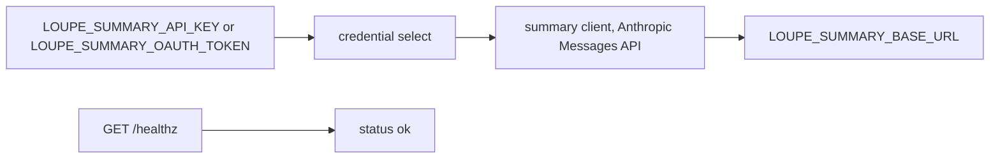
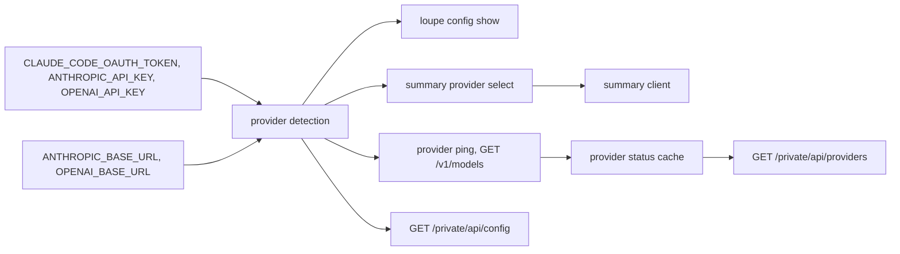
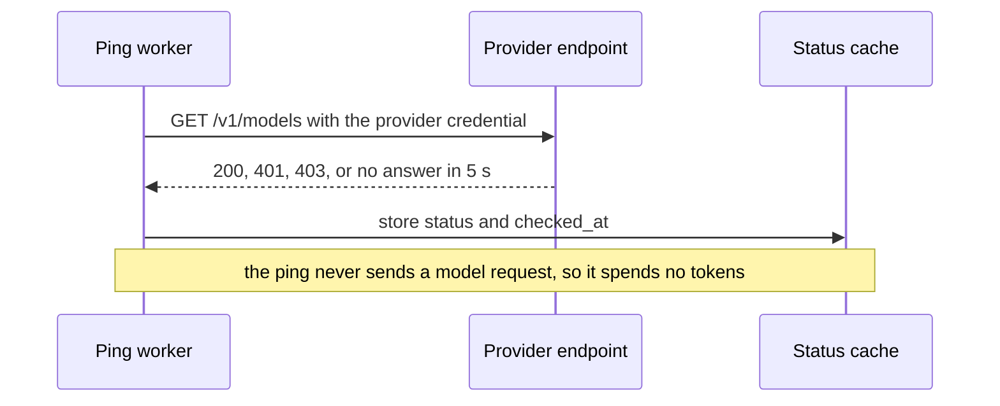
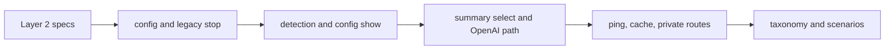

# Provider credentials with industry names and a health status per provider

## Change Summary

The binary reads its own model credentials from `LOUPE_SUMMARY_API_KEY` and `LOUPE_SUMMARY_OAUTH_TOKEN`. These names do not tell which token they expect. This CR changes the names to the names that the vendor tools use: `CLAUDE_CODE_OAUTH_TOKEN`, `ANTHROPIC_API_KEY`, and `OPENAI_API_KEY`. Each provider gets an endpoint override, `ANTHROPIC_BASE_URL` and `OPENAI_BASE_URL`, so a different provider with a compatible API can be reached. The binary detects the available providers from the set variables and shows them in `loupe config show`. A ping that spends no tokens gives a health status for each provider. A private endpoint, `GET /private/api/config`, returns the effective configuration with its sources, with the same content and the same masking as `loupe config show`.

## Motivation and Background

On 2026-10-21 the owner wrote: "let's normalize the env's to industry standards, i.e. LOUPE_SUMMARY_OAUTH_TOKEN doesn't really tell what OAUTH token is expected, but CLAUDE_CODE_OAUTH_TOKEN is. there should be env's for supported providers (anthropic and openai for now) with detection for available providers through set env's and a healthz endpoint that pings the endpoints and show status per provider. I'd expect support for at least CLAUDE_CODE_OAUTH_TOKEN, ANTHROPIC_API_KEY and OPENAI_API_KEY with overridable endpoints url's to support more providers".

An operator who already uses Claude Code or an OpenAI tool has these variables set. The binary can then use them with no new name to learn. A health status shows a wrong or expired credential before the summaries fail.

This CR is about the credentials of the binary itself. The proxy upstreams (`upstreams.toml`) are a different concept: the credentials of the agents pass through the proxy and the binary never stores them. This CR does not change the proxy.

## Change Drivers

1. The request of the owner on 2026-10-21.
2. `LOUPE_SUMMARY_OAUTH_TOKEN` does not name the kind of token that it expects.
3. The summarizer supports one provider. The owner wants Anthropic and OpenAI now, and more through endpoint overrides.
4. No surface shows if a credential works until a summary fails.

## Current State

- The summary client reads `LOUPE_SUMMARY_API_KEY` (header `x-api-key`) or `LOUPE_SUMMARY_OAUTH_TOKEN` (header `Authorization: Bearer`, with the Claude Code beta headers and the billing block, Haiku only). If both are set, `api_key` is active (`docs/specification/summaries.md`, Credentials; `src/summary/credential.rs`, `src/summary/headers.rs`).
- `LOUPE_SUMMARY_BASE_URL` (default `https://api.anthropic.com`) must use `https` or a loopback host. `LOUPE_SUMMARY_MODEL` defaults to `claude-haiku-5-5` (`docs/specification/configuration.md`, `src/config/vars.rs`).
- `loupe config show` prints `summary_credential` as `api_key`, `oauth_token`, or `none`.
- The summary client speaks only the Anthropic Messages API (`POST /v1/messages`).
- `GET /healthz` returns `{"status":"ok"}` with no authentication. `docs/specification/api.md` gives it open CORS (`access-control-allow-origin: *`), but `docs/specification/operations.md` says "The route has no CORS header". The two specifications do not agree.
- The private page and `/private/api/` exist only when `LOUPE_ADMIN_TOKEN` is set, and send no CORS header (`docs/specification/private-reports.md`).

### Current State Diagram



## Proposed Change

1. A **provider credential** table: three variables with industry names, each mapped to one provider and one kind.
2. An **endpoint override** per provider, with the https-or-loopback rule.
3. **Provider detection**: the set of providers that have at least one credential, shown in `loupe config show` and in the log at start.
4. A **provider status** for each detected provider from a ping that spends no tokens, exposed on `GET /private/api/providers` behind the admin token (Decision 1).
5. The removal of the old `LOUPE_SUMMARY_*` credential names (Decision 2) and a rule that selects the summary provider when more than one is available (Decision 3).
6. A private **configuration endpoint**, `GET /private/api/config`, behind the admin token, with the content of `loupe config show` (Decision 3).

### Proposed State Diagram



### Ping sequence



## Requirements

### Functional Requirements

**Provider credentials**

1. The binary **MUST** read these provider credentials:

| Variable | Provider | Kind | Auth header |
|---|---|---|---|
| `CLAUDE_CODE_OAUTH_TOKEN` | `anthropic` | `oauth_token` | `Authorization: Bearer`, with the OAuth header set and billing block of `summaries.md` |
| `ANTHROPIC_API_KEY` | `anthropic` | `api_key` | `x-api-key` and `anthropic-version` |
| `OPENAI_API_KEY` | `openai` | `api_key` | `Authorization: Bearer` |

2. A variable that is empty or that holds only white space **MUST** count as not set.
3. If `ANTHROPIC_API_KEY` and `CLAUDE_CODE_OAUTH_TOKEN` are both set, the `anthropic` provider **MUST** use `api_key`. This keeps the current rule that `api_key` wins.
4. The rule that a subscription OAuth token works with Haiku only **MUST** stay: when the active `anthropic` kind is `oauth_token` and the summary provider is `anthropic`, a summary model other than `claude-haiku-5-5` **MUST** stop `loupe serve` and `loupe summarize` at start with an actionable error. The error **MUST** name `CLAUDE_CODE_OAUTH_TOKEN`, `ANTHROPIC_API_KEY`, and `LOUPE_SUMMARY_MODEL`.
5. A log line, the `loupe config show` output, and an API response **MUST NOT** hold a credential value or a part of it.

**Endpoint overrides**

6. `ANTHROPIC_BASE_URL` (default `https://api.anthropic.com`) and `OPENAI_BASE_URL` (default `https://api.openai.com/v1`) **MUST** set the base URL of each provider. These are the names that the vendor SDKs read.
7. Each base URL **MUST** use `https`, except for a host of `127.0.0.1` or `localhost`. A different value **MUST** stop the start with an actionable error that names the variable. This is the rule of `proxy.md` for an upstream.
8. `LOUPE_SUMMARY_BASE_URL` **MUST** follow the removal rule of requirement 23. `ANTHROPIC_BASE_URL` replaces it.

**Provider detection**

9. At start the binary **MUST** compute the set of detected providers: a provider is detected when at least one of its credentials is set.
10. `loupe config show` **MUST** print one line per known provider: `provider.<name>: credential=<kind or none> base_url=<url> source=<configuration source>`. The line **MUST NOT** print the credential.
11. `loupe config show` **MUST** print `summary_provider: <name or none>` and replace `summary_credential` by it. The old key **MUST** be removed (Decision 2).
12. `loupe serve` **MUST** write one log line at start with the detected providers and the summary provider, with no credential.

**Summary provider selection**

13. **`summary_provider_select`, option (a) (Decision 3).** The summary provider **MUST** be chosen from the set of detected providers: `LOUPE_SUMMARY_PROVIDER` (`anthropic` or `openai`) if set, else `anthropic` if detected, else `openai` if detected, else none. A `LOUPE_SUMMARY_PROVIDER` that names a provider that is not detected, or a value that is not known, **MUST** stop the start with an actionable error that names `LOUPE_SUMMARY_PROVIDER` and the detected providers.
14. **`openai_summary_path`, option (a) (Decision 6).** When the summary provider is `openai`, the client **MUST** send `POST {OPENAI_BASE_URL}/chat/completions` with the same rule text, the same `max_tokens` limits (as `max_completion_tokens`), and the same 30-second timeout as the Anthropic client. `LOUPE_SUMMARY_MODEL` **MUST** have no default for `openai`; a missing value **MUST** stop the start with an actionable error that names `LOUPE_SUMMARY_MODEL`.
15. **`summary_opt_in`, option (a) (Decision 5).** A detected provider **MUST** enable the summaries with no other step, as a set credential does today. The start log line of requirement 12 makes this visible. With no detected provider, the summary worker **MUST** behave as today with no credential: the status `disabled` and no request.

**Provider status**

16. The binary **MUST** keep a provider status for each known provider, with one of the values `ok`, `unauthorized`, `unreachable`, or `not_configured`, and the time `checked_at` (UTC, RFC 3339).
17. The ping **MUST** be `GET {base_url}/v1/models` for `anthropic` and `GET {base_url}/models` for `openai` (the default OpenAI base URL ends in `/v1`). The ping **MUST NOT** call a model and **MUST NOT** spend tokens. The ping **MUST** send a body of no bytes and exactly these headers:

| Provider and kind | Ping headers |
|---|---|
| `anthropic`, `api_key` | `x-api-key`, `anthropic-version: 2023-06-01` |
| `anthropic`, `oauth_token` | `Authorization: Bearer`, `anthropic-version: 2023-06-01`, `anthropic-beta: oauth-2025-04-20,claude-code-20250219` |
| `openai`, `api_key` | `Authorization: Bearer` |

The billing block of `summaries.md` is part of a Messages body, so the ping **MUST NOT** send it.
18. The status values **MUST** map as follows: `2xx` gives `ok`; `401` or `403` gives `unauthorized`; a network error, a timeout, or any other status gives `unreachable`; a provider with no credential gives `not_configured` and sends no request.
19. The ping timeout **MUST** be 5 seconds. **`ping_schedule`, option (a) (Decision 4).** The worker **MUST** ping once at start, then every `LOUPE_PROVIDER_PING_SECS` seconds (default `300`, minimum `60`). A value under `60` or a value that is not an integer **MUST** stop the start with an actionable error that names `LOUPE_PROVIDER_PING_SECS`. A read of the status **MUST** use the cache and **MUST NOT** start a ping.
20. With a valid `CLAUDE_CODE_OAUTH_TOKEN`, the `anthropic` ping with the `oauth_token` headers of requirement 17 **MUST** get a `2xx` from the real `GET https://api.anthropic.com/v1/models`, so that the status is `ok`. Model-Based Testing scenario 4 verifies this before the ping ships.
21. **`status_exposure`, option (a) (Decision 1).** The provider status **MUST** be exposed on `GET /private/api/providers`, with the authorization of `private-reports.md` (admin token or admin session cookie) and no CORS header. The route **MUST** exist only when `LOUPE_ADMIN_TOKEN` is set. The response **MUST** hold, for each known provider, the name, the status, and `checked_at`, and **MUST NOT** hold a credential or a base URL. `GET /healthz` **MUST** stay unchanged.
22. The provider status **MUST NOT** change the HTTP status of `GET /healthz`. A provider that is down **MUST NOT** make the container unhealthy, because the proxy works without the summarizer.

**Migration**

23. **`legacy_names`, option (b) (Decision 2).** The binary **MUST NOT** read `LOUPE_SUMMARY_API_KEY`, `LOUPE_SUMMARY_OAUTH_TOKEN`, or `LOUPE_SUMMARY_BASE_URL`. If one of them is set (not empty), `loupe serve`, `loupe summarize`, and `loupe config show` **MUST** stop at start with an actionable error. The error **MUST** name the set legacy variable and its new name (`ANTHROPIC_API_KEY`, `CLAUDE_CODE_OAUTH_TOKEN`, or `ANTHROPIC_BASE_URL`), give the fix (rename the variable in `.env`), and state what to verify (`loupe config show` prints the provider line). The error **MUST NOT** print the value.
24. `LOUPE_SUMMARY_MODEL`, `LOUPE_SUMMARY_INTERVAL_SECS`, and `LOUPE_SUMMARY_MAX_ATTEMPTS` **MUST NOT** change name, because they configure the summarizer and not a provider. A set value of one of these names **MUST NOT** start the stop of requirement 23.

**Documentation and taxonomy**

25. `docs/specification/configuration.md`, `summaries.md`, `operations.md`, `api.md`, `private-reports.md` (the routes `/private/api/providers` and `/private/api/config`), the README configuration table, and `.env.example` **MUST** state the new names, the overrides, the detection, the status, and the configuration endpoint. The README and `.env.example` **MUST** remove `LOUPE_SUMMARY_API_KEY`, `LOUPE_SUMMARY_OAUTH_TOKEN`, and `LOUPE_SUMMARY_BASE_URL`, and **MUST** say that a set legacy name stops the start.
26. The conflict between `api.md` and `operations.md` about the CORS header of `GET /healthz` **MUST** be resolved against the code in the same change.
27. `.taxonomy` **MUST** get two rows: **provider credential** (a credential that the binary itself uses to call a model provider; not a credential of an agent that passes through the proxy, not a proxy token, not the admin token) and **provider status** (the cached result of the last ping of one provider: `ok`, `unauthorized`, `unreachable`, or `not_configured`; not the status of `GET /healthz`). The row of **admin token** already names "a provider credential" in its Not column, so the new term fits the vocabulary.

**Private configuration endpoint**

28. The binary **MUST** serve `GET /private/api/config` with the authorization of `private-reports.md` (admin token or admin session cookie) and no CORS header. The route **MUST** exist only when `LOUPE_ADMIN_TOKEN` is set. A request with no valid authorization **MUST** get `401`, the same answer as the other private API routes.
29. The response **MUST** hold the same content as `loupe config show`: each effective value with its configuration source, the provider lines of requirement 10, `summary_provider`, and the derived lines of `configuration.md`. The response **MUST** be JSON, with one object per entry (`name`, `value`, `source`).
30. The response **MUST** use the same masking as `loupe config show`: each secret is `set` or `unset`. The response **MUST NOT** hold a credential value, the admin token, a proxy token, or a part of one. The endpoint and `loupe config show` **MUST** share one render of the entries, so that the masking cannot drift between the two surfaces.
31. A read of the endpoint **MUST NOT** start a ping or reload the configuration. It reports the configuration that the process loaded at start. The test `private_config_read_is_cached` checks this.

### Non-Functional Requirements

1. The ping **MUST** run in its own task and **MUST NOT** delay the proxy, the parser, or the start of the HTTP listener.
2. A read of the provider status or of `GET /private/api/config` **MUST** answer in less than 5 ms at the 95th percentile, because it reads only the cache. The tests `provider_status_read_is_cached` and `private_config_read_is_cached` measure it.
3. The ping **MUST** send at most one request per provider per interval. The test `ping_schedule_one_request_per_interval` checks this over two intervals.
4. The new code **MUST** follow `documentation_standards`, `logging_standard`, and `actionable_errors`.

## Measurable Targets

| Metric | Method | Baseline | Threshold |
|---|---|---|---|
| Tokens spent by the ping | Fake upstream records the paths of all ping requests: `cargo test provider_ping_never_calls_a_model` | none (new) | 0 requests to `/v1/messages` or `/chat/completions` |
| Credential leak | `cargo test config_show_never_prints_a_credential`, `cargo test provider_log_never_holds_a_credential`, and `cargo test private_config_never_holds_a_credential` | none (new) | 0 occurrences of the test secret |
| Status and configuration read latency | `cargo test read_is_cached -- --nocapture` (1000 reads each) | none (new) | p95 under 5 ms |
| Start time to healthy | `docker compose up -d && time sh -c 'until curl -sf http://127.0.0.1:8787/healthz; do sleep 0.2; done'` (`operations.md`) | 0.02 s | under 0.5 s, unchanged in practice |
| Ping timeout | `cargo test provider_ping_times_out_unreachable` with a fake upstream that does not answer | none (new) | status `unreachable` in at most 5.5 s |

## Affected Components

- `src/summary/credential.rs`: credential select by provider; Haiku rule.
- `src/summary/headers.rs`: header sets per provider and kind.
- `src/summary/client.rs`: an OpenAI chat completions path.
- `src/config/vars.rs`: new variables and the stop on a legacy name.
- `src/config/show.rs`: one render of the entries for the CLI and the private endpoint.
- New: provider detection, ping worker, and status cache modules under `src/provider/`.
- `src/private/routes.rs` and new handlers under `src/private/`: `GET /private/api/providers` and `GET /private/api/config`.
- `docs/specification/configuration.md`, `summaries.md`, `operations.md`, `api.md`, `private-reports.md`, `README.md`, `.env.example`, `.taxonomy`.

## Scope Boundaries

### In Scope

- The three provider credentials, the two endpoint overrides, detection, `loupe config show`, the provider status, the removal of the legacy names, an OpenAI summary path, and `GET /private/api/config`.

### Out of Scope ("Here, But Not Further")

- The proxy, `upstreams.toml`, and the credentials of the agents.
- A provider other than `anthropic` and `openai` with its own variables. A compatible provider is reached only through a base URL override.
- An OpenAI OAuth or subscription token.
- A change to the rule text of the summaries or to the pricing.
- A provider status on the public dashboard.

## Alternative Approaches Considered

1. **Keep the `LOUPE_SUMMARY_*` names and only document them better.** Rejected: the owner asked for industry names.
2. **A generic list variable, for example `LOUPE_PROVIDERS=anthropic,openai`.** Rejected: detection from set variables is what the owner asked for, and a list duplicates the information.
3. **A ping that sends a one-token model request.** Rejected: it spends tokens and, on the OAuth path, quota.
4. **A ping on each request to the health route.** Rejected: a public route that starts outbound requests lets any caller make the binary call the provider.

## Impact Assessment

### User Impact

An operator with Claude Code or an OpenAI tool installed can reuse the variables that are already set. An operator with the old names gets an actionable error at start that names the new variable, and must rename the variable before the start continues. The status shows a bad credential before the summaries fail.

### Technical Impact

A new ping task and status cache. A second summary client path. The configuration loader stops on a legacy name. Two new private routes. Because the binary now reads common names, a variable that the operator set for a different tool can enable the summaries. The start log line of requirement 12 makes this visible.

### Business Impact

None outside the project.

## Implementation Approach

1. Layer 2: update the specifications and the README for the names, overrides, detection, status, and the decided options.
2. Configuration: new variables, the stop on a legacy name, and the base URL rule.
3. Detection and `loupe config show`.
4. Summary provider select and the OpenAI client path.
5. Ping worker, status cache, `GET /private/api/providers`, and `GET /private/api/config`. Before the ping ships, run scenario 4. If the real models path refuses the OAuth header set while a summary request succeeds, stop, record the observation in this CR, and do not ship a ping that sends a model request.
6. Taxonomy rows and scenarios.

### Implementation Flow



## Test Strategy

### Tests to Add

| File | Test | Proves |
|---|---|---|
| `src/config/vars.rs` | `industry_names_are_read` | the three credentials and two base URLs load |
| `src/config/vars.rs` | `empty_credential_counts_as_unset` | requirement 2 |
| `src/config/vars.rs` | `base_url_requires_https_or_loopback` | requirement 7, for both providers |
| `src/config/vars.rs` | `legacy_name_stops_start_and_names_new_variable` | requirements 23 and 24: each of the three legacy names stops the start and the error holds no value; `LOUPE_SUMMARY_MODEL`, `LOUPE_SUMMARY_INTERVAL_SECS`, and `LOUPE_SUMMARY_MAX_ATTEMPTS` do not stop the start |
| `src/summary/credential.rs` | `anthropic_api_key_wins_over_oauth_token` | requirement 3 |
| `src/summary/credential.rs` | `oauth_token_with_non_haiku_model_stops_start` | requirement 4 |
| `src/summary/credential.rs` | `summary_provider_selection_rule` | requirement 13, including a `LOUPE_SUMMARY_PROVIDER` that is not detected |
| `src/config/vars.rs` | `ping_secs_minimum_is_60` | requirement 19 |
| `src/summary/headers.rs` | `openai_bearer_headers` | requirement 1 |
| `src/summary/client.rs` | `openai_chat_completions_request_shape` | requirement 14, with a fake upstream |
| `src/config/vars.rs` | `openai_summary_without_model_stops_start` | requirement 14 |
| `src/summary/worker.rs` | `summary_opt_in_rule` | requirement 15 |
| `src/provider/ping.rs` | `ping_header_sets` | requirement 17, the exact headers per provider and kind, and no billing block |
| `src/provider/status.rs` | `checked_at_is_utc_rfc3339` | requirement 16 |
| `tests/serve_start.rs` | `start_log_lists_providers_without_credential` | requirement 12 |
| `tests/serve_start.rs` | `listener_starts_while_ping_hangs` | NFR 1, with a fake upstream that does not answer: `/healthz` answers before the ping timeout |
| `tests/healthz.rs` | `healthz_cors_header_matches_spec` | requirement 26, the header that the resolved specification states |
| `src/provider/detect.rs` | `detects_providers_from_set_variables` | requirement 9 |
| `src/provider/ping.rs` | `status_maps_from_response` | requirement 18 |
| `src/provider/ping.rs` | `provider_ping_never_calls_a_model` | requirement 17 |
| `src/provider/ping.rs` | `provider_ping_times_out_unreachable` | requirement 19 |
| `src/provider/status.rs` | `provider_status_read_is_cached` | requirement 19 and NFR 2 |
| `src/provider/worker.rs` | `ping_schedule_one_request_per_interval` | requirement 19 and NFR 3: with paused time, a fake upstream counts one request per provider at start and one after each of two intervals |
| `tests/private_config.rs` | `private_config_read_is_cached` | requirement 31 and NFR 2: over 1000 reads the fake upstream counts no request, the configuration is not reloaded, and p95 is under 5 ms |
| `tests/config_show.rs` | `config_show_lists_providers` and `config_show_never_prints_a_credential` | requirements 10, 11, and 5 |
| `tests/providers_route.rs` | `provider_status_route_shape_and_auth` | requirement 21: 401 with no token, the shape with the token, no CORS header, no route without `LOUPE_ADMIN_TOKEN` |
| `tests/private_config.rs` | `private_config_route_shape_and_auth` | requirements 28 and 29: 401 with no token, the same entries as `loupe config show` |
| `tests/private_config.rs` | `private_config_never_holds_a_credential` | requirement 30: test secrets for every credential, the admin token, and a proxy token do not occur in the body |
| `tests/healthz.rs` | `healthz_status_independent_of_providers` | requirement 22 |

### Tests to Modify

- `src/summary/credential.rs`: `non_haiku_model_needs_api_key` and `api_key_wins_and_headers` use the new names.
- Tests that set `LOUPE_SUMMARY_*` credentials move to the new names.

### Tests to Remove

None.

## Model-Based Testing

The change has a user surface: the CLI (`loupe config show`, `loupe serve` start log) and the private routes `GET /private/api/providers` and `GET /private/api/config`. Write the scenarios under `.agents/scenarios/` through the `user-scenario` skill.

1. **Detect providers.** Goal: the operator sees which providers are available. Steps: set `ANTHROPIC_API_KEY` and `OPENAI_API_KEY` to test values, run `loupe config show`. Success condition: two provider lines with `credential=api_key`, and the output does not hold either test value.
2. **Bad credential shows unauthorized.** Goal: the operator sees a wrong key. Steps: start `loupe serve` with a fake upstream as `ANTHROPIC_BASE_URL` that returns `401`, read `GET /private/api/providers` with the admin token. Success condition: `anthropic` is `unauthorized`, `openai` is `not_configured`.
3. **Legacy name.** Goal: the operator of an existing install learns the new name. Steps: start `loupe serve` with only `LOUPE_SUMMARY_OAUTH_TOKEN`. Success condition: the process exits non-zero, the error names `CLAUDE_CODE_OAUTH_TOKEN`, and the output does not hold the value.

4. **OAuth token on the models path.** Goal: the operator with a Claude Code subscription sees `ok`. Steps: start `loupe serve` with only a valid `CLAUDE_CODE_OAUTH_TOKEN` and the default `ANTHROPIC_BASE_URL`, read `GET /private/api/providers` with the admin token. Success condition: `anthropic` is `ok` (requirement 20).
5. **Private configuration.** Goal: the owner sees the effective configuration in the browser session. Steps: set `LOUPE_ADMIN_TOKEN` and `ANTHROPIC_API_KEY` to test values, start `loupe serve`, read `GET /private/api/config` with the admin token. Success condition: the body has the same entries as `loupe config show`, `ANTHROPIC_API_KEY` is `set`, and the body holds neither test value.

Run each scenario 3 times and record the count of passes.

## Acceptance Criteria

### AC-1: Industry names enable the providers

```gherkin
Given CLAUDE_CODE_OAUTH_TOKEN and OPENAI_API_KEY are set
And ANTHROPIC_API_KEY is not set
When the operator runs loupe config show
Then the output shows provider.anthropic with credential=oauth_token
And the output shows provider.openai with credential=api_key
And the output holds no credential value
```

### AC-2: The API key wins on Anthropic

```gherkin
Given ANTHROPIC_API_KEY and CLAUDE_CODE_OAUTH_TOKEN are both set
When the summary client sends a request to Anthropic
Then the request carries x-api-key
And the request carries no authorization header
```

### AC-3: The Haiku rule stays for the OAuth token

```gherkin
Given only CLAUDE_CODE_OAUTH_TOKEN is set
And LOUPE_SUMMARY_MODEL is not claude-haiku-5-5
When the operator runs loupe serve
Then the start stops with an actionable error
And the error names CLAUDE_CODE_OAUTH_TOKEN, ANTHROPIC_API_KEY, and LOUPE_SUMMARY_MODEL
```

### AC-4: Endpoint overrides follow the https rule

```gherkin
Given OPENAI_BASE_URL is http://example.com/v1
When the operator runs loupe serve
Then the start stops with an actionable error that names OPENAI_BASE_URL
```

### AC-5: The ping spends no tokens

```gherkin
Given a fake upstream for each provider
When the ping worker runs one pass
Then each upstream gets exactly one GET to its models path
And no upstream gets a POST
```

### AC-6: Status values map from the ping

```gherkin
Given the anthropic upstream returns 401
And the openai upstream does not answer within 5 seconds
When the ping worker runs one pass
Then the provider status of anthropic is unauthorized
And the provider status of openai is unreachable
```

### AC-7: Status is exposed on the private API

```gherkin
Given LOUPE_ADMIN_TOKEN is set
When a client sends GET /private/api/providers with the admin token
Then the response holds a status and checked_at for each known provider
And the response holds no credential and no base URL
And the response has no CORS header
And the same request with no token is refused
```

### AC-8: The health route stays healthy without providers

```gherkin
Given every provider status is unreachable
When a client sends GET /healthz
Then the response status is 200
```

### AC-9: A legacy name stops the start

```gherkin
Given only LOUPE_SUMMARY_API_KEY is set
When the operator runs loupe serve
Then the start stops with an actionable error that names LOUPE_SUMMARY_API_KEY and ANTHROPIC_API_KEY
And the error holds no credential value
```

### AC-10: The start log names the providers

```gherkin
Given ANTHROPIC_API_KEY and OPENAI_API_KEY are set to test values
When the operator runs loupe serve
Then one start log line names anthropic and openai as detected and names the summary provider
And the log holds neither test value
```

### AC-11: An OpenAI summary needs a model

```gherkin
Given the summary provider is openai
And LOUPE_SUMMARY_MODEL is not set
When the operator runs loupe serve
Then the start stops with an actionable error that names LOUPE_SUMMARY_MODEL
```

### AC-12: The ping does not delay the listener

```gherkin
Given a fake upstream that does not answer
When the operator runs loupe serve
Then GET /healthz answers 200 before the ping times out
And the provider status has checked_at in UTC RFC 3339 after the timeout
```

### AC-13: The healthz CORS conflict is resolved

```gherkin
Given api.md and operations.md state the same CORS rule for GET /healthz
When a client sends GET /healthz with an Origin header
Then the response CORS header matches that rule
```

### AC-14: The targets pass

```gherkin
Given the implementation is complete
When the commands of Measurable Targets run
Then each measured value meets its threshold
```

### AC-15: The private configuration endpoint masks every secret

```gherkin
Given LOUPE_ADMIN_TOKEN, ANTHROPIC_API_KEY, and OPENAI_API_KEY are set to test values
When a client sends GET /private/api/config with the admin token
Then the response holds the same entries and sources as loupe config show
And each secret entry is set or unset
And the response holds none of the test values
And the same request with no token gets 401
```

### AC-16: The summary provider follows the selection rule

```gherkin
Given ANTHROPIC_API_KEY and OPENAI_API_KEY are set
And LOUPE_SUMMARY_PROVIDER is not set
When the operator runs loupe config show
Then the output shows summary_provider: anthropic
```

## Quality Standards Compliance

### Build & Compilation

- [ ] `cargo build --release` succeeds with no warning.

### Linting & Code Style

- [ ] `cargo fmt --check` and `cargo clippy -- -D warnings` pass.

### Test Execution

- [ ] `cargo test` passes, including the tests of Test Strategy.

### Documentation

- [ ] The specifications, the README, and `.taxonomy` match the code.

### Code Review

- [ ] A reviewer agent reviews the change.

### Verification Commands

```bash
cargo fmt --check
cargo clippy -- -D warnings
cargo test
ANTHROPIC_API_KEY=test OPENAI_API_KEY=test cargo run -- config show
LOUPE_SUMMARY_API_KEY=test cargo run -- config show; echo "exit=$?"
```

## Risks and Mitigation

### Risk 1: A public status reveals the configured providers

A per-provider status on a route with open CORS tells any site which providers the operator uses and when a key fails. Mitigation: Decision 1 puts the status on the private API only.

### Risk 2: A common variable name enables the summaries by accident

An operator can have `ANTHROPIC_API_KEY` set for a different tool. The binary then sends scrubbed transcripts to the provider. Mitigation: the start log line of requirement 12. Decision 5 accepts this risk with no explicit opt-in.

### Risk 3: The OAuth token is refused on the models path

The models path can need a header set that differs from the Messages path. Mitigation: requirement 17 states the exact header set, requirement 20 states the expected result, and scenario 4 checks it against the real endpoint before the ping ships. On a refusal, the implementation stops for an observation (Implementation Approach step 5) instead of a ping that spends tokens.

### Risk 4: A compatible provider has no models path

Some compatible endpoints do not serve `GET /models`. Mitigation: the status is `unreachable` with the HTTP status in the log, and the summaries are not affected.

### Risk 5: The configuration endpoint leaks a secret

A second surface for the configuration can drift from the masking of `loupe config show`. Mitigation: requirement 30 makes the two surfaces share one render, and `private_config_never_holds_a_credential` checks the body for every test secret.

### Risk 6: An upgrade stops at start

An install with a legacy name does not start after the upgrade. Mitigation: the error of requirement 23 names the new variable, and the README states the rename.

## Dependencies

- CR-0006 (session summaries), CR-0011 (private page and its authorization), CR-0007 (public API).

## Estimated Effort

Medium: about 600 to 900 rows of code and tests, and the Layer 2 changes.

## Decision Outcome

The owner answered all six open questions on 2026-10-21 (see Decisions). Approval is pending the reviewer.

## Judgement Calls

1. **`api_key` wins over `oauth_token` on Anthropic.** This keeps the current rule of `summaries.md`.
2. **`OPENAI_BASE_URL` includes `/v1`.** The OpenAI SDKs use this form, so the ping path is `{base}/models`. `ANTHROPIC_BASE_URL` does not include `/v1`, which is the form of the Anthropic SDKs.
3. **The health route keeps its HTTP status.** A container health check must not fail because a provider is down.
4. **Model-only variables keep the `LOUPE_SUMMARY_` prefix.** They configure the summarizer, not a provider.
5. **No default model for OpenAI.** The project has no stated default for an OpenAI model, so the operator must set one.

## Decisions

The owner answered these questions on 2026-10-21.

1. **`status_exposure`: option (a).** The provider status is on `GET /private/api/providers` behind the admin token. `GET /healthz` does not change. Requirement 21.
2. **`legacy_names`: option (b).** `LOUPE_SUMMARY_API_KEY`, `LOUPE_SUMMARY_OAUTH_TOKEN`, and `LOUPE_SUMMARY_BASE_URL` are removed now. A set legacy name stops the start with an actionable error that names the new variable. Requirements 8, 11, 23, and 25.
3. **`summary_provider_select`: option (a).** `LOUPE_SUMMARY_PROVIDER` if set, else `anthropic` if detected, else `openai`, from the set of detected providers. The owner also asked for `GET /private/api/config`: the effective configuration with its sources, each secret only as `set` or `unset`, the same content as `loupe config show`, behind the admin token. Requirements 13 and 28 to 31.
4. **`ping_schedule`: option (a).** A ping at start and every `LOUPE_PROVIDER_PING_SECS` (default 300, minimum 60). A read uses the cache. Requirement 19.
5. **`summary_opt_in`: option (a).** A set credential enables the summaries, with the start log line. Requirement 15.
6. **`openai_summary_path`: option (a).** Detection, status, and the chat completions summary path. Requirement 14.

## Open Questions

None is open. The six questions of the draft are answered in Decisions.

## Implementation Status

Not started.

## Related Items

- CR-0006 session summaries, CR-0007 day publishing and public API, CR-0011 private reports page.
- `docs/specification/summaries.md`, `configuration.md`, `operations.md`, `api.md`, `private-reports.md`.

## More Information

- The `api.md` and `operations.md` conflict about the CORS header of `GET /healthz` was found when this CR was written (requirement 26).
- The OAuth header set and billing block were confirmed on 2026-10-20 (`summaries.md`). It is not yet confirmed that `GET /v1/models` accepts the same set (Risk 3).

## Approval

- [ ] Reviewer agent
