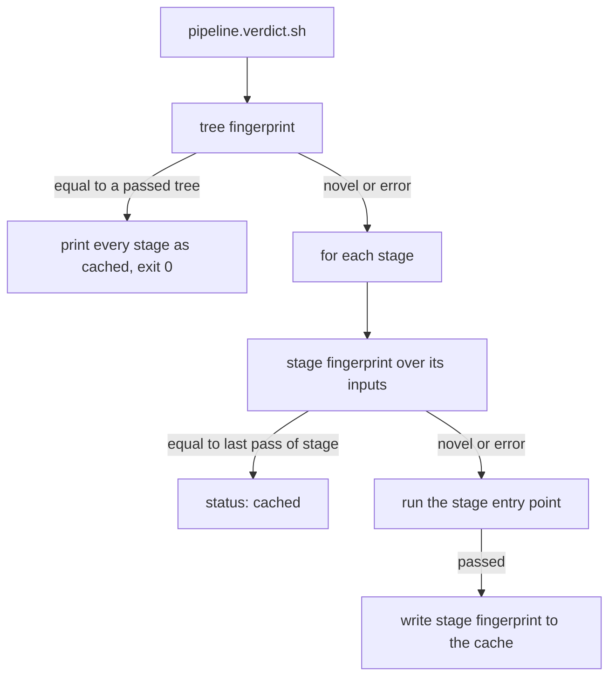

# Fast verdict by content

## Change Summary

The local verdict takes about 104 seconds on a warm tree. Each change, also a change to a document, pays that time. This CR makes the verdict faster without a decrease in proof. The test stage runs `cargo nextest`, which runs the test binaries in parallel. The verdict keeps a cache of passed results, keyed on the exact content fingerprint of the tree and of the inputs of each stage. A stage whose inputs did not change since its last pass prints `status: cached` and does not run.

## Motivation and Background

The owner wants to move faster without breaking things. The time from an edit to its verdict bounds how many changes an agent can prove in one session. The `fast_feedback_loop` convention says: prove content once, key a reused verdict on content, fail closed, and remove redundant proof, never proof.

Measured on 2026-10-21 on the Mac of the owner (arm64, warm cache):

| Stage | Time |
|---|---|
| format | 0.5 s |
| lint | 0.6 s |
| test | 99 s |
| web | 0.5 s |
| image | 1 s (layer cache hit) to 70 s (miss) |

The test stage compiles nothing on a warm tree (`cargo test --no-run` takes 0.5 s). The 99 s is run time. `cargo test` runs the 76 integration test binaries one after another, and many of them start a server and wait on real timers of 5, 10, or 15 s. `cargo-nextest` 0.9.149 runs the same 394 tests in 24 s, and all pass.

## Change Drivers

* The verdict time grew from 18.5 s to about 104 s in two days (`docs/specification/operations.md`, section Measurable targets).
* A change to a document or a scenario runs the full Rust test suite, but no Rust input changed.
* The owner asked for a faster verdict or a lower bar for tests. This CR selects a faster verdict and keeps the bar.

## Current State

`pipeline.verdict.sh` runs the stages format, lint, test, web, image in that order. It calls each stage entry point, prints one line per stage, and exits 0 only if every stage passed. It keeps no state between runs. `pipeline.test.sh` runs `cargo test`. No stage declares the paths that it reads.

### Current State Diagram


## Proposed Change

1. The test stage runs `cargo nextest run`. The minimum version of nextest is pinned in one file.
2. Each stage entry point declares its input paths with a `--inputs` flag.
3. The verdict computes a fingerprint of the full tree and of the inputs of each stage. The fingerprint includes the uncommitted changes of the working tree.
4. The verdict keeps a cache under `.agents/logs/` of the fingerprints that passed. On an exact match it prints `status: cached` and does not run the stage.

### Proposed State Diagram



## Requirements

### Functional Requirements

**Test runner**

1. `pipeline.test.sh` **MUST** run the tests with `cargo nextest run`.
2. The minimum version of `cargo-nextest` **MUST** be pinned in one file of the repository. `pipeline.test.sh` **MUST** read the pin from that file and **MUST NOT** state a version itself.
3. If `cargo nextest` is missing or its version is below the pin, `pipeline.test.sh` **MUST** stop with exit code 3 and an actionable error. The error **MUST** name the install command (`cargo install cargo-nextest --locked --version <pin>`), the pin file, and the verify command.
4. `pipeline.test.sh` **MUST NOT** fall back to `cargo test`. The measured loop stays one runner.
5. Doc tests, if the crate has them, **MUST** still run. If nextest does not run them, `pipeline.test.sh` **MUST** also run `cargo test --doc`.
6. The image stage **MUST NOT** change because of the test runner. The Dockerfile runs no tests.

**Stage inputs**

7. Each stage entry point **MUST** support a flag `--inputs` that prints the paths that the stage reads, one path per line, and exits 0 without a run.
8. The format, lint, and test stages **MUST** declare: `src`, `tests`, `Cargo.toml`, `Cargo.lock`, `build.rs`, `migrations`, `vendor`, `rust-toolchain.toml`, `examples`, `.cargo`, `rustfmt.toml`, `.rustfmt.toml`, `clippy.toml`, `.clippy.toml` (absent today, declared per requirement 11), and the script of the stage. The test stage **MUST** also declare the nextest pin file, any nextest configuration file, `upstreams.toml`, `config`, `.agents/scripts` (the tests run `prices.vendor.sh` and the `pipeline.*.sh` scripts), and each file under `docs/` that a test reads, today `docs/specification/accounts.md`.
9. The web stage **MUST** declare: `web`, `.tool-versions`, and `.agents/scripts/pipeline.web.sh`.
10. The image stage **MUST** declare: `Dockerfile`, `.dockerignore`, every source path of a `COPY` instruction in the Dockerfile, and `.agents/scripts/pipeline.image.sh`.
11. A path that a stage declares and that does not exist **MUST** be part of the fingerprint as absent, so its later creation changes the fingerprint.
11a. A test **MUST** find each repository path that a file under `tests/` reads (an `include_str!` or `include_bytes!` argument, and each string literal that names a path relative to the repository root and that exists) and **MUST** fail if that path is not inside the declared inputs of the test stage.

**Fingerprints**

12. The tree fingerprint **MUST** be the git tree hash of a temporary index that holds `HEAD` plus every tracked change and every untracked file that `.gitignore` does not exclude. The verdict **MUST** make it with `GIT_INDEX_FILE` set to a temporary file, `git add -A`, and `git write-tree`. The verdict **MUST NOT** change the real index, the working tree, or the stash.
13. The stage fingerprint **MUST** be the hash of the sorted list of `<path> <object id>` entries for the declared inputs of the stage in that same temporary tree, plus the name of the stage, plus the toolchain identity of the stage (requirement 13a).
13a. Each stage entry point **MUST** support a flag `--toolchain` that prints the versions of the tools outside the tree that the stage uses, and the verdict **MUST** add that output to the stage fingerprint: format and lint `rustc -V` and `cargo -V`; test also `cargo nextest --version`; web `node --version` and the version of the package manager; image `docker version --format '{{.Server.Version}}'` and the resolved digest of each `FROM` image. A `--toolchain` that fails, or a base image whose digest cannot be resolved, **MUST** make the stage run in full (requirement 21).
14. A fingerprint **MUST** depend only on content. Two trees with equal content **MUST** give the same fingerprint, whatever their commits.

**Verdict cache**

15. The cache **MUST** be stored under `.agents/logs/` and **MUST NOT** be tracked by git.
16. The verdict **MUST** write the fingerprint of a stage to the cache only after the stage passed in a run of this verdict. A failed stage **MUST NOT** write.
17. If the tree fingerprint equals a tree fingerprint for which every stage passed, the verdict **MUST** print each stage with `status: cached` and exit 0.
18. Else, for each stage, if the stage fingerprint equals the last passed fingerprint of that stage, the verdict **MUST** print `status: cached` for the stage and **MUST NOT** run it. Else it **MUST** run the stage.
19. A stage line **MUST** keep the form `stage: <name> status: passed|failed|cached seconds: <n>`. The verdict line **MUST** stay `verdict: passed|failed seconds: <total>`. A cached stage counts as passed for the exit code.
20. The flag `--no-cache` **MUST** run every stage and **MUST** still write the passed fingerprints.
21. The verdict **MUST** fail closed. If git is missing, the temporary index fails, a hash fails, the cache is absent or unreadable, or a stage's `--inputs` or `--toolchain` fails, the verdict **MUST** run the affected stages in full. It **MUST** print one diagnostic line on stderr that names the cause.
22. A write to the cache **MUST** be atomic (write a temporary file, then rename), so two parallel verdicts cannot leave a broken cache.
23. The cache **MUST** keep at most 200 tree entries and drop the oldest.

**Determinism and scope**

24. Only the hermetic stages format, lint, test, web, and image **MUST** enter the verdict. Live scenarios and benches **MUST** stay outside the verdict, as today.
25. The verdict **MUST** stay a caller of the stage entry points. The fingerprint and cache logic **MUST** live in a separate script under `.agents/scripts/` that the verdict calls, so that each file has one purpose.
26. The image stage **MUST** be in the default verdict if parameter `IMAGE_IN_DEFAULT` is `yes`, and **MUST** move behind a `--full` flag if it is `no`. `IMAGE_IN_DEFAULT` is pending the human (open question 2); provisional value: `yes`.

**Documentation**

27. `docs/specification/operations.md`, section Pipeline, **MUST** describe the nextest runner and its pin, the `--inputs` flag, the fingerprints, the cache, `status: cached`, `--no-cache`, and the fail-closed rule.
28. The section Measurable targets **MUST** record the measured times before and after this change.
29. `.taxonomy` **MUST** get rows for `verdict cache`, `tree fingerprint`, and `stage fingerprint`, and the `verdict` row **MUST** name `status: cached`.

### Non-Functional Requirements

1. The set of content that can pass the verdict **MUST** be equal to or smaller than with a verdict that always runs every stage.
2. The fingerprint and the cache lookup together **MUST** take at most 1 s on this repository.
3. The scripts **MUST** follow `agent_first_cli`: machine output by default, `--human` on request, documented exit codes, and actionable errors.

## Measurable Targets

| Metric | Method | Baseline | Threshold |
|---|---|---|---|
| Warm full verdict | `.agents/scripts/pipeline.verdict.sh --no-cache`, second run, total seconds (with the image stage, also if `IMAGE_IN_DEFAULT` is `no`, through `--full`) | about 104 s (2026-10-21) | at most 40 s, every stage `status: passed` |
| Test stage | seconds of the `test` line in the run above | 99 s | at most 30 s |
| Docs-only change | edit `docs/specification/operations.md`, then `.agents/scripts/pipeline.verdict.sh`, total seconds | about 104 s | at most 3 s, every stage `status: cached`, exit 0 |
| Web-only change | edit a file under `web/`, then the verdict | about 104 s | format, lint, test `status: cached`; image `status: cached` if `IMAGE_IN_DEFAULT` is `yes`, else no image line; web `status: passed` |
| Soundness | test `tests/pipeline.cache.rs` (see Test Strategy) | no cache exists | a changed input always runs its stage; a failed stage never gives `status: cached` |
| Input coverage | test `tests_read_only_declared_inputs` | no check exists | every path that a test reads is a declared input of the test stage |
| Toolchain in fingerprint | test `toolchain_change_runs_stage` | no check exists | a changed `--toolchain` output runs the stage |
| Fingerprint cost | stderr timing line of the fingerprint script | none | at most 1 s |

## Affected Components

* `.agents/scripts/pipeline.verdict.sh`: cache lookup, `--no-cache`, `status: cached`.
* `.agents/scripts/pipeline.fingerprint.sh` (new): the tree and stage fingerprints.
* `.agents/scripts/pipeline.format.sh`, `pipeline.lint.sh`, `pipeline.test.sh`, `pipeline.web.sh`, `pipeline.image.sh`: `--inputs`.
* `.agents/scripts/pipeline.test.sh`: nextest and its pin.
* The pin file for nextest (new, for example `.config/nextest-version`).
* `docs/specification/operations.md`, `.taxonomy`, `README.md` (install step).
* New tests under `tests/`.

## Scope Boundaries

### In Scope

* The nextest runner, the stage inputs, the fingerprints, the cache, the measurements, and the docs.

### Out of Scope ("Here, But Not Further")

* A change to the timers in the tests (open question 1).
* A verdict cache on a platform, or a shared remote cache.
* A change to the Dockerfile or to the stages themselves, other than the runner.
* Removal of a test or a stage.

## Alternative Approaches Considered

* **Lower the bar: skip slow tests by default.** Rejected. It removes proof, and the convention says remove redundant proof, never proof.
* **Key the cache on the commit SHA.** Rejected. A squash or an amend makes a new SHA over equal content, and a dirty tree has no SHA.
* **Path filters on `git diff` against the last green commit.** Rejected. A filter is not exact equality of content.
* **Fall back to `cargo test` when nextest is missing.** Rejected. Two runners make two loop times and hide a regression.

## Impact Assessment

### User Impact

The owner and the agents get a verdict in seconds for a docs or web change and in at most 40 s for a Rust change.

### Technical Impact

One new dev tool, `cargo-nextest`, at a pinned minimum version. One new script and one new cache file under `.agents/logs/`.

### Business Impact

More changes can be proved in one session, with the same proof.

## Implementation Approach

1. Add the pin file and change `pipeline.test.sh` to nextest. Measure.
2. Add `--inputs` to each stage entry point.
3. Add `pipeline.fingerprint.sh`.
4. Add the cache to `pipeline.verdict.sh`.
5. Update `operations.md`, `.taxonomy`, and `README.md`. Measure and record.

### Implementation Flow


## Test Strategy

Each test runs a script through a cargo wrapper, as `tests/prices.vendor.rs` and `tests/agent.connect.rs` do. The cache tests copy a small fixture repository into a temporary directory, run `git init`, and use stand-in stage scripts that write a marker file, so the tests do not run the real stages.

### Tests to Add

| File | Test | Asserts |
|---|---|---|
| `tests/pipeline.test.runner.rs` | `test_stage_stops_without_nextest` | With a PATH without `cargo-nextest`, `pipeline.test.sh` exits 3, stderr has `Fix:` and `cargo install cargo-nextest`, and no `cargo test` runs. |
| `tests/pipeline.test.runner.rs` | `test_stage_stops_below_pinned_nextest` | A stand-in `cargo-nextest` that reports a lower version gives exit 3. |
| `tests/pipeline.inputs.rs` | `every_stage_prints_its_inputs` | Each stage with `--inputs` exits 0 and prints the declared paths. |
| `tests/pipeline.inputs.rs` | `image_inputs_cover_dockerfile_copy_sources` | Each `COPY` source in `Dockerfile` is in the image inputs. |
| `tests/pipeline.inputs.rs` | `tests_read_only_declared_inputs` | Each repository path that a file under `tests/` reads (`include_str!`, `include_bytes!`, string paths) is inside the test stage inputs. |
| `tests/pipeline.inputs.rs` | `every_stage_prints_its_toolchain` | Each stage with `--toolchain` exits 0 and prints one or more version lines; the image stage prints a digest for each `FROM`. |
| `tests/pipeline.cache.rs` | `toolchain_change_runs_stage` | A stand-in stage whose `--toolchain` output changes between two runs runs on the second run. |
| `tests/pipeline.fingerprint.rs` | `tree_fingerprint_counts_dirty_and_untracked_files` | An edit or a new untracked file changes the fingerprint; the real index and `git stash list` do not change. |
| `tests/pipeline.fingerprint.rs` | `tree_fingerprint_is_independent_of_commit` | Equal content on two commits gives one fingerprint. |
| `tests/pipeline.fingerprint.rs` | `stage_fingerprint_ignores_other_paths` | An edit under `docs/` does not change the test stage fingerprint; an edit under `src/` does. |
| `tests/pipeline.cache.rs` | `unchanged_tree_prints_cached` | The second run prints every stage `status: cached` and exits 0, and no stand-in stage runs. |
| `tests/pipeline.cache.rs` | `changed_input_runs_its_stage_only` | An edit under `web/` runs the web stand-in only. |
| `tests/pipeline.cache.rs` | `failed_stage_is_never_cached` | A failing stand-in, run twice, fails twice and is never `status: cached`. |
| `tests/pipeline.cache.rs` | `corrupt_cache_runs_everything` | A garbled cache file runs every stage and prints a diagnostic on stderr. |
| `tests/pipeline.cache.rs` | `no_cache_flag_runs_everything` | `--no-cache` runs every stage. |
| `tests/pipeline.cache.rs` | `cache_is_bounded` | After 201 passed trees the cache holds 200 entries. |

### Tests to Modify

* Any existing test that reads the stage line format of the verdict accepts `status: cached`.

### Tests to Remove

* None.

## Model-Based Testing

The user surface is the command `.agents/scripts/pipeline.verdict.sh`. Two scenarios go under `.agents/scenarios/`.

1. **Docs edit gets an instant verdict.** Goal: a docs-only change gets a verdict fast. Steps: run the verdict until it passes; append one line to `docs/specification/operations.md`; run the verdict again. Success condition: exit code 0, every stage line has `status: cached`, total seconds at most 3. Run it 3 times; record attempts and passes.
2. **Rust edit gets the full proof.** Goal: a Rust change is never trusted from the cache. Steps: run the verdict until it passes; add a comment line to a file under `src/`; run the verdict again. Success condition: format, lint, and test lines have `status: passed` with test seconds above 1, and image is `status: passed`; total at most 40 s on a warm cache. Then add a failing assertion to a test under `tests/`, run the verdict, and see `status: failed` and exit 1 on two runs in a row.

## Acceptance Criteria

### AC-1: The test stage uses nextest

```gherkin
Given cargo-nextest at or above the pinned version is installed
When I run .agents/scripts/pipeline.test.sh
Then the log shows cargo nextest run
And the stage line has status: passed
```

### AC-2: A missing nextest stops the stage

```gherkin
Given cargo-nextest is not on PATH
When I run .agents/scripts/pipeline.test.sh
Then the exit code is 3
And stderr names the install command and the pin file
And cargo test does not run
```

### AC-3: An unchanged tree is cached

```gherkin
Given the verdict passed on the current tree
When I run .agents/scripts/pipeline.verdict.sh again
Then every stage line has status: cached
And the exit code is 0
```

### AC-4: A docs-only change is fast

```gherkin
Given the verdict passed on the current tree
And I change only a file under docs/
When I run .agents/scripts/pipeline.verdict.sh
Then every stage line has status: cached
And the total time is at most 3 seconds
```

### AC-5: A changed input runs its stage

```gherkin
Given the verdict passed on the current tree
And I change a file under web/
When I run .agents/scripts/pipeline.verdict.sh
Then the web line has status: passed
And the format, lint, and test lines have status: cached
And the image line has status: cached if IMAGE_IN_DEFAULT is yes
```

AC-5 depends on parameter `IMAGE_IN_DEFAULT` (pending the human).

### AC-6: A failure is never cached

```gherkin
Given a stage fails on the current tree
When I run .agents/scripts/pipeline.verdict.sh again without a change
Then that stage runs again and has status: failed
And the exit code is 1
```

### AC-7: The verdict fails closed

```gherkin
Given the cache file under .agents/logs/ is unreadable
When I run .agents/scripts/pipeline.verdict.sh
Then every stage runs
And stderr has one diagnostic line that names the cause
```

### AC-8: The cache can be bypassed

```gherkin
Given the verdict passed on the current tree
When I run .agents/scripts/pipeline.verdict.sh --no-cache
Then no stage line has status: cached
```

### AC-9: The fingerprint is by content and safe

```gherkin
Given a working tree with a tracked edit and an untracked file
When the verdict computes the tree fingerprint
Then the fingerprint differs from the fingerprint of HEAD
And the real index and the stash are unchanged
```

### AC-10: The targets pass

```gherkin
Given a warm cache
When I run .agents/scripts/pipeline.verdict.sh --no-cache twice
Then the second total is at most 40 seconds
And operations.md records the before and after values
```

## Quality Standards Compliance

### Build & Compilation

`cargo build` passes.

### Linting & Code Style

`pipeline.format.sh` and `pipeline.lint.sh` pass. `shellcheck` on changed scripts, if installed.

### Test Execution

`pipeline.verdict.sh --no-cache` passes with every stage `status: passed`.

### Documentation

`operations.md`, `.taxonomy`, and `README.md` are updated in the same change. Every new script has the `@agents-index` line and the usage docstring.

### Code Review

A reviewer agent checks the soundness rules (requirements 12 to 23, non-functional requirement 1).

### Verification Commands

```bash
.agents/scripts/pipeline.verdict.sh --no-cache
.agents/scripts/pipeline.verdict.sh
echo >> docs/specification/operations.md && .agents/scripts/pipeline.verdict.sh; git checkout docs/specification/operations.md
cargo nextest run --test pipeline.cache --test pipeline.fingerprint --test pipeline.inputs --test pipeline.test.runner
```

## Risks and Mitigation

### Risk 1: An undeclared input lets a broken change pass as cached

A stage can read a path that it does not declare. Mitigation: requirement 8 declares every path that the tests read today; the test `tests_read_only_declared_inputs` fails when a test reads an undeclared path; the inputs test checks the Dockerfile; the tree-level cache only hits on an exact tree match; `--no-cache` runs everything before a release.

### Risk 2: Parallel tests reveal shared state

nextest runs tests in separate processes in parallel. Mitigation: the 394 tests already passed under nextest on 2026-10-21.

### Risk 3: The toolchain changes outside the tree

A new `cargo`, `cargo-nextest`, `node`, or base image does not change the tree. The nextest pin is a minimum, and the `FROM` tags are mutable. Mitigation: requirement 13a puts the tool versions and the base image digests into each stage fingerprint, so a change of a tool runs the stage again. A failed `--toolchain` runs the stage in full.

### Risk 4: A broken cache hides a failure

Mitigation: only a passed stage writes, writes are atomic, and any read error runs everything.

## Dependencies

* `cargo-nextest` 0.9.149 or later, installed with `cargo install`.
* git 2.x with `GIT_INDEX_FILE` support.

## Estimated Effort

About one unit of work: six scripts, four test files, and three documents.

## Open Questions

1. Do the long real-timer tests get a paused clock or shorter configurable timers? Recommendation: yes, where the test asserts a timer and not a real socket. Out of scope of this CR.
2. Parameter `IMAGE_IN_DEFAULT`: does the image stage stay in the default verdict? Recommendation: `yes`, because its fingerprint makes it instant on an unchanged input set. Status: pending the human. The supervisor must send this question through the structured question tool and record the answer here. Requirement 26, AC-5, and the web-only and warm full verdict targets depend on it.

## Decision Outcome

Pending the reviewer.

## Judgement Calls

* The cache sits under `.agents/logs/`, because that path is already git-ignored and holds pipeline state.
* A separate fingerprint script keeps the verdict a caller only (`portable_pipeline`, small files).
* The cache keeps 200 trees, which covers a long session and stays small.
* Status `proposed`, because the governance skill sets that initial status.

## Decisions

* nextest without a fallback, per the request of the supervisor and the measured gain (99 s to 24 s).

## Open Questions

1. Do the long real-timer tests (15 s heartbeat, 10 s waits) get a paused clock or shorter configurable timers, to cut the 24 s further? Recommendation: yes, where the test asserts a timer and not a real socket. This is out of scope here and pending the human.
2. Does the image stage leave the default verdict and move to a `--full` flag? Recommendation: no. Keep it, because its fingerprint makes it instant on an unchanged input set. Requirement 26 holds this recommendation as provisional, pending the human.

## Implementation Status

Not started.

## Related Items

* `docs/specification/operations.md`, sections Pipeline and Measurable targets.
* `.agents/scripts/pipeline.verdict.sh`.

## More Information

The `fast_feedback_loop` and `portable_pipeline` conventions govern this change.

## Approval

Pending the reviewer agent.
