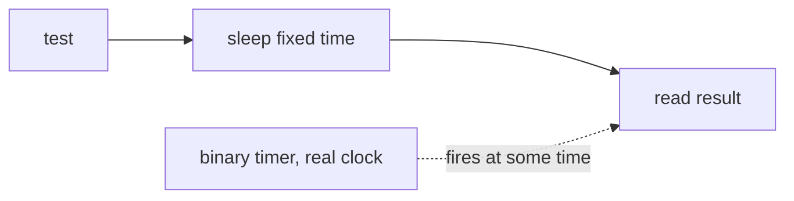
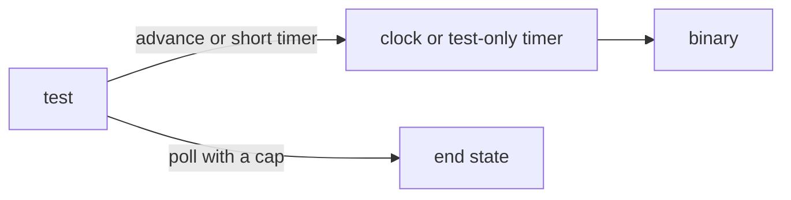

# Timer tests without real waits

## Change Summary

Under `cargo nextest` (CR-0016) the test stage takes 24 s for 394 tests. Nine test files hold most of that time, because they sleep on a fixed wall-clock wait or wait for a real timer of the binary to fire. This CR changes the tests that assert a timer to use a paused clock or a short, documented, test-only timer. The tests that drive a real socket or a real process keep real time, but they poll for the end state and do not sleep a fixed time.

## Motivation and Background

The owner wants to move faster without breaking things. The human decided on 2026-10-21: a test that asserts a timer gets a paused clock or a shorter configurable timer; a test that drives a real socket keeps real time. The `fast_feedback_loop` convention says that only deterministic gates enter the verdict. A test that sleeps a fixed time and then reads the result races the timer, so it is slow and can also be flaky.

## Change Drivers

* The test stage takes 24 s under nextest (measured 2026-10-21, 394 tests).
* Nine files sleep or wait 4 s or more.
* `src/publish/clock.rs` already injects a clock into the publisher. The live client (`src/live/client.rs`, `HEARTBEAT` 15 s, `WRITE_TIMEOUT` 5 s) and the token gate (`src/token/gate.rs`, `TTL` 1 s, `TOUCH_EVERY` 60 s) use real time constants.

## Current State

The slow tests and the timers that they wait on (names and values only):

| Test file | Wait in the test | Timer of the binary that it waits on | Class |
|---|---|---|---|
| `tests/token.proxy.rs` | `sleep` 1.5 s, 5 s, 2 s, 1 s after a revoke | token gate cache `TTL` 1 s, `TOUCH_EVERY` 60 s (`last_used_at` write) | A: asserts a timer |
| `tests/cli.day.rs` | `sleep` 2.5 s after `day delete`; poll up to 10 s | `LOUPE_PUBLISH_INTERVAL_SECS` = 1 | A: asserts a timer |
| `tests/live.events.rs` | `sleep` 0.3 s; collect for a fixed 6 s | `LOUPE_PARSE_INTERVAL_SECS` = 1, `LOUPE_IDLE_SECS` = 1, `HEARTBEAT` 15 s | A: asserts a timer |
| `tests/proxy.failure.rs` | header delays against a timeout; poll up to 10 s | `LOUPE_UPSTREAM_HEADERS_TIMEOUT_SECS` = 1 and 2 | A: asserts a timer |
| `tests/live.latency.rs` | `timeout` 30 s on the reader | none (measures a p95 of 250 ms) | B: real socket |
| `tests/serve.health.rs` | poll up to 10 s for start | none (process start) | B: real process |
| `tests/serve_start.rs` | poll up to 10 s and 5 s; asserts start under 5 s | none (process start) | B: real process |
| `tests/serve.shutdown.rs` | poll up to 10 s twice | shutdown grace 10 s | B: real process |
| `tests/proxy.queue.rs` | poll up to 10 s twice | none (queue drain) | B: real process |

Class A asserts the value or the effect of a timer. Class B drives a real socket or a real process; its wait is a bound, not the thing under test.

### Current State Diagram



## Proposed Change

1. Class A tests get an injected clock that the test advances, or a test-only configuration variable with a short value, for each timer that they assert.
2. Class A tests poll for the end state with a cap, and do not sleep a fixed time.
3. Class B tests keep real time. Each poll loop gets a cap, and a fixed `sleep` before an assertion is replaced by a poll.
4. No test-only variable changes the default behaviour of the binary.

### Proposed State Diagram



## Requirements

### Functional Requirements

**Class A, tests that assert a timer**

1. Each timer that a class A test asserts **MUST** be driven by an injected clock or by a configuration variable that the test sets to a short value.
2. The token gate cache `TTL` and the `last_used_at` write interval (`TOUCH_EVERY`) **MUST** be readable from the injected clock or from a configuration variable, so `tests/token.proxy.rs` does not sleep 5 s.
3. The live heartbeat (`HEARTBEAT`, 15 s) and the live write timeout **MUST** be driven by an injected clock or a configuration variable, so a test can assert them without a 15 s wait.
4. The proxy headers timeout, the summary timeouts, the shutdown grace, the retention interval, and the publish interval **MUST** each be settable by an existing or a new configuration variable, or be driven by an injected clock.
5. A class A test **MUST NOT** call a fixed `sleep` and then assert. It **MUST** poll for the end state with a cap, or advance the clock and then assert.
6. An assertion **MUST NOT** read the wall clock to decide pass or fail. The test reads the end state; a cap only ends the poll as a failure.

**Class B, tests that drive a real socket or process**

7. Class B tests **MUST** keep real time.
8. Each wait in a class B test **MUST** be a poll for an end state with a cap. A fixed `sleep` before an assertion **MUST** be replaced by a poll.
9. A cap **MUST** be no longer than the value in use today, and the poll interval **MUST** be at most 100 ms.
10. `tests/live.latency.rs` **MUST** keep its p95 threshold of 250 ms. It is a measurement, not a timer assertion.

**Defaults and documentation**

11. No test-only variable or injected clock **MUST** change the default behaviour of the binary. With no variable set, each timer **MUST** keep its value of today.
12. Each new test-only variable **MUST** be documented in `docs/specification/configuration.md` and marked as test-only, with its default. A timer that gets an injected clock instead **MUST NOT** get a variable.
13. `docs/specification/live.md`, `proxy.md`, `summaries.md`, and `proxy.tokens.md` **MUST** name each timer and how it is set, if this CR changes how it is set.
14. `docs/specification/operations.md`, section Measurable targets, **MUST** record the test stage time before and after.

### Non-Functional Requirements

1. The set of behaviour that the tests prove **MUST** be equal to or larger than today. No assertion is removed.
2. Each changed test **MUST** pass 20 times in a row under `cargo nextest run` (no flake).
3. A failed poll **MUST** print the end state that it waited for and the last observed state.

## Measurable Targets

| Metric | Method | Baseline | Threshold |
|---|---|---|---|
| Test stage | `.agents/scripts/pipeline.test.sh`, seconds, warm tree, second run | 24 s (394 tests, 2026-10-21) | under 15 s, all tests pass |
| Slowest test | `cargo nextest run` slowest test in the summary | about 10 s or more | at most 5 s |
| Fixed sleeps | `grep -nE 'sleep\(Duration::from_(secs\|millis)\(([1-9][0-9]{3,}\|[2-9])' tests/*.rs` | at least 5 hits | 0 hits before an assertion |
| Defaults | test `timer_defaults_unchanged` | no check | each timer default equals today's value |
| Flake | each changed test 20 runs | not measured | 20 of 20 pass |

## Affected Components

* `src/token/gate.rs`: `TTL`, `TOUCH_EVERY`.
* `src/live/client.rs`: `HEARTBEAT`, `WRITE_TIMEOUT`.
* `src/publish/clock.rs`: the existing injected clock, the pattern to copy.
* The proxy, summary, shutdown, and retention timers (exact files found at implementation).
* The nine test files in the table above, and the shared test helper that starts the binary.
* `docs/specification/configuration.md`, `live.md`, `proxy.md`, `summaries.md`, `proxy.tokens.md`, `operations.md`.

## Scope Boundaries

### In Scope

* The nine test files and the timers that they wait on.
* Injected clocks or test-only variables for those timers.

### Out of Scope ("Here, But Not Further")

* The verdict cache and the test runner (CR-0016).
* A change to a default timer value.
* Removal of a test or an assertion.
* Live scenarios and benches.

## Alternative Approaches Considered

* **Lower the bar: remove or ignore slow tests.** Rejected. It removes proof.
* **Run slow tests outside the verdict.** Rejected. These tests are hermetic and must gate.
* **Only test-only variables, no injected clock.** Kept as an option per timer; open question 1.

## Impact Assessment

### User Impact

None. Defaults do not change.

### Technical Impact

Some timers move behind an injected clock or a variable. The test helper gets a poll function with a cap.

### Business Impact

A faster verdict lets the owner prove more changes per session.

## Implementation Approach

1. Add the measurement: record the test stage time and the slowest tests.
2. Add `timer_defaults_unchanged`.
3. Change class B tests to capped polls.
4. Change class A timers one at a time, then their tests.
5. Update the specifications, then measure again.

### Implementation Flow


## Test Strategy

### Tests to Add

* `timer_defaults_unchanged`: with no variable set, each timer has its value of today.
* A poll helper test: the helper returns on the end state and fails with the last state at the cap.

### Tests to Modify

* The nine files in the table, per their class.

### Tests to Remove

None.

## Model-Based Testing

No user surface changes. Defaults stay the same, and the change is in the tests. The scenario is the measurement run below, done by a model or a human:

1. Run `.agents/scripts/pipeline.test.sh` two times on a warm tree.
2. Read the seconds of the second run.
3. Success condition: the stage passes, and the seconds are under 15.

## Acceptance Criteria

### AC-1: A class A test does not wait on a real timer

```gherkin
Given the token gate test that asserts a revoke
When the test runs under cargo nextest
Then it passes in at most 5 seconds
And it contains no fixed sleep before the assertion
```

### AC-2: A class B test keeps real time

```gherkin
Given a test that starts the binary as a process
When the test waits for the server to start
Then it polls the end state with a cap no longer than today
And the poll interval is at most 100 ms
```

### AC-3: Defaults do not change

```gherkin
Given the binary with no test-only variable set
When the timer defaults are read
Then each timer equals its value before this change
```

### AC-4: Test-only variables are documented

```gherkin
Given a new test-only variable
When configuration.md is read
Then the variable is listed, marked test-only, with its default
```

### AC-5: No assertion reads the wall clock

```gherkin
Given the changed tests
When their assertions are read
Then no assertion decides pass or fail from the wall clock
```

### AC-6: The target passes

```gherkin
Given a warm tree
When pipeline.test.sh runs the second time
Then every test passes
And the stage takes under 15 seconds
```

## Quality Standards Compliance

### Build & Compilation

`cargo build` passes.

### Linting & Code Style

`.agents/scripts/pipeline.lint.sh` and `pipeline.format.sh` pass.

### Test Execution

`.agents/scripts/pipeline.test.sh` passes; each changed test passes 20 of 20 runs.

### Documentation

The specifications in requirement 12 to 14 are updated before the code.

### Code Review

A reviewer agent checks blocking findings only.

### Verification Commands

```bash
.agents/scripts/pipeline.test.sh
cargo nextest run --test token.proxy --retries 0
.agents/scripts/pipeline.verdict.sh --no-cache
```

## Risks and Mitigation

### Risk 1: A test-only variable leaks into production behaviour

Mitigation: `timer_defaults_unchanged`, and documentation as test-only.

### Risk 2: A shorter timer hides a race that the real value shows

Mitigation: an injected clock is preferred where the timer logic is complex; class B keeps real time.

### Risk 3: Polls flake under parallel load

Mitigation: caps no shorter than today, and the 20-run flake check.

## Dependencies

* CR-0016 (nextest runner and the measurement script).

## Estimated Effort

Medium: about nine test files and four to six source files.

## Open Questions

1. Per timer, an injected clock or a test-only variable? Recommendation: an injected clock for the token gate and the live client (copy `src/publish/clock.rs`), and the existing or new `LOUPE_*_SECS` variables for the proxy, summary, shutdown, retention, and publish timers, because most already have a variable. This is a design choice inside the human's decision of 2026-10-21, so the implementer can decide it; no human question is needed.

## Decision Outcome

Pending review.

## Notes

Non-blocking items from the review, recorded for the implementer:

* Requirement 11 reads better as: a test-only variable or injected clock MUST NOT change the default behaviour.
* AC-1 (passes in at most 5 seconds) is a measurement of the run, not a test assertion, so it does not conflict with requirement 6.
* tests/serve.shutdown.rs is class B, but its timer column names the shutdown grace of 10 s; a test that asserts the grace value is class A. The implementer confirms the class of each test.
* Requirement 4 makes the retention and summary timers settable even where no slow test waits on them; the implementer limits it to the timers that a listed test waits on.
* The regex for fixed sleeps does not match a wait written as from_secs(1) or from_millis(1500), such as the 1.5 s sleep in tests/token.proxy.rs; requirement 5 and AC-1 cover that case.
* Reviewed and approved by an independent reviewer agent on 2026-10-21, first pass, with these notes.
