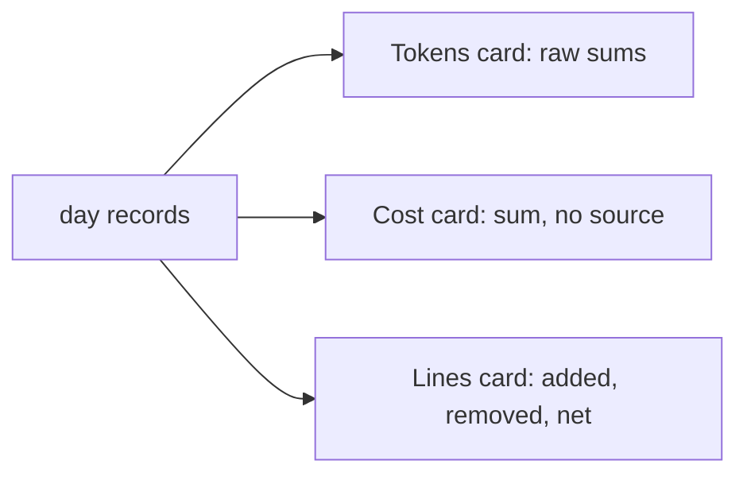
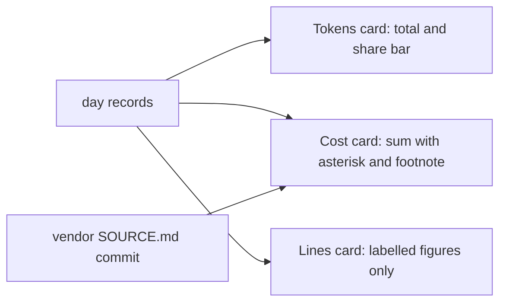
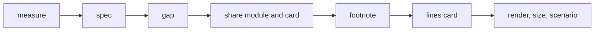

# Dashboard readability

## Change Summary

The owner looked at the live dashboard with the backfilled history on 2026-10-21 and asked for four changes. The cards touch each other, the cost has no stated source, the card "Tokens in the range" is hard to read, and the net figure on the lines card is hard to read and has no clear reason. This CR adds a spacing token, a cost footnote, a share view of the token kinds, and a new layout for the lines card.

## Motivation and Background

The owner wrote, on 2026-10-21:

1. "We also need some margin between the boxes on the web."
2. "The API-equivalent cost should have an asterisk and refer to litellm's price list."
3. "Tokens in the range is very hard to read, it needs formatting and/or visualization. A percentage/ratio between input/output/cache might be good here?"
4. "The Net feels off and is hard to read, this is a dashboard, everything must be motivated, usable and readable. Adjust accordingly."

These four points are the requirements. Where a point leaves a design choice open, this CR states a rule and names the choice a judgement call of the implementer.

## Change Drivers

* The dashboard is public. A reader must read each figure without help.
* The API-equivalent cost is a list price from a vendored file. A reader must see the source.
* The day record holds four token kinds (`input`, `cache_read`, `cache_write`, `output`), but the page shows only sums.

## Current State

* `web/assets/css/page.css` sets `gap: 16px` on `.wrap` and `.row` as literal values. No spacing token exists in `web/assets/css/tokens.css`. On the live page the cards look joined.
* `web/assets/js/section.cost.js` makes the card "Tokens in the range" with the raw sums and the cost card with the text "List price of the tokens, not money paid." The cost card names no source.
* `web/assets/js/section.lines.js` makes the card "Lines changed in the range" with added, removed, and net (added minus removed). The spec `docs/specification/dashboard.md`, section "Lines changed in the range", item 1, requires the net value.

### Current State Diagram



## Proposed Change

1. Add a spacing token and use it for the gap between cards and rows.
2. Add an asterisk to the cost label and a footnote that names the LiteLLM price file, links to the LiteLLM repository, and names the price commit.
3. Show the token total of the range with a share view of the four token kinds, in inline SVG.
4. Redesign the lines card so that each figure on it has a label and a reason.

### Proposed State Diagram



## Requirements

### Functional Requirements

**Spacing between cards**

1. `web/assets/css/tokens.css` **MUST** define a spacing token for the gap between cards (for example `--space-card-gap`). The design tokens table in `docs/specification/dashboard.md` **MUST** list it.
2. The gap between two cards in a row and between two rows **MUST** use that token, and **MUST** be at least 24 px at each width.
3. Two cards **MUST NOT** touch or share a border at 360 px and at 1440 px.

**Cost footnote**

4. The cost card label **MUST** end with an asterisk: "Cost (API-equivalent)*".
5. The cost card **MUST** show a footnote line that starts with an asterisk. The line **MUST** name LiteLLM and its price file `model_prices_and_context_window.json` as the source of the prices.
6. The footnote **MUST** link to the LiteLLM repository with a plain `href` (`https://github.com/BerriAI/litellm`). The page **MUST NOT** load a remote script, style, or font for it. The link **MUST** use `rel="noopener noreferrer"`.
7. The footnote **MUST** name the price commit of the vendored file (the short form of the commit in `vendor/litellm/SOURCE.md`). The commit is public data. The binary **MUST** take the commit from the vendored metadata at build time, not from a literal in the page code, so a refresh of the prices also changes the footnote.
8. The text "List price of the tokens, not money paid." **MUST** stay.

**Tokens in the range**

9. The card **MUST** show the total of the range (`input_total + output`) as its figure, in the integer format of the totals (thin space group mark).
10. The card **MUST** show the share of each of the four kinds: input, cache read, cache write, and output. Each share is a percentage of the total with one decimal, and each kind has a label and its count in the short form (for example `1.3M`).
11. The card **MUST** show the shares as one stacked horizontal bar in inline SVG. The bar uses colors from the design tokens; a new color token for each cache kind is added to `tokens.css` and to the tokens table if the existing tokens do not cover it. Text keeps a contrast of at least 4.5 to 1.
12. The four counts **MUST** sum to the total. The four bar segments **MUST** together fill the full bar width. The printed percentages are rounded and **MAY** sum to a value between 99.8 and 100.2.
13. A kind with a count of zero **MUST** show `0.0%` and no bar segment.
14. When the total of the range is zero, the card **MUST** show the empty state of the page rules and no bar.
15. The bar **MUST** have a text alternative (`<title>` or `aria-label`) that states each kind and its percentage.

**Lines changed in the range**

16. Every figure on the lines card **MUST** have a visible label and a stated reason to be on the card. The reason is recorded in `docs/specification/dashboard.md`, section "Lines changed in the range".
17. The implementer **MUST** pick one of two layouts:
    a. The net figure is the headline of the card, with a sign (`+` or `−`) and the label "net lines", and added and removed are the detail below it with their labels.
    b. The net figure is removed. Added and removed are the figures, with their labels.
18. Added **MUST** use `--color-positive` and removed **MUST** use `--color-output`, as today. A negative number **MUST** use the minus sign U+2212.
19. `docs/specification/dashboard.md`, section "Lines changed in the range", item 1, **MUST** change to match the selected layout.

**Widths**

20. The page **MUST** keep the width rule of CR-0008: no horizontal scroll at 360 px, and a correct layout at 1440 px.

### Non-Functional Requirements

1. The code size measured by `web.size.sh` **MUST** stay at or below 100 KiB.
2. The draw time of the page **MUST** stay at or below 500 ms.
3. The headline figure **MUST** stay at least two times the size of the totals figure.
4. The share computation and the format **MUST** be pure functions in their own small module, so node tests can call them.

## Measurable Targets

| Metric | Method | Baseline | Threshold |
|---|---|---|---|
| Code size | `.agents/scripts/web.size.sh` | measured at the start of implementation | at most 100 KiB |
| Draw time | `.agents/scripts/web.render.sh` | measured at the start of implementation | at most 500 ms |
| Headline ratio | `--size-headline` divided by `--size-figure` | 72 / 34 | at least 2 |
| Card gap | computed gap between two cards in the render at 360 px and 1440 px | 24 px, cards look joined | at least 24 px from the token, no shared border |
| Share sum | node test of the share module | no check | segments sum to the total; printed percentages in 99.8 to 100.2 |

## Affected Components

* `web/assets/css/tokens.css`, `web/assets/css/page.css`: the spacing token, the gap, and new color tokens if needed.
* `web/assets/js/section.cost.js`: the cost label, the footnote, and the tokens card.
* `web/assets/js/section.lines.js`: the lines card.
* `web/assets/js/format.number.js`: the percentage format, if it is not in the new module.
* A new module for the share computation under `web/assets/js/` and its node test under `web/test/`.
* The build path that puts the price commit into the page data (the exact place is found at implementation).
* `docs/specification/dashboard.md`: the tokens table, the sections "Cost (API-equivalent)", "Lines changed in the range", the tokens card, and the number formats.

## Scope Boundaries

### In Scope

* The four points of the owner and the spec text that they change.

### Out of Scope ("Here, But Not Further")

* A change to the charts, the headline, the heatmap, or the daily log.
* A light theme.
* A change to how the cost is computed.
* A change to the public API, except a field for the price commit if the implementer puts it there.

## Alternative Approaches Considered

* **Pie or donut chart for the shares.** Rejected as the default, because a stacked bar reads better at 360 px and is less code. The implementer can choose it only if it meets requirements 10 to 15.
* **Keep the net figure as a third equal figure.** Rejected. That is the state the owner called hard to read.
* **Hard-code the commit in the page.** Rejected. It drifts when the prices are refreshed.

## Impact Assessment

### User Impact

A reader sees separated cards, the source of the cost, the composition of the tokens, and a lines card with labelled figures.

### Technical Impact

A new small module, a few CSS tokens, and one value from the build.

### Business Impact

The public page states its sources, so a reader can trust the cost figure.

## Implementation Approach

1. Measure the code size and the draw time.
2. Update `docs/specification/dashboard.md`.
3. Add the spacing token and the gap.
4. Add the share module and its node tests, then the tokens card.
5. Add the cost footnote and the price commit value.
6. Change the lines card.
7. Run the render and the size scripts, and run the scenario.

### Implementation Flow



## Test Strategy

### Tests to Add

* Node test of the share module: four kinds sum to the total; a zero kind gives `0.0%` and no segment; a zero total gives the empty result; rounding stays in 99.8 to 100.2.
* Node test of the percentage format: one decimal, no locale dependency.
* Rust test in `web_serve` (or the test file that serves the page): the served page or its data holds the footnote text with "LiteLLM", `model_prices_and_context_window.json`, and the short price commit from `vendor/litellm/SOURCE.md`.

### Tests to Modify

* Node tests of the lines card, if they assert the net figure.

### Tests to Remove

None.

## Model-Based Testing

The change has a user surface: the dashboard page. A model drives it with `.agents/scripts/web.render.sh` or the browser driver, and a human can open the page by hand. Persist the scenario as `.agents/scenarios/dashboard.readability.md`.

1. Seed day records with nonzero counts for all four token kinds, and with more lines removed than added on some days.
2. Open the dashboard at 1440 px on the range 6M.
3. Check that a visible gap of at least 24 px is between each pair of cards.
4. Check that the cost label ends with an asterisk, and that the footnote names LiteLLM, the price file, and the short price commit, and links to the LiteLLM repository.
5. Check that the tokens card shows the total, a stacked bar, and four labelled percentages.
6. Check that every figure on the lines card has a label.
7. Repeat steps 3 to 6 at 360 px and check for no horizontal scroll.
8. Seed no tokens in the range and check that the tokens card shows the empty state and no bar.

Success condition: each check passes at both widths, in at least 2 of 2 runs.

## Acceptance Criteria

### AC-1: Cards have a gap

```gherkin
Given the dashboard with seeded days
When the page renders at 360 px and at 1440 px
Then the gap between two cards is at least 24 px
And the gap comes from a spacing token in tokens.css
```

### AC-2: The cost has a footnote

```gherkin
Given the dashboard with a nonzero cost
When the cost card renders
Then the label is "Cost (API-equivalent)*"
And a footnote names LiteLLM and model_prices_and_context_window.json
And the footnote links to https://github.com/BerriAI/litellm
And the footnote shows the short price commit of the vendored file
```

### AC-3: The token shares are readable

```gherkin
Given seeded days with input, cache read, cache write, and output tokens
When the tokens card renders
Then it shows the total in the totals format
And a stacked bar with one segment per nonzero kind
And each kind with a label and a percentage with one decimal
And the counts sum to the total
```

### AC-4: A zero total shows the empty state

```gherkin
Given a range with no tokens
When the tokens card renders
Then it shows the empty state
And it draws no bar
```

### AC-5: Every lines figure is labelled

```gherkin
Given seeded days with lines added and removed
When the lines card renders
Then every figure on the card has a visible label
And the net figure is either the labelled headline with added and removed below it, or absent
And the spec section states the reason for each figure
```

### AC-6: The targets hold

```gherkin
Given the changed page
When web.size.sh and web.render.sh run
Then the code size is at most 100 KiB
And the draw time is at most 500 ms
And the page has no horizontal scroll at 360 px
```

## Quality Standards Compliance

### Build & Compilation

`cargo build` passes.

### Linting & Code Style

`.agents/scripts/pipeline.lint.sh` and `pipeline.format.sh` pass.

### Test Execution

`.agents/scripts/pipeline.test.sh` and the node tests under `web/test/` pass.

### Documentation

`docs/specification/dashboard.md` changes before the code.

### Code Review

A reviewer agent checks blocking findings only.

### Verification Commands

```bash
.agents/scripts/pipeline.test.sh
.agents/scripts/web.size.sh
.agents/scripts/web.render.sh
```

## Risks and Mitigation

### Risk 1: Small segments are not visible at 360 px

Mitigation: the labels and percentages carry the values; the bar is the visual aid.

### Risk 2: The footnote commit drifts from the vendored file

Mitigation: requirement 7 and the Rust test read the commit from the vendored metadata.

### Risk 3: Rounded percentages do not sum to 100

Mitigation: requirement 12 states the tolerance; the bar uses the raw counts.

## Dependencies

* CR-0008 (design tokens and the width rule).
* The vendored LiteLLM price file and `vendor/litellm/SOURCE.md`.

## Estimated Effort

Small to medium: about six web files, one build value, and the spec.

## Open Questions

None. The form of the share view and the layout of the lines card are judgement calls of the implementer, inside the rules of requirements 10 to 19.

## Judgement Calls

1. Share view form: a stacked horizontal bar is the default, because it reads at 360 px and needs little code. Source: the request asks for "a percentage/ratio"; the form is open.
2. Lines card layout: the implementer picks layout a or b of requirement 17. Recommendation: layout a only if the net figure has a reason the owner can read (code growth of the range); else layout b.
3. Footnote link target: the repository root, not a pinned commit URL, because the commit is printed as text and the link stays valid.
4. Spacing value: at least 24 px; the implementer can choose a larger value if the render shows the cards still look joined.

## Decision Outcome

Pending review.

## Notes

None.
