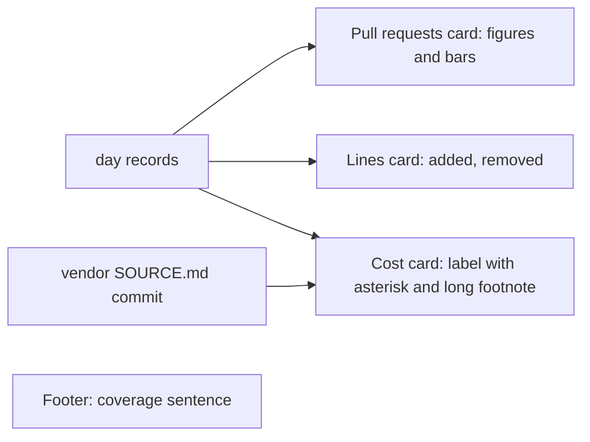
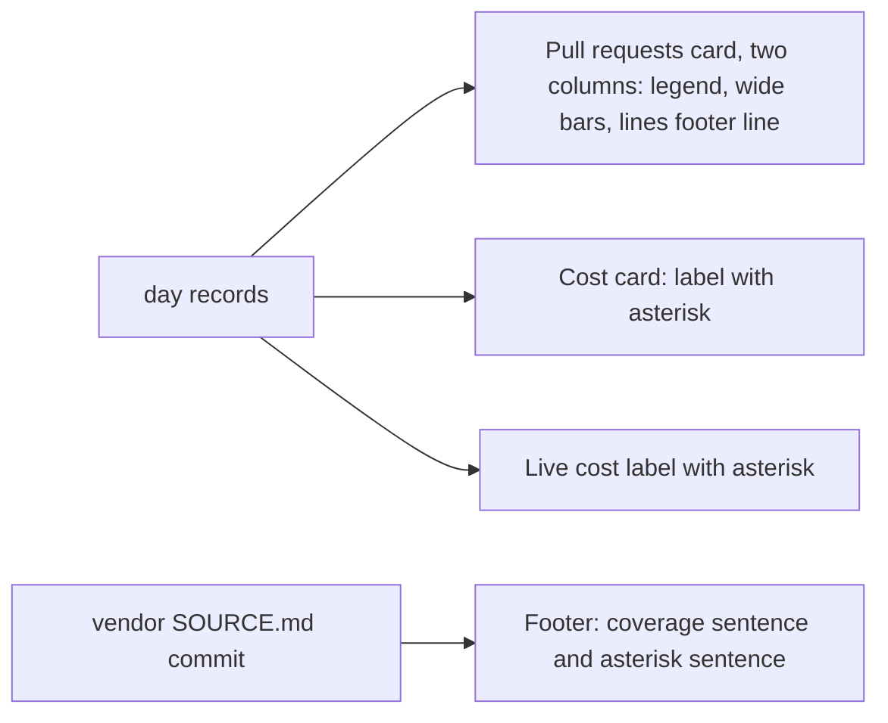
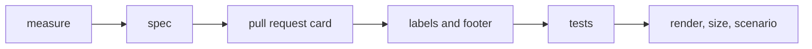

# Dashboard second pass

## Change Summary

The owner looked at the live dashboard with CR-0018 in place on 2026-10-21 and asked for four changes. The lines card goes away, and its two figures become one footer line of the pull request card. The pull request card spans two columns, its weekly bar chart fills the wider card, and the figures opened and merged sit in one horizontal legend row. The cost asterisk also goes on the live cost label. The long cost footnote becomes one short sentence in the page footer.

## Motivation and Background

The owner wrote, on 2026-10-21:

1. "It feels like the LoC change would be better as a footer for the pull request making the barchart wider. Open/merged would also be better as a horizontal legend."
2. "the litellm asterisk is too verbose, keep it minimal."
3. "add the asterisk to the 'live, today' as well for 'API-equivalent cost'."
4. "move the litellm asterisk to the footer with 'Covers Claude Code and Pi. claude.ai chats are not covered.'"

These four points are the requirements. Where a point leaves a layout detail open, this CR states a rule and names the detail a judgement call.

## Change Drivers

* The lines card holds only two small figures, and it takes a column that the weekly bar chart can use.
* The footnote of CR-0018 is long and sits under the cost card. The owner wants the asterisk to stay and the text to be minimal.
* The live section shows an API-equivalent cost with no asterisk, so a reader does not see that it is a list price.

## Current State

* `web/assets/js/section.prs.js` makes the card "Pull requests" with the sums opened and merged as figures and a weekly bar chart.
* `web/assets/js/section.lines.js` makes the card "Lines changed in the range" with two labelled figures, "lines added" and "lines removed" (`docs/specification/dashboard.md`, section "Lines changed in the range").
* `web/assets/js/section.cost.js` makes the cost card with the label "Cost (API-equivalent)*" and a footnote line that names LiteLLM, the price file, the link, and the price commit (spec section "Cost (API-equivalent)", items 6 and 7).
* `web/assets/js/live.section.js` labels the cost figure "API-equivalent cost", with no asterisk.
* `web/assets/js/section.footer.js` writes one sentence: "Covers Claude Code and Pi. claude.ai chats are not covered."
* `tests/web.serve.rs`, test `cost_footnote_has_price_commit`, asserts the footnote text.

### Current State Diagram



## Proposed Change

1. Remove the lines card. The pull request card spans the two columns that the two cards used. The tokens-per-day card keeps its column.
2. In the pull request card, put opened and merged in one horizontal legend row with their color squares, let the bar chart fill the card width, and add one footer line with lines added and lines removed.
3. Put the asterisk on the live cost label: "API-equivalent cost*".
4. Remove the long footnote from the cost card. Add one short sentence that starts with the asterisk to the page footer, beside the coverage sentence.

### Proposed State Diagram



## Requirements

### Functional Requirements

**Pull request card**

1. The page **MUST NOT** show a separate lines card.
2. The pull request card **MUST** span the two grid columns that the pull request card and the lines card used at 1440 px. The tokens-per-day card **MUST** keep its column.
3. The weekly bar chart **MUST** fill the width of the pull request card.
4. The figures opened and merged **MUST** sit in one horizontal legend row. Each item has its color square, its label, and its sum in the integer format of the totals.
5. The card **MUST** end with one footer line that shows lines added and lines removed, each with its label, in the integer format of the totals (thin space group mark). Added **MUST** use `--color-positive` and removed **MUST** use `--color-output`. A negative number **MUST** use the minus sign U+2212. The line shows no net value.
6. When all four GitHub fields are `null` in every record, the pull request card **MUST** show "GitHub not connected" in place of the legend, the chart, and the footer line.
7. When some records have `null` in the GitHub fields, a `null` **MUST** count as zero, and the pull request card **MUST** show "Partial GitHub data" once.
8. A change of range **MUST** change the legend figures, the chart, and the footer line.

**Asterisk on the cost labels**

9. The cost card label **MUST** stay "Cost (API-equivalent)*".
10. The live section cost label **MUST** be "API-equivalent cost*".

**Footer**

11. The cost card **MUST NOT** show the footnote line of CR-0018. The text "List price of the tokens, not money paid." on the cost card **MAY** go, because the footer sentence states it.
12. The page footer **MUST** keep the sentence "Covers Claude Code and Pi. claude.ai chats are not covered."
13. The page footer **MUST** show one more short sentence beside it that starts with an asterisk. The sentence names LiteLLM as a link to `https://github.com/BerriAI/litellm` with `rel="noopener noreferrer"`, names the short price commit, and states that the cost is a list price and not money paid. Example: "* LiteLLM list prices at a1b2c3d, not money paid."
14. The price commit **MUST** reach the page as CR-0018 states: the binary reads it from `vendor/litellm/SOURCE.md` at build time and puts it into the page at start (`src/web/footnote.rs`). The page code holds no literal commit.
15. The page **MUST NOT** load a remote script, style, or font for the footer.

**Widths**

16. At 360 px, the pull request card **MUST** take the full width, and the legend row and the footer line **MAY** wrap or stack. The page **MUST** have no horizontal scroll.
17. The footer **MUST** keep the gap token `--space-card-gap` of CR-0018 from the cards above it.

### Non-Functional Requirements

1. The code size measured by `web.size.sh` **MUST** stay at or below 100 KiB.
2. The draw time of the page **MUST** stay at or below 500 ms.
3. The headline figure **MUST** stay at least two times the size of the totals figure.
4. The format of the footer line of the pull request card **MUST** be a pure function, so a node test can call it.

## Measurable Targets

The targets are unchanged from CR-0018.

| Metric | Method | Baseline | Threshold |
|---|---|---|---|
| Code size | `.agents/scripts/web.size.sh` | measured at the start of implementation | at most 100 KiB |
| Draw time | `.agents/scripts/web.render.sh` | measured at the start of implementation | at most 500 ms |
| Headline ratio | `--size-headline` divided by `--size-figure` | 72 / 34 | at least 2 |
| Card gap | computed gap between two cards in the render at 360 px and 1440 px | 24 px | at least 24 px from the token |
| Horizontal scroll | render at 360 px | none | none |

## Affected Components

* `web/assets/js/section.prs.js`: the legend row, the wide chart, the footer line, and the GitHub-null states.
* `web/assets/js/section.lines.js`: removed, or reduced to the pure format of the footer line.
* `web/assets/js/section.cost.js`: the footnote removed.
* `web/assets/js/live.section.js`: the cost label.
* `web/assets/js/section.footer.js`: the asterisk sentence.
* `web/assets/css/page.css`, `web/index.html` (or the file that holds the grid): the two-column span and the removal of the lines slot.
* `tests/web.serve.rs`: the footnote test.
* Node tests under `web/test/`.
* `docs/specification/dashboard.md`: the sections "Pull requests", "Lines changed in the range", "Cost (API-equivalent)", "Live section", "Footer", and "GitHub not connected".

## Scope Boundaries

### In Scope

* The four points of the owner and the spec text that they change.

### Out of Scope ("Here, But Not Further")

* A change to the tokens card, the headline, the heatmap, or the daily log.
* A change to how the cost or the price commit is computed.
* A change to the public API.

## Alternative Approaches Considered

* **Keep the lines card and only shorten the footnote.** Rejected. Point 1 of the owner asks for the lines as a footer of the pull request card.
* **Keep the footnote under the cost card in a short form.** Rejected. Point 4 asks for it in the page footer.
* **A vertical legend beside the chart.** Rejected. Point 1 asks for a horizontal legend, and a side legend takes chart width.

## Impact Assessment

### User Impact

A reader sees a wider bar chart, the lines next to the pull requests that made them, and one short source sentence for both cost labels.

### Technical Impact

One card fewer, small changes in five page modules, one test moved.

### Business Impact

The page stays sourced with less text.

## Implementation Approach

1. Measure the code size and the draw time.
2. Update `docs/specification/dashboard.md`.
3. Change the pull request card and remove the lines card.
4. Change the cost card, the live label, and the footer.
5. Move the Rust test, and add the node tests.
6. Run the render and the size scripts, and run the scenario.

### Implementation Flow



## Test Strategy

### Tests to Add

* Node test of the footer line format: thin-space integers, the labels, the minus sign U+2212, no net value.
* Node test of the GitHub-null states of the pull request card: all `null` gives "GitHub not connected" and no legend, chart, or footer line; some `null` gives "Partial GitHub data" once and counts `null` as zero.

### Tests to Modify

* `tests/web.serve.rs`, `cost_footnote_has_price_commit`: assert that the served page or its data holds the footer sentence with "LiteLLM" and the short price commit from `vendor/litellm/SOURCE.md`. Rename the test to name the footer.
* Node tests of the lines card: remove or move them to the footer line format.

### Tests to Remove

* Tests that assert a separate lines card or the cost card footnote.

## Model-Based Testing

The change has a user surface: the dashboard page. A model drives it with `.agents/scripts/web.render.sh` or the browser driver, and a human can open the page by hand. Persist the scenario as `.agents/scenarios/dashboard.second-pass.md`.

1. Seed day records with pull requests and lines added and removed.
2. Open the dashboard at 1440 px on the range 6M.
3. Check that no lines card is on the page.
4. Check that the pull request card spans two columns and that the tokens-per-day card keeps its column.
5. Check that opened and merged sit in one horizontal legend row with color squares.
6. Check that the card ends with a footer line with lines added and lines removed, with labels.
7. Check that the cost card label and the live cost label end with an asterisk.
8. Check that the cost card has no footnote, and that the page footer has the coverage sentence and a sentence that starts with an asterisk, names LiteLLM, and shows the short price commit.
9. Repeat steps 3 to 8 at 360 px and check for no horizontal scroll.
10. Seed `null` for all GitHub fields and check that the pull request card shows "GitHub not connected".

Success condition: each check passes at both widths, in at least 2 of 2 runs.

## Acceptance Criteria

### AC-1: The lines are a footer line of a wide pull request card

```gherkin
Given seeded days with pull requests and lines added and removed
When the page renders at 1440 px
Then no separate lines card is on the page
And the pull request card spans two columns
And the tokens-per-day card keeps its column
And the card ends with a line that shows lines added and lines removed with labels
```

### AC-2: Opened and merged are a horizontal legend

```gherkin
Given seeded days with pull requests
When the pull request card renders
Then opened and merged sit in one row, each with a color square, a label, and a sum
And the weekly bar chart fills the card width
```

### AC-3: Both cost labels carry the asterisk

```gherkin
Given the dashboard with the live section shown
When the page renders
Then the cost card label is "Cost (API-equivalent)*"
And the live cost label is "API-equivalent cost*"
```

### AC-4: The source sentence is in the footer

```gherkin
Given the dashboard
When the page renders
Then the cost card shows no footnote line
And the footer shows "Covers Claude Code and Pi. claude.ai chats are not covered."
And the footer shows a sentence that starts with an asterisk, links LiteLLM, and shows the short price commit of the vendored file
And that sentence states that the cost is a list price and not money paid
```

### AC-5: GitHub-null states move to the pull request card

```gherkin
Given days with null in every GitHub field
When the pull request card renders
Then it shows "GitHub not connected" in place of the legend, the chart, and the footer line
```

### AC-6: The targets hold

```gherkin
Given the changed page
When web.size.sh and web.render.sh run
Then the code size is at most 100 KiB
And the draw time is at most 500 ms
And the page has no horizontal scroll at 360 px
```

## Quality Standards Compliance

### Build & Compilation

`cargo build` passes.

### Linting & Code Style

`.agents/scripts/pipeline.lint.sh` and `pipeline.format.sh` pass.

### Test Execution

`.agents/scripts/pipeline.test.sh` and the node tests under `web/test/` pass.

### Documentation

`docs/specification/dashboard.md` changes before the code.

### Code Review

A reviewer agent checks blocking findings only.

### Verification Commands

```bash
.agents/scripts/pipeline.test.sh
.agents/scripts/web.size.sh
.agents/scripts/web.render.sh
```

## Risks and Mitigation

### Risk 1: The legend and the footer line overflow at 360 px

Mitigation: requirement 16 lets them wrap or stack, and the scenario checks for no horizontal scroll.

### Risk 2: The footer sentence loses the price commit

Mitigation: requirement 14 and the moved Rust test.

## Dependencies

* CR-0018 (the cost asterisk, the price commit path, the gap token, the lines format).
* CR-0008 (design tokens and the width rule).

## Estimated Effort

Small: about six web files, one Rust test, and the spec.

## Open Questions

None. The four points of the owner decide the change. The layout details are judgement calls.

## Judgement Calls

1. Live label text: "API-equivalent cost*", the existing label plus the asterisk. Source: point 3 of the owner.
2. Footer sentence wording: one short sentence such as "* LiteLLM list prices at <commit>, not money paid." The price file name is not in it, because point 2 asks for minimal text; the link and the commit identify the source.
3. The text "List price of the tokens, not money paid." on the cost card: the implementer can remove it, because the footer sentence states it (requirement 11).
4. Mobile layout: at 360 px the merged card takes the full width and stacks its legend and its footer line when they do not fit on one row.
5. Footer line placement: the last element of the pull request card, below the chart, in the note style of the card.

## Decision Outcome

Approved on 2026-10-21 by a reviewer agent in a workflow, separate from the author. No blocking findings. The reviewer asked for one addition: the check that the footer sentence states "not money paid" is now in AC-4. The reviewer noted that requirement 2 limits the two-column span to 1440 px, which is acceptable because requirement 16 covers 360 px.

## Notes

Review notes: the four points of the owner map to requirements 1 to 5, 10, and 11 to 13. The GitHub-null states survive the merge of the cards through requirements 6 and 7, AC-5, and a node test. The Layer 1 boundary holds: the CR names the spec sections but does not inline the spec text.
