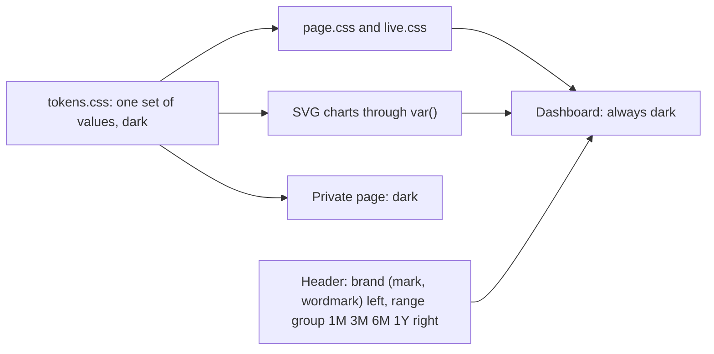
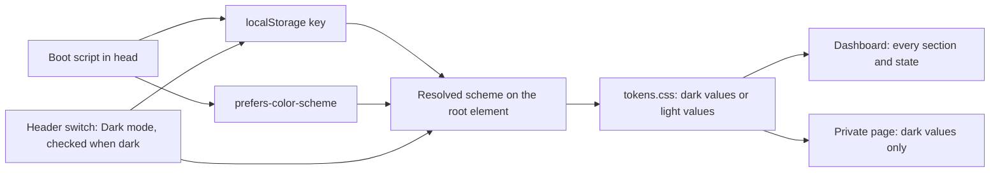
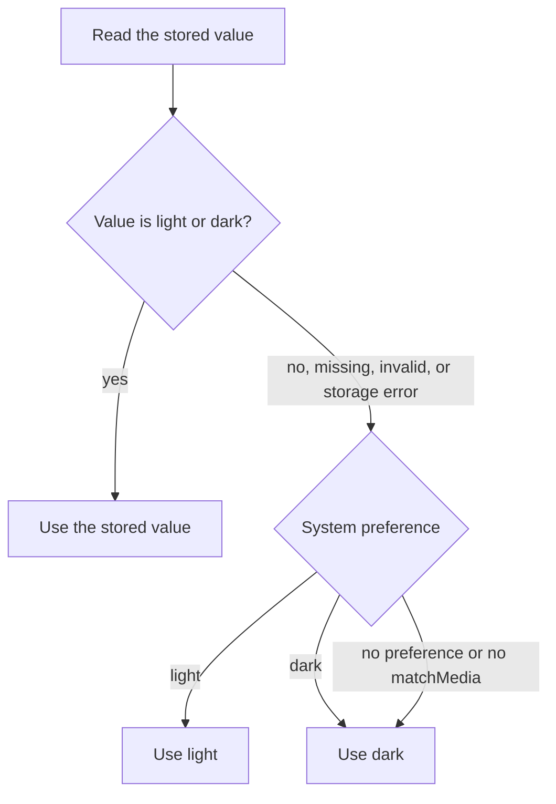
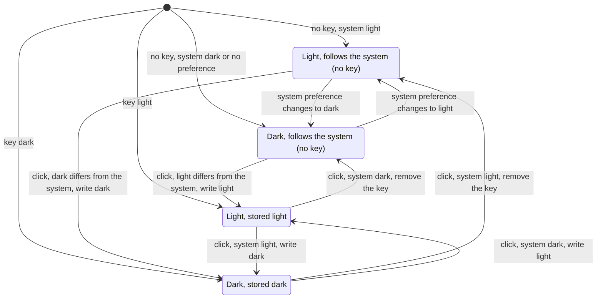
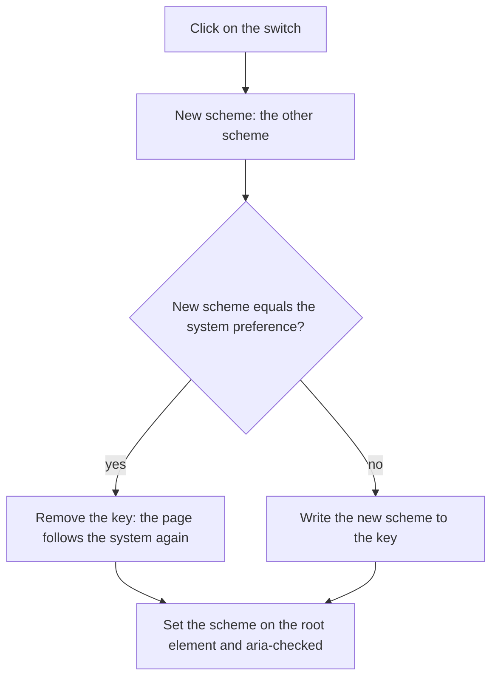
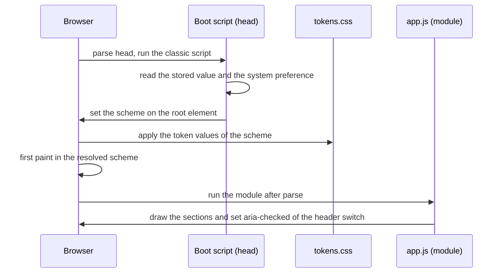
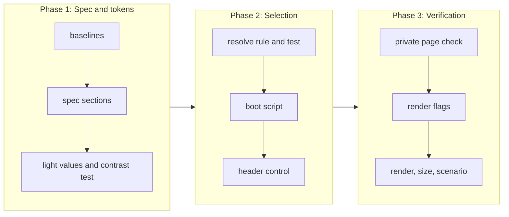

# Light mode

## Change Summary

The dashboard has one color scheme today, dark. This CR adds a light color scheme. The light scheme uses the same design token names as the dark scheme, with different values. The system preference `prefers-color-scheme` selects the scheme. A control in the header lets the reader override the system preference, and the browser keeps the override in `localStorage`. The page paints the correct scheme from the first frame. Every section and every state is readable in both schemes.

## Motivation and Background

The owner wrote: "add light mode".

The owner gave this one requirement. The functional requirements below make it testable. Where the requirement leaves a layout detail open, this CR states a rule and names the detail a judgement call. The section "Judgement Calls" lists each one.

## Change Drivers

* A reader in a bright room, or a reader whose system uses a light appearance, gets a dark page today. The page does not follow the system appearance.
* The spec states "The page has one color scheme, dark. It has no light theme and no theme switch." (section "Design tokens"). The owner now asks for a light scheme.
* Every color of the page already comes from a design token. Thus a second set of token values can change the full page with no change to the section modules.

## Current State

* `web/assets/css/tokens.css` declares `color-scheme: dark` and the color tokens on `:root`, with one value for each token.
* `web/assets/css/page.css` and `web/assets/css/live.css` use only `var(--…)` for colors. They hold no color literal.
* `web/assets/js/live.chart.js` sets the SVG `stroke` and `fill` attributes to `var(--color-rule)` and `var(--color-input)`. Thus the live chart also follows the tokens.
* `web/index.html` loads three stylesheets and one module script, `app.js`. The header is one row (CR-0021): the brand at the left, an inline SVG mark and the wordmark `h1`, and the range group at the right with four buttons, `1M`, `3M`, `6M`, and `1Y`, that use `aria-pressed`. The header has no update line.
* `web/assets/js/section.header.js` sets only the pressed state of the range buttons.
* The spec, section "Page technology", item 6, does not let the page use `localStorage`. Item 1 lets the page use only ES modules. Item 5 does not let the page use an inline script.
* The `content-security-policy` header has `script-src 'self'` and `style-src 'self'`. A test in `tests/web.serve.rs` asserts the header.
* The private reports page `web/private/index.html` also loads `tokens.css`. Its spec (`private-reports.md`, section "Page", item 6) states that it uses the dark theme of the dashboard.
* The paused state of the live section (the card "Today") shows "Paused, reconnecting" in the status note, stops the dot in `--color-text-faint`, and shows the kept figures and the sparkline in `--color-text-faint` at an opacity of 0.5.
* `.agents/scripts/web.size.sh` gives `code_kib: 64.8` at `ac55e2a` and `code_kib: 65.6` at `446f065`, after CR-0021.

### Current State Diagram



## Proposed Change

1. Add a light value for each color token. The light values use the same token names as the dark values.
2. Resolve the scheme from two inputs: the override in `localStorage`, and the system preference.
3. Set the resolved scheme on the root element before the first paint. Use a small same-origin classic script in the head that runs before the stylesheets apply. The content security policy does not change.
4. Add one toggle switch to the header directly after the range group: a button with the role `switch`, the accessible name "Dark mode", and a track of 44 by 24 px with a knob. The switch is checked when the resolved scheme is dark. The brand stays at the left, and the range group and the switch sit together at the right.
5. A click on the switch sets the other scheme. When the new scheme equals the system preference, remove the stored key, so the page follows the system preference again. Else write the new scheme to the key. The switch has no third state.
6. While no key is stored, follow a change of the system preference while the page is open.
7. Keep the private reports page dark.

### Proposed State Diagram



### Resolve Rule



### Switch States

The switch has two visible states, checked (dark) and unchecked (light). The stored key decides whether the page follows the system preference. There is no third state.



### Click Rule



### Load Sequence



## Requirements

### Functional Requirements

**Light color scheme from design tokens**

1. `web/assets/css/tokens.css` **MUST** give a light value for each color token of the spec section "Design tokens". The light value **MUST** use the same token name as the dark value.
2. The dark values **MUST** stay the values of the spec at `ac55e2a`.
3. The page code **MUST NOT** hold a color literal outside `tokens.css`. Each color of the page, of each SVG chart, and of the live chart **MUST** come from a token.
4. The CSS property `color-scheme` of the root element **MUST** equal the resolved scheme, `light` or `dark`. Thus the scrollbars and the native controls follow the scheme.

**Selection by the system preference**

5. When no valid override is stored, the page **MUST** use the scheme of `prefers-color-scheme`.
6. When the browser reports no preference, or has no `matchMedia`, the page **MUST** use the dark scheme.
7. When no valid override is stored and the system preference changes while the page is open, the page **MUST** change to the new scheme with no reload. When a valid override is stored, the page **MUST NOT** follow the change.

**Manual override in the header**

8. The header **MUST** show one toggle switch: a button with the role `switch` and the accessible name "Dark mode".
9. The switch **MUST** come directly after the range group. The range group and the switch **MUST** sit together at the right end of the header row, with the brand at the left, in the same row at 1440 px.
10. The switch **MUST** have `aria-checked="true"` when the resolved scheme is dark, and `aria-checked="false"` when it is light. A click **MUST** set the other scheme. When the new scheme equals the system preference, the click **MUST** remove the scheme key, so the page follows the system preference again. Else the click **MUST** write the new scheme to the key. With no preference or no `matchMedia`, the system preference counts as dark.
11. The keyboard **MUST** reach the switch with Tab and set the other scheme with Space and with Enter. The switch **MUST** show a track of 44 by 24 px with a knob.
12. The override **MUST** use one `localStorage` key with the value `light` or `dark`. Requirement 10 alone decides when a click writes the key and when it removes the key. The switch has no state that removes the key apart from that rule.
13. A click on the switch **MUST** change the scheme of the full page at once, with no reload, no new request to `/v1/days`, and no close of the live socket.
14. A click on the switch **MUST NOT** change the URL fragment. The range stays in the fragment as before.
15. After a reload, the page **MUST** show the scheme of the stored value, and the switch **MUST** have the `aria-checked` value of that scheme.

**Fall-back to the system preference**

16. When the stored value is not `light` or `dark`, the page **MUST** ignore it, use the system preference, and set `aria-checked` of the switch from the resolved scheme.
17. When the browser blocks `localStorage` or the access throws an error, the page **MUST** use the system preference, show no error, and still let the reader change the scheme for the current page view.

**No flash of the wrong scheme**

18. The resolved scheme **MUST** be on the root element before the first paint. The first frame of the page **MUST** show the page background of the resolved scheme.
19. The script that sets the scheme before the first paint **MUST** be a same-origin file in `web/assets/js/`. It **MUST NOT** be inline, `async`, `defer`, or a module, and it **MUST** come in the head before the first stylesheet link.
20. The `content-security-policy` header **MUST NOT** change.

**Contrast in the light scheme**

21. In the light scheme, each text token (`--color-text`, `--color-text-body`, `--color-text-muted`, `--color-text-faint`, `--color-link`, `--color-link-hover`) **MUST** have a contrast of at least 4.5 to 1 on `--color-bg` and on `--color-surface`.
22. In the light scheme, `--color-ink-inverse` **MUST** have a contrast of at least 4.5 to 1 on `--color-text`, because the selected buttons use this pair.
23. In the light scheme, each chart color (`--color-input`, `--color-output`, `--color-positive`, `--color-cache-read`, `--color-cache-write`, `--heat-1`, `--heat-2`, `--heat-3`, `--heat-4`) **MUST** have a contrast of at least 3 to 1 on `--color-surface`.
24. In the light scheme, `--color-positive` and `--color-output` **MUST** have a contrast of at least 4.5 to 1 on `--color-surface`, because the footer line of the pull request card uses them as text color.
25. In the light scheme, the contrast of `--heat-1` to `--heat-4` on `--color-surface` **MUST** increase from level to level, so that a higher level is always darker.
26. The contrast ratio **MUST** be the WCAG 2.x relative luminance ratio.

**Readable sections and states in both schemes**

27. In each scheme, the headline, the live section, the totals row, the pull request card, the tokens-per-day card, the token share bar, the cost cards, the heatmap with its legend, the daily log, the header, and the footer **MUST** show each text at a contrast of at least 4.5 to 1 on its rendered background.
28. In each scheme, the empty state, the error state with the button "Try again", the text "GitHub not connected", and the text "Partial GitHub data" **MUST** meet the text threshold of requirement 27.
29. In each scheme, the message of the live paused state **MUST** meet the text threshold of requirement 27. The kept figures in the muted style **MUST** have a contrast of at least 3 to 1 on their rendered background, the WCAG threshold for large text.
30. In each scheme, the focus outline of the buttons **MUST** have a contrast of at least 3 to 1 on its background.

**Scope of the scheme**

31. The private reports page **MUST** stay in the dark scheme. It **MUST NOT** follow `prefers-color-scheme` or the stored value, and it **MUST NOT** show the switch.

### Non-Functional Requirements

1. The page **MUST NOT** load a remote script, style, or font in either scheme.
2. The code size measured by `.agents/scripts/web.size.sh` **MUST** stay at or below 100 KiB.
3. The draw time of the page **MUST** stay at or below 500 ms in each scheme.
4. The headline **MUST** stay above the fold at 360 px and at 1440 px with the control in the header.
5. The headline figure **MUST** stay at least two times the size of the totals figure.
6. The page **MUST** have no horizontal scroll at 360 px in either scheme.
7. The resolve rule **MUST** be a pure function of the stored value and the system preference, so a node test can call it with no browser.
8. The live modules **MUST** still read no storage API. Only the scheme modules read `localStorage`, and only the one scheme key.

## Measurable Targets

| Metric | Method | Baseline | Threshold |
|---|---|---|---|
| Code size | `.agents/scripts/web.size.sh` prints `code_kib` | 65.6 KiB at `446f065`, after CR-0021 (64.8 KiB at `ac55e2a`) | at most 100 KiB |
| Added scheme code | the increase of `page_kib` from the baseline; `.agents/scripts/web.size.sh` prints `page_kib`, the bytes of `web/` minus `web/assets/fonts/`, `web/private/`, and `web/test/` | 47.7 KiB at `446f065`, after CR-0021 | at most 6.0 KiB |
| Draw time, each scheme | `.agents/scripts/web.render.sh --days 400 --scheme light` and `--scheme dark` print `draw_ms` | measured after the implementation, not at the start: 58.2 ms, dark only, at `446f065` in a worktree (see Notes, 2026-10-23) | at most 500 ms in each scheme |
| Remote requests, each scheme | `.agents/scripts/web.render.sh --days 400 --scheme light` and `--scheme dark` print `remote_requests` | 0, dark only | 0 in each scheme |
| Headline above the fold | `.agents/scripts/web.render.sh --days 400 --scheme light` prints `headline_above_fold_360` and `headline_above_fold_1440` | true at both widths, with no control | true at both widths, with the control |
| Headline ratio | `.agents/scripts/web.render.sh` prints `headline_ratio` | 2.12 | at least 2.0 |
| Horizontal scroll | `.agents/scripts/web.render.sh --scheme light` and `--scheme dark` print `no_hscroll_360` | true, dark only | true in each scheme |
| Token contrast, light | `node --test web/test/tokens.contrast.test.js` | no light scheme, no test | every pair of requirements 21 to 25 passes |
| Rendered text contrast | `.agents/scripts/web.render.sh --days 400 --scheme light` and `--scheme dark` print `min_text_contrast` | not measured | at least 4.5 in each scheme |
| Rendered graphic contrast | `.agents/scripts/web.render.sh --days 400 --scheme light` prints `min_graphic_contrast` over the series colors and heatmap levels 1 to 4 | not measured | at least 3.0 |
| First frame scheme | `.agents/scripts/web.render.sh --scheme light` and `--scheme dark`, each with the stored values none, `light`, `dark`, and `invalid`, prints `first_frame_scheme_ok` | not measured | true in all 8 runs |
| Resolve rule | `node --test web/test/scheme.resolve.test.js` | no test | every case of the table in AC-2 passes |
| Policy header | `cargo test --test web_serve` | the policy of the spec section "Headers" | unchanged |

`--scheme`, `min_text_contrast`, `min_graphic_contrast`, and `first_frame_scheme_ok` are new outputs of `web.render.sh` and `web.render.cdp.mjs`. `--scheme` sets the emulated `prefers-color-scheme`. A second new flag, `--stored <value>`, puts a value into the scheme key before the navigation. The probe reads `first_frame_scheme_ok` from the first frame of the DevTools screencast.

## Affected Components

* `web/assets/css/tokens.css`: the light values, `color-scheme` for each scheme, and the selector that only the dashboard activates.
* `web/assets/css/page.css`: the style of the switch (the 44 by 24 px track and the knob), its place beside the range group at the right of the header row, and the wrap of the header at 360 px.
* `web/assets/css/live.css`: the muted style of the paused state, if the contrast of requirement 29 is not met.
* `web/index.html`: the boot script in the head, before the stylesheet links, and the switch in the header.
* `web/assets/js/`: one new classic boot script, one new module for the switch, and the pure resolve rule.
* `web/assets/js/section.header.js`, or the new switch module: `aria-checked` of the switch.
* `web/assets/js/app.js`: the mount of the switch.
* `web/private/index.html` and `web/private/assets/css/private.css`: only if a change is necessary to keep the dark scheme.
* `.agents/scripts/web.render.sh` and `.agents/scripts/web.render.cdp.mjs`: the flags `--scheme` and `--stored` and the new outputs.
* Node tests under `web/test/`.
* `tests/web.serve.rs`: a test that the page holds the boot script in the head before the stylesheets.
* `docs/specification/dashboard.md`: the sections "Page technology", "Header", "Live section", "Footer", "States" (subsection "Live feed paused"), and "Design tokens".
* `docs/specification/private-reports.md`: section "Page", item 6.
* `docs/specification/operations.md`: the table of measurable targets, for the new rows of this CR.
* New scenario `.agents/scenarios/dashboard.light-mode.md` and its screenshots.

## Scope Boundaries

### In Scope

* The light values of the color tokens and the selection of the scheme.
* The header switch, the stored override, and the fall-back.
* The boot script that prevents a flash of the wrong scheme.
* The contrast of text and of the chart colors in the light scheme.
* The readability of each section and each state in both schemes.
* The spec sections that this CR names.

### Out of Scope ("Here, But Not Further")

* A change to the dark values of the tokens. The dark heatmap levels do not meet the 3 to 1 threshold today. A separate CR can change them.
* A light scheme for the private reports page.
* A high-contrast scheme, a custom accent color, or more than two schemes.
* A change to the size, font, radius, or spacing tokens.
* A change of the layout, the sections, the data, or the public API.
* A scheme in the URL fragment or on the server.
* A light favicon, a `theme-color` meta element, and a print style.
* A change of the content security policy.

## Alternative Approaches Considered

* **A toggle switch, "Dark mode", checked when dark.** Chosen. A click that lands on the scheme of the system preference removes the stored key, so the reader gets back to the system preference with no third state and no clear of the site data.
* **A group of three buttons, System, Light, and Dark.** Rejected. The owner asked for a switch on 2026-10-23. The CR was first approved and implemented with this group; the switch replaced it after the implementation.
* **Only `prefers-color-scheme`, with no control.** Rejected. The owner asks for a manual override.
* **A media query in CSS only, and the control applied after `app.js` runs.** Rejected. A reader with a stored override that differs from the system sees a flash of the wrong scheme, because the module runs after the first paint.
* **An inline script in the head.** Rejected. The policy has `script-src 'self'` with no hash or nonce. A change of the policy is out of scope.
* **A cookie and a server-side scheme in `index.html`.** Rejected. The static routes do not read or set a cookie (spec section "No credentials"). The `etag` of `index.html` would also depend on the request.
* **New token names with a prefix, for example `--light-color-bg`.** Rejected. Every rule of `page.css`, `live.css`, and the SVG attributes would need a change. The same names with a second set of values change no section module.
* **One button that cycles System, Light, Dark.** Rejected. The reader cannot see all states, and the next state is not clear. The switch has two states, and its checked state shows the scheme.

## Impact Assessment

### User Impact

A reader with a light system appearance gets a light page with no action. A reader can click the switch "Dark mode" in the header, and the page keeps the other scheme on that browser; a second click returns to the system preference. A reader who does nothing with a dark system appearance sees the page of today, plus the switch.

### Technical Impact

* One new classic script and one new module. The section modules do not change, because they use tokens.
* The page now uses `localStorage` for one key. The spec section "Page technology" changes to permit this one key.
* The page now has one classic script. The spec section "Page technology" changes to permit this one file.
* The header grows by one switch at the right, after the range group. At 360 px the range buttons already take a second line (CR-0021), and the switch comes after them, on their line or on the next line.
* The render script gets two flags and three outputs.

### Business Impact

The page is readable in more places and follows the system of the reader. The cost is small: one token set, two small scripts, and tests.

## Implementation Approach

1. Measure the code size, the draw time, and the headline fold at the start, and record them as baselines.
2. Update the named sections of `docs/specification/dashboard.md`, item 6 of `private-reports.md`, and the target rows of `operations.md`.
3. Add the light token values and the contrast node test. Adjust the values until the test passes.
4. Add the resolve rule and its node test.
5. Add the boot script to the head, and the static test of its place.
6. Add the switch to the header and its module.
7. Check the private page, and keep it dark.
8. Add `--scheme`, `--stored`, and the new outputs to the render script.
9. Run the render and the size scripts in both schemes, and run the scenario.

### Implementation Flow



## Test Strategy

### Tests to Add

| Test File | Test Name | Description | Inputs | Expected Output |
|-----------|-----------|-------------|--------|-----------------|
| `web/test/tokens.contrast.test.js` | `light_text_contrast` | Parses `tokens.css` and computes the ratio of each text token on `--color-bg` and `--color-surface`, light values | the light values | each ratio at least 4.5 |
| `web/test/tokens.contrast.test.js` | `light_ink_inverse_contrast` | Ratio of `--color-ink-inverse` on `--color-text`, light values | the light values | at least 4.5 |
| `web/test/tokens.contrast.test.js` | `light_chart_contrast` | Ratio of each chart color on `--color-surface`, light values | the light values | each ratio at least 3.0; `--color-positive` and `--color-output` at least 4.5 |
| `web/test/tokens.contrast.test.js` | `light_heat_order` | Ratio of `--heat-1` to `--heat-4` on `--color-surface` | the light values | strictly increasing |
| `web/test/tokens.contrast.test.js` | `every_color_token_has_light_value` | Compares the token names of the two sets | `tokens.css` | the same set of color names; dark values equal the spec table |
| `web/test/tokens.contrast.test.js` | `no_color_literal_outside_tokens` | Searches the CSS and JS files of `web/assets/` outside `tokens.css` for hex, `rgb(`, and `hsl(` color values | the files | no match |
| `web/test/scheme.resolve.test.js` | `resolve_table` | Calls the resolve rule with each row of the table of AC-2 | stored value, system preference | the scheme of the table |
| `web/test/scheme.resolve.test.js` | `storage_error_falls_back` | Calls the boot logic with a fake storage that throws | throwing storage, preference light | `light`, no error |
| `web/test/scheme.control.test.js` | `click_stores_the_override_and_a_system_value_removes_it` | Drives the switch module with a fake document and a fake storage | an invalid stored value with the system preference dark, then two clicks | the key is `light`, then the key is absent because dark is the system preference; `aria-checked` follows the scheme; the URL fragment does not change |
| `web/test/scheme.control.test.js` | `system_is_followed_only_without_an_override` | Fires a change event of a fake `matchMedia` with no key, then after a click that stores `dark` | preference dark to light | the scheme changes with no key, and does not change with the key `dark` |
| `web/test/scheme.control.test.js` | `only_scheme_key_used` | Records each storage call during the tests | the calls | only the one scheme key |
| `tests/web.serve.rs` | `index_has_scheme_boot_before_styles` | Gets `/` and checks the head | the served page | a same-origin classic script with no `async`, `defer`, or `type="module"` before the first stylesheet link |
| `tests/web.serve.rs` | `private_page_has_no_scheme_control` | Gets the private page and checks for the switch and the boot script | the served private page | neither is present |

### Tests to Modify

| Test File | Test Name | Current Behavior | New Behavior | Reason for Change |
|-----------|-----------|------------------|--------------|-------------------|
| `web/test/live.storage.test.js` | `no_storage_access` | Asserts that the `live.*` files use no storage and no cookie | No change of the assertion. Add a comment that only the scheme modules use `localStorage` | The new storage use must not reach the live modules |
| `.agents/scripts/web.render.cdp.mjs` | the measure of the render | Measures one scheme, dark | Measures the scheme of `--scheme` with the value of `--stored`, and prints the contrast outputs and `first_frame_scheme_ok` | The targets of this CR need both schemes |

### Tests to Remove

Not applicable. No test asserts that the page has only a dark scheme.

## Model-Based Testing

The change has a user surface: the dashboard page. A model drives it with the browser driver of `.agents/scripts/web.render.cdp.mjs`, and a human can open the page by hand. Persist the scenario as `.agents/scenarios/dashboard.light-mode.md`.

1. Seed 400 days with `.agents/scripts/days.seed.sh` on a scratch data directory, as `web.render.sh` does.
2. Start `loupe serve` on that data directory.
3. Set the emulated system preference to light. Clear the scheme key.
4. Open the page at 1440 px on the range 6M. Check that the first frame and the loaded page are light, and that the switch "Dark mode" has `aria-checked="false"`.
5. Check each section: the headline, the live section, the totals row, the pull request card, the tokens-per-day card, the token share bar, the cost cards, the heatmap and its legend, the daily log, and the footer. Read `min_text_contrast` and `min_graphic_contrast`.
6. Take the screenshot `dashboard.light-mode.light.1440.png`.
7. Click the switch. Check that the page is dark at once, that the switch has `aria-checked="true"`, that the scheme key holds `dark`, that no new request to `/v1/days` goes out, and that the live socket stays open.
8. Take the screenshot `dashboard.light-mode.dark.1440.png`.
9. Reload. Check that the first frame is dark and that the switch has `aria-checked="true"`.
10. Click the switch. Check that the page is light and that the scheme key is absent, because light is the system preference.
11. Set the scheme key to an invalid value and reload. Check that the page follows the system preference and that the switch has `aria-checked="false"`.
12. Set the emulated system preference to dark with no key. Check that the page changes to dark with no reload.
13. Repeat steps 3 to 12 at 360 px. Check that the header switch is visible, that the headline is above the fold, and that the page has no horizontal scroll. Take the screenshots `dashboard.light-mode.light.360.png` and `dashboard.light-mode.dark.360.png`.
14. In each scheme, show the states: the empty state (seed 0 days), the error state (stop the server, then reload), "GitHub not connected" (seed with `--github none`), and the live paused state (close the socket). Check the contrast of each state.
15. Open the private reports page with the preference light. Check that it is dark and has no switch.
16. Stop the server and the browser.

Success condition: each check passes at both widths and in both schemes, in at least 2 of 2 runs. The four screenshots are in `.agents/scenarios/`.

## Acceptance Criteria

### AC-1: The system preference selects the scheme

```gherkin
Given no stored scheme value
  And the system preference is light
When the page loads at 1440 px
Then the page uses the light token values
  And the root color-scheme is light
  And the switch "Dark mode" has aria-checked "false"
```

### AC-2: The resolve rule follows the table

```gherkin
Given the stored value <stored>
  And the system preference <system>
When the page resolves the scheme
Then the scheme is <scheme>
  And the switch has aria-checked <checked>

Examples:
  | stored  | system        | scheme | checked |
  | none    | light         | light  | false   |
  | none    | dark          | dark   | true    |
  | none    | no preference | dark   | true    |
  | light   | dark          | light  | false   |
  | dark    | light         | dark   | true    |
  | invalid | light         | light  | false   |
  | error   | light         | light  | false   |
```

### AC-3: The header switch overrides and resets

```gherkin
Given no stored scheme value and the system preference light
When the reader clicks the switch "Dark mode"
Then the page is dark at once
  And the switch has aria-checked "true"
  And the scheme key holds "dark"
  And no new request to /v1/days goes out
  And the live socket stays open
  And the URL fragment does not change
When the reader clicks the switch again
Then the page is light
  And the scheme key is absent, because light is the system preference
```

### AC-4: The override survives a reload

```gherkin
Given the reader clicked the switch to light with the system preference dark
When the reader reloads the page
Then the page is light
  And the switch has aria-checked "false"
When the reader clicks the switch
Then the page is dark
  And the scheme key is absent, because dark is the system preference
```

### AC-5: No flash of the wrong scheme

```gherkin
Given the stored value "dark" and the system preference light
When the page loads
Then the first frame shows the dark page background
  And the boot script is a same-origin classic script in the head before the first stylesheet
  And the content-security-policy header is unchanged
```

### AC-6: The light tokens meet the contrast thresholds

```gherkin
Given the light values in tokens.css
When node --test web/test/tokens.contrast.test.js runs
Then each text token has at least 4.5 to 1 on --color-bg and on --color-surface
  And --color-ink-inverse has at least 4.5 to 1 on --color-text
  And each chart color has at least 3 to 1 on --color-surface
  And --color-positive and --color-output have at least 4.5 to 1 on --color-surface
  And the heatmap levels 1 to 4 increase in contrast
  And the dark values equal the values of the spec at ac55e2a
  And no file under web/ other than tokens.css holds a color literal
```

### AC-7: Every section and state is readable in both schemes

```gherkin
Given 400 seeded days
When web.render.sh runs with --scheme light and then with --scheme dark
Then min_text_contrast is at least 4.5 in each run
  And min_graphic_contrast is at least 3.0 in the light run
  And the empty state, the error state, "GitHub not connected", and the live paused message meet the text threshold in each scheme
  And the muted figures of the live paused state have at least 3 to 1 on their background in each scheme
  And the focus outline of a button has at least 3 to 1 on its background in each scheme
```

### AC-8: The system change is followed only with no stored override

```gherkin
Given no stored scheme value and the system preference dark
When the system preference changes to light
Then the page is light with no reload
Given the stored value "dark" after a click on the switch
When the system preference changes to light
Then the page stays dark
```

### AC-9: The private page stays dark

```gherkin
Given the system preference light and the stored value "light"
When the private reports page loads
Then the page uses the dark token values
  And the page shows no scheme control
```

### AC-10: The targets hold in both schemes

```gherkin
Given the changed page
When web.size.sh runs, and web.render.sh runs with --scheme light and with --scheme dark
Then the code size is at most 100 KiB
  And the draw time is at most 500 ms in each scheme
  And remote_requests is 0 in each scheme
  And the headline is above the fold at 360 px and at 1440 px
  And the page has no horizontal scroll at 360 px
```

### AC-11: The switch sits at the right of the product header

```gherkin
Given the dashboard at 1440 px
When the page renders
Then the header shows the brand at the left, and the range group 1M, 3M, 6M, 1Y followed by the switch "Dark mode" at the right, in one row
  And the switch is one button with the role switch and a track of 44 by 24 px with a knob
  And the keyboard reaches the switch with Tab and sets the other scheme with Space and with Enter
Given the dashboard at 360 px
When the page renders
Then the switch is visible after the range group
  And the page has no horizontal scroll
```

## Quality Standards Compliance

### Build & Compilation

- [x] `cargo build` passes.

### Linting & Code Style

- [x] `.agents/scripts/pipeline.lint.sh` and `.agents/scripts/pipeline.format.sh` pass.
- [x] Each new file under `web/assets/js/` has one `@agents-index` line.

### Test Execution

- [x] `.agents/scripts/pipeline.test.sh` passes.
- [x] `.agents/scripts/pipeline.web.sh` passes, with the new node tests.

### Documentation

- [x] `docs/specification/dashboard.md` changes before the code, in the sections that this CR names.
- [x] `docs/specification/private-reports.md` and `docs/specification/operations.md` change in the named places.

### Code Review

- [ ] A reviewer agent checks blocking findings only.
- [ ] The commit title follows Conventional Commits.

### Verification Commands

```bash
.agents/scripts/pipeline.test.sh
.agents/scripts/pipeline.web.sh
.agents/scripts/web.size.sh
.agents/scripts/web.render.sh --days 400 --scheme light
.agents/scripts/web.render.sh --days 400 --scheme dark
```

## Risks and Mitigation

### Risk 1: The header control pushes the headline below the fold at 360 px

**Likelihood:** medium
**Impact:** medium
**Mitigation:** Non-functional requirement 4 and the render output `headline_above_fold_360`. At 360 px the range buttons already take a second header line (CR-0021). The switch comes after them, on their line or on the next line, and it has no visible text.

### Risk 2: A chart color passes 3 to 1 but loses its hue identity

**Likelihood:** medium
**Impact:** low
**Mitigation:** Judgement call 8 keeps the hue family of each series. The screenshots in both schemes let the reviewer compare the colors.

### Risk 3: The shared `tokens.css` turns the private page light

**Likelihood:** medium
**Impact:** medium
**Mitigation:** Requirement 31, AC-9, and the test `private_page_has_no_scheme_control`. Only the boot script of the dashboard activates the light values.

### Risk 4: The boot script delays the first paint

**Likelihood:** low
**Impact:** low
**Mitigation:** The script is small and same-origin with `cache-control: no-cache` and an `etag`. The draw time target holds in both schemes.

### Risk 5: The paused state of the live section fails the contrast in one scheme

**Likelihood:** high
**Impact:** low
**Mitigation:** Requirement 29 permits a change of the muted style in `live.css`. The scenario checks the paused state in both schemes.

## Dependencies

* CR-0008 (the design tokens, the content security policy, and the width rule).
* CR-0013 (the live section and the storage rule of the live modules).
* CR-0018 and CR-0019 (the card gap, the pull request footer line colors, and the footer sentences).
* CR-0021 (the product header with the brand and the range buttons `1M`, `3M`, `6M`, `1Y`, and the card "Today" of the live section).

## Estimated Effort

Small to medium: one token set, two small scripts, about five new node tests, two Rust tests, the render script flags, and four spec sections.

## Open Questions

None. The owner asked for a light mode. The layout details are judgement calls.

## Judgement Calls

1. Control form: one toggle switch, a button with the role `switch`, `aria-checked="true"` when the scheme is dark, and the accessible name "Dark mode". A click sets the other scheme. When the new scheme equals the system preference, the click removes the stored key, so the page follows the system again; else the key holds the scheme. Reason: the owner chose a switch on 2026-10-23, after the implementation. The rule keeps the way back to the system preference with no third state.
2. Control place: in the header, directly after the range group, so the range group and the switch sit together at the right of the one product row, and the brand stays at the left. In the same row at 1440 px. At 360 px the switch comes after the range buttons, on their line or on the next line. The switch has the accessible name "Dark mode".
3. Switch label: the accessible name "Dark mode", with no visible text. The track is 44 by 24 px with a knob, inside the 48 px header row. Reason: the supervisor replaced the earlier call "words, not icons" and its 44 px minimum height on 2026-10-23 (see Notes); the switch form makes the checked state visible, and the 24 px track fits the header row.
4. Token names: the light scheme uses the same token names as the dark scheme. The spec table "Design tokens" gets a second value column for the light values. No new color token name.
5. Storage: one `localStorage` key, `dashboard.scheme`, with the value `light` or `dark`. A click that sets the scheme of the system preference removes the key. The key does not depend on the site title, which an operator can change with `LOUPE_SITE_TITLE`, so a change of the title keeps the stored choice.
6. Invalid or blocked storage: an unknown value is ignored, and a storage error falls back to the system preference with no message.
7. No preference: when the browser reports no preference or has no `matchMedia`, the page is dark, the scheme of today.
8. Light palette: the implementer chooses the values with the contrast test. Each series keeps the hue family of its dark value: blue for input, amber for output, green for positive, violet for cache read, and teal for cache write. The heatmap is a green ramp that gets darker from level 1 to level 4. `--color-surface` is lighter than `--color-bg`, so the cards stand out as in the dark scheme.
9. Exempt colors: `--heat-0`, `--color-border`, and `--color-rule` are not chart colors for the 3 to 1 threshold. `--heat-0` shows a day with no value, and the borders and rules only separate areas. Each cell has a `title` with the value.
10. Text use of chart colors: `--color-positive` and `--color-output` get the text threshold 4.5 to 1, because the pull request footer line uses them as text.
11. Paused state: the kept figures get the large text threshold of 3 to 1 in both schemes, and the paused message gets 4.5 to 1. The muted style can change to meet this.
12. Follow of the system: while no key is stored, the page follows a change of the system preference with no reload. While the key holds `light` or `dark`, it does not.
13. No flash mechanism: a same-origin classic script in the head, before the stylesheet links, sets the scheme on the root element. The policy does not change.
14. Private page: it stays dark and shows no switch. The light scheme of the private page is out of scope.
15. URL fragment: the scheme does not go in the fragment, so a shared link uses the scheme of the reader.
16. Scheme switch: no redraw and no new request. The charts follow the tokens through `var()`.
17. Code budget: the added page code is at most 6.0 KiB of `page_kib`, the page files without the fonts, the private page, and the node tests. `code_kib`, which also counts the node tests, stays inside its budget of 100 KiB.
18. Dark values: unchanged. The dark heatmap levels that do not meet 3 to 1 are out of scope.

## Decision Outcome

Approved on 2026-10-23 by a reviewer agent in a Pi session through the proxy, separate from the author, after two passes. The first pass found four blocking findings: functional requirements 2, 3, 29 (second sentence), and 30 had no acceptance criterion. The second pass added these four criteria:

1. AC-6: "the dark values equal the values of the spec at ac55e2a" (functional requirement 2).
2. AC-6: "no file under web/ other than tokens.css holds a color literal" (functional requirement 3).
3. AC-7: "the muted figures of the live paused state have at least 3 to 1 on their background in each scheme" (functional requirement 29, second sentence).
4. AC-7: "the focus outline of a button has at least 3 to 1 on its background in each scheme" (functional requirement 30).

The second pass found no other blocking finding.

## Notes

Layer 1 boundary: this CR names the spec sections that change. It does not inline the spec text and holds no code. The spec sections that change are "Page technology" (items 1, 5, and 6: the one classic script and the one storage key), "Header" (the control), "Live section" (item 11 stays true for the live modules), "Footer" (readable in both schemes), "States" (the paused state contrast), and "Design tokens" (the two schemes, the light value column, and the contrast rules) in `dashboard.md`. Item 6 of the section "Page" in `private-reports.md` and the target table in `operations.md` also change.

### Review notes, 2026-10-23

Reviewer agent, rebase on the header and the live card of CR-0021 (implemented in `032ff51`). Each edit is the smallest change that fits the current state. Every judgement call still holds; judgement calls 2 and 5 changed only in their place rule and their reason.

1. Current State: the header bullet now describes the one product row (brand with mark and wordmark at the left, range buttons `1M`, `3M`, `6M`, `1Y` at the right, no update line). The old text named a title, an update time, and three range buttons.
2. Current State: `section.header.js` now sets only the pressed state of the range buttons. The old text said it also set the update time.
3. Current State: the paused bullet now names the status note "Paused, reconnecting", the still dot, and the muted sparkline of the card "Today", in addition to the muted figures.
4. Current State and Measurable Targets: the code size baseline is now 65.6 KiB at `446f065`, after CR-0021. The baseline 64.8 KiB at `ac55e2a` would have counted the code of CR-0021 against the 6.0 KiB budget of the scheme code.
5. Current State Diagram: the header node now shows the brand at the left and the four range buttons at the right.
6. Proposed Change 4, functional requirement 9, judgement call 2, and Affected Components (`page.css`): the control group comes directly after the range group, and both groups sit together at the right of the header row, with the brand at the left. Reason: the header is a flex row with the brand at the left and the range buttons at the right (spec "Header", item 1). A third group placed only "after the range group" would move the range buttons away from the right end.
7. Technical Impact and Risk 1: at 360 px the range buttons already take a second header line, so the control group can take a third line. The old text said the control could wrap to a second row.
8. Acceptance Criteria: added AC-11 for functional requirements 8, 9, and 11 (the group name, the three buttons, the place in the new header, the 44 px height, and the keyboard). No criterion covered the place of the control in the header.
9. Judgement call 5: the reason of the key `dashboard.scheme` no longer cites the old site title rule, because the default title is now the product name. The key and its values do not change.
10. Notes: the storage item of the spec section "Live section" is now item 11, not item 6. Item 6 now states that the section does not show the open segments.
11. Dependencies: added CR-0021.

Implementation notes, 2026-10-23, decided by the supervisor on the implementer's questions:

1. The render script has two outputs that the CR did not name, `min_paused_figure_contrast` and `min_focus_contrast`. They stay, because AC-7 needs them, and the CR lets the implementer extend the render script.
2. The scenario driver gives the page the empty, error, not-connected, and partial states through rewritten `/v1/days` responses instead of a re-seed per state. Accepted: the page code path of each state is the same, and the states are checked at the user surface.
3. The three scheme buttons carry no `aria-pressed` in the HTML; the control sets it at load from the resolved scheme. Accepted: a static value would be wrong for a stored override, and the control runs before the first interaction.
4. The measured values of the targets go into the operations document at the verification step, as for every CR.

### Review notes, 2026-10-23, after the implementation

Two decisions of the owner and of the supervisor, taken after the implementation, change this CR.

1. The owner: the scheme control is a toggle switch, not three buttons. The header has one button with the role `switch`, `aria-checked="true"` when the scheme is dark, and the accessible name "Dark mode", after the range buttons. A click sets the other scheme. When the new scheme equals the system preference, the stored key is removed, so the page follows the system again; else the key holds the scheme. The resolve rule and the scheme script do not change. Changed: judgement calls 1 and 2, functional requirements 8 to 11, and AC-1, AC-2, AC-3, AC-4, AC-8, and AC-11. Implementation note 3 now applies to `aria-checked` of the switch: the HTML has the value `false`, and the control sets the value of the resolved scheme at load.
2. The supervisor, method change of the target "Added scheme code":
   * Old method and value: the increase of `code_kib` of `.agents/scripts/web.size.sh`, the bytes of `web/` minus `web/assets/fonts/` and `web/private/`. It gives +9.7 KiB, from 65.6 KiB at `446f065` to 75.3 KiB at `e88f5bd`.
   * New method and value: the increase of `page_kib`, a new output of `web.size.sh`, the bytes of `web/` minus `web/assets/fonts/`, `web/private/`, and `web/test/`. It gives +3.5 KiB, from 47.7 KiB at `446f065` to 51.2 KiB at `e88f5bd`. The node tests under `web/test/` grew 6.2 KiB, from 17.9 KiB to 24.1 KiB.
   * Threshold: unchanged, at most 6.0 KiB.
   * Reason: judgement call 17 states a page budget, and the Estimated Effort lists about five new node tests apart from the two small scripts. Thus the method of the approved CR did not measure the metric that the CR states: `code_kib` counts the node tests, which the browser does not load.
   * Evidence: `git ls-tree -r -l` at `446f065` and at `e88f5bd`, with the sum of the sizes of the files under `web/` outside `web/assets/fonts/` and `web/private/` (65.6 KiB and 75.3 KiB), and of the files under `web/test/` (17.9 KiB and 24.1 KiB). `web.size.sh` on the two trees gives the same `code_kib` and `page_kib` values.
   * The target "Code size" does not change: `code_kib` at most 100 KiB. It was 75.3 KiB at `e88f5bd`, passed.
3. This note does not change the other text of the CR that names the three buttons or the state System: the description, Proposed Change items 4 to 6, the diagrams, functional requirements 7, 12, 15, and 16, the alternative "A two-state toggle", and judgement calls 3 and 12. Functional requirement 10 and the spec section "Color scheme" give the rule of the switch.
4. Verification, 2026-10-23: `node --test web/test/*.test.js` passed 43 of 43 tests, `cargo nextest run --test web_serve` passed 15 of 15, and `.agents/scripts/pipeline.verdict.sh` exited 0 in 972.9 seconds (format, lint, test, web, and image `status: passed`). The scenario `.agents/scenarios/dashboard.light-mode.md` passed 35 of 35 checks in 2 of 2 runs with the switch. The measured values of every target are in `docs/specification/operations.md`. The quality checks of the reviewer agent and of the commit title stay open.

### Record notes, 2026-10-23, the scheme switch in every section

The CR is implemented. This edit is a record of the implemented switch, not a change of scope. Item 3 of the review notes above left the text that named the three buttons or the state System; this edit replaces it in every section.

1. Changed to the switch: the description, Proposed Change items 4 to 6, the Proposed State diagram, the state diagram (now "Switch States", with the new "Click Rule" flow), the Load Sequence, functional requirements 7, 12 to 16, and 31, the Measurable Targets row "Draw time, each scheme", Affected Components, In Scope, Alternative Approaches Considered, User Impact, Technical Impact, Implementation Approach step 6, the Tests to Add rows of `scheme.control.test.js` (now with the names of the implemented tests) and `private_page_has_no_scheme_control`, Model-Based Testing steps 4, 7, 9 to 11, 13, and 15, Risk 1, and judgement calls 3, 5, 12, and 14.
2. Functional requirements 12 and 10: requirement 12 said that a selection of System removes the key, and requirement 10 said that a click removes the key when the new scheme equals the system preference. Resolved in favour of the switch rule: requirement 12 now names only the key and its values, and requirement 10 alone decides when a click writes or removes the key.
3. The alternative "A two-state toggle" is now the chosen form. The three buttons System, Light, and Dark are the rejected alternative, because the owner asked for a switch on 2026-10-23.

Decisions of the supervisor, 2026-10-23:

1. Judgement call 3 (words, not icons) is replaced by the accessible name "Dark mode" with no visible text. The 44 px minimum height of the control becomes a track of 24 px height (44 by 24 px) inside the 48 px header row.
2. Draw time baseline: 58.2 ms, dark only, measured after the implementation in a worktree at `446f065`. Accepted, because no baseline was recorded at the start of the implementation (Implementation Approach step 1).
3. The `.taxonomy` row "scheme override" was updated together with the row "scheme control" to describe the switch and its click rule (`3c6122c`). Accepted.
4. The first test run of the verdict of the light mode verification took 798.6 seconds under the macOS scan of freshly linked test binaries. It is recorded in `docs/specification/operations.md` under the target of the scan ("Test stage, first run after a Rust edit"), not under this CR.
