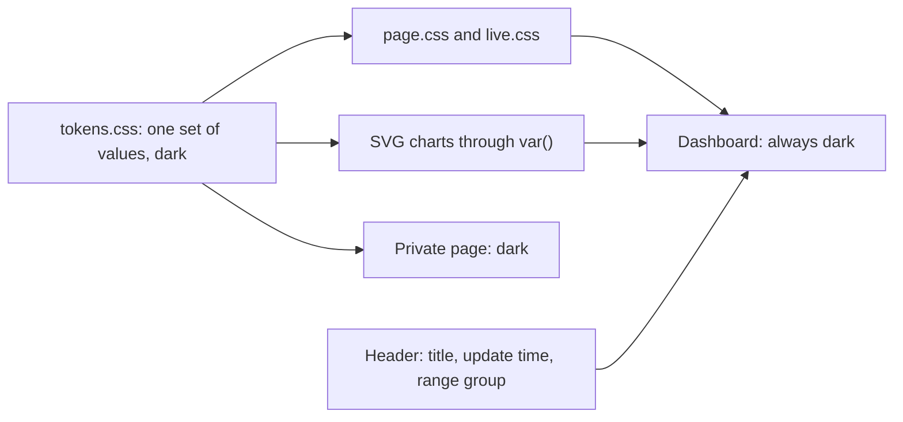
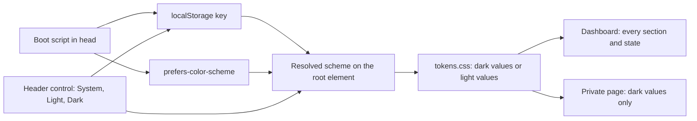
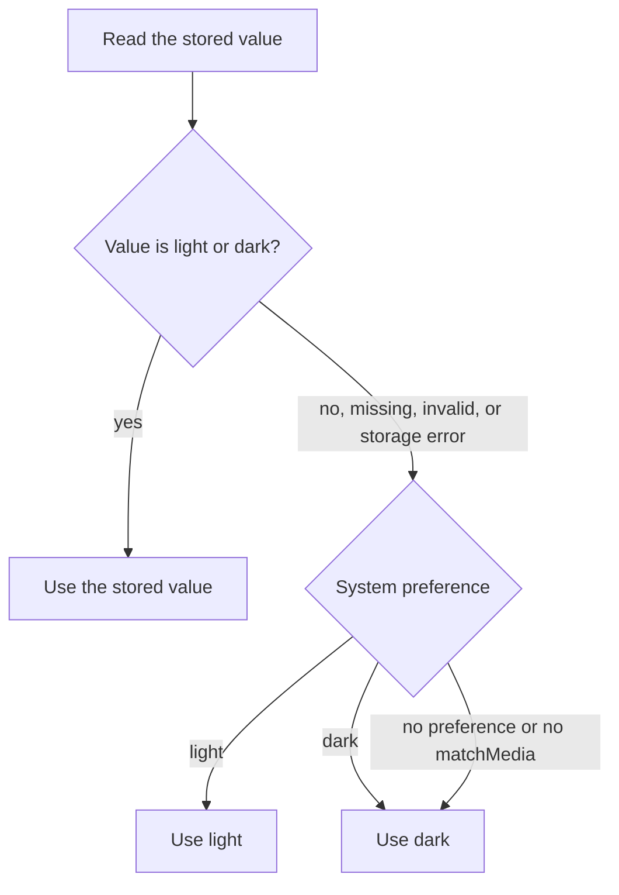
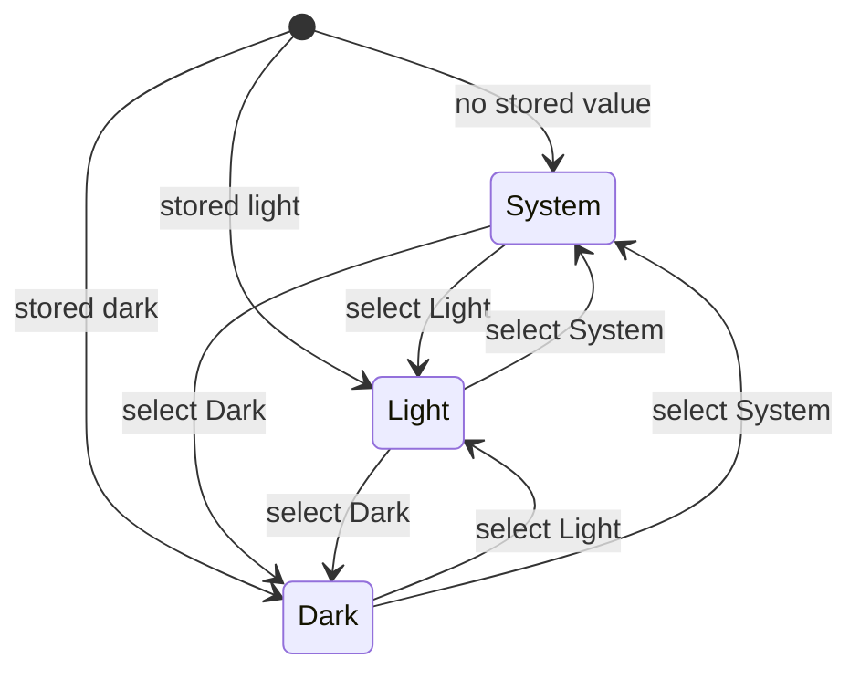
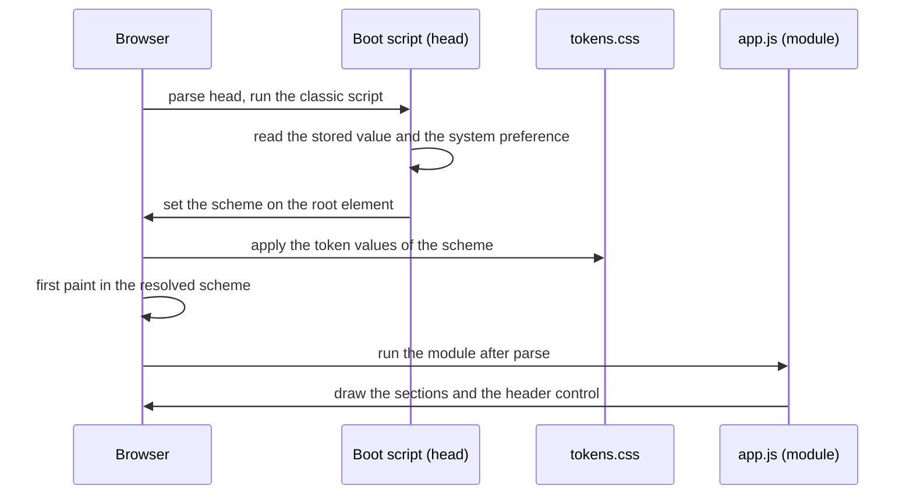
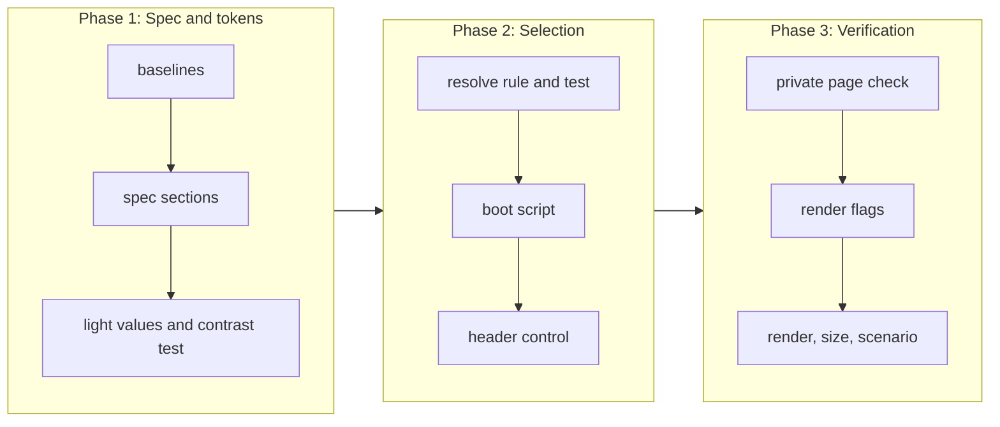

# Light mode

## Change Summary

The dashboard has one color scheme today, dark. This CR adds a light color scheme. The light scheme uses the same design token names as the dark scheme, with different values. The system preference `prefers-color-scheme` selects the scheme. A control in the header lets the reader override the system preference, and the browser keeps the override in `localStorage`. The page paints the correct scheme from the first frame. Every section and every state is readable in both schemes.

## Motivation and Background

The owner wrote: "add light mode".

The owner gave this one requirement. The functional requirements below make it testable. Where the requirement leaves a layout detail open, this CR states a rule and names the detail a judgement call. The section "Judgement Calls" lists each one.

## Change Drivers

* A reader in a bright room, or a reader whose system uses a light appearance, gets a dark page today. The page does not follow the system appearance.
* The spec states "The page has one color scheme, dark. It has no light theme and no theme switch." (section "Design tokens"). The owner now asks for a light scheme.
* Every color of the page already comes from a design token. Thus a second set of token values can change the full page with no change to the section modules.

## Current State

* `web/assets/css/tokens.css` declares `color-scheme: dark` and the color tokens on `:root`, with one value for each token.
* `web/assets/css/page.css` and `web/assets/css/live.css` use only `var(--…)` for colors. They hold no color literal.
* `web/assets/js/live.chart.js` sets the SVG `stroke` and `fill` attributes to `var(--color-rule)` and `var(--color-input)`. Thus the live chart also follows the tokens.
* `web/index.html` loads three stylesheets and one module script, `app.js`. The header holds the title, the update time, and the range group with three buttons that use `aria-pressed`.
* `web/assets/js/section.header.js` sets the update time and the pressed state of the range buttons.
* The spec, section "Page technology", item 6, does not let the page use `localStorage`. Item 1 lets the page use only ES modules. Item 5 does not let the page use an inline script.
* The `content-security-policy` header has `script-src 'self'` and `style-src 'self'`. A test in `tests/web.serve.rs` asserts the header.
* The private reports page `web/private/index.html` also loads `tokens.css`. Its spec (`private-reports.md`, section "Page", item 6) states that it uses the dark theme of the dashboard.
* The paused state of the live section shows the kept figures in `--color-text-faint` at an opacity of 0.5.
* `.agents/scripts/web.size.sh` gives `code_kib: 64.8` at `ac55e2a`.

### Current State Diagram



## Proposed Change

1. Add a light value for each color token. The light values use the same token names as the dark values.
2. Resolve the scheme from two inputs: the override in `localStorage`, and the system preference.
3. Set the resolved scheme on the root element before the first paint. Use a small same-origin classic script in the head that runs before the stylesheets apply. The content security policy does not change.
4. Add a control with three states, System, Light, and Dark, to the header after the range group.
5. When the reader selects Light or Dark, keep the choice in `localStorage`. When the reader selects System, remove the stored choice.
6. When the control is in the state System, follow a change of the system preference while the page is open.
7. Keep the private reports page dark.

### Proposed State Diagram



### Resolve Rule



### Control States



### Load Sequence



## Requirements

### Functional Requirements

**Light color scheme from design tokens**

1. `web/assets/css/tokens.css` **MUST** give a light value for each color token of the spec section "Design tokens". The light value **MUST** use the same token name as the dark value.
2. The dark values **MUST** stay the values of the spec at `ac55e2a`.
3. The page code **MUST NOT** hold a color literal outside `tokens.css`. Each color of the page, of each SVG chart, and of the live chart **MUST** come from a token.
4. The CSS property `color-scheme` of the root element **MUST** equal the resolved scheme, `light` or `dark`. Thus the scrollbars and the native controls follow the scheme.

**Selection by the system preference**

5. When no valid override is stored, the page **MUST** use the scheme of `prefers-color-scheme`.
6. When the browser reports no preference, or has no `matchMedia`, the page **MUST** use the dark scheme.
7. When the control is in the state System and the system preference changes while the page is open, the page **MUST** change to the new scheme with no reload.

**Manual override in the header**

8. The header **MUST** show one control group with the accessible name "Color scheme" and three buttons with the text "System", "Light", and "Dark".
9. The control group **MUST** come after the range group in the header, in the same row at 1440 px.
10. The button of the current state **MUST** have `aria-pressed="true"`. The other two buttons **MUST** have `aria-pressed="false"`. In the state System, the button "System" is pressed, not the button of the resolved scheme.
11. The keyboard **MUST** reach and use each button. Each button **MUST** have a minimum height of 44 px, as the range buttons have.
12. A selection of Light or Dark **MUST** write the value `light` or `dark` to one `localStorage` key. A selection of System **MUST** remove that key.
13. A selection **MUST** change the scheme of the full page at once, with no reload, no new request to `/v1/days`, and no close of the live socket.
14. A selection **MUST NOT** change the URL fragment. The range stays in the fragment as before.
15. After a reload, the page **MUST** show the scheme and the pressed button of the stored value.

**Fall-back to the system preference**

16. When the stored value is not `light` or `dark`, the page **MUST** ignore it, use the system preference, and show the state System.
17. When the browser blocks `localStorage` or the access throws an error, the page **MUST** use the system preference, show no error, and still let the reader change the scheme for the current page view.

**No flash of the wrong scheme**

18. The resolved scheme **MUST** be on the root element before the first paint. The first frame of the page **MUST** show the page background of the resolved scheme.
19. The script that sets the scheme before the first paint **MUST** be a same-origin file in `web/assets/js/`. It **MUST NOT** be inline, `async`, `defer`, or a module, and it **MUST** come in the head before the first stylesheet link.
20. The `content-security-policy` header **MUST NOT** change.

**Contrast in the light scheme**

21. In the light scheme, each text token (`--color-text`, `--color-text-body`, `--color-text-muted`, `--color-text-faint`, `--color-link`, `--color-link-hover`) **MUST** have a contrast of at least 4.5 to 1 on `--color-bg` and on `--color-surface`.
22. In the light scheme, `--color-ink-inverse` **MUST** have a contrast of at least 4.5 to 1 on `--color-text`, because the selected buttons use this pair.
23. In the light scheme, each chart color (`--color-input`, `--color-output`, `--color-positive`, `--color-cache-read`, `--color-cache-write`, `--heat-1`, `--heat-2`, `--heat-3`, `--heat-4`) **MUST** have a contrast of at least 3 to 1 on `--color-surface`.
24. In the light scheme, `--color-positive` and `--color-output` **MUST** have a contrast of at least 4.5 to 1 on `--color-surface`, because the footer line of the pull request card uses them as text color.
25. In the light scheme, the contrast of `--heat-1` to `--heat-4` on `--color-surface` **MUST** increase from level to level, so that a higher level is always darker.
26. The contrast ratio **MUST** be the WCAG 2.x relative luminance ratio.

**Readable sections and states in both schemes**

27. In each scheme, the headline, the live section, the totals row, the pull request card, the tokens-per-day card, the token share bar, the cost cards, the heatmap with its legend, the daily log, the header, and the footer **MUST** show each text at a contrast of at least 4.5 to 1 on its rendered background.
28. In each scheme, the empty state, the error state with the button "Try again", the text "GitHub not connected", and the text "Partial GitHub data" **MUST** meet the text threshold of requirement 27.
29. In each scheme, the message of the live paused state **MUST** meet the text threshold of requirement 27. The kept figures in the muted style **MUST** have a contrast of at least 3 to 1 on their rendered background, the WCAG threshold for large text.
30. In each scheme, the focus outline of the buttons **MUST** have a contrast of at least 3 to 1 on its background.

**Scope of the scheme**

31. The private reports page **MUST** stay in the dark scheme. It **MUST NOT** follow `prefers-color-scheme` or the stored value, and it **MUST NOT** show the control.

### Non-Functional Requirements

1. The page **MUST NOT** load a remote script, style, or font in either scheme.
2. The code size measured by `.agents/scripts/web.size.sh` **MUST** stay at or below 100 KiB.
3. The draw time of the page **MUST** stay at or below 500 ms in each scheme.
4. The headline **MUST** stay above the fold at 360 px and at 1440 px with the control in the header.
5. The headline figure **MUST** stay at least two times the size of the totals figure.
6. The page **MUST** have no horizontal scroll at 360 px in either scheme.
7. The resolve rule **MUST** be a pure function of the stored value and the system preference, so a node test can call it with no browser.
8. The live modules **MUST** still read no storage API. Only the scheme modules read `localStorage`, and only the one scheme key.

## Measurable Targets

| Metric | Method | Baseline | Threshold |
|---|---|---|---|
| Code size | `.agents/scripts/web.size.sh` prints `code_kib` | 64.8 KiB at `ac55e2a` | at most 100 KiB |
| Added scheme code | the increase of `code_kib` from the baseline | 0 | at most 6.0 KiB |
| Draw time, each scheme | `.agents/scripts/web.render.sh --days 400 --scheme light` and `--scheme dark` print `draw_ms` | measured at the start of implementation, dark only | at most 500 ms in each scheme |
| Remote requests, each scheme | `.agents/scripts/web.render.sh --days 400 --scheme light` and `--scheme dark` print `remote_requests` | 0, dark only | 0 in each scheme |
| Headline above the fold | `.agents/scripts/web.render.sh --days 400 --scheme light` prints `headline_above_fold_360` and `headline_above_fold_1440` | true at both widths, with no control | true at both widths, with the control |
| Headline ratio | `.agents/scripts/web.render.sh` prints `headline_ratio` | 2.12 | at least 2.0 |
| Horizontal scroll | `.agents/scripts/web.render.sh --scheme light` and `--scheme dark` print `no_hscroll_360` | true, dark only | true in each scheme |
| Token contrast, light | `node --test web/test/tokens.contrast.test.js` | no light scheme, no test | every pair of requirements 21 to 25 passes |
| Rendered text contrast | `.agents/scripts/web.render.sh --days 400 --scheme light` and `--scheme dark` print `min_text_contrast` | not measured | at least 4.5 in each scheme |
| Rendered graphic contrast | `.agents/scripts/web.render.sh --days 400 --scheme light` prints `min_graphic_contrast` over the series colors and heatmap levels 1 to 4 | not measured | at least 3.0 |
| First frame scheme | `.agents/scripts/web.render.sh --scheme light` and `--scheme dark`, each with the stored values none, `light`, `dark`, and `invalid`, prints `first_frame_scheme_ok` | not measured | true in all 8 runs |
| Resolve rule | `node --test web/test/scheme.resolve.test.js` | no test | every case of the table in AC-2 passes |
| Policy header | `cargo test --test web_serve` | the policy of the spec section "Headers" | unchanged |

`--scheme`, `min_text_contrast`, `min_graphic_contrast`, and `first_frame_scheme_ok` are new outputs of `web.render.sh` and `web.render.cdp.mjs`. `--scheme` sets the emulated `prefers-color-scheme`. A second new flag, `--stored <value>`, puts a value into the scheme key before the navigation. The probe reads `first_frame_scheme_ok` from the first frame of the DevTools screencast.

## Affected Components

* `web/assets/css/tokens.css`: the light values, `color-scheme` for each scheme, and the selector that only the dashboard activates.
* `web/assets/css/page.css`: the style of the control group and the wrap of the header at 360 px.
* `web/assets/css/live.css`: the muted style of the paused state, if the contrast of requirement 29 is not met.
* `web/index.html`: the boot script in the head, before the stylesheet links, and the control group in the header.
* `web/assets/js/`: one new classic boot script, one new module for the control, and the pure resolve rule.
* `web/assets/js/section.header.js`, or the new control module: the pressed state of the scheme buttons.
* `web/assets/js/app.js`: the mount of the control.
* `web/private/index.html` and `web/private/assets/css/private.css`: only if a change is necessary to keep the dark scheme.
* `.agents/scripts/web.render.sh` and `.agents/scripts/web.render.cdp.mjs`: the flags `--scheme` and `--stored` and the new outputs.
* Node tests under `web/test/`.
* `tests/web.serve.rs`: a test that the page holds the boot script in the head before the stylesheets.
* `docs/specification/dashboard.md`: the sections "Page technology", "Header", "Live section", "Footer", "States" (subsection "Live feed paused"), and "Design tokens".
* `docs/specification/private-reports.md`: section "Page", item 6.
* `docs/specification/operations.md`: the table of measurable targets, for the new rows of this CR.
* New scenario `.agents/scenarios/dashboard.light-mode.md` and its screenshots.

## Scope Boundaries

### In Scope

* The light values of the color tokens and the selection of the scheme.
* The header control, the stored override, and the fall-back.
* The boot script that prevents a flash of the wrong scheme.
* The contrast of text and of the chart colors in the light scheme.
* The readability of each section and each state in both schemes.
* The spec sections that this CR names.

### Out of Scope ("Here, But Not Further")

* A change to the dark values of the tokens. The dark heatmap levels do not meet the 3 to 1 threshold today. A separate CR can change them.
* A light scheme for the private reports page.
* A high-contrast scheme, a custom accent color, or more than two schemes.
* A change to the size, font, radius, or spacing tokens.
* A change of the layout, the sections, the data, or the public API.
* A scheme in the URL fragment or on the server.
* A light favicon, a `theme-color` meta element, and a print style.
* A change of the content security policy.

## Alternative Approaches Considered

* **A two-state toggle, Light and Dark.** Rejected. After the first click, the reader cannot go back to the system preference without a clear of the site data. The owner asks for a fall-back to the system preference.
* **Only `prefers-color-scheme`, with no control.** Rejected. The owner asks for a manual override.
* **A media query in CSS only, and the control applied after `app.js` runs.** Rejected. A reader with a stored override that differs from the system sees a flash of the wrong scheme, because the module runs after the first paint.
* **An inline script in the head.** Rejected. The policy has `script-src 'self'` with no hash or nonce. A change of the policy is out of scope.
* **A cookie and a server-side scheme in `index.html`.** Rejected. The static routes do not read or set a cookie (spec section "No credentials"). The `etag` of `index.html` would also depend on the request.
* **New token names with a prefix, for example `--light-color-bg`.** Rejected. Every rule of `page.css`, `live.css`, and the SVG attributes would need a change. The same names with a second set of values change no section module.
* **One button that cycles System, Light, Dark.** Rejected. The reader cannot see all states, and the next state is not clear. A group of three buttons uses the pattern of the range group.

## Impact Assessment

### User Impact

A reader with a light system appearance gets a light page with no action. A reader can select Light or Dark in the header, and the page keeps the choice on that browser. A reader who does nothing with a dark system appearance sees the page of today, plus the control.

### Technical Impact

* One new classic script and one new module. The section modules do not change, because they use tokens.
* The page now uses `localStorage` for one key. The spec section "Page technology" changes to permit this one key.
* The page now has one classic script. The spec section "Page technology" changes to permit this one file.
* The header grows by one control group. At 360 px it can wrap to a second row.
* The render script gets two flags and three outputs.

### Business Impact

The page is readable in more places and follows the system of the reader. The cost is small: one token set, two small scripts, and tests.

## Implementation Approach

1. Measure the code size, the draw time, and the headline fold at the start, and record them as baselines.
2. Update the named sections of `docs/specification/dashboard.md`, item 6 of `private-reports.md`, and the target rows of `operations.md`.
3. Add the light token values and the contrast node test. Adjust the values until the test passes.
4. Add the resolve rule and its node test.
5. Add the boot script to the head, and the static test of its place.
6. Add the control group to the header and its module.
7. Check the private page, and keep it dark.
8. Add `--scheme`, `--stored`, and the new outputs to the render script.
9. Run the render and the size scripts in both schemes, and run the scenario.

### Implementation Flow



## Test Strategy

### Tests to Add

| Test File | Test Name | Description | Inputs | Expected Output |
|-----------|-----------|-------------|--------|-----------------|
| `web/test/tokens.contrast.test.js` | `light_text_contrast` | Parses `tokens.css` and computes the ratio of each text token on `--color-bg` and `--color-surface`, light values | the light values | each ratio at least 4.5 |
| `web/test/tokens.contrast.test.js` | `light_ink_inverse_contrast` | Ratio of `--color-ink-inverse` on `--color-text`, light values | the light values | at least 4.5 |
| `web/test/tokens.contrast.test.js` | `light_chart_contrast` | Ratio of each chart color on `--color-surface`, light values | the light values | each ratio at least 3.0; `--color-positive` and `--color-output` at least 4.5 |
| `web/test/tokens.contrast.test.js` | `light_heat_order` | Ratio of `--heat-1` to `--heat-4` on `--color-surface` | the light values | strictly increasing |
| `web/test/tokens.contrast.test.js` | `every_color_token_has_light_value` | Compares the token names of the two sets | `tokens.css` | the same set of color names; dark values equal the spec table |
| `web/test/tokens.contrast.test.js` | `no_color_literal_outside_tokens` | Searches the CSS and JS files of `web/assets/` outside `tokens.css` for hex, `rgb(`, and `hsl(` color values | the files | no match |
| `web/test/scheme.resolve.test.js` | `resolve_table` | Calls the resolve rule with each row of the table of AC-2 | stored value, system preference | the scheme of the table |
| `web/test/scheme.resolve.test.js` | `storage_error_falls_back` | Calls the boot logic with a fake storage that throws | throwing storage, preference light | `light`, no error |
| `web/test/scheme.control.test.js` | `select_writes_and_removes_key` | Drives the control module with a fake document and a fake storage | select Light, then System | the key is `light`, then the key is absent; the pressed button follows |
| `web/test/scheme.control.test.js` | `system_follows_preference_change` | Fires a change event of a fake `matchMedia` in the state System, then in the state Dark | preference dark to light | the scheme changes in System, and does not change in Dark |
| `web/test/scheme.control.test.js` | `only_scheme_key_used` | Records each storage call during the tests | the calls | only the one scheme key |
| `tests/web.serve.rs` | `index_has_scheme_boot_before_styles` | Gets `/` and checks the head | the served page | a same-origin classic script with no `async`, `defer`, or `type="module"` before the first stylesheet link |
| `tests/web.serve.rs` | `private_page_has_no_scheme_control` | Gets the private page and checks for the control and the boot script | the served private page | neither is present |

### Tests to Modify

| Test File | Test Name | Current Behavior | New Behavior | Reason for Change |
|-----------|-----------|------------------|--------------|-------------------|
| `web/test/live.storage.test.js` | `no_storage_access` | Asserts that the `live.*` files use no storage and no cookie | No change of the assertion. Add a comment that only the scheme modules use `localStorage` | The new storage use must not reach the live modules |
| `.agents/scripts/web.render.cdp.mjs` | the measure of the render | Measures one scheme, dark | Measures the scheme of `--scheme` with the value of `--stored`, and prints the contrast outputs and `first_frame_scheme_ok` | The targets of this CR need both schemes |

### Tests to Remove

Not applicable. No test asserts that the page has only a dark scheme.

## Model-Based Testing

The change has a user surface: the dashboard page. A model drives it with the browser driver of `.agents/scripts/web.render.cdp.mjs`, and a human can open the page by hand. Persist the scenario as `.agents/scenarios/dashboard.light-mode.md`.

1. Seed 400 days with `.agents/scripts/days.seed.sh` on a scratch data directory, as `web.render.sh` does.
2. Start `loupe serve` on that data directory.
3. Set the emulated system preference to light. Clear the scheme key.
4. Open the page at 1440 px on the range 6M. Check that the first frame and the loaded page are light, and that the button "System" is pressed.
5. Check each section: the headline, the live section, the totals row, the pull request card, the tokens-per-day card, the token share bar, the cost cards, the heatmap and its legend, the daily log, and the footer. Read `min_text_contrast` and `min_graphic_contrast`.
6. Take the screenshot `dashboard.light-mode.light.1440.png`.
7. Select "Dark". Check that the page is dark at once, that no new request to `/v1/days` goes out, and that the live socket stays open.
8. Take the screenshot `dashboard.light-mode.dark.1440.png`.
9. Reload. Check that the first frame is dark and that the button "Dark" is pressed.
10. Select "System". Check that the page is light and that the scheme key is absent.
11. Set the scheme key to an invalid value and reload. Check that the page follows the system preference and that "System" is pressed.
12. Set the emulated system preference to dark with no key. Check that the page changes to dark with no reload.
13. Repeat steps 3 to 12 at 360 px. Check that the header control is visible, that the headline is above the fold, and that the page has no horizontal scroll. Take the screenshots `dashboard.light-mode.light.360.png` and `dashboard.light-mode.dark.360.png`.
14. In each scheme, show the states: the empty state (seed 0 days), the error state (stop the server, then reload), "GitHub not connected" (seed with `--github none`), and the live paused state (close the socket). Check the contrast of each state.
15. Open the private reports page with the preference light. Check that it is dark and has no control.
16. Stop the server and the browser.

Success condition: each check passes at both widths and in both schemes, in at least 2 of 2 runs. The four screenshots are in `.agents/scenarios/`.

## Acceptance Criteria

### AC-1: The system preference selects the scheme

```gherkin
Given no stored scheme value
  And the system preference is light
When the page loads at 1440 px
Then the page uses the light token values
  And the root color-scheme is light
  And the button "System" has aria-pressed "true"
```

### AC-2: The resolve rule follows the table

```gherkin
Given the stored value <stored>
  And the system preference <system>
When the page resolves the scheme
Then the scheme is <scheme>
  And the pressed button is <button>

Examples:
  | stored  | system        | scheme | button |
  | none    | light         | light  | System |
  | none    | dark          | dark   | System |
  | none    | no preference | dark   | System |
  | light   | dark          | light  | Light  |
  | dark    | light         | dark   | Dark   |
  | invalid | light         | light  | System |
  | error   | light         | light  | System |
```

### AC-3: The header control overrides and resets

```gherkin
Given the page in the state System with the system preference light
When the reader selects "Dark"
Then the page is dark at once
  And the scheme key holds "dark"
  And no new request to /v1/days goes out
  And the live socket stays open
  And the URL fragment does not change
When the reader selects "System"
Then the page is light
  And the scheme key is absent
```

### AC-4: The override survives a reload

```gherkin
Given the reader selected "Light" with the system preference dark
When the reader reloads the page
Then the page is light
  And the button "Light" has aria-pressed "true"
```

### AC-5: No flash of the wrong scheme

```gherkin
Given the stored value "dark" and the system preference light
When the page loads
Then the first frame shows the dark page background
  And the boot script is a same-origin classic script in the head before the first stylesheet
  And the content-security-policy header is unchanged
```

### AC-6: The light tokens meet the contrast thresholds

```gherkin
Given the light values in tokens.css
When node --test web/test/tokens.contrast.test.js runs
Then each text token has at least 4.5 to 1 on --color-bg and on --color-surface
  And --color-ink-inverse has at least 4.5 to 1 on --color-text
  And each chart color has at least 3 to 1 on --color-surface
  And --color-positive and --color-output have at least 4.5 to 1 on --color-surface
  And the heatmap levels 1 to 4 increase in contrast
```

### AC-7: Every section and state is readable in both schemes

```gherkin
Given 400 seeded days
When web.render.sh runs with --scheme light and then with --scheme dark
Then min_text_contrast is at least 4.5 in each run
  And min_graphic_contrast is at least 3.0 in the light run
  And the empty state, the error state, "GitHub not connected", and the live paused message meet the text threshold in each scheme
```

### AC-8: The system change is followed only in the state System

```gherkin
Given the page in the state System with the system preference dark
When the system preference changes to light
Then the page is light with no reload
Given the page in the state Dark
When the system preference changes to light
Then the page stays dark
```

### AC-9: The private page stays dark

```gherkin
Given the system preference light and the stored value "light"
When the private reports page loads
Then the page uses the dark token values
  And the page shows no scheme control
```

### AC-10: The targets hold in both schemes

```gherkin
Given the changed page
When web.size.sh runs, and web.render.sh runs with --scheme light and with --scheme dark
Then the code size is at most 100 KiB
  And the draw time is at most 500 ms in each scheme
  And remote_requests is 0 in each scheme
  And the headline is above the fold at 360 px and at 1440 px
  And the page has no horizontal scroll at 360 px
```

## Quality Standards Compliance

### Build & Compilation

- [ ] `cargo build` passes.

### Linting & Code Style

- [ ] `.agents/scripts/pipeline.lint.sh` and `.agents/scripts/pipeline.format.sh` pass.
- [ ] Each new file under `web/assets/js/` has one `@agents-index` line.

### Test Execution

- [ ] `.agents/scripts/pipeline.test.sh` passes.
- [ ] `.agents/scripts/pipeline.web.sh` passes, with the new node tests.

### Documentation

- [ ] `docs/specification/dashboard.md` changes before the code, in the sections that this CR names.
- [ ] `docs/specification/private-reports.md` and `docs/specification/operations.md` change in the named places.

### Code Review

- [ ] A reviewer agent checks blocking findings only.
- [ ] The commit title follows Conventional Commits.

### Verification Commands

```bash
.agents/scripts/pipeline.test.sh
.agents/scripts/pipeline.web.sh
.agents/scripts/web.size.sh
.agents/scripts/web.render.sh --days 400 --scheme light
.agents/scripts/web.render.sh --days 400 --scheme dark
```

## Risks and Mitigation

### Risk 1: The header control pushes the headline below the fold at 360 px

**Likelihood:** medium
**Impact:** medium
**Mitigation:** Non-functional requirement 4 and the render output `headline_above_fold_360`. The control can wrap to a second header row, and the button text stays short.

### Risk 2: A chart color passes 3 to 1 but loses its hue identity

**Likelihood:** medium
**Impact:** low
**Mitigation:** Judgement call 8 keeps the hue family of each series. The screenshots in both schemes let the reviewer compare the colors.

### Risk 3: The shared `tokens.css` turns the private page light

**Likelihood:** medium
**Impact:** medium
**Mitigation:** Requirement 31, AC-9, and the test `private_page_has_no_scheme_control`. Only the boot script of the dashboard activates the light values.

### Risk 4: The boot script delays the first paint

**Likelihood:** low
**Impact:** low
**Mitigation:** The script is small and same-origin with `cache-control: no-cache` and an `etag`. The draw time target holds in both schemes.

### Risk 5: The paused state of the live section fails the contrast in one scheme

**Likelihood:** high
**Impact:** low
**Mitigation:** Requirement 29 permits a change of the muted style in `live.css`. The scenario checks the paused state in both schemes.

## Dependencies

* CR-0008 (the design tokens, the content security policy, and the width rule).
* CR-0013 (the live section and the storage rule of the live modules).
* CR-0018 and CR-0019 (the card gap, the pull request footer line colors, and the footer sentences).

## Estimated Effort

Small to medium: one token set, two small scripts, about five new node tests, two Rust tests, the render script flags, and four spec sections.

## Open Questions

None. The owner asked for a light mode. The layout details are judgement calls.

## Judgement Calls

1. Control form: a group of three buttons, "System", "Light", and "Dark", with `aria-pressed`, in the pill style of the range group. Reason: the reader can go back to the system preference, and all states are visible.
2. Control place: in the header, after the range group, in the same row at 1440 px. At 360 px the group can wrap to the next row, below the range group. The group has the accessible name "Color scheme".
3. Button text: words, not icons. Reason: no icon file and no icon font, and the text is clear without a tooltip.
4. Token names: the light scheme uses the same token names as the dark scheme. The spec table "Design tokens" gets a second value column for the light values. No new color token name.
5. Storage: one `localStorage` key, `dashboard.scheme`, with the value `light` or `dark`. The state System removes the key. The key does not name the product, so it agrees with the rule for the site title.
6. Invalid or blocked storage: an unknown value is ignored, and a storage error falls back to the system preference with no message.
7. No preference: when the browser reports no preference or has no `matchMedia`, the page is dark, the scheme of today.
8. Light palette: the implementer chooses the values with the contrast test. Each series keeps the hue family of its dark value: blue for input, amber for output, green for positive, violet for cache read, and teal for cache write. The heatmap is a green ramp that gets darker from level 1 to level 4. `--color-surface` is lighter than `--color-bg`, so the cards stand out as in the dark scheme.
9. Exempt colors: `--heat-0`, `--color-border`, and `--color-rule` are not chart colors for the 3 to 1 threshold. `--heat-0` shows a day with no value, and the borders and rules only separate areas. Each cell has a `title` with the value.
10. Text use of chart colors: `--color-positive` and `--color-output` get the text threshold 4.5 to 1, because the pull request footer line uses them as text.
11. Paused state: the kept figures get the large text threshold of 3 to 1 in both schemes, and the paused message gets 4.5 to 1. The muted style can change to meet this.
12. Follow of the system: in the state System, the page follows a change of the system preference with no reload. In the states Light and Dark, it does not.
13. No flash mechanism: a same-origin classic script in the head, before the stylesheet links, sets the scheme on the root element. The policy does not change.
14. Private page: it stays dark and shows no control. The light scheme of the private page is out of scope.
15. URL fragment: the scheme does not go in the fragment, so a shared link uses the scheme of the reader.
16. Scheme switch: no redraw and no new request. The charts follow the tokens through `var()`.
17. Code budget: the added code is at most 6.0 KiB of `code_kib`, inside the page budget of 100 KiB.
18. Dark values: unchanged. The dark heatmap levels that do not meet 3 to 1 are out of scope.

## Decision Outcome

Pending. The status is proposed.

## Notes

Layer 1 boundary: this CR names the spec sections that change. It does not inline the spec text and holds no code. The spec sections that change are "Page technology" (items 1, 5, and 6: the one classic script and the one storage key), "Header" (the control), "Live section" (item 6 stays true for the live modules), "Footer" (readable in both schemes), "States" (the paused state contrast), and "Design tokens" (the two schemes, the light value column, and the contrast rules) in `dashboard.md`. Item 6 of the section "Page" in `private-reports.md` and the target table in `operations.md` also change.
