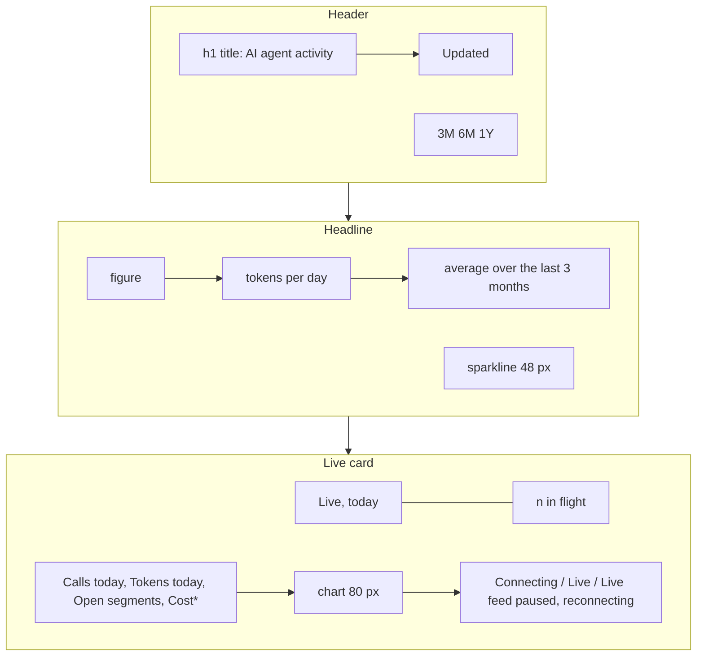
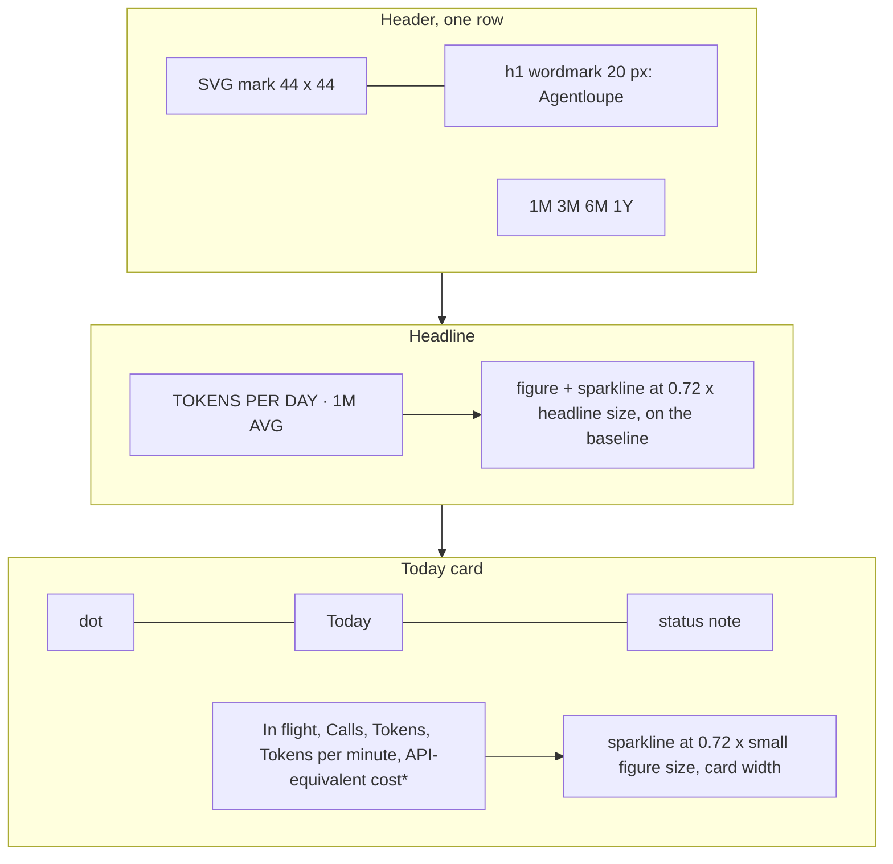
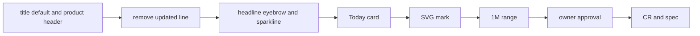

# Dashboard product header

## Change Summary

The owner reviewed the live dashboard on 2026-10-23 and asked for six changes in a fast iteration. The implementer made each change in the same session, and the owner approved the result live. This CR records the change after the fact. The working tree diff against `86203e9` in `web`, `src`, and `tests` is the authority for the behaviour that this CR describes.

The site title now defaults to the product name "Agentloupe". The header is one product row: an SVG mark, the wordmark, and the range buttons. The updated line is gone. The headline has an eyebrow, the figure, and a sparkline as tall as the digits. The live card is "Today", with a connection dot, a short status note, five figures in one row, and a sparkline as tall as the digits of a figure. A new range `1M` of 30 days is the default.

## Motivation and Background

The owner wrote, in this order, on 2026-10-23:

1. "Make the AI agent activity title default to the product name and make it overridable through env. The look and feel should be a product header. Think Stripe dashboard, keep it minimal."
2. "I don't understand Updated 23 Oct 2026, 06:07 CEST, it is not self-explanatory." The owner decided to remove the line, because the last row of the daily log already shows the latest published day.
3. "Make tokens per day and average over the last 3 months the eyebrow of the metric." The text was compacted to "Tokens per day · 3M avg". Then: "make the timechart the same height as the metric text".
4. About the live card: "too much whitespace", "Live is repeated", "0 in flight is hidden", "use the space for relevant metrics as first class elements", and "add a live indicator to visualize that the websocket is connected". The owner then chose the heading "Today" from ten alternatives.
5. "Create an SVG logo for Agentloupe the size of the 3M/6M/1Y toggles and adjust the text size to look nice next to it."
6. "Add a last 30d timeline and use it as default."

These six points are the requirements. The implemented diff decides each layout detail.

## Change Drivers

* The default title "AI agent activity" hid the product name, and the header did not read as a product.
* The update time "Updated 23 Oct 2026, 06:07 CEST" was not self-explanatory, and the daily log already shows the latest published day.
* The headline unit and the range in words took two lines under the figure.
* The live card repeated the word "Live", hid the in-flight count in a small note, and had too much white space.
* The page had no short range for the recent work.

## Current State

At `86203e9`:

* `src/config/vars.rs` gives `LOUPE_SITE_TITLE` the default "AI agent activity". `src/config/validate.rs` uses "AI agent activity" as the example in the error hint. The default page does not show the product name.
* `web/index.html` has a header with a text block (the `h1` title in the class `title` at `--size-title`, and a paragraph `#updated` with the text "Loading") and the range buttons `3M`, `6M`, and `1Y`.
* `web/assets/js/section.header.js` writes the update time from `updated_at`, or "No update yet", and sets `aria-pressed` on the range buttons.
* `web/assets/js/section.headline.js` shows the figure, the unit "tokens per day", the range in words ("average over the last 3 months"), and a sparkline of 48 px height beside the text block.
* `web/assets/js/live.section.js` shows the heading "Live, today", a note "<n> in flight" beside it, four figures ("Calls today", "Tokens today", "Open segments", "API-equivalent cost*"), a chart of 80 px height, and a status line "Connecting", "Live", or "Live feed paused, reconnecting" under the chart.
* `web/assets/js/range.select.js` has the ranges `3M` (91 days), `6M` (182 days), and `1Y` (365 days). A missing or unknown fragment gives `3M`.

### Current State Diagram



## Proposed Change

1. Set the default of `LOUPE_SITE_TITLE` to "Agentloupe". The variable still overrides it.
2. Make the header one product row: an inline SVG mark of 44 by 44 px, the wordmark `h1` at 20 px, and the range buttons `1M`, `3M`, `6M`, and `1Y`.
3. Remove the updated line and the text "No update yet" from the header.
4. Give the headline an eyebrow "Tokens per day · <range> avg", then the figure with a sparkline in one row. The sparkline is 0.72 times the headline size tall, and its bottom edge sits on the baseline of the digits.
5. Rework the live card: the heading "Today" with a connection dot, a status note, five figures in one row, and a sparkline at 0.72 times the small figure size.
6. Add the range `1M` of 30 days and make it the default.

### Proposed State Diagram



## Requirements

### Functional Requirements

**Site title**

1. The default of `LOUPE_SITE_TITLE` **MUST** be "Agentloupe". With no value set, the page **MUST** show "Agentloupe" in the `<title>` element and in the `h1` of the header.
2. A value of `LOUPE_SITE_TITLE` **MUST** replace the default. The validation of the value **MUST** stay the same (1 to 80 characters after trim). The example in the error hint **MUST** be "Agentloupe".
3. `loupe config show` **MUST** show "Agentloupe" as the default of `site_title`.

**Header**

4. The header **MUST** be one row: a brand group on the left and the range buttons on the right, vertically centered, with a minimum height of 48 px. When the row does not fit the width, the range buttons **MUST** go to a second line.
5. The brand group **MUST** hold an inline SVG mark of 44 by 44 px and the wordmark `h1` at 20 px, weight 600, with 10 px between them. The `h1` **MUST** show the site title.
6. The mark **MUST** be a loupe: a ring and a handle in the text color (`currentColor`), and three bars of different heights in `--color-input` inside the lens. The mark **MUST** be hidden from assistive technology (`aria-hidden="true"`, `focusable="false"`).
7. The header **MUST NOT** show the update time or the text "No update yet".
8. The range buttons **MUST** be `1M`, `3M`, `6M`, and `1Y`, in this order. The button of the selected range **MUST** have `aria-pressed="true"`, and the other buttons `aria-pressed="false"`.

**Ranges**

9. The range `1M` **MUST** be the last 30 days. The ranges `3M` (91 days), `6M` (182 days), and `1Y` (365 days) **MUST** stay.
10. The fragment `#range=1M` **MUST** select `1M`. A missing or unknown fragment **MUST** select `1M`.

**Headline**

11. The headline **MUST** start with an eyebrow with the text "Tokens per day · <range> avg", where `<range>` is the key of the selected range, for example "Tokens per day · 3M avg".
12. The eyebrow **MUST** use the mono label style: `--font-mono`, `--size-label`, `--color-text-muted`, uppercase, with a letter spacing of 0.04 em.
13. Below the eyebrow, the figure and the sparkline **MUST** sit in one row, aligned on the baseline. The sparkline **MUST** have a height of 0.72 times `--size-headline`, and its bottom edge **MUST** sit on the baseline of the digits.
14. At 360 px, the sparkline **MUST** move to a line under the figure.
15. When the view has no record, the headline **MUST** show the eyebrow and the figure and no sparkline.
16. The headline **MUST NOT** show the separate unit line "tokens per day" or the range in words.

**Live card**

17. The heading row **MUST** show a dot of 8 px, the heading "Today" in the label style of the cards, and a status note at the right end of the row. The accessible name of the section **MUST** be "Today, live".
18. While frames arrive, the dot **MUST** pulse in `--color-positive`. In the paused state, the dot **MUST** be still and use `--color-text-faint`. When the user asks for reduced motion, the dot **MUST NOT** pulse.
19. The status note **MUST** have the role `status`. It **MUST** be "Connecting" before the first frame, empty while frames arrive, and "Paused, reconnecting" in the paused state.
20. The card **MUST** show five figures in this order: "In flight", "Calls", "Tokens", "Tokens per minute", and "API-equivalent cost*". At 1440 px the five figures **MUST** sit in one row.
21. "Tokens per minute" **MUST** be the sum of the last six 10-second buckets of the live chart, in the short form.
22. The card **MUST NOT** show the figure "Open segments", the heading "Live, today", the note "<n> in flight", or a status line under the chart.
23. The sparkline **MUST** show the tokens of each 10-second bucket over the last 10 minutes, with a height of 0.72 times `--size-figure-small`, and **MUST** stretch to the width of the card.
24. In the paused state, the figures and the sparkline **MUST** keep the muted style.

### Non-Functional Requirements

1. The page **MUST** have no horizontal scroll at 360 px and at 1440 px.
2. The mark **MUST** be inline SVG in the page. The page **MUST NOT** load a file for it.
3. The headline figure **MUST** stay the largest text on the page.

## Measurable Targets

| Metric | Method | Result on 2026-10-23 |
|---|---|---|
| Horizontal scroll | render at 360 px and 1440 px | none at both widths |
| Node tests | `node --test` under `web/test/` | 34 pass |
| Web serve tests | `tests/web.serve.rs` | 15 pass |

## Affected Components

* `src/config/vars.rs`: the default of `LOUPE_SITE_TITLE`.
* `src/config/validate.rs`: the example in the error hint of `LOUPE_SITE_TITLE`.
* `src/config/show.rs`: the unit test of the default `site_title`.
* `web/index.html`: the brand group with the mark and the wordmark, and the `1M` button.
* `web/assets/css/page.css`: the header row, the brand, the mark, the wordmark, the eyebrow, the headline row, and the sparkline height. The rules of `.title`, `.updated`, `.headline-unit`, `.headline-text`, and `.headline-range` are removed.
* `web/assets/css/live.css`: the heading row, the dot and its pulse, the figure row, and the sparkline height.
* `web/assets/js/section.header.js`: only the pressed state of the range buttons.
* `web/assets/js/app.js`: the header call without `updated_at`.
* `web/assets/js/section.headline.js`: the eyebrow and the headline row.
* `web/assets/js/range.select.js`: the range `1M`, the default, and the removal of the range in words.
* `web/assets/js/live.section.js`: the heading, the dot, the status note, the five figures, and "Tokens per minute".
* `web/assets/js/live.chart.js`: the chart stretches to the card width.
* `tests/web.serve.rs`, `web/test/range.select.test.js`, `web/test/view.build.test.js`.
* `docs/specification/dashboard.md`, `docs/specification/configuration.md`, `README.md`.

## Scope Boundaries

### In Scope

* The six points of the owner, as the diff implements them.
* The spec and README text that describes the changed behaviour.

### Out of Scope ("Here, But Not Further")

* The private reports page and its own range selector. It keeps `3M`, `6M`, and `1Y`.
* The live state, the socket, and the live route. The state still counts the open segments; only the card stops showing them.
* The public API. The envelope still has `updated_at`; only the header stops showing it.
* The totals row, the pull request card, the token cards, the cost cards, the heatmap, the daily log, and the footer.
* The design token values. `tokens.css` does not change.
* The light mode of CR-0020.

## Alternative Approaches Considered

* **Keep the update time and reword it.** Rejected by the owner. The last row of the daily log already shows the latest published day.
* **Keep the long eyebrow "Tokens per day, average over the last 3 months".** Rejected. The owner accepted the compact form "Tokens per day · 3M avg".
* **Nine other headings for the live card.** The owner chose "Today" from ten alternatives.
* **Keep "Open segments" as a fifth figure.** Rejected. The owner asked for relevant metrics as first-class elements. "In flight" and "Tokens per minute" take the space.

## Impact Assessment

### User Impact

A reader sees the product name and a minimal product header. The headline states its unit and range in one short eyebrow. The live card shows at a glance that the socket is connected, and it shows the in-flight count and the token rate as figures. A first visit shows the last 30 days.

### Technical Impact

A change of one default value and one hint example, small changes in nine web files, and four changed tests. A shared link with `#range=3M`, `#range=6M`, or `#range=1Y` still selects its range. A link with no fragment now selects `1M` and not `3M`.

### Business Impact

The page shows the product name by default. An operator who wants another title sets `LOUPE_SITE_TITLE`.

## Implementation Approach

The implementer made the changes in the order of the six points, in one session, with the owner reviewing each step live. The tests changed with the code. This CR and the spec update come after the change.

### Implementation Flow



## Test Strategy

### Tests to Add

None. The changed tests cover the new defaults and the new range.

### Tests to Modify

| Test File | Test Name | Current Behavior | New Behavior | Reason for Change |
|---|---|---|---|---|
| `tests/web.serve.rs` | `root_serves_index_html` | asserts "AI agent activity" in `<title>` and `h1`, and no "Agentloupe" in the body | asserts "Agentloupe" in `<title>` and `h1` | the default title is the product name |
| `src/config/show.rs` | `masks_every_secret` | asserts the shown `site_title` "AI agent activity" among the defaults | asserts `site_title` "Agentloupe" | the default title changed |
| `web/test/range.select.test.js` | `fragment_selects_range` | `#x` and an empty fragment give `3M` | `#range=3M` gives `3M`; `#x` and an empty fragment give `1M` | `1M` is the default |
| `web/test/view.build.test.js` | `range_lengths` | checks `3M`, `6M`, `1Y` | also checks `1M` with 30 days | the range `1M` is new |

### Tests to Remove

None.

## Acceptance Criteria

### AC-1: The default title is the product name

```gherkin
Given LOUPE_SITE_TITLE is not set
When the binary serves GET /
Then the <title> element is "Agentloupe"
And the h1 of the header is "Agentloupe"
```

### AC-2: The title is overridable

```gherkin
Given LOUPE_SITE_TITLE is "My agents"
When the binary serves GET /
Then the <title> element and the h1 are "My agents"
```

### AC-3: The header is a product row

```gherkin
Given the dashboard at 1440 px
When the page renders
Then the header shows a 44 by 44 px loupe mark, the wordmark at 20 px, and the buttons 1M, 3M, 6M, 1Y in one row
And the header shows no update time and no "No update yet"
```

### AC-4: The headline has an eyebrow and a baseline sparkline

```gherkin
Given seeded days and the range 3M
When the headline renders
Then the eyebrow text is "Tokens per day · 3M avg", shown in uppercase
And the sparkline is 0.72 times the headline size tall
And the bottom edge of the sparkline is on the baseline of the digits
```

### AC-5: The headline stacks at 360 px

```gherkin
Given seeded days
When the page renders at 360 px
Then the sparkline is under the figure
And the page has no horizontal scroll
```

### AC-6: The live card shows connection and five figures

```gherkin
Given the live socket sends frames
When the live card renders at 1440 px
Then the heading is "Today" with a dot in the positive color that pulses
And the status note is empty
And the figures In flight, Calls, Tokens, Tokens per minute, API-equivalent cost* sit in one row
And no figure "Open segments" shows
And the sparkline stretches to the card width
```

### AC-7: The live card shows the connection states

```gherkin
Given the page has loaded
When no frame came yet
Then the status note is "Connecting"
When the socket closes after frames came
Then the dot is still and faint
And the status note is "Paused, reconnecting"
And the figures and the sparkline are muted
```

### AC-8: Tokens per minute is the last six buckets

```gherkin
Given live buckets of 10 seconds
When the card draws
Then "Tokens per minute" is the sum of the last six buckets in the short form
```

### AC-9: 1M is a range and the default

```gherkin
Given a URL with no fragment or an unknown fragment
When the page loads
Then the range 1M of the last 30 days is selected
And the 1M button has aria-pressed "true"
When the user selects 3M
Then the fragment is "#range=3M"
```

## Quality Standards Compliance

### Build & Compilation

The web serve tests built and ran the binary on 2026-10-23.

### Linting & Code Style

Not recorded for this change. The pipeline was not run in this session.

### Test Execution

On 2026-10-23, every node test passed (34), and the web serve tests passed (15).

### Documentation

`docs/specification/dashboard.md`, `docs/specification/configuration.md`, and `README.md` change with this CR, after the code.

### Code Review

The owner reviewed the change live and approved it.

### Verification Commands

```bash
node --test web/test/
cargo test --test web_serve
.agents/scripts/pipeline.test.sh
```

## Risks and Mitigation

### Risk 1: A shared link with no fragment shows another range than before

**Likelihood:** medium
**Impact:** low
**Mitigation:** a link with `#range=3M` still selects `3M`. The owner chose `1M` as the default.

### Risk 2: The pulse distracts or costs motion

**Likelihood:** low
**Impact:** low
**Mitigation:** the dot does not pulse when the user asks for reduced motion, and it stops in the paused state.

### Risk 3: CR-0020 assumes the old header

**Likelihood:** high
**Impact:** low
**Mitigation:** CR-0020 is proposed and puts a scheme control in the header. Rebase CR-0020 on this header before its implementation.

## Dependencies

* CR-0008 (the dashboard, the design tokens, and the width rule).
* CR-0013 (the live route and the live section).
* CR-0019 (the asterisk on the live cost label).

## Estimated Effort

Small: one session, fifteen files in `web`, `src`, and `tests`, and three documents.

## Judgement Calls

1. The eyebrow uses the range key ("3M"), not the range in words, so one short line holds the unit and the range.
2. The mark uses `currentColor` for the ring and the handle, so it follows the text color, and `--color-input` for the bars.
3. The wordmark size of 20 px sits next to a 44 px mark and the 44 px range buttons.
4. "Tokens per minute" comes from the buckets of the live chart, so it needs no new data from the socket.
5. The status note is empty while live, because the moving dot already shows the connection.

## Decision Outcome

Approved by the owner in a live review on 2026-10-23, implemented in the same session, CR authored after the fact at the owner's request to keep the chain consistent.

## Implementation Status

* **Started:** 2026-10-23
* **Completed:** 2026-10-23
* **Notes:** measured on 2026-10-23 at 1440 px and 360 px: no horizontal scroll, every node test passes (34), the web serve tests pass (15).

## Related Items

* CR-0008 Dashboard SPA
* CR-0013 Live metrics WebSocket
* CR-0019 Dashboard second pass
* CR-0020 Light mode (proposed, needs a rebase on this header)
