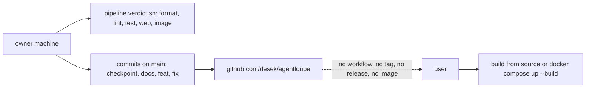
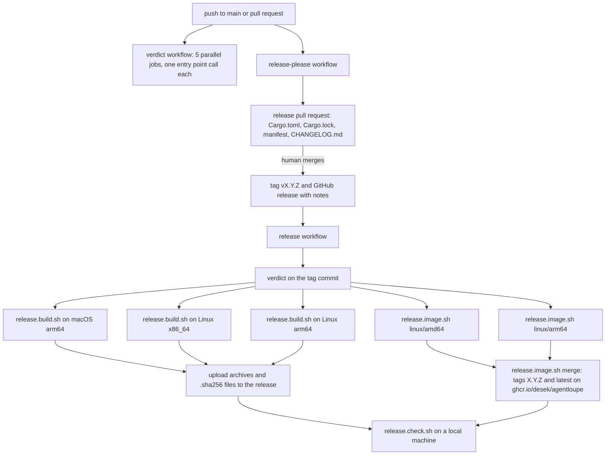
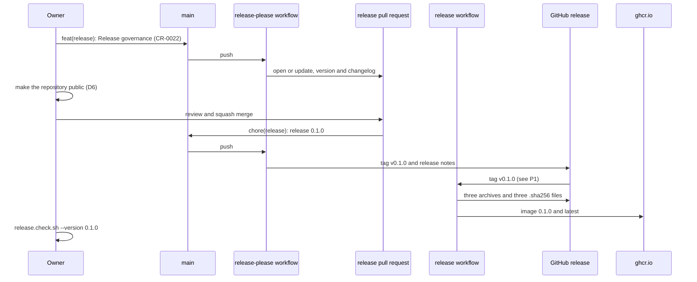
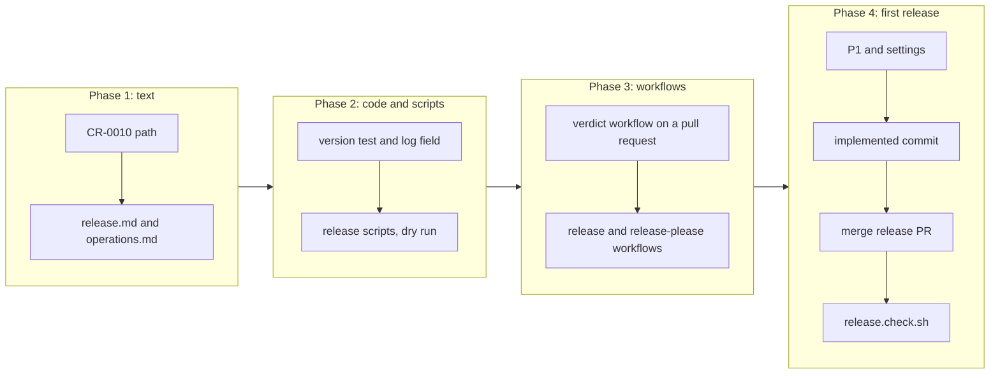

# Release governance

## Change Summary

The project has no hosted pipeline, no tag, no release, and no published image today. This CR adds three GitHub Actions workflows that are thin callers of the portable pipeline: a verdict workflow, a release-please workflow, and a release workflow. A tag `vX.Y.Z` publishes the `loupe` binary for macOS arm64, Linux x86_64, and Linux arm64 with SHA-256 checksum files, and the container image `ghcr.io/desek/agentloupe` with the version tag and `latest`. A new specification file `docs/specification/release.md` states the version rules, and a new script checks a published release on a local machine. The first public release is `v0.1.0`.

## Motivation and Background

The owner wrote, on 2026-10-23: "we're ready to make this production ready, meaning published to github with tags and release artifacts, version governance, CI/CD tooling and some potential scrubbing of the git history."

The owner then decided, on 2026-10-23:

1. **D1, history.** The git history stays as it is. A gitleaks scan of all 267 commits and a scan for real token shapes found no secret, only test fixtures. The one home path in `docs/cr/CR-0010-macos-end-to-end-acceptance.md`, line 421, is removed in a normal commit.
2. **D2, first version.** The first public release is `v0.1.0`. This matches `Cargo.toml`. The `target-version` values of the earlier CRs are the internal plan. They are not tags.
3. **D3, assets.** A tag produces release assets: the `loupe` binary for macOS arm64, Linux x86_64, and Linux arm64, each with a SHA-256 checksum file, and the container image on `ghcr.io/desek/agentloupe`, tagged with the version and with `latest`.
4. **D4, release tool.** release-please cuts the releases. A workflow opens and updates one release pull request from the Conventional Commits on `main`, with the changelog. The merge of that pull request makes the tag and the GitHub release with the notes.

The owner then answered two more points, on 2026-10-23:

5. **D5, release token (resolves P1).** release-please uses a fine-grained personal access token with the repository permissions contents, pull requests, and issues, each read and write, on this repository only. It is stored as the repository secret `RELEASE_PLEASE_TOKEN`, created on 2026-10-23.
6. **D6, visibility.** The repository is private today. It becomes public at the first release `v0.1.0`, so the GitHub Actions minutes, the macOS runner, the arm64 runners, and the ghcr.io image are free. The release scenario states the step that makes the repository public (section "Model-Based Testing", step 8), and non-functional requirement 4 bounds the paid use if the repository is still private at that moment.

These six decisions and the facts of the repository below are the requirements. Where a decision leaves a detail open, this CR states a rule and names the detail a judgement call.

## Change Drivers

* The owner wants to publish the project with tags and release assets.
* A user can install the project today only from source or from a local image build. A user cannot download a binary or pull an image.
* The verdict runs only on the machine of the owner. A pull request from another person gets no verdict.
* The commit convention puts most work in `checkpoint(CR-NNNN)` commits and marks a CR implemented in a `docs(cr)` commit. A changelog that reads the commit types does not see the CRs. A rule for the implemented commit fixes this.
* The `target-version` values of the CRs (for example `0.11.0` in CR-0019) look like released versions. They are not. One rule must state what a version is.

## Current State

* `Cargo.toml` holds the version `0.1.0`, the package name `agent-loupe`, and the binary name `loupe`. `publish = false`. The license is MIT.
* `src/cli/mod.rs` declares the command with the clap attribute `version`, so `loupe --version` prints the name and the version. No test asserts this, and no specification section states it.
* The log of `loupe serve` has no line that names the version. `GET /healthz` returns `{"status":"ok"}` (`docs/specification/operations.md`, section "Health").
* The portable pipeline is in `.agents/scripts/`: the stage entry points `pipeline.format.sh`, `pipeline.lint.sh`, `pipeline.test.sh`, `pipeline.web.sh`, and `pipeline.image.sh`, and the verdict `pipeline.verdict.sh` with its fingerprint script (`operations.md`, sections "Pipeline", "Stage inputs and toolchain", and "Fingerprints and the verdict cache").
* `rust-toolchain.toml` pins Rust `1.97.1` with `rustfmt` and `clippy`. `.tool-versions` pins Node `22.20.0` and `cargo-nextest` `0.9.149` under its mise registry name.
* The root `Dockerfile` builds the image `agent-loupe:local`, which `pipeline.image.sh` checks. The runtime stage is `debian:bookworm-slim` with the user `loupe` (UID 10001).
* The binary reads `upstreams.toml` and `config/<env>.toml` at run time. The image copies both files into `/app`.
* The repository has no `.github/` directory, no tag, no `CHANGELOG.md`, and no release.
* The remote is `https://github.com/desek/agentloupe`.
* The history has 268 commits at the source commit: 137 `checkpoint`, 119 `docs`, 6 `fix`, 3 `feat`, 2 `chore`, and 1 `test`.
* `README.md` documents only the local image build with `docker compose up -d --build` (section "Connect the agents", step 2). It has no section "Install" and no install from source.
* `docs/cr/CR-0010-macos-end-to-end-acceptance.md`, line 421 (decision D6a), holds an absolute home path of the owner. The other matches of `/Users/` in the tree are test fixtures (`/Users/marker/...`) and search terms in scenarios.

### Current State Diagram



## Proposed Change

1. Remove the home path from CR-0010 in a normal commit. Do not rewrite the history.
2. Add the specification file `docs/specification/release.md`. It is the one source of the version rules.
3. Add the verdict workflow. It runs the five stages as parallel jobs on each push to `main` and on each pull request.
4. Add the release-please workflow and its two configuration files at the root. It keeps one release pull request open from the Conventional Commits on `main`.
5. Add the release workflow. On a tag `vX.Y.Z`, it builds the three binaries and the multi-platform image, then publishes them.
6. Add three release scripts under `.agents/scripts/`: one builds a binary asset, one builds and pushes the image, and one checks a published release on a local machine.
7. State the version of the binary: `loupe --version` and one start log line.
8. Add the release install paths to `README.md`.

### Proposed State Diagram



### Release Sequence



## Requirements

### Functional Requirements

**History and hygiene (D1)**

1. The implementation **MUST NOT** rewrite, rebase, or force-push the published history of `main`.
2. A normal commit **MUST** replace the absolute home path in `docs/cr/CR-0010-macos-end-to-end-acceptance.md`, line 421, with a placeholder, for example `<path to pi-cc-auth>/src/index.ts`. The decision text of D6a **MUST** stay the same in all other words.
3. After requirement 2, `git grep -nE "/Users/[d]esek"` on the tree **MUST** return no match. The bracket keeps this line of the CR from matching itself.

**Version (D2)**

4. The `version` field of the `[package]` table in `Cargo.toml` **MUST** be the one source of the version. A commit other than the merge of the release pull request **MUST NOT** change it.
5. A source file, script, workflow file, or configuration file **MUST NOT** state the version, except the files that release-please writes from `Cargo.toml`: `Cargo.lock` and `.release-please-manifest.json`, and the `release-as` value in `release-please-config.json` until the commit after the first release removes it (judgement call 9). `CHANGELOG.md`, the CRs, and the scenarios record past versions and are not a source. A script or a test that needs the version **MUST** read it from `Cargo.toml`, from the tag, or from its input.
6. `loupe --version` **MUST** print `loupe <version>` with the version from `Cargo.toml`, then a newline, on stdout, and **MUST** exit with code 0.
7. The first log line of `loupe serve` **MUST** hold the key field `version` with the version from `Cargo.toml`. The line goes to stderr and to the log file, per `operations.md`, section "Logging".
8. The body of `GET /healthz` **MUST NOT** change. The dashboard footer **MUST NOT** change.
9. The first tag **MUST** be `v0.1.0`. The implementation **MUST NOT** make a tag for a `target-version` value of an earlier CR.

**Commit rule for the release notes**

10. The commit that marks a CR implemented **MUST** be a `feat`, `fix`, or `feat!` commit. Its summary **MUST** be the CR title followed by the CR id in parentheses, for example `feat(release): Release governance (CR-0022)`. The same commit **MUST** change the CR status to `implemented`.
11. The type of the implemented commit **MUST** follow the change: `fix` when the CR corrects a behavior that a specification already states, `feat` when the CR adds or changes a behavior, and `feat!` with a `BREAKING CHANGE:` footer when the CR breaks a documented interface (a public API route, a CLI flag, a configuration variable, or the day record schema).
12. The implementation steps of a CR **MUST** stay `checkpoint(CR-NNNN)` commits.

**Verdict workflow**

13. The verdict workflow **MUST** start on each push to `main` and on each pull request that targets `main`. It **MUST** also accept a call from another workflow of the repository, with the ref to check out as an input.
14. The verdict workflow **MUST** run the five stages format, lint, test, web, and image as five parallel jobs. Each job **MUST** make exactly one call to its stage entry point in `.agents/scripts/`, with no argument that changes the stage.
15. Each job **MUST** check out the head commit of the event: the head commit of the pull request for a pull request, and the pushed commit for a push, and the commit of the ref input for a call. It **MUST NOT** check out the merge ref of a pull request.
16. Each job **MUST** install the Rust toolchain with rustup from `rust-toolchain.toml`, and Node and `cargo-nextest` with mise from `.tool-versions`. The job installs only the tools that its stage needs.
17. The verdict workflow **MUST** fail closed. One final job named `verdict` **MUST** depend on the five stage jobs, and **MUST** pass only when each of the five jobs has the result `success`. A result `failure`, `cancelled`, or `skipped` **MUST** make it fail. A job **MUST NOT** use `continue-on-error` or an automatic retry.
18. The verdict workflow **MUST** have only the permission `contents: read`.

**All workflows (thin callers)**

19. Each workflow **MUST** do only platform work: the trigger, the runner, the checkout, the toolchain install from the pin files, the cache, one call for each stage or release step, the upload of artifacts and release assets, the login to the registry, and the gate on the visibility of the repository (requirement 33).
20. A workflow file **MUST NOT** hold project logic, a tool version, a target triple, an image name, a version of the project, or a configuration value of the project. The pin files, the release-please configuration files, and the scripts hold these values.
21. Each action from outside the repository **MUST** be pinned by its full 40-character commit SHA, with the release tag in a comment.
22. A workflow file **MUST NOT** hold a secret value. A workflow **MUST** read a credential only from the `GITHUB_TOKEN` of the workflow, or from the repository secret that parameter P1 names.

**release-please workflow (D4)**

23. The release-please workflow **MUST** start on each push to `main`, and **MUST** use the manifest configuration: `release-please-config.json` and `.release-please-manifest.json` at the root.
24. The configuration **MUST** set the release type `rust` for the root package, so release-please updates the version in `Cargo.toml` and `Cargo.lock`.
25. The configuration **MUST** make the first release `0.1.0` and **MUST** start the changelog at the source commit `c3e95d3` (judgement call 9).
26. The configuration **MUST** set the changelog sections: `feat` as "Features", `fix` as "Bug Fixes", `perf` as "Performance", and `revert` as "Reverts". The types `checkpoint`, `docs`, `chore`, `test`, `ci`, `build`, `refactor`, and `style` **MUST** be hidden. A breaking change **MUST** show in the breaking changes section of release-please.
27. The configuration **MUST** set the bump rules of `docs/specification/release.md`: from 1.0.0, `fix` bumps the patch, `feat` bumps the minor, and a breaking change bumps the major. Below 1.0.0, release-please applies its pre-1.0 rules with `bump-minor-pre-major` set to true and `bump-patch-for-minor-pre-major` set to false: `fix` bumps the patch, `feat` bumps the minor, and a breaking change bumps the minor, not the major. The move to `1.0.0` is a decision of the human, made with a `Release-As: 1.0.0` footer.
28. release-please **MUST** keep at most one open release pull request. Its title **MUST** have the form `chore(release): release <version>`, for example `chore(release): release 0.1.0`.
29. The release pull request **MUST** change only `Cargo.toml`, `Cargo.lock`, `.release-please-manifest.json`, and `CHANGELOG.md`.
30. The merge of the release pull request **MUST** make the tag `v<version>` on the merge commit and a GitHub release with the changelog section of that version as its notes. The tag **MUST NOT** hold a component name.
31. The `GITHUB_TOKEN` of the release-please workflow **MUST** have only the permissions `contents: write` and `pull-requests: write`. release-please **MUST** authenticate with the token of P1 (D5), which holds contents, pull requests, and issues read and write; release-please needs the issues permission for the labels of the release pull request.

**Release workflow (D3)**

32. The release workflow **MUST** start on the push of a tag that matches `v<major>.<minor>.<patch>` with no suffix. It **MUST** also accept a manual start with a tag input, to run a failed release again. Each tag **MUST** get exactly one automatic run (see P1).
33. The release workflow **MUST** check out the tag. It **MUST** first run the verdict workflow on the tag commit, and **MUST** build nothing when the verdict fails. When the event states that the repository is private, the release workflow **MUST** fail in its first job, on a Linux x86_64 runner, with an error that names the visibility, and **MUST** start no macOS job, no arm64 job, and no push to ghcr.io (D6).
34. `release.build.sh` **MUST** stop with an actionable error before the build when the tag version differs from the `Cargo.toml` version at the tag, or when the checked-out commit is not the tag commit.
35. The release workflow **MUST** build the binary with `release.build.sh` on three native runners: `aarch64-apple-darwin` on a macOS arm64 runner, `x86_64-unknown-linux-gnu` on a Linux x86_64 runner, and `aarch64-unknown-linux-gnu` on a Linux arm64 runner. No cross tool is used (judgement call 2). Each runner **MUST** install the toolchain from `rust-toolchain.toml`.
36. Each binary asset **MUST** be one archive `loupe-v<version>-<target>.tar.gz`. It **MUST** hold `loupe`, `upstreams.toml`, the `config/` directory, `LICENSE`, and `README.md`, because the binary reads `upstreams.toml` and `config/<env>.toml` at run time.
37. Each archive **MUST** have one checksum file `loupe-v<version>-<target>.tar.gz.sha256`. The file **MUST** hold one line in the format of `sha256sum`: the lowercase hex digest, two spaces, and the archive name. `shasum -a 256 -c` on macOS and `sha256sum -c` on Linux **MUST** accept it.
38. The release workflow **MUST** attach the three archives and the three checksum files to the GitHub release of the tag. It **MUST** attach them only after all three builds and both image builds pass.
39. `release.image.sh` **MUST** build the image from the root `Dockerfile` with no change to the `Dockerfile`, for `linux/amd64` on a Linux x86_64 runner and for `linux/arm64` on a Linux arm64 runner, and push each by digest.
40. `release.image.sh` **MUST** then make one multi-platform image index on `ghcr.io/desek/agentloupe` with the tags `<version>` (no `v`, for example `0.1.0`) and `latest`. The tag `latest` **MUST** move only when both platform builds pass.
41. The image **MUST** carry the OCI labels `org.opencontainers.image.source` (`https://github.com/desek/agentloupe`), `version`, `revision` (the full commit of the tag), `licenses` (`MIT`), `title`, `description`, and `created` (the commit time of the tag, not the wall clock).
42. The release workflow **MUST** log in to `ghcr.io` with the `GITHUB_TOKEN` of the workflow, with the permissions `contents: write` and `packages: write`. It **MUST NOT** need a new secret.
43. When one job of the release workflow fails, the workflow **MUST** fail, and the release **MUST NOT** get a partial set of assets from that run.

**Release scripts**

44. `.agents/scripts/release.build.sh` **MUST** build `loupe` with `cargo build --release --locked` for the target of the host, from the pinned toolchain, and write the archive and its checksum file to an output directory. It **MUST** print one machine line per asset with the name, the size of the archive, the size of the binary, and the digest. `--dry-run` **MUST** print the plan and build nothing.
45. `.agents/scripts/release.image.sh` **MUST** have two modes: build and push the image of the host platform by digest, and merge the digests into the tagged index. The image name **MUST** be one constant in this script and in `release.md`. `--dry-run` **MUST** print the commands and run nothing.
46. `.agents/scripts/release.check.sh --version <X.Y.Z>` **MUST** check a published release on a local machine. It **MUST**:
    1. download the three archives and the three checksum files of the release from `github.com/desek/agentloupe` with `curl`, with no credential, into a temporary directory;
    2. verify each checksum and fail on a mismatch or a missing file;
    3. unpack the archive of the host platform and run `loupe --version`, and compare the output with `loupe <X.Y.Z>`;
    4. run `loupe --version` of each Linux archive in a `debian:bookworm-slim` container of the matching platform when Docker is present, and report `skipped` with the reason when Docker is absent;
    5. pull `ghcr.io/desek/agentloupe:<X.Y.Z>` with no login, and check that the tag `latest` has the same digest when `<X.Y.Z>` is the newest release;
    6. start the image with two keys from `loupe gen-key` of the same image, bound to `127.0.0.1` on a free port, with no named volume, poll `GET /healthz` with a cap of 30 seconds, and check the status 200, the body `{"status":"ok"}`, and the field `version` in the first log line;
    7. stop and remove the container and the temporary directory on each exit path.
47. Each release script **MUST** follow `agent_first_cli`: the `@agents-index` line, a docstring with purpose, usage, and parameters, a complete `--help`, a machine format on stdout by default, `--human` for the friendly view, actionable errors on stderr, and documented exit codes. `release.check.sh` **MUST** use exit code 0 for pass, 1 for a failed check, 2 for a usage error, 3 for a missing tool, and 4 for a download or pull failure.
48. `release.check.sh` **MUST** run with the bash 3.2 of macOS, the default tools of macOS, `curl`, and Docker. It **MUST NOT** need `jq` or `gh`. It **MUST NOT** print a key that it makes.

**Documentation**

49. The new file `docs/specification/release.md` **MUST** state: the semantic versioning rules, the bump rules of requirement 27, the tag form `vX.Y.Z` and the image tag form `X.Y.Z`, the release flow from the release pull request to the published assets, the artifact list with the asset names and the image name, the rule for the implemented commit of a CR (requirements 10 to 12), the meaning of `target-version` in a CR, the token of P1, and the verify command `release.check.sh`.
50. `docs/specification/operations.md` **MUST** change in these sections: "Subcommands" (the flag `--version`), "Logging" (the version field of the first start line), "Container" (the registry image, its platforms, and its labels), "Pipeline" (a new subsection on the hosted workflows as thin callers), and "Measurable targets" (the new rows of this CR).
51. `docs/specification/index.md` **MUST** get one row for `release.md`.
52. `.taxonomy` **MUST** get rows for the terms "release pull request", "release asset", "implemented commit", and "release check".
53. `README.md` **MUST** get a section "Install" with three paths: from a release asset (download, checksum check, unpack, run), from the registry image (`docker pull ghcr.io/desek/agentloupe:<version>` and a `docker run` with the port, the volume, and the env file of `compose.yaml`), and from source (`cargo build --release --locked --bin loupe` with the toolchain of `rust-toolchain.toml`, a new path), and it **MUST** keep the local image build of the section "Connect the agents". The section **MUST** name `release.check.sh`.

### Non-Functional Requirements

1. The verdict on the machine of the owner **MUST** stay the same: `pipeline.verdict.sh`, its cache, and its fingerprints do not change.
2. A stage entry point **MUST NOT** change, except for a change that a workflow run needs. Each such change **MUST** have its reason in the implementation notes of this CR.
3. The stages format, lint, test, and web **MUST** stay hermetic. The release scripts and the release check stay outside the verdict, because they use the network.
4. The project **MUST NOT** use a paid service. The workflows use the GitHub-hosted runners that are free for a public repository and the free GitHub Container Registry for a public package. The owner makes the repository public before the merge of the first release pull request (D6). While the repository is private, only the verdict and release-please workflows run, on Linux x86_64 runners, and the release workflow stops per requirement 33. The account of the owner **MUST** keep a budget of 0 USD for GitHub Actions and for GitHub Packages with usage stopped at the limit, so a run on the private repository uses at most the included minutes and storage of the plan and costs 0 USD.
5. The count of secret values in the workflow files **MUST** be zero.
6. The targets of the section "Measurable Targets" **MUST** hold.

## Measurable Targets

The baseline column holds the value before this CR. "None" means that the metric does not exist before this CR.

| Metric | Method | Baseline | Threshold |
|---|---|---|---|
| Verdict workflow time on a pull request | the duration of the workflow run, from `createdAt` to `updatedAt` of `gh run view <run id> --json createdAt,updatedAt`, on a pull request that changes one Rust file | none, no workflow | at most 20 minutes with a cold cache, at most 12 minutes with a warm cache |
| Time from the tag to the published assets | the time from `createdAt` of `gh release view v<version> --json createdAt` to the end of the release workflow run on the same tag, when the six assets and the tag `latest` exist | none, no release | at most 45 minutes |
| Size of each binary | the binary size that `release.build.sh` prints for each asset (requirement 44), read from the log of the release run | 14 402 064 bytes for a local release build on macOS arm64 on 2026-10-21; not a release asset | at most 25 MiB for each of the three binaries |
| Size of the image | `docker image inspect --format '{{.Size}}' ghcr.io/desek/agentloupe:<version>` after the pull, for each platform | 158 MB for `agent-loupe:local` as `docker image ls` reports on 2026-10-23 | at most 200 MB for each platform |
| Secrets in the workflow files | `gitleaks dir .github` finding count, plus `grep -rEc 'ghp_|github_pat_|gho_|lpt_|sk-ant-|sk-' .github` | none, no workflow | 0 findings and 0 matches. A reference of the form `secrets.NAME` is not a secret value. |
| Release check result | `.agents/scripts/release.check.sh --version 0.1.0; echo $?` | none, no release | exit code 0, every check `status: passed` or a stated `skipped` |
| New repository secrets | count of the secrets in the repository settings | 0 before 2026-10-23; 1 (`RELEASE_PLEASE_TOKEN`) since 2026-10-23 (D5) | exactly 1, `RELEASE_PLEASE_TOKEN` |
| Paid use | the billing usage of the account for GitHub Actions and GitHub Packages, and its budgets | none, no workflow | 0 USD charged; a budget of 0 USD with usage stopped at the limit for each product |

## Affected Components

New files:

* `.github/workflows/verdict.yml`: the verdict workflow (requirements 13 to 18).
* `.github/workflows/release-please.yml`: the release-please workflow (requirements 23 to 31).
* `.github/workflows/release.yml`: the release workflow (requirements 32 to 43).
* `release-please-config.json` and `.release-please-manifest.json`: the release-please configuration at the root.
* `CHANGELOG.md`: made by release-please in the first release pull request. No person writes it by hand.
* `.agents/scripts/release.build.sh`, `.agents/scripts/release.image.sh`, `.agents/scripts/release.check.sh`.
* `.agents/scenarios/release.first.md`: the scenario of the section "Model-Based Testing".
* `docs/specification/release.md`.
* A test file for the version flag and the start log line, for example `tests/cli.version.rs`, with its `[[test]]` entry in `Cargo.toml`.

Changed files:

* `src/serve/mod.rs` (or the file that writes the first start line): the field `version`.
* `docs/cr/CR-0010-macos-end-to-end-acceptance.md`, line 421: the home path (requirement 2).
* `docs/specification/operations.md`: the sections "Subcommands", "Logging", "Container", "Pipeline", and "Measurable targets".
* `docs/specification/index.md`: one new row.
* `.taxonomy`: four new rows.
* `README.md`: the new section "Install", and a link to it from "Status".

Not changed:

* `Dockerfile`, `compose.yaml`, `.dockerignore`, `rust-toolchain.toml`, `.tool-versions`.
* `pipeline.verdict.sh` and the fingerprint script. The stage entry points, except per non-functional requirement 2.
* `GET /healthz`, the public API, and the dashboard.

## Scope Boundaries

### In Scope

* The four decisions of the owner and the files above.
* The three workflows, the release-please configuration, and the three release scripts.
* The version flag, the start log line, and the specification text of the release.
* The first release `v0.1.0` and its check.

### Out of Scope ("Here, But Not Further")

* A rewrite of the git history, a force push, or a new tag on an old commit (D1).
* A new paid service, a paid runner, or a paid registry.
* A deploy of the image to a host, a cluster, or a cloud service. Public hosting stays out of scope, as `README.md` states.
* A change to the pipeline scripts beyond what the workflows need (non-functional requirement 2).
* A change to the `Dockerfile` or to `compose.yaml`.
* Code signing or notarization of the macOS binary. A follow-up CR can add it.
* Build provenance attestations, an SBOM, and image signatures. A follow-up CR can add them.
* Automatic dependency update pull requests for the pinned actions.
* A rule of branch protection on `main`. The owner commits to `main` directly today.
* A publish of the crate to crates.io. `publish = false` stays.
* A Windows or macOS x86_64 binary.

## Alternative Approaches Considered

* **Rewrite the history with git filter-repo.** Rejected by D1. The scans found no secret, and a rewrite breaks every clone and every commit link in the CRs.
* **Tag each `target-version` of the earlier CRs.** Rejected by D2. The values are an internal plan and do not match a tested build.
* **Hand-made tags and release notes.** Rejected by D4. release-please makes the version and the notes from the commits, so the person makes no version decision by hand below 1.0.0.
* **One workflow that runs `pipeline.verdict.sh`.** Rejected. The verdict runs the stages in sequence and relies on a local cache. Five parallel jobs are faster on hosted runners, and each job shows its own result.
* **Workflows with inline build commands.** Rejected. The workflows are thin callers, so the same steps run on the machine of the owner and in the hosted runner.
* **Cross-compile the Linux arm64 binary with `cross` on an x86_64 runner, and build the arm64 image under QEMU emulation.** Rejected for the default. Native arm64 runners are free for public repositories, need no extra tool, and a Rust build under QEMU takes much longer. `cross` (cross-rs) stays the named fallback, see Risk 3.
* **A bare binary as the asset.** Rejected. The binary needs `upstreams.toml` and `config/` at run time, and a download through a browser loses the execute bit.
* **A static musl build.** Rejected for now. The glibc build on an older runner image gives a wide reach with no change to the build, and the image already uses glibc.

## Impact Assessment

### User Impact

A user can download a checked binary or pull a multi-platform image with no build. A user can see the version with `loupe --version` and in the start log. The dashboard and the API do not change.

### Technical Impact

* Three new workflow files, two configuration files, three scripts, one specification file, and one test file.
* One new log field. No change to the public API, the day record, or the dashboard.
* The commit convention changes in one point: the implemented commit of a CR is a `feat`, `fix`, or `feat!` commit, not a `docs(cr)` commit.
* The test stage runs on Linux in the verdict workflow for the first time. A test that depends on macOS can fail there (Risk 1).

### Business Impact

The project becomes installable by others and gets a public version history. The cost stays zero: the repository is public from `v0.1.0` and uses free runners and the free registry, and non-functional requirement 4 bounds the use while it is private.

## Implementation Approach

1. Remove the home path from CR-0010 in its own commit: `docs(cr): remove a home path from CR-0010`.
2. Write `docs/specification/release.md` and update `operations.md`, `index.md`, and `.taxonomy`.
3. Add the version test, then the field `version` in the first start line.
4. Write the three release scripts with `--dry-run`, and run them locally with `--dry-run` and `--help`.
5. Write the verdict workflow. Open a pull request from a branch and read the result of the five jobs.
6. Write the release workflow and the release-please workflow and configuration.
7. Update `README.md`.
8. Check the token of D5 and set the repository settings of the section "Dependencies". The owner makes the repository public before the merge of the release pull request (D6).
9. Make the implemented commit `feat(release): Release governance (CR-0022)` on `main`.
10. Run the scenario `release.first.md`: merge the release pull request, wait for the release, and run `release.check.sh --version 0.1.0`.
11. Record the measured values in `operations.md`, section "Measurable targets".

### Implementation Flow



## Test Strategy

### Tests to Add

| Test File | Test Name | Description | Inputs | Expected Output |
|---|---|---|---|---|
| `tests/cli.version.rs` | `version_flag_prints_cargo_version` | `loupe --version` prints the version of `Cargo.toml`. | `loupe --version` | stdout `loupe <CARGO_PKG_VERSION>` and a newline, exit code 0 |
| `tests/cli.version.rs` | `serve_start_line_names_version` | The first log line of `loupe serve` holds the field `version`. | `loupe serve` with a temporary data directory and test keys | the first JSON line of the log file has `version` equal to `CARGO_PKG_VERSION` |
| `tests/cli.version.rs` | `healthz_body_unchanged` | The health body stays the same. | `GET /healthz` | status 200, body `{"status":"ok"}` |
| `.agents/scripts/release.check.sh` | self check with `--help` and `--dry-run` | The script prints its plan with no network call. | `--version 0.1.0 --dry-run` | the six asset names, the image name, exit code 0 |
| `.agents/scripts/release.build.sh` | `--dry-run` on a tag that differs from `Cargo.toml` | The script stops before the build. | a temporary tag `v9.9.9` in a scratch clone | exit code non-zero and an error that names both versions |

If an existing test asserts that each script in `.agents/scripts/` follows `agent_first_cli`, it covers the three new scripts with no change.

### Tests to Modify

Not applicable. No existing test asserts the start log, the version flag, or a workflow. `tests/healthz.rs` and `tests/serve.health.rs` keep their assertions, because requirement 8 keeps the health body.

### Tests to Remove

Not applicable. The CR removes no behavior.

## Model-Based Testing

The change has a user surface: the GitHub pull request, the GitHub release, the registry, and the release check script. A human can follow the steps in a browser and a terminal. A model can follow them with `gh` and the shell. Persist the scenario as `.agents/scenarios/release.first.md`, with the observed values.

1. On `main`, check that `Cargo.toml` holds `0.1.0` and that `git tag` lists no tag.
2. Push the implemented commit `feat(release): Release governance (CR-0022)` to `main`.
3. Check that the verdict workflow runs on the push with five stage jobs and one `verdict` job, and that each job passes.
4. Check that the release-please workflow opens one pull request with the title `chore(release): release 0.1.0`.
5. In the pull request, check that only `Cargo.toml`, `Cargo.lock`, `.release-please-manifest.json`, and `CHANGELOG.md` change, and that `Cargo.toml` still holds `0.1.0`.
6. Check that `CHANGELOG.md` has the section `0.1.0` with "Features" and the line of CR-0022, and with no `checkpoint`, `docs`, `chore`, or `test` commit.
7. With the personal access token of D5 (secret `RELEASE_PLEASE_TOKEN`): check that the verdict workflow runs on the release pull request and passes.
8. Make the repository public (D6). First, while it is still private, start the release workflow by hand with the tag input `v0.1.0`, and check that the run fails in its first job with an error that names the visibility, and that it used no macOS or arm64 runner (requirement 33). Then the owner runs `gh repo edit desek/agentloupe --visibility public --accept-visibility-change-consequences` (or uses Settings, General, Danger Zone, Change visibility), and checks that `gh repo view desek/agentloupe --json visibility` prints `PUBLIC`. The merge of step 9 waits for this check.
9. Squash merge the release pull request.
10. Check that the tag `v0.1.0` exists on the merge commit, and that the GitHub release `v0.1.0` has the changelog section as its notes.
11. Check that the release workflow runs once for `v0.1.0`, runs the verdict first, and passes.
12. Check that the release has six assets: three `loupe-v0.1.0-<target>.tar.gz` archives and three `.sha256` files.
13. Check that `ghcr.io/desek/agentloupe:0.1.0` and `ghcr.io/desek/agentloupe:latest` exist with one digest, for `linux/amd64` and `linux/arm64`, and that the package is public (the owner sets it public per judgement call 10 when it is not).
14. On a macOS arm64 machine with Docker, run `.agents/scripts/release.check.sh --version 0.1.0`.
15. Check the machine output: each checksum `status: passed`, the host `--version` `status: passed` with `loupe 0.1.0`, each Linux `--version` `status: passed`, the image pull `status: passed`, the health check `status: passed` with the start line version `0.1.0`, and exit code 0.
16. Change one byte of a downloaded archive in a copy of the temporary directory, and check that the checksum step fails with exit code 1 (the script has a flag to keep and reuse a directory, or the human runs `shasum -a 256 -c` on the copy).
17. Record the times and sizes of the section "Measurable Targets", and the billing usage of the account (0 USD).

Success condition: each check passes in one run of the first release. The release check passes in 2 of 2 runs on the same machine.

## Acceptance Criteria

### AC-1: The history stays and the home path goes (requirements 1 to 3)

```gherkin
Given the published history of main at commit c3e95d3
When the CR is implemented
Then git log of main still holds commit c3e95d3 and every commit before it with the same hashes
And no force push to main happened
And git grep -nE "/Users/[d]esek" on the tree returns no match
And decision D6a in CR-0010 keeps all its other words
```

### AC-2: Cargo.toml is the one source of the version (requirements 4, 5, and 9)

```gherkin
Given the tree after the CR
When a search for the string of the current version runs over the source files, scripts, workflow files, and configuration files
Then the only matches are in Cargo.toml, Cargo.lock, .release-please-manifest.json, and the release-as value of release-please-config.json until the commit after the first release removes it
And no workflow file holds the version
And the first tag is v0.1.0
And no tag exists for a target-version value of an earlier CR
```

### AC-3: The binary names its version (requirements 6 to 8)

```gherkin
Given a loupe binary built from Cargo.toml with version 0.1.0
When the user runs "loupe --version"
Then stdout is "loupe 0.1.0" and a newline
And the exit code is 0
When the user starts "loupe serve"
Then the first log line holds the field version with the value 0.1.0
And GET /healthz returns status 200 and the body {"status":"ok"}
And the dashboard footer is the same as before the CR
```

### AC-4: The implemented commit carries the CR into the notes (requirements 10 to 12)

```gherkin
Given a CR with the title "Release governance" and the id CR-0022
When the CR is marked implemented
Then the commit has the type feat, fix, or feat!
And its summary ends with "Release governance (CR-0022)"
And the same commit sets the CR status to implemented
And the implementation steps before it are checkpoint(CR-0022) commits
```

### AC-5: The verdict workflow runs five parallel stage jobs (requirements 13, 14, and 16)

```gherkin
Given a pull request that targets main
When the verdict workflow runs
Then it has the five jobs format, lint, test, web, and image, which start at the same time
And each job has exactly one step that calls its pipeline entry point
And each job installs Rust from rust-toolchain.toml and Node and cargo-nextest from .tool-versions
And the workflow file holds no tool version
```

### AC-6: The verdict workflow checks out the head commit (requirement 15)

```gherkin
Given a pull request whose head commit is H and whose merge ref commit is M
When the verdict workflow runs on the pull request
Then each job logs git rev-parse HEAD equal to H
And no job checks out M
```

### AC-7: The verdict workflow fails closed (requirements 17 and 18)

```gherkin
Given a pull request in which the lint stage fails
When the verdict workflow runs
Then the lint job fails
And the verdict job fails
And the workflow run has the conclusion failure
Given a run in which the test job is cancelled
When the verdict job evaluates the results
Then the verdict job fails
And the workflow token has only the permission contents read
```

### AC-8: The workflows are thin callers (requirements 19 to 22)

```gherkin
Given the three workflow files
When a reviewer reads each step
Then each step is a trigger, runner, checkout, toolchain install, cache, single script call, upload, or registry login step
And no file holds a tool version, a target triple, an image name, a project version, or a configuration value
And each external action is pinned by a 40-character commit SHA with the tag in a comment
And gitleaks dir .github reports 0 findings
And each credential reference in the workflow files is the GITHUB_TOKEN or secrets.RELEASE_PLEASE_TOKEN
```

### AC-9: release-please keeps one release pull request (requirements 23, 24, 28, and 29)

```gherkin
Given a feat commit on main after the source commit
When the release-please workflow runs
Then exactly one open pull request has the title form "chore(release): release <version>"
And it changes only Cargo.toml, Cargo.lock, .release-please-manifest.json, and CHANGELOG.md
When a second feat commit lands on main
Then the same pull request is updated and no second release pull request opens
```

### AC-10: The first release is 0.1.0 (requirement 25)

```gherkin
Given Cargo.toml at 0.1.0, no tag, and the release-please configuration of this CR
When the first release pull request opens
Then its version is 0.1.0
And its changelog lists no commit at or before c3e95d3
```

### AC-11: The changelog hides the work commits (requirement 26)

```gherkin
Given commits after the last release of the types checkpoint, docs, chore, test, feat, and fix
When release-please writes the changelog section
Then the section lists the feat commits under "Features" and the fix commits under "Bug Fixes"
And it lists no checkpoint, docs, chore, test, ci, build, refactor, or style commit
And a commit with a BREAKING CHANGE footer shows in the breaking changes section
```

### AC-12: The bump follows the commit types below 1.0.0 (requirement 27)

```gherkin
Given the last release 0.1.0
When the only releasable commit since then is a fix
Then the release pull request proposes 0.1.1
When the releasable commits include a feat
Then it proposes 0.2.0
When the releasable commits include a feat! with a BREAKING CHANGE footer
Then it proposes 0.2.0 and not 1.0.0
When a commit has the footer "Release-As: 1.0.0"
Then it proposes 1.0.0
```

### AC-13: The merge makes the tag and the release (requirements 30 and 31)

```gherkin
Given the open release pull request for 0.1.0
When the human squash merges it
Then the tag v0.1.0 points at the merge commit
And the GitHub release v0.1.0 exists with the 0.1.0 changelog section as its notes
And the tag name holds no component name
And the GITHUB_TOKEN of the release-please workflow has only contents write and pull-requests write
And release-please authenticates with secrets.RELEASE_PLEASE_TOKEN
```

### AC-14: The release workflow builds from the tag after a verdict (requirements 32 to 34)

```gherkin
Given the tag v0.1.0 on a commit where Cargo.toml holds 0.1.0
When the tag is created
Then exactly one automatic run of the release workflow starts
And it checks out the tag commit
And it runs the verdict workflow on that commit before any build
Given a tag v0.1.1 on a commit where Cargo.toml holds 0.1.0
When the release workflow runs
Then release.build.sh stops before the build with an error that names 0.1.1 and 0.1.0
And the release gets no asset
Given the repository is private
When the release workflow is started by hand with the tag input v0.1.0
Then the run fails in its first job with an error that names the visibility
And the run used no macOS runner and no arm64 runner and pushed no image
```

### AC-15: Three binaries with checksums (requirements 35 to 38 and 43)

```gherkin
Given a release run for v0.1.0 in which every job passes
When the run ends
Then the release has loupe-v0.1.0-aarch64-apple-darwin.tar.gz, loupe-v0.1.0-x86_64-unknown-linux-gnu.tar.gz, and loupe-v0.1.0-aarch64-unknown-linux-gnu.tar.gz
And each archive has a .sha256 file that shasum -a 256 -c and sha256sum -c accept
And each archive holds loupe, upstreams.toml, config/, LICENSE, and README.md
And the macOS archive was built on a macOS arm64 runner and the Linux archives on native Linux runners
Given a release run in which the Linux arm64 build fails
When the run ends
Then the workflow fails and the release gets no asset from that run
```

### AC-16: The multi-platform image on ghcr.io (requirements 39 to 42)

```gherkin
Given a release run for v0.1.0 in which every job passes
When the run ends
Then ghcr.io/desek/agentloupe:0.1.0 and ghcr.io/desek/agentloupe:latest have the same index digest
And the index holds linux/amd64 and linux/arm64
And the image carries the OCI labels source, version 0.1.0, revision, licenses MIT, title, description, and created
And the Dockerfile has no change in the tag commit
And the workflow used only the GITHUB_TOKEN with contents write and packages write
Given a release run in which the linux/arm64 image build fails
Then the tag latest does not move
```

### AC-17: The release scripts follow agent_first_cli (requirements 44, 45, and 47)

```gherkin
Given release.build.sh, release.image.sh, and release.check.sh
When each runs with --help
Then it prints the purpose, the usage, the parameters, and the exit codes
When each runs with --dry-run and stdout is not a terminal
Then it prints machine lines and changes nothing
When each runs with a missing required input
Then it writes an actionable error on stderr and exits with the documented usage code
```

### AC-18: The release check verifies a release (requirements 46 and 48)

```gherkin
Given the published release v0.1.0 and its image
And a macOS arm64 machine with bash 3.2, curl, and Docker, and no jq and no gh
When the user runs ".agents/scripts/release.check.sh --version 0.1.0"
Then each of the three checksums has status passed
And the host binary prints "loupe 0.1.0"
And each Linux binary prints "loupe 0.1.0" in a container of its platform
And the image pull, the healthz check, and the start line version have status passed
And no key value appears on stdout or stderr
And no container and no temporary directory of the run remains
And the exit code is 0
Given an archive whose bytes differ from its checksum file
When the check verifies it
Then the checksum status is failed and the exit code is 1
```

### AC-19: The release specification exists (requirements 49 to 52)

```gherkin
Given the tree after the CR
When a reader opens docs/specification/release.md
Then it states the semantic versioning rules, the bump rules, the tag form, the image tag form, the release flow, the artifact list, the rule for the implemented commit, the meaning of target-version, the release token, and the verify command
And docs/specification/index.md has a row for release.md
And operations.md states the version flag, the version field of the start line, the registry image, and the hosted workflows
And .taxonomy has the rows release pull request, release asset, implemented commit, and release check
```

### AC-20: The README states the release install paths (requirement 53)

```gherkin
Given README.md after the CR
When a reader opens the section "Install"
Then it shows the download of a release asset, the checksum check with shasum -a 256 -c, the unpack, and loupe --version
And it shows docker pull ghcr.io/desek/agentloupe:<version> and a docker run with the port, the volume, and the env file of compose.yaml
And it shows the install from source with cargo build --release --locked --bin loupe
And it keeps the local image build with docker compose up -d --build
And it names release.check.sh
```

### AC-21: The targets hold (non-functional requirements 1 to 6)

```gherkin
Given the first release v0.1.0
When the measurements of the section Measurable Targets run
Then the verdict workflow on a pull request takes at most 20 minutes cold and 12 minutes warm
And the time from the tag to the published assets is at most 45 minutes
And each binary is at most 25 MiB
And each platform image is at most 200 MB
And the workflow files hold 0 secret values
And pipeline.verdict.sh on the machine of the owner gives the same stage lines as before the CR
And git diff c3e95d3 of each stage entry point is empty, or each change has its reason in the implementation notes of this CR
And pipeline.verdict.sh calls no release script
And the billing usage of the account for GitHub Actions and GitHub Packages is 0 USD, with a budget of 0 USD that stops usage for each
```

## Quality Standards Compliance

### Build & Compilation

`cargo build --release --locked --bin loupe` passes on the three targets in the release workflow.

### Linting & Code Style

`.agents/scripts/pipeline.lint.sh` and `.agents/scripts/pipeline.format.sh` pass, locally and in the verdict workflow. The release scripts pass `bash -n` and follow the style of the existing scripts.

### Test Execution

`.agents/scripts/pipeline.test.sh` passes, locally and in the verdict workflow on Linux.

### Documentation

`docs/specification/release.md` and the changed sections of `operations.md` are written before the workflows. `README.md` gets the section "Install".

### Code Review

A reviewer agent checks blocking findings only, with a focus on the thin caller rule, the permissions of each workflow, and the pin of each action.

### Verification Commands

```bash
.agents/scripts/pipeline.verdict.sh
.agents/scripts/release.build.sh --help
.agents/scripts/release.image.sh --dry-run --tag v0.1.0
.agents/scripts/release.check.sh --version 0.1.0
gitleaks dir .github
gh run list --workflow verdict.yml --limit 5
gh release view v0.1.0
```

## Risks and Mitigation

### Risk 1: A test depends on macOS and fails on the Linux runner

**Likelihood:** medium
**Impact:** high
**Mitigation:** Phase 3 opens a pull request before the release workflow exists, so a Linux failure shows early. A fix goes into the test, not into the workflow. The image stage already builds the code on Linux, so the compile risk is low.

### Risk 2: The tag that release-please makes with the GITHUB_TOKEN does not start the release workflow

**Likelihood:** none with the personal access token of D5, which the owner chose on 2026-10-23
**Impact:** high
**Mitigation:** GitHub does not start a workflow from an event that the `GITHUB_TOKEN` makes. With the personal access token of D5, the tag push starts the release workflow, and the verdict workflow runs on the release pull request. The release-please workflow does not call the release workflow directly, so requirement 32 holds: exactly one automatic run per tag. The manual start runs a failed release again.

### Risk 3: Native arm64 Linux runners are not available

**Likelihood:** low for a public repository
**Impact:** medium
**Mitigation:** The fallback for the binary is `cross` (cross-rs) on the Linux x86_64 runner with the pinned toolchain, and the fallback for the image is a QEMU build on the same runner. A fallback needs a change of this CR.

### Risk 4: The new ghcr.io package is private

**Likelihood:** high on the first push
**Impact:** medium, `docker pull` with no login fails
**Mitigation:** The OCI source label links the package to the repository. The human sets the package visibility to public one time after the first push (judgement call 10). The release check pulls with no login, so it finds this.

### Risk 5: macOS blocks the downloaded binary

**Likelihood:** medium for a download through a browser, low for `curl`
**Impact:** low
**Mitigation:** The README states the command that removes the quarantine attribute. Signing and notarization are out of scope.

### Risk 6: The glibc of the Linux binary is newer than the glibc of the host

**Likelihood:** low
**Impact:** medium
**Mitigation:** The Linux binaries build on the Ubuntu 22.04 runner images (glibc 2.35), which is older than the runtime image `debian:bookworm-slim` (glibc 2.36). `release.md` states the glibc floor.

### Risk 7: The personal access token expires or leaks

**Likelihood:** medium for expiry, low for a leak
**Impact:** medium
**Mitigation:** The token is fine-grained, limited to this one repository, with only contents, pull requests, and issues read and write (D5). It lives only as a repository secret. `release.md` states the expiry date check and the rotation steps. When it expires, release-please fails with an authentication error, and no release is made in error.

### Risk 8: An old commit type gives a wrong release note

**Likelihood:** low
**Impact:** low
**Mitigation:** The changelog starts at the source commit `c3e95d3` (judgement call 9). The earlier work is in `docs/cr/`, CR-0001 to CR-0021.

### Risk 9: An action pinned by SHA gets a security fix that the repository does not take

**Likelihood:** medium
**Impact:** low
**Mitigation:** `release.md` states a check of the pins at each minor release. Automatic update pull requests are out of scope.

## Dependencies

* The owner makes the repository `desek/agentloupe` public at the first release, before the merge of the release pull request (D6, scenario step 8). The free macOS and arm64 runners, the anonymous download of the assets, and the anonymous pull from ghcr.io need this. Until then, non-functional requirement 4 bounds the paid use.
* The repository secret `RELEASE_PLEASE_TOKEN` holds the token of D5. The owner created it on 2026-10-23.
* CR-0016 (the stage entry points, `--inputs`, `--toolchain`, and the verdict).
* CR-0001 (the pipeline entry points and the container).

## Estimated Effort

Medium: three workflow files, two configuration files, three scripts, one specification file, one test file, and documentation changes. About one working day, plus the wait for the hosted runs.

## Open Questions

### P1: The token of release-please (decided on 2026-10-23, D5)

The release-please workflow needs a token that can push a branch, open a pull request, and make a tag and a release.

| Option | Effect | Cost |
|---|---|---|
| The `GITHUB_TOKEN` of the workflow | No secret to manage. GitHub does not start a workflow from an event that this token makes. The verdict workflow does not run on the release pull request, and the tag does not start the release workflow (Risk 2). | The release pull request has no verdict before the merge. The release workflow needs a direct call from the release-please workflow. The setting "Allow GitHub Actions to create and approve pull requests" must be on. |
| A fine-grained personal access token, stored as the repository secret `RELEASE_PLEASE_TOKEN`, with contents, pull requests, and issues read and write on this repository only (chosen, D5) | The verdict workflow runs on the release pull request. The tag push starts the release workflow with no extra call. | One secret to store and to rotate before it expires. The pull request and the tag show the owner as the author. |

Recommendation: the personal access token. The release pull request changes `Cargo.toml` and `Cargo.lock`, and a verdict on that change before the merge is the fail-closed choice. It also removes the direct call of Risk 2.

Status: decided by the owner on 2026-10-23 (D5): the fine-grained personal access token, with contents, pull requests, and issues read and write on this repository only, stored as the repository secret `RELEASE_PLEASE_TOKEN`, created on 2026-10-23. The issues permission covers the labels that release-please sets on the release pull request. The implementation keeps the token name in one place of the release-please workflow.

## Judgement Calls

1. **Runner images.** Verdict jobs: `ubuntu-24.04`. Release builds: `macos-15` (arm64) for `aarch64-apple-darwin`, `ubuntu-22.04` for `x86_64-unknown-linux-gnu`, and `ubuntu-22.04-arm` for `aarch64-unknown-linux-gnu`, for the glibc 2.35 floor. Image builds: `ubuntu-24.04` and `ubuntu-24.04-arm`. Each label is pinned to a version, not to `latest`.
2. **Cross tool for linux/arm64.** None: a native arm64 runner. The named fallback is `cross` (cross-rs) for the binary and QEMU for the image (Risk 3).
3. **Checkout action and its pin.** `actions/checkout`, pinned by the full commit SHA of the newest release of its newest major version at the time of the implementation, with the tag in a comment. The same rule pins every other action: the toolchain install with mise, the cache, the artifact upload and download, the registry login, Docker Buildx, and release-please (`googleapis/release-please-action`).
4. **Retention of artifacts.** The intermediate artifacts of the release workflow (the archives before the upload and the image digests) keep 3 days. The verdict workflow uploads no artifact; the job log holds the stage output. The release assets on the GitHub release stay with no limit.
5. **Image labels.** The OCI labels of requirement 41, set by `release.image.sh` at build time, so the `Dockerfile` does not change. `created` is the commit time of the tag, so two builds of one tag get the same label.
6. **Release pull request branch name.** The default branch of release-please for a root package with no component: `release-please--branches--main`.
7. **Release pull request title.** `chore(release): release <version>`. The type `chore` keeps the squash commit of the release out of the next notes.
8. **Image tag form.** The version with no `v` (`0.1.0`) and `latest`. The git tag keeps the `v` (`v0.1.0`).
9. **Handling of the first release.** The configuration sets `bootstrap-sha` to `c3e95d3` and `release-as` to `0.1.0`. The first release pull request proposes `0.1.0`, which equals `Cargo.toml`, and its changelog lists only the commits after `c3e95d3`. The commit after the release removes `release-as` with a `chore(release)` commit. The earlier work is in `docs/cr/`.
10. **Package visibility.** The human sets the ghcr.io package to public one time after the first push. The workflow does not change the visibility.
11. **Bump below 1.0.0.** A breaking change bumps the minor below 1.0.0 (`bump-minor-pre-major`), so a `feat!` cannot publish `1.0.0` by accident. The move to `1.0.0` is a human decision with `Release-As: 1.0.0`.
12. **Asset form.** A `.tar.gz` archive with the binary and its run-time files, and a checksum of the archive, because the binary reads `upstreams.toml` and `config/` and a bare binary loses its execute bit.
13. **Version shown by the binary.** The first start log line holds the field `version`. The health body stays the same, because `operations.md` and the `HEALTHCHECK` of the `Dockerfile` state it.
14. **Verdict gate in the release.** The release workflow runs the verdict workflow on the tag commit before the builds. This adds time but keeps the release fail-closed when a release pull request merges with no verdict (P1).
15. **Cache.** The verdict jobs and the release builds cache the cargo registry and the target directory with a key from `Cargo.lock` and `rust-toolchain.toml`. The image jobs use no layer cache in this CR. The verdict cache of `pipeline.verdict.sh` is not used on the hosted runners.
16. **Concurrency.** A new push to a pull request cancels the older verdict run of that pull request. A push to `main` and a release run are never cancelled.
17. **Tag pattern.** The release workflow accepts only `v<major>.<minor>.<patch>` with digits, no pre-release suffix.
18. **Release check on Linux binaries.** `release.check.sh` runs the Linux binaries in a `debian:bookworm-slim` container of the matching platform. With no Docker, it reports `skipped` with the reason.
19. **Docker run in the README.** The README shows a `docker run` that uses the same port, volume, and env file as `compose.yaml`. `compose.yaml` stays a local build.

## Decision Outcome

Approved on 2026-10-23 by a reviewer agent in a Pi session through the proxy, separate from the author, with the owner's answers recorded: D5 (the release token, which resolves P1) and D6 (the repository becomes public at the first release `v0.1.0`, with the paid use bounded while it is private).

Chosen approach: "thin hosted workflows over the portable pipeline, release-please for the version and the notes, native runners for three binaries and a two-platform image", because it keeps the history (D1), starts at `v0.1.0` (D2), publishes the assets of D3 with the tool of D4, and puts no logic, version, or configuration value into a workflow.

## Related Items

* CR-0001: the pipeline entry points and the container.
* CR-0010: the home path of requirement 2.
* CR-0016: the fast verdict, the stage inputs, and the toolchain output.
* `docs/specification/operations.md`: sections "Subcommands", "Logging", "Health", "Container", "Pipeline", "Stage inputs and toolchain", "Fingerprints and the verdict cache", and "Measurable targets".

## Notes

Layer 1 isolation: this CR names the specification sections and the files that change. It does not hold their text, workflow YAML, or code. The decisions D1 to D4 map to requirements 1 to 3, 4 to 9, 32 to 43, and 23 to 31. The facts of the repository in the request map to requirements 13 to 22 (thin callers and the verdict workflow), 10 to 12 (commit rule), 27 (bump rules), 39 (same `Dockerfile`), and 53 (README). The only parameter that waited for the human, P1, is decided by D5.

### Review notes, 2026-10-23

Reviewer: a reviewer agent in a Pi session through the proxy, separate from the author. Scope: blocking findings only. Each edit below is the smallest change for one finding.

1. Recorded the owner's answers of 2026-10-23 as D5 (release token) and D6 (visibility) in "Motivation and Background", and changed "four decisions" to "six decisions". P1 is marked decided; its table row, Risk 2, Risk 7, "Dependencies", Implementation Approach step 8, and the target "New repository secrets" now follow D5. The dependency on the setting "Allow GitHub Actions to create and approve pull requests" is removed, because it applied only to the `GITHUB_TOKEN` option.
2. Release step not possible with the stated permissions: requirement 31 and Risk 7 gave the token only contents and pull requests write, but release-please sets labels on the release pull request, which needs the issues permission. Requirement 31 now separates the `GITHUB_TOKEN` permissions from the token of D5, which holds contents, pull requests, and issues read and write. AC-13 checks the secret.
3. D6 visibility step: the release scenario had no step that makes the repository public. Added scenario step 8 (check the private gate, then `gh repo edit ... --visibility public`, then check `PUBLIC`, before the merge), renumbered steps 9 to 17, and added the step to the release sequence diagram. Step 13 names the package visibility step of judgement call 10.
4. D6 bound on paid use: requirement 33 now makes the release workflow fail in its first Linux x86_64 job when the repository is private, with no macOS job, no arm64 job, and no ghcr.io push; requirement 19 lists this gate as platform work. Non-functional requirement 4 now requires a 0 USD budget that stops usage for Actions and Packages. Added the target "Paid use", AC-14 (private gate) and AC-21 (billing) lines, and adjusted "Business Impact".
5. Not testable against the repository: requirement 3 and AC-1 used a `git grep` for the literal home path, which matches the text of this CR itself, so it could never return no match. The pattern is now `/Users/[d]esek`, and this CR holds the literal path nowhere.
6. Contradiction inside the version rule: requirement 5 and AC-2 allowed the version only in `Cargo.toml`, `Cargo.lock`, and the manifest, but judgement call 9 puts `release-as` with `0.1.0` in `release-please-config.json`. Added that value as a time-bound exception.
7. Contradiction with the repository: "Current State", requirement 53, and AC-20 named an existing install from source in `README.md`. The README has none; it documents only `docker compose up -d --build`. The source path is now a new path (`cargo build --release --locked --bin loupe`), and the local image build stays.
8. Requirement 33 not reachable on a manual start: requirement 15 checked out only the pull request head or the pushed commit, so a call from the release workflow started by hand would check out the default branch, not the tag. Requirements 13 and 15 now take the ref to check out as an input of the call.
9. Measurement not testable: the target "Size of each binary" read a `binary_bytes` field of `release.check.sh` that no requirement defines. The method now reads the binary size that `release.build.sh` prints per requirement 44.
10. Requirements without an acceptance criterion: requirement 22 (credential sources) and non-functional requirements 2, 3, and 4 had no line in AC-8 and AC-21. Added one line each.

Non-blocking remarks, not edited: D1 says 267 commits and "Current State" says 268 (268 is the count at `c3e95d3`); the `Dockerfile` itself does not name `agent-loupe:local`, `pipeline.image.sh` and `compose.yaml` do; the `sk-` pattern of the target "Secrets in the workflow files" also matches words such as `task-`; AC-17 and the test table give `release.check.sh` a `--dry-run` that requirement 46 does not state.

Open blocking findings: none.

### Implementation notes, 2026-10-23

1. Non-functional requirement 2: no stage entry point changed (`git diff c3e95d3 -- .agents/scripts/pipeline.*.sh` is empty). One helper of the web stage changed: `.agents/scripts/web.size.sh` counted bytes with `stat -f%z`, which is the BSD form; on the Linux runner `stat -f` reads the file system, the pipe failed under `pipefail`, and the web job failed with no size line. It now counts with `cat` and `wc -c`, which give the same values on macOS and Linux (76.1, 52.0, 232.0, and 12.9 KiB before and after). `web.size.sh` is not a declared input of the web stage, so the local verdict cache did not see this change; the verdict workflow ran the stage in full.
2. The first start line is written in `src/cli/serve.rs`, right after the log starts, as `loupe serve starting` with the key field `version` from `CARGO_PKG_VERSION`. `tests/cli.version.rs` checks the flag, the first line of the log file and of stderr, and the health body.
3. `release.build.sh` and `release.image.sh` use exit code 4 for a failed tag check. With `--dry-run` and no tag yet, they check the version against `Cargo.toml` at `HEAD` and say so in the plan line; a real run needs the tag. `release.build.sh` reads the binary from `CARGO_TARGET_DIR` when it is set.
4. `release.check.sh --dir DIR` keeps the downloads and does not download a file that is already in `DIR`, so scenario step 16 can change one byte of a copy and check again. The pull uses an empty Docker configuration with the endpoint of the current context, so it holds no credential.
5. The release workflow attaches the six assets, then merges the image index, in one final job that needs the three builds and the two image builds.

Implementation notes, 2026-10-23, decided by the supervisor on the implementer's questions:

1. The release branch name `release-please--branches--main--components--agent-loupe` and the title pattern warning are accepted as release-please behaviour; judgement call 6 is corrected by this note.
2. The compare link of the first changelog heading points at the same tag twice, because no earlier tag exists. Accepted for the first release.
3. The size script is now an input of the web stage, so a change to it runs the stage again.
4. A local throwaway tag in a scratch clone, never pushed, is inside the rule that forbids a tag on the repository.
5. The outward steps, the switch to public and the merge of the release pull request, wait for the owner after the pre-release audits.
