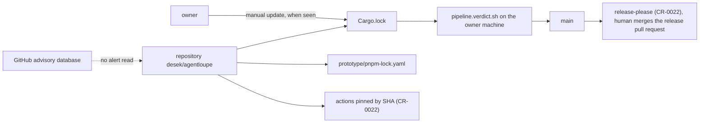
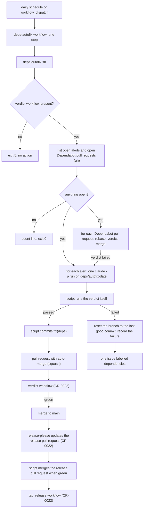
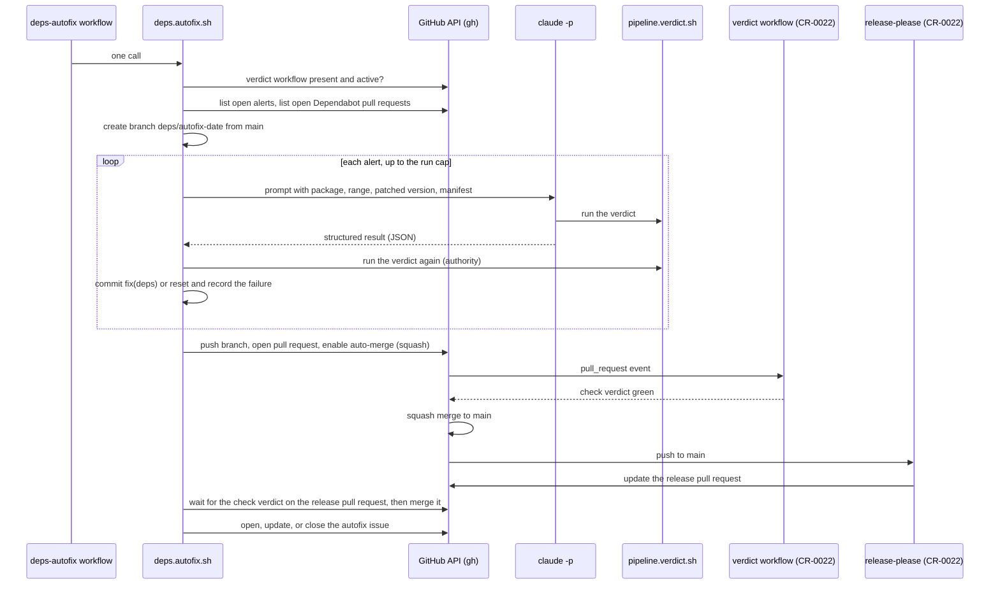
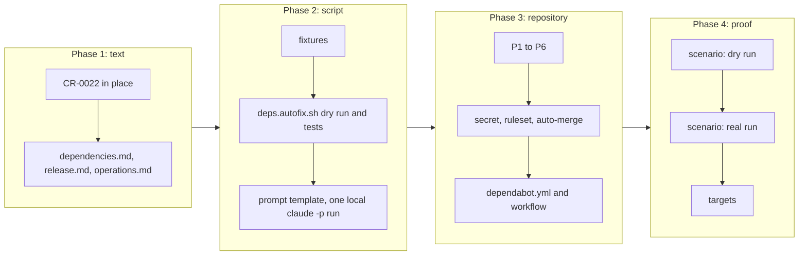

# Dependency autofix

## Change Summary

Today, no automation looks at the dependencies of the project. A vulnerable crate stays in `Cargo.lock` until the owner sees it. This CR adds a daily workflow that calls one script, `.agents/scripts/deps.autofix.sh`. The script finds the open Dependabot security alerts and the open Dependabot pull requests. For each alert, the script starts one headless Claude Code run that updates the dependency and runs the verdict. The script puts each green fix on one branch as a `fix(deps)` commit and opens one pull request with auto-merge. When the fix merges, release-please of CR-0022 updates the release pull request, and the script merges the release pull request when its checks are green. When a fix fails, the script writes the result into one issue. No human step is necessary.

## Motivation and Background

The owner wrote, on 2026-10-23: "Create a CR for a daily workflow that checks for open dependabot issues and uses Claude Code with CLAUDE_CODE_OAUTH_TOKEN to fix, test and release the changes required."

The owner then decided, on 2026-10-23:

1. **D1, Dependabot issue.** A Dependabot issue is an open Dependabot security alert or an open Dependabot version update pull request. Dependabot security alerts are enabled on the repository. A `dependabot.yml` declares version updates for `cargo` at the root, `npm` in `prototype`, and `github-actions`, each weekly.
2. **D2, no human.** The workflow runs with no human. Claude Code fixes on a branch, the verdict runs, and the pull request merges itself when green, as a fix commit. The release pull request of release-please merges itself when its checks are green. Thus a dependency fix becomes a release.
3. **D3, cost of the runners.** The repository becomes public at the first release (CR-0022). Thus the GitHub Actions minutes are free.

These three decisions and the facts of the repository below are the requirements. Where a decision leaves a detail open, this CR states a rule and names the detail a judgement call.

## Change Drivers

* A security advisory for a crate in `Cargo.lock` gets no action until the owner reads it. After the first release, a published binary can hold the vulnerable code for an unknown time.
* CR-0022 pins each external action by its commit SHA (CR-0022, requirement 21). CR-0022, Risk 9, states that a pinned action does not get its security fixes with no manual check.
* The owner has a Claude Code subscription. A headless run with the subscription token can do the update and the adaptation of the code that a plain version bump cannot do.
* A fix that does not become a release does not reach the users. CR-0022 makes a release from the commits on `main`, so a `fix(deps)` commit on `main` is enough to start a patch release.

## Current State

* The dependencies of the project are:
  * the crates in `Cargo.lock` (root, ecosystem `cargo`);
  * the npm packages of `prototype/`, with `prototype/package.json` and `prototype/pnpm-lock.yaml`, managed with pnpm (the `packageManager` field of `prototype/package.json` names the pnpm version);
  * the external actions of the workflows of CR-0022, pinned by SHA;
  * the vendored LiteLLM price file under `vendor/litellm/`, refreshed by `.agents/scripts/prices.vendor.sh`. It is not a Dependabot ecosystem.
* The repository has no `.github/` directory, no `dependabot.yml`, and no workflow. CR-0022 adds the first three workflows: the verdict workflow, the release-please workflow, and the release workflow.
* The pipeline entry points are `.agents/scripts/pipeline.*.sh`, and `pipeline.verdict.sh` runs them (`docs/specification/operations.md`, section "Pipeline"). The test stage can take up to 10 minutes. A change to `Cargo.lock` needs `cargo build` and the verdict.
* The verdict does not read `prototype/`. No stage builds or tests the prototype.
* Every script in `.agents/scripts/` follows `agent_first_cli`: the `@agents-index` line, a docstring, `--help`, machine output by default, `--human`, actionable errors on stderr, and documented exit codes.
* The proxy of this product captures the calls of Claude Code and Pi on the machine of the owner. A Claude Code run on a GitHub runner does not go through the proxy, so the dashboard does not show it.
* CR-0022 lists "Automatic dependency update pull requests for the pinned actions" and "A rule of branch protection on `main`" as out of scope. This CR adds both, in the limits that the section "Scope Boundaries" states.

### Current State Diagram



## Proposed Change

1. Add `.github/dependabot.yml` with weekly version updates for `cargo` at `/`, `npm` at `/prototype`, and `github-actions` at `/` (D1).
2. Add the script `.agents/scripts/deps.autofix.sh` and its prompt template `.agents/scripts/deps.autofix.prompt.md`. The script holds all the logic of the flow.
3. Add the workflow `.github/workflows/deps-autofix.yml`. It is a thin caller in the sense of CR-0022, requirements 19 to 22. It starts on a daily schedule and on `workflow_dispatch`, installs the tools, and calls the script in one step.
4. Add a repository ruleset on `main` that requires the check `verdict` of the CR-0022 verdict workflow for a pull request, with the repository admin in the bypass list. Turn on the repository setting "Allow auto-merge". Thus auto-merge waits for the verdict, and the owner can still commit to `main` directly.
5. Add the specification file `docs/specification/dependencies.md`, and change `docs/specification/release.md` of CR-0022 for the automatic merge of the release pull request.

### Proposed State Diagram



### Run Sequence



## Requirements

### Functional Requirements

**Dependabot configuration (D1)**

1. `.github/dependabot.yml` **MUST** declare version updates for three ecosystems: `cargo` with the directory `/`, `npm` with the directory `/prototype`, and `github-actions` with the directory `/`. Each **MUST** have the interval `weekly`. *(Amended by CR-0024: see "Amendment by CR-0024", item 1.)*
2. The Dependabot configuration **MUST** set a commit message prefix, so that the title of each Dependabot pull request is a Conventional Commit. The `cargo` and `npm` updates **MUST** give the form `fix(deps): ...`. The `github-actions` updates **MUST** give the form `ci(deps): ...` (judgement call 13). *(Amended by CR-0024: see "Amendment by CR-0024", item 1.)*
3. Dependabot security alerts **MUST** be on for the repository. The script **MUST** check this at start through the list call of the Dependabot alerts with the read token of P1, whose error names disabled alerts (the endpoint of the repository setting needs the administration permission, which no token of this flow holds), and stop with an actionable error when the alerts are off.

**Workflow**

4. The workflow `.github/workflows/deps-autofix.yml` **MUST** start on a daily schedule and on `workflow_dispatch`. The schedule time is judgement call 1.
5. The workflow **MUST** have one concurrency group for all its runs, so that at most one run is active. A new run **MUST NOT** cancel an active run.
6. The workflow job **MUST** have a timeout. The value is judgement call 4.
7. The workflow **MUST** request these permissions of the `GITHUB_TOKEN`, and no others: `contents: write`, `pull-requests: write`, `issues: write`, `security-events: read`, `actions: read`, and `checks: read`. The read of the Dependabot alerts is parameter P1.
8. The workflow **MUST** be a thin caller per CR-0022, requirements 19 to 22. It **MUST** call `deps.autofix.sh` in exactly one step. The workflow file **MUST NOT** hold the schedule logic of the fix, a tool version, a model name, a limit other than the job timeout of requirement 6, a branch name, or a label.
9. The workflow **MUST** install the Rust toolchain from `rust-toolchain.toml`, and Node, `cargo-nextest`, and Claude Code from `.tool-versions` (judgement call 3), in the same way as the verdict workflow of CR-0022. *(Amended by CR-0024: see "Amendment by CR-0024", item 5.)*
10. The workflow **MUST** give the secret `CLAUDE_CODE_OAUTH_TOKEN` to the script step only, as an environment variable. It **MUST NOT** give it to another step. This extends CR-0022, requirement 22, by one repository secret for this workflow only; the target "New repository secrets" of CR-0022 becomes exactly 2, `RELEASE_PLEASE_TOKEN` and `CLAUDE_CODE_OAUTH_TOKEN`.

**Precondition**

11. The script **MUST** stop with exit code 5 and an actionable error, before any API write and before any `claude -p` run, when the verdict workflow of CR-0022 is absent from the checked-out tree or is not active on the repository. The error **MUST** name CR-0022 and the file of the verdict workflow.
12. The script **MUST** stop with exit code 3 and an actionable error, before any run, when `gh`, `git`, `claude`, `cargo`, or `corepack` is missing (`pnpm` comes through corepack, judgement call 9), or when `CLAUDE_CODE_OAUTH_TOKEN` or the GitHub token is empty. The error **MUST** name the missing item and not its value.

**Discovery**

13. The script **MUST** list the open Dependabot security alerts of the repository with the GitHub REST API through the `gh` CLI. For each alert, it **MUST** read the alert number, the advisory identifier (GHSA), the ecosystem, the package name, the vulnerable version range, the first patched version, the manifest path, and the severity.
14. The script **MUST** list the open pull requests whose author is Dependabot, through the `gh` CLI. For each, it **MUST** read the number, the head commit, the title, the changed files, and the state of the check `verdict`.
15. When an alert and an open Dependabot pull request name the same package and the pull request moves it to a version at or above the first patched version, the script **MUST** handle the item once, through the pull request path.
16. When no alert and no Dependabot pull request is open, the script **MUST** print one count line with zero alerts and zero pull requests and exit with code 0. It **MUST NOT** create a branch, a pull request, or an issue, and **MUST NOT** start `claude -p`.
17. An alert with no first patched version **MUST NOT** start a `claude -p` run. The script **MUST** record it in the autofix issue with the reason `no_patched_version`.

**Fix of an alert**

18. For each open alert, the script **MUST** start at most one `claude -p` run in the same workflow run. The run **MUST** use the subscription token in `CLAUDE_CODE_OAUTH_TOKEN`, the model of judgement call 2, a turn limit, a budget limit (judgement call 4, parameter P3), and a process timeout of judgement call 4, after which the script ends the process and counts the item as `failed` with the reason `timeout`.
19. The prompt **MUST** come from `.agents/scripts/deps.autofix.prompt.md` with the alert fields filled in: the package, the ecosystem, the vulnerable range, the first patched version, the manifest path, and the advisory identifier. The prompt **MUST** tell Claude Code to update the dependency in the manifest and in the lock file, to run `.agents/scripts/pipeline.verdict.sh`, to change code only when the verdict fails because of the update, and to end with one JSON object as its structured result.
20. The structured result **MUST** hold the fields `status` (`fixed` or `failed`), `package`, `from_version`, `to_version`, `files_changed`, `verdict` (`passed` or `failed`), and `reason`. The script **MUST** treat a missing, unparsable, or incomplete result as `failed`.
21. Claude Code **MUST NOT** commit, push, or call the GitHub API. The script **MUST** give the `claude -p` process no GitHub token. The checkout **MUST NOT** persist a credential in the git configuration, and the script **MUST** give a token to git only for its own push, so that no file in the tree or in `.git/` holds a GitHub token while `claude -p` runs. The tool allowlist of the run is judgement call 5.
22. After each `claude -p` run, the script **MUST** check the diff. A diff that changes a path outside the allowed paths of judgement call 6 **MUST** count as `failed` with the reason `path_not_allowed`. A diff that holds a match of the credential patterns of the section "Measurable Targets" or the value of a token of the run **MUST** count as `failed` with the reason `credential_in_diff`, and the script **MUST NOT** write the matched text anywhere.
23. After each `claude -p` run with the status `fixed`, the script **MUST** run `pipeline.verdict.sh` itself, with no GitHub token and no `CLAUDE_CODE_OAUTH_TOKEN` in its environment. Only a verdict with exit code 0 in this script run counts as passed. For an update in `prototype/`, the script **MUST** also install with the frozen lock file and build the prototype (judgement call 9).
24. When the check of requirement 23 passes, the script **MUST** make one commit on the autofix branch. The summary **MUST** have the form `fix(deps): bump <package> to <version> (<GHSA id>)`. The script, not Claude Code, writes the message from the alert data. *(Amended by CR-0024: see "Amendment by CR-0024", item 2.)*
25. When a fix fails, the script **MUST** reset the autofix branch to its last good commit, record the failure, and continue with the next item. It **MUST NOT** start a second `claude -p` run for the same alert in the same workflow run.

**Dependabot pull requests**

26. For each open Dependabot pull request, the script **MUST** first bring it up to date with `main` when it is behind, through the rebase command of Dependabot, and wait for the new head commit with a cap.
27. When the check `verdict` of the up-to-date head commit is green, the script **MUST** enable auto-merge with squash on the pull request.
28. When the check `verdict` fails, the script **MUST** hand the update to one `claude -p` run on the autofix branch, with the same rules as requirements 18 to 25. The prompt names the package and the target version of the pull request. When that fix passes, the script **MUST** close the Dependabot pull request with a comment that links the autofix pull request. When it fails, the script **MUST** leave the Dependabot pull request open and record the failure (judgement call 10).
29. The script **MUST NOT** merge a `github-actions` pull request whose diff replaces a 40-character commit SHA with a tag or a branch name (CR-0022, requirement 21).

**Branch, pull request, and merge**

30. All fixes of one workflow run **MUST** land on one branch `deps/autofix-<YYYY-MM-DD>`, with the date of the run in UTC, created from the head of `main`. When the branch exists from an earlier run on the same day, the script **MUST** reuse it.
31. When the branch holds one or more fix commits, the script **MUST** push it and open one pull request to `main`, or update the open pull request of that branch. The title and the body are judgement call 7.
32. The script **MUST** enable auto-merge with the squash method on the autofix pull request. The pull request **MUST** merge only when the check `verdict` of CR-0022 is green, through the ruleset of requirement 45. When the check of parameter P4 shows that the token of P2 bypasses the ruleset, the script **MUST NOT** enable auto-merge; it **MUST** instead wait for the check `verdict` of the head commit with the wait cap of judgement call 4 and merge with squash only when it is green.
33. The squash commit of the autofix pull request **MUST** be a `fix(deps)` commit, so that release-please of CR-0022 proposes a patch release. When the pull request holds more than one fix, the squash body **MUST** hold one `fix(deps)` line for each fix, so that each fix shows in the changelog (parameter P6). *(Amended by CR-0024: see "Amendment by CR-0024", item 2.)*
34. The script **MUST NOT** push to `main`. Each change to `main` **MUST** come through a pull request merge.

**Release pull request (D2)**

35. After it enables auto-merge, the script **MUST** wait for the merge of the autofix pull request with the wait cap of judgement call 4, and record `release_pending` when the merge does not come before the cap. When the run merged at least one `fix(deps)` commit, the script **MUST** do this step: wait for the release-please workflow run on the merge commit to end, find the one open release pull request of CR-0022 by its title form `chore(release): release <version>`, check that its base holds the merge commit, wait for the check `verdict` on its head commit with a cap, and merge it with squash when the check is green.
36. The script **MUST NOT** merge a release pull request that proposes `1.0.0` or a new major version. It **MUST** record such a case in the autofix issue as `release_needs_human`.
37. When the check `verdict` of the release pull request does not become green before the cap, the script **MUST** record `release_pending` in its output and leave the pull request open. The next run **MUST** do the step of requirement 35 again for that pull request; it finds it as the open release pull request whose changelog section lists a `fix(deps)` change.

**Failure issue**

38. When one or more items fail in a run, the script **MUST** open one issue, or comment on the open one, with the label `dependencies` and the title of judgement call 8. The text **MUST** hold, for each failed item: the alert or pull request, the package, the reason, the structured result, the link to the workflow run, and the last lines of the log after the redaction of requirement 41.
39. There **MUST** be at most one open autofix issue. When a run ends with no failure and the issue is open, the script **MUST** comment with the run link and close it.
40. A failed item **MUST NOT** start a new `claude -p` run in a later workflow run until its input changes or the hold time of judgement call 11 ends.

**Secrets and logs**

41. The script **MUST NOT** print `CLAUDE_CODE_OAUTH_TOKEN` or a GitHub token on stdout, on stderr, in a log file, in an issue, in a pull request, or in a commit. Before the script writes a log extract to an issue, it **MUST** remove each match of the credential patterns of the section "Measurable Targets".

**Script interface**

42. `deps.autofix.sh` **MUST** follow `agent_first_cli`: the `@agents-index` line, a docstring with purpose, usage, and parameters, a complete `--help`, machine output on stdout by default (one `key: value` line per item and one summary line), `--human` for the friendly view, and actionable errors on stderr.
43. `deps.autofix.sh --dry-run` **MUST** do the discovery and print each action that it would do: the item, the path (alert or pull request), the branch, the prompt fields, the merge, and the issue action. It **MUST NOT** start `claude -p`, write to the tree, push, or write to the GitHub API.
44. The script **MUST** document and use these exit codes: 0 for a run with no failure (nothing open, or every item fixed or merged), 1 for a run with one or more failed items and the issue written, 2 for a usage error, 3 for a missing tool or credential, 4 for a GitHub API failure, and 5 for an absent verdict workflow.

**Repository settings**

45. A repository ruleset on `main` **MUST** require the status check `verdict` for a pull request, with the repository admin in the bypass list. The repository setting "Allow auto-merge" **MUST** be on (parameter P4). *(Amended by CR-0024: see "Amendment by CR-0024", item 3.)*

**Documentation**

46. The new file `docs/specification/dependencies.md` **MUST** state: the meaning of a Dependabot issue (D1), the ecosystems and their directories, the flow of a run, the prompt fields, the structured result, the allowed paths, the limits, the branch and commit forms, the release pull request step, the issue, the exit codes, the tokens, the hold time, and the known gap of non-functional requirement 6.
47. `docs/specification/release.md` (from CR-0022) **MUST** change in two places: the release flow names the automatic merge of the release pull request of requirements 35 to 37, and the rule for commit types names `fix(deps)` and `ci(deps)`.
48. `docs/specification/operations.md` **MUST** change in two sections: "Pipeline" (the deps-autofix workflow in the subsection on the hosted workflows of CR-0022) and "Measurable targets" (the rows of this CR, and the row "New repository secrets" of CR-0022 per requirement 10).
49. `docs/specification/index.md` **MUST** get one row for `dependencies.md`.
50. `.taxonomy` **MUST** get rows for the terms "Dependabot issue", "autofix branch", "autofix issue", and "structured result".

### Non-Functional Requirements

1. The pipeline entry points, `pipeline.verdict.sh`, and the fingerprint script **MUST NOT** change.
2. The verdict workflow, the release-please workflow, and the release workflow of CR-0022 **MUST NOT** change, except for the ruleset name of the check `verdict` when the implementation of CR-0022 gives it another name. *(Amended by CR-0024: see "Amendment by CR-0024", item 4.)*
3. The project **MUST NOT** use a paid service other than the Claude Code subscription of the owner. The runners are free for a public repository (D3).
4. The count of credentials in the workflow logs, the issues, and the pull requests of this flow **MUST** be zero.
5. Each workflow run **MUST** end in one of three states: nothing open (exit 0), every item merged or set to auto-merge (exit 0), or an issue that holds each failed item (exit 1). A run that ends with exit code 3, 4, or 5 **MUST** show as failed in GitHub Actions.
6. The CR **MUST** state a known gap: a `claude -p` run on a GitHub runner does not go through the proxy of this product, so the dashboard does not show its calls and its cost. The script output records the tokens and the cost of each run instead. A route of the CI run through a hosted proxy is a later option (section "Scope Boundaries").
7. The targets of the section "Measurable Targets" **MUST** hold.

## Measurable Targets

"None" in the baseline column means that the metric does not exist before this CR.

| Metric | Method | Baseline | Threshold |
|---|---|---|---|
| Time of one run with nothing open | the duration of the run, from `createdAt` to `updatedAt` of `gh run view <run id> --json createdAt,updatedAt`, on a run whose summary line counts zero alerts and zero pull requests | none, no workflow | at most 5 minutes |
| Time of one run with one alert | the same method, on a run with exactly one alert and no Dependabot pull request, from the start to the merge of the release pull request | none, no workflow | at most 120 minutes |
| Credentials in logs | for each run of the model-based test: download the run log with `gh run view <run id> --log`, the issue text, and the pull request text, then run `gitleaks` on them and count the matches of the patterns `sk-ant-`, `ghp_`, `github_pat_`, `gho_`, `ghs_`, and the literal value of each secret on the machine of the owner | none, no workflow | 0 findings and 0 matches |
| Share of runs with a defined end | over the first 14 scheduled runs: count the runs that end with exit 0 and a count line of zero, with a merged or auto-merge fix, or with exit 1 and an updated issue; divide by the count of runs | none, no workflow | 14 of 14 (every run) |
| Tokens of one `claude -p` run | the fields `input_tokens`, `cache_creation_input_tokens`, `cache_read_input_tokens`, and `output_tokens` of the JSON result of the run, printed by the script on its item line | none, no run | recorded for each run; no threshold for the first 14 runs |
| API-equivalent cost of one `claude -p` run | the token counts of the row above and the model of the run, priced with the rules of `docs/specification/cost.md` and the vendored price file, as the dashboard of this product shows a cost; compared with the field `total_cost_usd` of the JSON result | none, no run | at most the budget of judgement call 4 for each run; the two values differ by at most 5 percent, or the difference has a stated reason in `dependencies.md` |

## Affected Components

New files:

* `.github/dependabot.yml`: the Dependabot configuration (requirements 1 and 2).
* `.github/workflows/deps-autofix.yml`: the thin caller (requirements 4 to 10).
* `.agents/scripts/deps.autofix.sh`: the logic of the flow (requirements 11 to 44).
* `.agents/scripts/deps.autofix.prompt.md`: the prompt template (requirement 19).
* `docs/specification/dependencies.md`: the specification (requirement 46).
* `.agents/scenarios/deps.autofix.md`: the scenario of the section "Model-Based Testing".
* A test file for the script with recorded API responses, for example `tests/deps.autofix.rs`, its fixtures under `tests/fixtures/deps/`, and its `[[test]]` entry in `Cargo.toml`.

Changed files:

* `.tool-versions`: one line for Claude Code (judgement call 3).
* `docs/specification/release.md`: the release flow and the rule for commit types (requirement 47).
* `docs/specification/operations.md`: the sections "Pipeline" and "Measurable targets" (requirement 48).
* `docs/specification/index.md`: one new row.
* `.taxonomy`: four new rows.

Repository settings (no file):

* The ruleset on `main` and the setting "Allow auto-merge" (requirement 45).
* The secret `CLAUDE_CODE_OAUTH_TOKEN`, which the owner makes with `claude setup-token`.
* The permissions of the secret `RELEASE_PLEASE_TOKEN` of CR-0022, per parameters P1 and P2.

Not changed:

* `.agents/scripts/pipeline.*.sh`, `pipeline.verdict.sh`, and the fingerprint script.
* `vendor/litellm/` and `.agents/scripts/prices.vendor.sh`.
* The three workflows of CR-0022, `release-please-config.json`, and `.release-please-manifest.json`.
* `Dockerfile`, `compose.yaml`, `README.md`, the binary, the public API, and the dashboard.

## Scope Boundaries

### In Scope

* The three decisions of the owner.
* The Dependabot configuration, the daily workflow, the script, the prompt template, and their tests.
* The automatic merge of the autofix pull request, of the green Dependabot pull requests, and of the release pull request.
* The ruleset on `main` and the setting "Allow auto-merge", as far as auto-merge needs them.
* The specification text of the flow.

### Out of Scope ("Here, But Not Further")

* A change to the pipeline scripts (non-functional requirement 1).
* An update of the vendored price file under `vendor/litellm/`. It is not a Dependabot ecosystem, and `prices.vendor.sh` stays a manual step.
* A deploy of a release to a host. CR-0022 keeps deploy out of scope.
* A change to the three workflows of CR-0022, to the release-please configuration, or to the release rules of CR-0022, other than the two places of requirement 47.
* A route of the `claude -p` runs through a hosted proxy, so that the dashboard shows them. This needs a public host of the proxy, which `README.md` keeps out of scope. A follow-up CR can add it.
* Dependabot security updates (the automatic pull requests for alerts). The script fixes the alerts. When the owner turns security updates on later, requirement 15 handles the overlap.
* A required review or a second human approver on `main`.
* An update of the pin of Claude Code in `.tool-versions`. Dependabot does not read `.tool-versions`. The owner updates it by hand.
* A fix of a code scanning alert or a secret scanning alert.

## Alternative Approaches Considered

* **Dependabot security updates with auto-merge only, no Claude Code.** Rejected. A bump that breaks the build or a test stays open, and a transitive crate with no direct manifest entry often needs a change to a parent crate. D2 asks for a fix with no human.
* **Logic in the workflow file.** Rejected. CR-0022 makes every workflow a thin caller, and the script can run with `--dry-run` on the machine of the owner.
* **One branch and one pull request per alert.** Rejected. Each pull request runs the verdict workflow and starts its own release pull request update. One branch per run makes one patch release per day at most. The owner asked for one branch `deps/autofix-<date>`.
* **Claude Code commits and pushes.** Rejected. The script writes the commit message from the alert data, runs its own verdict, and holds the GitHub token. Claude Code gets no GitHub token, so a prompt injection cannot push.
* **The Claude Code GitHub Action.** Rejected for the default. The action holds its own logic and inputs in the workflow file. A plain `claude -p` call in the script keeps the logic in the repository and runs the same on the machine of the owner.
* **An API key in place of the subscription token.** Rejected. The owner chose `CLAUDE_CODE_OAUTH_TOKEN`, and an API key is a paid service (non-functional requirement 3).

## Impact Assessment

### User Impact

A user gets a patch release with the fixed dependency, with no action of the owner. The changelog shows each `fix(deps)` line. The binary, the API, and the dashboard do not change.

### Technical Impact

* One workflow, one Dependabot file, one script, one prompt template, one test file with fixtures, and one specification file.
* `main` gets a ruleset. The owner keeps direct commits through the bypass.
* Releases can come at any day. A release that the owner did not start can carry the pending `feat` commits of the owner (judgement call 12).
* The test stage reads `.agents/scripts`, so the new script changes the fingerprint of the test stage one time.

### Business Impact

The cost stays the subscription of the owner and zero for the runners (D3). Each `claude -p` run uses part of the usage limit of the subscription. The budget and the run cap of judgement call 4 limit this.

## Implementation Approach

1. Confirm that CR-0022 is implemented: the verdict workflow, the release-please workflow, and the release workflow run on the repository, and the repository is public.
2. Write `docs/specification/dependencies.md` and change `release.md`, `operations.md`, `index.md`, and `.taxonomy`.
3. Record the fixtures: the JSON of an alert list, an empty list, a Dependabot pull request list, and a `claude -p` JSON result, with no credential in them.
4. Write `deps.autofix.sh` with `--dry-run` and `--help` first, and the test file against the fixtures.
5. Write the prompt template and run one `claude -p` run on the machine of the owner on a scratch branch.
6. Resolve parameters P1 to P6. Set the secret, the token permissions, the ruleset, and "Allow auto-merge".
7. Add `.github/dependabot.yml` and the workflow.
8. Run the scenario `deps.autofix.md`.
9. Record the measured values in `operations.md`, section "Measurable targets".
10. Make the implemented commit per CR-0022, requirement 10: `feat(deps): Dependency autofix (CR-0023)`.

### Implementation Flow



## Test Strategy

### Tests to Add

| Test File | Test Name | Description | Inputs | Expected Output |
|---|---|---|---|---|
| `tests/deps.autofix.rs` | `nothing_open_prints_zero_and_exits_0` | No item gives one count line and no action. | fixture: empty alert list, empty pull request list, `--dry-run` | count line with 0 and 0, exit code 0, no action line |
| `tests/deps.autofix.rs` | `dry_run_lists_actions_for_alert` | An alert gives the planned branch, prompt fields, and merge. | fixture: one cargo alert with a patched version | action lines with the package, the range, the patched version, the manifest, `deps/autofix-<date>`; no write |
| `tests/deps.autofix.rs` | `alert_with_pr_is_handled_once` | An alert and a matching Dependabot pull request give one item. | fixture: one alert and one pull request for the same package at the patched version | one item line with the path `pull_request` |
| `tests/deps.autofix.rs` | `no_patched_version_starts_no_run` | An alert with no patched version is recorded, not fixed. | fixture: one alert with no patched version | item line with `no_patched_version`, no `claude` action |
| `tests/deps.autofix.rs` | `absent_verdict_workflow_exits_5` | The precondition holds. | a temporary tree with no verdict workflow file | exit code 5, error names CR-0022 |
| `tests/deps.autofix.rs` | `missing_token_exits_3_without_value` | A missing credential is named, not printed. | empty `CLAUDE_CODE_OAUTH_TOKEN`, a test GitHub token value | exit code 3, error names the variable, output holds no test token value |
| `tests/deps.autofix.rs` | `invalid_result_counts_as_failed` | A bad structured result fails the item. | fixture: a `claude -p` result with no JSON object | item status `failed`, reason `invalid_result` |
| `tests/deps.autofix.rs` | `path_outside_allowlist_fails` | The diff guard holds. | a fixture diff that changes a file under `.github/` | item status `failed`, reason `path_not_allowed` |
| `tests/deps.autofix.rs` | `commit_summary_form` | The commit summary names the package, the version, and the advisory. | alert fixture | `fix(deps): bump <package> to <version> (<GHSA id>)` |
| `tests/deps.autofix.rs` | `redaction_removes_credentials` | The issue extract holds no credential. | a log fixture with test values of each pattern | 0 matches in the extract |
| `tests/deps.autofix.rs` | `release_pr_major_not_merged` | The guard of requirement 36 holds. | fixture: release pull request title `chore(release): release 1.0.0` | `release_needs_human`, no merge action |
| `tests/deps.autofix.rs` | `actions_pr_sha_to_tag_refused` | The guard of requirement 29 holds. | fixture diff that replaces a SHA with a tag | no merge action, reason `pin_not_sha` |

The tests run the script with a fixture directory in place of the GitHub API and of `claude`, so the test stage stays hermetic. The fixture mode is a documented flag of the script for tests only.

### Tests to Modify

Not applicable. No existing test covers dependencies or a workflow of this flow. If an existing test checks that each script under `.agents/scripts/` follows `agent_first_cli`, it covers `deps.autofix.sh` with no change.

### Tests to Remove

Not applicable. The CR removes no behavior.

## Model-Based Testing

The change has a user surface: the GitHub Actions run, the pull requests, the issue, and the release. A model can follow the steps with `gh` and the shell, and a human can follow them in a browser. Persist the scenario as `.agents/scenarios/deps.autofix.md`, with the observed values. The real runs need the consent of the owner, recorded in the scenario with the date.

**Part A: dry run.**

1. On a scratch branch `deps/scenario-<date>`, add a crate at a version with a known GitHub advisory and a known patched version to `Cargo.toml`, and update `Cargo.lock`. The crate and the advisory are named in the scenario.
2. Push the scratch branch to a fork, or to the repository with the consent of the owner. Wait until the Dependabot alert for that crate is open on that repository.
3. Run `deps.autofix.sh --dry-run` against that repository.
4. Check that the output names the alert, the package, the vulnerable range, the patched version, the manifest, the branch `deps/autofix-<date>`, and the planned merge.
5. Check that no branch, pull request, issue, or commit was made, and that no `claude -p` process started.

**Part B: real run with one alert.**

6. Start the workflow with `workflow_dispatch` on the same repository.
7. Check that one run is active and that a second dispatch waits in the concurrency group.
8. Check that the branch `deps/autofix-<date>` has one `fix(deps)` commit that names the crate, the patched version, and the advisory, and that the diff changes only allowed paths.
9. Check that the autofix pull request has auto-merge with squash, and that it merges only after the check `verdict` is green.
10. Check that the alert closes after the merge.
11. Check that release-please updates the release pull request with a patch version, and that the script merges it when its check `verdict` is green.
12. Check that the tag and the release of CR-0022 follow.
13. Record the run time, the tokens, and the API-equivalent cost of the `claude -p` run.

**Part C: Dependabot pull request.**

14. With an open Dependabot version update pull request (or one that `workflow_dispatch` finds after the first weekly run), run the workflow. Check that the script rebases it when it is behind, and enables auto-merge when the check `verdict` is green.

**Part D: failure path.**

15. Seed an alert whose fix cannot pass, for example a scratch crate whose patched version needs a change outside the allowed paths, or run with a turn limit of 1 set through the documented flag of the script.
16. Check that the branch holds no commit for that item, that one issue with the label `dependencies` holds the item, the reason, the result, and the run link, and that a second run on the same day does not start `claude -p` for that item.

**Part E: credentials.**

17. Run the method of the row "Credentials in logs" over each run of Parts B to D.

Success condition: each check passes in one run of each part. Part A passes in 2 of 2 runs.

## Acceptance Criteria

### AC-1: Dependabot declares the three ecosystems (requirements 1 and 2)

*Amended by CR-0024: see "Amendment by CR-0024", item 1.*

```gherkin
Given the tree after the CR
When a reader opens .github/dependabot.yml
Then it declares cargo at "/", npm at "/prototype", and github-actions at "/"
And each has the interval weekly
And a cargo or npm pull request title starts with "fix(deps):"
And a github-actions pull request title starts with "ci(deps):"
```

### AC-2: The script checks that alerts are on (requirement 3)

```gherkin
Given a repository with Dependabot alerts turned off
When deps.autofix.sh runs
Then it stops with an actionable error that names the setting
And it starts no claude -p run
```

### AC-3: The workflow starts daily and by hand, one run at a time (requirements 4 to 6)

```gherkin
Given the deps-autofix workflow
When the schedule time comes or a person starts workflow_dispatch
Then one run starts
When a second start comes while a run is active
Then the second run waits and does not cancel the active run
And the job has a timeout
```

### AC-4: The workflow has the stated permissions (requirement 7)

```gherkin
Given the deps-autofix workflow file
When a reviewer reads its permissions
Then they are contents write, pull-requests write, issues write, security-events read, actions read, and checks read
And no other permission is set
And the read of the Dependabot alerts uses the token that parameter P1 names
```

### AC-5: The workflow is a thin caller (requirements 8 to 10)

```gherkin
Given the deps-autofix workflow file
When a reviewer reads each step
Then each step is a checkout, a toolchain install from the pin files, a cache, or the one call of deps.autofix.sh
And the file holds no tool version, model name, branch name, or label, and no limit other than the job timeout
And the checkout persists no credential in the git configuration
And only the step of the script gets CLAUDE_CODE_OAUTH_TOKEN
```

### AC-6: No run without the verdict workflow (requirement 11)

```gherkin
Given a tree with no verdict workflow of CR-0022
When deps.autofix.sh runs
Then it exits with code 5
And the error names CR-0022 and the verdict workflow file
And it made no API write and started no claude -p run
```

### AC-7: A missing tool or credential stops the run (requirement 12)

```gherkin
Given CLAUDE_CODE_OAUTH_TOKEN is empty
When deps.autofix.sh runs
Then it exits with code 3
And the error names CLAUDE_CODE_OAUTH_TOKEN
And no output holds a credential value
```

### AC-8: Discovery reads the alerts and the pull requests (requirements 13 to 15)

```gherkin
Given one open alert for crate A and one open Dependabot pull request for crate B
When deps.autofix.sh --dry-run runs
Then the item for A shows the alert number, GHSA id, ecosystem, package, range, patched version, manifest, and severity
And the item for B shows the number, head commit, title, changed files, and the state of the check verdict
Given an alert for crate C and a Dependabot pull request that moves C to the patched version
When deps.autofix.sh --dry-run runs
Then C has one item with the path pull_request
```

### AC-9: Nothing open gives a count line and exit 0 (requirement 16)

```gherkin
Given no open alert and no open Dependabot pull request
When deps.autofix.sh runs
Then it prints one count line with 0 alerts and 0 pull requests
And it exits with code 0
And no branch, pull request, or issue exists from this run
And no claude -p process started
```

### AC-10: No patched version, no run (requirement 17)

```gherkin
Given an open alert with no first patched version
When deps.autofix.sh runs
Then the alert starts no claude -p run
And the autofix issue holds the alert with the reason no_patched_version
```

### AC-11: One claude -p run per alert with limits (requirements 18 to 21)

```gherkin
Given one open alert for a crate with a patched version
When deps.autofix.sh runs
Then exactly one claude -p run starts for the alert
And the run uses the model, the turn limit, the budget limit, and the process timeout of dependencies.md
When the run passes the process timeout
Then the script ends the process and the item has the status failed and the reason timeout
And the prompt names the package, the ecosystem, the range, the patched version, the manifest, and the GHSA id
And the claude -p process has no GitHub token in its environment
And the run ends with a structured result with status, package, from_version, to_version, files_changed, verdict, and reason
Given a result with no valid JSON object
Then the item has the status failed and the reason invalid_result
```

### AC-12: The script is the authority for the diff and the verdict (requirements 22 and 23)

```gherkin
Given a claude -p run that reports fixed and changes a file under .github/
When the script checks the diff
Then the item fails with the reason path_not_allowed
Given a claude -p run whose diff holds a test value of a credential pattern
When the script checks the diff
Then the item fails with the reason credential_in_diff and no output holds the value
And pipeline.verdict.sh of the script runs with no GitHub token and no CLAUDE_CODE_OAUTH_TOKEN in its environment
Given a claude -p run that reports fixed and changes only allowed paths
When the script runs pipeline.verdict.sh itself
Then the item counts as fixed only when that verdict exits with code 0
And for an update in prototype the frozen install and the build of the prototype also pass
```

### AC-13: A fix is one fix(deps) commit by the script (requirement 24)

*Amended by CR-0024: see "Amendment by CR-0024", item 2.*

```gherkin
Given a fixed alert for crate "foo" at version 1.2.4 with advisory GHSA-xxxx-xxxx-xxxx
When the script commits
Then the branch gets one commit with the summary "fix(deps): bump foo to 1.2.4 (GHSA-xxxx-xxxx-xxxx)"
And Claude Code made no commit and no push
```

### AC-14: A failed fix does not stay and is not retried (requirements 25 and 40)

```gherkin
Given two alerts, where the first fix fails and the second fix passes
When deps.autofix.sh runs
Then the branch holds only the commit of the second fix
And the first alert got exactly one claude -p run in this workflow run
When a second workflow run starts on the same day with no change to the first alert
Then the first alert starts no claude -p run
```

### AC-15: Dependabot pull requests merge when green (requirements 26, 27, and 29)

```gherkin
Given an open Dependabot pull request that is behind main
When deps.autofix.sh runs
Then the script asks Dependabot to rebase it and waits for the new head commit with a cap
When the check verdict of the new head commit is green
Then the pull request has auto-merge with squash
Given a github-actions pull request whose diff replaces a commit SHA with a tag
Then the script does not merge it and records the reason pin_not_sha
```

### AC-16: A red Dependabot pull request goes to Claude Code (requirement 28)

```gherkin
Given an open Dependabot pull request whose check verdict fails
When deps.autofix.sh runs
Then one claude -p run starts on the autofix branch for its package and target version
When that fix passes
Then the Dependabot pull request is closed with a comment that links the autofix pull request
When that fix fails
Then the Dependabot pull request stays open and the autofix issue holds it
```

### AC-17: One branch, one pull request, auto-merge (requirements 30 to 32)

```gherkin
Given a run on 2026-11-02 with two passed fixes
When the run pushes
Then the branch deps/autofix-2026-11-02 holds the two fix commits
And one pull request from that branch to main exists
And it has auto-merge with the squash method
And it merges only after the check verdict of CR-0022 is green
Given the check of P4 shows that the token of P2 bypasses the ruleset
When the run pushes
Then the script enables no auto-merge and merges with squash only after the check verdict of the head commit is green
```

### AC-18: The merge makes a patch release candidate (requirement 33)

```gherkin
Given the autofix pull request with two fixes merges
When release-please reads the squash commit on main
Then the squash commit summary has the type fix and the scope deps
And the body holds one fix(deps) line for each fix
And the release pull request proposes a patch version
And the changelog lists each fix
```

### AC-19: No direct push to main (requirement 34)

```gherkin
Given any run of the deps-autofix workflow
When a reviewer reads the push events of main in that time
Then each change to main is the merge of a pull request
And the script made no push to main
```

### AC-20: The release pull request merges itself when green (requirements 35 to 37)

```gherkin
Given a run that merged one fix(deps) commit
When the release-please workflow run on the merge commit ends
Then the script finds the release pull request with the title form "chore(release): release <version>"
And it waits for the check verdict of its head commit
When the check is green
Then the script squash merges the release pull request
Given a release pull request that proposes 1.0.0
Then the script does not merge it and the issue holds release_needs_human
Given a release pull request whose check is not green before the cap
Then the output holds release_pending and the next run does the step again
Given an autofix pull request that does not merge before the wait cap
Then the output holds release_pending
And the next run finds the open release pull request whose changelog lists a fix(deps) change and does the step for it
```

### AC-21: One issue holds the failures (requirements 38 and 39)

```gherkin
Given a run in which one item fails
When the run ends
Then one open issue with the label dependencies and the stated title holds the item, the package, the reason, the structured result, the run link, and a redacted log extract
And the script exits with code 1
Given a later run in which no item fails and the issue is open
When the run ends
Then the script comments with the run link and closes the issue
```

### AC-22: No credential in any output (requirement 41)

```gherkin
Given the runs of the model-based test
When gitleaks and the pattern search run over the run logs, the issue text, and the pull request text
Then the count of findings is 0
And the count of matches of each secret value is 0
```

### AC-23: The script follows agent_first_cli and has a dry run (requirements 42 to 44)

```gherkin
Given deps.autofix.sh
When it runs with --help
Then it prints the purpose, the usage, the parameters, and the exit codes 0, 1, 2, 3, 4, and 5
When it runs with --dry-run and stdout is not a terminal
Then it prints one key: value line for each planned action and one summary line
And it starts no claude -p run, writes no file, pushes nothing, and writes nothing to the GitHub API
When it runs with an unknown flag
Then it writes an actionable error on stderr and exits with code 2
```

### AC-24: Auto-merge waits for the verdict (requirement 45)

```gherkin
Given the ruleset on main that requires the check verdict, with the admin in the bypass list
And the setting Allow auto-merge is on
When auto-merge is enabled on a pull request whose check verdict is still running
Then the pull request does not merge until the check verdict is green
And the owner can still push a commit to main directly
```

### AC-25: The specification states the flow (requirements 46 to 50)

```gherkin
Given the tree after the CR
When a reader opens docs/specification/dependencies.md
Then it states the meaning of a Dependabot issue, the ecosystems, the flow, the prompt fields, the structured result, the allowed paths, the limits, the branch and commit forms, the release step, the issue, the exit codes, the tokens, the hold time, and the known gap of the proxy
And release.md names the automatic merge of the release pull request and the types fix(deps) and ci(deps)
And operations.md names the deps-autofix workflow and has the rows of this CR
And index.md has a row for dependencies.md
And .taxonomy has the rows Dependabot issue, autofix branch, autofix issue, and structured result
```

### AC-26: The pipeline and the CR-0022 workflows stay the same (non-functional requirements 1 and 2)

```gherkin
Given the diff of the implementation of this CR
When a reviewer reads it
Then no file .agents/scripts/pipeline.*.sh changes
And the fingerprint script does not change
And the three workflow files of CR-0022 do not change
```

### AC-27: Every run has a defined end (non-functional requirements 5 and 7)

```gherkin
Given the first 14 scheduled runs
When each run ends
Then each run ends with a zero count line, with a merged or auto-merge fix, or with an updated issue
And a run with exit code 3, 4, or 5 shows as failed in GitHub Actions
And a run with nothing open takes at most 5 minutes
And a run with one alert takes at most 120 minutes to the merge of the release pull request
```

### AC-28: The cost of a run is visible (non-functional requirements 3 and 6)

```gherkin
Given a run with one claude -p run
When the run ends
Then the item line holds the model, the four token counts, and the API-equivalent cost
And the cost is at most the budget of dependencies.md
And dependencies.md states that the dashboard does not show the runs on GitHub runners
And the run used no API key, and the billing usage of the account for GitHub Actions is 0 USD
```

## Quality Standards Compliance

### Build & Compilation

`cargo build` passes. A fix of a crate passes `cargo build` and the verdict in the script before its commit.

### Linting & Code Style

`.agents/scripts/pipeline.lint.sh` and `pipeline.format.sh` pass. `deps.autofix.sh` passes `bash -n` and follows the style of the existing scripts.

### Test Execution

`.agents/scripts/pipeline.test.sh` passes with the new test file, locally and in the verdict workflow of CR-0022.

### Documentation

`docs/specification/dependencies.md` and the changed sections of `release.md` and `operations.md` are written before the script.

### Code Review

A reviewer agent checks blocking findings only, with a focus on the thin caller rule, the permissions, the path of each credential, and the guards of requirements 22, 29, 34, and 36.

### Verification Commands

* `.agents/scripts/pipeline.verdict.sh`
* `.agents/scripts/deps.autofix.sh --help`
* `.agents/scripts/deps.autofix.sh --dry-run`
* `gh run list --workflow deps-autofix.yml --limit 14`
* `gh run view <run id> --log`, then `gitleaks` over the saved log
* `gh issue list --label dependencies --state all`

## Risks and Mitigation

### Risk 1: A fix breaks a behavior and no test fails

**Likelihood:** medium
**Impact:** high
**Mitigation:** The prompt tells Claude Code to change code only when the verdict fails because of the update. The diff guard limits the paths (judgement call 6). The verdict runs two times: in the script and in the verdict workflow. The release workflow of CR-0022 runs the verdict on the tag again. A release is a patch that a user can skip, and the next fix is a new patch. The owner sees each fix in the changelog.

### Risk 2: A runaway loop of runs, commits, or cost

**Likelihood:** low
**Impact:** medium
**Mitigation:** The workflow starts only on the schedule and on `workflow_dispatch`, never on a push or a pull request, so its own merges do not start it again. One concurrency group allows one run. Each item gets at most one `claude -p` run per workflow run, and a failed item waits for the hold time (requirement 40). The run cap, the turn limit, the budget, the process timeout, and the job timeout of judgement call 4 bound each run.

### Risk 3: The token of Claude Code expires or is revoked

**Likelihood:** medium (a token of `claude setup-token` has a fixed lifetime, parameter P5)
**Impact:** medium, no fix until a new token
**Mitigation:** The script detects an authentication error of `claude -p`, stops the remaining `claude -p` runs, writes the reason `claude_auth` and the command `claude setup-token` into the autofix issue, and exits with code 3. `dependencies.md` states the expiry date check and the rotation steps. The merge of green Dependabot pull requests continues, because it needs no Claude Code.

### Risk 4: A merge triggers the release of a broken binary

**Likelihood:** low
**Impact:** high
**Mitigation:** The release pull request merges only when its check `verdict` is green. The release workflow of CR-0022 runs the verdict on the tag before any build and publishes no asset when a build fails. The script refuses a major version and `1.0.0` (requirement 36). No deploy follows a release. A broken patch gets a new fix commit and a new patch release. CR-0022 `release.check.sh` stays the check of a release on the machine of the owner.

### Risk 5: A prompt injection through the data of a dependency

**Likelihood:** low
**Impact:** high
**Mitigation:** Claude Code gets no GitHub token and no web tool (judgement call 5). The script, not Claude Code, commits and pushes. The diff guard refuses `.github/`, `.agents/`, `docs/`, `vendor/`, and the `Dockerfile`. The verdict and the verdict workflow run on each change.

### Risk 6: The GitHub token cannot read the alerts or cannot start the workflows

**Likelihood:** high for the `GITHUB_TOKEN`
**Impact:** high
**Mitigation:** Parameters P1 and P2. GitHub does not start a workflow from an event that the `GITHUB_TOKEN` makes, so the push, the pull request, and the merges use the fine-grained token `RELEASE_PLEASE_TOKEN` of CR-0022. The script names the missing permission in its error.

### Risk 7: The verdict on the runner is slow or flaky

**Likelihood:** medium
**Impact:** medium
**Mitigation:** The script builds the crate one time before the first `claude -p` run, so later verdicts reuse the target directory. The workflow caches the cargo registry and the target directory with the same key as the verdict workflow of CR-0022. The Bash timeout of Claude Code is set above the time of the test stage (judgement call 4). A verdict that times out counts as failed and goes to the issue.

### Risk 8: Many releases in a short time

**Likelihood:** medium
**Impact:** low
**Mitigation:** One branch per day gives at most one autofix release per day. The `github-actions` updates use `ci(deps)`, which release-please hides, so they make no release.

## Dependencies

* CR-0022 is implemented: the verdict workflow with the job `verdict`, the release-please workflow, the release workflow, the rule for commit types, and `docs/specification/release.md`. This CR uses them and does not restate them.
* The repository is public (D3, CR-0022).
* CR-0022 parameter P1 resolves to the fine-grained token `RELEASE_PLEASE_TOKEN`. If it resolves to the `GITHUB_TOKEN`, this CR still needs that token (parameter P2).
* The owner makes the secret `CLAUDE_CODE_OAUTH_TOKEN` with `claude setup-token`.
* Dependabot security alerts are on (D1).
* CR-0016: the verdict and the stage entry points.
* CR-0005: the cost rules that the measurement of the cost of a run uses.

## Estimated Effort

Medium: one script with about the size of `release.check.sh` of CR-0022, one prompt template, one test file with fixtures, one workflow, one Dependabot file, one specification file, and documentation changes. About one working day, plus the waits for the hosted runs and for a real alert.

## Open Questions

The parameters below wait for verification at the implementation. Each has a stated fallback, so none blocks the approval of this CR.

### P1: The read of the Dependabot alerts

The `GITHUB_TOKEN` of a workflow may not read the Dependabot alerts, also with `security-events: read`. Verify with one `workflow_dispatch` run that calls the alerts endpoint through `gh` with the `GITHUB_TOKEN`. If it fails, the fallback is the fine-grained token `RELEASE_PLEASE_TOKEN` of CR-0022, extended with the repository permission "Dependabot alerts: read". The script reads the alerts with the token that `dependencies.md` names, in one place.

### P2: The token for the writes

Events that the `GITHUB_TOKEN` makes start no workflow. Thus the push of the autofix branch, the pull request, the enable of auto-merge, the rebase command comment on a Dependabot pull request (Dependabot does not act on a command from the bot of the `GITHUB_TOKEN`), and the merge of the release pull request use `RELEASE_PLEASE_TOKEN`, so that the verdict workflow runs on the autofix pull request and the merge starts release-please. Verify that the token has "Contents: write" and "Pull requests: write" (from CR-0022), and add "Workflows: write" when the merge of a `github-actions` pull request needs it. The `GITHUB_TOKEN` keeps the issue writes and the reads.

### P3: The budget flag of Claude Code

Verify that the pinned Claude Code version has a budget flag for `claude -p`, and the names of the turn limit flag, the output format flag, the tool allowlist flag, and the environment variables for the Bash timeout. If no budget flag exists, the script enforces the budget after each run from `total_cost_usd`, stops the remaining runs when the sum passes the cap of the workflow run, and the process timeout bounds each run.

### P4: Auto-merge needs a required check

GitHub merges an auto-merge pull request at once when no check is required. Verify that the ruleset of requirement 45 makes auto-merge wait for the check `verdict`, that the check name matches the job name of CR-0022, and that the admin bypass keeps the direct commits of the owner.

### P5: The lifetime of the token of `claude setup-token`

Verify the lifetime of the token and record the expiry date and the rotation steps in `dependencies.md`.

### P6: Many fixes in one squash commit

Verify that release-please reads each `fix(deps)` line of the body of one squash commit as a separate change. If not, the autofix pull request with more than one fix uses the merge method "rebase", so that each `fix(deps)` commit lands on `main` as it is.

### P7: Dependabot and the pnpm version of the prototype

`prototype/package.json` names the pnpm version in its `packageManager` field. Verify that Dependabot supports that pnpm major version. If not, the `npm` entry stays in `dependabot.yml`, the failure shows in the Dependabot log, and the script still fixes the alerts of `prototype/`.

## Judgement Calls

1. **Schedule time.** Each day at 04:17 UTC. It is before the working day of the owner in Europe/Stockholm, and off the full hour, where GitHub delays scheduled runs. Dependabot version updates run each Monday at 03:00 UTC, so the Monday run finds the new pull requests.
2. **Model of `claude -p`.** The Sonnet alias of Claude Code, set as one constant in `deps.autofix.sh` and in `dependencies.md`. The script records the resolved model ID of each run from the JSON result. A dependency update needs code reading and small edits, not long planning.
3. **Install and pin of Claude Code.** One line in `.tool-versions` with the npm package of Claude Code, installed by mise as the other tools. The workflow states no version (CR-0022, requirement 20).
4. **Limits.** At most 30 turns and a budget of 5 US dollars API-equivalent per `claude -p` run; at most 4 `claude -p` runs per workflow run, and a cap of 15 US dollars per workflow run; a process timeout of 40 minutes per `claude -p` run; a Bash tool timeout of 20 minutes in Claude Code, so that one verdict call fits; a wait cap of 30 minutes for a check `verdict`; a job timeout of 180 minutes. The items above the run cap wait for the next run, oldest alert and highest severity first.
5. **Tools of Claude Code.** Read, Edit, Write, Grep, and Glob; Bash only for `cargo`, `pnpm` in `prototype/`, `git diff`, `git status`, `git log`, and `.agents/scripts/pipeline.*.sh`. No web fetch, no web search, no `git commit`, no `git push`, no `gh`, no `curl`, no `env`, and no `printenv`.
6. **Allowed paths of a fix.** `Cargo.toml`, `Cargo.lock`, `prototype/package.json`, and `prototype/pnpm-lock.yaml` always; `src/`, `tests/`, and `prototype/src/` only when the verdict failed after the version change. Never `.github/`, `.agents/`, `docs/`, `vendor/`, `web/`, `Dockerfile`, `compose.yaml`, `rust-toolchain.toml`, or `.tool-versions`.
7. **Branch, pull request title and body.** The branch `deps/autofix-<YYYY-MM-DD>` (UTC). The title `fix(deps): bump <package> to <version>` for one fix, and `fix(deps): update <n> dependencies` for more. The body lists one `fix(deps)` line per fix, the advisories, and the link to the run.
8. **Issue title and label.** "Dependency autofix: failed items", with the label `dependencies`, which Dependabot also uses. The script finds the open issue by the title and the label. The issue holds a machine block with one line per failed item and its date, for the hold time.
9. **Lock file of pnpm.** The update runs with the pnpm version of the `packageManager` field through corepack, in `prototype/`. A transitive package gets an override entry in `prototype/package.json` when no direct dependency update brings the patched version. The check after the fix installs with the frozen lock file and builds the prototype, because the verdict does not read `prototype/`.
10. **Major version bump that fails the verdict.** One `claude -p` run can change code in the allowed paths to adapt to the new major version. If the run fails, the Dependabot pull request stays open with a comment that links the issue, and the item waits for the hold time. The script does not ignore the major version in Dependabot.
11. **Hold time of a failed item.** 7 days, or until the input changes: a new head commit of the Dependabot pull request, a new patched version of the advisory, or a new commit on `main` in the manifest of the item. The flag `--retry-failed` of the script ends the hold for a manual run.
12. **Merge method and scope of the release merge.** Squash for the autofix pull request, the Dependabot pull requests, and the release pull request (CR-0022). The script merges the release pull request only in a run that merged at least one `fix(deps)` commit. The release can then also carry the unreleased `feat` and `fix` commits of the owner on `main`; `dependencies.md` states this.
13. **Commit type of the action updates.** `ci(deps)` for `github-actions`, hidden by release-please, so a pin update of an action makes no release, because it does not change the binary or the image. `fix(deps)` for `cargo` and `npm`, per D2. *(Amended by CR-0024: see "Amendment by CR-0024", item 1.)*
14. **Pin update of GitHub Actions by SHA.** Dependabot updates the 40-character SHA and the version comment. The script merges such a pull request only when the diff keeps a SHA pin (requirement 29). The script never asks Claude Code to change a workflow file.
15. **Grouping of Dependabot updates.** The minor and patch updates of one ecosystem come in one grouped pull request each week. Each major update has its own pull request.
16. **Process of an alert covered by a Dependabot pull request.** The pull request path (requirement 15), so that one change does not start two fixes.
17. **Extra permissions.** `issues: write` for the autofix issue, `actions: read` to check the verdict workflow, and `checks: read` to read the check `verdict`. The owner did not list them, and the flow needs them.
18. **Log extract in the issue.** The last 200 lines of the item log, after the redaction of requirement 41. The repository is public, so the full log stays in the run log, which GitHub masks for the secrets.

## Decision Outcome

Approved on 2026-10-23 by a reviewer agent in a Pi session through the proxy, separate from the author. Implementation after CR-0022.

Chosen approach: "one daily thin-caller workflow, one repository script that holds the logic, headless Claude Code with the subscription token and no GitHub token, one branch per day with `fix(deps)` commits, auto-merge on the verdict of CR-0022, and an automatic merge of the green release pull request", because it meets D1 to D3, keeps the logic testable with `--dry-run` and fixtures, keeps the credentials out of the reach of Claude Code, and keeps every change to `main` behind the verdict.

## Related Items

* CR-0022: the verdict workflow, the release-please workflow, the release workflow, the thin caller rules (requirements 19 to 22), the rule for commit types (requirements 10 to 12), parameter P1, and `docs/specification/release.md`.
* CR-0016: the verdict and the stage entry points.
* CR-0005: the API-equivalent cost.
* `docs/specification/operations.md`: sections "Pipeline" and "Measurable targets".
* `docs/specification/cost.md`: the cost rules for the measurement of a run.

## Notes

Layer 1 isolation: this CR names the specification sections and the files that change. It does not hold their text, workflow YAML, or code. The decisions map to the requirements: D1 to requirements 1 to 3 and 13 to 17; D2 to requirements 18 to 37; D3 to non-functional requirement 3. The facts of the request map to requirements 8 to 12 (thin caller, precondition), 21 and 41 (credentials), 42 to 44 (`agent_first_cli`), and non-functional requirement 6 (the known gap of the proxy). This CR changes two boundaries of CR-0022 by D1 and D2: it adds update pull requests for the pinned actions, and it adds a ruleset on `main` with an admin bypass.

### Review notes, 2026-10-23

Reviewer: a reviewer agent in a Pi session through the proxy, separate from the author. Scope: blocking findings only. Each edit below is the smallest change for one finding.

1. Step the stated permissions cannot do: requirement 3 checked the setting of the alerts "through the API". The endpoint of the repository setting needs the administration permission, which neither the `GITHUB_TOKEN` of requirement 7 nor the token of P1 holds. Requirement 3 now checks through the list call of the alerts with the read token of P1.
2. Contradiction inside the thin caller rule: requirement 8 and AC-5 forbade any limit in the workflow file, but requirement 6 requires a job timeout there. The job timeout is now the one named exception.
3. Contradiction with CR-0022: CR-0022, requirement 22, lets a workflow read only the `GITHUB_TOKEN` or `RELEASE_PLEASE_TOKEN`, and its target "New repository secrets" is exactly 1. Requirement 10 now states the extension by `CLAUDE_CODE_OAUTH_TOKEN` for this workflow only, and requirement 48 updates the target row to exactly 2.
4. Step the workflow cannot do: requirement 12 stopped the run with exit code 3 when `pnpm` is missing, but requirement 9 installs no pnpm and judgement call 9 runs pnpm through corepack. Requirement 12 now checks `corepack`.
5. `claude -p` run without a timeout requirement: requirement 18 and AC-11 stated a turn limit and a budget, but the process timeout lived only in judgement call 4. Requirement 18 now requires the process timeout, with the reason `timeout`, and AC-11 checks it.
6. Credential within reach of Claude Code: the checkout of a workflow persists the `GITHUB_TOKEN` in `.git/config` by default, which the Read tool or a build script under `cargo` can read and use to push. Requirement 21 now forbids a persisted credential and limits the git token to the push of the script. AC-5 checks it.
7. Credential could reach a commit: the diff guard of requirement 22 checked only paths, so a token written into `src/` by an injected prompt or a build script would be committed to a public repository. Requirement 22 now fails such a diff with `credential_in_diff`. AC-12 checks it.
8. Credential could reach a log: requirement 23 ran the verdict, which runs the build scripts of the updated crates, in the environment of the script, which holds both tokens. The verdict and the prototype build now run with neither token. AC-12 checks it.
9. Auto-merge not bound to the verdict: the token of P2 is the token of the owner, who is in the bypass list of the ruleset of requirement 45, so auto-merge enabled with it can merge with no green check, and P4 had no fallback. Requirement 32 now names the fallback: no auto-merge, a wait for the green check `verdict`, then a squash merge. AC-17 checks it.
10. D2 not reachable as written: requirement 35 started the release step only "when the run merged" a fix, but auto-merge merges after the verdict workflow ends, and the script did not wait for it, so the release pull request could never merge; requirement 37 named no way for the next run to find the pull request. Requirement 35 now waits for the merge with the wait cap and records `release_pending`, and requirement 37 finds the release pull request by a `fix(deps)` change in its changelog. AC-20 checks both.
11. Step the stated token cannot do: requirement 26 used the rebase command of Dependabot, and P2 gave the comment writes to the `GITHUB_TOKEN`, whose bot Dependabot does not obey. P2 now puts the rebase command comment on `RELEASE_PLEASE_TOKEN`.
12. Requirements without an acceptance criterion: non-functional requirement 3 (no paid service) and the two time targets of non-functional requirement 7 had no line. AC-27 and AC-28 now hold one line each.

Checked with no finding: the workflow calls `deps.autofix.sh` in one step (requirement 8); the script handles the alerts (requirements 13, 17 to 25) and the Dependabot pull requests (requirements 14, 15, 26 to 29) as the Change Summary states; the release pull request merges only after a green check `verdict` (requirement 35); the known gap of the proxy is stated (non-functional requirement 6, AC-28); the commit types follow CR-0022, requirements 10 to 12 and 26; no specification text, workflow YAML, or code is inlined.

Non-blocking remarks, not edited: the fallback of P3 checks the budget after a run, so one run can pass the per-run budget of the target "API-equivalent cost" before the process timeout ends it; Claude Code itself holds `CLAUDE_CODE_OAUTH_TOKEN`, and its Bash subprocesses may inherit it (GitHub masks the literal value in the log, and edit 7 covers the commit); `docs/specification/release.md` states the token of P1, and requirement 47 does not list the update for the permissions that P1 and P2 add; "Dependencies" still treats CR-0022 P1 as open, but CR-0022 decided it (D5); the `.tool-versions` line for Claude Code can make a blanket `mise install` in the verdict jobs of CR-0022 install it.

Open blocking findings: none.

## Amendment by CR-0024

CR-0024 (Public release readiness, approved on 2026-10-23) amends this CR before its implementation starts. The status of this CR stays `approved`. Each changed item carries a short marker that points to this section. Where this section and a changed item differ, this section applies.

1. **Commit type of the prototype updates.** The `npm` updates of `/prototype` use the commit message prefix `chore(deps)`, which the release notes hide, because the prototype is not shipped. The `cargo` updates keep `fix(deps)`. The `github-actions` updates keep `ci(deps)`. This changes requirements 1 and 2, judgement call 13, and AC-1.
2. **Commit type of a prototype-only fix.** A fix commit of `deps.autofix.sh` that changes only `prototype/` uses `chore(deps)`, with the same summary form as requirement 24. The squash commit of an autofix pull request is `fix(deps)` when the pull request holds one or more `cargo` fixes, and `chore(deps)` when it holds only `prototype/` fixes. The squash body keeps one line for each fix, with the type of that fix. This changes requirements 24 and 33, and AC-13.
3. **Ruleset on `main`.** The script `.agents/scripts/repo.settings.sh` of CR-0024 meets requirement 45: its main ruleset requires the check `verdict` with the repository admin role in the bypass list, and its merge settings turn on "Allow auto-merge". This CR **MUST NOT** make a second ruleset on `main`. Parameter P4 stays a check of the effect of the bypass on auto-merge.
4. **Frozen workflows.** The verdict workflow, the release-please workflow, and the release workflow that non-functional requirement 2 freezes are the workflows after CR-0024, with its job timeouts, the empty permissions of the `GITHUB_TOKEN` of the release-please workflow, and its tool installs.
5. **Tools of the workflow.** The workflow of requirement 9 also installs cargo-deny from `.tool-versions`, because the verdict that `deps.autofix.sh` runs calls the dependency check `deps.deny.sh` in the lint stage.
6. **Changed items.** Requirements 1, 2, 9, 24, 33, and 45, non-functional requirement 2, judgement call 13, AC-1, and AC-13.

### Implementation notes, 2026-10-24

The implementation covers the parts that a private repository can complete (the specification commit `156daaa`): requirements 1 and 2 with the amendment, 4 to 44 in code and tests, 46 to 50 (in the specification commit), and the non-functional requirements 1, 2, and 6. The run log is `.agents/scenarios/deps.autofix.md` with `.agents/scenarios/deps.autofix.dryrun.log`; the measured values are in `docs/specification/operations.md` (Dependency autofix targets), and the results of the checks at implementation in `docs/specification/dependencies.md` (Checks at implementation).

Parts that wait:

1. The public repository (D3): requirement 45 through `repo.settings.sh` (the main ruleset, auto-merge, and the Dependabot alerts), which applies only on the public repository.
2. Requirement 3 and the alert list: the Dependabot alerts are off on the private repository. The script stops with exit code 4 and the error that names the setting; the dry run against `desek/agentloupe` records that answer. The tests use the recorded alert lists of `tests/fixtures/deps/`.
3. The secret `CLAUDE_CODE_OAUTH_TOKEN` (requirement 10, parameter P5): the owner has not created it. Until then a run of the workflow ends with exit code 3 and names the secret. The permissions "Dependabot alerts: read" and, when needed, "Workflows: write" of `RELEASE_PLEASE_TOKEN` (parameters P1 and P2) wait with it.
4. The first real run (Model-Based Testing, Parts A on a real alert, B, C, D, and E), and with it AC-3 (the concurrency on GitHub), AC-11 to AC-22 on GitHub, AC-24, AC-27, AC-28, the hosted time targets, the credentials target over real run logs, the 14 first scheduled runs, and parameters P4, P6, and P7.

Decisions at the implementation:

1. Parameter P3: Claude Code 2.1.310 has `--max-budget-usd` and the turn flag `--max-turns` for `claude -p`, and reads `BASH_DEFAULT_TIMEOUT_MS` and `BASH_MAX_TIMEOUT_MS`. The script uses them, and also sums `total_cost_usd` against the cap of one workflow run.
2. Judgement call 3: the registry of mise resolves the npm package; `mise ls-remote npm:@anthropic-ai/claude-code` lists 2.1.310, and `.tool-versions` pins `npm:@anthropic-ai/claude-code 2.1.310`. Each existing workflow installs named tools only, so the verdict jobs do not install it (review remark on the blanket `mise install`).
3. Parameter P4 waits, so the script uses item 2 of "Merge rule": a wait for the green check `verdict`, then a squash merge. The constant `MERGE_MODE` of the script selects auto-merge after the check.
4. The tokens: the workflow gives the script `GH_TOKEN` (the workflow token, for the reads and the issue), `RELEASE_TOKEN` (the secret `RELEASE_PLEASE_TOKEN`, named in one place of the script, for the alert read, the push, the pull requests, the rebase command, and the merges), and `CLAUDE_CODE_OAUTH_TOKEN`. The `claude -p` process and the verdict of the script run with `env -i` and a fixed allowlist of variables. git gets the release token only for the fetch and the push of the script, through a credential helper that reads it from its environment. A non-dry run stops with exit code 3 when the git configuration holds an `extraheader`.
5. The dry run needs no `claude`, `cargo`, `corepack`, or `CLAUDE_CODE_OAUTH_TOKEN`, and reads with the release token when it is set, else with the `gh` login, so the owner can run it on the private repository. A non-dry run stops on a dirty work tree with exit code 2.
6. A disabled alert list ends with exit code 4 (a GitHub API answer); the specification names no code for it.
7. A held item counts as a failed item that the issue holds: exit code 1, and the issue stays open. A run with nothing open still merges a green release pull request whose changelog lists a `fix(deps)` change (requirement 37); it makes no issue, so a `1.0.0` release pull request in such a run is reported as waiting with `release_needs_human`.
8. The script reports six item reasons that the specification table did not list: `claude_failed`, `no_change`, `verdict_failed`, `prototype_failed`, `run_cap`, and `budget_cap`. `dependencies.md` now lists them.
9. The fixture mode is the flag `--fixtures DIR`: the fake `gh` and `claude` of the test are first on `PATH` and read DIR; the script polls with no delay, reads the date and a lower process timeout from DIR, and refuses a git remote that is not a local path. The shell tests are `tests/scripts/deps.autofix.test.sh` (24 tests), run by `tests/deps.autofix.rs` in four parallel groups; the longest group took 46 seconds in the local test stage.
10. The test file named in AC-6 checks that the error names the verdict workflow file and the release governance, not a CR identifier, because the code holds no CR identifier; the specification diff states the same.
11. The cost of the item line comes from the totals per model of the result with the base price fields; `dependencies.md` (Cost and free plan bounds) states the reason of a difference from `total_cost_usd`.
12. The workflow restores the cache with the key of the verdict test job, and has no gate on the visibility, which the specification does not state.

Hosted verdict of the pull request <https://github.com/desek/agentloupe/pull/7> before this commit: run 40045426258 on `ea826b2`, `success` in 7 minutes 8 seconds (the test job passed `stage: test status: passed seconds: 318.9`).

Implementation notes, 2026-10-24, decided by the supervisor on the implementer's questions:

1. The Dependabot version update pull requests that opened on the merge stay open; the autofix handles them after its first real run, and they cost hosted minutes only on a new push.
2. The daily workflow is disabled with `gh workflow disable` until the secret `CLAUDE_CODE_OAUTH_TOKEN` exists and the repository is public, so it does not fail every day on the missing secret.
3. The additions to the dependencies specification where the CR was silent (the extra item reasons, exit 4 when alerts are off, a held item as exit 1) are accepted as specification additions.
4. The parts that wait: the real run, the measured hosted durations, the fourteen runs with a defined end, the cost of a run, and the second repository secret.

### Iteration notes, 2026-10-24: the rebase fallback

Observation of the first real run: the run asked Dependabot to rebase pull request 8 with the comment `@dependabot rebase` and waited the wait cap of 30 minutes. Dependabot never rebased (no reaction, no new head commit), so the run made no progress; with five Dependabot pull requests behind `main` it would have waited 30 minutes for each of them and then hit the job timeout of 180 minutes. The supervisor cancelled the run.

Decision of the supervisor: the wait of requirement 26 gets a fallback. Iteration:

1. The wait for the new head commit after the rebase command has its own cap of 5 minutes, the constant `REBASE_WAIT_CAP_SECS` next to `WAIT_CAP_SECS` in `deps.autofix.sh` (1 poll in the fixture mode). The wait cap of judgement call 4 (30 minutes) stays for the check `verdict`.
2. When the new head does not come before the rebase cap, the script continues with the current head. A green check `verdict` of that head merges the pull request with squash, as before: a squash merge of a branch behind `main` is valid, and the verdict runs on `main` after the merge. A red check hands the pull request to one `claude -p` run, as before (requirement 28): the fix is made on the autofix branch from `main`, not on the Dependabot branch (the script never pushes to a Dependabot branch), and the fix closes the Dependabot pull request.
3. The item line records `rebase: dependabot_no_response` in that case. Before, the item waited with `release_pending` and `wait: rebase`.
4. Tests: `behind_pr_is_rebased_then_merged` (Dependabot answers) stays; `behind_pr_no_rebase_green_merges` and `behind_pr_no_rebase_red_goes_to_claude` cover no answer with a green and a red check. The shell tests are now 27.
5. `docs/specification/dependencies.md` states the rebase cap in "Limits" and the fallback in item 1 of "Dependabot pull requests".
