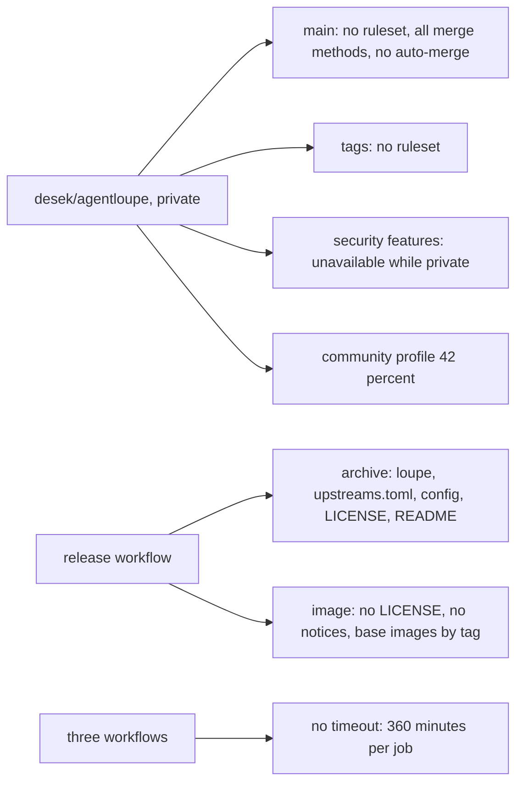
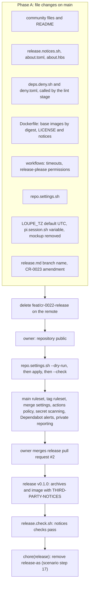
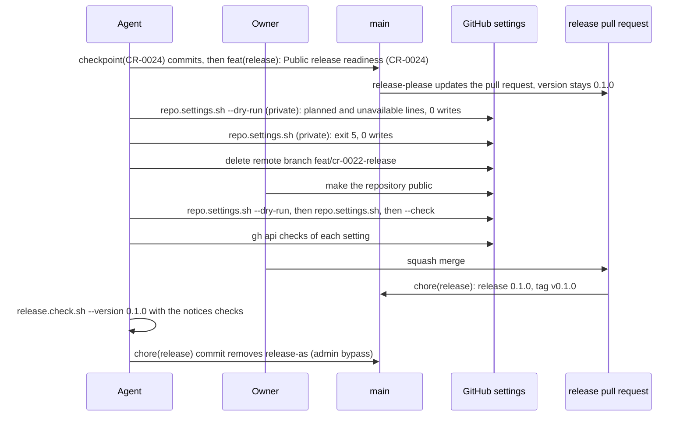
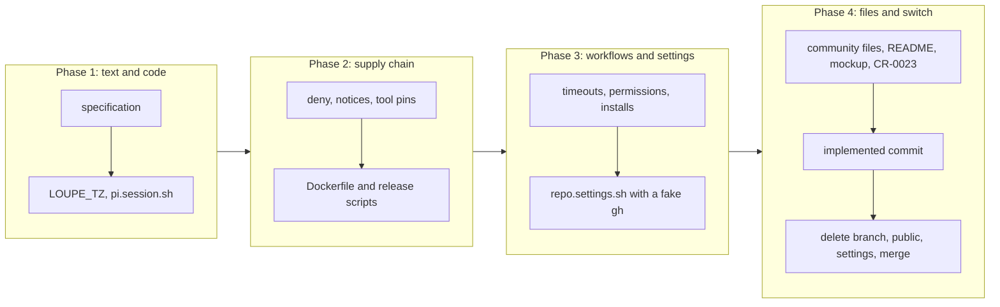

# Public release readiness

## Change Summary

The repository `desek/agentloupe` is private today. It turns public at the first release `v0.1.0`. Two audits of 2026-10-23 found that the release machinery of CR-0022 is sound, but the repository governance around it is not ready for a public project: no rule protects `main` or the release tags, no security policy exists, the security features are off, and the release assets carry no third-party notices. This CR closes the four blocking gaps and the nine should-fix gaps of the CI/CD governance audit, and applies the owner's decisions on the history audit. The file changes land on `main` first. Then the owner makes the repository public. Then one repository script applies the repository settings. Only then the owner merges the release pull request.

## Motivation and Background

Two audits are in the explore cache. Each was made at commit `35833c3`, while the release pull request #2 (`chore(release): release 0.1.0`) is open with a green verdict:

* `.agents/explore/2026-10-23-cicd-governance-audit.md`: the workflows, the branch rules, the repository files, the release governance, the supply chain, and the secrets hygiene. Its gap table has rows 1 to 23 with the severities blocking, should fix, and note. Its verdict: "do the four blocking items in the window between going public and merging PR #2".
* `.agents/explore/2026-10-23-history-audit.md`: the secrets, the personal data, the stray files, the commit quality, and the tracked configuration in all 301 commits. Its findings table has rows 1 to 12. Its verdict: "fit to publish. There are no blocking items."

The owner decided on 2026-10-23:

1. **D1, scope.** This CR covers the four blocking gaps (governance rows 1 to 4) and the nine should-fix gaps (governance rows 5 to 13).
2. **D2, mockup archive.** A normal commit removes the mockup archive (an early prototype archive, removed) from the tree. The README row that cites it says that the design values came from a mockup. The history keeps the archive (history finding 2).
3. **D3, commit author email.** The commit author email stays as it is (history finding 5).
4. **D4, time zone.** The default of `LOUPE_TZ` changes from `Europe/Stockholm` to `UTC` in the code, the README, the env example, and the specification. An install keeps its own value in `.env` (history finding 7).
5. **D5, extension path.** `.agents/scripts/pi.session.sh` reads the path of the pi-cc-auth extension from an environment variable. A missing variable gives an actionable error (history finding 3).
6. **D6, stale branch.** The remote branch `feat/cr-0022-release` is deleted (history finding 10).
7. **D7, release branch name.** `docs/specification/release.md` names the release branch as release-please makes it (governance row 19).
8. **D8, prototype updates.** In CR-0023, the npm ecosystem of `prototype/` uses the commit type `chore(deps)`, which the release notes hide, because the prototype is not shipped (governance row 22). CR-0023 records this as an amendment before its implementation.
9. **D9, later work.** Governance rows 14 to 18, 20, 21, and 23 are out of scope. This CR lists them as later work.

The owner also stated these facts, which are requirements of this CR:

10. **F1, order.** On the free plan, a ruleset and the security features are available only on a public repository. Thus the file changes land on `main` first. Then the owner makes the repository public. Then one repository script in `.agents/scripts/` applies the settings with `gh api`. Only then the release pull request merges.
11. **F2, workflows.** The workflows of CR-0022 can change for the timeouts and for the permissions of `release-please.yml`.
12. **F3, notices.** The release asset and the image carry a file `THIRD-PARTY-NOTICES`, made by cargo about or a named equivalent, plus the LiteLLM license and the Geist font license. A repository script makes the file. The verdict or `release.check.sh` checks it.
13. **F4, dependency check.** The cargo deny check runs as a repository script that the verdict pipeline calls as a stage or that the lint stage calls, with a `deny.toml` that states the allowed licenses and the advisory policy. This CR states which.
14. **F5, base images.** The Docker base images are pinned by digest. The tag stays as a comment.
15. **F6, community files.** `CONTRIBUTING.md`, `CODE_OF_CONDUCT.md` (Contributor Covenant 2.1), `SECURITY.md` (supported versions, private vulnerability reporting, a response time), `.github/pull_request_template.md`, and issue templates for a bug and a feature request. Each file is short.
16. **F7, README.** The sections "Status" and "Open work" state the current state: 24 change requests, the binary exists, and the release flow. They point to Contributing and Security.
17. **F8, release-as.** The `release-as` line goes from `release-please-config.json` right after `v0.1.0` publishes, as step 17 of the release scenario states. This CR only confirms it.

Where a decision or a fact leaves a detail open, this CR states a rule and names the detail a judgement call.

## Change Drivers

* The repository turns public at `v0.1.0`. A public repository with no rule on `main` lets any person with write access force-push or delete `main`.
* A user who finds a vulnerability has no private channel and no policy to follow.
* The MIT, Apache-2.0, and OFL licenses of the embedded crates, the LiteLLM price data, and the Geist fonts require their notices to travel with each distributed copy. The archives and the image do not carry them today.
* No license or advisory check runs before a publish.
* Two builds of one tag can get different operating system layers, because the base images float on their tags.
* A job with no timeout can run for 360 minutes, also on the macOS runner.
* The community profile of the repository is 42 percent.
* The README says "Thirteen change requests" and "Write the `loupe` binary from scratch". Both are wrong.
* The history audit found the owner's directory layout in a tracked script and the owner's domain in a tracked archive.

## Current State

* The repository is private on the free plan. `gh api repos/desek/agentloupe` gives `visibility: private`, `allow_squash_merge: true`, `allow_merge_commit: true`, `allow_rebase_merge: true`, `delete_branch_on_merge: false`, `allow_auto_merge: false`, `squash_merge_commit_title: COMMIT_OR_PR_TITLE`, and `squash_merge_commit_message: COMMIT_MESSAGES`.
* The endpoints of the rulesets, the branch protection, and the branch rules return 403 "Upgrade to GitHub Pro or make this repository public". No rule exists on `main` or on a tag.
* `security_and_analysis` is null. The endpoints of the Dependabot alerts and of the private vulnerability reporting return 404.
* The actions policy is `enabled: true`, `allowed_actions: all`, `sha_pinning_required: false`. The default workflow token is `read`, and actions cannot approve pull requests.
* `gh api repos/desek/agentloupe/community/profile` gives `health_percentage: 42`. The description, the README, and the license are present. The code of conduct, the contributing guide, the issue template, and the pull request template are absent.
* The repository has exactly one secret, `RELEASE_PLEASE_TOKEN`.
* `.github/` holds only `workflows/`: `verdict.yml`, `release.yml`, and `release-please.yml`. No job has `timeout-minutes`. Eleven jobs have `runs-on`: six in `verdict.yml`, four in `release.yml` (`visibility`, `build`, `image`, `publish`), and one in `release-please.yml`. The job `verdict` of `release.yml` calls the verdict workflow and has no `runs-on`.
* `release-please.yml` gives its `GITHUB_TOKEN` `contents: write` and `pull-requests: write`. release-please authenticates with `RELEASE_PLEASE_TOKEN`, so these grants are not used (governance row 17).
* The lint job of `verdict.yml` installs only the Rust toolchain. The test job installs `cargo-nextest` with mise from `.tool-versions`. The release build and image jobs install no tool from `.tool-versions`.
* The `Dockerfile` has two `FROM` lines, `rust:slim-bookworm` and `debian:bookworm-slim`, each by tag and with no digest. The runtime stage copies the binary, `config/`, and `upstreams.toml` into `/app`. It copies no license file. `.dockerignore` is an allowlist and does not allow `LICENSE`.
* `release.build.sh` packs `loupe`, `upstreams.toml`, `config/`, `LICENSE`, and `README.md` into each archive. The binary embeds about 291 crates of `Cargo.lock`, the LiteLLM price file of `vendor/litellm/` (license in `vendor/litellm/LICENSE`, upstream commit in `vendor/litellm/SOURCE.md`), and the Geist fonts of `web/assets/fonts/` (license in `web/assets/fonts/OFL.txt`).
* No `deny.toml` exists. No script, workflow, or specification runs `cargo deny` or `cargo audit`.
* The repository has no `CONTRIBUTING.md`, `CODE_OF_CONDUCT.md`, `SECURITY.md`, pull request template, or issue template.
* `README.md`, section "Status", says "Thirteen change requests" (24 exist after this CR) and names two early prototype archives, removed. The row of the mockup archive calls it "The source of the design values of the dashboard". Section "Open work" says "Write the `loupe` binary from scratch". The README has no pointer to a contributing guide or a security policy.
* The default `Europe/Stockholm` of `LOUPE_TZ` is in `src/config/vars.rs`, in the unit tests `default_when_unset` (`src/config/loader.rs`) and `masks_every_secret` (`src/config/show.rs`), in the fallback of `.agents/scripts/summary.threshold.sh`, in `README.md` (the variable table and "How it works" step 8), in `.env.example`, and in `docs/specification/configuration.md` (section "Variables") and `docs/specification/days.md` (section "Day boundaries"). The owner's local `.env` has no `LOUPE_TZ` line, so the owner's install uses the default today.
* `.agents/scripts/pi.session.sh` sets the extension path to a fixed path under the owner's home directory, line 20.
* The remote has three branches: `main`, `release-please--branches--main--components--agent-loupe` (pull request #2), and `feat/cr-0022-release` with 8 pre-squash `checkpoint(CR-0022)` commits that are not on `main`.
* `docs/specification/release.md` does not name the release branch. Judgement call 6 of CR-0022 named `release-please--branches--main`; the implementation notes of CR-0022 corrected it.
* `release-please-config.json` holds `release-as` for `0.1.0`. Step 17 of `.agents/scenarios/release.first.md` removes it in a `chore(release)` commit after the release.
* CR-0023 (approved, not implemented) gives the `npm` updates of `/prototype` the form `fix(deps)` (requirement 2, judgement call 13), plans the `main` ruleset in requirement 45, and freezes the workflows of CR-0022 in non-functional requirement 2.
* The two audit files in `.agents/explore/` are tracked. They quote the owner's former home path, so `git grep -nE "/Users/[d]esek"` matches 5 lines in them. CR-0022, requirement 3, requires no match in the tree.
* The local `main` is at `e13351f`. `origin/main` is at `35833c3`.

### Current State Diagram



## Proposed Change

1. Add the community files and rewrite two sections of `README.md`.
2. Add a third-party notices script. The release scripts put its output into each archive and into the image, and the release check verifies it.
3. Add a dependency check script with `deny.toml`. The lint stage calls it.
4. Pin the two base images of the `Dockerfile` by digest.
5. Add a timeout to each workflow job, and remove the unused token grants of `release-please.yml`.
6. Add the repository settings script `.agents/scripts/repo.settings.sh`. It applies the main ruleset, the tag ruleset, the merge settings, the actions policy, and the security features.
7. Apply the history decisions: remove the mockup archive, change the default of `LOUPE_TZ` to `UTC`, read the pi-cc-auth path from an environment variable, and delete the stale remote branch.
8. Name the release branch in `release.md`, and record the amendment of D8 in CR-0023.
9. Run the order of F1: files on `main`, then public, then the settings script, then the merge of the release pull request.

### Proposed State Diagram



### Order Sequence



## Requirements

### Functional Requirements

**Order and history (F1, D3)**

1. The implementation **MUST** follow this order: (a) all file changes of this CR land on `main`, and the remote branch `feat/cr-0022-release` is deleted; (b) the owner makes the repository public; (c) `repo.settings.sh` applies the settings, and `repo.settings.sh --check` exits with code 0; (d) the owner merges the release pull request.
2. The release pull request **MUST NOT** merge before step (c) of requirement 1 is complete.
3. The implementation **MUST NOT** rewrite, rebase, or force-push the published history of `main`. This keeps CR-0022, requirement 1.
4. The implementation **MUST NOT** change the author or committer email of a past commit, and **MUST NOT** add a `.mailmap` file (D3).

**Repository settings script (F1, governance rows 1, 2, 3, 8, 9, 10)**

5. A new script `.agents/scripts/repo.settings.sh` **MUST** apply the repository settings of requirements 9 to 15. It **MUST** read and write each setting only through `gh api`. It **MUST** follow `agent_first_cli`: the `@agents-index` line, a docstring with purpose, usage, and parameters, a complete `--help`, one machine line per setting on stdout by default, `--human` for the friendly view, actionable errors on stderr, and documented exit codes.
6. The script **MUST** have three modes. The default mode applies the settings. `--dry-run` reads each setting, prints the planned change, and writes nothing. `--check` reads each setting, prints each difference as drift, and writes nothing.
7. The script **MUST** be idempotent. It **MUST** compare each setting with the desired state and write only a setting that differs. A second run directly after a successful run **MUST** make zero write calls. It **MUST** find a ruleset by its name, update that ruleset in place, never make a second ruleset with the same name, and never delete a ruleset that it does not own.
8. In the default mode and in `--check`, the script **MUST** stop before any write with exit code 5 and an error that names the visibility, when the repository is private. In `--dry-run`, the script **MUST** report each setting that it cannot read on a private repository as `unavailable` with the reason, and exit with code 0.
9. **Main ruleset.** The script **MUST** keep one active branch ruleset (judgement call 11) on the default branch with these rules: require a pull request before a merge, require the status check `verdict`, require a linear history, block a force push, and block the deletion of the branch.
10. **Tag ruleset.** The script **MUST** keep one active tag ruleset (judgement call 12) on the tags `v*` that restricts the creation, the update, and the deletion of a matching tag.
11. **Merge settings.** The script **MUST** set: squash merge on, merge commit off, rebase merge off, delete the head branch on merge on, and auto-merge on.
12. **Actions policy.** The script **MUST** set "require actions to be pinned to a full-length commit SHA" on. It **MUST** keep the actions enabled, the default workflow token `read`, and the setting that lets actions approve pull requests off.
13. **Secret scanning.** The script **MUST** turn on secret scanning and push protection.
14. **Dependabot alerts.** The script **MUST** turn on the Dependabot alerts. It **MUST NOT** change the Dependabot security updates (judgement call 15).
15. **Private vulnerability reporting.** The script **MUST** turn on the private vulnerability reporting.
16. Each machine line **MUST** have the form of a setting name and a status: `unchanged`, `applied`, `planned`, `drift`, or `unavailable`, with a detail when the status is not `unchanged`. The last line **MUST** give the count of writes and the result.
17. The script **MUST** use exit code 0 for success, 1 for drift found by `--check`, 2 for a usage error, 3 for a missing `gh` or a `gh` login with no admin permission on the repository, 4 for a failed API call, and 5 for a private repository in the default mode or in `--check`.
18. The script **MUST NOT** change the visibility of the repository. The script **MUST NOT** run in a workflow, and a workflow **MUST NOT** call it. It **MUST** use the `gh` login of the person who runs it, and it **MUST NOT** need a new secret. It **MUST NOT** print a token.
19. The script **MUST** run with the bash 3.2 of macOS and `gh`. It **MUST NOT** need `jq`.

**Community files (F6, governance rows 2 and 11)**

20. `CONTRIBUTING.md` at the root **MUST** state: how to propose a change (an issue first, then a pull request), the change request process in `docs/cr/`, the Conventional Commits rule and the rule for the implemented commit of `release.md`, the local verdict `.agents/scripts/pipeline.verdict.sh`, the required check `verdict`, the squash merge, and that a contribution is under the MIT license of the project. It **MUST** have at most 80 lines.
21. `CODE_OF_CONDUCT.md` at the root **MUST** be the Contributor Covenant version 2.1, with only the contact for enforcement filled in (judgement call 16).
22. `SECURITY.md` at the root **MUST** state: the supported versions, the private vulnerability reporting of GitHub as the one channel, an instruction not to open a public issue for a vulnerability, the response times, and the disclosure after the fix release (judgement call 16). It **MUST** have at most 60 lines.
23. `.github/pull_request_template.md` **MUST** ask for: a summary, the linked change request or issue, a Conventional Commits title, a local verdict that passed, the updated specification or README, and no secret in the change. It **MUST** have at most 30 lines.
24. `.github/ISSUE_TEMPLATE/` **MUST** hold one bug report template and one feature request template, each at most 40 lines, and one template configuration that links security reports to `SECURITY.md` (judgement call 16).

**README (F7, D2, governance row 12)**

25. `README.md`, section "Status", **MUST** state: 24 change requests in `docs/cr/`, the `loupe` binary exists and runs in the container, and the release flow (release-please, the tag, the release assets, the image), with links to the section "Install" and to `docs/specification/release.md`. The word "Thirteen" **MUST NOT** remain.
26. In the section "Status", the row of the mockup archive **MUST** go. One sentence **MUST** state that the design values of the dashboard came from a design mockup with sample data. The README **MUST NOT** name the archive file or the domain in it. The row of the other early prototype archive, removed, stays.
27. `README.md`, section "Open work", **MUST** list only open work (judgement call 17). The item "Write the `loupe` binary from scratch" **MUST** go.
28. `README.md` **MUST** get a short section "Contributing" before the section "License", with links to `CONTRIBUTING.md`, `CODE_OF_CONDUCT.md`, and `SECURITY.md`.
29. `README.md`, section "Install", step 3 of "From a release asset", and section "License" **MUST** name `THIRD-PARTY-NOTICES`.

**Third-party notices (F3, governance row 4)**

30. A new script `.agents/scripts/release.notices.sh` **MUST** write the file `THIRD-PARTY-NOTICES`. It **MUST** use cargo about (judgement call 5). It **MUST** follow `agent_first_cli`, with `--dry-run` that prints the plan and writes nothing.
31. The file **MUST** hold, in this order: a header that names the project and the version from `Cargo.toml`; the licenses of the crates of `Cargo.lock` that the `loupe` binary uses on the three release targets, each license text once with the crates under it; the text of `vendor/litellm/LICENSE` with the upstream commit of `vendor/litellm/SOURCE.md`; and the text of `web/assets/fonts/OFL.txt` with the font names.
32. Two runs of the script on one commit **MUST** give byte-identical files. The file **MUST NOT** hold a time stamp, a host name, or a path of the build machine.
33. The script **MUST** stop with an actionable error when cargo about is missing (exit code 3), when a crate has a license outside the accepted list (exit code 1), or when `vendor/litellm/LICENSE` or `web/assets/fonts/OFL.txt` is missing (exit code 1).
34. The cargo about configuration **MUST** be in `about.toml` and its template in `about.hbs`, both at the root. The accepted licenses of `about.toml` **MUST** equal the allowed licenses of `deny.toml`.
35. `release.build.sh` **MUST** call `release.notices.sh` and **MUST** add `THIRD-PARTY-NOTICES` to each archive. Each archive then holds `loupe`, `upstreams.toml`, `config/`, `LICENSE`, `README.md`, and `THIRD-PARTY-NOTICES`.
36. `release.image.sh` **MUST** call `release.notices.sh` before the build. The release image **MUST** hold `/app/LICENSE` and `/app/THIRD-PARTY-NOTICES`. `release.image.sh` **MUST** fail with exit code 1, before the push, when the built image lacks one of the two files.
37. The local image build of `pipeline.image.sh` and of `docker compose up -d --build` **MUST** still pass when no `THIRD-PARTY-NOTICES` file exists. Each image **MUST** hold `/app/LICENSE` (judgement call 7).
38. `.gitignore` **MUST** ignore the generated `THIRD-PARTY-NOTICES` at the root. `.dockerignore` **MUST** allow `LICENSE` and `THIRD-PARTY-NOTICES`.
39. `release.check.sh` **MUST** add one check line `notices <target>` for each of the three archives and one check line `notices image`. A check **MUST** pass when the file is present and not empty, holds the LiteLLM section and the Geist section, and has the same SHA-256 digest as the other copies. `notices image` **MUST** report `skipped` with the reason when Docker is absent.

**Dependency check (F4, governance row 6)**

40. A new script `.agents/scripts/deps.deny.sh` **MUST** run `cargo deny` with the four checks advisories, licenses, bans, and sources against `deny.toml` at the root, with the lock file locked. It **MUST** follow `agent_first_cli`.
41. The lint stage **MUST** call `deps.deny.sh` after clippy (judgement call 3). `pipeline.lint.sh` **MUST** still print one stage line. The stage status **MUST** be `failed` when clippy or the dependency check fails. The stage log **MUST** hold both outputs. The verdict **MUST** keep its five stages.
42. `deny.toml` **MUST** state this policy (judgement call 4):
    1. Licenses: an allow list of permissive SPDX identifiers. A copyleft license **MUST NOT** be on the list. An exception for one crate **MUST** name the crate and the reason in a comment.
    2. Advisories: a vulnerability in any crate fails. An unmaintained or unsound advisory fails for a direct dependency. A yanked crate fails. An ignore entry **MUST** name the advisory identifier, the reason, and a review date.
    3. Bans: a wildcard version requirement fails. More than one version of a crate gives a warning, not a failure.
    4. Sources: only the crates.io registry. A git source or another registry fails.
43. `deps.deny.sh` **MUST** fail when the accepted licenses of `about.toml` differ from the allowed licenses of `deny.toml`.
44. When the advisory database cannot be fetched, `deps.deny.sh` **MUST** fail with an actionable error that names the fetch. The lint stage then fails (fail closed). The fetch of the advisory database **MUST** be the one network use of the lint stage. This amends CR-0022, non-functional requirement 3, and the sentence on the hermetic stages in `operations.md`, section "Pipeline", for the lint stage only; the stages format, test, and web stay hermetic.
45. The declared inputs of the lint stage **MUST** add `deny.toml`, `about.toml`, and `.agents/scripts/deps.deny.sh`. `pipeline.lint.sh --toolchain` **MUST** also print the version of cargo-deny.
46. `.tool-versions` **MUST** pin cargo-deny and cargo-about under their mise registry names.

**Base images (F5, governance row 7)**

47. Each `FROM` line of the `Dockerfile` **MUST** name its base image by the SHA-256 digest of the multi-platform image index. The tag **MUST** stay in a comment next to the line (judgement call 8).
48. The count of `FROM` lines with no digest **MUST** be zero. A test **MUST** assert this.
49. `operations.md`, section "Container", **MUST** state the digest rule and the refresh of the digests by a human at each minor release, with the command that reads the current digest of a tag.

**Workflows (F2, governance row 5)**

50. Each job with `runs-on` in the three workflow files **MUST** have `timeout-minutes` (judgement call 9). The job `verdict` of `release.yml` calls a reusable workflow, which takes no timeout. The jobs of the called workflow carry their own.
51. The `GITHUB_TOKEN` of `release-please.yml` **MUST** have no permission (judgement call 1). release-please **MUST** still authenticate with `RELEASE_PLEASE_TOKEN`. This replaces CR-0022, requirement 31, for the `GITHUB_TOKEN` only.
52. The lint job of `verdict.yml` **MUST** install cargo-deny with mise from `.tool-versions`. The build jobs and the image jobs of `release.yml` **MUST** install cargo-about with mise from `.tool-versions` (judgement call 2).
53. Apart from requirements 50 to 52, the workflow files **MUST NOT** change. Each workflow **MUST** stay a thin caller per CR-0022, requirements 19 to 22. Each action **MUST** stay pinned by its full commit SHA.

**History decisions (D2, D5, D6)**

54. A normal commit **MUST** remove the mockup archive, an early prototype archive, removed, from the tree. `docs/cr/CR-0008-dashboard-spa.md` **MUST NOT** change (judgement call 21).
55. `pi.session.sh` **MUST** read the path of the extension entry file from the environment variable `PI_CC_AUTH_EXT` (judgement call 19). The script **MUST NOT** hold a default path.
56. When `PI_CC_AUTH_EXT` is unset or empty, `pi.session.sh` **MUST** exit with code 3 and an error that names the variable, the fix, and a verify step. When the variable names a file that does not exist, it **MUST** exit with code 3 and an error that names the variable and the path. This **MUST** also apply with `--dry-run`. The docstring and `--help` **MUST** name the variable.
57. After requirement 55, `git grep -n "Repo/[d]esek" -- .agents/scripts` **MUST** return no match.
58. A normal commit **MUST** replace the owner's former home path in the two audit files of `.agents/explore/` with a placeholder, so that `git grep -nE "/Users/[d]esek"` on the tree returns no match again (judgement call 20). All other words of the audits **MUST** stay.
59. The remote branch `feat/cr-0022-release` **MUST** be deleted before the switch to public.

**Time zone (D4)**

60. The default of `LOUPE_TZ` **MUST** be `UTC` in `src/config/vars.rs`. Each copy of the default **MUST** say `UTC`: the fallback in `.agents/scripts/summary.threshold.sh`, the variable table and "How it works" step 8 of `README.md`, the comment in `.env.example`, `configuration.md` section "Variables", and `days.md` section "Day boundaries".
61. A value of `LOUPE_TZ` from the environment or from `.env` **MUST** keep its effect. The change **MUST NOT** move, rebuild, or migrate a stored day.
62. The example value in the error for an invalid `LOUPE_TZ`, the example in the specification, and the test fixtures that need a zone with daylight saving time **MUST** stay `Europe/Stockholm` (judgement call 18).

**Release specification and CR-0023 (D7, D8, F8)**

63. `docs/specification/release.md`, section "Release flow", **MUST** name the release branch `release-please--branches--main--components--agent-loupe`, as release-please makes it for the package `agent-loupe`. It **MUST** state that the merge setting deletes the branch and that release-please makes it again for the next release.
64. This CR **MUST NOT** change `release-please-config.json`. Step 17 of `.agents/scenarios/release.first.md` **MUST** stay the step that removes `release-as` in a `chore(release)` commit right after `v0.1.0` publishes.
65. Before the implementation of CR-0023 starts, `docs/cr/CR-0023-dependency-autofix.md` **MUST** record a section "Amendment by CR-0024" and a short marker on each item that it changes (judgement call 22). The amendment **MUST** state:
    1. The `npm` updates of `/prototype` use the prefix `chore(deps)`. The `cargo` updates keep `fix(deps)`. The `github-actions` updates keep `ci(deps)`.
    2. A fix commit of `deps.autofix.sh` that changes only `prototype/` uses `chore(deps)`. The squash commit of an autofix pull request is `fix(deps)` when it holds one or more `cargo` fixes, and `chore(deps)` when it holds only `prototype/` fixes.
    3. Requirement 45 of CR-0023 is met by `repo.settings.sh` of this CR. CR-0023 **MUST NOT** make a second ruleset on `main`. Parameter P4 of CR-0023 stays a check.
    4. The workflows that non-functional requirement 2 of CR-0023 freezes are the workflows after this CR.
    5. The workflow of requirement 9 of CR-0023 also installs cargo-deny from `.tool-versions`, because the verdict that `deps.autofix.sh` runs calls `deps.deny.sh` in the lint stage.
    6. The changed items: requirements 1, 2, 9, 24, 33, and 45, non-functional requirement 2, judgement call 13, AC-1, and AC-13.

**Documentation**

66. `docs/specification/release.md` **MUST** change in these sections: "Release flow" (requirement 63), "First release" (the order of requirement 1), "Binary archives" (the archive list of requirement 35), "Container image" (the license files of requirement 36), "Verify a release" (the checks of requirement 39), and two new sections, "Third-party notices" (requirements 30 to 39) and "Repository settings" (requirements 5 to 19).
67. `docs/specification/operations.md` **MUST** change in these sections: "Container" and "Registry image" (requirements 36, 37, 47, and 49), "Pipeline" (a new subsection "Dependency check" for requirements 40 to 44, and the sentence on the hermetic stages per requirement 44), "Stage inputs and toolchain" (requirement 45, and the new `COPY` sources of the image stage), "Fingerprints and the verdict cache" (the lint stage reads the advisory database over the network), "Hosted workflows" (requirements 50 to 52), and "Release targets" (the new rows of the section "Measurable Targets").
68. `docs/specification/configuration.md`, section "Variables", and `docs/specification/days.md`, section "Day boundaries", **MUST** state the default `UTC`.
69. `.taxonomy` **MUST** get rows for the terms "third-party notices", "dependency check", and "repository settings".
70. In `docs/specification/index.md`, the row of `release.md` **MUST** also name the third-party notices and the repository settings. No other row changes. No new specification file is added (judgement call 23).

### Non-Functional Requirements

1. The project **MUST NOT** use a paid service. Each setting of requirements 9 to 15 is free for a public repository on the free plan.
2. `pipeline.verdict.sh` and the fingerprint script **MUST NOT** change. Of the stage entry points, only `pipeline.lint.sh` (requirements 41 and 45) and `pipeline.image.sh` (its declared inputs, for the new `COPY` sources) **MUST** change.
3. The workflow files **MUST** change only per requirements 50 to 52.
4. No new file **MUST** hold a secret value. The count of repository secrets **MUST** stay 1.
5. The verdict workflow time on a pull request **MUST** stay within the thresholds of CR-0022: at most 20 minutes with a cold cache and at most 12 minutes with a warm cache.
6. Each new script **MUST** pass `bash -n` and the lint and format rules of the existing scripts.
7. The targets of the section "Measurable Targets" **MUST** hold.

## Measurable Targets

The baseline column holds the value at the source commit or on 2026-10-23. "None" means that the metric does not exist before this CR.

| Metric | Method | Baseline | Threshold |
|---|---|---|---|
| Community profile | `gh api repos/desek/agentloupe/community/profile --jq .health_percentage`, after the switch to public | 42 | 100 |
| Workflow jobs with no timeout | in each of the three workflow files, count the jobs that have the key `runs-on` and no key `timeout-minutes` | 11 (6 in `verdict.yml`, 4 in `release.yml`, 1 in `release-please.yml`) | 0 |
| Unpinned base images | count the `FROM` lines of `Dockerfile` whose image reference has no `@sha256:` with 64 hex digits | 2 | 0 |
| Dependency check | `.agents/scripts/deps.deny.sh; echo $?` on `main`, and the lint job of the verdict workflow on the tag `v0.1.0` | none, no `deny.toml` | exit code 0 |
| Notices in the archives | `tar -tzf <archive>` lists `THIRD-PARTY-NOTICES` in the top directory, for each of the three archives of the release | 0 of 3 | 3 of 3 |
| Notices in the image | `docker run --rm --entrypoint cat ghcr.io/desek/agentloupe:<version> /app/THIRD-PARTY-NOTICES` exits 0 with a file that is not empty, for `linux/amd64` and `linux/arm64` | 0 of 2 | 2 of 2 |
| Notices check | the lines `notices <target>` and `notices image` of `release.check.sh --version <version>` | none | 4 lines, each `status: passed` |
| Main branch rules | `gh api repos/desek/agentloupe/rules/branches/main --jq '[.[].type]'` | 403 | holds `pull_request`, `required_status_checks` with the context `verdict`, `required_linear_history`, `non_fast_forward`, and `deletion` |
| Tag ruleset | `gh api repos/desek/agentloupe/rulesets`, then the ruleset with the target `tag` | 403 | active, includes `refs/tags/v*`, rules `creation`, `update`, and `deletion` |
| Merge settings | `gh api repos/desek/agentloupe --jq '[.allow_squash_merge,.allow_merge_commit,.allow_rebase_merge,.delete_branch_on_merge,.allow_auto_merge]'` | true, true, true, false, false | true, false, false, true, true |
| Actions policy | `gh api repos/desek/agentloupe/actions/permissions --jq .sha_pinning_required` | false | true |
| Secret scanning | `gh api repos/desek/agentloupe --jq .security_and_analysis` | null | `secret_scanning` and `secret_scanning_push_protection` with status `enabled` |
| Dependabot alerts | `gh api -i repos/desek/agentloupe/vulnerability-alerts`, the HTTP status | 404 | 204 |
| Private vulnerability reporting | `gh api repos/desek/agentloupe/private-vulnerability-reporting --jq .enabled` | 404 | true |
| Idempotence of the settings script | the count of writes on the last line of a second `repo.settings.sh` run, and the exit code of `repo.settings.sh --check` | none, no script | 0 writes, exit code 0 |
| Length of the community files | `wc -l` of `CONTRIBUTING.md`, `SECURITY.md`, the pull request template, and each issue template | none, no file | at most 80, 60, 30, and 40 lines |
| Verdict workflow time | the CR-0022 method: `createdAt` to `updatedAt` of `gh run view <run id>` on a pull request that changes one Rust file | 5 min 13 s and 6 min 39 s (runs 39997262577 and 39997205916) | at most 20 minutes cold, 12 minutes warm |
| Owner paths and mockup | `git grep -nE "/Users/[d]esek"`, `git grep -n "Repo/[d]esek" -- .agents/scripts`, and the tracked files of the early prototype archives, removed | 5 matches, 1 match, 2 archives | 0, 0, 1 archive |
| Remote branches | `git ls-remote --heads origin` | `main`, the release-please branch, `feat/cr-0022-release` | no `feat/cr-0022-release` |
| Default time zone | `loupe config show` with no `LOUPE_TZ` set | `Europe/Stockholm` | `UTC` with the source default |

## Affected Components

New files:

* `.agents/scripts/repo.settings.sh`: the repository settings script (requirements 5 to 19).
* `.agents/scripts/release.notices.sh`, `about.toml`, `about.hbs`: the third-party notices (requirements 30 to 34).
* `.agents/scripts/deps.deny.sh`, `deny.toml`: the dependency check (requirements 40 to 44).
* `CONTRIBUTING.md`, `CODE_OF_CONDUCT.md`, `SECURITY.md`.
* `.github/pull_request_template.md`, `.github/ISSUE_TEMPLATE/bug_report.md`, `.github/ISSUE_TEMPLATE/feature_request.md`, `.github/ISSUE_TEMPLATE/config.yml`.
* `.agents/scenarios/repo.settings.md`: the scenario of the section "Model-Based Testing".
* `tests/scripts/repo.settings.test.sh` with its wrapper `tests/repo.settings.rs`, and `tests/scripts/pi.session.test.sh` with its wrapper `tests/pi.session.rs`, each with its `[[test]]` entry in `Cargo.toml`.

Changed files:

* `.github/workflows/verdict.yml`, `.github/workflows/release.yml`, `.github/workflows/release-please.yml`: requirements 50 to 52 only.
* `Dockerfile`, `.dockerignore`, `.gitignore`, `.tool-versions`.
* `.agents/scripts/pipeline.lint.sh`, `.agents/scripts/pipeline.image.sh` (declared inputs), `.agents/scripts/release.build.sh`, `.agents/scripts/release.image.sh`, `.agents/scripts/release.check.sh`, `.agents/scripts/pi.session.sh`, `.agents/scripts/summary.threshold.sh`.
* `src/config/vars.rs`, and the unit tests `default_when_unset` in `src/config/loader.rs` and `masks_every_secret` in `src/config/show.rs`.
* `tests/pipeline.inputs.rs`: the base image digest test.
* `README.md`, `.env.example`, `.taxonomy`.
* `docs/specification/release.md`, `docs/specification/operations.md`, `docs/specification/configuration.md`, `docs/specification/days.md`, and `docs/specification/index.md` per requirement 70.
* `docs/cr/CR-0023-dependency-autofix.md`: the amendment of requirement 65.
* `.agents/explore/2026-10-23-cicd-governance-audit.md` and `.agents/explore/2026-10-23-history-audit.md`: the home path only (requirement 58).
* `.agents/scenarios/release.first.md`: the notices check lines in the table "Checks of `release.check.sh`".

Removed files:

* The mockup archive, an early prototype archive, removed.

Repository settings (not files): the main ruleset, the tag ruleset, the merge settings, the actions policy, secret scanning and push protection, Dependabot alerts, and private vulnerability reporting. The remote branch `feat/cr-0022-release`.

Not changed:

* `pipeline.verdict.sh`, the fingerprint script, and the stage entry points other than lint and image.
* `release-please-config.json` and `.release-please-manifest.json` (requirement 64).
* `compose.yaml`, `rust-toolchain.toml`, the public API, the dashboard, and the day record.
* `docs/cr/CR-0001` to `docs/cr/CR-0022`, the other early prototype archive (removed), `prototype/`, and the scenarios other than `release.first.md`.

## Scope Boundaries

### In Scope

* Governance rows 1 to 4 (blocking): the main ruleset, `SECURITY.md` and private reporting, the security features, and the third-party notices.
* Governance rows 5 to 13 (should fix): the timeouts, the dependency check, the base image digests, the merge settings, the actions policy, the tag ruleset, the community files, the README sections, and the confirmation of the `release-as` removal.
* Governance row 19: the release branch name in `release.md`.
* Governance row 22: the amendment of CR-0023.
* History findings 2, 3, 5, 7, and 10 per the decisions D2 to D6.
* The order of F1 and the repository settings script.

### Out of Scope ("Here, But Not Further")

Later work, each for a later CR:

* Governance row 14: build provenance, image signatures, and an SBOM.
* Governance row 15: a release that waits as a draft until its assets exist.
* Governance row 16: the removal of the cargo cache from the release builds.
* Governance row 17: the owner listed it as later work, but F2 allows the change of the permissions of `release-please.yml`. Requirement 51 makes that change (judgement call 1). The update of `operations.md` "Hosted workflows" is part of requirement 67.
* Governance row 18: the text of `release.md` "Pinned actions" against CR-0023.
* Governance row 20: a `.gitleaksignore` for the test fixtures.
* Governance row 21: `CODEOWNERS`, `.editorconfig`, and signed commits.
* Governance row 23: an automatic post-publish run of `release.check.sh`.

Also out of scope:

* A rewrite of the history, a change of a past commit email, or a `.mailmap` (D3).
* The Dependabot `docker` ecosystem for the base images (judgement call 8).
* Dependabot security updates (judgement call 15). CR-0023 owns the dependency flow.
* A change to the other early prototype archive (removed), to `prototype/`, or to the records of earlier CRs and scenarios.
* A migration of the stored days of an install to another time zone.
* The scenario screenshots, the commit message style, and the other notes of the history audit.

## Alternative Approaches Considered

* **Apply the settings by hand in the web UI.** Rejected. A script is repeatable, can show drift with `--check`, and records the desired state in the tree.
* **Apply the settings from a workflow.** Rejected. It needs an admin token as a repository secret. The owner's `gh` login does it once, with no new secret.
* **Pay for GitHub Pro to set the rules while private.** Rejected. The project uses no paid service, and the repository turns public anyway.
* **A sixth verdict stage for the dependency check.** Rejected. It adds a job and a sixth result to the fail-closed job of `verdict.yml`, and a stage to `pipeline.verdict.sh`. The lint stage already reads `Cargo.lock`, so one call there changes less.
* **`cargo audit` for the advisories only.** Rejected. It does not check the licenses, and the notices need a license policy.
* **A committed `THIRD-PARTY-NOTICES` file.** Rejected. Each `Cargo.lock` change of a Dependabot pull request (CR-0023) would make the file stale and fail the verdict. A file made at release time is always current.
* **`cargo-bundle-licenses` or a hand-written generator.** Rejected. cargo about is the common tool, reads the same SPDX data as cargo deny, and uses a template for a plain text file.
* **Pin the base images by the digest of one platform.** Rejected. The release builds `linux/amd64` and `linux/arm64` from one `Dockerfile`. The index digest resolves to the right platform on each runner.
* **Keep `Europe/Stockholm` as the default.** Rejected by D4.

## Impact Assessment

### User Impact

A user of a release gets the licenses of all third-party parts in the archive and in the image. A user can report a vulnerability in private and knows the response time. A contributor finds a guide, a code of conduct, and templates. An install with no `LOUPE_TZ` cuts the days in UTC; an install that sets `LOUPE_TZ` in `.env` sees no change.

### Technical Impact

* The lint stage now needs cargo-deny and reads the advisory database over the network. A new advisory can fail a pull request that does not touch a dependency (Risk 2).
* The release builds and the image builds need cargo-about.
* The `Dockerfile` changes: base image digests, and `LICENSE` and `THIRD-PARTY-NOTICES` in the runtime stage.
* After the switch, a push to `main` by a person who is not an admin fails. The owner keeps direct pushes through the admin bypass.
* Merge commits and rebase merges are no longer possible. Each merge is a squash merge.

### Business Impact

The project meets the expectations of a public open-source project at its first release. The cost stays zero.

## Implementation Approach

1. Write the specification changes: `release.md`, `operations.md`, `configuration.md`, `days.md`, `.taxonomy`.
2. Change the default of `LOUPE_TZ` and its tests. Change `pi.session.sh` and add its shell test.
3. Write `deny.toml`, `about.toml`, `about.hbs`, `deps.deny.sh`, and `release.notices.sh`. Pin both tools in `.tool-versions`. Wire the dependency check into the lint stage, and run the local verdict.
4. Change the `Dockerfile`, `.dockerignore`, `.gitignore`, `release.build.sh`, `release.image.sh`, and `release.check.sh`. Run the release scripts with `--dry-run`, and `release.build.sh` in a scratch clone with a local tag.
5. Change the three workflows. Open a pull request from a branch and read the result of the jobs.
6. Write `repo.settings.sh` with `--dry-run` and `--check` first, and its shell test with a fake `gh`.
7. Add the community files. Rewrite the README sections.
8. Remove the mockup archive. Replace the home path in the two audit files.
9. Record the amendment in CR-0023.
10. Make the implemented commit `feat(release): Public release readiness (CR-0024)` on `main` (judgement call 24).
11. Run the scenario `.agents/scenarios/repo.settings.md`. It includes the deletion of the remote branch, the switch to public by the owner, the settings script, and the merge of the release pull request.
12. Record the measured values in `operations.md`, section "Release targets".

### Implementation Flow



## Test Strategy

### Tests to Add

| Test File | Test Name | Description | Inputs | Expected Output |
|---|---|---|---|---|
| `tests/scripts/repo.settings.test.sh` | `dry_run_writes_nothing` | `--dry-run` reads and plans. | a fake `gh` on `PATH` that records each call and serves a public repository with all settings off | each setting `planned`, 0 calls with a write method, exit code 0 |
| `tests/scripts/repo.settings.test.sh` | `private_apply_stops` | The default mode stops on a private repository. | the fake `gh` serves `visibility: private` | exit code 5, an error that names the visibility, 0 write calls |
| `tests/scripts/repo.settings.test.sh` | `private_dry_run_unavailable` | `--dry-run` on a private repository. | the fake `gh` serves 403 for the rulesets | the ruleset lines `unavailable` with the reason, exit code 0 |
| `tests/scripts/repo.settings.test.sh` | `second_run_is_idempotent` | A run on the desired state writes nothing. | the fake `gh` serves the desired state | each line `unchanged`, writes 0, exit code 0 |
| `tests/scripts/repo.settings.test.sh` | `check_reports_drift` | `--check` finds one difference. | the desired state with rebase merge on | one `drift` line for the merge settings, exit code 1, 0 writes |
| `tests/scripts/repo.settings.test.sh` | `ruleset_updated_in_place` | An existing ruleset with the same name is updated, not duplicated. | the fake `gh` serves a ruleset `main` with one rule missing | one update call to that ruleset, no create call |
| `tests/scripts/repo.settings.test.sh` | `missing_gh` | No `gh` on `PATH`. | an empty `PATH` directory | exit code 3, an actionable error |
| `tests/scripts/pi.session.test.sh` | `unset_variable` | The variable is required. | `PI_CC_AUTH_EXT` unset, `--dry-run` | exit code 3, the error names `PI_CC_AUTH_EXT` |
| `tests/scripts/pi.session.test.sh` | `missing_file` | The variable names no file. | `PI_CC_AUTH_EXT` set to a path that does not exist, `--dry-run` | exit code 3, the error names the variable and the path |
| `tests/scripts/pi.session.test.sh` | `dry_run_uses_variable` | The command holds the path of the variable. | `PI_CC_AUTH_EXT` set to a temporary file, `--dry-run`, a token file in a temporary home | the command line holds that path, exit code 0 |
| `tests/pipeline.inputs.rs` | `dockerfile_base_images_pinned` | Each base image has a digest. | `Dockerfile` | each `FROM` line holds `@sha256:` and 64 hex digits |
| `tests/pipeline.inputs.rs` | `lint_inputs_cover_deny_files` | The lint stage declares its new inputs. | `pipeline.lint.sh --inputs` | holds `deny.toml`, `about.toml`, and `.agents/scripts/deps.deny.sh` |
| `.agents/scripts/deps.deny.sh` | self check | The license lists agree. | `about.toml` and `deny.toml` with one license removed from one list, in a scratch copy | non-zero exit code and an error that names the license |
| `.agents/scripts/release.notices.sh` | `--dry-run` and two real runs | The output is deterministic. | two runs on one commit | `--dry-run` writes nothing; the two files are byte-identical and hold the LiteLLM and Geist sections |

### Tests to Modify

| Test File | Test Name | Current Behavior | New Behavior | Reason for Change |
|---|---|---|---|---|
| `src/config/loader.rs` | `default_when_unset` | expects `Europe/Stockholm` with the source default | expects `UTC` with the source default | D4 |
| `src/config/show.rs` | `masks_every_secret` | expects `LOUPE_TZ` to show `Europe/Stockholm` | expects `UTC` | D4 |
| `tests/pipeline.inputs.rs` | `image_inputs_cover_dockerfile_copy_sources` | covers the current `COPY` sources | covers `LICENSE` and `THIRD-PARTY-NOTICES` too, through the image stage inputs | requirement 36 |

The tests that set `LOUPE_TZ` explicitly and the fixtures with `Europe/Stockholm` do not change (judgement call 18).

### Tests to Remove

Not applicable. The CR removes no behavior that a test covers.

## Model-Based Testing

The change has a user surface: the repository settings, the pull request page, the release, and the scripts. A human can follow the steps in a browser and a terminal. A model can follow them with `gh` and the shell. Persist the scenario as `.agents/scenarios/repo.settings.md`, with the observed values.

1. Agent: check that `gh repo view desek/agentloupe --json visibility` prints `PRIVATE`. Record the baselines of the section "Measurable Targets".
2. Agent: check that `main` holds the implemented commit of this CR, that the verdict workflow passed on it, that pull request #2 is updated and still proposes `0.1.0`, and that `release-please-config.json` still holds `release-as`.
3. Agent, private: run `repo.settings.sh --dry-run`. Check: each ruleset line, the secret scanning line, and the private reporting line are `unavailable` with the reason; the merge settings line and the actions policy line are `planned`; the last line gives 0 writes; the exit code is 0.
4. Agent, private: run `gh api repos/desek/agentloupe` and the actions permissions endpoint. Check that each value equals the baseline of step 1.
5. Agent, private: run `repo.settings.sh`. Check: exit code 5, an error that names the visibility, and 0 writes. Repeat step 4.
6. Agent: delete the remote branch `feat/cr-0022-release`. Check `git ls-remote --heads origin`.
7. Owner: run `gh repo edit desek/agentloupe --visibility public --accept-visibility-change-consequences`. Agent: check that the visibility is `PUBLIC`.
8. Agent: run `repo.settings.sh --dry-run`. Check that no line is `unavailable`, that each setting that differs is `planned`, and that the writes are 0.
9. Agent: run `repo.settings.sh`. Check that each setting of step 8 is `applied` and that the exit code is 0.
10. Agent: run each `gh api` method of the section "Measurable Targets" for the main branch rules, the tag ruleset, the merge settings, the actions policy, secret scanning, Dependabot alerts, and private vulnerability reporting. Check each threshold.
11. Agent: run `repo.settings.sh` again. Check that each line is `unchanged` and that the writes are 0. Run `repo.settings.sh --check`. Check exit code 0.
12. Agent: turn on rebase merges with `gh repo edit desek/agentloupe --enable-rebase-merge`. Run `repo.settings.sh --check`. Check one `drift` line and exit code 1. Run `repo.settings.sh`. Run `--check` again. Check exit code 0.
13. Agent: push a scratch branch with one formatting error in a Rust file and open a pull request. Enable auto-merge with squash. Check that the verdict fails and that the pull request does not merge. Check that `gh pr merge --merge` fails because merge commits are not allowed. Close the pull request. Check that the branch is deleted, or delete it.
14. Agent: check that the community profile is 100.
15. Agent: list the secret scanning alerts with `gh api repos/desek/agentloupe/secret-scanning/alerts`. Record the count. Close a fixture alert as "used in tests" (judgement call 25).
16. Owner: squash merge pull request #2. Agent: run steps 10 to 16 of `.agents/scenarios/release.first.md`. Check that `release.check.sh --version 0.1.0` prints the lines `notices aarch64-apple-darwin`, `notices x86_64-unknown-linux-gnu`, `notices aarch64-unknown-linux-gnu`, and `notices image`, each with `status: passed`, and exit code 0.
17. Agent: run the methods of the rows "Notices in the archives" and "Notices in the image".
18. Agent: run step 17 of `release.first.md`. Check that `release-please-config.json` on `main` has no `release-as` after the `chore(release)` commit, and that the commit came through the admin bypass with the verdict green afterwards.

Success condition: each check passes in one run. The settings script gives 0 writes in 2 of 2 runs after the apply.

## Acceptance Criteria

### AC-1: The order holds (requirements 1 and 2)

```gherkin
Given the file changes of CR-0024 on main and the repository private
When the owner and the agent run the scenario repo.settings.md
Then the remote branch feat/cr-0022-release is deleted before the visibility changes
And repo.settings.sh applies the settings only after the visibility is PUBLIC
And repo.settings.sh --check exits with code 0 before pull request #2 merges
And the merge time of pull request #2 is after the last applied line of repo.settings.sh
```

### AC-2: The history stays (requirements 3 and 4)

```gherkin
Given the published history of main at commit 35833c3
When the CR is implemented
Then every commit at or before 35833c3 keeps its hash
And no force push to main happened
And the author email of each past commit is unchanged
And the tree has no .mailmap file
```

### AC-3: The settings script plans on a private repository (requirements 6 and 8)

```gherkin
Given the repository is private
When the agent runs "repo.settings.sh --dry-run"
Then each ruleset line, the secret scanning line, and the private reporting line have the status unavailable with a reason
And the last line gives 0 writes
And the exit code is 0
When the agent runs "repo.settings.sh"
Then the exit code is 5
And stderr names the visibility
And gh api shows the same merge settings and actions policy as before
```

### AC-4: The settings script applies the main ruleset (requirement 9)

```gherkin
Given the repository is public
When the agent runs "repo.settings.sh"
Then gh api repos/desek/agentloupe/rules/branches/main returns the rule types pull_request, required_status_checks, required_linear_history, non_fast_forward, and deletion
And the required status check has the context verdict
And the ruleset is active with the repository admin role in the bypass list
```

### AC-5: The settings script applies the tag ruleset (requirement 10)

```gherkin
Given the repository is public
When the agent runs "repo.settings.sh"
Then gh api repos/desek/agentloupe/rulesets lists one active ruleset with the target tag
And it includes refs/tags/v*
And it has the rules creation, update, and deletion
```

### AC-6: The merge settings and the actions policy (requirements 11 and 12)

```gherkin
Given the repository is public
When the agent runs "repo.settings.sh"
Then allow_squash_merge is true, allow_merge_commit is false, allow_rebase_merge is false
And delete_branch_on_merge is true and allow_auto_merge is true
And sha_pinning_required of the actions permissions is true
And the default workflow permission is read and actions cannot approve pull requests
When a person tries "gh pr merge --merge" on a pull request
Then GitHub refuses the merge
```

### AC-7: The security features (requirements 13 to 15)

```gherkin
Given the repository is public
When the agent runs "repo.settings.sh"
Then security_and_analysis shows secret_scanning and secret_scanning_push_protection enabled
And gh api -i repos/desek/agentloupe/vulnerability-alerts returns status 204
And gh api repos/desek/agentloupe/private-vulnerability-reporting returns enabled true
And the Dependabot security updates setting is the same as before the run
```

### AC-8: The settings script is idempotent and finds drift (requirements 7, 16, and 17)

```gherkin
Given repo.settings.sh applied the settings once
When the agent runs "repo.settings.sh" again
Then each line has the status unchanged
And the last line gives 0 writes
Given rebase merges are turned on by hand
When the agent runs "repo.settings.sh --check"
Then one line has the status drift for the merge settings
And the exit code is 1
And no write happened
```

### AC-9: The settings script follows the CLI rules (requirements 5, 18, and 19)

```gherkin
Given repo.settings.sh
When it runs with --help
Then it prints the purpose, the usage, the modes, and the exit codes
When gh is missing
Then it exits with code 3 and an actionable error
When it runs with the bash 3.2 of macOS and no jq
Then it works
And no workflow file names repo.settings.sh
And no line of its output holds a token
```

### AC-10: The required check blocks a red pull request (requirement 9)

```gherkin
Given the main ruleset is active
And a pull request whose verdict fails
When auto-merge with squash is enabled on it
Then the pull request does not merge while the check verdict is failed
```

### AC-11: The community profile is complete (requirements 20 to 24)

```gherkin
Given the community files of CR-0024 on main and the repository public
When the agent runs "gh api repos/desek/agentloupe/community/profile --jq .health_percentage"
Then the value is 100
And CODE_OF_CONDUCT.md is the Contributor Covenant 2.1
And SECURITY.md names the private vulnerability reporting, the supported versions, and the response times
And CONTRIBUTING.md has at most 80 lines, SECURITY.md at most 60, the pull request template at most 30, and each issue template at most 40
And the issue template configuration links security reports to SECURITY.md
```

### AC-12: The README is current (requirements 25 to 29)

```gherkin
Given README.md after the CR
When a reader opens the section Status
Then it states 24 change requests, that the loupe binary exists, and the release flow with links to Install and release.md
And it does not hold the word "Thirteen"
And it states that the design values came from a design mockup
And it names no mockup archive file and no domain of the owner
When the reader opens the section Open work
Then it does not hold "Write the loupe binary from scratch"
And the README has a section Contributing with links to CONTRIBUTING.md, CODE_OF_CONDUCT.md, and SECURITY.md
And the sections Install and License name THIRD-PARTY-NOTICES
```

### AC-13: The notices file is complete and deterministic (requirements 30 to 34)

```gherkin
Given a commit on main with cargo-about installed from .tool-versions
When the agent runs release.notices.sh twice
Then the two files THIRD-PARTY-NOTICES are byte-identical
And each holds a header with the version of Cargo.toml
And each holds the crate licenses, the LiteLLM license with the upstream commit, and the Geist font license
And neither holds a time stamp or a path of the build machine
Given a crate with a license outside the accepted list
When release.notices.sh runs
Then it exits with code 1 and names the crate and the license
```

### AC-14: The archives and the image carry the notices (requirements 35 to 38)

```gherkin
Given the release v0.1.0
When the agent lists each of the three archives
Then each archive holds loupe, upstreams.toml, config/, LICENSE, README.md, and THIRD-PARTY-NOTICES
When the agent reads /app/LICENSE and /app/THIRD-PARTY-NOTICES in the image for linux/amd64 and linux/arm64
Then both files exist and are not empty
Given no THIRD-PARTY-NOTICES file at the root
When pipeline.image.sh builds the local image
Then the stage passes and the image holds /app/LICENSE
And git status does not list a generated THIRD-PARTY-NOTICES
```

### AC-15: The release check verifies the notices (requirement 39)

```gherkin
Given the release v0.1.0 and Docker on the machine
When the agent runs "release.check.sh --version 0.1.0"
Then the lines notices aarch64-apple-darwin, notices x86_64-unknown-linux-gnu, notices aarch64-unknown-linux-gnu, and notices image have status passed
And the four copies have one SHA-256 digest
Given Docker is absent
Then the line notices image has status skipped with the reason
```

### AC-16: The dependency check runs in the lint stage (requirements 40 to 46)

```gherkin
Given deny.toml and about.toml on main
When the agent runs pipeline.lint.sh
Then the stage runs clippy and then deps.deny.sh
And it prints one stage line
And deps.deny.sh exits with code 0
And pipeline.lint.sh --inputs lists deny.toml, about.toml, and .agents/scripts/deps.deny.sh
And pipeline.lint.sh --toolchain prints the version of cargo-deny
Given a scratch copy in which deny.toml does not allow one license that a crate uses
When the lint stage runs
Then the stage status is failed and the log names the crate and the license
Given the advisory database cannot be fetched
When the lint stage runs
Then the stage status is failed and the error names the fetch
```

### AC-17: The base images are pinned (requirements 47 to 49)

```gherkin
Given the Dockerfile after the CR
When the test dockerfile_base_images_pinned runs
Then each FROM line holds @sha256: with 64 hex digits
And a comment next to each FROM line names the tag
And the local image build and the release image build for linux/amd64 and linux/arm64 pass
```

### AC-18: The workflows have timeouts and least privilege (requirements 50 to 53)

```gherkin
Given the three workflow files after the CR
When a reviewer reads each job
Then each job with runs-on has timeout-minutes
And the GITHUB_TOKEN of release-please.yml has no permission
And release-please still opens and updates the release pull request with RELEASE_PLEASE_TOKEN
And the lint job installs cargo-deny and the release build and image jobs install cargo-about from .tool-versions
And no other step changed
And each external action is pinned by a 40-character commit SHA
```

### AC-19: The owner paths, the mockup, and the stale branch are gone (requirements 54 to 59)

```gherkin
Given the tree after the CR
When the agent runs git grep -nE "/Users/[d]esek"
Then there is no match
And git grep -n "Repo/[d]esek" -- .agents/scripts has no match
And the tracked files list only one early prototype archive, removed
And docs/cr/CR-0008-dashboard-spa.md is unchanged
And git ls-remote --heads origin does not list feat/cr-0022-release
```

### AC-20: pi.session.sh reads the extension path (requirements 55 and 56)

```gherkin
Given PI_CC_AUTH_EXT is unset
When the agent runs "pi.session.sh --name t --prompt-file p --dry-run"
Then the exit code is 3
And stderr names PI_CC_AUTH_EXT, the fix, and a verify step
Given PI_CC_AUTH_EXT names a file that exists
When the agent runs the same command
Then the printed command holds that path
And the exit code is 0
```

### AC-21: The default time zone is UTC (requirements 60 to 62)

```gherkin
Given no LOUPE_TZ in the environment and in .env
When the user runs "loupe config show"
Then LOUPE_TZ shows UTC with the source default
Given LOUPE_TZ=Europe/Stockholm in .env
When the user runs "loupe config show"
Then LOUPE_TZ shows Europe/Stockholm
And a stored day record is unchanged after the upgrade
And README.md, .env.example, configuration.md, and days.md state the default UTC
And the error for an invalid LOUPE_TZ still gives the example Europe/Stockholm
```

### AC-22: The release specification names the branch and keeps the release-as step (requirements 63 and 64)

```gherkin
Given release.md after the CR
Then the section Release flow names release-please--branches--main--components--agent-loupe
And release-please-config.json has the same content as at e13351f
When step 17 of release.first.md runs after v0.1.0 publishes
Then release-please-config.json has no release-as
```

### AC-23: CR-0023 records the amendment (requirement 65)

```gherkin
Given docs/cr/CR-0023-dependency-autofix.md before its implementation
When a reader opens it
Then it has the section "Amendment by CR-0024"
And the section states chore(deps) for the npm updates of /prototype and for a prototype-only fix
And it states that requirement 45 is met by repo.settings.sh
And it states that the workflow of requirement 9 also installs cargo-deny
And requirements 1, 2, 9, 24, 33, and 45, non-functional requirement 2, judgement call 13, AC-1, and AC-13 each carry a marker
And the status of CR-0023 is still approved
```

### AC-24: The targets hold (non-functional requirements 1 to 7)

```gherkin
Given the first release v0.1.0 after the CR
When the measurements of the section Measurable Targets run
Then each threshold holds
And git diff e13351f of pipeline.verdict.sh and of the fingerprint script is empty
And the stage entry points other than pipeline.lint.sh and pipeline.image.sh are unchanged
And the count of repository secrets is 1
And the billing usage of the account is 0 USD
```

### AC-25: The specification and the taxonomy state the change (requirements 44, 46, 49, 66, 67, 69, and 70)

```gherkin
Given the tree after the CR
When a reviewer reads release.md
Then the sections Release flow, First release, Binary archives, Container image, and Verify a release state the changes of requirement 66
And release.md has the sections Third-party notices and Repository settings
When a reviewer reads operations.md
Then the sections Container, Registry image, Pipeline, Stage inputs and toolchain, Fingerprints and the verdict cache, Hosted workflows, and Release targets state the changes of requirement 67
And Container states the digest rule and the command that reads the current digest of a tag
And Pipeline has the subsection Dependency check and names the fetch of the advisory database as the one network use of the lint stage
And .tool-versions pins cargo-deny and cargo-about under their mise registry names
And .taxonomy has rows for third-party notices, dependency check, and repository settings
And the row of release.md in index.md names the third-party notices and the repository settings
And no new file exists under docs/specification/
```

## Quality Standards Compliance

### Build & Compilation

`cargo build --release --locked --bin loupe` passes locally and on the three release targets. The local image build and the release image build pass.

### Linting & Code Style

`.agents/scripts/pipeline.lint.sh`, now with the dependency check, and `.agents/scripts/pipeline.format.sh` pass, locally and in the verdict workflow. Each new script passes `bash -n` and follows the style of the existing scripts.

### Test Execution

`.agents/scripts/pipeline.test.sh` passes, locally and in the verdict workflow on Linux, with the new shell tests.

### Documentation

The specification changes are written before the code. `README.md` and the community files are written before the switch to public.

### Code Review

A reviewer agent checks blocking findings only, with a focus on the order of F1, the rules of the rulesets, the thin caller rule, and the license policy.

### Verification Commands

```bash
.agents/scripts/pipeline.verdict.sh
.agents/scripts/deps.deny.sh
.agents/scripts/release.notices.sh --dry-run
.agents/scripts/repo.settings.sh --dry-run
.agents/scripts/repo.settings.sh --check
.agents/scripts/release.check.sh --version 0.1.0
gh api repos/desek/agentloupe/community/profile --jq .health_percentage
gh api repos/desek/agentloupe/rules/branches/main
```

## Risks and Mitigation

### Risk 1: The owner merges the release pull request before the settings script

**Likelihood:** low
**Impact:** high, the first public release ships with no rule on `main` and no security policy channel
**Mitigation:** Requirement 2 and the scenario put the merge after `--check` exits 0. The release pull request stays open until then.

### Risk 2: A new advisory fails every pull request

**Likelihood:** medium
**Impact:** medium, no merge until the fix or an ignore entry
**Mitigation:** CR-0023 fixes alerts each day. When no patched version exists, the owner adds an ignore entry with the advisory, the reason, and a review date (requirement 42). The owner can also merge through the admin bypass.

### Risk 3: The advisory database cannot be fetched

**Likelihood:** low
**Impact:** medium, the lint stage fails closed
**Mitigation:** The error names the fetch. A run again after the outage passes. The hosted runners fetch on each run, because they do not use the verdict cache.

### Risk 4: A current crate has a license that the allow list does not hold

**Likelihood:** medium at the first run
**Impact:** low
**Mitigation:** The implementer adds the license when it is permissive, or an exception for that crate with the reason, and records it in the implementation notes. A copyleft license stops the implementation and goes to the owner.

### Risk 5: cargo-about has no binary for Linux arm64 or macOS arm64 in the mise registry

**Likelihood:** low
**Impact:** medium
**Mitigation:** Parameter P3. The fallback is the cargo backend of mise, which builds the pinned version from source.

### Risk 6: The admin bypass lets the owner force-push or merge without a verdict

**Likelihood:** low
**Impact:** high
**Mitigation:** CR-0022, requirement 1, forbids a force push of `main`. The bypass covers the direct checkpoint commits of the owner and the removal of `release-as`. CR-0023, parameter P4, checks the effect on auto-merge.

### Risk 7: The required check `verdict` never reports on a pull request

**Likelihood:** low
**Impact:** high, every pull request waits
**Mitigation:** The check name equals the job name of `verdict.yml`. Parameter P4 checks the app of the check. Step 13 of the scenario proves the check on a scratch pull request.

### Risk 8: Secret scanning or push protection flags a test fixture

**Likelihood:** low; the fixtures do not have real token shapes
**Impact:** low
**Mitigation:** The owner closes an alert as "used in tests". Push protection lets the owner allow a fixture value with a reason. A `.gitleaksignore` is later work (governance row 20).

### Risk 9: The digest of a base image is removed from the registry

**Likelihood:** low
**Impact:** medium, the image build fails
**Mitigation:** The comment keeps the tag. The refresh rule of requirement 49 gives the command for a new digest.

### Risk 10: The owner's install cuts days in UTC after the upgrade

**Likelihood:** high, the owner's `.env` has no `LOUPE_TZ` line today
**Impact:** medium, the day boundaries of the owner move by the zone offset
**Mitigation:** Before the owner runs the new version, the owner adds `LOUPE_TZ=Europe/Stockholm` to the local `.env`, which stays untracked. Requirement 61 keeps the explicit value.

### Risk 11: The tag ruleset blocks the tag of release-please

**Likelihood:** low; the token of release-please belongs to the owner, who is in the bypass list
**Impact:** high, no tag and no release
**Mitigation:** Parameter P5. The fallback drops the creation rule and keeps the update and deletion rules.

### Risk 12: The SHA pin policy rejects the call of the local reusable workflow

**Likelihood:** low; the policy applies to actions from outside the repository
**Impact:** high, the release workflow fails
**Mitigation:** Parameter P1. The first release run after the switch shows it before any asset. The fallback turns the policy off and records it.

## Dependencies

* CR-0022 is implemented: the three workflows, the release scripts, `release.md`, and the open release pull request #2.
* This CR is implemented before CR-0023. CR-0023 records the amendment of requirement 65 before its implementation starts.
* The owner makes the repository public between steps 6 and 8 of the scenario (F1).
* The owner's `gh` login has the admin permission on the repository.
* cargo-deny and cargo-about are in the mise registry.
* CR-0016: the stage entry points, `--inputs`, `--toolchain`, and the verdict.
* CR-0001: the container and the configuration defaults.

## Estimated Effort

Medium to large: four new scripts, four configuration files, eight community files, two shell test files, three workflow edits, the `Dockerfile`, specification and README changes, and the CR-0023 amendment. About one and a half working days, plus the hosted runs and the first release.

## Open Questions

The parameters below wait for verification at the implementation. Each has a stated fallback, so none blocks the approval of this CR.

### P1: The API of the SHA pin policy

The audit read `sha_pinning_required` from the actions permissions endpoint. Verify that the same endpoint writes it, and that the policy does not block the call of `.github/workflows/verdict.yml` from `release.yml`. Fallback: the script reports the setting as `unavailable` with the reason, and `release.md` states the manual step in the settings page.

### P2: The issue templates in the community profile

Verify that the community profile counts the Markdown issue templates of requirement 24. Fallback: issue forms with the same fields.

### P3: The cargo-about package for each runner

Verify that mise installs cargo-about from the registry on macOS arm64, Linux x86_64, and Linux arm64. Fallback: the cargo backend of mise with the pinned version.

### P4: The app of the required check

Verify that the check `verdict` comes from the GitHub Actions app, from a check run of the verdict workflow. Bind the required check to that app. Fallback: a required check with no app binding.

### P5: The tag creation of release-please

Verify at the first release that release-please makes the tag `v0.1.0` through the token of the owner under the tag ruleset. Fallback: the tag ruleset keeps only the update and deletion rules.

## Judgement Calls

1. **Permissions of `release-please.yml`.** The owner listed governance row 17 as later work, but F2 allows the change of the permissions of `release-please.yml`. This CR removes the unused grants (requirement 51), because F2 names it, the file changes anyway for the timeout, and release-please uses `RELEASE_PLEASE_TOKEN`. If the reviewer reads D9 as binding, requirement 51 goes and row 17 stays later work.
2. **Tool installs in the workflows.** F2 names only the timeouts and the permissions. The lint job needs cargo-deny, and the release build and image jobs need cargo-about. Each install is one mise step from `.tool-versions`, which is platform work under CR-0022, requirement 19.
3. **Where the dependency check runs.** The lint stage calls `deps.deny.sh` (F4). It does not become a sixth stage, so `pipeline.verdict.sh` and the fail-closed job of `verdict.yml` do not change. The advisory check needs the network; `operations.md` records that the lint stage reads the advisory database. The local verdict cache can keep a lint pass while a new advisory appears. The hosted verdict has no cache, so each pull request and each release tag checks again.
4. **Policy of `deny.toml`.** The allowed licenses are permissive SPDX identifiers: MIT, Apache-2.0, Apache-2.0 WITH LLVM-exception, BSD-2-Clause, BSD-3-Clause, ISC, Zlib, Unicode-3.0, CC0-1.0, and the others that a current crate needs and that are permissive (Risk 4). No GPL, LGPL, AGPL, or other copyleft license. Advisories: a vulnerability fails for all crates; unmaintained and unsound fail for direct dependencies; yanked fails. Bans: wildcards fail, duplicate versions warn. Sources: crates.io only.
5. **Notices tool and form.** cargo about, with `about.toml` and `about.hbs` at the root. One plain text file `THIRD-PARTY-NOTICES`, the union of the three release targets, with the dev dependencies left out and the build dependencies kept. The script writes it at the root, and `.gitignore` ignores it.
6. **Where the notices are checked.** In `release.check.sh` (F3 allows the verdict or `release.check.sh`), and in `release.image.sh` after the build. The verdict does not make the notices, so the verdict does not need cargo-about.
7. **License files in the image.** `/app/LICENSE` in every image. `/app/THIRD-PARTY-NOTICES` in the release image. A local image has no notices, because it is not distributed.
8. **Base image digest.** The digest of the multi-platform image index. A human refreshes it at each minor release. No Dependabot `docker` ecosystem, because CR-0023 does not allow a fix in the `Dockerfile`.
9. **Timeout values.** The five stage jobs of the verdict: 30 minutes. The fail-closed job `verdict`: 5 minutes. The release job `visibility`: 5 minutes. The release build jobs and image jobs: 60 minutes. The job `publish`: 15 minutes. The release-please job: 10 minutes. The verdict ran in 5 to 7 minutes on 2026-10-23.
10. **Settings script form.** The name `repo.settings.sh`, the repository `desek/agentloupe` as one constant with a `--repo` flag for a test, the three modes, and the exit codes of requirement 17. It never runs in a workflow.
11. **Main ruleset details.** The name `main`. Zero required approvals, because one maintainer cannot approve his own pull request. Squash as the one allowed merge method of the rule. The check `verdict` bound to the GitHub Actions app, with no "up to date" rule, so a pull request needs no rebase before a merge. The repository admin role in the bypass list in the mode "always", so the owner keeps the direct checkpoint commits (as in CR-0023, requirement 45).
12. **Tag ruleset details.** The name `release-tags`, the pattern `refs/tags/v*`, the rules creation, update, and deletion, and the repository admin role in the bypass list in the mode "always", so that the token of release-please, which belongs to the owner, can make a tag.
13. **Squash commit text.** The title is the pull request title. The message is the list of the commit messages, which is the current default and keeps the `fix(deps)` lines that CR-0023, parameter P6, reads.
14. **Actions policy details.** All actions stay allowed; only the SHA pin rule changes. The script keeps the default token `read` and keeps the approval of pull requests by actions off.
15. **Dependabot security updates.** They stay off. CR-0023 owns the fix flow, and two flows on one alert would race.
16. **Community file content.** `SECURITY.md`: the supported version is the newest minor release of 0.x; the one channel is GitHub private vulnerability reporting; an acknowledgement within 7 days and an assessment within 30 days. `CODE_OF_CONDUCT.md`: the contact is the commit author email, which stays public per D3. The issue templates are Markdown files; the template configuration keeps blank issues allowed and adds one contact link to `SECURITY.md`.
17. **README "Open work".** It lists the later work of this CR in one line each, and each current item that the specification still marks open. The implementer checks "Account ID sources" and "Dashboard design" against `accounts.md` and `dashboard.md`, and removes each item that a CR closed.
18. **Scope of the time zone change.** Only the default and its copies change. The example value `Europe/Stockholm` in the error and in the specification stays, as do the test fixtures that need a zone with daylight saving time, the scenarios, the CRs, and `prototype/`.
19. **Variable name.** `PI_CC_AUTH_EXT`, the path of the extension entry file, as the history audit proposed. `--dry-run` also needs it, because the printed command holds the path.
20. **Home path in the audits.** The two audit files are tracked and break CR-0022, requirement 3. A normal commit replaces the literal path with a placeholder. The owner did not state this.
21. **Records of earlier work.** `docs/cr/CR-0008-dashboard-spa.md` keeps its citation of the archive as a record. The other early prototype archive, removed, stays.
22. **Form of the CR-0023 amendment.** One section "Amendment by CR-0024" plus one short marker on each changed item. A fix of the script in `prototype/` uses `chore(deps)` too, because the reason of D8 applies. The ruleset of CR-0023, requirement 45, is the ruleset of this CR.
23. **Specification layout.** No new specification file. The settings and the notices go into `release.md`; the dependency check goes into `operations.md`, section "Pipeline".
24. **Implemented commit.** `feat(release): Public release readiness (CR-0024)`. The type is `feat`, because the CR adds assets and changes a default. It has no breaking change footer, because no release exists yet.
25. **Secret scanning alerts on fixtures.** The owner closes such an alert as "used in tests". No `.gitleaksignore` in this CR.
26. **Target version.** `0.1.0`, because the CR lands on `main` before the first release publishes, so its line is in the notes of `v0.1.0`.

## Decision Outcome

Approved on 2026-10-23 by a reviewer agent in a Pi session through the proxy, separate from the author.

Chosen approach: "files first, then public, then one idempotent settings script, then the release", because the free plan allows the rulesets and the security features only on a public repository (F1), the script records the desired state and finds drift, and the release pull request merges only when the repository governance is complete.

## Related Items

* CR-0022: the release governance, the workflows, and the release scripts.
* CR-0023: the dependency autofix and the amendment of requirement 65.
* CR-0016: the stage entry points and the verdict.
* CR-0008: the citation of the mockup archive, kept as a record.
* `.agents/explore/2026-10-23-cicd-governance-audit.md`: gap table rows 1 to 23.
* `.agents/explore/2026-10-23-history-audit.md`: findings 1 to 12.
* `.agents/scenarios/release.first.md`: steps 10 to 17.
* `docs/specification/release.md` and `docs/specification/operations.md`: the sections of requirements 66 and 67.

## Notes

Layer 1 isolation: this CR names the files and the specification sections that change. It does not hold their text, workflow YAML, configuration content, or code.

Map of the sources to the requirements:

| Source | Requirements |
|---|---|
| Governance row 1 (main ruleset) | 9, 5 to 8, 16 to 19 |
| Governance row 2 (security policy) | 15, 22 |
| Governance row 3 (security features) | 13, 14 |
| Governance row 4 (notices) | 30 to 39 |
| Governance row 5 (timeouts) | 50 |
| Governance row 6 (dependency check) | 40 to 46 |
| Governance row 7 (base images) | 47 to 49 |
| Governance row 8 (merge settings) | 11 |
| Governance row 9 (actions policy) | 12 |
| Governance row 10 (tag rules) | 10 |
| Governance row 11 (community files) | 20 to 24 |
| Governance row 12 (README) | 25 to 29 |
| Governance row 13 (release-as) | 64 |
| Governance row 19 (branch name) | 63 |
| Governance row 22 (prototype updates) | 65 |
| History finding 2 (mockup) | 26, 54 |
| History finding 3 (script path) | 55 to 57 |
| History finding 5 (email) | 4 |
| History finding 7 (time zone) | 60 to 62 |
| History finding 10 (stale branch) | 59 |
| F1 (order) | 1, 2, 8 |

### Review notes, 2026-10-23

Reviewer: a reviewer agent in a Pi session through the proxy, separate from the author. Scope: blocking findings only. Each edit below is the smallest change for one finding.

1. Conflict with CR-0022 (implemented): the dependency check fetches the advisory database in the lint stage, but CR-0022, non-functional requirement 3, and `operations.md`, section "Pipeline", state the lint stage hermetic, and the CR did not name the amendment. Requirement 44 now names the fetch as the one network use of the lint stage and the amendment, and requirement 67 adds the hermetic sentence of "Pipeline" to the changes.
2. Conflict with CR-0022 (implemented): requirement 51 removes the permissions that CR-0022, requirement 31, requires of the `GITHUB_TOKEN` of `release-please.yml`, with no statement of the change. Requirement 51 now states that it replaces CR-0022, requirement 31, for the `GITHUB_TOKEN` only.
3. Conflict with CR-0023 (approved): after this CR the lint stage of `pipeline.verdict.sh` needs cargo-deny, but CR-0023, requirement 9, installs only the Rust toolchain, Node, `cargo-nextest`, and Claude Code in its workflow, so the verdict of `deps.autofix.sh` would fail on a missing tool. Requirement 65 now adds the amendment of requirement 9 and puts it in the list of changed items; AC-23 checks it.
4. Requirement not testable: requirement 70 said that `index.md` changes "only when its row lists the sections", which a reviewer cannot decide. It now names the change: the row of `release.md` names the third-party notices and the repository settings, and no other row changes.
5. Requirements without an acceptance criterion: requirements 66, 67, 69, and 70 (the specification, the taxonomy, and the index) had no AC, and the specification parts of requirements 44, 46, and 49 had no line. The new AC-25 checks them.

Checked with no finding: the order of F1 puts each setting that a private repository on the free plan cannot have (the rulesets, secret scanning and push protection, private vulnerability reporting, the community profile) after the switch to public, and the default mode stops with exit code 5 while private; each setting of requirements 9 to 15 has a REST endpoint that an admin `gh` login can write; the settings script, the notices, and the dependency check live in repository scripts, and the workflows get only timeouts, a permission change, and tool installs from `.tool-versions`; the counts of the current state (11 jobs with `runs-on`, 2 `FROM` lines, 5 home path matches, 24 change requests, the `LOUPE_TZ` default locations, `pi.session.sh` line 20, the three remote branches) match the repository; the sections that requirements 66 to 68 name exist; no specification text, workflow YAML, configuration content, or code is inlined.

Non-blocking remarks, not edited: "Current State" says the runtime stage copies the binary into `/app`, but the `Dockerfile` copies it to `/usr/local/bin/loupe` and only `config/` and `upstreams.toml` into `/app`; `release.image.sh` builds and pushes in one `docker buildx build` call today, so requirement 36 (fail before the push) needs a separate build and check before the push; the declared inputs of the image stage cannot fingerprint the ignored `THIRD-PARTY-NOTICES`; the local verdict cache can keep a lint pass across a new advisory (judgement call 3 states it); the measured values of step 12 and the `release-as` removal are file changes after the switch, which requirement 1 (a) does not exempt by name.

Open blocking findings: none.

### Implementation notes, 2026-10-23

1. The first run of the dependency check failed on `RUSTSEC-2026-0384` (a race in `tokio::time::Interval`, tokio 1.54.0). `Cargo.lock` now holds tokio 1.54.1, a two-line change of the lock file; no other crate moved. `deps.deny.sh` then exits 0; bans warns on five duplicate crates (`base64`, `getrandom`, `rand_core`, `syn`, `winnow`), which the policy allows.
2. Risk 4: the crates of the three release targets need one permissive license beyond the list of judgement call 4, `CDLA-Permissive-2.0` (`webpki-roots`). It is on both lists. `BSL-1.0`, `Unlicense`, and `LGPL-2.1-or-later` occur only as alternatives of an `OR` expression whose other side is allowed (`ryu`, `memchr`, `r-efi`), so they are not on the lists. No exception entry exists.
3. Parameter P3: `.tool-versions` pins `aqua:EmbarkStudios/cargo-deny 0.20.2` and `github:EmbarkStudios/cargo-about 0.9.2`, the backend names of mise, as for cargo-nextest. cargo-about is not in the aqua registry; its GitHub release has binaries for `aarch64-apple-darwin`, `x86_64-unknown-linux-musl`, and `aarch64-unknown-linux-musl`, so the cargo fallback is not needed.
4. `deps.deny.sh` fetches the advisory database with `cargo deny fetch db`, then runs `cargo fetch --locked` and `cargo deny --offline --locked check`, so a failed fetch has its own error (exit 4) and the check makes no second fetch. `pipeline.lint.sh --toolchain` prints `cargo-deny absent` when the tool is missing, so the flag works on the test runner, which does not install cargo-deny.
5. `release.notices.sh` runs `cargo fetch --locked`, then `cargo about generate --frozen`, so cargo about reads only the local crate sources. The file is 202 913 bytes with 205 crates under 123 license texts at this commit; two runs, and a run in a scratch clone at another path, give the same SHA-256 digest.
6. The `Dockerfile` copies `LICENSE THIRD-PARTY-NOTICE[S]` into `/app`; the bracket makes the notices optional for a local build. The test `image_inputs_cover_dockerfile_copy_sources` reads the bracket as the plain path.
7. `release.image.sh build` builds the image with `--load` under a local check tag, checks `/app/LICENSE` and `/app/THIRD-PARTY-NOTICES`, removes the check tag, and only then builds again with the push output, which reuses the build cache. Nothing reaches the registry before the check.
8. The image jobs of `release.yml` run `release.notices.sh`, which needs cargo, so they also get the step "Install the Rust toolchain of rust-toolchain.toml" that the build jobs have. This is one step beyond requirement 52.
9. The base image digests are the index digests of `rust:slim-bookworm` (`sha256:86234e85…`) and `debian:bookworm-slim` (`sha256:7ff6ba31…`) on 2026-10-23.
10. The test `every_stage_prints_its_inputs` still expected three web inputs after `e13351f` made `web.size.sh` an input of the web stage, so the test stage failed at `e13351f`. The test now expects four.
11. `repo.settings.sh` reads with `gh api --jq`, which gh evaluates itself, so no `jq` is needed. Its shell tests serve the output of those reads from a fake `gh`. On the private repository, `--dry-run` gives `unavailable` for both rulesets (403), secret scanning (`security_and_analysis` null), and private vulnerability reporting (404), and `planned` for the merge settings, the actions policy, and the Dependabot alerts. Parameters P1, P2, P4, and P5 wait for the switch to public.

Implementation notes, 2026-10-23, decided by the supervisor on the implementer's questions:

1. The scenario file is `.agents/scenarios/release.readiness.md`, not `repo.settings.md`; this note corrects the CR.
2. The release image jobs install the Rust toolchain because the notices script needs cargo there. Accepted as a deviation from requirement 53, recorded here.
3. The scenario landed in its own pull request after the change. Accepted.
4. The local commits made beside the implementation were rebased onto main by the supervisor.
