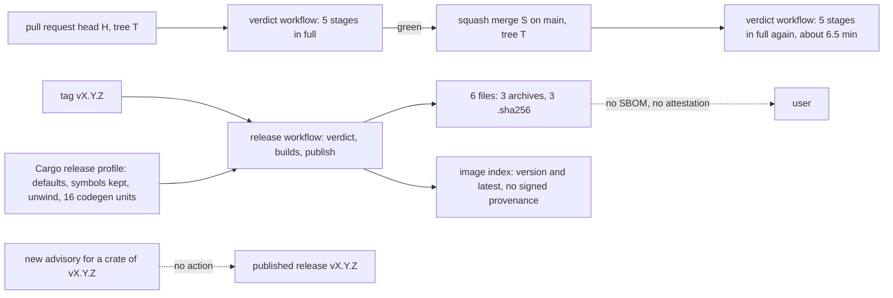
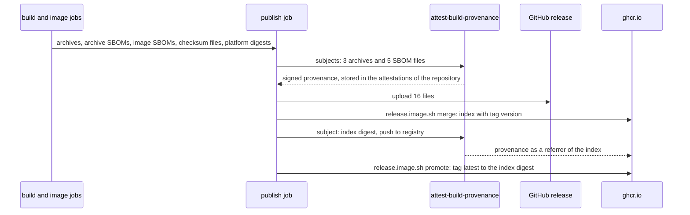
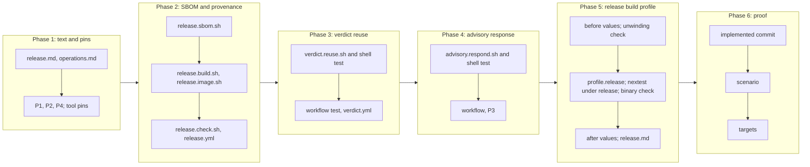

# Supply chain assurance

## Change Summary

CR-0022 publishes the `loupe` binary for three targets and the image `ghcr.io/desek/agentloupe` with checksums. CR-0024 adds the dependency check, the third-party notices, and the base image digests. Three supply chain controls are still absent, and the release binary still builds with the default Cargo release profile. This CR adds the three controls and the release profile in four parts.

1. **SBOM and provenance.** Each binary archive gets a CycloneDX SBOM from the `Cargo.lock` of the tag. Each platform image gets a CycloneDX SBOM. The release workflow makes a signed build provenance attestation for each archive, each SBOM file, and the image index digest. `release.check.sh` verifies the SBOM files and the attestations.
2. **Deterministic gating on GitHub.** The verdict workflow reuses a prior full green verdict of the identical git tree. The lookup reads the run records of the repository, is read-only, accepts exact tree equality only, and fails closed. The lint stage still runs in full, because it reads the advisory database. The release workflow keeps its full verdict on the tag commit.
3. **Advisory response for published versions.** A daily workflow checks the `Cargo.lock` of each published release against the advisory database. On a new hit, one repository script makes a draft repository security advisory, adds a warning note at the top of the notes of each affected release, opens or updates one issue with the label `security`, and, when a fix release exists, moves the image tag `latest` to the fixed version. The script never deletes an asset, a release, a tag, or an image tag.
4. **Release build profile (amendment of 2026-10-23).** The Cargo release profile of `Cargo.toml` sets `strip = true`, `lto = "fat"`, `codegen-units = 1`, `panic = "abort"`, and `debug = false`. The release scripts and the `Dockerfile` already build with `--release`, so they use the profile with no change. The dev and test profiles stay as they are. Before `panic = "abort"` lands, a check proves that no code path relies on unwinding. The reason is build hygiene: casual reading of the binary gets harder and the asset gets smaller. It is no secrecy claim, because a native binary is always readable.

## Motivation and Background

The owner asked, on 2026-10-23: "Do we have SBOM generation? And deterministic gating? And automatic revocation of versions with CVEs?"

The answer at the source commit is "no" for each question:

* No script, workflow, or specification makes an SBOM. The audit `.agents/explore/2026-10-23-cicd-governance-audit.md`, row 14, records "no attest-build-provenance, no cosign, no SBOM".
* The local verdict `pipeline.verdict.sh` keys its cache on the tree fingerprint. The hosted verdict workflow has no cache and no reuse. It runs all five stages again on the push of a squash merge, also when the pull request head had the identical tree and a green verdict.
* No process looks at a published release after its publish. A new advisory for a crate in the `Cargo.lock` of a published tag gets no action.

The owner then wrote, on 2026-10-23: "Create the CR. We need it."

The owner stated these requirements in the request for this CR:

1. **O1, SBOM and provenance.** A CycloneDX SBOM per release asset, from the `Cargo.lock` of the tag, with `cargo cyclonedx` or `cargo sbom`; the CR names the tool and pins it in `.tool-versions`. An SBOM for the image, with `buildx --sbom` or syft; the CR names it. A build provenance attestation per asset and for the image digest, with `actions/attest-build-provenance`, the permissions `id-token: write` and `attestations: write`, pinned by SHA. The SBOM files on the release with checksum entries. The verify command `gh attestation verify` in `release.md`, checked by `release.check.sh`. A judgement call on image signing with cosign keyless.
2. **O2, deterministic gating.** The hosted verdict reuses a prior green verdict of the identical tree hash (`git rev-parse HEAD^{tree}`) from the run records of the repository: read-only, exact equality only, fail closed, with the checkout of the head commit and never the merge ref, as the local verdict cache does. The release workflow keeps its verdict gate on the tag commit. The CR states the measurable gain.
3. **O3, advisory response.** A daily workflow runs the dependency check (cargo deny advisories) against the `Cargo.lock` of each published release tag that is not yet marked. On a hit: a GitHub security advisory draft with the affected versions and the advisory id; a warning note at the top of the notes of the affected release through the releases API; one issue with the label `security` that links the advisory and the fix path of CR-0023; and, after the fix release exists, a move of the image tag `latest` to the fixed version only. The script never deletes an asset or an image tag. The logic is in one repository script per `agent_first_cli`, and the workflow is a thin caller. The CR states the permissions and the limit that a GitHub release cannot be yanked.

On 2026-10-23, after the first three parts, the owner asked for a fourth part:

4. **O4, release build profile.** The Cargo release profile sets `strip = true`, `lto = "fat"` or `"thin"` (the CR states which and why), `codegen-units = 1`, `panic = "abort"`, and `debug = false`. The release scripts and the `Dockerfile` use that profile with no change. The test and dev profiles stay as they are. Before `panic = "abort"` lands, a check exists that no code path relies on unwinding (`catch_unwind`), stated as a requirement with its method: a grep of `src` for `catch_unwind`, and the test run under the release profile with `cargo nextest --cargo-profile release` or an equivalent that the CR names. The measured targets are the size of each release asset before and after (the baseline is the artifact check of 2026-10-23: macOS arm64 14,402,208 bytes, Linux x86_64 16,834,544 bytes, Linux arm64 16,341,728 bytes), the start time of `loupe serve` to the listening line before and after, and the verdict pass under the profile. The reason is build hygiene that makes casual reading of the binary harder and the asset smaller, with the statement that it is no secrecy claim, because a native binary is always readable.

These requirements, the fast feedback loop rules of the project instructions, and the facts of the repository below are the requirements of this CR. Where the owner left a detail open, this CR states a rule and names the detail a judgement call.

## Change Drivers

* A user of a release cannot see which crates the binary holds without a build from source.
* A user cannot prove that an archive or an image came from the release workflow of this repository. A checksum file proves integrity only, because the same job makes the archive and its checksum (audit row 14).
* The hosted verdict runs the test stage again on each squash merge. On 2026-10-23 the two push runs on `main` took 6 min 43 s and 6 min 39 s, and the test job took 6 min 32 s of that. The pull request run before each merge had already proved the same content.
* A published release stays as it is when a vulnerability is found in one of its crates. A reader of the release page gets no warning.
* CR-0022 lists "Build provenance attestations, an SBOM, and image signatures" as out of scope with the note "A follow-up CR can add them". CR-0024 lists audit row 14 as later work. This CR is that follow-up.
* The release binary keeps its full symbol table, its unwind tables, and 16 codegen units. Its symbol names show the module structure of the code to any reader with `nm`, and the binary is larger than it needs to be: 14,402,208 to 16,834,544 bytes for the three targets in the artifact check of 2026-10-23.

## Current State

The state below is the state after the merge of CR-0024, which is implemented on a branch and about to merge.

* The release workflow `.github/workflows/release.yml` has the jobs `visibility`, `verdict` (a call of the verdict workflow on the tag), `build` (three native runners), `image` (two native runners), and `publish`. The job `publish` has the permissions `contents: write` and `packages: write`. It attaches the assets with `gh release upload`, then calls `release.image.sh merge`. No job has `id-token: write` or `attestations: write`.
* A release has six asset files: three archives `loupe-v<version>-<target>.tar.gz` and three `.sha256` files (`release.md`, section "Binary archives").
* `.agents/scripts/release.build.sh` builds the archive of the host target and writes its checksum file. It calls `release.notices.sh` before the build. It makes no SBOM.
* `.agents/scripts/release.image.sh build` builds the image of the host platform, checks `/app/LICENSE` and `/app/THIRD-PARTY-NOTICES`, and pushes it by digest. It does not set the BuildKit attestation options, so BuildKit can add its default unsigned provenance. `release.image.sh merge` makes the index with the tags `<version>` and `latest` in one call.
* `.agents/scripts/release.check.sh` checks the downloads, the checksums, `loupe --version`, the image pull, `/healthz`, the start line, and the notices. It needs no `jq` and no `gh` (CR-0022, requirement 48). It checks no SBOM and no attestation.
* `.tool-versions` pins Node, cargo-nextest, cargo-deny, and cargo-about. No SBOM tool is pinned.
* The verdict workflow `.github/workflows/verdict.yml` runs the five stage jobs in parallel on the head commit of the event, then the fail-closed job `verdict`. It has only the permission `contents: read`. It has no reuse of an earlier run. No test reads a workflow file.
* Each workflow run record of the repository holds `head_sha`, `event`, `conclusion`, `head_repository`, and `head_commit.tree_id`. For run 39997262577 (event `pull_request`) the API gives the tree `ab844be1…`.
* The verdict runs on `main` on 2026-10-23: run 39998277995 (push, 6 min 43 s: format 16 s, web 16 s, lint 31 s, image 3 min 34 s, test 6 min 32 s, `verdict` 3 s) and run 39997205916 (push, 6 min 39 s). The pull request runs took 5 to 7 minutes.
* `pipeline.verdict.sh` keeps a local cache keyed on the tree fingerprint (`operations.md`, section "Fingerprints and the verdict cache"). The hosted runners do not use it.
* The lint stage calls `deps.deny.sh`, which fetches the advisory database over the network. This is the one network use of the lint stage (`operations.md`, section "Pipeline").
* `deny.toml` sets the three release targets in `[graph]` and the advisory policy: a vulnerability fails for each crate.
* No workflow or script reads a published release after its publish. No release has a warning note. The repository has no label `security` and no repository security advisory.
* The repository is private. No tag, release, or image exists. The first release `v0.1.0` waits for the switch to public (CR-0024, requirement 1).
* The repository has one secret, `RELEASE_PLEASE_TOKEN`. CR-0023 (approved, not implemented) adds `CLAUDE_CODE_OAUTH_TOKEN`, a daily workflow at 04:17 UTC, and `fix(deps)` releases with no human step.
* `SECURITY.md` names the private vulnerability reporting of GitHub as the one channel, and the disclosure after the fix release.

The facts of Part 4 below were read on 2026-10-23 at the commit `2561b8e` of `main`.

* `Cargo.toml` has no `[profile.*]` section, and no `.cargo/config.toml` exists. The release build thus uses the Cargo defaults of the toolchain 1.97.1 of `rust-toolchain.toml`: `opt-level = 3`, `debug = false`, `strip = "debuginfo"` (the default when debug info is off), `lto = false` (thin local LTO inside each crate only), `codegen-units = 16`, and `panic = "unwind"`. The dev and test profiles are the Cargo defaults too.
* `release.build.sh` builds with `cargo build --release --locked --bin loupe`. The `Dockerfile` builds with `cargo build --release --locked --bin loupe` in its build stage. `pipeline.image.sh` builds that `Dockerfile`, so the image stage of each verdict compiles the release profile. The bench and scenario scripts (`api.bench.sh`, `proxy.latency.sh`, `web.render.sh`, and 12 others) also build with `--release`. No `[[bench]]` target exists.
* The artifact check `.agents/explore/2026-10-23-release-artifacts-check.md` (commit `d93de7d`) measured these values with `release.build.sh`: macOS arm64 on the host, binary 14,402,208 bytes and archive 4,645,682 bytes; Linux x86_64 in `rust:1.97.1-bookworm` under emulation, binary 16,834,544 bytes and archive 5,118,180 bytes; Linux arm64 in `rust:1.97.1-bookworm`, binary 16,341,728 bytes and archive 5,069,279 bytes. The three byte counts of O4 are the `binary_bytes` values. The cold macOS build took 33.3 s. The check recorded 0.35 s from the start to the first answer of `/healthz` on macOS, but not the time to the line `listening`.
* `loupe serve` writes the info line with the message `listening` after the bind (`src/serve/mod.rs`). Each log line is JSON with a `time` field in milliseconds.
* A grep of `src` for `catch_unwind`, `resume_unwind`, `UnwindSafe`, `set_hook`, and `take_hook` gives 0 hits. Code that only acts after a panic of other code still exists: 13 recoveries of a poisoned lock (the recovery that takes the inner value of the poisoned guard) in 9 files, one match on the result of `tokio::task::spawn_blocking` whose error arm logs a warning (`src/live/route.rs`), and one ignored result of a thread join (`src/serve/mod.rs`). The server runs its handlers in tokio tasks and its workers in threads. Today a panic in one handler task or one worker thread ends that task or thread, and the process goes on.
* The store opens SQLite in WAL mode (`src/store/open.rs`). `compose.yaml` sets `restart: unless-stopped`.
* The image job of the verdict run 39998277995 took 3 min 34 s, and its test job 6 min 32 s.

### Current State Diagram



## Proposed Change

1. Add the script `release.sbom.sh`. `release.build.sh` calls it for the archive SBOM, and `release.image.sh build` calls it for the platform image SBOM.
2. Change the release workflow: the image jobs upload the image SBOM files, and the job `publish` attests the files, uploads them, pushes the index with the version tag, attests the index digest, and then moves `latest`.
3. Add the SBOM and attestation checks to `release.check.sh`, and the section "Supply chain" to `release.md`.
4. Add the entry point `verdict.reuse.sh` and a first job `reuse` in the verdict workflow. On a hit, the stage jobs format, test, web, and image do not run. The lint job always runs.
5. Add a test that reads the workflow files and pins the checkout ref and the reuse rules.
6. Add the script `advisory.respond.sh` and the daily workflow `advisory-response.yml`.
7. Document each part in `release.md` and `operations.md`.
8. Run the unwinding check, then set the release profile in `Cargo.toml`, and add the section "Release build profile" to `release.md` with the measured values (Part 4).

### Proposed State Diagram

```mermaid
flowchart TD
  subgraph P1["Part 1: release"]
    B["build job: release.build.sh"] --> BS["archive, .sha256, archive SBOM, .sha256"]
    IM["image job: release.image.sh build"] --> IS["platform digest, image SBOM, .sha256"]
    BS & IS --> PUB["publish job"]
    PUB --> AT1["attest-build-provenance: 3 archives, 5 SBOM files"]
    AT1 --> UP["upload 16 files"]
    UP --> MG["release.image.sh merge: index with the version tag"]
    MG --> AT2["attest-build-provenance: index digest, push to registry"]
    AT2 --> PR["release.image.sh promote: latest to the index digest"]
  end
  subgraph P2["Part 2: hosted verdict"]
    E["push or pull request"] --> RU["reuse job: verdict.reuse.sh lookup"]
    RU -- "hit: equal tree, full green run" --> L["lint job only"]
    RU -- "miss or lookup failed" --> F["format, lint, test, web, image in full"]
    L & F --> J["verdict job: verdict.reuse.sh judge"]
    C["workflow_call from release"] --> F
  end
  subgraph P3["Part 3: advisory response"]
    S["daily schedule or dispatch"] --> AR["advisory.respond.sh"]
    AR --> SC["cargo deny advisories on Cargo.lock of each published tag"]
    SC -- "new hit" --> D["draft security advisory"]
    SC -- "new hit" --> N["warning note at top of release notes"]
    SC -- "new hit" --> IS2["one issue, label security"]
    SC -- "fix release exists" --> LT["latest to the fixed version only"]
  end
  subgraph P4["Part 4: release build profile"]
    UC["unwinding check: grep of src, nextest under the release profile"] -- passed --> RP["Cargo.toml: profile.release strip, lto fat, codegen-units 1, panic abort, debug false"]
    RP --> RB["release.build.sh, Dockerfile, pipeline.image.sh: cargo build --release, no change"]
    RB --> MS["measured: binary and archive size, start to listening, verdict"]
  end
```



### Publish Sequence



### Reuse Sequence

```mermaid
sequenceDiagram
  participant W as verdict workflow (push of S)
  participant R as verdict.reuse.sh lookup
  participant API as GitHub run records (read-only)
  participant J as verdict.reuse.sh judge
  W->>R: checked-out commit S, base P, event push, current run id
  R->>R: tree T of S with git rev-parse
  R->>API: list verdict runs, success, push or pull_request, same repository, last 72 hours
  API-->>R: run of head H with head_commit.tree_id T
  R->>API: jobs of that run: five stage jobs success, none skipped
  R->>API: compare P with H: H contains P
  R-->>W: decision hit, source run, source commit H, tree T
  W->>W: lint job runs; format, test, web, image do not run
  W->>J: five job results and the decision
  J-->>W: pass only if lint success and the four jobs are skipped on a hit
```

## Requirements

### Functional Requirements

**Part 1: SBOM of each archive (O1)**

1. The archive SBOM tool **MUST** be `cargo-cyclonedx` of the CycloneDX project (judgement call 1). `.tool-versions` **MUST** pin it under its name in the mise registry (parameter P1).
2. A new script `.agents/scripts/release.sbom.sh` **MUST** write the SBOM files. It **MUST** follow `agent_first_cli`: the `@agents-index` line, a docstring with purpose, usage, and parameters, a complete `--help`, a machine format on stdout by default, `--human`, actionable errors on stderr, documented exit codes, and `--dry-run` that prints the plan and writes nothing.
3. The mode `asset --tag <tag> --target <triple> --out <dir>` **MUST** write `loupe-v<version>-<target>.cdx.json`. The file **MUST** be CycloneDX JSON (judgement call 3). Its metadata component **MUST** be the package `agent-loupe` with the version of the tag. It **MUST** hold one component for each crate of `Cargo.lock` that the `loupe` binary uses on that target, with the name, the version, the package URL, and the checksum of `Cargo.lock`. It **MUST NOT** hold the development dependencies.
4. The mode `asset` **MUST** read `Cargo.toml` and `Cargo.lock` of the checked-out tag commit. It **MUST** stop with exit code 1 when `Cargo.lock` changes during the run. It **MUST** stop with exit code 4 when the checked-out commit is not the tag commit, with the same tag check as `release.build.sh`.
5. Two runs of the mode `asset` on one commit **MUST** give the same set of components (name, version, package URL, and hash). The file **MUST NOT** hold a path of the build machine. The serial number and the time stamp of the SBOM **MAY** differ between runs (judgement call 4).
6. `release.build.sh` **MUST** call `release.sbom.sh asset` after the build. It **MUST** write the SBOM file and its checksum file into its output directory, next to the archive. When the SBOM step fails, `release.build.sh` **MUST** fail with exit code 1, so no archive leaves the job with no SBOM.
7. The machine line of `release.build.sh` for each asset **MUST** also name the SBOM file and the count of its components.

**Part 1: SBOM of the image (O1)**

8. The image SBOM tool **MUST** be syft of Anchore (judgement call 2). `.tool-versions` **MUST** pin it under its name in the mise registry.
9. The mode `image --tag <tag> --platform <os/arch> --digest <digest> --out <dir>` of `release.sbom.sh` **MUST** write `loupe-v<version>-image-<os>-<arch>.cdx.json` from the pushed platform image, read from the registry by its digest. The file **MUST** be CycloneDX JSON. It **MUST** list the operating system packages of the image and the `loupe` binary.
10. `release.image.sh build` **MUST** call `release.sbom.sh image` after the push by digest. It **MUST** write the SBOM file and its checksum file into a directory that the new flag `--sbom-dir` names. When the SBOM step fails, `release.image.sh build` **MUST** fail with exit code 1.
11. `release.image.sh build` **MUST** turn off the BuildKit provenance and SBOM attestations explicitly, so the pushed image holds no unsigned provenance next to the signed one of requirement 15 (judgement call 6).

**Part 1: release files and checksums (O1)**

12. Each SBOM file **MUST** have one checksum file `<name>.sha256` in the format of CR-0022, requirement 37.
13. The release **MUST** hold 16 files: the three archives, the three archive SBOM files, the two image SBOM files, and one checksum file for each of these eight files. This replaces the count of six in CR-0022, requirement 38, and in `release.md`.
14. The job `publish` **MUST** attach the 16 files only after all three builds and both image builds pass, as CR-0022, requirement 38, states for the archives.

**Part 1: build provenance (O1)**

15. The job `publish` **MUST** make one build provenance attestation with `actions/attest-build-provenance` whose subjects are the three archives and the five SBOM files. It **MUST** make it before the upload of requirement 14. When the attestation fails, the job **MUST** fail and upload nothing.
16. `release.image.sh merge` **MUST** push the index with the tag `<version>` only. It **MUST** write the image name and the index digest as two `key=value` lines to a file that the new flag `--output-file` names, so the workflow passes both to the next step as step outputs and states no image name (CR-0022, requirement 20).
17. The job `publish` **MUST** then make one build provenance attestation with `actions/attest-build-provenance` for the subject name and the index digest that the step outputs of requirement 16 give (the image `ghcr.io/desek/agentloupe`), and push the attestation to the registry.
18. A new mode `release.image.sh promote --tag <tag>` **MUST** move the tag `latest` to the index digest of the tag `<version>`. The job `publish` **MUST** call it only after the attestation of requirement 17 passes. This replaces the move of `latest` in CR-0022, requirement 40. The mode **MUST** refuse a move to a version that is older than the version that `latest` points to, with exit code 1 (judgement call 21). The mode `promote` **MUST NOT** require that the checked-out commit is the tag commit, because the advisory workflow of requirement 47 calls it from a checkout of the default branch; it **MUST** still stop with exit code 4 when the tag is absent or when the version in `Cargo.toml` at the tag differs from the tag version.
19. Only the job `publish` **MUST** have the permissions `id-token: write` and `attestations: write`. The job keeps `contents: write` and `packages: write`. The other jobs of each workflow **MUST NOT** get `id-token: write` or `attestations: write`.
20. Each use of `actions/attest-build-provenance` **MUST** be pinned by its full 40-character commit SHA, with the release tag in a comment (CR-0022, requirement 21).
21. A manual start of the release workflow for a tag **MUST** make the attestations again with no error, and **MUST** move `latest` only per requirement 18.
22. The image is not signed with cosign in this CR. The signed provenance of requirement 17 is the one signature of the image (judgement call 7).

**Part 1: verify (O1)**

23. `release.check.sh` **MUST** download the five SBOM files and their checksum files with the archives, and verify each checksum.
24. `release.check.sh` **MUST** check each SBOM file: the text holds the CycloneDX format marker, the metadata component `agent-loupe` with the version of the release for an archive SBOM, and at least one component. It **MUST** print one check line `sbom <file>` for each of the five files.
25. When `gh` is present, `release.check.sh` **MUST** run `gh attestation verify` for each of the three archives and the five SBOM files, and for `oci://ghcr.io/desek/agentloupe:<version>`. Each call **MUST** bind the attestation to the repository `desek/agentloupe`, to the signer workflow `.github/workflows/release.yml` of that repository, and to the source ref `refs/tags/v<version>` (parameter P4). It **MUST** print one check line `attestation <file>` for each file and one line `attestation image`.
26. When `gh` is absent, each attestation check **MUST** report `skipped` with the reason. The other checks **MUST** still need no `gh` and no `jq`. This amends CR-0022, requirement 48: `gh` is optional, not required.
27. The new flag `--skip-supply-chain` **MUST** report each `sbom` and `attestation` check as `skipped` with the reason "skipped by flag". It is for a release made before this CR, for example `v0.1.0`. Without the flag, a missing SBOM file or attestation **MUST** fail the check (judgement call 8).
28. The exit codes of `release.check.sh` **MUST** stay the same: an SBOM or attestation failure is exit code 1, and a download failure is exit code 4.

**Part 2: hosted verdict reuse (O2)**

29. A new entry point `.agents/scripts/verdict.reuse.sh` **MUST** decide the reuse. It **MUST** follow `agent_first_cli`. It **MUST** have two modes: `lookup` and `judge`.
30. The mode `lookup` **MUST** take the platform values as explicit inputs: the repository, the commit of the checkout, the event (`push` or `pull_request`), the base commit (the first parent of the pushed commit for a push, the base commit of the pull request for a pull request), the id of the current run, and a file for the decision. The token **MUST** come from the named environment variable `GH_TOKEN`. Where `git` can give a value, the script **MUST** use it as the local default.
31. The mode `lookup` **MUST** compute the tree of the checked-out commit with `git rev-parse HEAD^{tree}`. It **MUST** first check that `HEAD` equals the commit input, so the advertised tree equals the validated tree.
32. The mode `lookup` **MUST** accept a source run only when each condition below holds:
    1. The run is a run of `.github/workflows/verdict.yml` of this repository, with the conclusion `success`.
    2. The event of the run is `push` or `pull_request`. A run of another event **MUST NOT** count.
    3. The head repository of the run is this repository (judgement call 11).
    4. The run started within the lookback window of 72 hours before the current run (judgement call 10).
    5. The full 40-character `head_commit.tree_id` of the run equals the tree of requirement 31, by string equality. No other match counts: not a commit SHA, a branch, an ancestor, a path filter, or a green check of a pull request.
    6. Each of the five stage jobs format, lint, test, web, and image of the run has the conclusion `success`. A run in which a stage job was skipped by a reuse **MUST NOT** count, so the age of a proof never passes the window.
    7. For a source run of the event `pull_request`, the head commit of that run contains the base commit of requirement 30 (the compare of the base with the head gives `ahead` or `identical`). This proves that the workflow file of the merge ref of that run equals the workflow file of the tree.
    8. The run is not the current run.
33. The mode `lookup` **MUST** be read-only. It **MUST** make only read calls to the GitHub API. It **MUST NOT** write a cache, an artifact, a status, or a verdict store.
34. The mode `lookup` **MUST** fail closed. A missing tool, a missing token, a failed or partial API call, an unknown field, a bad commit input, a `HEAD` that differs from the commit input, or a page limit reached **MUST** give the decision `miss` with the reason `lookup_failed` and the cause. Only a positive match gives `hit`.
35. The mode `lookup` **MUST** print one machine line with the decision (`hit` or `miss`), the reason (`match`, `novel`, or `lookup_failed`), the tree, and, for a hit, the source run id and the source commit. With no decision file, the exit code **MUST** be 0 for `hit`, 1 for `miss` with `novel`, and 4 for `miss` with `lookup_failed`. With a decision file, the script **MUST** write the decision and the reason to that file and exit with code 0, so the platform step does not fail on a miss. Exit code 2 **MUST** be a usage error, and exit code 3 a missing tool, in both forms.
36. The mode `judge` **MUST** take the results of the five stage jobs and the decision as explicit inputs. It **MUST** pass only in one of two cases: (a) each of the five stage jobs has the result `success`; or (b) the decision is `hit`, the lint job has the result `success`, and the four jobs format, test, web, and image have the result `skipped`. Each other combination **MUST** fail. An absent decision **MUST** count as `miss`.
37. The verdict workflow **MUST** get one new first job `reuse` on a Linux x86_64 runner. The job **MUST** check out the head commit of the event (never the merge ref), with the history that the base commit needs, and **MUST** make exactly one call of `verdict.reuse.sh lookup`. It **MUST** have a timeout (judgement call 13).
38. The job `reuse` **MUST NOT** run on a call from another workflow. A call from the release workflow **MUST** run the five stage jobs in full, so the release keeps its full verdict on the tag commit.
39. The stage jobs format, test, web, and image **MUST** run unless the decision of the job `reuse` is `hit`. When the job `reuse` fails, is skipped, or gives no decision, these jobs **MUST** run in full.
40. The lint job **MUST** run in full on each event, because the dependency check reads the advisory database over the network and is not a deterministic stage (judgement call 9).
41. The job `verdict` **MUST** depend on the job `reuse` and the five stage jobs, and **MUST** make exactly one call of `verdict.reuse.sh judge`. The check name `verdict` **MUST NOT** change, so the main ruleset of CR-0024 still requires it.
42. The job `reuse` **MUST** have only the permissions `contents: read` and `actions: read` (parameter P2). The other jobs of the verdict workflow **MUST** keep only `contents: read`. A job of the verdict workflow **MUST NOT** get a write permission.
43. A new test **MUST** read `.github/workflows/verdict.yml` and `.github/workflows/release.yml` and fail when: a checkout of the verdict workflow does not use the head commit expression, or uses the merge ref; the job `reuse` can run on a workflow call; the lint job has a condition on the decision; the job `verdict` does not call `verdict.reuse.sh judge`; a job of the verdict workflow has a write permission; or the release workflow does not call the verdict workflow before its builds.
44. The declared inputs of the test stage **MUST** add `.github/workflows`, because the test of requirement 43 reads it.
45. `pipeline.verdict.sh`, its fingerprint script, and the local verdict cache **MUST NOT** change.

**Part 3: advisory response (O3)**

46. A new script `.agents/scripts/advisory.respond.sh` **MUST** hold all the logic of the advisory response. It **MUST** follow `agent_first_cli`, with `--dry-run`.
47. A new workflow `.github/workflows/advisory-response.yml` **MUST** start on a daily schedule (judgement call 15) and on `workflow_dispatch`. It **MUST** be a thin caller per CR-0022, requirements 19 to 22: it checks out the default branch with all tags and no persisted credential, installs the Rust toolchain from `rust-toolchain.toml` and cargo-deny from `.tool-versions`, sets up Docker Buildx, logs in to `ghcr.io`, and makes exactly one call of `advisory.respond.sh`.
48. The workflow **MUST** have one concurrency group for all its runs, and a new run **MUST NOT** cancel an active run. Its job **MUST** have a timeout (judgement call 13).
49. The workflow **MUST** request these permissions of the `GITHUB_TOKEN`, and no others: `contents: write` (the release notes), `issues: write` (the issue and the label), and `packages: write` (the move of `latest`). The draft advisory **MUST** use the token of parameter P3, given to the script step only. This extends CR-0022, requirement 22, by the one repository secret of parameter P3, for the script step of this workflow only.
50. The script **MUST** list the published releases of the repository whose tag has the form `v<major>.<minor>.<patch>`. It **MUST** skip a draft release and a pre-release.
51. For each such release, the script **MUST** export the tree of its tag with `git archive` into a temporary directory and run `cargo deny check advisories` there against the `Cargo.lock` of the tag. It **MUST** use the `deny.toml` of the checked-out default branch, or the file that the flag `--deny-config` names (judgement call 17). It **MUST NOT** change the working tree, the index, or the branches of the clone.
52. The script **MUST** fetch the advisory database one time in a run, then check each release offline against that database. When the fetch or the read of the database fails, the script **MUST** stop with exit code 5 and claim no clean result (fail closed).
53. Only an advisory of the kind vulnerability **MUST** count as a hit. An unmaintained, unsound, or informational notice and a yanked crate **MUST NOT** start a response (judgement call 18). An ignore entry of the `deny.toml` in use applies.
54. Each release **MUST** carry one hidden marker in its notes with the ids of the advisories already handled for it. A hit whose advisory id is in the marker of that release **MUST** give no new action. Thus "not yet marked" is per release and per advisory id, and a later advisory on a marked release still gets a response (judgement call 16).
55. For each new hit, the script **MUST** create one draft repository security advisory for each upstream advisory id, or update the existing draft of that id. The draft **MUST** name the upstream advisory id and its aliases, the crate and its version, the upstream link, the affected versions of this project, and the fixed version when it exists. The script **MUST NOT** publish the draft and **MUST NOT** request a CVE. A human publishes it (judgement call 19).
56. For each new hit, the script **MUST** add one warning note at the top of the notes of the affected release through the releases API. The note **MUST** name the advisory id, the crate, the upstream link, the link to the issue of requirement 57, and the fixed version when it exists. The script **MUST** keep the earlier notes text unchanged below the note, and **MUST** update the marker of requirement 54 in the same write.
57. For each upstream advisory id with a hit, the script **MUST** keep exactly one open issue with the label `security`. It **MUST** open it, or comment on it when it exists. The issue **MUST** link the upstream advisory and the draft, list the affected versions, and state the fix path: the daily autofix workflow of CR-0023 when it exists, else the manual steps in `release.md` (a `fix(deps)` commit and a patch release). The script **MUST** create the label `security` when it is absent.
58. A fix release is a published release whose version is greater than each affected version and whose own check of requirement 51 gives no hit for that advisory. When a fix release exists, the script **MUST**: name the fixed version in the note of each affected release, in the draft, and in the issue; and make sure that the image tag `latest` points to the newest published release that has no hit for that advisory and that is newer than each affected release. When `latest` points elsewhere, the script **MUST** move it with `release.image.sh promote` (requirement 18).
59. The script **MUST** move `latest` only to a fixed version per requirement 58. It **MUST NOT** move `latest` to an affected version or to a version older than the version that `latest` points to.
60. The script **MUST NOT** delete or replace a release, a release asset, a git tag, an image tag, or a package version. It **MUST NOT** change the draft or pre-release state of a release. The only image tag that it moves is `latest`. Reason: a reader of the dashboard, or a user pinned to a version, can need an old version, and the warning note and the advisory tell that user the risk with no loss of the version.
61. When the fix release exists, `latest` points to it, and the draft names the fixed version, the script **MUST** comment on the issue with the run link and close it.
62. With `--dry-run`, the script **MUST** do the listing and the checks of requirements 50 to 53 and print each planned action: the draft, the note, the issue, and the move of `latest`. It **MUST NOT** make a write call to the GitHub API, a registry write, or a git write.
63. The script **MUST** print one machine line for each release (`release: <tag> status: clean|hit|marked advisories: <ids>`), one line for each action, and one summary line with the counts. It **MUST NOT** print a token.
64. The script **MUST** document and use these exit codes: 0 for a run with no new hit or with each action done, 1 for one or more failed actions, 2 for a usage error, 3 for a missing tool or credential, 4 for a failed GitHub API call, and 5 for a failed read of the advisory database.
65. The known limit **MUST** be stated in `release.md` and `SECURITY.md`: GitHub has no yank for a release. A published release stays downloadable, and its image tag stays pullable. The response is a warning note, a draft advisory that a human publishes, an issue, and the move of `latest` to the fixed version.

**Documentation**

66. `docs/specification/release.md` **MUST** change in these sections: "Release flow" (the order of the job `publish`), "Release assets" (the 16 files), "Container image" (the attestation, the promote step, and the BuildKit attestations off), "Verify a release" (the SBOM and attestation checks and `--skip-supply-chain`), "Pinned actions" (the new action), and "Release token" (the secret of parameter P3 next to `RELEASE_PLEASE_TOKEN`, so the section no longer states that `RELEASE_PLEASE_TOKEN` is the only repository secret). It **MUST** get two new sections: "Supply chain" (the SBOM tools and format, the attestation subjects, the verify commands with `gh attestation verify`, and the cosign decision) and "Advisory response" (requirements 46 to 65, the marker, the no-delete rule and its reason, and the limit of requirement 65). The section of Part 4 is stated in requirement 82.
67. `docs/specification/operations.md` **MUST** change in these sections: "Hosted workflows" (the job `reuse`, the new permissions, the attestation as platform work, the advisory workflow and its timeout, and the timeout table), "Fingerprints and the verdict cache" (a new subsection "Hosted verdict reuse" for requirements 29 to 45), "Stage inputs and toolchain" (requirement 44), and "Release targets" (the new rows of Parts 1 to 3 of the section "Measurable Targets"). Part 4 does not change `operations.md`; its measured values go to `release.md` (requirement 82).
68. `SECURITY.md` **MUST** get at most five lines on the advisory response for published releases and the limit of requirement 65.
69. `.taxonomy` **MUST** get rows for the terms "SBOM", "build provenance attestation", "verdict reuse", "source run", "advisory response", and "fix release".
70. In `docs/specification/index.md`, the row of `release.md` **MUST** also name the supply chain and the advisory response. No new specification file is added.

**Part 4: release build profile (O4, amendment of 2026-10-23)**

71. `Cargo.toml` **MUST** get one section `[profile.release]` with exactly these five keys: `strip = true`, `lto = "fat"` (judgement call 27; requirement 80 states the one case for `"thin"`), `codegen-units = 1`, `panic = "abort"`, and `debug = false`. The key `opt-level` **MUST NOT** be set, so it stays the Cargo default 3 (judgement call 31).
72. The dev and test profiles **MUST** stay as they are. `Cargo.toml` **MUST NOT** get a `[profile.dev]`, `[profile.test]`, `[profile.bench]`, or custom profile section. No `.cargo/config.toml`, no `CARGO_PROFILE_*` variable, and no `RUSTFLAGS` in a script, a workflow, or the `Dockerfile` **MUST** set or override a profile key.
73. The release scripts and the `Dockerfile` **MUST** use the profile with no change for Part 4. `release.build.sh`, `release.image.sh`, `pipeline.image.sh`, the `Dockerfile`, the workflows, and the bench and scenario scripts keep `cargo build --release`, which selects `[profile.release]`. The Part 1 changes to `release.build.sh` and `release.image.sh` stay; Part 4 adds no change to them.
74. Before `panic = "abort"` lands, the explicit unwinding check **MUST** pass: `grep -rnE 'catch_unwind|resume_unwind|UnwindSafe|panic::set_hook|panic::take_hook' src` gives no hit. A hit **MUST** block `panic = "abort"` until the code no longer needs it.
75. Before `panic = "abort"` lands, the implicit unwinding check **MUST** pass: `grep -rnE 'spawn_blocking|JoinError|is_panic|into_panic|\.join\(\)|into_inner\(\)' src` lists each place that can act after a panic of other code. Each hit **MUST** get one class: "inert under abort" (the code handles a panic or a poisoned lock that cannot occur under abort, and the process end is the accepted outcome, judgement call 30), or "needs unwinding" (the code needs a result, a cleanup, or a recovery after a panic for correct behavior). A hit of the class "needs unwinding" **MUST** block `panic = "abort"`: Part 4 then lands with the other four keys only, and `release.md` names the hit (judgement call 28).
76. Before the profile lands, the test run under the release profile **MUST** pass: `cargo nextest run --locked --no-fail-fast --cargo-profile release` exits 0 and passes the same count of tests as the test stage at the same commit. When the pinned cargo-nextest does not accept `--cargo-profile`, the named equivalent is `cargo nextest run --locked --no-fail-fast --release` (parameter P6). The run is a check at the implementation and at each later change of `[profile.release]`, not a stage of the verdict (judgement call 29).
77. Before the profile lands, the binary check under the profile **MUST** pass, because Cargo builds the test harness with unwind and requirement 76 thus does not run abort code: the archive binary that `release.build.sh` builds with the profile prints the version with `--version`, writes the line `listening` after `loupe serve`, answers `GET /healthz` with 200 and `{"status":"ok"}`, and on SIGTERM writes the line `database closed, exit` and exits with code 0. Each Linux binary **MUST** pass `--version` and `/healthz` in `debian:bookworm-slim` of its platform.
78. The checks of requirements 74 to 77 **MUST** run on the working tree that holds the profile, before the implemented commit. The scenario `.agents/scenarios/supply-chain.md` **MUST** record their commands, results, and the class of each hit of requirement 75.
79. Each measured target of Part 4 (section "Measurable Targets") **MUST** be measured before and after the profile with the same environment and the same method: the same host, the same container image, and the same commit except `Cargo.toml` (judgement call 32).
80. `lto` **MUST** be `"fat"`. When the row "Image job time under the profile" or the row "Release build time under the profile" fails its threshold with `"fat"`, the implementation **MUST** set `lto = "thin"`, measure each Part 4 row again, and state both measurements and the reason in `release.md`.
81. The profile **MUST NOT** change a behavior that a user sees, except these four, which `release.md` **MUST** state: the smaller binary and archive; a panic ends the process with SIGABRT and runs no destructor, where today it ends one task or one thread; a backtrace holds addresses and no symbol names; and the start time within the threshold of its row.
82. `docs/specification/release.md` **MUST** get a new section "Release build profile" with: the five keys and the reason for each; the choice of `lto` and its reason; the rule that the dev and test profiles stay as they are; the unwinding check with its method (requirements 74 to 77) and its result; the four effects of requirement 81; the measured values before and after; and the statement of requirement 83. Item 1 of the section "Binary archives" **MUST** name the section.
83. The statement **MUST** say: the profile is build hygiene that makes casual reading of the binary harder and the asset smaller; it is no secrecy claim, because a native binary is always readable with a disassembler, and its strings stay readable, for example the log and error messages, the source file paths in panic messages, and a URL set at build time (CR-0026). A text of the project (`README.md`, `release.md`, `SECURITY.md`, release notes) **MUST NOT** claim that the profile hides, protects, or obfuscates code or data (judgement call 33).

### Non-Functional Requirements

1. The safety invariant **MUST** hold: the set of trees that can reach `main` with a green check `verdict`, and the set of content that a release can publish, **MUST** be equal to or smaller than with a verdict that always runs in full.
2. The project **MUST NOT** use a paid service. The attestations use the public Sigstore instance and the attestation store of GitHub, which are free for a public repository.
3. The stage entry points **MUST NOT** change, except the declared inputs of `pipeline.test.sh` (requirement 44). `pipeline.verdict.sh` and its fingerprint script **MUST NOT** change.
4. Each workflow **MUST** stay a thin caller per CR-0022, requirements 19 to 22. The attestation step is platform work: an identity statement that the platform signs for the run (judgement call 5). Each action **MUST** stay pinned by its full commit SHA.
5. The count of repository secrets **MUST** grow by at most one, for parameter P3.
6. A new file and the output of a new script **MUST NOT** hold a secret value.
7. Each new script **MUST** pass `bash -n` and the lint and format rules of the existing scripts. `release.check.sh` **MUST** still run with the bash 3.2 of macOS.
8. The time from the tag to the published assets **MUST** stay within 45 minutes (CR-0022), with the release profile of Part 4.
9. The targets of the section "Measurable Targets" **MUST** hold.

## Measurable Targets

The baseline column holds the value at the source commit or on 2026-10-23. "None" means that the metric does not exist before this CR. The release rows are measured on the first release after this CR. The Part 4 rows are measured before and after the profile per requirement 79: the macOS arm64 values on the host, the Linux values in `rust:1.97.1-bookworm` of each platform, as the artifact check of 2026-10-23 did; the values of the first release run after this CR are recorded next to them.

| Metric | Method | Baseline | Threshold |
|---|---|---|---|
| Archives with an SBOM | `gh release view v<version> --json assets` lists `loupe-v<version>-<target>.cdx.json` and its `.sha256` for each target | 0 of 3 | 3 of 3 |
| Image platforms with an SBOM | the same list holds `loupe-v<version>-image-<os>-<arch>.cdx.json` and its `.sha256` | 0 of 2 | 2 of 2 |
| SBOM coverage of each archive | the component count that `release.build.sh` prints, against the count of distinct crates of `cargo tree --locked --target <triple> -e normal,build --prefix none` minus the root package, at the tag | none | equal for each target |
| Release files with an attestation | `gh attestation verify <file> --repo desek/agentloupe` with the signer workflow and source ref flags of requirement 25, for each archive and SBOM file; count the exit codes 0 | 0 of 8 | 8 of 8 |
| Image with an attestation | `gh attestation verify oci://ghcr.io/desek/agentloupe:<version>` with the same flags; exit code | none | exit code 0 |
| Attestation of a changed file | change one byte of a downloaded archive copy, then `gh attestation verify` on the copy | none | non-zero exit code |
| Release check with the supply chain | `.agents/scripts/release.check.sh --version <version>; echo $?` with `gh` present | none | exit code 0; each `sbom` and `attestation` line `status: passed` |
| Verdict time on a squash merge of a green pull request | the duration of the verdict run (`createdAt` to `updatedAt` of `gh run view <run id> --json createdAt,updatedAt`) on the push of a squash merge of a pull request that was up to date with `main` and had a green verdict; median of 3 merges | 6 min 43 s and 6 min 39 s (push runs 39998277995 and 39997205916 on 2026-10-23; test job 6 min 32 s) | at most 3 minutes, and at most 50 percent of the baseline median |
| Verdict time on novel content | the same method on a pull request that changes one Rust file | 5 to 7 minutes on 2026-10-23 | at most 1 minute above the baseline median (the job `reuse`); within the CR-0022 thresholds |
| Lookup time | the duration of the job `reuse` in the run of the row "Verdict time on a squash merge" | none | at most 60 seconds |
| Unsound reuse | over each run with the decision `hit` in the scenario and in the first 14 days: count the runs where the source tree on the machine line differs from `git rev-parse <checked-out commit>^{tree}` | none | 0 |
| Reuse in a release | count the release runs whose called verdict has a job `reuse` that ran | none | 0 |
| Write calls of the lookup | the fake `gh` of the shell test records each method of each call of `verdict.reuse.sh lookup` | none | 0 calls with a method other than `GET` |
| Time from an advisory to the response | the commit time of the advisory file in the advisory database, to the `created_at` of the issue and the time of the note line of the run log | none | at most 26 hours |
| Responses in the seeded dry run | the planned action lines of `advisory.respond.sh --dry-run --deny-config <seeded file>` | none | 1 draft, 1 note for each affected release, 1 issue, and 0 write calls |
| Deleted assets | before and after each run of `advisory.respond.sh` and of the release workflow: the count of releases, of release assets, of git tags, and of image tags | none | 0 deleted, 0 replaced by the advisory script |
| Repository secrets | the count of secrets in the repository settings | 1 (2 with CR-0023) | at most 1 more than before this CR |
| Paid use | the billing usage of the account for GitHub Actions and GitHub Packages | 0 USD | 0 USD |
| Binary size under the profile (Part 4) | the `binary_bytes` value that `release.build.sh` prints for each target, before and after the profile | macOS arm64 14,402,208 bytes; Linux x86_64 16,834,544 bytes; Linux arm64 16,341,728 bytes (artifact check of 2026-10-23, commit `d93de7d`) | for each target: at most 85 percent of the before value, and at most 25 MiB |
| Archive size under the profile (Part 4) | the `archive_bytes` value that `release.build.sh` prints for each target, before and after | macOS arm64 4,645,682 bytes; Linux x86_64 5,118,180 bytes; Linux arm64 5,069,279 bytes (same check) | for each target: below the before value |
| Start time to the line `listening` (Part 4) | 10 starts of the archive binary with `env -i`, two keys from `loupe gen-key`, a new temporary data directory each time, and `--listen 127.0.0.1:0`; for each start, the time from the spawn to the stdout line whose message is `listening`; median; on the macOS arm64 host and on linux/arm64 in `debian:bookworm-slim` | none; measured before the profile at the implementation (the artifact check recorded only 0.35 s to the first `/healthz` answer on macOS) | on each host: the after median at most 110 percent of the before median |
| Verdict under the profile (Part 4) | `.agents/scripts/pipeline.verdict.sh; echo $?` on the working tree with the profile, and the conclusion of the hosted verdict of its pull request | none | exit code 0 and conclusion `success` |
| Tests under the release profile (Part 4) | the command of requirement 76; exit code and the count of passed tests, against the test stage at the same commit | none | exit code 0; equal counts |
| Explicit unwinding hits (Part 4) | the grep of requirement 74 | 0 at `2561b8e` | 0 |
| Implicit unwinding hits needing unwinding (Part 4) | the grep of requirement 75; each hit classified | 15 hits at `2561b8e` (13 poison recoveries, 1 `spawn_blocking` result, 1 thread join), not classified | each hit classified; 0 of the class "needs unwinding" for `panic = "abort"` to land |
| Symbols of the binary (Part 4) | `nm <binary> 2>/dev/null \| wc -l` on the macOS arm64 archive binary, before and after | none; measured before the profile | at most 5 percent of the before count |
| Image job time under the profile (Part 4) | the duration of the job image of the hosted verdict on a pull request that changes one Rust file, against the job test of the same run | image 3 min 34 s, test 6 min 32 s (run 39998277995) | the image job duration at most the test job duration of the same run, so the verdict time does not grow |
| Release build time under the profile (Part 4) | the wall time of `release.build.sh` on the macOS arm64 host with a cold `target/`, and the duration of each build job of the first release run | 33.3 s on the host (artifact check) | at most 5 minutes on the host; each build job within the 45-minute budget of non-functional requirement 8 |

## Affected Components

New files:

* `.agents/scripts/release.sbom.sh`: the SBOM files (requirements 2 to 5, 9).
* `.agents/scripts/verdict.reuse.sh`: the reuse lookup and the judge (requirements 29 to 36).
* `.agents/scripts/advisory.respond.sh`: the advisory response (requirements 46 to 65).
* `.github/workflows/advisory-response.yml`: the thin caller of the advisory response (requirements 47 to 49).
* `tests/workflow.verdict.rs` with its `[[test]]` entry in `Cargo.toml`: the test of requirement 43.
* `tests/scripts/verdict.reuse.test.sh` with its wrapper `tests/verdict.reuse.rs`, and `tests/scripts/advisory.respond.test.sh` with its wrapper `tests/advisory.respond.rs`, each with a fake `gh` and its `[[test]]` entry.
* `.agents/scenarios/supply-chain.md`: the scenario of the section "Model-Based Testing".

Changed files:

* `.github/workflows/release.yml`: the image jobs upload the image SBOM files; the job `publish` gets the attestation steps, the new order, and the two new permissions.
* `.github/workflows/verdict.yml`: the job `reuse`, the conditions of four stage jobs, and the job `verdict`.
* `.agents/scripts/release.build.sh`, `.agents/scripts/release.image.sh` (the flags `--sbom-dir` and `--output-file`, the mode `promote`, the BuildKit attestations off), `.agents/scripts/release.check.sh`.
* `.agents/scripts/pipeline.test.sh`: the declared inputs only (requirement 44).
* `.tool-versions`: cargo-cyclonedx and syft.
* `Cargo.toml`: the section `[profile.release]` of Part 4 (requirements 71 and 72), next to the `[[test]]` entries of Parts 2 and 3.
* `docs/specification/release.md`, `docs/specification/operations.md`, `docs/specification/index.md`, `SECURITY.md`, `.taxonomy`. For Part 4, `release.md` gets the section "Release build profile" and one change to item 1 of "Binary archives" (requirement 82).
* `README.md`, section "Install": one line on the SBOM files and the verify command.
* `docs/cr/CR-0023-dependency-autofix.md`: an "Amendment by CR-0025" note on non-functional requirement 2, when CR-0023 is not implemented before this CR (judgement call 24).

Repository settings (not files): the secret of parameter P3, and the label `security` (made by the script).

Not changed:

* `pipeline.verdict.sh`, its fingerprint script, the local verdict cache, and the stage entry points other than the declared inputs of `pipeline.test.sh`.
* `.github/workflows/release-please.yml`, `release-please-config.json`, `.release-please-manifest.json`.
* `Dockerfile`, `compose.yaml`, `deny.toml`, `about.toml`, `rust-toolchain.toml`.
* For Part 4: the dev and test profiles, `pipeline.image.sh`, the bench and scenario scripts that build with `--release`, and each workflow. `release.build.sh` and `release.image.sh` get only the Part 1 changes. Part 4 adds no file and no change to `operations.md`.
* The binary, the public API, the dashboard, and the day record.

## Scope Boundaries

### In Scope

* O1: the archive and image SBOM files, their checksum files, the build provenance attestations, and the verify step.
* O2: the reuse of a full green verdict of an identical tree in the verdict workflow, the judge, and the workflow test.
* O3: the daily advisory response for published releases.
* O4: the section `[profile.release]` of `Cargo.toml`, the unwinding check before `panic = "abort"`, the measurements before and after, and the section "Release build profile" of `release.md`.
* The specification, taxonomy, README, and `SECURITY.md` text of the four parts.

### Out of Scope ("Here, But Not Further")

* An image signature with cosign. This CR recommends it as a later step (judgement call 7).
* Signing or notarization of the macOS binary (CR-0022 keeps it out).
* The LiteLLM price file and the Geist fonts as SBOM components. `THIRD-PARTY-NOTICES` names them; the archive SBOM lists the crates of `Cargo.lock` only (judgement call 3).
* Attestations of the two platform image digests. The attestation subject is the index digest (judgement call 6).
* A claim of SLSA build level 3. The attestation records the workflow run; this CR claims no level.
* Audit row 15: a draft release until the assets exist. The release stays published by release-please before the assets exist.
* Audit row 16: the cargo cache of the release builds.
* Audit row 23: an automatic run of `release.check.sh` after the publish. It stays a manual check on a machine with Docker and `gh`.
* A reuse in the release workflow, a reuse of a single stage, a reuse across forks, and a written verdict store.
* A reuse of the lint stage.
* A yank, a deletion, or a replacement of a published release, asset, tag, image tag, or package version.
* The publish of a draft advisory and a CVE request. These stay human steps.
* An advisory check of `prototype/` or of the npm packages. The prototype is not shipped.
* A fix of the advisory. CR-0023 and the owner own the fix path.
* Obfuscation, string encryption, symbol encryption, anti-debugging, or packing of the binary (UPX or similar). Part 4 makes no secrecy claim (requirement 83).
* A change of `opt-level`, the dev profile, the test profile, or a custom profile for the benches (judgement call 31).
* A separate debug symbols file as a release asset, and a crash symbolization service.
* Tests with `panic = "abort"`, which needs the unstable `-Zpanic-abort-tests` flag of Cargo.
* A layer that catches a panic of a request handler and answers 500. Under `panic = "abort"` it would not run.
* A new measurement of the earlier bench values. The bench scripts build with the new profile from Part 4 on; their recorded values stay as history.
* Byte-reproducible archives (artifact check, finding F8).

## Alternative Approaches Considered

* **`cargo sbom` for the archive SBOM.** Rejected for the default. `cargo-cyclonedx` is the tool of the CycloneDX project, writes CycloneDX JSON, and filters the graph by target. `cargo sbom` stays the fallback of parameter P1.
* **`buildx --sbom=true` for the image SBOM.** Rejected. BuildKit writes SPDX, not CycloneDX, as an attestation manifest in the image index. The merge of push-by-digest images in `release.image.sh merge` does not keep it reliably, and the file is not a release asset. syft writes a CycloneDX file from the pushed digest, so all five SBOM files have one format.
* **The SBOM attestation action in place of a file on the release.** Rejected for this CR. The owner asked for SBOM files on the release with checksum entries. The provenance attestation covers the SBOM files as subjects.
* **Attest in each build job.** Rejected. One attestation in the job `publish` has all subjects, needs the token permissions in one job only, and runs only when all builds passed.
* **Reuse on a commit SHA or on a green ancestor.** Rejected by the fast feedback loop rules: a squash merge makes a new SHA over the same tree, and a green ancestor does not prove a merged tree.
* **A verdict store written by the workflow.** Rejected. A written store is as privileged as an artifact push. The run records of GitHub already hold the tree and the job results, and the lookup reads them.
* **Reuse of the lint stage.** Rejected. The dependency check reads the advisory database, which changes with no change of the tree.
* **Delete or hide an affected release.** Rejected by the owner (O3). A reader can need an old version, and a deleted asset breaks each pinned install and each checksum link.
* **Move `latest` back to an older unaffected version.** Rejected. An older version can lack fixes of the newer one, and a backward move surprises a user of `latest`.
* **The advisory response in CR-0023's script.** Rejected. CR-0023 fixes `main`; this response marks the published past. One script per purpose keeps each testable.
* **`lto = "thin"` as the default.** Rejected for the default, kept as the fallback of requirement 80. Thin LTO builds faster in parallel, but with `codegen-units = 1` most of that gain is gone, and fat LTO gives the smaller binary that O4 measures.
* **`opt-level = "z"` or `"s"`.** Rejected. It makes the binary smaller but slower, and the proxy is on the hot path of each agent call.
* **A custom profile `dist` with `--profile dist`.** Rejected. O4 asks for the release scripts and the `Dockerfile` with no change. A custom profile would need a new flag in each.
* **Keep `panic = "unwind"`.** Rejected by O4. The unwinding check of requirements 74 and 75 makes the change safe, and the process end on a panic is accepted (judgement call 30).
* **UPX or another packer.** Rejected. It slows the start, triggers antivirus tools, and is a secrecy tool, not hygiene.

## Impact Assessment

### User Impact

A user gets an SBOM for each archive and each image platform, and can prove the origin of each file and of the image with `gh attestation verify`. A user of an affected release sees a warning at the top of its notes and finds the fixed version. A user of `latest` gets the fixed version after the fix release. No release, asset, or image tag goes away.

From Part 4 on, a user downloads a smaller archive and gets a smaller binary. A panic of `loupe` ends the process instead of one task or thread: the compose service restarts by its `restart: unless-stopped`, and a native run stops and must be started again. A backtrace of a panic holds addresses and no symbol names; the panic message keeps the source file and line.

### Technical Impact

* The release workflow makes 16 files and two attestations. The job `publish` gets `id-token: write` and `attestations: write`.
* The tag `latest` moves in its own step after the image attestation.
* The verdict workflow gets one job and a new judge. A squash merge of an up-to-date green pull request runs only the lint stage.
* One new daily workflow with write permissions on the release notes, the issues, and the packages.
* Two new tools in `.tool-versions`.
* `release.check.sh` uses `gh` when it is present.
* Part 4: each build with `--release` takes longer, because of fat LTO and one codegen unit. This hits the release builds, the image stage of each verdict and of `pipeline.verdict.sh`, the image builds of `compose.yaml`, and the bench scripts. The test stage keeps the test profile. `Cargo.toml` is an input of each stage, so each verdict cache entry misses once.

### Business Impact

The project meets the common supply chain expectations of a public open-source project: SBOM, signed provenance, and a response to advisories on published versions. The cost stays zero. The release build profile is hygiene that a reviewer of a public project expects; it brings no business claim of secrecy.

## Implementation Approach

1. Write the specification changes: `release.md`, `operations.md`, `index.md`, `.taxonomy`, and `SECURITY.md`.
2. Resolve parameters P1, P2, and P4 with one dry check each. Pin cargo-cyclonedx and syft in `.tool-versions`.
3. Write `release.sbom.sh` with `--dry-run`. Change `release.build.sh` and `release.image.sh`. Run each with `--dry-run`, and `release.sbom.sh asset` for real on the host target.
4. Change `release.check.sh`. Check `--help`, `--dry-run`, and `--skip-supply-chain`.
5. Change `release.yml`.
6. Write `verdict.reuse.sh` with its shell test and a fake `gh`. Write `tests/workflow.verdict.rs`. Change `verdict.yml` and the declared inputs of `pipeline.test.sh`.
7. Write `advisory.respond.sh` with its shell test and a fake `gh`. Write `advisory-response.yml`.
8. Part 4: measure the before values of the Part 4 rows. Run the unwinding checks of requirements 74 and 75 and classify each hit. Add `[profile.release]` to `Cargo.toml`. Run the checks of requirements 76 and 77, and measure the after values. Apply requirement 80 when a time row fails. Write the section "Release build profile" of `release.md`.
9. Resolve parameter P3 with the owner. Record the amendment note in CR-0023 when CR-0023 is not implemented yet.
10. Make the implemented commit `feat(release): Supply chain assurance (CR-0025)` (judgement call 25).
11. Run the scenario `.agents/scenarios/supply-chain.md`.
12. Record the measured values of Parts 1 to 3 in `operations.md`, section "Release targets", and of Part 4 in `release.md`, section "Release build profile".

### Implementation Flow



## Test Strategy

### Tests to Add

| Test File | Test Name | Description | Inputs | Expected Output |
|---|---|---|---|---|
| `tests/workflow.verdict.rs` | `checkout_uses_head_commit` | Each checkout of the verdict workflow uses the head commit expression. | `.github/workflows/verdict.yml` | each checkout ref is the head expression; no merge ref |
| `tests/workflow.verdict.rs` | `reuse_never_on_workflow_call` | The job `reuse` cannot run on a call. | the same file | the job `reuse` has a condition that excludes `workflow_call` |
| `tests/workflow.verdict.rs` | `lint_always_runs` | The lint job has no reuse condition. | the same file | the lint job has no condition on the decision |
| `tests/workflow.verdict.rs` | `verdict_job_calls_judge` | The job `verdict` makes one call of the judge. | the same file | one step that calls `verdict.reuse.sh judge`; the job needs `reuse` and the five stage jobs |
| `tests/workflow.verdict.rs` | `release_calls_full_verdict` | The release workflow calls the verdict workflow before its builds. | `.github/workflows/release.yml` | the build and image jobs need the job that calls `verdict.yml` |
| `tests/scripts/verdict.reuse.test.sh` | `hit_on_equal_tree` | A full green run of the same tree gives a hit. | a fake `gh` with one push run, `tree_id` equal, five jobs `success` | `decision: hit`, the source run id, exit code 0 |
| `tests/scripts/verdict.reuse.test.sh` | `miss_on_other_tree` | A different tree gives a miss. | the same run with another `tree_id` | `decision: miss reason: novel`, exit code 1 |
| `tests/scripts/verdict.reuse.test.sh` | `reused_run_is_not_a_source` | A run with skipped stage jobs is not a source. | the equal tree, four jobs `skipped` | `reason: novel` |
| `tests/scripts/verdict.reuse.test.sh` | `old_run_is_not_a_source` | The window holds. | the equal tree, run 73 hours old | `reason: novel` |
| `tests/scripts/verdict.reuse.test.sh` | `fork_run_is_not_a_source` | Other head repositories do not count. | the equal tree, head repository of a fork | `reason: novel` |
| `tests/scripts/verdict.reuse.test.sh` | `pr_run_behind_base_is_not_a_source` | A pull request run whose head does not contain the base does not count. | the equal tree, compare status `behind` or `diverged` | `reason: novel` |
| `tests/scripts/verdict.reuse.test.sh` | `api_error_fails_closed` | A failed call gives a miss. | the fake `gh` returns an error for the runs list | `reason: lookup_failed`, the cause, exit code 4 |
| `tests/scripts/verdict.reuse.test.sh` | `head_mismatch_fails_closed` | The checkout must equal the input. | `HEAD` differs from the commit input | `reason: lookup_failed`, exit code 4 |
| `tests/scripts/verdict.reuse.test.sh` | `decision_file_exits_0` | The platform form exits 0 on a miss. | a miss with a decision file | the file holds `decision=miss` and the reason; exit code 0 |
| `tests/scripts/verdict.reuse.test.sh` | `lookup_is_read_only` | The lookup makes no write call. | each case above | the fake `gh` records only `GET` |
| `tests/scripts/verdict.reuse.test.sh` | `judge_truth_table` | The judge passes only in the two cases. | each combination of the five results (`success`, `failure`, `cancelled`, `skipped`) and the decision (`hit`, `miss`, absent) | pass only for case (a) and case (b) of requirement 36 |
| `tests/scripts/advisory.respond.test.sh` | `dry_run_plans_and_writes_nothing` | A seeded hit gives planned actions only. | a fake `gh` with one release, a stub cargo deny result with one vulnerability | one draft, one note, and one issue line `planned`; 0 write calls |
| `tests/scripts/advisory.respond.test.sh` | `marked_release_gives_no_action` | The marker makes the run idempotent. | the same hit, the marker holds the advisory id | `status: marked`, no action line |
| `tests/scripts/advisory.respond.test.sh` | `new_advisory_on_marked_release` | A second advisory on a marked release gets a response. | the marker holds another id | actions for the new id only |
| `tests/scripts/advisory.respond.test.sh` | `unmaintained_is_not_a_hit` | Only vulnerabilities count. | a stub result with an unmaintained notice | `status: clean` |
| `tests/scripts/advisory.respond.test.sh` | `latest_moves_only_forward_to_fix` | The move rule holds. | releases 0.1.0 (affected) and 0.1.1 (fixed), `latest` at 0.1.0 | one `promote` action to 0.1.1 |
| `tests/scripts/advisory.respond.test.sh` | `no_backward_move` | No move to an older version. | 0.1.1 affected, 0.1.0 clean, no fix release, `latest` at 0.1.1 | no `promote` action |
| `tests/scripts/advisory.respond.test.sh` | `never_deletes` | No delete call exists. | each case | the fake `gh` records no `DELETE` and no asset upload; the docker stub records no tag removal |
| `tests/scripts/advisory.respond.test.sh` | `db_fetch_failure_exits_5` | A broken database read fails closed. | the cargo deny stub fails the fetch | exit code 5, no `clean` line |
| `tests/scripts/advisory.respond.test.sh` | `notes_kept_below_warning` | The earlier notes text stays. | a release with notes text N | the planned body is the note, the marker, then N unchanged |
| `.agents/scripts/release.sbom.sh` | `--dry-run` and two real `asset` runs | The SBOM is stable. | two runs on one commit, host target | `--dry-run` writes nothing; the component sets are equal |
| `src` (command check, Part 4) | the greps of requirements 74 and 75 | No code path relies on unwinding. | the working tree with the profile | 0 explicit hits; each implicit hit classified, 0 of the class "needs unwinding" |
| all test targets (command check, Part 4) | `cargo nextest run --locked --no-fail-fast --cargo-profile release` | The tests pass under the release profile. | the working tree with the profile | exit code 0; the same count of passed tests as the test stage |
| the archive binary (command check, Part 4) | the binary check of requirement 77 | The binary built with `panic = "abort"` starts, serves, and stops cleanly. | the archive of `release.build.sh` with the profile | `--version`, the line `listening`, `/healthz` 200, `database closed, exit`, exit code 0 |

Part 4 adds no test file. Its checks are commands, because the profile is build configuration and the test stage keeps the test profile (judgement call 29).

### Tests to Modify

| Test File | Test Name | Current Behavior | New Behavior | Reason for Change |
|---|---|---|---|---|
| `tests/pipeline.inputs.rs` | the test that checks the declared inputs of the test stage against the paths that tests read | `.github/workflows` is not a declared input | `.github/workflows` is a declared input | requirement 44 |

### Tests to Remove

Not applicable. The CR removes no behavior that a test covers.

## Model-Based Testing

The change has a user surface: the release page, the registry, the verdict check of a pull request, the release notes, the issues, and the advisories. A human can follow the steps in a browser and a terminal. A model can follow them with `gh` and the shell. Persist the scenario as `.agents/scenarios/supply-chain.md`, with the observed values.

The owner does not allow a release on a scratch tag in a fork. Thus the scenario runs on the repository `desek/agentloupe`, after `v0.1.0`, with the consent of the owner for the next release, recorded in the scenario with the date. The response path runs in dry-run with a seeded advisory. Part D (the release build profile) runs on the machine of the implementer before the implemented commit, with the rehearsal method of the artifact check of 2026-10-23, and its release values are read in Part A.

**Part A: SBOM and provenance on the first release after this CR.**

1. Agent: check that `main` holds the implemented commit of this CR and that `gh release view v0.1.0` exists. Record the baselines of the section "Measurable Targets".
2. Agent: on the release pull request that release-please opens, check that the verdict passes. Owner: give consent and squash merge it.
3. Agent: check that the release workflow runs once for the new tag, that the called verdict has no job `reuse` that ran, and that the job `publish` passes.
4. Agent: run `gh release view v<version> --json assets`. Check the 16 file names.
5. Agent: run `gh attestation verify` for each archive and each SBOM file, and for `oci://ghcr.io/desek/agentloupe:<version>`, with the flags of requirement 25. Check exit code 0 for each.
6. Agent: check that `docker buildx imagetools inspect ghcr.io/desek/agentloupe:latest` gives the index digest of `<version>`.
7. Agent: change one byte of a copy of one archive. Run `gh attestation verify` on the copy. Check a non-zero exit code.
8. Agent: run `.agents/scripts/release.check.sh --version <version>` with `gh` and Docker. Check each `sbom` and `attestation` line `status: passed`, and exit code 0. Run it again with `gh` hidden from `PATH`. Check each `attestation` line `status: skipped` with the reason, and exit code 0.
9. Agent: run `.agents/scripts/release.check.sh --version 0.1.0 --skip-supply-chain`. Check exit code 0. Run it without the flag. Check exit code 1 and a failed `sbom` line.
10. Agent: compare the component count of each archive SBOM with the method of the row "SBOM coverage of each archive".

**Part B: verdict reuse.**

11. Agent: open a pull request from a branch that is up to date with `main`, with a change to one documentation file. Wait for the green verdict. Record the tree of its head.
12. Agent: squash merge it while `main` does not move. On the push run, check: the job `reuse` gives `decision: hit` with the source run of step 11 and the same tree; the jobs format, test, web, and image are skipped; the lint job passes; the job `verdict` passes. Record the duration. Repeat steps 11 and 12 two more times.
13. Agent, negative control: open two pull requests, merge the first, then squash merge the second with no update. Check that the push run of the second gives `decision: miss reason: novel` and runs the five stages in full.
14. Agent, negative control: on a pull request, push a commit whose tree equals the tree of a pull request run older than 72 hours, or use the fake `gh` case of the shell test when no such run exists. Check `reason: novel`.
15. Agent: check that the release run of Part A ran the five stages in full.

**Part C: advisory response in dry-run.**

16. Agent: make a scratch copy of the advisory database with one seeded advisory of the kind vulnerability for one crate of the `Cargo.lock` of `v0.1.0`, at its version there, with a patched version that the release of Part A holds. Write a scratch `deny.toml` override whose advisory database is that copy (parameter P5). Keep both files outside the repository.
17. Agent: record the count of releases, release assets, git tags, and image tags.
18. Agent: run `advisory.respond.sh --dry-run --deny-config <scratch deny.toml>`. Check: `v0.1.0` has `status: hit` with the seeded id; the release of Part A has `status: clean`; the planned actions are one draft, one note on `v0.1.0`, one issue, and no `promote`, because `latest` already points to the fixed version.
19. Agent: seed a second advisory that also affects the release of Part A, with no patched version. Run the dry run again. Check the planned notes on both releases and no `promote` action.
20. Agent: run `advisory.respond.sh --dry-run` with no override. Check that no release has a hit, or record each real hit for the owner.
21. Agent: repeat the counts of step 17. Check equal counts. Check that the run logs hold no token.
22. Agent: with the consent of the owner, start `advisory-response.yml` with `workflow_dispatch` (no override). Check that the run ends with exit code 0 and that the counts of step 17 are unchanged.

**Part D: release build profile.**

23. Agent: on the working tree without the profile, in scratch clones under `/private/tmp` with the git shim of the artifact check for the tag check, build the three archives with `release.build.sh` (macOS arm64 on the host, Linux in `rust:1.97.1-bookworm` of each platform). Record `binary_bytes`, `archive_bytes`, the build wall time, and the `nm` symbol count of the macOS binary. Measure the start time to the line `listening` with the method of its row on both hosts. Check that the values are near the artifact check baseline, and record each difference.
24. Agent: run the grep of requirement 74. Check 0 hits.
25. Agent: run the grep of requirement 75. Record each hit with its file and line and its class, with a one-line reason. Check 0 hits of the class "needs unwinding".
26. Agent: add `[profile.release]` with the five keys of requirement 71. Check with `git diff --stat` that only `Cargo.toml` changed for Part 4, and that no `[profile.dev]`, `[profile.test]`, or `[profile.bench]` exists.
27. Agent: run the command of requirement 76. Check exit code 0 and the count of passed tests against `pipeline.test.sh` at the same tree. Record the duration.
28. Agent: repeat step 23 with the profile. Check the thresholds of the rows "Binary size under the profile", "Archive size under the profile", "Start time to the line `listening`", "Symbols of the binary", and "Release build time under the profile".
29. Agent: run the binary check of requirement 77 on the macOS archive binary and on both Linux binaries in `debian:bookworm-slim`. Check each item.
30. Agent: run `.agents/scripts/pipeline.verdict.sh`. Check exit code 0. After the push of the pull request, check that the hosted verdict passes and the row "Image job time under the profile". When a time row fails, apply requirement 80 and repeat steps 27 to 30 with `lto = "thin"`.
31. Agent: check that `release.md`, section "Release build profile", states the five keys, the `lto` choice and its reason, the check and its result, the four effects, the measured values, and the statement of requirement 83. Run `grep -rniE 'obfuscat|hide|protect|secre' README.md docs/specification/release.md SECURITY.md`, read each line that matches, and check that no line claims that the profile hides or protects code or data.
32. Agent: in Part A step 4, read the `binary_bytes` and `archive_bytes` of each build job of the release run, and record them next to the values of step 28.

Success condition: each check passes in one run. Part C steps 18 and 19 pass in 2 of 2 runs. Part D steps 23 and 28 use the same host and container image.

## Acceptance Criteria

### AC-1: Each archive has a CycloneDX SBOM (requirements 1 to 7)

```gherkin
Given a release run for the tag v<version> in which every job passes
When the run ends
Then the release holds loupe-v<version>-<target>.cdx.json for each of the three targets
And each file is CycloneDX JSON with the metadata component agent-loupe at <version>
And each file lists the crates of the Cargo.lock of the tag that the binary uses on that target, with name, version, package URL, and hash
And no file lists a development dependency
And the build log line of each asset names the SBOM file and its component count
Given the SBOM step fails on one runner
Then release.build.sh exits with code 1 and the release gets no file from that run
Given release.sbom.sh
When it runs with --help
Then it prints the purpose, the usage, the parameters, and the exit codes
And --dry-run prints the plan and writes no file
When the mode asset runs on a commit that is not the tag commit
Then it exits with code 4
When Cargo.lock changes during the run
Then it exits with code 1
When the mode asset runs two times on one commit
Then both files have the same set of components by name, version, package URL, and hash
And no file holds a path of the build machine
```

### AC-2: Each image platform has a CycloneDX SBOM (requirements 8 to 11)

```gherkin
Given a release run for v<version> in which every job passes
When the run ends
Then the release holds loupe-v<version>-image-linux-amd64.cdx.json and loupe-v<version>-image-linux-arm64.cdx.json
And each lists the operating system packages and the loupe binary of its platform image
And the pushed platform images hold no BuildKit provenance or SBOM attestation
And .tool-versions pins cargo-cyclonedx and syft and no workflow file states a tool version
Given the SBOM step of release.image.sh build fails
Then release.image.sh build exits with code 1
```

### AC-3: The release has 16 files with checksums (requirements 12 to 14)

```gherkin
Given the release v<version> after this CR
When gh release view lists its assets
Then it lists 16 files: 3 archives, 5 SBOM files, and 8 checksum files
And shasum -a 256 -c and sha256sum -c accept each checksum file
```

### AC-4: The files and the image have a signed provenance (requirements 15 to 20)

```gherkin
Given the release v<version> after this CR
When the user runs gh attestation verify on each archive and each SBOM file with the repository, signer workflow, and source ref of the release
Then each exit code is 0
When the user runs gh attestation verify oci://ghcr.io/desek/agentloupe:<version> with the same flags
Then the exit code is 0
And only the publish job of release.yml has id-token write and attestations write
And each use of attest-build-provenance is pinned by a 40-character commit SHA with the tag in a comment
Given a copy of an archive with one changed byte
When the user runs gh attestation verify on the copy
Then the exit code is not 0
And release.yml states no image name; the image subject comes from the output file of release.image.sh merge
Given a release run in which the attestation of the files fails
Then the publish job fails and the release gets none of the 16 files from that run
```

### AC-5: latest moves only after the image attestation (requirements 16 to 18, 21)

```gherkin
Given a release run in which the image attestation fails
When the run ends
Then the tag <version> exists on the index
And the tag latest has not moved
And the workflow run has the conclusion failure
Given a manual start of the release workflow for the same tag
When the run passes
Then the attestations exist and latest points to the index digest of <version>
Given promote is asked to move latest to a version older than the one latest points to
Then release.image.sh promote exits with code 1 and latest does not move
```

### AC-6: The release check verifies the supply chain (requirements 23 to 28)

```gherkin
Given the release v<version> after this CR, Docker, and gh on a macOS arm64 machine
When the user runs ".agents/scripts/release.check.sh --version <version>"
Then the five sbom lines and the nine attestation lines have status passed
And the exit code is 0
Given gh is absent
Then each attestation line has status skipped with the reason and the exit code is 0
Given the release v0.1.0, made before this CR
When the user runs the check with --skip-supply-chain
Then each sbom and attestation line has status skipped with the reason "skipped by flag" and the exit code is 0
When the user runs the check without the flag
Then a sbom line has status failed and the exit code is 1
```

### AC-7: The documentation states the supply chain (requirement 66)

```gherkin
Given release.md after this CR
When a reader opens the section Supply chain
Then it names cargo-cyclonedx and syft, the CycloneDX format, the attestation subjects, the gh attestation verify commands, and the cosign decision
And the sections Release flow, Release assets, Container image, Verify a release, Pinned actions, and Release token state the changes of requirement 66
```

### AC-8: A squash merge of a green pull request reuses the verdict (requirements 29 to 32, 36, 39, 40)

```gherkin
Given a pull request that is up to date with main, whose head H has the tree T and a full green verdict run
When the owner squash merges it and main did not move
Then the verdict run of the push gives the decision hit with the source run of H and the tree T
And the jobs format, test, web, and image are skipped
And the lint job runs and passes
And the job verdict passes
And the duration of the run is at most 3 minutes
```

### AC-9: Exact equality is the whole condition (requirement 32)

```gherkin
Given a source candidate run with conclusion success
When its head_commit.tree_id differs from the tree of the checkout
Or one of its five stage jobs was skipped
Or it is older than 72 hours
Or its head repository is a fork
Or its event is not push or pull_request
Or it is a pull_request run whose head does not contain the base commit
Or it is the current run
Then verdict.reuse.sh lookup gives the decision miss with the reason novel
And the five stage jobs run in full
```

### AC-10: The lookup fails closed and is read-only (requirements 31, 33 to 35)

```gherkin
Given the GitHub API returns an error, a partial page, or an unknown field
Or HEAD differs from the commit input
Or gh or the token is missing
When verdict.reuse.sh lookup runs
Then the decision is miss with the reason lookup_failed and the cause
And with no decision file the exit code is 4, different from the exit code 1 of novel content
And with a decision file the exit code is 0 and the file holds the decision and the reason
And the lookup made no call with a method other than GET
And no cache, artifact, or status was written
Given the job reuse fails, is skipped, or gives no decision
Then the jobs format, test, web, and image run in full
When verdict.reuse.sh runs with --help
Then it prints the modes lookup and judge, their inputs, the variable GH_TOKEN, and the exit codes
```

### AC-11: The judge passes only in the two stated cases (requirements 36 and 41)

```gherkin
Given each combination of the results of the five stage jobs and of the decision
When verdict.reuse.sh judge runs
Then it passes when each of the five jobs has the result success
And it passes when the decision is hit, lint has the result success, and format, test, web, and image have the result skipped
And it fails for each other combination
And it fails when the decision is absent and a stage job was skipped
And the check name is still verdict
```

### AC-12: The release keeps its full verdict (requirement 38)

```gherkin
Given the release workflow on a tag
When it calls the verdict workflow
Then the job reuse does not run
And the five stage jobs run in full on the tag commit
```

### AC-13: The workflow test pins the rules (requirements 42 to 45)

```gherkin
Given tests/workflow.verdict.rs
When a later edit makes a checkout of verdict.yml use the merge ref
Or lets the job reuse run on a workflow call
Or adds a decision condition to the lint job
Or gives a job of verdict.yml a write permission
Then the test stage fails
And pipeline.test.sh --inputs lists .github/workflows
And git diff of pipeline.verdict.sh and of the fingerprint script is empty
And the job reuse has only contents read and actions read
And the job reuse checks out the head commit, makes exactly one call of verdict.reuse.sh lookup, and has a timeout
```

### AC-14: The advisory workflow is a thin caller with the stated permissions (requirements 46 to 49)

```gherkin
Given .github/workflows/advisory-response.yml
When a reviewer reads it
Then it starts on a daily schedule and on workflow_dispatch
And it has one concurrency group with no cancel and a job timeout
And its steps are the checkout with all tags and no persisted credential, the toolchain installs from the pin files, the Buildx setup, the registry login, and one call of advisory.respond.sh
And the GITHUB_TOKEN has only contents write, issues write, and packages write
And only the script step gets the advisory token
```

### AC-15: Each published release is checked, and marks make the run idempotent (requirements 50 to 54)

```gherkin
Given the published releases v0.1.0 and v<next>, and one draft release
When advisory.respond.sh runs
Then it prints one release line for v0.1.0 and v<next> and none for the draft
And each check uses the Cargo.lock of the tag, exported with git archive
And git status of the clone is unchanged
Given a hit whose advisory id is in the marker of that release
Then the release line has status marked and no action follows
Given the advisory database cannot be read
Then the script exits with code 5 and prints no clean line
```

### AC-16: A new hit gives a draft, a note, and an issue (requirements 55 to 57)

```gherkin
Given a new vulnerability advisory A for a crate of the Cargo.lock of v0.1.0
When advisory.respond.sh runs
Then one draft repository security advisory names A, its aliases, the crate, the affected version 0.1.0, and the upstream link
And the draft is not published and no CVE is requested
And the notes of v0.1.0 start with a warning note that names A, the crate, the upstream link, and the issue
And the earlier notes text follows unchanged, with the marker holding A
And one open issue with the label security links A and the draft, lists 0.1.0, and states the fix path of CR-0023
And the label security exists after the run, made by the script when it was absent
When the script runs again with no change
Then it makes no new draft, no second note, and no second issue
```

### AC-17: latest moves only to a fixed version (requirements 58, 59, 61)

```gherkin
Given A affects v0.1.0, the release v0.1.1 has no hit for A, and latest points to 0.1.0
When advisory.respond.sh runs
Then latest points to 0.1.1
And the note of v0.1.0, the draft, and the issue name 0.1.1 as the fixed version
And the issue is closed with a comment that holds the run link
And release.image.sh promote ran from the checkout of the default branch with no tag commit error
Given A affects v0.1.1, v0.1.0 has no hit, and no newer release exists
When advisory.respond.sh runs
Then latest does not move
```

### AC-18: Nothing is deleted (requirement 60)

```gherkin
Given the counts of releases, release assets, git tags, and image tags before a run
When advisory.respond.sh runs in each case of AC-15 to AC-17
Then each count after the run is equal or higher
And the script made no DELETE call and no asset upload
And the only image tag that changed is latest
```

### AC-19: The dry run and the interface (requirements 62 to 64)

```gherkin
Given a seeded advisory through a deny.toml override
When advisory.respond.sh --dry-run --deny-config <file> runs
Then it prints the planned draft, note, issue, and promote lines
And it made no write call to the GitHub API, no registry write, and no git write
When it runs with --help
Then it prints the purpose, the usage, the flags, and the exit codes 0 to 5
And no output line holds a token
```

### AC-20: The limit is stated (requirements 65, 68)

```gherkin
Given release.md and SECURITY.md after this CR
When a reader opens them
Then each states that a GitHub release cannot be yanked
And each states that the response is a warning note, a draft advisory, an issue, and the move of latest to the fixed version
And release.md states the no-delete rule and its reason
```

### AC-21: The specification and the taxonomy state the change (requirements 67, 69, 70)

```gherkin
Given operations.md after this CR
Then Fingerprints and the verdict cache has the subsection Hosted verdict reuse
And Hosted workflows names the job reuse, the attestation as platform work, the advisory workflow, and their permissions and timeouts
And Stage inputs and toolchain lists .github/workflows for the test stage
And Release targets has the rows of this CR
And .taxonomy has the six new rows
And the row of release.md in index.md names the supply chain and the advisory response
And no new file exists under docs/specification/
```

### AC-22: The targets hold (non-functional requirements 1 to 9)

```gherkin
Given the scenario supply-chain.md is complete
When the measurements of the section Measurable Targets run
Then each threshold holds
And the count of unsound reuse is 0
And the count of repository secrets grew by at most 1
And the time from the tag to the published assets is at most 45 minutes
And the billing usage of the account is 0 USD
```

### AC-23: The release profile is set, and nothing else changes (requirements 71 to 73)

```gherkin
Given Cargo.toml after this CR
When a reviewer reads it
Then it has one section profile.release with strip true, lto fat, codegen-units 1, panic abort, and debug false, and no opt-level key
And it has no profile.dev, profile.test, profile.bench, or custom profile section
And no .cargo/config.toml, CARGO_PROFILE variable, or RUSTFLAGS in a script, a workflow, or the Dockerfile sets a profile key
And git diff of the Dockerfile, pipeline.image.sh, and each workflow holds no Part 4 change
And release.build.sh and the Dockerfile still build with cargo build --release --locked --bin loupe
```

### AC-24: No code path relies on unwinding before panic abort lands (requirements 74, 75, 78)

```gherkin
Given the working tree with the profile, before the implemented commit
When the agent runs the explicit grep of requirement 74 over src
Then it gives no hit
When the agent runs the implicit grep of requirement 75 over src
Then each hit has the class inert under abort or needs unwinding, with a reason, in the scenario
And no hit has the class needs unwinding
Given a hit of the class needs unwinding
Then Cargo.toml has no panic abort key and release.md names the hit
```

### AC-25: The tests and the binary pass under the profile (requirements 76, 77)

```gherkin
Given the working tree with the profile
When the agent runs cargo nextest run --locked --no-fail-fast --cargo-profile release, or the equivalent of parameter P6
Then the exit code is 0
And the count of passed tests equals the count of the test stage at the same tree
Given the archive binary that release.build.sh builds with the profile
When the agent runs it with --version, then loupe serve, then GET /healthz, then SIGTERM
Then it prints the version, writes the line listening, answers 200 with status ok, writes database closed, exit, and exits with code 0
And each Linux binary passes --version and /healthz in debian:bookworm-slim of its platform
```

### AC-26: The binary and the archive are smaller, and the start is not slower (requirements 79, 80)

```gherkin
Given the before values measured without the profile and the after values measured with it, with the same host, container image, and method
Then the binary of each target is at most 85 percent of its before value and at most 25 MiB
And the archive of each target is smaller than its before value
And the median start time to the line listening on each host is at most 110 percent of its before median
And the symbol count of the macOS binary is at most 5 percent of its before count
And the hosted image job takes at most as long as the test job of the same run
Given a time row fails with lto fat
Then Cargo.toml holds lto thin and release.md states both measurements and the reason
```

### AC-27: The verdict passes under the profile (Part 4)

```gherkin
Given the working tree with the profile
When the agent runs .agents/scripts/pipeline.verdict.sh
Then the exit code is 0
And the hosted verdict of the pull request has the conclusion success
```

### AC-28: release.md states the profile with no secrecy claim (requirements 81 to 83)

```gherkin
Given release.md after this CR
When a reader opens the section Release build profile
Then it states the five keys and the reason for each, the lto choice and its reason, and that the dev and test profiles stay as they are
And it states the unwinding check, its method, and its result
And it states that a panic ends the process, that a backtrace holds no symbol names, and the measured sizes and start times before and after
And it states that the profile is build hygiene and no secrecy claim, because a native binary is always readable
And item 1 of Binary archives names the section
And no text of README.md, release.md, or SECURITY.md claims that the profile hides, protects, or obfuscates code or data
```

## Quality Standards Compliance

### Build & Compilation

`cargo build --release --locked --bin loupe` passes on the three release targets, with the release profile of Part 4. The release image builds pass for both platforms.

### Linting & Code Style

`.agents/scripts/pipeline.lint.sh` and `.agents/scripts/pipeline.format.sh` pass, locally and in the verdict workflow. Each new script passes `bash -n` and follows the style of the existing scripts.

### Test Execution

`.agents/scripts/pipeline.test.sh` passes, locally and in the verdict workflow, with the new workflow test and the two shell tests. For Part 4, `cargo nextest run --locked --no-fail-fast --cargo-profile release` passes once at the implementation (requirement 76).

### Documentation

The specification changes are written before the scripts. `release.md` states the verify commands before the first release with the new files.

### Code Review

A reviewer agent checks blocking findings only, with a focus on the soundness of the reuse (exact equality, fail closed, read-only, head checkout), the permissions of each job, the no-delete rule, the thin caller rule, and, for Part 4, the class of each implicit unwinding hit.

### Verification Commands

* `.agents/scripts/pipeline.verdict.sh`
* `.agents/scripts/release.sbom.sh --help` and `--dry-run`
* `.agents/scripts/verdict.reuse.sh --help`
* `.agents/scripts/advisory.respond.sh --dry-run`
* `.agents/scripts/release.check.sh --version <version>`
* `gh attestation verify <file> --repo desek/agentloupe`
* `gh run list --workflow verdict.yml --limit 10`
* `grep -rnE 'catch_unwind|resume_unwind|UnwindSafe|panic::set_hook|panic::take_hook' src`
* `cargo nextest run --locked --no-fail-fast --cargo-profile release`

## Risks and Mitigation

### Risk 1: A reuse admits a tree that a full run would reject

**Likelihood:** low
**Impact:** high
**Mitigation:** The only match is the full tree id. The source run must be a full run of the same repository with five green stage jobs. The window of 72 hours bounds the drift of the runner image, which the tree does not capture. The lint stage, the one stage with a network input, always runs. The release runs the full verdict on the tag. The lookup fails closed on each doubt.

### Risk 2: The workflow file of a pull request run differs from the workflow file of its head tree

**Likelihood:** low
**Impact:** medium
**Mitigation:** GitHub runs a pull request workflow from the merge ref. Requirement 32, item 7, accepts a pull request run only when its head contains the base, so its merge ref has the head tree. The workflow test pins the checkout of the head commit.

### Risk 3: The token cannot read the run records

**Likelihood:** low for a public repository
**Impact:** low; each run is a miss and runs in full
**Mitigation:** Parameter P2. The fail-closed rule turns the failure into a full run, and the machine line names the cause.

### Risk 4: An attestation fails after the version tag exists

**Likelihood:** low
**Impact:** medium; the version is pullable with no attestation for a short time
**Mitigation:** `latest` does not move. A manual start of the release workflow makes the attestation again.

### Risk 5: cargo-cyclonedx or syft has no binary for a runner

**Likelihood:** low
**Impact:** medium
**Mitigation:** Parameter P1. The fallback is the cargo backend of mise for cargo-cyclonedx, and `cargo sbom` as the named second tool.

### Risk 6: The advisory script writes a wrong note on many releases

**Likelihood:** low
**Impact:** medium
**Mitigation:** The script never deletes text: it adds a block above the notes and keeps the earlier text. The marker makes the run idempotent. The scenario runs in dry-run first. The owner can remove a note by hand.

### Risk 7: A warning note tells attackers which version is weak

**Likelihood:** medium
**Impact:** low
**Mitigation:** The script acts only on advisories that are already public in the advisory database. The draft advisory stays private until a human publishes it.

### Risk 8: The response token leaks

**Likelihood:** low
**Impact:** medium
**Mitigation:** Parameter P3 limits it to the permission "Repository security advisories" on this repository. Only the script step gets it. `release.md` states the rotation.

### Risk 9: A new advisory makes many releases and the main lint fail on the same day

**Likelihood:** medium
**Impact:** low
**Mitigation:** The lint stage fails `main` per CR-0024 Risk 2. CR-0023 fixes `main`. This response marks the past releases. The issue links both paths.

### Risk 10: A panic ends the whole server under `panic = "abort"`

**Likelihood:** low
**Impact:** medium; the proxy stops for each agent until a restart
**Mitigation:** The implicit unwinding check of requirement 75 classifies each place that acts after a panic, and a hit of the class "needs unwinding" blocks the key. The store uses SQLite in WAL mode, which survives a process end. The compose service restarts. A panic is a bug, and a process end shows it, where today a dead worker thread can stay unseen. `release.md` states the effect.

### Risk 11: Fat LTO slows the verdict and the release

**Likelihood:** medium
**Impact:** low
**Mitigation:** The rows "Image job time under the profile" and "Release build time under the profile" measure it, and requirement 80 switches to thin LTO when a row fails. The test stage keeps the test profile.

### Risk 12: A reader takes the profile as a security control

**Likelihood:** medium
**Impact:** low
**Mitigation:** Requirement 83: `release.md` states that the profile is no secrecy claim, and no text claims that it hides or protects code or data. The scenario step 31 checks it.

### Risk 13: A crash report without symbol names is hard to read

**Likelihood:** medium
**Impact:** low
**Mitigation:** The panic message keeps its text and the source file and line. A developer reproduces with the dev profile, which keeps the symbols.

## Dependencies

* CR-0022 is implemented: the release workflow, the release scripts, `release.md`, and the release check.
* CR-0024 is merged: the dependency check, `deny.toml`, the notices, the timeouts, the rulesets, and the check `verdict`.
* The repository is public and `v0.1.0` is published, so the attestations, the run records, and the scenario can run.
* CR-0023 is the fix path that the issue of requirement 57 names. Part 3 does not need CR-0023 to run: without it, the issue names the manual fix steps.
* The owner creates the secret of parameter P3 before the first real run of Part 3.
* CR-0016: the verdict, the stage entry points, and the local verdict cache.
* Part 4 needs no other part and no new tool. It can land before the first release after this CR, and its release values are read on that release.

## Estimated Effort

Large: three new scripts, two shell test files with fake `gh` fixtures, one workflow test, one new workflow, three workflow edits, three release script edits, and the specification text. About two working days, plus the hosted runs and one release. Part 4 adds about half a day: one `Cargo.toml` section, the unwinding check, one long test run under the release profile, the measurements before and after on two hosts, and one section of `release.md`.

## Open Questions

The parameters below wait for verification at the implementation. Each has a stated fallback, so none blocks the approval of this CR, except P3 for the first real write run of Part 3.

### P1: The mise package of cargo-cyclonedx and syft

Verify that mise installs cargo-cyclonedx and syft from its registry on macOS arm64, Linux x86_64, and Linux arm64. Fallback: the cargo backend of mise for cargo-cyclonedx; for syft, the GitHub release backend of mise.

### P2: The permission to read the run records

Verify whether the `GITHUB_TOKEN` with only `contents: read` can list the workflow runs and the jobs of a public repository. If it can, the job `reuse` gets no `actions: read`. Else `actions: read`, a read permission, goes to the job `reuse` only.

### P3: The token of the draft advisory

The `GITHUB_TOKEN` has no permission for repository security advisories.

| Option | Effect | Cost |
|---|---|---|
| A new fine-grained token with only "Repository security advisories: read and write" on this repository, stored as the secret `ADVISORY_TOKEN` (recommended) | Least privilege. A leak cannot push code or make a release. | One more secret to rotate. |
| Add the permission to `RELEASE_PLEASE_TOKEN` | No new secret. | The release token gets one more power, and the advisory workflow holds a token that can push. |

Until the owner decides, the script runs with `--dry-run` only, and a real run without the token exits with code 3.

### P4: The flags of `gh attestation verify`

Verify that the `gh` version of the owner supports the signer workflow and the source ref flags. Fallback: the certificate identity flag with the release workflow path and the tag.

### P5: A seeded advisory database through a `deny.toml` override

Verify that cargo deny reads a local scratch copy of the advisory database that the override names, with no fetch from the network. Fallback: the script gets a flag that names a database directory and skips the fetch.

### P6: The release profile flag of cargo-nextest

Verify that the pinned cargo-nextest 0.9.149 accepts `--cargo-profile release`. Fallback: `cargo nextest run --locked --no-fail-fast --release`, which selects the same profile. Both forms build the test harness with unwind, as Cargo does for each test build; requirement 77 covers the binary with abort.

## Judgement Calls

1. **Archive SBOM tool.** `cargo-cyclonedx`, the tool of the CycloneDX project, pinned in `.tool-versions` to its newest release at the implementation. It filters the graph by target, so each archive gets the crates of its target. `cargo sbom` is the fallback (P1).
2. **Image SBOM tool.** syft of Anchore, pinned in `.tool-versions`. It reads the pushed platform image from the registry by digest and writes CycloneDX, so the five SBOM files have one format. `buildx --sbom` is rejected (section "Alternative Approaches Considered").
3. **SBOM format and scope.** CycloneDX JSON, in the newest specification version that both tools write at the implementation. One archive SBOM per target, with the normal and build dependencies and no development dependency, like `THIRD-PARTY-NOTICES`. The LiteLLM price file and the Geist fonts are not components in this CR; `THIRD-PARTY-NOTICES` names them.
4. **SBOM stability.** The set of components is stable for one commit. The serial number and the time stamp can change, because the tools make them and a change of the file needs JSON tools outside the bash 3.2 rule.
5. **Attestation as platform work.** The attestation is an identity statement that GitHub and Sigstore sign for the run. It joins the closed list of platform work in `operations.md`, with this reason.
6. **Image subject and BuildKit attestations.** The subject is the index digest, which a pull by tag resolves. The platform digests have no attestation of their own. BuildKit attestations are off, so the image holds one signed provenance and no unsigned one.
7. **Cosign keyless.** Not in this CR; recommended as a later step. Trade-off: the provenance attestation of requirement 17 is already a Sigstore keyless signature over the index digest, stored in the registry, and `gh attestation verify` and `cosign verify-attestation` both check it. A separate cosign signature helps a cluster admission policy that checks only signatures, but no consumer of the project needs it today, it adds a tool pin, a step, and a registry artifact, and cosign can sign an existing digest later with no change to a published image.
8. **Old releases in the check.** `--skip-supply-chain` for a release before this CR. A version floor in the script would state a project version, which CR-0022, requirement 5, forbids.
9. **Lint never reused.** The lint stage reads the advisory database over the network, so it is not a deterministic stage. It runs on each event. The gain comes from the test and image stages, which take most of the time.
10. **Lookback window.** 72 hours. The tree does not capture the runner image, which GitHub updates about each week. A window shorter than that cadence bounds the drift. A squash merge usually follows the green pull request run within this window.
11. **Source runs.** Only runs of the events `push` and `pull_request` whose head repository is this repository. A fork pull request does not give a source, because the owner merges same-repository branches (Dependabot, autofix, release-please, owner branches), and this keeps the trust boundary simple.
12. **Decision path.** The decision reaches the stage jobs as the output of the job `reuse`, which is the result of an earlier job. The judge moves from inline shell into `verdict.reuse.sh judge`, so a shell test covers its truth table.
13. **Timeouts.** The job `reuse`: 5 minutes. The job of the advisory workflow: 30 minutes. The other timeouts of CR-0024 stay.
14. **Measured gain.** The verdict time on the push of a squash merge of a green, up-to-date pull request: from about 6 min 40 s to at most 3 minutes. The remaining time is the job `reuse`, the lint job (31 s before the dependency check, plus the database fetch), and the job `verdict`.
15. **Schedule.** Each day at 05:23 UTC: after the autofix workflow of CR-0023 at 04:17 UTC, so a fix release of that run can already exist, and off the full hour.
16. **Marker.** One hidden marker line in the release notes with the handled advisory ids. The notes are the one place that a reader and the script both see, and no extra store is needed. "Not yet marked" is per release and per advisory id.
17. **Policy file.** The `deny.toml` of the default branch, so an ignore entry that the owner adds today also applies to the past releases. The override flag is for the seeded scenario and the tests.
18. **Kinds of advisories.** Only the kind vulnerability starts a response. Unmaintained, unsound, informational notices, and yanked crates are not a risk to a reader of an old release that a note must state.
19. **Draft advisory form.** One draft per upstream advisory id, ecosystem "other" with the package name `agentloupe`, because the crate is not published (`publish = false`). The severity is the upstream severity when it exists. A human publishes the draft and asks for a CVE when needed.
20. **Issue form.** One issue per upstream advisory id, title "Security: <advisory id> in <crate> affects published releases", label `security`. The script closes it when the fix release exists, `latest` points to it, and the draft names it.
21. **Direction of the latest move.** Only forward, to a fixed version newer than each affected release. Never backward, so a user of `latest` never gets an older build.
22. **Promote mode.** The move of `latest` is one mode of `release.image.sh`, used by the release workflow and by the advisory script, so the image name and the move rule stay in one script.
23. **Asset upload on a manual rerun.** The release workflow keeps `--clobber` for a manual rerun of the same tag (CR-0022). The advisory script never uploads an asset.
24. **CR-0023 frozen workflows.** CR-0023, non-functional requirement 2, freezes the workflows "after CR-0024". When CR-0023 is not implemented before this CR, CR-0023 gets a short "Amendment by CR-0025" note: the frozen workflows are the workflows after this CR.
25. **Implemented commit.** `feat(release): Supply chain assurance (CR-0025)`. The type is `feat`, because the CR adds release files and behaviour. No breaking change: the asset names of CR-0022 stay. Part 4 is part of the same commit; the profile alone would be a `build` change, and it does not change the type.
26. **Target version.** `0.2.0`, the next minor release after `v0.1.0` per the bump rules of `release.md` for a `feat` commit. It is a plan, not a version (CR-0022).
27. **Fat LTO.** `lto = "fat"`. With `codegen-units = 1` the build already runs one codegen unit for each crate, so thin LTO keeps little of its parallel gain, and fat LTO gives the smallest binary and the widest inlining across crates. The cost is build time on the release runners and in the image stage of the verdict, which runs in parallel with the longer test stage. The release budget of 45 minutes holds a cold build of 33.3 s with room. Requirement 80 makes thin LTO the measured fallback, so the choice rests on numbers and not on a guess.
28. **Scope of the unwinding check.** The grep for `catch_unwind` is the request of O4 and gives 0 hits, but it does not find code that relies on unwinding without that word. tokio isolates a panic of a task by unwinding, a matched `spawn_blocking` result or a thread join sees a panic of other code, and a recovery of a poisoned lock runs only after a panic. The implicit grep of requirement 75 finds these places, and each gets a class. At `2561b8e` the 15 hits look "inert under abort": the poison recoveries and the join results handle a panic that cannot occur under abort, and the `spawn_blocking` error arm in `src/live/route.rs` logs a warning that a process end replaces. The implementation confirms each class.
29. **Release-profile tests as a one-time check.** The command of requirement 76 links each of about 90 test binaries with fat LTO and one codegen unit, which takes far longer than the test stage. It runs at the implementation and at each later change of `[profile.release]`, not in the verdict, and the test stage keeps the test profile per O4. Cargo ignores `panic` for a test build, so the run proves the effect of `strip`, `lto`, `codegen-units`, and `debug`; the binary check of requirement 77 proves the binary with `panic = "abort"`.
30. **Process end on a panic is accepted.** Under abort, a panic in a handler task or a worker thread ends the process, where today it ends one task or one thread and the rest goes on. The store is SQLite in WAL mode, which keeps each committed transaction through a process end. The compose service restarts. A queued capture that is not yet written is lost, as on a kill. A server with a dead worker thread and no sign of it is worse than a process end that the supervisor and the log show.
31. **`opt-level` unchanged.** The default 3 stays. `"z"` or `"s"` would cut more bytes at the cost of speed on the proxy path. The dev and test profiles stay at the Cargo defaults, so the edit loop and the test stage keep their times.
32. **Like-for-like baseline.** The byte counts of O4 are the `binary_bytes` values of the artifact check, built on the macOS host and in `rust:1.97.1-bookworm` for Linux, not on the release runners. The before and after values are measured with that same method at the implementation, so the compare holds one change only. The values of the first release run are recorded next to them, not compared with them.
33. **No secrecy claim.** `strip = true` removes the symbol table, so a reader with `nm` no longer sees the module and function names. The machine code, the string constants, and the behaviour stay readable with a disassembler and `strings`. A URL set at build time by CR-0026 stays readable in the binary. The project therefore states the profile as hygiene and never as a control.
34. **Where the Part 4 values go.** The section "Release build profile" of `release.md`, next to the rule that they measure, as O4 names `Cargo.toml` and `release.md` as the affected files. The rows of Parts 1 to 3 stay in `operations.md`, section "Release targets".

## Decision Outcome

Approved on 2026-10-23 by a reviewer agent in a Pi session through the proxy, separate from the author. Implementation after v0.1.0.

Chosen approach: "SBOM files and signed provenance in the existing publish job, a read-only exact-tree reuse of full green verdict runs with lint always in full, a daily advisory response that marks and never deletes, and a release profile with fat LTO and panic abort after an unwinding check", because it answers the three questions of the owner and the request for Part 4, keeps every workflow a thin caller, keeps the safety invariant of the fast feedback loop, keeps every published version available, and makes the release binary smaller with no secrecy claim.

## Related Items

* CR-0022: the release workflow, the release scripts, requirements 5, 21, 37, 38, 40, and 48, and the out-of-scope item on attestations, SBOM, and signatures.
* CR-0023: the fix path of the advisory issue, and non-functional requirement 2.
* CR-0024: the dependency check, `deny.toml`, the notices, the timeouts, and the main ruleset with the check `verdict`.
* CR-0016: the local verdict cache, the tree fingerprint, and the stage entry points.
* CR-0026: the telemetry URL set at build time, which stays readable in a stripped binary (judgement call 33).
* `.agents/explore/2026-10-23-release-artifacts-check.md`: the baseline sizes of Part 4.
* `.agents/explore/2026-10-23-cicd-governance-audit.md`: rows 14, 15, and 23.
* `docs/specification/release.md`: sections "Release flow", "Release assets", "Binary archives", "Container image", "Verify a release", and "Pinned actions", and the new sections "Supply chain", "Advisory response", and "Release build profile".
* `docs/specification/operations.md`: sections "Pipeline", "Stage inputs and toolchain", "Fingerprints and the verdict cache", "Hosted workflows", and "Release targets".

## Notes

Layer 1 isolation: this CR names the files and the specification sections that change. It does not hold their text, workflow YAML, configuration content, or code. Part 4 names the five values of the release profile, because the values are the request of the owner; it holds no TOML text.

Map of the sources to the requirements:

| Source | Requirements |
|---|---|
| O1, SBOM per asset and tool pin | 1 to 7, 12 |
| O1, image SBOM | 8 to 11 |
| O1, SBOM files on the release with checksums | 12 to 14 |
| O1, provenance per asset and for the image digest | 15 to 21 |
| O1, cosign judgement | 22, judgement call 7 |
| O1, verify command | 23 to 28, 66 |
| O2, exact tree reuse from run records | 29 to 35 |
| O2, head checkout, never the merge ref | 31, 37, 43 |
| O2, release keeps its gate | 38 |
| O2, measurable gain | targets "Verdict time on a squash merge of a green pull request" and "Lookup time" |
| O3, daily check of published tags | 46 to 54 |
| O3, draft advisory, note, issue | 55 to 57 |
| O3, latest to the fixed version, no delete | 58 to 61 |
| O3, one script, thin caller, permissions | 46 to 49, 62 to 64 |
| O3, no yank | 65 |
| O4, release profile keys and the `lto` choice | 71, 80, judgement call 27 |
| O4, dev and test profiles unchanged | 72, judgement call 31 |
| O4, scripts and `Dockerfile` with no change | 73 |
| O4, unwinding check before `panic = "abort"`, with its method | 74 to 78, judgement calls 28 to 30, parameter P6 |
| O4, measured targets: asset size, start time, verdict | 79, the Part 4 rows of "Measurable Targets", judgement call 32 |
| O4, build hygiene and no secrecy claim | 81 to 83, judgement call 33 |
| O4, affected files `Cargo.toml` and `release.md` | 71, 82, judgement call 34 |
| Audit row 14 | 1 to 28 |
| Audit rows 15 and 23 | out of scope, section "Scope Boundaries" |

### Amendment of 2026-10-23: Part 4, release build profile

On 2026-10-23 the owner asked for a fourth part, O4: the release build profile of the binary. This amendment adds Part 4 to each section: the summary, the motivation (O4), a change driver, the current state of the profile, the unwinding sites, and the baseline, both diagrams, item 8 of the proposed change, requirements 71 to 83, the amended requirements 66 and 67 and non-functional requirement 8, ten rows of "Measurable Targets", the affected and not changed files, the scope, five alternatives, the impact, step 8 of the implementation and phase 5 of its flow, three command checks, Part D of the scenario (steps 23 to 32), AC-23 to AC-28, the quality standards, risks 10 to 13, a dependency, the effort, parameter P6, judgement calls 27 to 34 and the note on Part 4 in judgement call 25, the decision outcome, the related items, and this map. The status stays `proposed`. The frontmatter keeps the date and the source commit of the first draft; the Part 4 facts of the section "Current State" were read at `2561b8e`.

The three byte counts of O4 are the binary sizes (`binary_bytes`) of the artifact check, not the archive sizes. Part 4 measures both, with the owner's counts as the binary baseline (judgement call 32).

### Review notes, 2026-10-23

Reviewer: a reviewer agent in a Pi session through the proxy, separate from the author. Scope: blocking findings only. Each edit below is the smallest change for one finding.

1. Contradiction with the repository: requirement 49 adds the secret of parameter P3, but CR-0022, requirement 22, lets a workflow read only the `GITHUB_TOKEN` or `RELEASE_PLEASE_TOKEN`, and `release.md` (Release token) states that `RELEASE_PLEASE_TOKEN` is the only repository secret. Requirement 49 now states the extension of CR-0022, requirement 22; requirement 66 adds the section "Release token"; AC-7 checks it.
2. Project value in a workflow: requirement 17 made the workflow name the subject `ghcr.io/desek/agentloupe`, but CR-0022, requirement 20, and `operations.md` (Hosted workflows) forbid an image name in a workflow file. Requirement 16 now makes `release.image.sh merge` write the image name and the index digest to the output file, requirement 17 takes both from the step outputs, and AC-4 checks that `release.yml` states no image name.
3. Step that cannot work as stated: `release.image.sh` stops with exit code 4 when the checked-out commit is not the tag commit, but the advisory workflow (requirement 47) checks out the default branch and calls `release.image.sh promote` (requirement 58). Requirement 18 now exempts the mode `promote` from the tag commit check and keeps the tag and version checks; AC-17 checks it.
4. Requirements without an acceptance criterion: requirements 2, 4, and 5 (the interface, the exit codes, and the stability of `release.sbom.sh`), 10 (exit code 1 of the image SBOM step), 15 (no upload when the attestation fails), 29 and 39 (the interface of `verdict.reuse.sh`, and the full run when the job `reuse` fails), 32 item 8 (the current run), 37 (one call and the timeout of the job `reuse`), and 57 (the label `security`). AC-1, AC-2, AC-4, AC-9, AC-10, AC-13, and AC-16 now hold a line for each.
5. Layer 1 breach: the section "Current State" quoted a Rust expression of `src`. It now describes the recovery in words.

No open blocking finding stays. Part 2 was checked against the fast feedback loop rules (content proved once, exact tree equality, fail closed, lint never reused, head checkout, read-only lookup, no fork source and no writer on a fork pull request) with no finding. Part 3 deletes no asset, release, tag, image tag, or package version.

Non-blocking remarks, not edited: syft lists a Rust binary as a component only when it finds build metadata in it (for example from cargo-auditable), so the "loupe binary" part of requirement 9 can need a syft file cataloger setting or a reworded check at the implementation; `gh attestation verify` needs a `gh` login, so requirement 25 fails rather than skips when `gh` is present but logged out; the refusal of requirement 18 makes a manual rerun of an older tag end as failed after its attestations; requirement 71 names the five profile values in key form, which this review reads as values of the owner's request and not as file content.

### Implementation notes, 2026-10-24

The implementation covers the parts that the specification states for a private repository (the specification commit `75f6fe2`): Part 4 in full, Part 1 without the attestations and the signing, Part 2 in full, and Part 3 without the draft security advisory. The run log is `.agents/scenarios/release.assurance.md`; the Part 4 values are in `docs/specification/release.md` (Release build profile, Measured values), and the values of Parts 1 to 3 in `docs/specification/operations.md` (Release targets).

Parts that wait for the public repository:

1. Requirements 15, 17, 19, 20, and 21, and the `--output-file` of requirement 16: the build provenance attestations of the job `publish` and their permissions. `release.image.sh merge` tags the version only, and `promote` moves `latest` forward after the merge; the image attestation step goes between the two when it exists.
2. Requirements 25 and 26: `gh attestation verify` in `release.check.sh` and the optional `gh`; parameter P4.
3. Requirement 22 and judgement call 7: the cosign decision.
4. Requirements 49 and 55, parameter P3: the draft security advisory and its token. On a private repository the script reports the draft action `blocked`; the workflow passes no advisory token yet.
5. Every measurement on a published release: the 16 files, the image SBOM files of the release run, the release build jobs, the median of 3 squash merges, the 14-day count of unsound reuse, the release run with no job `reuse`, the time from an advisory to the response, the real (not seeded) advisory runs, and the counts of releases, assets, tags, and image tags around a write run.
6. Requirements 65 and 68 (the limit in `SECURITY.md`), the `README.md` line of the section "Affected Components", and the amendment note of CR-0023 (judgement call 24): the specification diff is silent on them, and they belong to the first public release.

Decisions at the implementation:

1. Parameter P1: the registry of mise has syft but no cargo-cyclonedx. `.tool-versions` pins `github:CycloneDX/cyclonedx-rust-cargo cargo-cyclonedx-0.5.9` (the release backend, tag prefix in the version) and `aqua:anchore/syft 1.55.0`. Both write CycloneDX JSON 1.5.
2. cargo-cyclonedx lists the crates of `cargo metadata`, which unifies the development dependencies and lists optional crates that the build does not enable: 208 crates for macOS, 24 of them not in the binary. `release.sbom.sh asset` keeps the crates that `cargo tree --target <triple> -e normal,build` lists, the method of the coverage row, and replaces the path of the checkout by `.`.
3. Review remark on requirement 9: syft lists a Rust binary only with embedded build metadata. `release.sbom.sh image` asks syft for the digest of each file and keeps the operating system packages and the file `/usr/local/bin/loupe` with its digest and the version.
4. `release.image.sh` got a read-only mode `latest`, so the advisory script plans the move of `latest` without a second copy of the image name.
5. The owner asked for the daily workflow `advisory-response.yml` now, while the specification commit placed it after the public repository; `release.md` (Advisory response) and `operations.md` (Hosted workflows) now state the workflow, and that a private run reports the draft `blocked` instead of the exit code 3, which stays for a write run on a public repository without the token.
6. Parameter P2: the `GITHUB_TOKEN` of a private repository needs `actions: read` to list the runs; the job `reuse` has it.
7. Parameter P5 holds with no extra flag: cargo deny reads a seeded advisory file from the scratch copy that `db-path` names, and `cargo deny fetch db` keeps it.
8. Parameter P6: cargo-nextest 0.9.149 accepts `--cargo-profile release`.
9. Defect found at the run: `advisory.respond.sh` used `gh auth status`, which fails when any stored account has an invalid token; it now uses `gh auth token`.
10. The scenario file is `.agents/scenarios/release.assurance.md`, the name of the implementation request, not `supply-chain.md`.

Implementation notes, 2026-10-24, decided by the supervisor on the implementer's questions:

1. The daily advisory workflow exists now and reports the draft advisory as blocked while the repository is private; the specification follows that behaviour. Accepted.
2. The measured values of the release profile are in the release specification, the other values in the operations document, as the specification diff placed them. Accepted.
3. The SBOM tool is pinned through the GitHub release backend of mise, because its registry has no entry, and the SBOM lists only the crates of the binary. Accepted.
4. The SECURITY.md lines, the README install line, and the CR-0023 amendment note come with the public parts of this CR after the first public release.
5. The failed first attempt of the hosted verdict on main at efe79b5 passed on a re-run with the same tree; the supervisor investigates it as a flaky test.
