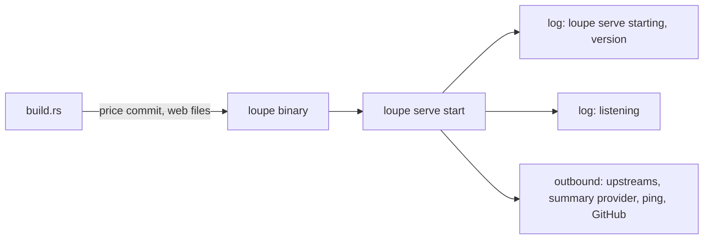
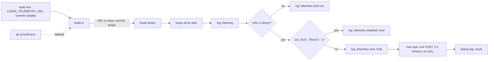
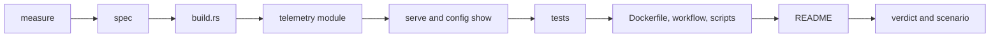

# Start telemetry

## Change Summary

A release build of `loupe` sends one HTTP POST when `loupe serve` starts. The body holds five fields only: a schema version, the product name, the version from `Cargo.toml`, the full commit hash of the build, and the target triple. The build reads the target URL from `LOUPE_TELEMETRY_URL` at build time and puts it into the binary. When the variable is absent or empty at build time, the binary holds no URL and makes no request. The release workflow sets the variable from a repository variable, so the release assets and the image send the request and a local build does not. At run time, `DO_NOT_TRACK=1` stops the request. One log line at start names the telemetry state. `README.md` states that the request exists, what it holds, and why.

## Motivation and Background

The owner wrote, on 2026-10-23:

> "We need a telemetry request as well that sends a post on startup with version number and commit hash. This should be statically built at build time. If the env is not set at build time, disable the feature. It's disabled with the undocumented env DO_NOT_TRACK=1."

This statement holds four requirements:

1. One POST at start with the version and the commit hash.
2. The target is fixed at build time ("statically built").
3. No build-time variable means no feature.
4. `DO_NOT_TRACK=1` disables the feature at run time, and the user documentation does not name it.

Where the statement leaves a detail open, this CR states a rule and names the detail a judgement call (see "Judgement Calls"). One detail stays open for the owner: the URL that receives the posts (see "Open Questions").

## Change Drivers

* The owner has no count of the installs that run, and no count of the versions that run. The release check and the download counts of GitHub do not show which version starts.
* A bug report often has no version and no commit. The start request gives the owner the spread of the versions in use.
* A user can build from source, and a fork can build its own image. Their builds must not send data to the owner. A build-time URL keeps the request in the official release builds only.

## Current State

* `build.rs` puts two values into the binary at build time: the price commit from `vendor/litellm/SOURCE.md` (as a compile-time environment value) and the embed list of the `web/` files. It reads no build environment variable of its own and no git data.
* The binary knows its version from `Cargo.toml` (`release.md`, section "Version shown by the binary"). It does not know its commit hash or its target triple.
* `src/cli/serve.rs` writes the first log line, "loupe serve starting", with the key field `version`. `src/serve/mod.rs` runs the start sequence and writes the line `listening` after the bind (`operations.md`, section "Logging").
* The binary sends outbound requests only to the upstreams (the proxy), the summary provider, the provider ping, and the GitHub API. Each uses its own reqwest client with rustls. `src/summary/client.rs` is the pattern: one client, a fixed timeout, and a log line that never holds a credential.
* `loupe config show` (`src/config/show.rs`) prints the variables of `src/config/vars.rs` and derived lines with the source `build`, for example `price_commit`. `configuration.md` (section "`loupe config show`") lists the lines.
* `.github/workflows/release.yml` builds the three binary assets with `release.build.sh` and the two platform images with `release.image.sh`. It passes no build variable to the build. `.dockerignore` keeps `.git` out of the image build context, so a build in the image has no git data.
* `README.md` (section "Privacy model") lists what the binary does with each kind of data. No row names an outbound request to the owner. `SECURITY.md` is the vulnerability report policy.

### Current State Diagram



## Proposed Change

1. `build.rs` reads `LOUPE_TELEMETRY_URL` and a commit variable at build time. It validates the URL, finds the commit hash, reads the target triple from cargo, and puts the three values into the binary.
2. A new module sends the start request. It builds the body, sends one POST with its own client, and logs the result at debug level.
3. `loupe serve` decides the telemetry state after the bind of the listener: `built-out`, `disabled`, or `sent`. It writes one log line with the state. For `sent`, it starts the request in its own task.
4. `loupe config show` prints one line `telemetry` with the build state.
5. The release workflow passes the repository variable `LOUPE_TELEMETRY_URL` and the tag commit to the binary build and to the image build. The `Dockerfile` accepts both values as build arguments in the build stage.
6. `release.check.sh` starts each binary and each image with `DO_NOT_TRACK=1`, so a release check sends no request.
7. `README.md` states the request, its content, and its purpose.

### Proposed State Diagram



## Requirements

### Functional Requirements

**Build**

1. `build.rs` **MUST** read the build environment variable `LOUPE_TELEMETRY_URL`. It **MUST** print a rerun instruction for this variable and for the commit variable of requirement 6, so a change of either value rebuilds the binary.
2. When `LOUPE_TELEMETRY_URL` is absent, or is empty after the removal of white space at the start and the end, the binary **MUST** hold no telemetry URL. This is the state `built-out`.
3. When `LOUPE_TELEMETRY_URL` is set, `build.rs` **MUST** validate it. The URL **MUST** use `https`, or `http` with the host `127.0.0.1` or `localhost`. The URL **MUST NOT** hold a user name or a password. A URL that is not valid **MUST** stop the build with an actionable error that names `LOUPE_TELEMETRY_URL`, the rule, and the fix. The error **MUST NOT** print the full URL.
4. In the state `built-out`, the start path **MUST** make no telemetry request and **MUST NOT** read `DO_NOT_TRACK`.
5. The run-time environment **MUST NOT** change the URL. A value of `LOUPE_TELEMETRY_URL` in the environment of `loupe serve` **MUST** have no effect.
6. `build.rs` **MUST** find the commit hash of the build in this order:
   1. The build environment variable `LOUPE_BUILD_COMMIT`, when it holds 40 lowercase hex characters.
   2. The output of git for the commit of `HEAD` in the source tree, when git and the repository exist and the output is 40 lowercase hex characters.
   3. Else the value `unknown`.
7. `build.rs` **MUST** put the target triple of the build, as cargo gives it, into the binary.

**Start request**

8. When the binary holds a URL and `DO_NOT_TRACK` is not `1`, `loupe serve` **MUST** send exactly one HTTP POST to the URL at each start.
9. The request **MUST** start after the listener is bound and after the line `listening`. It **MUST** run in its own task. The bind, the line `listening`, and the first answer of `GET /healthz` **MUST NOT** wait for it.
10. The request **MUST** use its own HTTP client with rustls. It **MUST NOT** go through the proxy routes of `loupe`. The capture **MUST NOT** record it, the database **MUST NOT** store it, the live feed **MUST NOT** emit an event for it, and the dashboard and the public API **MUST NOT** show it.
11. The body **MUST** be one JSON object with exactly five fields:

    | Field | Value |
    |---|---|
    | `schema` | the integer `1` |
    | `product` | the string `agentloupe` |
    | `version` | the version from `Cargo.toml` at build time |
    | `commit` | the 40-character commit hash of requirement 6, or `unknown` |
    | `target` | the target triple of requirement 7 |

12. The body **MUST NOT** hold a host name, a user name, a path, a working directory, an account, a key, a token, a credential, a configuration value, a time, an IP address of the host, or data of the dashboard, the calls, or the sessions.
13. The request **MUST** have the header `content-type: application/json` and the header `user-agent: agentloupe/<version>`. It **MUST NOT** have an `authorization` header or a cookie.
14. The client **MUST** follow no redirect.
15. The request **MUST** have one attempt and no retry. The timeout of the attempt **MUST** be 5 seconds, from the start of the connect to the end of the response.
16. The result of the request **MUST NOT** change the start or the run of `loupe serve`. Any status code, a network error, or a timeout **MUST** give one log line at debug level, and nothing more. A 2xx status is not required. The debug line **MUST** hold the URL host and the status code or the error kind, and **MUST NOT** hold the body, the path, or the query of the URL.
17. A shutdown signal **MUST NOT** wait for an open start request. The shutdown rules of `operations.md` (section "Shutdown") **MUST** stay the same.

**Opt-out at run time**

18. When the environment variable `DO_NOT_TRACK` has the exact value `1`, `loupe serve` **MUST NOT** send the request. Any other value, an empty value, or no value **MUST NOT** stop the request. This follows the convention of consoledonottrack.com.
19. The binary **MUST** read `DO_NOT_TRACK` from the process environment only, at the start of `loupe serve`.

**Log line**

20. `loupe serve` **MUST** write one info line `telemetry` at each start, after the line `listening`, with the key field `state`:

    | State | Condition | Other key field |
    |---|---|---|
    | `built-out` | the binary holds no URL | none |
    | `disabled` | the binary holds a URL and `DO_NOT_TRACK` is `1` | `host`, the host of the URL |
    | `sent` | the binary holds a URL and the request started | `host`, the host of the URL |

21. The line **MUST NOT** hold the scheme, the path, the query, or the port of the URL, and **MUST NOT** hold the body. The line **MUST NOT** name `DO_NOT_TRACK`.
22. The line **MUST** be at info level, so a normal start still logs no warning and no error (`operations.md`, section "Logging").

**Configuration output**

23. `loupe config show` and `GET /private/api/config` **MUST** print one line `telemetry` with the source `build`. The value **MUST** be `built-out` when the binary holds no URL, and `built-in host=<host>` when the binary holds a URL.
24. `loupe config show` **MUST NOT** read `DO_NOT_TRACK` and **MUST NOT** print it. `src/config/vars.rs` **MUST NOT** list `DO_NOT_TRACK`.

**Documentation**

25. `README.md` **MUST** state, in the section "Privacy model", that a release asset and the release image send one POST at the start of `loupe serve`. It **MUST** list the five fields, state the purpose (a count of the versions in use), and state that the request holds no data of the user, the host, or the dashboard.
26. `README.md` **MUST** state that a build from source, and a local image build, send no request.
27. `README.md`, `docs/specification/configuration.md`, `.env.example`, `compose.yaml`, and the output of `loupe config show` **MUST NOT** name `DO_NOT_TRACK`.
28. `docs/specification/operations.md` **MUST** state the full behaviour, including `DO_NOT_TRACK`, because the tests follow the specification. See judgement call 6.

**Release**

29. The build job and the image job of `.github/workflows/release.yml` **MUST** pass the repository variable `LOUPE_TELEMETRY_URL` (a variable, not a secret) to the build of the binary.
30. The release workflow **MUST** pass `LOUPE_BUILD_COMMIT` with the full commit of the checked-out tag. It **MUST NOT** use the commit of the workflow event, because a manual run starts from the default branch.
31. The `Dockerfile` **MUST** accept `LOUPE_TELEMETRY_URL` and `LOUPE_BUILD_COMMIT` as build arguments in the build stage only, with an empty default. `release.image.sh` **MUST** pass both. A local image build with no build argument **MUST** give the state `built-out`.
32. When the repository variable is not set, the release **MUST NOT** fail. `release.build.sh` and `release.image.sh` **MUST** print the telemetry state of each build (`built-in` with the host, or `built-out`) in their machine output.
33. `release.check.sh` **MUST** start each binary and each image with `DO_NOT_TRACK=1`. In its image start check, it **MUST** check that the log holds the line `telemetry` with the state `disabled` or `built-out`.
34. The count of repository secrets **MUST** stay 1 (`release.md`, section "Release token").
35. The pipeline scripts **MUST** build and test with `LOUPE_TELEMETRY_URL` unset, so a value in the shell of a developer does not change the verdict.

### Non-Functional Requirements

1. The start request **MUST** add no time to the bind and to the line `listening`.
2. The body **MUST** be at most 256 bytes.
3. The start request **MUST** add no dependency to `Cargo.toml`. It uses reqwest, rustls, serde_json, and tokio, which the binary has.
4. The decision of the state and the build of the body **MUST** be pure functions, so a unit test can call them with no network and no environment.
5. The send function **MUST** take the URL and the timeout as parameters, so a test can call it with a local fake endpoint.

## Measurable Targets

| Metric | Method | Baseline | Threshold |
|---|---|---|---|
| Requests per start, state `sent` | count of POST requests at the fake endpoint after one start | 0, no feature | exactly 1 |
| Requests per start, state `disabled` | same, with `DO_NOT_TRACK=1` | 0 | 0 |
| Requests per start, state `built-out` | same, with a build without the variable | 0 | 0 |
| Retries after an error or a timeout | count of requests at a fake endpoint that answers 500, and at one that holds the request open | 0 | 0 more than the first attempt |
| Time to give up | `cargo test telemetry_gives_up_after_timeout` | none | the send ends in at most 5.5 seconds |
| Start delay added | time from the process start to the first 200 of `GET /healthz`, median of 5 starts, with a fake endpoint that holds the request open, compared with 5 starts with `DO_NOT_TRACK=1` | measured at the start of implementation | difference at most 50 ms |
| Body size | byte count of the body that the fake endpoint receives | none | at most 256 bytes |
| Body field count | key count of the received JSON object | none | exactly 5 |
| URL in a built-out binary | `grep -c` of the fake host in the built-out binary file | none | 0 matches |
| Telemetry rows in the data | count of rows in the exchange table and of live events after a start in the state `sent` | 0 | 0 |
| New tests | count of the tests in "Tests to Add" that pass in the verdict | 0 | 8 of 8 |
| Repository secrets | count of the secrets in the repository settings | 1 | 1 |
| Opt-out name in the user documentation | `grep -c DO_NOT_TRACK README.md docs/specification/configuration.md .env.example compose.yaml` and in the output of `loupe config show` | 0 | 0 |

## Affected Components

* `build.rs`: the read and the validation of `LOUPE_TELEMETRY_URL`, the commit hash in the order of requirement 6, the target triple, and the rerun instructions.
* A new module for the start request under `src/` (for example `src/telemetry/`): the state decision, the body, the send, and the log lines.
* `src/serve/mod.rs`: the decision and the task start after the line `listening`.
* `src/config/show.rs`: the line `telemetry`.
* `Dockerfile`: two build arguments in the build stage.
* `.github/workflows/release.yml`: the repository variable and the tag commit in the build job and the image job.
* `.agents/scripts/release.build.sh`, `.agents/scripts/release.image.sh`: the pass of the two values and the telemetry state in the machine output.
* `.agents/scripts/release.check.sh`: `DO_NOT_TRACK=1` and the log check.
* The pipeline scripts under `.agents/scripts/` that build and test: the unset of `LOUPE_TELEMETRY_URL`.
* Tests under `tests/` and unit tests in the new module.
* `README.md`: the sections "Privacy model" and "Install" ("From source").
* `docs/specification/operations.md`: the sections "Subcommands" (the row of `loupe serve`), "Logging" (the line `telemetry`), a new section "Start request" after "Provider ping", and "Measurable targets".
* `docs/specification/configuration.md`: the section "`loupe config show`" (the line `telemetry`) and a new short section "Build variables" that names `LOUPE_TELEMETRY_URL` and `LOUPE_BUILD_COMMIT`.
* `docs/specification/release.md`: the sections "Version shown by the binary" (the commit and the target in the binary), "Binary archives", "Container image", "Release token" (the repository variable is not a secret), and "Verify a release".
* A new scenario `.agents/scenarios/telemetry.start.md`.

## Scope Boundaries

### In Scope

* The build-time URL, the commit hash, and the target triple in the binary.
* The one start request of `loupe serve`, its log line, and its debug line.
* The run-time opt-out `DO_NOT_TRACK=1`.
* The line `telemetry` of `loupe config show`.
* The release workflow, the release scripts, the `Dockerfile` build arguments, and the release check.
* The privacy statement in `README.md`, and the specification text.

### Out of Scope ("Here, But Not Further")

* A receiver service, a storage of the posts, or a report of the posts. The owner provides the endpoint outside this repository.
* A request from any subcommand other than `loupe serve`, for example `loupe backfill` or `loupe config show`.
* A periodic request, a request at shutdown, or a request with usage data.
* A unique install ID or any other value that links two starts.
* The commit hash in `loupe --version` or in the first log line. These outputs do not change.
* A documented opt-out flag or a documented opt-out variable.
* A change to the proxy, the capture, the parser, the summaries, the dashboard, or the public API.

## Alternative Approaches Considered

* **A run-time variable for the URL.** Rejected. The owner asked for a URL that is "statically built at build time".
* **A cargo feature or a compile flag that removes the send code.** Rejected. The verdict builds without the URL, so the send code would have no test in the verdict. The URL is the part that the build leaves out. The start path has no target, so it sends nothing (judgement call 9).
* **The URL as a repository secret.** Rejected. The URL is not secret; it is visible in the binary of each release. A secret would also break the rule of one repository secret.
* **A retry with backoff.** Rejected. One attempt is enough for a count, and a retry adds network use at start.
* **A documented opt-out in `README.md` and `loupe config show`.** Rejected by the owner, who decided that the opt-out stays undocumented.
* **The commit hash from the event commit of the workflow.** Rejected. A manual run of the release workflow starts from the default branch, so the event commit can differ from the tag commit.

## Impact Assessment

### User Impact

A user of a release asset or of the release image sends one small POST at each start of `loupe serve`. The request holds no data of the user. The start log names the state. A user who builds from source sends nothing.

### Technical Impact

`build.rs` gets three more build values. One new module adds one outbound request. The release workflow, two release scripts, the release check, and the `Dockerfile` get small changes. No new dependency.

### Business Impact

The owner gets a count of the starts per version, commit, and target. The project gets a documented outbound request, which a reader can object to (see "Risks and Mitigation").

## Implementation Approach

1. Measure the baseline of the start delay.
2. Update `docs/specification/operations.md`, `configuration.md`, and `release.md`.
3. Change `build.rs`.
4. Add the telemetry module with the pure state decision, the pure body, and the send.
5. Call it from `src/serve/mod.rs` after the line `listening`, and add the line to `src/config/show.rs`.
6. Add the tests.
7. Change the `Dockerfile`, the release workflow, the release scripts, the release check, and the pipeline scripts.
8. Update `README.md`.
9. Run the verdict, then run the scenario.

### Implementation Flow



## Test Strategy

### Tests to Add

1. `telemetry_body_has_five_fields`: the pure body has exactly the five fields of requirement 11, the version from `Cargo.toml`, a commit of 40 hex characters or `unknown`, and at most 256 bytes. No key outside the five exists.
2. `telemetry_sends_one_post`: the send to a local fake endpoint gives exactly one POST, with the body of test 1, `content-type: application/json`, the user agent `agentloupe/<version>`, and no `authorization` header and no cookie.
3. `telemetry_gives_up_after_timeout`: a fake endpoint accepts the connection and holds the request open. The send ends in at most 5.5 seconds, the fake endpoint gets one connection, and no error reaches the caller. The test follows `operations.md` (section "Timers in tests"): real time on a real socket, a poll with a cap.
4. `telemetry_no_retry`: a fake endpoint that answers 500 gets exactly one request. A refused connection gives one debug line and no second attempt. A redirect answer gives no request to the redirect target.
5. `telemetry_opt_out_only_value_1`: the pure state decision gives `disabled` for `DO_NOT_TRACK` equal to `1`, and `sent` for no value, an empty value, `0`, `true`, `yes`, and ` 1`.
6. `telemetry_built_out_state`: the pure state decision gives `built-out` for no URL with each `DO_NOT_TRACK` value. In the verdict build, which has no URL, `loupe config show` prints `telemetry` with the value `built-out` and the source `build`.
7. `telemetry_log_line_has_host_only`: the log line and the debug line hold the host and do not hold the scheme, the path, the query, the port, or a field of the body.
8. `telemetry_url_validation`: the URL rule of requirement 3 accepts an `https` URL and an `http` URL on `127.0.0.1` and `localhost`, and refuses another `http` host, a URL with a user name or a password, and a value that is not a URL. The rule is a pure function that `build.rs` and the test share.

### Tests to Modify

* The tests of `loupe config show` and of `GET /private/api/config` that compare the full list of lines: add the line `telemetry`.
* The release check: the image start check reads the line `telemetry`.

### Tests to Remove

None.

## Model-Based Testing

The change has a user surface: the start of `loupe serve`, its log, and `loupe config show`. A model runs these steps on this machine, and a human can run them by hand. Persist the scenario as `.agents/scenarios/telemetry.start.md` with the received bodies and the log lines.

1. Start a local fake endpoint on `127.0.0.1` on a free port. It records each request with its method, its headers, and its body.
2. Build the binary with `LOUPE_TELEMETRY_URL` set to the fake endpoint.
3. Run `loupe config show`. Check the line `telemetry` with `built-in host=127.0.0.1` and the source `build`. Check that no line names `DO_NOT_TRACK`.
4. Start `loupe serve` with two keys from `loupe gen-key` and a new data directory. Wait for the first 200 of `GET /healthz`.
5. Check the log: the line `telemetry` with `state` `sent` and `host` `127.0.0.1` comes after the line `listening`, and holds no path and no body.
6. Check the fake endpoint: exactly one POST, a JSON body with exactly the five fields, the version of `Cargo.toml`, the commit of `git rev-parse HEAD`, the target triple of the host, at most 256 bytes.
7. Check that the exchange table has 0 rows and that `GET /healthz` still answers 200. Stop the server.
8. Make the fake endpoint hold each request open. Start `loupe serve` again. Check that `GET /healthz` answers 200 while the request is open, and that a SIGTERM stops the server in the limit of `operations.md` (section "Shutdown").
9. Start `loupe serve` with `DO_NOT_TRACK=1`. Check the line `telemetry` with `state` `disabled`, and check that the fake endpoint got no new request.
10. Build the binary again with `LOUPE_TELEMETRY_URL` unset. Check that `grep -c` of the fake host in the binary file gives 0. Run `loupe config show` and check `telemetry` with `built-out`. Start `loupe serve` and check the line `telemetry` with `state` `built-out` and no request at the fake endpoint.
11. Build with `LOUPE_TELEMETRY_URL` set to an `http` URL on a host that is not a loopback host. Check that the build stops with the actionable error of requirement 3.

Success condition: each check passes, in at least 2 of 2 runs.

## Acceptance Criteria

### AC-1: A build with the URL sends one POST at start

```gherkin
Given a binary built with LOUPE_TELEMETRY_URL set to a local fake endpoint
And DO_NOT_TRACK is not set
When loupe serve starts
Then the fake endpoint receives exactly one POST
And the request starts after the log line "listening"
And the log line "telemetry" has the state "sent" and the host of the URL only
```

### AC-2: The body holds only the five fields

```gherkin
Given a binary built with LOUPE_TELEMETRY_URL set to a local fake endpoint
When the fake endpoint receives the start request
Then the body is one JSON object with exactly the fields schema, product, version, commit, and target
And version equals the version in Cargo.toml
And commit is 40 lowercase hex characters or "unknown"
And the body is at most 256 bytes
And the body holds no host name, user, path, account, key, token, or dashboard data
```

### AC-3: One attempt, a timeout of 5 seconds, no effect on the start

```gherkin
Given a fake endpoint that holds each request open
When loupe serve starts with a binary that holds the URL of the fake endpoint
Then GET /healthz answers 200 while the request is open
And the send ends in at most 5.5 seconds
And the fake endpoint gets no second request
And the result shows only in one debug line
```

### AC-4: DO_NOT_TRACK=1 stops the request

```gherkin
Given a binary built with LOUPE_TELEMETRY_URL set to a local fake endpoint
When loupe serve starts with DO_NOT_TRACK set to "1"
Then the fake endpoint receives no request
And the log line "telemetry" has the state "disabled"
When loupe serve starts with DO_NOT_TRACK set to "true"
Then the fake endpoint receives exactly one request
```

### AC-5: A build without the URL is built-out

```gherkin
Given a binary built with LOUPE_TELEMETRY_URL unset or empty
When loupe config show runs
Then it prints the line telemetry with the value "built-out" and the source "build"
When loupe serve starts
Then no telemetry request is made
And the log line "telemetry" has the state "built-out"
And the binary file holds no telemetry URL
```

### AC-6: The request stays outside the product data

```gherkin
Given loupe serve started in the state "sent"
When the start request is done
Then the exchange table has no row for it
And the live feed emitted no event for it
And the dashboard and the public API do not show it
```

### AC-7: The release builds send and the local builds do not

```gherkin
Given the repository variable LOUPE_TELEMETRY_URL is set
When the release workflow builds a tag
Then each binary asset and each platform image holds the URL
And each build holds the full commit of the tag
And the machine output of release.build.sh and release.image.sh names the state "built-in" with the host
When docker compose up -d --build runs on a local machine with no build argument
Then the image is built-out
```

### AC-8: The opt-out stays out of the user documentation, and the request does not

```gherkin
Given the changed repository
When a reader searches README.md, configuration.md, .env.example, compose.yaml, and the output of loupe config show
Then no match of DO_NOT_TRACK exists
And README.md states the start request, its five fields, and its purpose
And README.md states that a build from source sends no request
```

### AC-9: The release check sends nothing

```gherkin
Given a published release with the URL built in
When release.check.sh runs
Then each start of a binary or of the image has DO_NOT_TRACK set to "1"
And the image start check finds the line telemetry with the state "disabled"
```

## Quality Standards Compliance

### Build & Compilation

`cargo build` passes with `LOUPE_TELEMETRY_URL` unset, and with it set to a valid URL.

### Linting & Code Style

`.agents/scripts/pipeline.lint.sh` and `pipeline.format.sh` pass. The dependency check passes with no new crate.

### Test Execution

`.agents/scripts/pipeline.test.sh` passes, with the 8 new tests.

### Documentation

`docs/specification/operations.md`, `configuration.md`, and `release.md` change before the code. `README.md` changes in the same change request.

### Code Review

A reviewer agent checks blocking findings only.

### Verification Commands

```bash
.agents/scripts/pipeline.verdict.sh
.agents/scripts/release.build.sh --dry-run --tag <tag>
```

## Risks and Mitigation

### Risk 1: A reader objects to the request on privacy grounds

A user can see an outbound request to the owner as tracking, and the undocumented opt-out can add to this view.

Mitigation: the body holds five fields with no data of the user, the host, or the dashboard (requirements 11 and 12). `README.md` states the request, its content, and its purpose (requirement 25). The start log names the state at each start (requirement 20). A build from source sends nothing (requirement 26). The request has no ID that links two starts. The source is public, so a reader can verify each point.

### Risk 2: The network is blocked or slow at start

A host with no route out, a firewall, or a DNS failure can make the request hang or fail.

Mitigation: the request runs in its own task after the bind (requirement 9). It has one attempt and a timeout of 5 seconds (requirement 15). A failure gives one debug line only (requirement 16). A shutdown does not wait for it (requirement 17). AC-3 checks this.

### Risk 3: A local build or the verdict sends a request by accident

A developer who has `LOUPE_TELEMETRY_URL` in the shell can build a binary that sends.

Mitigation: the pipeline scripts unset the variable (requirement 35). The line `telemetry` of `loupe config show` and of the start log shows the state.

### Risk 4: The release check or a release test sends posts to the owner's endpoint

Mitigation: `release.check.sh` sets `DO_NOT_TRACK=1` (requirement 33).

### Risk 5: The commit is wrong in the image

`.dockerignore` keeps `.git` out of the build context, so git at build time gives no commit in the image.

Mitigation: `release.image.sh` passes `LOUPE_BUILD_COMMIT` as a build argument (requirements 30 and 31). A local image build gets `unknown`, which is correct for a build with no git data.

### Risk 6: A merge conflict with the work of CR-0024

The branch of CR-0024 changes `README.md`, `SECURITY.md`, the release scripts, and the `Dockerfile`.

Mitigation: start the implementation after that branch merges to `main`.

## Dependencies

* CR-0022 (the release workflow, the release scripts, the release check, and `release.md`).
* The endpoint of the owner (see "Open Questions"). The code and the tests do not need it; only the repository variable needs it.

## Estimated Effort

Medium: `build.rs`, one new module, two small changes in the start and in `loupe config show`, 8 tests, the `Dockerfile`, the release workflow, four scripts, three specification files, `README.md`, and one scenario.

## Open Questions

1. **Pending parameter: the endpoint URL.** Which URL receives the posts? The owner sets it as the repository variable `LOUPE_TELEMETRY_URL`. Until the owner sets it, each release is built-out, and no release fails (requirement 32). The CR does not name a URL.

## Judgement Calls

1. **Body field names.** `schema`, `product`, `version`, `commit`, and `target`. They are short and they name the value. `schema` lets a receiver read a later body.
2. **Product value.** The string `agentloupe`, the lowercase product name. The package name `agent-loupe` and the binary name `loupe` are internal names.
3. **User agent.** `agentloupe/<version>`. A receiver can filter on it, and it holds no more data than the body.
4. **A 2xx status is not required.** Each status, an error, and a timeout give one debug line only. The start request is a count and not a delivery, so a receiver failure has no effect on the user.
5. **The meaning of `sent`.** The state `sent` means that the request started. The outcome goes to the debug line. Thus the info line is written at once and does not wait for the network.
6. **The opt-out in the specification.** The owner decided that the opt-out is not in `README.md`, in `configuration.md`, or in `loupe config show`. This CR also keeps it out of `.env.example` and `compose.yaml`. The specification file `operations.md` states it, because the tests follow the specification and the source is public. A reader can find it there, and this CR records that as accepted.
7. **The privacy statement in `README.md`, not in `SECURITY.md`.** The owner asked for the statement in `README.md` and in `SECURITY.md` or a privacy section. `README.md` has the section "Privacy model", which lists each data flow. The statement goes there as one row and one paragraph. `SECURITY.md` is the vulnerability report policy, so it does not change.
8. **The commit variable name.** `LOUPE_BUILD_COMMIT`, with the prefix of the project. A value that is not 40 lowercase hex characters counts as absent, and the build goes to git, then to `unknown`. The build does not mark a tree with local changes.
9. **"Compiled out".** In the state `built-out`, the binary holds no URL and the start path has no target. The send function stays in each build, so the verdict can test it with a fake endpoint. A compile flag that removes the code would leave the send with no test.
10. **URL rule at build time.** `https`, or `http` on a loopback host, with no user name and no password. This is the rule of the provider base URLs in `configuration.md`. A bad URL stops the build, as a bad price commit does.
11. **The log line.** A separate info line `telemetry` after `listening`, not a field of the first line. The state `sent` needs the bound listener, and the first line is written before the start sequence.
12. **The `loupe config show` line.** It shows the build state only: `built-out`, or `built-in host=<host>`. It does not read `DO_NOT_TRACK`, so it does not name the opt-out.
13. **No redirect.** The client follows no redirect, as the proxy client does. A redirect could send the body to a host that the build did not name.
14. **The exact value `1`.** Only the exact string `1` disables the request. White space and other true words do not. This is the text of the convention.
15. **A missing repository variable does not fail the release.** The release builds built-out and the release scripts print the state. The owner can set the variable later.
16. **The release check sets `DO_NOT_TRACK=1`.** A check of a release must not count as a start of a user.
17. **Target version.** `0.2.0`, an internal plan after the first release `0.1.0`, as `release.md` states for `target-version`.

## Notes

The Layer 1 boundary holds: the CR names the files and the specification sections that change, and it inlines no file content and no code. The owner's instruction of 2026-10-23 is quoted in "Motivation and Background".
