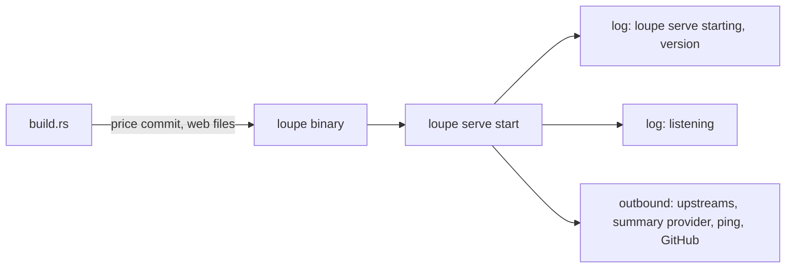
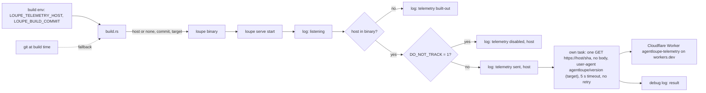
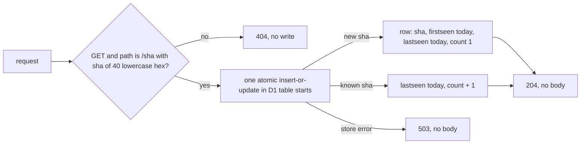
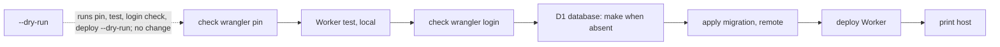
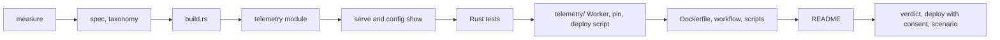

# Start telemetry

## Change Summary

A release build of `loupe` sends one HTTP GET when `loupe serve` starts. The URL is `https://<host>/<commit-sha>`: the host comes from the build variable `LOUPE_TELEMETRY_HOST`, and the path is the full 40-character commit hash of the build. The request has no body. The `User-Agent` header carries the version and the target triple as `agentloupe/<version> (<target triple>)`. The URL itself is the schema. When the variable is absent or empty at build time, the binary holds no host and makes no request. The release workflow sets the variable from a repository variable, so the release assets and the image send the request and a local build does not. At run time, `DO_NOT_TRACK=1` stops the request. One log line at start names the telemetry state. `README.md` states that the request exists, what it holds, who receives it, and why.

The receiver is a Cloudflare Worker in this repository under `telemetry/`, served on the `workers.dev` subdomain `agentloupe-telemetry` of the owner's account. It answers only `GET /<sha>`. For a 40-character lowercase hex `sha` it adds a row to a D1 database (`sha`, `firstseen`, `lastseen`, `count`), or updates the row, in one atomic insert-or-update, and answers 204. Any other path or method gets 404. It stores nothing else and has no read route. The repository script `.agents/scripts/telemetry.deploy.sh` deploys it through `wrangler`, which `.tool-versions` pins.

## Motivation and Background

The owner wrote, on 2026-10-23:

> "We need a telemetry request as well that sends a post on startup with version number and commit hash. This should be statically built at build time. If the env is not set at build time, disable the feature. It's disabled with the undocumented env DO_NOT_TRACK=1."

This statement holds four requirements:

1. One request at start with the version and the commit hash.
2. The target is fixed at build time ("statically built").
3. No build-time variable means no feature.
4. `DO_NOT_TRACK=1` disables the feature at run time, and the user documentation does not name it.

On 2026-10-23, after the approval, the owner decided three more points. They amend this CR (see "Notes", section "Amendment, 2026-10-23"):

1. **Decision 1, the request.** The request is a GET, not a POST, of `https://<host>/<commit-sha>`. The host comes from the build-time variable, and the path is the full 40-character commit hash of the build. The body is gone. The version travels in the `User-Agent` header as `agentloupe/<version> (<target triple>)`. The URL itself is the schema. The receiving endpoint is no longer a pending parameter.
2. **Decision 2, the endpoint.** The endpoint is a Cloudflare Worker in this repository under `telemetry/`, with its `wrangler` configuration, a D1 database as the store (its insert-or-update is atomic), and a migration. It is served on the `workers.dev` subdomain `agentloupe-telemetry` of the owner's account, and deployed by `.agents/scripts/telemetry.deploy.sh` through `wrangler`, pinned in `.tool-versions`. It handles `GET /<sha>` only, stores only the commit, two dates, and a count, and has no read route.
3. **Decision 3, the macOS asset.** The `curl` install path of the macOS asset stays, with no Apple signing. This is a statement of scope, not a requirement.

Where the owner leaves a detail open, this CR states a rule and names the detail a judgement call (see "Judgement Calls").

## Change Drivers

* The owner has no count of the installs that run, and no count of the versions that run. The release check and the download counts of GitHub do not show which version starts.
* A bug report often has no version and no commit. The start request gives the owner the spread of the commits in use.
* A user can build from source, and a fork can build its own image. Their builds must not send data to the owner. A build-time host keeps the request in the official release builds only.
* The owner needs a receiver that holds no personal data and that a reader can audit. A Worker whose source is in this repository makes the stored data verifiable.

## Current State

* `build.rs` puts two values into the binary at build time: the price commit from `vendor/litellm/SOURCE.md` (as a compile-time environment value) and the embed list of the `web/` files. It reads no build environment variable of its own and no git data.
* The binary knows its version from `Cargo.toml` (`release.md`, section "Version shown by the binary"). It does not know its commit hash or its target triple.
* `src/cli/serve.rs` writes the first log line, "loupe serve starting", with the key field `version`. `src/serve/mod.rs` runs the start sequence and writes the line `listening` after the bind (`operations.md`, section "Logging").
* The binary sends outbound requests only to the upstreams (the proxy), the summary provider, the provider ping, and the GitHub API. Each uses its own reqwest client with rustls. `src/summary/client.rs` is the pattern: one client, a fixed timeout, and a log line that never holds a credential.
* `loupe config show` (`src/config/show.rs`) prints the variables of `src/config/vars.rs` and derived lines with the source `build`, for example `price_commit`. `configuration.md` (section "`loupe config show`") lists the lines.
* `.github/workflows/release.yml` builds the three binary assets with `release.build.sh` and the two platform images with `release.image.sh`. It passes no build variable to the build. `.dockerignore` is an allow list: it keeps `.git` and each path that it does not name out of the image build context, so a build in the image has no git data.
* `README.md` (section "Privacy model") lists what the binary does with each kind of data. No row names an outbound request to the owner. `SECURITY.md` is the vulnerability report policy.
* `README.md` (section "Install") installs the macOS asset with `curl` and states that the macOS binary is not signed and that a `curl` download gets no quarantine attribute.
* The repository has no `telemetry/` directory, no Worker, and no Cloudflare configuration. `.tool-versions` pins `nodejs 22.20.0` and three cargo tools, and has no `wrangler` line. `.gitignore` already ignores `.wrangler/`. The hosted workflows install only the tools that each job names from `.tool-versions`.

### Current State Diagram



## Proposed Change

1. `build.rs` reads `LOUPE_TELEMETRY_HOST` and a commit variable at build time. It validates the host, finds the commit hash, reads the target triple from cargo, and puts the three values into the binary.
2. A new module sends the start request. It builds the URL `https://<host>/<commit-sha>` and the `User-Agent` value, sends one GET with no body with its own client, and logs the result at debug level.
3. `loupe serve` decides the telemetry state after the bind of the listener: `built-out`, `disabled`, or `sent`. It writes one log line with the state. For `sent`, it starts the request in its own task.
4. `loupe config show` prints one line `telemetry` with the build state.
5. The release workflow passes the repository variable `LOUPE_TELEMETRY_HOST` and the tag commit to the binary build and to the image build. The `Dockerfile` accepts both values as build arguments in the build stage.
6. `release.check.sh` starts each binary and each image with `DO_NOT_TRACK=1`, so a release check sends no request.
7. `README.md` states the request, its content, its receiver, and its purpose.
8. A new directory `telemetry/` holds the Worker: its `wrangler` configuration, its source, one D1 migration, and a Worker test. The Worker answers `GET /<sha>` with an atomic insert-or-update in D1 and 204, and each other request with 404.
9. A new script `.agents/scripts/telemetry.deploy.sh` tests the Worker, makes the D1 database when it is absent, applies the migration, and deploys the Worker through `wrangler`, with `--dry-run`. `.tool-versions` pins `npm:wrangler 4.100.0`.

### Proposed State Diagram



### Proposed Endpoint Diagram



### Proposed Deploy Diagram



## Requirements

### Functional Requirements

**Build**

1. `build.rs` **MUST** read the build environment variable `LOUPE_TELEMETRY_HOST`. It **MUST** print a rerun instruction for this variable and for the commit variable of requirement 6, so a change of either value rebuilds the binary. When the git fallback of requirement 6 reads a repository, `build.rs` **MUST** also print a rerun instruction for the git files that name the commit of `HEAD`, so a new commit rebuilds the binary with the new hash.
2. When `LOUPE_TELEMETRY_HOST` is absent, or is empty after the removal of white space at the start and the end, the binary **MUST** hold no telemetry host and no telemetry URL. This is the state `built-out`.
3. When `LOUPE_TELEMETRY_HOST` is set, `build.rs` **MUST** validate it. The value **MUST** be a host name with an optional port, and **MUST NOT** hold a scheme, a path, a query, a fragment, a user name, or a password. The scheme of the request is `https`. The scheme is `http` only when the host is `127.0.0.1` or `localhost`, for a local fake endpoint. A value that is not valid **MUST** stop the build with an actionable error that names `LOUPE_TELEMETRY_HOST`, the rule, and the fix. The error **MUST NOT** print the full value.
4. In the state `built-out`, the start path **MUST** make no telemetry request and **MUST NOT** read `DO_NOT_TRACK`.
5. The run-time environment **MUST NOT** change the host. A value of `LOUPE_TELEMETRY_HOST` in the environment of `loupe serve` **MUST** have no effect.
6. When `LOUPE_TELEMETRY_HOST` is set, `build.rs` **MUST** find the commit hash of the build in this order:
   1. The build environment variable `LOUPE_BUILD_COMMIT`, when it holds 40 lowercase hex characters.
   2. The output of git for the commit of `HEAD` in the source tree, when git and the repository exist and the output is 40 lowercase hex characters.
   3. Else the build **MUST** stop with an actionable error that names `LOUPE_BUILD_COMMIT`, the rule (40 lowercase hex characters), and the fix. A build with a host and no commit would send a path that the endpoint refuses.
7. When `LOUPE_TELEMETRY_HOST` is set, `build.rs` **MUST** put the target triple of the build, as cargo gives it, into the binary.

**Start request**

8. When the binary holds a host and `DO_NOT_TRACK` is not `1`, `loupe serve` **MUST** send exactly one HTTP GET of `https://<host>/<commit-sha>` at each start (`http` for a loopback host, requirement 3).
9. The request **MUST** start after the listener is bound and after the line `listening`. It **MUST** run in its own task. The bind, the line `listening`, and the first answer of `GET /healthz` **MUST NOT** wait for it.
10. The request **MUST** use its own HTTP client with rustls. It **MUST NOT** go through the proxy routes of `loupe`. The capture **MUST NOT** record it, the database **MUST NOT** store it, the live feed **MUST NOT** emit an event for it, and the dashboard and the public API **MUST NOT** show it.
11. The path of the URL **MUST** be exactly `/` and the 40-character commit hash of requirement 6. The URL **MUST NOT** have a query or a fragment. The URL is the schema: the request carries no schema field, and a later change of the shape of the path is a new schema.
12. The request **MUST** have no body. The URL and the headers **MUST NOT** hold a host name of the user's machine, a user name, a file path, a working directory, an account, a key, a token, a credential, a configuration value, a time, an IP address of the host, or data of the dashboard, the calls, or the sessions.
13. The request **MUST** have the header `user-agent: agentloupe/<version> (<target triple>)`, with the version from `Cargo.toml` at build time and the target triple of requirement 7, for example `agentloupe/0.2.0 (aarch64-apple-darwin)`. It **MUST NOT** have an `authorization` header, a cookie, or a `content-type` header. The code **MUST NOT** set any other header; the headers that the HTTP client adds for the transport stay.
14. The client **MUST** follow no redirect.
15. The request **MUST** have one attempt and no retry. The timeout of the attempt **MUST** be 5 seconds, from the start of the connect to the end of the response.
16. The result of the request **MUST NOT** change the start or the run of `loupe serve`. Any status code, a network error, or a timeout **MUST** give one log line at debug level, and nothing more. A 2xx status is not required. The debug line **MUST** hold the host and the status code or the error kind, and **MUST NOT** hold the path (and so the commit hash) or the query of the URL.
17. A shutdown signal **MUST NOT** wait for an open start request. The shutdown rules of `operations.md` (section "Shutdown") **MUST** stay the same.

**Opt-out at run time**

18. When the environment variable `DO_NOT_TRACK` has the exact value `1`, `loupe serve` **MUST NOT** send the request. Any other value, an empty value, or no value **MUST NOT** stop the request. This follows the convention of consoledonottrack.com.
19. The binary **MUST** read `DO_NOT_TRACK` from the process environment only, at the start of `loupe serve`.

**Log line**

20. `loupe serve` **MUST** write one info line `telemetry` at each start, after the line `listening`, with the key field `state`:

    | State | Condition | Other key field |
    |---|---|---|
    | `built-out` | the binary holds no host | none |
    | `disabled` | the binary holds a host and `DO_NOT_TRACK` is `1` | `host`, the host |
    | `sent` | the binary holds a host and the request started | `host`, the host |

21. The line **MUST NOT** hold the scheme, the path, the query, or the port of the URL, and **MUST NOT** hold the `User-Agent` value. The line **MUST NOT** name `DO_NOT_TRACK`.
22. The line **MUST** be at info level, so a normal start still logs no warning and no error (`operations.md`, section "Logging").

**Configuration output**

23. `loupe config show` and `GET /private/api/config` **MUST** print one line `telemetry` with the source `build`. The value **MUST** be `built-out` when the binary holds no host, and `built-in host=<host>` when the binary holds a host.
24. `loupe config show` **MUST NOT** read `DO_NOT_TRACK` and **MUST NOT** print it. `src/config/vars.rs` **MUST NOT** list `DO_NOT_TRACK`.

**Documentation**

25. `README.md` **MUST** state, in the section "Privacy model", that a release asset and the release image send one GET of `https://<host>/<commit-sha>` at the start of `loupe serve`, with the version and the target triple in the `User-Agent` header and no body. It **MUST** state the purpose (a count of the commits in use), and that the request holds no data of the user, the host, or the dashboard. It **MUST** state that the receiver is a Cloudflare Worker whose source is under `telemetry/`, that it stores per commit only a first date, a last date, and a count, and that it stores no IP address, no `User-Agent`, and no header.
26. `README.md` **MUST** state that a build from source, and a local image build, send no request.
27. `README.md`, the files under `docs/specification/`, `.env.example`, `compose.yaml`, `.taxonomy`, the files under `telemetry/`, and the output of `loupe config show` **MUST NOT** name `DO_NOT_TRACK`.
28. `docs/specification/operations.md` **MUST** state the start request, its URL shape, its `User-Agent`, its timing, and its log states, and that a run-time opt-out gives the state `disabled`, without the name of the opt-out variable. Requirement 18 of this CR is the source of the opt-out name for the tests. See judgement call 6.
29. `docs/specification/release.md` **MUST** state, in a new section "Telemetry endpoint", the Worker, its one route, its answers, its table, the data it does not store, the deploy script, the `wrangler` pin, and the repository variable `LOUPE_TELEMETRY_HOST`.
30. `.taxonomy` **MUST** get one row for the term "start request" and one row for the term "telemetry endpoint".

**Release**

31. The build job and the image job of `.github/workflows/release.yml` **MUST** pass the repository variable `LOUPE_TELEMETRY_HOST` (a variable, not a secret) to the build of the binary.
32. The release workflow **MUST** pass `LOUPE_BUILD_COMMIT` with the full commit of the checked-out tag. It **MUST NOT** use the commit of the workflow event, because a manual run starts from the default branch.
33. The `Dockerfile` **MUST** accept `LOUPE_TELEMETRY_HOST` and `LOUPE_BUILD_COMMIT` as build arguments in the build stage only, with an empty default. `release.image.sh` **MUST** pass both. A local image build with no build argument **MUST** give the state `built-out`.
34. When the repository variable is not set, the release **MUST NOT** fail. `release.build.sh` and `release.image.sh` **MUST** print the telemetry state of each build (`built-in` with the host, or `built-out`) in their machine output.
35. `release.check.sh` **MUST** start each binary and each image with `DO_NOT_TRACK=1`. In its image start check, it **MUST** check that the log holds the line `telemetry` with the state `disabled` or `built-out`.
36. The count of repository secrets **MUST** stay 1 (`release.md`, section "Release token"). A workflow **MUST NOT** hold a Cloudflare token.
37. The pipeline scripts **MUST** build and test with `LOUPE_TELEMETRY_HOST` and `LOUPE_BUILD_COMMIT` unset, so a value in the shell of a developer does not change the verdict.

**Endpoint**

38. The directory `telemetry/` **MUST** hold the Worker project: one `wrangler` configuration file, the Worker source, one D1 migration under `telemetry/migrations/`, and the Worker test under `telemetry/test/`. The Worker name **MUST** be `agentloupe-telemetry`. The configuration **MUST** serve the Worker on its `workers.dev` subdomain (`agentloupe-telemetry.<account subdomain>.workers.dev`) and **MUST NOT** add a route or a custom domain.
39. The configuration **MUST** bind one D1 database with the name `agentloupe-telemetry`. The migration **MUST** create one table `starts` with exactly four columns: `sha` (text, the primary key), `firstseen` (text, a UTC date `YYYY-MM-DD`), `lastseen` (text, a UTC date `YYYY-MM-DD`), and `count` (integer).
40. For a `GET` whose path is `/` and a `sha` that matches `^[0-9a-f]{40}$`, the Worker **MUST** run one atomic insert-or-update statement: it inserts the row (`sha`, `firstseen` = the current date, `lastseen` = the current date, `count` = 1), or, when the row exists, sets `lastseen` to the current date and increments `count` by 1, and leaves `firstseen` as it is. It **MUST** then answer 204 with no body. The current date is the UTC date at the Worker.
41. For any other path or any other method, including `HEAD`, `POST`, an uppercase hex `sha`, a `sha` of another length, the root path, and a path with more segments, the Worker **MUST** answer 404 and **MUST NOT** write to the store.
42. The Worker **MUST** ignore the query of a request and **MUST NOT** store it.
43. When the store fails, the Worker **MUST** answer 503 with no body. The binary ignores the answer (requirement 16).
44. The Worker **MUST** store nothing but the four columns of requirement 39: no IP address, no `User-Agent`, no header, no query, no time of day, and no country. It **MUST NOT** write request data to a log. The `wrangler` configuration **MUST** turn Workers Logs (observability) off and **MUST NOT** add Logpush or a tail consumer.
45. The Worker **MUST** have no read route in this CR. A later CR may add a report for the owner only.

**Deploy**

46. `.tool-versions` **MUST** pin `npm:wrangler 4.100.0`. The hosted workflows install only the tools that each job names, so the pin adds no install to a workflow.
47. `.agents/scripts/telemetry.deploy.sh` **MUST** follow `agent_first_cli`: the `@agents-index` line, a docstring with purpose, usage, and parameters, a complete `--help`, a machine format on stdout by default (one `key: value` line per step and one summary line with the host), `--human` for the friendly view, actionable errors on stderr, and documented exit codes: 0 done, 1 a step failed, 2 a usage error, 3 `wrangler` missing or not the pinned version, 4 `wrangler` not logged in.
48. The script **MUST** call `wrangler` through the pin of `.tool-versions` and **MUST** check that `wrangler --version` equals the pin. It **MUST** run, in this order: the pin check, the Worker test of requirement 52, the login check (`wrangler whoami`), the D1 database (made only when `wrangler d1 list` has no database of the name `agentloupe-telemetry`), the remote migration, and the deploy. It **MUST** print the host of the deployed Worker.
49. With `--dry-run`, the script **MUST** run the pin check, the Worker test, the login check, and `wrangler deploy --dry-run`, print each step that a real run would do, and make no change on the Cloudflare account and no change in the repository.
50. The script **MUST** be idempotent: a second run with no change in `telemetry/` makes no second database, applies no migration twice, ends with the same deployed Worker, and exits 0.
51. The script **MUST NOT** store a Cloudflare credential, **MUST NOT** set the repository variable, and **MUST NOT** run in a workflow or in the pipeline. It prints the host and the command that sets the repository variable `LOUPE_TELEMETRY_HOST`, which the owner runs.
52. A Worker test under `telemetry/test/` **MUST** run the Worker locally with `wrangler dev` and a local D1 database, and **MUST** cover the insert (one row with `count` 1 and both dates today), the increment (`count` 2, `firstseen` unchanged, `lastseen` today), and the rejection (each case of requirement 41 answers 404 and leaves the row count unchanged). It **MUST** need no Cloudflare account, no login, and no network to the account. `telemetry.deploy.sh --test` **MUST** run it alone.

### Non-Functional Requirements

1. The start request **MUST** add no time to the bind and to the line `listening`.
2. The request **MUST** have a body of 0 bytes.
3. The start request **MUST** add no dependency to `Cargo.toml`. It uses reqwest, rustls, and tokio, which the binary has.
4. The decision of the state, the build of the URL, and the build of the `User-Agent` value **MUST** be pure functions, so a unit test can call them with no network and no environment.
5. The send function **MUST** take the URL, the `User-Agent` value, and the timeout as parameters, so a test can call it with a local fake endpoint.
6. The Worker **MUST** run at most one D1 statement per request and none for a refused request, so each start costs at most one write on the free plan.
7. The Worker project **SHOULD** need no npm package besides the pinned `wrangler`, and no build step.

## Measurable Targets

| Metric | Method | Baseline | Threshold |
|---|---|---|---|
| Requests per start, state `sent` | count of GET requests at the fake endpoint after one start | 0, no feature | exactly 1 |
| Requests per start, state `disabled` | same, with `DO_NOT_TRACK=1` | 0 | 0 |
| Requests per start, state `built-out` | same, with a build without the variable | 0 | 0 |
| Retries after an error or a timeout | count of requests at a fake endpoint that answers 500, and at one that holds the request open | 0 | 0 more than the first attempt |
| Time to give up | `cargo test telemetry_gives_up_after_timeout` | none | the send ends in at most 5.5 seconds |
| Start delay added | time from the process start to the first 200 of `GET /healthz`, median of 5 starts, with a fake endpoint that holds the request open, compared with 5 starts with `DO_NOT_TRACK=1` | measured at the start of implementation | difference at most 50 ms |
| Request shape | method, path, body size, and query of the request at the fake endpoint | none | `GET`, `/` and 40 lowercase hex characters equal to the build commit, 0 bytes, no query |
| User agent | the `user-agent` header at the fake endpoint | none | exactly `agentloupe/<version of Cargo.toml> (<target triple of the build>)` |
| Host in a built-out binary | `grep -c` of a random marker host name (for example `marker-<random>.invalid`) in a binary built without the variable, after a build with the marker | none | 0 matches |
| Telemetry rows in the product data | count of rows in the exchange table and of live events after a start in the state `sent` | 0 | 0 |
| Worker response time | `curl -o /dev/null -w '%{time_total}'` of 10 GETs of the deployed host with a test `sha`, from the owner's machine | none, no endpoint | median at most 500 ms, each at most 2 s |
| Rows after N starts of one build | `wrangler d1 execute agentloupe-telemetry --remote` count of rows for the build `sha`, after N starts | 0, no store | exactly 1 row, `count` equals N |
| Count increment per start | `count` before and after one more start, read with `wrangler d1 execute` | none | exactly +1, `firstseen` unchanged, `lastseen` the UTC date of the start |
| Writes by a refused request | row count and `count` before and after the rejection cases of requirement 41 in the Worker test | none | unchanged, every answer 404 |
| Stored columns | column list of the table `starts` | none | exactly 4: `sha`, `firstseen`, `lastseen`, `count` |
| New tests | count of the Rust tests in "Tests to Add" that pass in the verdict, and of the Worker test cases that pass in `telemetry.deploy.sh --test` | 0 | 8 of 8 Rust tests, 3 of 3 Worker cases |
| Deploy idempotence | a second run of `telemetry.deploy.sh` right after the first | none | exit 0, 1 database of the name, 0 migrations applied, the same host |
| Dry-run changes | `wrangler d1 list` and `git status --porcelain` before and after `telemetry.deploy.sh --dry-run` | none | no difference |
| Repository secrets | count of the secrets in the repository settings | 1 | 1 |
| Opt-out name in the user documentation, the specification, and the Worker | `grep -rc DO_NOT_TRACK README.md docs/specification .env.example compose.yaml .taxonomy telemetry` and in the output of `loupe config show` | 0 | 0 |

## Affected Components

* `build.rs`: the read and the validation of `LOUPE_TELEMETRY_HOST`, the commit hash in the order of requirement 6, the target triple, and the rerun instructions.
* A new module for the start request under `src/` (for example `src/telemetry/`): the state decision, the URL, the `User-Agent` value, the send, and the log lines.
* `src/serve/mod.rs`: the decision and the task start after the line `listening`.
* `src/config/show.rs`: the line `telemetry`.
* `Dockerfile`: two build arguments in the build stage. `.dockerignore` does not change; its allow list keeps `telemetry/` out of the image build context.
* `.github/workflows/release.yml`: the repository variable and the tag commit in the build job and the image job.
* `.agents/scripts/release.build.sh`, `.agents/scripts/release.image.sh`: the pass of the two values and the telemetry state in the machine output.
* `.agents/scripts/release.check.sh`: `DO_NOT_TRACK=1` and the log check.
* The pipeline scripts under `.agents/scripts/` that build and test: the unset of `LOUPE_TELEMETRY_HOST` and `LOUPE_BUILD_COMMIT`.
* Tests under `tests/` and unit tests in the new module.
* New: `telemetry/` with the `wrangler` configuration, the Worker source, the migration under `telemetry/migrations/`, and the Worker test under `telemetry/test/`.
* New: `.agents/scripts/telemetry.deploy.sh`.
* `.tool-versions`: the line `npm:wrangler 4.100.0`.
* `README.md`: the sections "Privacy model" and "Install" ("From source").
* `docs/specification/operations.md`: the sections "Subcommands" (the row of `loupe serve`), "Logging" (the line `telemetry`), a new section "Start request" after "Provider ping", and "Measurable targets".
* `docs/specification/configuration.md`: the section "`loupe config show`" (the line `telemetry`) and a new short section "Build variables" that names `LOUPE_TELEMETRY_HOST` and `LOUPE_BUILD_COMMIT`.
* `docs/specification/release.md`: the sections "Version shown by the binary" (the commit and the target in the binary), "Binary archives", "Container image", "Release token" (the repository variable is not a secret), "Verify a release", and a new section "Telemetry endpoint".
* `.taxonomy`: the rows "start request" and "telemetry endpoint".
* A new scenario `.agents/scenarios/telemetry.start.md`.
* The owner's Cloudflare account: one Worker `agentloupe-telemetry` and one D1 database `agentloupe-telemetry`, made by the deploy script with the owner's consent.
* The repository variable `LOUPE_TELEMETRY_HOST`, set by the owner to the host that the deploy script prints.

## Scope Boundaries

### In Scope

* The build-time host, the commit hash, and the target triple in the binary.
* The one start GET of `loupe serve`, its log line, and its debug line.
* The run-time opt-out `DO_NOT_TRACK=1`.
* The line `telemetry` of `loupe config show`.
* The release workflow, the release scripts, the `Dockerfile` build arguments, and the release check.
* The privacy statement in `README.md`, and the specification text.
* The receiving Worker under `telemetry/`, its D1 store and migration, its test, its deploy script, and the `wrangler` pin.
* Statement of scope, no requirement (Decision 3): the `curl` install path of the macOS asset in `README.md` stays as it is, and the macOS asset gets no Apple signing and no notarisation. This CR changes nothing in the install path.

### Out of Scope ("Here, But Not Further")

* A read route, a report, a dashboard, or an export of the stored rows. A later CR may add a report for the owner only.
* A custom domain or a route for the Worker, and a paid Cloudflare plan.
* A deploy of the Worker from a workflow, and a Cloudflare token in the repository.
* A request from any subcommand other than `loupe serve`, for example `loupe backfill` or `loupe config show`.
* A periodic request, a request at shutdown, or a request with usage data.
* A unique install ID or any other value that links two starts.
* The commit hash in `loupe --version` or in the first log line. These outputs do not change.
* A documented opt-out flag or a documented opt-out variable.
* Apple code signing and notarisation of the macOS asset (see the statement in "In Scope").
* A change to the proxy, the capture, the parser, the summaries, the dashboard, or the public API.

## Alternative Approaches Considered

* **A run-time variable for the host.** Rejected. The owner asked for a target that is "statically built at build time".
* **A POST with a JSON body of five fields.** Replaced by Decision 1. A GET with the commit in the path and the version in the `User-Agent` carries the same data with no body, and the URL is the schema.
* **A receiver outside this repository, a pending parameter.** Replaced by Decision 2. A Worker in this repository makes the stored data auditable.
* **Workers KV as the store.** Rejected. KV has no atomic increment, so two starts at once can lose a count. D1 has an atomic insert-or-update.
* **A Worker test with vitest and the Workers pool.** Not chosen. It adds npm packages to the repository. `wrangler dev` with a local D1 database tests the same three cases with the pinned `wrangler` only (judgement call 22).
* **A cargo feature or a compile flag that removes the send code.** Rejected. The verdict builds without the host, so the send code would have no test in the verdict. The host is the part that the build leaves out. The start path has no target, so it sends nothing (judgement call 9).
* **The host as a repository secret.** Rejected. The host is not secret; it is visible in the binary of each release. A secret would also break the rule of one repository secret.
* **A retry with backoff.** Rejected. One attempt is enough for a count, and a retry adds network use at start and writes to the store.
* **A documented opt-out in `README.md` and `loupe config show`.** Rejected by the owner, who decided that the opt-out stays undocumented.
* **The commit hash from the event commit of the workflow.** Rejected. A manual run of the release workflow starts from the default branch, so the event commit can differ from the tag commit.

## Impact Assessment

### User Impact

A user of a release asset or of the release image sends one small GET at each start of `loupe serve`. The request holds the commit of the build in its path and the version and the target in its `User-Agent`, and no data of the user. The start log names the state. A user who builds from source sends nothing. The `curl` install of the macOS asset does not change.

### Technical Impact

`build.rs` gets three more build values. One new module adds one outbound request. The release workflow, two release scripts, the release check, and the `Dockerfile` get small changes. No new crate. A new `telemetry/` directory holds a small Worker in JavaScript with one D1 table, and a new deploy script calls the pinned `wrangler`.

### Business Impact

The owner gets, per commit, the first date, the last date, and the count of the starts. The owner runs one Worker and one D1 database on the free plan of the owner's Cloudflare account. The project gets a documented outbound request, which a reader can object to (see "Risks and Mitigation").

## Implementation Approach

1. Measure the baseline of the start delay.
2. Update `docs/specification/operations.md`, `configuration.md`, `release.md`, and `.taxonomy`.
3. Change `build.rs`.
4. Add the telemetry module with the pure state decision, the pure URL and `User-Agent` builds, and the send.
5. Call it from `src/serve/mod.rs` after the line `listening`, and add the line to `src/config/show.rs`.
6. Add the Rust tests.
7. Add `telemetry/` (configuration, Worker, migration, Worker test), the `wrangler` pin, and `telemetry.deploy.sh`. Run `telemetry.deploy.sh --test` and `--dry-run`.
8. Change the `Dockerfile`, the release workflow, the release scripts, the release check, and the pipeline scripts.
9. Update `README.md`.
10. Run the verdict. With the owner's consent, deploy the Worker, then run the scenario. The owner sets the repository variable.

### Implementation Flow



## Test Strategy

### Tests to Add

1. `telemetry_request_shape`: the pure URL build gives `https://<host>/<commit>` for a public host and `http://` for `127.0.0.1` and `localhost`, with a path of exactly 40 lowercase hex characters and no query. The pure `User-Agent` build gives `agentloupe/<version of Cargo.toml> (<target triple>)`.
2. `telemetry_sends_one_get`: the send to a local fake endpoint gives exactly one GET of the path `/<commit>`, with no body, the `User-Agent` of test 1, and no `authorization` header, no cookie, and no `content-type` header.
3. `telemetry_gives_up_after_timeout`: a fake endpoint accepts the connection and holds the request open. The send ends in at most 5.5 seconds, the fake endpoint gets one connection, and no error reaches the caller. The test follows `operations.md` (section "Timers in tests"): real time on a real socket, a poll with a cap.
4. `telemetry_no_retry`: a fake endpoint that answers 500 gets exactly one request. A refused connection gives one debug line and no second attempt. A redirect answer gives no request to the redirect target.
5. `telemetry_opt_out_only_value_1`: the pure state decision gives `disabled` for `DO_NOT_TRACK` equal to `1`, and `sent` for no value, an empty value, `0`, `true`, `yes`, and ` 1`.
6. `telemetry_built_out_state`: the pure state decision gives `built-out` for no host with each `DO_NOT_TRACK` value. In the verdict build, which has no host, `loupe config show` prints `telemetry` with the value `built-out` and the source `build`.
7. `telemetry_log_line_has_host_only`: the log line and the debug line hold the host and do not hold the scheme, the path, the commit, the query, the port, or the `User-Agent` value.
8. `telemetry_host_validation`: the host rule of requirement 3 accepts a host name, a host name with a port, `127.0.0.1`, and `localhost`, and refuses a value with a scheme, a path, a query, a fragment, a user name, or a password, and an empty label. The rule is a pure function that `build.rs` and the test share.

Worker test (`telemetry/test/`, run by `telemetry.deploy.sh --test`), three cases on a local D1 database through `wrangler dev`:

* **insert**: `GET /<sha>` answers 204 with no body; the table holds one row with the `sha`, `firstseen` and `lastseen` equal to the UTC date, and `count` 1.
* **increment**: a second `GET /<sha>` answers 204; the row has `count` 2, the same `firstseen`, and `lastseen` equal to the UTC date; the table still holds one row.
* **rejection**: each case of requirement 41 answers 404, and the row count and the `count` stay the same; a query on a valid path is not stored.

### Tests to Modify

* The tests of `loupe config show` and of `GET /private/api/config` that compare the full list of lines: add the line `telemetry`.
* The release check: the image start check reads the line `telemetry`.

### Tests to Remove

None.

## Model-Based Testing

The change has a user surface: the start of `loupe serve`, its log, `loupe config show`, the deploy script, and the stored row. A model runs these steps on this machine, and a human can run them by hand. Persist the scenario as `.agents/scenarios/telemetry.start.md` with the requests at the fake endpoint, the log lines, the script output, and the rows read.

**Part A, the endpoint (once, with the owner's consent for steps 3 and 4)**

1. Run `telemetry.deploy.sh --test`. Check 3 of 3 Worker cases pass and exit 0.
2. Run `telemetry.deploy.sh --dry-run`. Check that it lists the steps of a real run, that `wrangler deploy --dry-run` passes, and that `wrangler d1 list` and `git status --porcelain` show no change.
3. Ask the owner for consent. Run `telemetry.deploy.sh` for real on the owner's account. Check exit 0 and the printed host `agentloupe-telemetry.<account subdomain>.workers.dev`.
4. Run `telemetry.deploy.sh` again. Check exit 0, one database of the name, no migration applied, the same host.
5. Send `GET /` and `POST /<sha>` to the deployed host. Check 404 for each.

**Part B, a local build against the deployed host (once, after Part A)**

6. Build the binary from a committed `HEAD` with `LOUPE_TELEMETRY_HOST` set to the deployed host and `LOUPE_BUILD_COMMIT` unset.
7. Run `loupe config show`. Check the line `telemetry` with `built-in host=<deployed host>` and the source `build`, and no line that names `DO_NOT_TRACK`.
8. Start `loupe serve` once with two keys from `loupe gen-key` and a new data directory. Wait for the first 200 of `GET /healthz`. Check the line `telemetry` with `state` `sent` and the deployed host, after the line `listening`. Stop the server.
9. Read the row with `wrangler d1 execute agentloupe-telemetry --remote` for the `sha` of `git rev-parse HEAD`. Check one row, `count` 1, and `firstseen` and `lastseen` equal to the UTC date.
10. Start `loupe serve` a second time and stop it. Read the row again. Check `count` 2, the same `firstseen`, and `lastseen` equal to the UTC date.
11. Measure the Worker response time with 10 `curl` GETs of a test `sha` against the target. Then delete the test rows (the test `sha` and, when the owner asks, the build `sha`) with `wrangler d1 execute`.

**Part C, the binary against a local fake endpoint (2 of 2 runs)**

12. Start a local fake endpoint on `127.0.0.1` on a free port. It records each request with its method, its path, its headers, and its body.
13. Build the binary with `LOUPE_TELEMETRY_HOST` set to `127.0.0.1:<port>`. Start `loupe serve`. Check exactly one GET of `/<commit of git rev-parse HEAD>`, a body of 0 bytes, no query, and the `User-Agent` `agentloupe/<version of Cargo.toml> (<target triple of the host>)`. Check that the exchange table has 0 rows and that `GET /healthz` answers 200. Stop the server.
14. Make the fake endpoint hold each request open. Start `loupe serve` again. Check that `GET /healthz` answers 200 while the request is open, and that a SIGTERM stops the server in the limit of `operations.md` (section "Shutdown").
15. Start `loupe serve` with `DO_NOT_TRACK=1`. Check the line `telemetry` with `state` `disabled`, and check that the fake endpoint got no new request.
16. Build once with `LOUPE_TELEMETRY_HOST` set to a random marker host, then build again with the variable unset. Check that `grep -c` of the marker in the second binary gives 0. Run `loupe config show` and check `telemetry` with `built-out`. Start `loupe serve` and check the line `telemetry` with `state` `built-out` and no request at the fake endpoint.
17. Build with `LOUPE_TELEMETRY_HOST` set to a value with a scheme or a path. Check that the build stops with the actionable error of requirement 3.

Success condition: each check passes; Parts A and B once with the owner's consent (each real start writes to the owner's store), Part C in 2 of 2 runs.

## Acceptance Criteria

### AC-1: A build with the host sends one GET at start

```gherkin
Given a binary built with LOUPE_TELEMETRY_HOST set to a local fake endpoint
And DO_NOT_TRACK is not set
When loupe serve starts
Then the fake endpoint receives exactly one GET
And the request starts after the log line "listening"
And the log line "telemetry" has the state "sent" and the host only
```

### AC-2: The URL is the commit, the version is in the User-Agent, and there is no body

```gherkin
Given a binary built with LOUPE_TELEMETRY_HOST set to a local fake endpoint
When the fake endpoint receives the start request
Then the method is GET and the path is "/" and the 40-character commit hash of the build
And the URL has no query and no fragment
And the body is 0 bytes
And the user-agent is "agentloupe/<version in Cargo.toml> (<target triple of the build>)"
And the URL and the headers hold no host name, user, file path, account, key, token, or dashboard data
```

### AC-3: One attempt, a timeout of 5 seconds, no effect on the start

```gherkin
Given a fake endpoint that holds each request open
When loupe serve starts with a binary that holds the host of the fake endpoint
Then GET /healthz answers 200 while the request is open
And the send ends in at most 5.5 seconds
And the fake endpoint gets no second request
And the result shows only in one debug line
```

### AC-4: DO_NOT_TRACK=1 stops the request

```gherkin
Given a binary built with LOUPE_TELEMETRY_HOST set to a local fake endpoint
When loupe serve starts with DO_NOT_TRACK set to "1"
Then the fake endpoint receives no request
And the log line "telemetry" has the state "disabled"
When loupe serve starts with DO_NOT_TRACK set to "true"
Then the fake endpoint receives exactly one request
```

### AC-5: A build without the host is built-out

```gherkin
Given a binary built with LOUPE_TELEMETRY_HOST unset or empty
When loupe config show runs
Then it prints the line telemetry with the value "built-out" and the source "build"
When loupe serve starts
Then no telemetry request is made
And the log line "telemetry" has the state "built-out"
And the binary file holds no telemetry host
```

### AC-6: The request stays outside the product data

```gherkin
Given loupe serve started in the state "sent"
When the start request is done
Then the exchange table has no row for it
And the live feed emitted no event for it
And the dashboard and the public API do not show it
```

### AC-7: The release builds send and the local builds do not

```gherkin
Given the repository variable LOUPE_TELEMETRY_HOST is set
When the release workflow builds a tag
Then each binary asset and each platform image holds the host
And each build holds the full commit of the tag
And the machine output of release.build.sh and release.image.sh names the state "built-in" with the host
When docker compose up -d --build runs on a local machine with no build argument
Then the image is built-out
```

### AC-8: The opt-out stays out of the user documentation, and the request does not

```gherkin
Given the changed repository
When a reader searches README.md, the files under docs/specification/, .env.example, compose.yaml, .taxonomy, the files under telemetry/, and the output of loupe config show
Then no match of DO_NOT_TRACK exists
And README.md states the start GET, its URL shape, its User-Agent, its receiver, the data the receiver stores and does not store, and its purpose
And README.md states that a build from source sends no request
And release.md has the section "Telemetry endpoint"
And .taxonomy has the rows "start request" and "telemetry endpoint"
```

### AC-9: The release check sends nothing

```gherkin
Given a published release with the host built in
When release.check.sh runs
Then each start of a binary or of the image has DO_NOT_TRACK set to "1"
And the image start check finds the line telemetry with the state "disabled"
```

### AC-10: The build rules hold

```gherkin
Given LOUPE_TELEMETRY_HOST is set at build time to a value with a scheme, a path, a query, a user name, or a password
When cargo build runs
Then the build stops with an error that names LOUPE_TELEMETRY_HOST, the rule, and the fix
And the error does not print the full value
Given LOUPE_TELEMETRY_HOST is set and LOUPE_BUILD_COMMIT is 40 lowercase hex characters at build time
When the binary sends the start request
Then the path is "/" and LOUPE_BUILD_COMMIT, and the user-agent names the target triple of the build
Given LOUPE_TELEMETRY_HOST is set, LOUPE_BUILD_COMMIT is unset, and the source tree is a git repository
When a new commit is made and cargo build runs again with the same build environment
Then the path holds the new commit of HEAD
Given LOUPE_TELEMETRY_HOST is set, LOUPE_BUILD_COMMIT is unset, and no git repository exists
When cargo build runs
Then the build stops with an error that names LOUPE_BUILD_COMMIT, the rule, and the fix
When LOUPE_TELEMETRY_HOST or LOUPE_BUILD_COMMIT changes and cargo build runs
Then the build script runs again
```

### AC-11: The run-time environment does not change the host

```gherkin
Given a binary built with LOUPE_TELEMETRY_HOST set to fake endpoint A
When loupe serve starts with LOUPE_TELEMETRY_HOST set to fake endpoint B in its environment
Then endpoint A receives exactly one GET and endpoint B receives none
Given a built-out binary
When loupe serve starts with LOUPE_TELEMETRY_HOST set to a fake endpoint in its environment
Then the fake endpoint receives no request
And the pure state decision gives "built-out" for each DO_NOT_TRACK value
```

### AC-12: The headers, the redirect, the debug line, the shutdown, and the log level

```gherkin
Given a binary built with LOUPE_TELEMETRY_HOST set to a local fake endpoint
When the fake endpoint receives the start request
Then it has no authorization header, no cookie, and no content-type header
Given a fake endpoint that answers with a redirect
Then the redirect target receives no request
Given a fake endpoint that answers 500, or a refused connection
Then exactly one debug line holds the host and the status or the error kind, and no path, commit, or query
Given a fake endpoint that holds each request open
When loupe serve gets SIGTERM
Then it exits with code 0 within the limit of operations.md, section Shutdown
And in each state the line telemetry is at info level and a normal start logs no warning and no error
```

### AC-13: loupe config show names the build state only

```gherkin
Given a binary built with LOUPE_TELEMETRY_HOST set to host H
When loupe config show runs, and when GET /private/api/config is called
Then each prints the line telemetry with the value "built-in host=H" and the source "build"
And neither output names DO_NOT_TRACK, with DO_NOT_TRACK set to "1" or unset
And src/config/vars.rs lists no DO_NOT_TRACK
```

### AC-14: The release and the pipeline without the variable

```gherkin
Given the repository variable LOUPE_TELEMETRY_HOST is not set
When the release workflow builds a tag
Then the release passes
And the machine output of release.build.sh and release.image.sh names the state "built-out"
And the repository has exactly 1 secret and no workflow holds a Cloudflare token
Given LOUPE_TELEMETRY_HOST and LOUPE_BUILD_COMMIT are set in the shell
When the pipeline scripts build and test
Then the verdict build is built-out
```

### AC-15: No new crate, pure decision and builds, a parameterised send

```gherkin
Given the changed repository
Then Cargo.toml has no new dependency, build dependency, or development dependency
And a unit test calls the state decision, the URL build, and the User-Agent build with no network and no process environment
And a test calls the send function with the URL of a local fake endpoint, a User-Agent value, and a timeout as parameters
```

### AC-16: The Worker inserts a new commit

```gherkin
Given the Worker runs under wrangler dev with an empty local D1 table starts
When it receives GET /<sha> with a sha of 40 lowercase hex characters
Then it answers 204 with no body
And the table holds one row with that sha, firstseen and lastseen equal to the UTC date, and count 1
```

### AC-17: The Worker increments a known commit

```gherkin
Given the table starts holds a row for sha S with count 1
When the Worker receives GET /S
Then it answers 204 with no body
And the row for S has count 2, the same firstseen, and lastseen equal to the UTC date
And the table holds one row for S
And the Worker source runs one D1 statement for a valid request and none for a refused request
```

### AC-18: The Worker refuses each other request

```gherkin
Given the Worker runs under wrangler dev with a local D1 database
When it receives GET /, GET /<39 hex characters>, GET /<41 hex characters>, GET /<40 uppercase hex characters>, GET /<sha>/x, HEAD /<sha>, or POST /<sha>
Then each answer is 404
And the row count and each count of the table starts stay the same
When it receives GET /<sha>?a=b
Then it answers 204 and stores no query
```

### AC-19: The Worker stores nothing else and has no read route

```gherkin
Given the migration under telemetry/migrations/
Then the table starts has exactly the columns sha, firstseen, lastseen, and count
And the Worker source writes no IP address, User-Agent, header, query, or time of day
And the Worker source writes no request data to a log
And the Worker source answers 503 with no body when the D1 statement fails
And the wrangler configuration turns observability off and names no Logpush and no tail consumer
And the wrangler configuration names the Worker agentloupe-telemetry, the D1 database agentloupe-telemetry, the workers.dev subdomain, and no route or custom domain
And no request reads a row
```

### AC-20: The deploy script follows agent_first_cli, has a dry run, and is idempotent

```gherkin
Given .tool-versions pins npm:wrangler 4.100.0
When telemetry.deploy.sh --help runs
Then it prints the purpose, the usage, the flags --dry-run, --test, and --human, and the exit codes
When telemetry.deploy.sh --dry-run runs on the owner's machine
Then the Worker test passes, wrangler deploy --dry-run passes, and the account and the repository have no change
When wrangler is missing or not the pinned version
Then the script exits 3 with an error that names the pin and the fix
When wrangler is not logged in
Then the script exits 4 with an error that names wrangler login
When the script runs for real twice with the owner's consent
Then the second run makes no second database, applies no migration, prints the same host, and exits 0
And no workflow and no pipeline script runs telemetry.deploy.sh
And the script stores no Cloudflare credential, does not set the repository variable, and prints the host and the command that sets LOUPE_TELEMETRY_HOST
```

### AC-21: The deployed endpoint counts the starts of a build

```gherkin
Given the Worker is deployed on the owner's account
And a local build with LOUPE_TELEMETRY_HOST set to the deployed host
When loupe serve starts once
Then wrangler d1 execute agentloupe-telemetry --remote shows one row for the build commit with count 1
When loupe serve starts a second time
Then the row shows count 2, the same firstseen, and lastseen equal to the UTC date
And the median response time of the Worker over 10 GETs is at most 500 ms
```

## Quality Standards Compliance

### Build & Compilation

`cargo build` passes with `LOUPE_TELEMETRY_HOST` unset, and with it and a commit set to valid values.

### Linting & Code Style

`.agents/scripts/pipeline.lint.sh` and `pipeline.format.sh` pass. The dependency check passes with no new crate.

### Test Execution

`.agents/scripts/pipeline.test.sh` passes, with the 8 new Rust tests. `telemetry.deploy.sh --test` passes the 3 Worker cases. The verdict does not run the Worker test (judgement call 24).

### Documentation

`docs/specification/operations.md`, `configuration.md`, `release.md`, and `.taxonomy` change before the code. `README.md` changes in the same change request.

### Code Review

A reviewer agent checks blocking findings only.

### Verification Commands

```bash
.agents/scripts/pipeline.verdict.sh
.agents/scripts/release.build.sh --dry-run --tag <tag>
.agents/scripts/telemetry.deploy.sh --test
.agents/scripts/telemetry.deploy.sh --dry-run
```

## Risks and Mitigation

### Risk 1: A reader objects to the request on privacy grounds

A user can see an outbound request to the owner as tracking, and the undocumented opt-out can add to this view. The platform of the Worker sees the IP address of each connection, as for any HTTPS request.

Mitigation: the request carries the build commit in its path and the version and the target in its `User-Agent`, and no data of the user, the host, or the dashboard (requirements 11 to 13). The Worker stores only the commit, two dates, and a count, and no IP address, no `User-Agent`, and no header; its logs are off (requirement 44). `README.md` states the request, the receiver, the stored data, and the purpose (requirement 25). The start log names the state at each start (requirement 20). A build from source sends nothing (requirement 26). The request has no ID that links two starts. The source of the binary and of the Worker is public, so a reader can verify each point.

### Risk 2: The network is blocked or slow at start

A host with no route out, a firewall, or a DNS failure can make the request hang or fail.

Mitigation: the request runs in its own task after the bind (requirement 9). It has one attempt and a timeout of 5 seconds (requirement 15). A failure gives one debug line only (requirement 16). A shutdown does not wait for it (requirement 17). AC-3 checks this.

### Risk 3: A local build or the verdict sends a request by accident

A developer who has `LOUPE_TELEMETRY_HOST` in the shell can build a binary that sends.

Mitigation: the pipeline scripts unset the variable (requirement 37). The line `telemetry` of `loupe config show` and of the start log shows the state.

### Risk 4: The release check or a release test sends requests to the owner's endpoint

Mitigation: `release.check.sh` sets `DO_NOT_TRACK=1` (requirement 35). The scenario writes to the store only with the owner's consent and deletes its test rows (scenario step 11).

### Risk 5: The commit is wrong or missing in the image

`.dockerignore` keeps `.git` out of the build context, so git at build time gives no commit in the image.

Mitigation: `release.image.sh` passes `LOUPE_BUILD_COMMIT` as a build argument (requirements 32 and 33). A build with a host and no commit stops with an actionable error (requirement 6), so no binary sends a path that the Worker refuses. A local image build with no build argument is built-out and needs no commit.

### Risk 6: A merge conflict with the work of CR-0024

The branch of CR-0024 changes `README.md`, `SECURITY.md`, the release scripts, and the `Dockerfile`.

Mitigation: start the implementation after that branch merges to `main`.

### Risk 7: The free plan limits of Cloudflare

The free plan caps the Worker requests per day and the D1 rows written per day (about 100,000 of each per day at the time of writing; each upsert can count more than one row written, because the primary key index counts). Above a cap, the Worker or the store fails until the next day, and the counts of that day are lost.

Mitigation: the binary sends exactly one request per start, with no retry (requirements 8 and 15). The Worker runs at most one statement per request and none for a refused request (non-functional requirement 6). A store failure gives 503, which the binary ignores (requirements 16 and 43), so a user sees no effect. The owner can read the usage in the Cloudflare dashboard and move to a paid plan in a later CR.

### Risk 8: Anyone can send fake requests

The route is public, so a third party can send any 40-character hex value, or the same value many times. This adds noise rows, inflates a count, and uses the daily caps.

Mitigation: the Worker refuses each value that is not 40 lowercase hex characters (requirement 41). The count is a signal, not an exact number. A row whose `sha` is not a commit of this repository is noise that a later report can drop. The store holds no personal data, so fake requests leak nothing.

### Risk 9: The owner's Cloudflare credential

`wrangler` holds the owner's login on the owner's machine.

Mitigation: the deploy script runs only on the owner's machine with the owner's consent, stores no credential, and never runs in a workflow (requirement 51). The repository holds no Cloudflare token (requirement 36). The D1 database ID in the configuration is not a secret.

### Risk 10: A change of `wrangler` breaks the deploy

Mitigation: `.tool-versions` pins `npm:wrangler 4.100.0`, and the script checks the pin before any step (requirements 46 and 48).

## Dependencies

* CR-0022 (the release workflow, the release scripts, the release check, and `release.md`).
* The owner's Cloudflare account on the free plan, with `wrangler` logged in on the owner's machine.
* `wrangler` 4.100.0 through the `npm` backend of mise (`npm:wrangler 4.100.0` exists on the owner's machine), and the Node pin `nodejs 22.20.0` of `.tool-versions`.
* The owner's consent for the first deploy and for the writes of the scenario (Parts A and B).
* The repository variable `LOUPE_TELEMETRY_HOST`, set by the owner to the host that `telemetry.deploy.sh` prints. The code and the tests do not need it; only the release builds use it.

## Estimated Effort

Medium: `build.rs`, one new module, two small changes in the start and in `loupe config show`, 8 Rust tests, a small Worker with one table, one migration, and one test file, one deploy script, the `wrangler` pin, the `Dockerfile`, the release workflow, four release and pipeline scripts, three specification files, `.taxonomy`, `README.md`, and one scenario.

## Decision Outcome

Approved on 2026-10-23 by a reviewer agent in a Pi session through the proxy, separate from the author. Amended on 2026-10-23 with three decisions of the owner (see "Notes", section "Amendment, 2026-10-23"); the status stays `approved`. The receiving endpoint is decided: the Worker `agentloupe-telemetry` of this repository. Amended and approved again on 2026-10-23 after the second pass.

## Open Questions

None. The former open question, the endpoint URL, is closed by Decision 2: the endpoint is the Worker `agentloupe-telemetry` on the `workers.dev` subdomain of the owner's account. Until the owner sets the repository variable `LOUPE_TELEMETRY_HOST` to its host, each release is built-out, and no release fails (requirement 34).

## Judgement Calls

1. **The URL is the schema.** Decision 1 removes the body and its `schema` field. The shape `/<40 hex>` is schema 1. A later shape (for example a second path segment) is a new schema, and the Worker refuses each shape that it does not know.
2. **Product value.** The string `agentloupe` in the `User-Agent`, the lowercase product name. The package name `agent-loupe` and the binary name `loupe` are internal names.
3. **User agent.** `agentloupe/<version> (<target triple>)`, as the owner decided. A receiver can filter on it. The Worker does not store it.
4. **A 2xx status is not required.** Each status, an error, and a timeout give one debug line only. The start request is a count and not a delivery, so a receiver failure has no effect on the user.
5. **The meaning of `sent`.** The state `sent` means that the request started. The outcome goes to the debug line. Thus the info line is written at once and does not wait for the network.
6. **The opt-out stays out of the documentation.** The owner decided that the opt-out is undocumented. This CR keeps its name out of `README.md`, the files under `docs/specification/`, `.env.example`, `compose.yaml`, `.taxonomy`, `telemetry/`, and `loupe config show`. `operations.md` states that a run-time opt-out gives the state `disabled`, without its name. This CR, a governance record, names the variable for the tests, and the public source holds it. The request itself stays documented (requirements 25, 26, 28, 29).
7. **The privacy statement in `README.md`, not in `SECURITY.md`.** The owner asked for the statement in `README.md` and in `SECURITY.md` or a privacy section. `README.md` has the section "Privacy model", which lists each data flow. The statement goes there as one row and one paragraph. `SECURITY.md` is the vulnerability report policy, so it does not change.
8. **The commit variable and no `unknown`.** `LOUPE_BUILD_COMMIT`, with the prefix of the project. A value that is not 40 lowercase hex characters counts as absent, and the build goes to git. Decision 1 makes the commit the path, and the Worker refuses any other path, so a build with a host and no commit stops instead of sending `unknown`. A built-out build needs no commit. The build does not mark a tree with local changes.
9. **"Compiled out".** In the state `built-out`, the binary holds no host and the start path has no target. The send function stays in each build, so the verdict can test it with a fake endpoint. A compile flag that removes the code would leave the send with no test.
10. **The variable holds a host, and its name is `LOUPE_TELEMETRY_HOST`.** Decision 1 fixes the scheme and the path (`https://<host>/<commit-sha>`), so only the host comes from the build. The former name `LOUPE_TELEMETRY_URL` would invite a scheme or a path, which the build now refuses. `http` stays allowed for `127.0.0.1` and `localhost` only, so the tests and the scenario can use a local fake endpoint; this follows the loopback rule of the provider base URLs in `configuration.md`. A bad value stops the build, as a bad price commit does.
11. **The log line.** A separate info line `telemetry` after `listening`, not a field of the first line. The state `sent` needs the bound listener, and the first line is written before the start sequence.
12. **The `loupe config show` line.** It shows the build state only: `built-out`, or `built-in host=<host>`. It does not read `DO_NOT_TRACK`, so it does not name the opt-out.
13. **No redirect.** The client follows no redirect, as the proxy client does. A redirect could send the commit to a host that the build did not name.
14. **The exact value `1`.** Only the exact string `1` disables the request. White space and other true words do not. This is the text of the convention.
15. **A missing repository variable does not fail the release.** The release builds built-out and the release scripts print the state. The owner sets the variable after the first deploy.
16. **The release check sets `DO_NOT_TRACK=1`.** A check of a release must not count as a start of a user.
17. **Target version.** `0.2.0`, an internal plan after the first release `0.1.0`, as `release.md` states for `target-version`.
18. **The dates are UTC dates.** "The current date" is the UTC date at the Worker, in the form `YYYY-MM-DD`. It needs no time zone setting and holds no time of day.
19. **The query is ignored.** The binary sends no query. A query on a valid path does not make the request invalid, and the Worker does not store it. The owner's rule names the path and the method only.
20. **`HEAD` gets 404.** The owner's rule allows `GET` only. `HEAD` and each other method get 404 and no write.
21. **A store error gives 503.** The owner's rule names 204 and 404 only. A failure of D1 is neither, so the Worker answers 503 with no body, and the binary ignores it.
22. **The Worker test uses `wrangler dev`, not vitest.** The owner allowed either. `wrangler dev` with a local D1 database and a test file under `telemetry/test/` (run with the pinned Node) needs no npm package beyond the pinned `wrangler`, so the repository gets no `package.json` lock to maintain.
23. **The D1 database ID.** `wrangler` binds a D1 database by its ID. On the first real run, the script makes the database and writes its ID into the `wrangler` configuration; the owner commits that change. A second run finds the ID and changes nothing. The ID is not a secret.
24. **The Worker test is not in the verdict.** The verdict stages pin Rust and Node and use no npm package; `wrangler` is a deploy tool of the owner's machine. `telemetry.deploy.sh` runs the Worker test before each deploy and in `--dry-run`, so no Worker change reaches the account untested.
25. **The deploy script does not set the repository variable.** Repository settings belong to the owner and to `repo.settings.sh`. The script prints the host and the command, and the owner runs it once.
26. **Workers Logs off.** The owner's rule says the Worker stores nothing else. Workers Logs would store request data, including headers, on the account, so the configuration turns them off.
27. **The macOS asset (Decision 3).** The owner's statement on the `curl` install path and on Apple signing is a scope statement, so it has no requirement and no acceptance criterion.

## Notes

The Layer 1 boundary holds: the CR names the files and the specification sections that change, and it inlines no file content and no code. The owner's instruction of 2026-10-23 is quoted in "Motivation and Background".

### Review notes, 2026-10-23

A reviewer agent, separate from the author, reviewed for blocking findings only. These notes describe the CR before the amendment below; the amendment supersedes the POST, the body, the variable name `LOUPE_TELEMETRY_URL`, and the pending endpoint. Edits:

1. **Owner conflict, the opt-out in the specification.** Requirement 28 and judgement call 6 put `DO_NOT_TRACK` into `operations.md`, which breaks the instruction that the opt-out stays undocumented. Edit: requirement 27 now bans the name from each file under `docs/specification/`; requirement 28 states the start request and a nameless run-time opt-out in `operations.md`, with requirement 18 of this CR as the test source; judgement call 6, AC-8, and the measurable target "Opt-out name" follow. The start request and its content stay documented (requirements 25, 26, 28).
2. **Untestable target, the URL in a built-out binary.** The fake host is `127.0.0.1`, and the binary already holds that string (the default `LOUPE_LISTEN` in `src/config/vars.rs`, the loopback rule), so a `grep -c` of the host can never give 0. Edit: the measurable target and scenario step 10 grep the full fake URL with its port and a random path marker.
3. **Contradiction with `build.rs`, a stale commit.** `build.rs` already prints rerun instructions, so cargo does not rerun it on a new commit, and the git fallback of requirement 6 would keep an old hash. Edit: requirement 1 adds a rerun instruction for the git files that name `HEAD` when the fallback reads a repository; AC-10 checks it.
4. **Requirements without an acceptance criterion.** Requirements 1, 3, 5, 6, 7, 13, 14, 16, 17, 22, 23 (`built-in`), 24, 32 (no variable), 34, 35, and non-functional requirements 3 to 5 had no Gherkin criterion. Edit: AC-10 to AC-15 added.

No blocking finding stays open. The body fields carry no personal data and no secret, the request uses its own client and not the proxy routes or the capture, and the CR inlines no code or file content. The receiving URL stays a parameter pending the owner (Open Questions 1).

### Amendment, 2026-10-23

The owner decided three points on 2026-10-23, after the approval. The status stays `approved`.

1. **Decision 1, a GET of `https://<host>/<commit-sha>`.** The POST and its body are gone. The path is the full 40-character commit of the build, the version and the target triple travel in `User-Agent: agentloupe/<version> (<target triple>)`, and the URL is the schema. Edits: the frontmatter description, "Change Summary", "Motivation and Background", "Proposed Change", the proposed state diagram, requirements 1 to 28, non-functional requirements 2 to 5, the measurable targets "Request shape", "User agent", and "Host in a built-out binary" (which replace "Body size", "Body field count", and "URL in a built-out binary"), Rust tests 1, 2, 7, and 8, AC-1, AC-2, AC-5, AC-7, AC-10 to AC-15, and judgement calls 1, 3, 8, 10, and 13. The build variable is now `LOUPE_TELEMETRY_HOST` (judgement call 10). A build with a host and no commit stops; the value `unknown` is gone (judgement call 8). The marker grep of review edit 2 now uses a marker host name, because the build no longer takes a path.
2. **Decision 2, a Cloudflare Worker under `telemetry/`.** D1 store with an atomic insert-or-update, one migration, the `workers.dev` subdomain `agentloupe-telemetry`, the deploy script `.agents/scripts/telemetry.deploy.sh` with `--dry-run`, the pin `npm:wrangler 4.100.0`, one route `GET /<sha>` with 204 or 404, no other stored data, no read route, a Worker test of the insert, the increment, and the rejection, and the free plan limits as a risk. Edits: "Change Summary", "Change Drivers", "Current State", "Proposed Change", the new endpoint and deploy diagrams, requirements 29, 30, 36, 37, and 38 to 52 (the release requirements, formerly 29 to 35, are now 31 to 37, and the references follow), non-functional requirements 6 and 7, the measurable targets of the Worker, the deploy, and the dry run, "Affected Components", "Scope Boundaries", "Alternative Approaches Considered", "Impact Assessment", "Implementation Approach", "Test Strategy", "Model-Based Testing" (Parts A and B), AC-16 to AC-21, "Quality Standards Compliance", risks 7 to 10, "Dependencies", "Estimated Effort", "Decision Outcome", "Open Questions" (the endpoint is no longer pending), and judgement calls 18 to 26.
3. **Decision 3, the macOS asset.** The `curl` install path stays, with no Apple signing. Edits: a statement in "Scope Boundaries" (In Scope and Out of Scope), "Current State", "User Impact", and judgement call 27. No requirement and no acceptance criterion.

The opt-out `DO_NOT_TRACK=1` stays undocumented, and the request itself stays documented, as before (requirements 25 to 29, judgement call 6).

### Second review notes, 2026-10-23

A reviewer agent, separate from the author, reviewed the amended CR for blocking findings only, against `build.rs`, `src/config/vars.rs`, `src/serve/mod.rs`, `src/summary/client.rs`, `.github/workflows/release.yml`, `.tool-versions`, and `docs/specification/release.md`. The amendment is consistent in each section: no POST, no body, and no pending endpoint remain outside the history of the notes; the Worker stores only the commit, two dates, and a count; the increment is one atomic statement; the host is the `workers.dev` subdomain `agentloupe-telemetry`; the opt-out stays undocumented and the request stays documented; the CR inlines no code, YAML, or SQL. Edits:

1. **Untestable criterion, one statement per request.** AC-17 checked that "the Worker ran one statement", which the Worker test cannot observe through `wrangler dev`, and non-functional requirement 6 (none for a refused request) had no criterion. Edit: AC-17 checks in the Worker source one D1 statement for a valid request and none for a refused request.
2. **Requirement without an acceptance criterion, the store error.** Requirement 43 (503 with no body on a store failure) had no criterion. Edit: AC-19 checks the 503 answer in the Worker source.
3. **Requirement without an acceptance criterion, the deploy boundaries.** Requirement 51 (no stored credential, no write of the repository variable, the printed host and command) had no criterion. Edit: AC-20 checks these three points.

No blocking finding stays open. The status stays `approved`.

### Implementation notes, 2026-10-23

1. The endpoint is deployed: the Worker `agentloupe-telemetry` on `agentloupe-telemetry.daniel-95c.workers.dev` and the D1 database `agentloupe-telemetry` (ID in `telemetry/wrangler.toml`). The repository variable `LOUPE_TELEMETRY_HOST` holds the host; the repository still has 1 secret.
2. The measured values are in `docs/specification/operations.md` (Start telemetry targets) and the runs in `.agents/scenarios/telemetry.start.md`.
3. `build.rs` watches only the git files that exist; a watch of an absent `packed-refs` made cargo run the build script at each build.
4. `.agents/scripts/pipeline.test.sh` hid a failed test: its run function sat in an `if`, where `set -e` does not apply, so the stage passed with a failed test. The function now returns on failure and the stage prints the output of each failed test. Two tests that this hid on the Linux runners now pass: the mode helper of `tests/scripts/agent.connect.test.sh` tries GNU `stat` first, and `every_stage_prints_its_toolchain` checks that the image toolchain fails when a base image is absent.
5. `.agents/scripts/telemetry.probe.py` is the fake endpoint and the start delay measurement of the scenario.
6. `SECURITY.md` does not change (judgement call 7).
