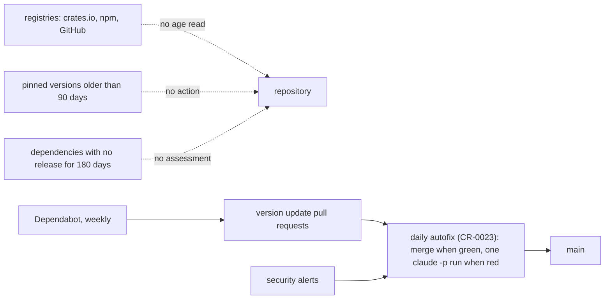
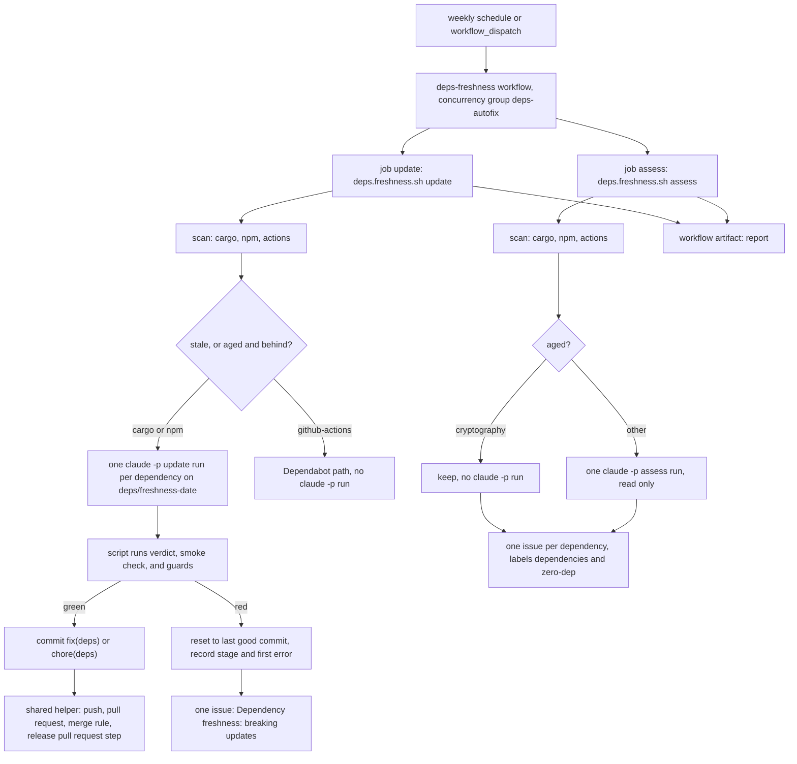
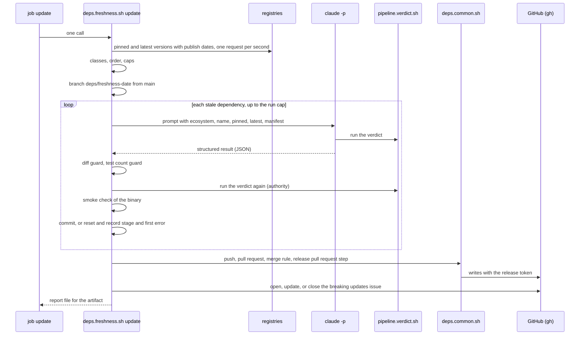
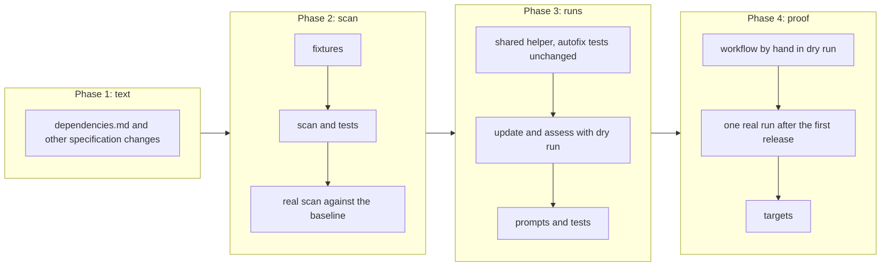

# Dependency freshness

## Change Summary

Today, the project updates a dependency only when Dependabot opens a version update pull request or a security alert opens (CR-0023). No process measures how old a pinned version is, and no process checks if a new major version breaks the app. This CR adds a weekly workflow that calls one new script, `.agents/scripts/deps.freshness.sh`. The script reads the direct dependencies of the three ecosystems, gets the publish dates from the registries, and gives each dependency one class: `fresh`, `stale`, or `aged`. For each stale dependency, one headless Claude Code run raises the dependency to the latest version, also across a major version. The script then runs the full verdict and a smoke check. A green update becomes one commit on the freshness branch and goes through the pull request flow of the daily autofix. A red update goes into one issue with the failing stage and the first error, so the owner sees what breaks. For each aged dependency, one headless Claude Code run reads how the project uses the dependency and recommends `keep`, `replace`, or `watch` in one issue for each dependency. The script never recommends to replace a cryptography crate. A replacement itself is a separate change request that the owner approves.

## Motivation and Background

The owner wrote, on 2026-10-24: "Look for outdated packages in general with an agentic 'get latest packages and determine if the app will break'. In general I don't want more than 3 months old packages. If deps are older than 6 months it should be considered to replace with self-managed code (zero dep approach)."

This CR reads the statement as three decisions of the owner:

1. **D1, freshness limit.** A pinned version must not be older than 3 months when a newer version exists. This CR uses 90 days.
2. **D2, zero-dep limit.** When a dependency has no release for more than 6 months, the project considers a replacement with its own code. This CR uses 180 days, measured on the latest release.
3. **D3, agentic break check.** An agent gets the latest version and finds out if the app breaks. The verdict of the project is the judge, not the agent.

The supervisor measured the baseline on 2026-10-24 from the crates.io API (section "Current State"). These decisions, the requirements that the supervisor gave for this CR, and the facts of the repository below are the requirements. Where a detail is open, this CR states a rule and names the detail a judgement call.

## Change Drivers

* Five direct crates are more than 90 days behind their latest release. Four of them are behind by a major version in the sense of semantic versioning below `1.0.0` (for example `rusqlite` 0.37 against 0.40). Dependabot opens a pull request for each, but nobody checks if the app breaks, and a red pull request stays open.
* Eight direct crates have no release for more than 180 days. Some are small and stable (`hex`), and some are large (`axum`). The project has no record of which of them it can replace with its own code, and no rule for which it must keep.
* The daily autofix of CR-0023 handles the security alerts and the Dependabot pull requests. It does not look at the age of a version, and it does not raise a version on its own.
* The advisory response of CR-0025 acts after a vulnerability is known. An old pinned version raises the chance that a fix exists only in a version that the project cannot take without a major update. A regular update keeps the distance small.
* A major update of `sha2` needs a major update of `hmac` in the same change, because both use the trait crate `digest` and the project uses `Hmac<Sha256>` in `src/capture/credential.rs` and `src/private/cookie.rs`. A single version bump by Dependabot cannot make such a coupled change.

## Current State

### Dependencies of the project

* **cargo.** `Cargo.toml` has 26 direct dependency entries: 22 in `[dependencies]` and 4 in `[dev-dependencies]`. `tokio` is in both tables, so the entries name 25 distinct crates. `Cargo.toml` states version ranges, for example `"0.10"`. `Cargo.lock` holds the resolved version of each crate.
* **npm.** `prototype/package.json` has 4 direct packages: `vite` (dev), `driver.js`, `@fontsource/geist-sans`, and `@fontsource/geist-mono`, each at an exact version. `prototype/pnpm-lock.yaml` holds the resolved versions. The prototype is not shipped.
* **github-actions.** The five workflows under `.github/workflows/` pin 8 distinct external actions by their full 40-character commit SHA, with the release tag in a comment (CR-0022, requirement 21). One more `uses` line names the local verdict workflow, which is not a dependency.

### Baseline of the cargo dependencies

The supervisor measured these values on 2026-10-24 from the crates.io API. The age is in whole days from the publish date to 2026-10-24. "Latest" is the highest version that is not a pre-release, not the first entry of the API answer.

| Group | Crate | Pinned | Age of pinned | Latest | Age of latest |
|---|---|---|---|---|---|
| Pinned more than 90 days old and behind the latest | `aes-gcm` | 0.10.3 | 1128 | 0.11.1 | 63 |
| | `sha2` | 0.10.9 | 541 | 0.11.1 | 11 |
| | `rusqlite` | 0.37.0 | 475 | 0.40.2 | 76 |
| | `reqwest` | 0.12.28 | 305 | 0.13.5 | 45 |
| | `tokio-tungstenite` (dev) | 0.29.0 | 220 | 0.30.0 | 104 |
| Latest release older than 180 days | `hex` | 0.4.3 | 2060 | 0.4.3 | 2060 |
| | `subtle` | 2.6.1 | 851 | 2.6.1 | 851 |
| | `chrono-tz` | 0.10.4 | 469 | 0.10.4 | 469 |
| | `tracing` | 0.1.44 | 309 | 0.1.44 | 309 |
| | `tracing-subscriber` | 0.3.23 | 224 | 0.3.23 | 224 |
| | `axum` | 0.8.9 | 193 | 0.8.9 | 193 |
| | `tempfile` (dev) | 3.27.0 | 227 | 3.27.0 | 227 |
| | `hmac` | 0.12.1 | 1709 | 0.13.0 | 208 |
| Pinned older than 90 days, but equal to the latest | `chrono`, `getrandom`, `bytes`, `serde` | | | | |
| Fresh | `base64`, `futures-util`, `rust_decimal`, `clap`, `serde_json`, `jsonschema` (dev), `tokio`, `toml` | | | | |

Two facts follow from the table:

1. `hmac` is in the aged group, and it is also behind its latest version.
2. The baseline counts 5 stale crates and 8 aged crates.

The baseline of the npm packages and of the actions is not measured. The first scan of the model-based test records it.

### Automation today

* `.agents/scripts/deps.autofix.sh` runs each day at 04:17 UTC through `.github/workflows/deps-autofix.yml`. It holds the branch, the push, the pull request, the merge rule, and the release pull request step (`docs/specification/dependencies.md`, sections "Autofix branch and merge" and "Release pull request step"). Its concurrency group is `deps-autofix`. Its job timeout is 180 minutes. The workflow is disabled until the secret `CLAUDE_CODE_OAUTH_TOKEN` exists and the repository is public (CR-0023, implementation notes).
* The limits of one `claude -p` run of the autofix are: at most 30 turns, at most 5 US dollars API-equivalent, and a process timeout of 40 minutes (`dependencies.md`, section "Limits").
* Dependabot opens weekly version update pull requests on Monday at 03:00 UTC for the three ecosystems (`.github/dependabot.yml`). The minor and patch updates of one ecosystem come in one grouped pull request. Each major update has its own pull request.
* The verdict (`pipeline.verdict.sh`) runs the format, lint, test, web, and image stages. The lint stage runs `deps.deny.sh`, which checks the advisories, the licenses, and the sources with cargo deny.
* No script reads a publish date from a registry. No issue has the label `zero-dep`.

### Current State Diagram



## Proposed Change

1. Add the script `.agents/scripts/deps.freshness.sh` with three actions: `scan`, `update`, and `assess`. The script holds all the logic.
2. Add two prompt templates: `.agents/scripts/deps.freshness.update.prompt.md` and `.agents/scripts/deps.freshness.assess.prompt.md`.
3. Move the branch, push, pull request, merge, and release pull request steps of `deps.autofix.sh` into one shared helper, `.agents/scripts/deps.common.sh`. `deps.autofix.sh` sources the helper and keeps its behaviour.
4. Add the workflow `.github/workflows/deps-freshness.yml`. It is a thin caller with two jobs: one job calls `deps.freshness.sh update`, and one job calls `deps.freshness.sh assess`. It shares the concurrency group of the daily autofix.
5. Add the sections of the freshness flow to `docs/specification/dependencies.md`, and change `release.md`, `operations.md`, `index.md`, and `.taxonomy`.

### Proposed State Diagram



### Update Sequence



## Requirements

### Functional Requirements

**Scan: inputs (D1, D2)**

1. The script `.agents/scripts/deps.freshness.sh` **MUST** read the direct dependencies of three ecosystems, and only the direct dependencies (judgement call 1):
   1. `cargo`: each entry of `[dependencies]`, `[dev-dependencies]`, and `[build-dependencies]` of `Cargo.toml`, with the resolved version from `Cargo.lock`. A crate in more than one table **MUST** count as one dependency.
   2. `npm`: each entry of `dependencies` and `devDependencies` of `prototype/package.json`, with the resolved version from `prototype/pnpm-lock.yaml`.
   3. `github-actions`: each external action of the files under `.github/workflows/`, with its pinned commit SHA and the tag of its version comment. A local workflow or a local action **MUST NOT** count. One action that more than one workflow pins **MUST** count as one dependency for each distinct pin.
2. The pinned version of a cargo or npm dependency **MUST** be the resolved version of the lock file. When the lock file holds more than one version of the crate, the pinned version **MUST** be the version that the root package uses.
3. The pinned version of an action **MUST** be the tag of the version comment. The script **MUST** check through the GitHub API that the tag resolves to the pinned SHA. When it does not, the line **MUST** hold `pin_check: mismatch`, and the class **MUST** be `stale`.

**Scan: registries**

4. The script **MUST** get the versions and the publish dates from these sources (judgement call 2):
   1. `cargo`: the crates.io API, one request for each crate, with a `User-Agent` header that names the project and its repository URL.
   2. `npm`: the npm registry document of the package, with the field `time` for the publish date of each version.
   3. `github-actions`: the releases API of the GitHub repository of the action through `gh`. For a tag with no release, the commit date of the tagged commit.
5. The script **MUST** send at most one request per second to each registry (judgement call 13). On an HTTP 429 or a 5xx answer, it **MUST** retry at most 3 times with a growing wait. After the last retry, the dependency **MUST** get the class `unknown`, and the run **MUST** end with exit code 6 after the other work.
6. The latest version **MUST** be the highest version by semantic version order that is not a pre-release, not yanked (crates.io), not deprecated (npm), and not a draft or pre-release (GitHub). The script **MUST NOT** take the order of the API answer, the npm `dist-tags`, or the first entry as the latest (judgement calls 3 and 4). For an action, a tag that is not a full semantic version, for example `v4`, **MUST NOT** count.
7. A dependency with a pinned version that is yanked or deprecated **MUST** get the class `stale` with the field `yanked: yes`, whatever its age (judgement call 3).
8. The age of a version **MUST** be the count of whole days from its publish time to the scan time, both in UTC.

**Scan: classes**

9. The script **MUST** give each dependency exactly one class. A dependency whose lookup failed has the class `unknown` (requirement 5). A pin mismatch or a yanked or deprecated pinned version has the class `stale` (requirements 3 and 7). Each other dependency has one class, with this order of precedence:
   1. `aged`: the latest release is older than 180 days.
   2. `stale`: the pinned version is older than 90 days and is behind the latest.
   3. `fresh`: each other case, that is the pinned version is at most 90 days old, or it equals the latest.
10. The line of each dependency **MUST** also hold the field `behind` (`yes` or `no`). A dependency of the class `aged` with `behind: yes` **MUST** get an update run as a stale dependency does (judgement call 5). At the baseline, this is `hmac`.
11. The thresholds 90 days and 180 days **MUST** be two named constants of the script, each with a comment that states its reason: D1 for 90 days and D2 for 180 days. Another script, a prompt template, or a workflow file **MUST NOT** state the values as thresholds; in the specification, `dependencies.md` states them.

**Scan: output**

12. The action `scan` **MUST** print one line for each dependency with these fields: `ecosystem`, `name`, `kind` (normal, dev, build, or action), `pinned`, `pinned_date`, `pinned_age_days`, `latest`, `latest_date`, `latest_age_days`, `behind`, `class`, and `yanked`. Then it **MUST** print one summary line with the count of each class, the count of all dependencies, and the scan time in seconds.
13. The output **MUST** follow `agent_first_cli`: `key: value` lines on stdout by default, `--human` for a table view, and `--json` for one JSON document with the same fields. Errors **MUST** go to stderr with an actionable text.
14. The action `scan` **MUST** be read-only. It **MUST NOT** start `claude -p`, write to the tree, or write to the GitHub API. It **MUST** need no `CLAUDE_CODE_OAUTH_TOKEN`.
15. The script **MUST** write the report of each action as one JSON file to a path that the flag `--report` names. The report **MUST** hold the scan lines, the result of each run, the tokens and the cost of each `claude -p` run, and the summary. It **MUST** hold no credential.

**Update of a stale dependency (D3)**

16. The action `update` **MUST** do the scan, then start at most one `claude -p` update run for each `cargo` or `npm` dependency of the class `stale`, or of the class `aged` with `behind: yes`, in one workflow run.
17. A `github-actions` dependency **MUST NOT** get a `claude -p` run, because Claude Code never changes a workflow file (CR-0023, judgement call 14). The script **MUST** record a stale action with the reason `dependabot_path` when a Dependabot pull request for that action is open, and with the reason `actions_no_pr` when none is open. The second case **MUST** go into the issue of requirement 31 (judgement call 9).
18. The script **MUST** handle the dependencies in this order: cargo `[dependencies]` and `[build-dependencies]` first, then cargo `[dev-dependencies]`, then npm. Inside each group, the oldest pinned version **MUST** come first (judgement call 6).
19. Each update run **MUST** use the subscription token in `CLAUDE_CODE_OAUTH_TOKEN`, the model, the turn limit, the budget limit, the Bash tool timeout, and the process timeout of one `claude -p` run of the autofix (`dependencies.md`, section "Limits"). The limits of one workflow run are judgement call 12. The script **MUST NOT** raise a limit.
20. The prompt **MUST** come from `.agents/scripts/deps.freshness.update.prompt.md` with these fields: the ecosystem, the name, the kind, the pinned version, the latest version, and the manifest path. The prompt **MUST** tell Claude Code to raise the dependency to the latest version, also across a major version, in the manifest and in the lock file; to run `.agents/scripts/pipeline.verdict.sh`; to change code in the allowed paths only when the verdict fails because of the update; to raise another direct dependency only when the update cannot build without it (judgement call 7); and to end with one structured result.
21. The structured result **MUST** hold the fields `status` (`updated`, `breaks`, or `failed`), `name`, `from_version`, `to_version`, `also_raised` (a list of name and version pairs), `files_changed`, `code_changed` (true or false), `verdict`, `failing_stage`, `first_error`, and `reason`. A missing, unparsable, or incomplete result **MUST** count as `failed` with the reason `invalid_result`.
22. The credential rules of the autofix **MUST** apply to each `claude -p` run of this flow: the process gets no GitHub token, the checkout persists no credential, the process and the verdict of the script run with a fixed allowlist of environment variables, and the tool allowlist is the allowlist of the autofix (CR-0023, requirement 21 and judgement call 5).
23. After each update run, the script **MUST** check the diff with the allowed paths and the credential patterns of the autofix (CR-0023, requirement 22, and judgement call 6). A path outside the allowed paths **MUST** fail the item with `path_not_allowed`. A credential match **MUST** fail the item with `credential_in_diff`. A diff that removes a direct dependency from `Cargo.toml` or `prototype/package.json` **MUST** fail the item with `dependency_removed`, so that an update run never replaces a dependency, also a cryptography crate, with own code.
24. After each update run, the script **MUST** count the test attributes (`#[test]` and `#[tokio::test]`) under `src/` and `tests/`. When the count is lower than the count on the branch before the run, the item **MUST** fail with the reason `tests_removed`.
25. The script **MUST** decide if the app breaks by its own checks, not by the result of Claude Code (judgement call 10). The app breaks when one of these checks fails:
    1. The verdict: `pipeline.verdict.sh` of the script, with no GitHub token and no `CLAUDE_CODE_OAUTH_TOKEN` in its environment, exits with a code that is not 0.
    2. The smoke check of a `cargo` update: the `loupe` binary of a debug build prints its version with `--version`, writes the line `listening` after `loupe serve`, answers `GET /healthz` with status 200 and the body `{"status":"ok"}`, and on SIGTERM writes the line `database closed, exit` and exits with code 0. These are the items of the binary check of `release.md` (Release build profile, "Unwinding check", item 4) that run on one host.
    3. The prototype check of an `npm` update: the install with the frozen lock file and the build of the prototype.
26. When each check of requirements 23 to 25 passes, the script **MUST** make one commit on the freshness branch. The type **MUST** follow the ecosystem rules of `dependencies.md` (section "Commit"): `fix(deps)` for a `cargo` update, and `chore(deps)` for an update that changes only `prototype/`. The summary **MUST** have the form `<type>(deps): bump <name> to <version>`. The body **MUST** hold the pinned age and the latest age, one line for each crate of `also_raised`, and the line `code changed: yes` when `code_changed` is true. The script, not Claude Code, writes the message.
27. When a check fails, the script **MUST** reset the freshness branch to its last good commit and record the item as `breaks` with the failing check, the failing stage, and the first error line of the verdict output of the script, after the redaction of requirement 41. Then it **MUST** continue with the next item.
28. The next update run **MUST** start from the last good commit, so the verdict runs between two updates (judgement call 6).
29. A dependency that a run raised through `also_raised` **MUST NOT** get its own run in the same workflow run.

**Branch and pull request flow**

30. All green updates of one workflow run **MUST** land on one branch `deps/freshness-<YYYY-MM-DD>` with the date of the run in UTC, made from the head of `main` (judgement call 8). The script **MUST** then use the shared helper of requirement 46 for the push, the pull request, the merge rule, and the release pull request step, with the same rules as the autofix (`dependencies.md`, sections "Autofix branch and merge" and "Release pull request step"). The title of the pull request **MUST** follow the title forms of the autofix.

**Breaking updates issue**

31. When one or more update items break or fail, the script **MUST** open one issue, or comment on the open one, with the title "Dependency freshness: breaking updates" and the label `dependencies` (judgement call 9). For each item, the text **MUST** hold: the ecosystem and the name, the pinned and the latest version, the failing check, the failing stage, the first error, the structured result, and the link to the workflow run. The text **MUST** also hold the summary of the scan.
32. There **MUST** be at most one open breaking updates issue. When a later run has no breaking or failed item and the issue is open, the script **MUST** comment with the run link and close it.
33. An item that broke **MUST NOT** start a new update run until the latest version changes, or 28 days pass, or a person starts the script with `--retry-failed` (judgement call 11). The issue **MUST** hold one machine block with one line for each held item and its date.

**Zero-dep assessment of an aged dependency (D2)**

34. The action `assess` **MUST** do the scan, then write one assessment for each dependency of the class `aged`, of each ecosystem.
35. Before each assessment, the script **MUST** count the use of the dependency with a fixed search: the import lines, the distinct imported symbols, the call sites, and the count of files, under `src/`, `tests/`, `build.rs`, `prototype/src/`, and, for an action, `.github/workflows/`. These counts are the authority. The assessment **MUST** use them.
36. A cryptography dependency **MUST** always get the recommendation `keep` with the reason "cryptography: the project does not write its own cryptography". It **MUST NOT** get a `claude -p` run. A cryptography dependency is `aes-gcm`, `sha2`, `hmac`, `subtle`, `getrandom`, and each crate whose crates.io field `repository` points to the GitHub organisation `RustCrypto` (judgement call 14).
37. For each other aged dependency, the script **MUST** start at most one `claude -p` assessment run. The run **MUST** use the per-run limits of requirement 19, except the process timeout of judgement call 12. Its tools **MUST** be Read, Grep, and Glob only, with no Bash, no Edit, no Write, and no web tool. After the run, the work tree **MUST** be unchanged; else the item **MUST** fail with the reason `tree_changed`.
38. The prompt **MUST** come from `.agents/scripts/deps.freshness.assess.prompt.md` with the scan line and the counts of requirement 35. The structured result **MUST** hold the fields `name`, `symbols`, `call_sites`, `replacement_lines` (an estimate of the lines of own code), `risks` (a list), `recommendation` (`keep`, `replace`, or `watch`), and `reason`. A `replace` with `replacement_lines` above 500 **MUST** become `watch` with the reason `estimate_too_large` (judgement call 15).
39. The script **MUST** write each assessment into one issue for each dependency, with the title "Zero-dep assessment: <ecosystem> <name>" and the labels `dependencies` and `zero-dep`. The script **MUST** make the label `zero-dep` when it is absent. The issue **MUST** hold the scan line, the counts, the symbols, the estimate, the risks, the recommendation, the reason, the link to the run, and the statement: "A replacement is a separate change request for this dependency. The owner approves it before any code changes."
40. The script **MUST** find the assessment issue of a dependency by its title and its labels, in each state (judgement call 16):
    1. When no issue exists, it opens one.
    2. When the issue is open and the latest version, the counts, or the class did not change, it starts no new `claude -p` run and changes nothing. After 90 days from the last assessment, it starts a new run and comments.
    3. When the latest version or the counts changed, it starts a new run and comments.
    4. When the dependency is no longer aged or no longer a dependency, it comments with the reason and closes the issue.
    5. When the owner closed the issue, it does not reopen it and does not comment until the latest version changes.

**Secrets and logs**

41. The script **MUST NOT** print `CLAUDE_CODE_OAUTH_TOKEN` or a GitHub token on stdout, on stderr, in the report, in the artifact, in an issue, in a pull request, or in a commit. Before it writes a log extract or a first error, it **MUST** remove each match of the credential patterns of the autofix (`dependencies.md`, section "Credentials and logs").

**Workflow**

42. The workflow `.github/workflows/deps-freshness.yml` **MUST** start on a weekly schedule (judgement call 17) and on `workflow_dispatch`. A manual start **MUST** be able to ask for a dry run, which the workflow passes to the script as `--dry-run`.
43. The workflow **MUST** use the concurrency group `deps-autofix`, the group of the daily autofix, with no cancel of an active run. Thus the weekly run and the daily run never run at once (judgement call 18).
44. The workflow **MUST** be a thin caller per CR-0022, requirements 19 to 22. It **MUST** have two jobs, `update` and `assess`. Each job **MUST** call `deps.freshness.sh` in exactly one step, with the action `update` or `assess`. Each job **MUST** have a timeout (judgement call 12). The steps of a job **MUST** be a checkout with no persisted credential, the tool installs from the pin files as in the autofix workflow, the step of `.agents/scripts/claude.ensure.sh` that makes the Claude Code binary runnable (`dependencies.md`, section "Install of Claude Code"), a cache, the one call of the script, and one upload of the report as a workflow artifact (judgement call 19). The upload action **MUST** be pinned by its full commit SHA.
45. The job `update` **MUST** have the permissions of the autofix job and no others. The job `assess` **MUST** have only `contents: read` and `issues: write`. Only the step of the script **MUST** get `CLAUDE_CODE_OAUTH_TOKEN`. Only the step of the script of the job `update` **MUST** get the release token. This workflow **MUST NOT** add a repository secret.

**Shared helper**

46. The branch, push, pull request, merge rule, and release pull request steps of `deps.autofix.sh` **MUST** move into `.agents/scripts/deps.common.sh`, which both scripts source. The helper **MUST** take the branch name and the item lines as inputs. The behaviour of `deps.autofix.sh` **MUST NOT** change: its shell tests **MUST** pass with no change to their expected output. The one change of `tests/scripts/deps.autofix.test.sh` **MUST** be the copy of `deps.common.sh` into the test repository next to `deps.autofix.sh`, because the setup of the test copies only the script and its prompt.

**Script interface**

47. `deps.freshness.sh` **MUST** follow `agent_first_cli`: the `@agents-index` line, a docstring with the purpose, the usage, and the parameters, a complete `--help`, machine output by default, `--human`, `--json`, and actionable errors on stderr.
48. With `--dry-run`, the actions `update` and `assess` **MUST** do the scan and print the plan: each planned run with its prompt fields, the order, the caps, the branch, the issue actions, and the cryptography rule. They **MUST NOT** start `claude -p`, write to the tree, push, or write to the GitHub API. A dry run **MUST** need no `claude`, no `cargo`, no `corepack`, and no `CLAUDE_CODE_OAUTH_TOKEN`.
49. A documented flag `--fixtures DIR` **MUST** replace the registries, the GitHub API, and `claude` with recorded answers, for the tests. A run in this mode **MUST** use no network.
50. The script **MUST** document and use these exit codes: 0 for success (the scan done, each run green or none, each assessment written), 1 for one or more broken or failed items that an issue holds, 2 for a usage error, 3 for a missing tool or credential, 4 for a failed GitHub API call, 5 for an absent or inactive verdict workflow (action `update` only, as in the autofix), and 6 for a registry lookup that failed after its retries.
51. The script **MUST** write the summary of each action to the job summary of the workflow run when the variable of the job summary is set.

**Documentation**

52. `docs/specification/dependencies.md` **MUST** get new sections: "Freshness scan" (the inputs, the sources, the latest rule, the age, the classes, and the thresholds with their reasons), "Freshness update" (the order, the run, the checks, the meaning of "the app breaks", the commit, the branch, and the breaking updates issue), "Zero-dep assessment" (the counts, the cryptography rule, the run, the recommendation, and the issue), "Freshness workflow" (the schedule, the jobs, the concurrency group, the permissions, and the artifact), and "Freshness script interface" (the actions, the flags, the exit codes, and the reasons). It **MUST** change the sections "Limits" (the limits of one freshness workflow run), "Tokens" (the use of each token by the freshness flow), "Autofix workflow" (the shared concurrency group), and "Cost and free plan bounds" (the count of `claude -p` runs in one week).
53. `docs/specification/release.md` **MUST** change in the section "Releases from the dependency autofix", which also names the weekly freshness flow as a source of `fix(deps)` releases.
54. `docs/specification/operations.md` **MUST** change in two sections: "Hosted workflows" (the freshness workflow and its job timeouts) and "Measurable targets" (a new subsection "Dependency freshness targets").
55. `docs/specification/index.md` **MUST** change the row of `dependencies.md` to name the freshness flow.
56. `.taxonomy` **MUST** get rows for the terms "freshness class", "stale dependency", "aged dependency", "freshness branch", "breaking update", and "zero-dep assessment".

### Non-Functional Requirements

1. The pipeline entry points, `pipeline.verdict.sh`, and the fingerprint script **MUST NOT** change.
2. `deps.autofix.sh` **MUST NOT** change, except the move of the steps of requirement 46 into the shared helper. `.github/workflows/deps-autofix.yml`, `.github/dependabot.yml`, and the workflows of CR-0022 and CR-0025 **MUST NOT** change.
3. The project **MUST NOT** use a paid service other than the Claude Code subscription of the owner.
4. The count of credentials in the run logs, the artifacts, the issues, and the pull requests of this flow **MUST** be zero.
5. This CR **MUST NOT** add replacement code for a dependency.
6. The known gap of the proxy of the autofix applies: a `claude -p` run on a GitHub runner does not show on the dashboard. The report records the tokens and the cost of each run.
7. The targets of the section "Measurable Targets" **MUST** hold.

## Measurable Targets

"None" in the baseline column means that the metric does not exist before this CR. "The first real run" is the first scheduled or manual run, not in dry run, after the repository is public and the secret `CLAUDE_CODE_OAUTH_TOKEN` exists.

| Metric | Method | Baseline | Threshold |
|---|---|---|---|
| Stale direct dependencies | the count `stale` of the summary line of `deps.freshness.sh scan`, run 30 days after the first real run | 5 (crates.io, 2026-10-24) | 0 within 30 days after the first real run |
| Aged and behind direct dependencies | the count of the scan lines with `class: aged` and `behind: yes` in the same scan | 1 (`hmac`) | 0 within 30 days after the first real run |
| Aged dependencies with an assessment issue | after the first real run: the count of issues with the labels `dependencies` and `zero-dep` and a title that names an aged dependency of the scan, in each state, divided by the count `aged` of the scan | 0 of 8 | 8 of 8 (each aged dependency) |
| Cryptography crates with `replace` | the count of the assessment issues of a cryptography dependency (requirement 36) whose recommendation is not `keep` | none | 0 |
| Correct latest version | in the model-based test, Part A: the count of the 13 crates of the baseline table with a stated latest version whose scan line names the same latest version | none | 13 of 13, unless a new release came after 2026-10-24, which the scenario names with its date |
| Time of one scan | the field of the scan time in the summary line of `deps.freshness.sh scan`, on the machine of the owner and on the runner | none | at most 120 seconds |
| Limits of one `claude -p` run | the fields `num_turns` and `total_cost_usd` of the result, and the run time on the item line, for each run of the first real run | none | at most 30 turns, at most 5 US dollars API-equivalent, and at most the process timeout of the run kind |
| Cost of one workflow run | the sum of `total_cost_usd` on the summary line of each job | none | at most the budget of each job (judgement call 12) |
| Update runs with a defined end | over the first 4 weekly runs: the count of update items with a commit, a `breaks` record in the issue, or a `held` line, divided by the count of update items | none | each item |
| Credentials in logs | for each real run of the model-based test: download the run log with `gh run view <run id> --log`, the artifacts, the issue texts, and the pull request text, then run `gitleaks` on them and count the matches of `sk-ant-`, `ghp_`, `github_pat_`, `gho_`, `ghs_`, and the literal value of each secret on the machine of the owner | none | 0 findings and 0 matches |
| Requests per second to a registry | the fake registry of the shell tests records the time of each request | none | at most 1 request in each second, for each registry |

## Affected Components

New files:

* `.agents/scripts/deps.freshness.sh`: the scan, the update, and the assessment (requirements 1 to 51).
* `.agents/scripts/deps.freshness.update.prompt.md`: the prompt of an update run (requirement 20).
* `.agents/scripts/deps.freshness.assess.prompt.md`: the prompt of an assessment run (requirement 38).
* `.agents/scripts/deps.common.sh`: the shared helper (requirement 46).
* `.github/workflows/deps-freshness.yml`: the thin caller (requirements 42 to 45).
* `tests/deps.freshness.rs`, `tests/scripts/deps.freshness.test.sh`, and the fixtures under `tests/fixtures/freshness/`.
* `.agents/scenarios/deps.freshness.md`: the scenario of the section "Model-Based Testing".

Changed files:

* `.agents/scripts/deps.autofix.sh`: it sources the shared helper (requirement 46).
* `tests/scripts/deps.autofix.test.sh`: its setup also copies `deps.common.sh` (requirement 46); no expected output changes.
* `Cargo.toml`: one `[[test]]` entry for `tests/deps.freshness.rs`.
* `docs/specification/dependencies.md`: five new sections and four changed sections (requirement 52).
* `docs/specification/release.md`: the section "Releases from the dependency autofix" (requirement 53).
* `docs/specification/operations.md`: the sections "Hosted workflows" and "Measurable targets" (requirement 54).
* `docs/specification/index.md`: the row of `dependencies.md`.
* `.taxonomy`: six new rows.

Repository settings (no file):

* The label `zero-dep`, which the script makes.

Not changed:

* `.agents/scripts/pipeline.*.sh`, `pipeline.verdict.sh`, and the fingerprint script.
* `.github/workflows/deps-autofix.yml`, `.github/dependabot.yml`, and the workflows of CR-0022 and CR-0025.
* The binary, the public API, the dashboard, `Dockerfile`, and `compose.yaml`. An update that the flow merges changes `Cargo.toml`, `Cargo.lock`, and maybe code, through its own pull request.

## Scope Boundaries

### In Scope

* The three decisions of the owner (D1 to D3).
* The scan of the direct dependencies of cargo, of the npm prototype, and of the pinned actions.
* The agentic update of a stale cargo or npm dependency, the break check, and the record of a breaking update.
* The zero-dep assessment of an aged dependency, as an issue.
* The weekly workflow, the shared helper, the prompts, the tests, and the specification text.

### Out of Scope ("Here, But Not Further")

* Replacement code for any dependency. Each replacement is a separate change request per dependency that the owner approves.
* A change to the daily autofix beyond the shared helper of requirement 46. Its schedule, its limits, its issue, and its workflow file stay.
* A change to `.github/dependabot.yml`. Dependabot stays the path of the action pins.
* A `claude -p` run that changes a workflow file.
* A scan of the transitive dependencies. They follow their parents (judgement call 1). cargo deny of the lint stage still checks each crate of `Cargo.lock`.
* The pins that Dependabot does not read: `.tool-versions`, `rust-toolchain.toml`, the base image digests of the `Dockerfile`, and the vendored price file under `vendor/litellm/`. A later CR can add them to the scan.
* A change to the thresholds 90 and 180 days through a flag or a configuration file.
* A route of the `claude -p` runs through a hosted proxy.

## Alternative Approaches Considered

* **Dependabot only, with no age rule.** Rejected. Dependabot opens the pull request, but it does not adapt code for a major version, and it does not tell the owner what breaks. D3 asks for an agentic break check.
* **Add the freshness check to the daily autofix script.** Rejected. The autofix handles security items each day and has a job timeout of 180 minutes. A week of major updates in the same run can delay a security fix. A separate weekly run with a shared concurrency group keeps the two flows apart and never at once.
* **One `claude -p` run for all stale dependencies.** Rejected. One failure would hide the result of each other update, and the cost cap of one run would cover many updates. One run per dependency with the verdict between them gives one clear result for each dependency.
* **Let Claude Code decide if the app breaks.** Rejected. The script runs the verdict and the smoke check itself, as the autofix does. The result of Claude Code is input, not the judge.
* **Use the npm `dist-tags` or the first API entry as the latest version.** Rejected. The supervisor found that the first entry of the crates.io answer is not always the highest release. The highest semantic version that is not a pre-release is a rule that each ecosystem can follow.
* **Recommend a replacement of a cryptography crate when its use is small.** Rejected. Own cryptography code has a high risk and no review. `subtle` and `hmac` are small in use but carry constant-time and protocol rules.
* **A fixed `replace` rule by size only.** Rejected. A small crate can hold data that changes, for example the time zone data of `chrono-tz`. The assessment names the risks, and the owner decides through a change request.

## Impact Assessment

### User Impact

A user gets patch releases with current dependencies. A major update that changes code shows `code changed: yes` in its commit and its pull request. The binary, the API, and the dashboard do not change by this CR itself.

### Technical Impact

* One script, two prompts, one shared helper, one workflow, one test file with fixtures, and specification changes.
* The daily autofix gets a refactor into a shared helper with no change of behaviour.
* At most one freshness release each week. The release can carry other unreleased commits on `main`, as the autofix release can.
* The weekly run can hold the concurrency group for up to the job timeout of the job `update`. A daily autofix run that starts then waits.

### Business Impact

The cost stays the subscription of the owner and zero for the runners of a public repository. The first real run can start up to 4 update runs and up to 6 assessment runs (8 aged minus 2 cryptography crates), each with a budget cap. The later weekly runs start fewer runs, because a fresh dependency starts none and an open assessment starts none until its input changes.

## Implementation Approach

1. Write the sections of `dependencies.md` and the changes of `release.md`, `operations.md`, `index.md`, and `.taxonomy`.
2. Record the fixtures: crates.io answers with a pre-release, a yanked version, and an out-of-order list; an npm document with a `time` field; a releases list of an action; and `claude -p` results for an update and an assessment.
3. Write `deps.freshness.sh scan` with `--help`, `--json`, `--human`, and the tests against the fixtures.
4. Run the scan against the real registries on the machine of the owner and compare it with the baseline table.
5. Move the shared steps into `deps.common.sh`. Run the shell tests of the autofix with no change.
6. Write the actions `update` and `assess`, their `--dry-run`, the prompts, and their tests.
7. Add the workflow. Run it by hand in dry run.
8. After the first release, with the consent of the owner, do one real run.
9. Record the measured values in `operations.md`, subsection "Dependency freshness targets".
10. Make the implemented commit per CR-0022, requirement 10: `feat(deps): Dependency freshness (CR-0027)`.

### Implementation Flow



## Test Strategy

### Tests to Add

The tests run `tests/scripts/deps.freshness.test.sh` from `tests/deps.freshness.rs`, with `--fixtures` in place of the registries, of `gh`, and of `claude`. The test stage stays hermetic.

| Test File | Test Name | Description | Inputs | Expected Output |
|---|---|---|---|---|
| `tests/deps.freshness.rs` | `scan_classes` | Each class comes from the stated rule. | fixtures for a fresh, a stale, an aged, and an aged-and-behind crate | the four lines with `class` `fresh`, `stale`, `aged`, `aged`; `behind: yes` on the last |
| `tests/deps.freshness.rs` | `latest_is_highest_release` | The latest is the highest release, not the first entry. | a crates.io answer with a pre-release first and an older version before the highest | `latest` is the highest version that is not a pre-release |
| `tests/deps.freshness.rs` | `yanked_latest_skipped` | A yanked version is not the latest. | the highest version yanked | `latest` is the next version |
| `tests/deps.freshness.rs` | `yanked_pinned_is_stale` | A yanked pinned version is stale. | a pinned version yanked, 10 days old | `class: stale`, `yanked: yes` |
| `tests/deps.freshness.rs` | `crate_in_two_tables_counted_once` | A crate in two tables is one dependency. | a manifest with `tokio` in `[dependencies]` and `[dev-dependencies]` | one line for `tokio` |
| `tests/deps.freshness.rs` | `npm_time_field` | The npm dates come from the field `time`. | an npm document | the dates of the `time` field |
| `tests/deps.freshness.rs` | `action_pin_resolved` | An action pin resolves to its tag and date. | a pin, a tag that resolves to it, a releases list | `pinned` is the tag; `pin_check` passes |
| `tests/deps.freshness.rs` | `action_pin_mismatch` | A tag that does not resolve to the pin is stale. | a tag that resolves to another SHA | `pin_check: mismatch`, `class: stale` |
| `tests/deps.freshness.rs` | `user_agent_and_rate` | crates.io gets a User-Agent, and each registry at most one request per second. | the fake registry records the headers and the times | the header names the project; no two requests in one second |
| `tests/deps.freshness.rs` | `registry_error_exit_6` | A failed lookup is not a class. | a fake registry that answers 503 | `class: unknown`, 3 retries, exit code 6 |
| `tests/deps.freshness.rs` | `json_output` | `--json` holds the same fields. | the class fixtures | a JSON document with each field of requirement 12 |
| `tests/deps.freshness.rs` | `dry_run_starts_no_claude` | The dry run plans and writes nothing. | stale and aged fixtures, `--dry-run` | the plan lines; no `claude` call; no write call; no change of the tree |
| `tests/deps.freshness.rs` | `update_order_and_cap` | The order and the run cap hold. | 6 stale crates over the three groups | the runs in the order of requirement 18; the fifth and the sixth with `run_cap` |
| `tests/deps.freshness.rs` | `update_green_commits` | A green update is one commit with the stated form. | an update result `updated`; a passing stand-in verdict and smoke check | one commit `fix(deps): bump <name> to <version>` with the ages in the body |
| `tests/deps.freshness.rs` | `update_red_records_stage` | A red verdict is a breaking update. | an update result `updated`; a stand-in verdict that fails the test stage | the branch reset; the issue holds the stage `test` and the first error |
| `tests/deps.freshness.rs` | `smoke_failure_breaks` | A failed smoke check is a breaking update. | a passing verdict; a stand-in binary with no `listening` line | `breaks` with the failing check `smoke` |
| `tests/deps.freshness.rs` | `tests_removed_fails` | A drop of test attributes fails. | a fixture diff that removes one `#[test]` | `failed` with `tests_removed` |
| `tests/deps.freshness.rs` | `also_raised_no_second_run` | A coupled raise gets no own run. | an update of `sha2` that also raises `hmac` | one run; `hmac` named in the commit body; no run for `hmac` |
| `tests/deps.freshness.rs` | `stale_action_no_claude` | An action gets no update run. | a stale action with no Dependabot pull request | no `claude` call; `actions_no_pr` in the issue |
| `tests/deps.freshness.rs` | `held_breaking_item` | A breaking item waits. | the issue block holds an item of 3 days ago with the same latest | `held`; no `claude` call |
| `tests/deps.freshness.rs` | `crypto_is_keep_without_claude` | A cryptography crate gets keep. | aged `subtle`; aged crate with a `RustCrypto` repository field | `keep` with the stated reason; no `claude` call |
| `tests/deps.freshness.rs` | `assessment_issue_form` | The assessment issue has the stated title, labels, and fields. | an aged crate and an assessment result `replace` with 40 lines | the title, both labels, the counts, the statement of requirement 39 |
| `tests/deps.freshness.rs` | `large_replace_becomes_watch` | A large estimate is not `replace`. | an assessment result `replace` with 800 lines | `watch` with `estimate_too_large` |
| `tests/deps.freshness.rs` | `assessment_tree_changed_fails` | An assessment run must not write. | a stand-in `claude` that writes a file | `failed` with `tree_changed` |
| `tests/deps.freshness.rs` | `redaction_and_no_token` | No credential reaches an output. | test values of each pattern in the logs and the environment | 0 matches in the output, the report, the issue text, and the commit |

### Tests to Modify

None with a change of expected output. `tests/deps.autofix.rs` and `tests/scripts/deps.autofix.test.sh` **MUST** pass after the move into the shared helper (requirement 46), with one change only: the setup of `tests/scripts/deps.autofix.test.sh` also copies `deps.common.sh` into the test repository. No assertion and no expected output changes. This is the proof that the autofix keeps its behaviour.

### Tests to Remove

Not applicable. The CR removes no behaviour.

## Model-Based Testing

The change has a user surface: the scan output, the GitHub Actions run, the artifact, the pull request, and the issues. A model can follow each step with the shell and `gh`. Persist the scenario as `.agents/scenarios/deps.freshness.md` with the observed values. Part C needs the consent of the owner, recorded in the scenario with the date.

**Part A: the script against the real registries, on this machine, in dry run.**

1. Run `.agents/scripts/deps.freshness.sh scan` and record the scan time.
2. Check each line of the 25 crates against the baseline table. Name each difference with the publish date of the new release that causes it.
3. Check that the scan has 4 npm lines and one line for each distinct action pin, and record their classes as the baseline of these two ecosystems.
4. Run `deps.freshness.sh update --dry-run` and `deps.freshness.sh assess --dry-run`.
5. Check that the update plan names the runs in the order of requirement 18 and marks each run above the cap with `run_cap`.
6. Check that the assessment plan names `keep` with no run for `subtle` and `hmac`, and one run for each other aged crate.
7. Check that no `claude` process started, that the tree is unchanged, and that no issue, branch, or pull request was made.

**Part B: the weekly workflow by hand, in dry run, on the repository.**

8. Start the workflow with `workflow_dispatch` and the dry-run input.
9. Check that the two jobs run, that each job calls the script in one step, and that each job uploads a report artifact.
10. While the run is active, start the daily autofix by hand in dry run. Check that it waits in the concurrency group and does not run at the same time.
11. Download the artifacts and the log. Run the method of the row "Credentials in logs".

**Part C: one real run, after the first release.**

12. With the repository public and the secret `CLAUDE_CODE_OAUTH_TOKEN` set, start the workflow with `workflow_dispatch` and no dry run.
13. Check that each update run has a commit on `deps/freshness-<date>` or a `breaks` record with a stage and a first error in the issue "Dependency freshness: breaking updates".
14. Check that the freshness pull request merges only after the check `verdict` is green, and that the release pull request step follows the rules of the autofix.
15. Check that each aged crate has one issue with the labels `dependencies` and `zero-dep`, and that each cryptography crate has `keep`.
16. Record the turns, the cost, and the time of each `claude -p` run, and the cost of each job.
17. Run the method of the row "Credentials in logs" over the run.
18. 30 days later, run the scan again and record the counts `stale` and aged-and-behind.

Success condition: each check passes. Part A passes in 2 of 2 runs.

## Acceptance Criteria

### AC-1: The scan reads the direct dependencies of three ecosystems (requirements 1 to 3)

```gherkin
Given the tree at the source commit
When deps.freshness.sh scan runs
Then it prints one line for each of the 25 distinct crates of Cargo.toml
And one line for each of the 4 packages of prototype/package.json
And one line for each distinct external action pin of .github/workflows
And no line for a transitive dependency or for the local verdict workflow
And tokio has exactly one line
Given a lock file with two versions of one direct crate
Then the pinned version is the version that the root package uses
Given an action pin whose version comment tag resolves to another SHA
Then its line holds pin_check: mismatch and class stale
```

### AC-2: The latest version is the highest release (requirements 4 to 8)

```gherkin
Given a registry answer whose first entry is not the highest version
And the answer holds a pre-release above the highest release
And the highest release is yanked
When the scan reads it
Then latest is the highest version that is not a pre-release and not yanked
And the ages are whole days in UTC from the publish dates
And the crates.io requests carry a User-Agent that names the project
And no registry gets more than one request in one second
Given a deprecated npm version, a draft GitHub release, and an action tag v4
Then none of them is the latest
Given a pinned version that is yanked and 10 days old
Then its line holds class stale and yanked yes
```

### AC-3: Each dependency has one class (requirements 9 to 11)

```gherkin
Given the baseline of 2026-10-24
When deps.freshness.sh scan runs on 2026-10-24
Then aes-gcm, sha2, rusqlite, reqwest, and tokio-tungstenite have class stale
And hex, subtle, chrono-tz, tracing, tracing-subscriber, axum, tempfile, and hmac have class aged
And hmac has behind yes
And chrono, getrandom, bytes, serde, and toml have class fresh
And the summary line counts 5 stale and 8 aged
And the script states the thresholds 90 and 180 as named constants with their reasons
And no other script, prompt template, or workflow file states them as thresholds
```

### AC-4: The scan output has the stated forms (requirements 12 to 15)

```gherkin
Given deps.freshness.sh
When scan runs with no flag and stdout is not a terminal
Then each line holds ecosystem, name, kind, pinned, pinned_date, pinned_age_days, latest, latest_date, latest_age_days, behind, class, and yanked
And a summary line holds the count of each class and the scan time
When scan runs with --json
Then it prints one JSON document with the same fields
When scan runs with --human
Then it prints a table
And scan runs with no CLAUDE_CODE_OAUTH_TOKEN in the environment
And scan starts no claude -p run, writes no file in the tree, and makes no write call
```

### AC-5: A registry failure is not a class (requirement 5)

```gherkin
Given a registry that answers 503 for one crate
When the scan runs
Then the script retries at most 3 times
And the crate has class unknown
And the run ends with exit code 6
And the crate gets no claude -p run
```

### AC-6: Each stale dependency gets one update run in a stated order (requirements 16, 18, and 19)

```gherkin
Given the baseline of 2026-10-24
When deps.freshness.sh update runs
Then the runs come in the order hmac, aes-gcm, sha2, rusqlite, reqwest, tokio-tungstenite, minus each crate raised by an earlier run
And at most 4 claude -p runs start
And the remaining items carry run_cap
And each run uses the turn limit, the budget, the Bash tool timeout, and the process timeout of the autofix
```

### AC-7: An action gets no update run (requirement 17)

```gherkin
Given a stale action pin
When deps.freshness.sh update runs
Then no claude -p run starts for the action
And the item carries dependabot_path when a Dependabot pull request for the action is open
And the item carries actions_no_pr in the breaking updates issue when none is open
```

### AC-8: The script decides if the app breaks (requirements 23 to 25)

```gherkin
Given an update run that reports updated
When the script checks the result
Then it checks the diff paths and the credential patterns
And it counts the test attributes against the count before the run
And it runs pipeline.verdict.sh with no GitHub token and no CLAUDE_CODE_OAUTH_TOKEN in the environment
And for a cargo update it runs the smoke check of the debug binary
And for an npm update it runs the frozen install and the build of the prototype
And a diff that removes a direct dependency from a manifest fails the item with the reason dependency_removed
And the update counts as green only when each check passes
```

### AC-9: A green update is one commit on the freshness branch (requirements 26, 28, and 30)

```gherkin
Given a green update of rusqlite from 0.37.0 to 0.40.2 that changed code in src
When the script commits
Then the branch deps/freshness-<date> gets one commit "fix(deps): bump rusqlite to 0.40.2"
And the body holds the pinned age, the latest age, and the line "code changed: yes"
And Claude Code made no commit and no push
And the next update run starts from this commit
And the shared helper pushes the branch, opens the pull request, and merges it only after the check verdict is green
```

### AC-10: A red update goes into one issue (requirements 27, 31, and 32)

```gherkin
Given an update of reqwest to 0.13.5 whose verdict fails in the test stage
When the run ends
Then the freshness branch holds no commit for reqwest
And one open issue "Dependency freshness: breaking updates" with the label dependencies holds reqwest, 0.12.28, 0.13.5, the failing check verdict, the stage test, the first error, the structured result, the run link, and the scan summary
And the script exits with code 1
Given a later run with no breaking item and the issue open
When the run ends
Then the script comments with the run link and closes the issue
```

### AC-11: A breaking item waits (requirement 33)

```gherkin
Given reqwest broke 7 days ago at latest 0.13.5
And the latest is still 0.13.5
When deps.freshness.sh update runs
Then reqwest has the status held and gets no claude -p run
When a person runs the script with --retry-failed
Then reqwest gets one claude -p run
```

### AC-12: A coupled raise is one run (requirements 20 and 29)

```gherkin
Given sha2 0.11 needs hmac 0.13 to build
When the update run of sha2 raises hmac too
Then the commit body names hmac and its version
And hmac gets no own claude -p run in that workflow run
```

### AC-13: A removed test fails the update (requirement 24)

```gherkin
Given an update run whose diff removes one #[test] function
When the script checks the result
Then the item fails with the reason tests_removed
And the branch holds no commit for the item
```

### AC-14: Each aged dependency gets one assessment issue (requirements 34, 35, 38, and 39)

```gherkin
Given the baseline of 2026-10-24
When deps.freshness.sh assess runs
Then each of the 8 aged crates has one issue "Zero-dep assessment: cargo <name>" with the labels dependencies and zero-dep
And each issue holds the scan line, the import count, the symbols, the call sites, the file count, the estimate in lines, the risks, the recommendation, the reason, and the run link
And each issue states that a replacement is a separate change request that the owner approves
And the label zero-dep exists
```

### AC-15: A cryptography crate is always keep (requirement 36)

```gherkin
Given the aged crates subtle and hmac
And an aged crate whose crates.io repository field points to the GitHub organisation RustCrypto
When deps.freshness.sh assess runs
Then each gets the recommendation keep with the reason "cryptography: the project does not write its own cryptography"
And none of them gets a claude -p run
```

### AC-16: An assessment run only reads (requirements 37 and 38)

```gherkin
Given an assessment run
Then its tools are Read, Grep, and Glob only
When the run changes a file in the work tree
Then the item fails with the reason tree_changed
Given an assessment result replace with an estimate of 800 lines
Then the issue holds watch with the reason estimate_too_large
```

### AC-17: An assessment issue changes only when its input changes (requirement 40)

```gherkin
Given an open assessment issue for hex from 10 days ago
And the latest version and the counts did not change
When deps.freshness.sh assess runs
Then no claude -p run starts for hex and the issue does not change
Given the owner closed the assessment issue of tracing
When deps.freshness.sh assess runs with the same latest version of tracing
Then the issue stays closed with no new comment
Given axum got a new release and is no longer aged
When deps.freshness.sh assess runs
Then the script comments on the axum issue with the reason and closes it
Given an open assessment issue for chrono-tz whose last assessment is 91 days old, with the same latest version and counts
When deps.freshness.sh assess runs
Then one claude -p run starts for chrono-tz and the script comments on the issue
Given the call site count of hex changed since its last assessment
When deps.freshness.sh assess runs
Then one claude -p run starts for hex and the script comments on the issue
```

### AC-18: The dry run plans and does nothing (requirement 48)

```gherkin
Given no CLAUDE_CODE_OAUTH_TOKEN, no claude, and no cargo
When deps.freshness.sh update --dry-run and deps.freshness.sh assess --dry-run run
Then each prints the planned runs with their prompt fields, the order, the caps, the branch, and the issue actions
And no claude -p process starts
And the tree is unchanged, nothing is pushed, and no write call is made to the GitHub API
```

### AC-19: The weekly workflow is a thin caller in the shared concurrency group (requirements 42 to 45)

```gherkin
Given the deps-freshness workflow file
When a reviewer reads it
Then it starts on a weekly schedule and on workflow_dispatch with a dry-run input
And its concurrency group is deps-autofix with no cancel of an active run
And it has the jobs update and assess, each with a timeout
And each job calls deps.freshness.sh in exactly one step
And each other step is a checkout with no persisted credential, a tool install from the pin files, the step of claude.ensure.sh, a cache, or the upload of the report artifact pinned by a full commit SHA
And the job assess has only the permissions contents read and issues write
And only the step of the script gets CLAUDE_CODE_OAUTH_TOKEN
And the job update has the permissions of the autofix job and no others
And only the step of the script of the job update gets the release token
And the workflow adds no repository secret
When the weekly run is active and the daily autofix starts
Then the daily autofix waits until the weekly run ends
```

### AC-20: The report is an artifact and a summary (requirements 15, 31, and 51)

```gherkin
Given a run of the deps-freshness workflow
When the run ends
Then each job has one report artifact with the scan lines, the result of each run, the tokens, the cost, and the summary
And the job summary of the run holds the summary
And each issue that the run writes holds the summary of the scan
And the report holds no credential
```

### AC-21: The autofix keeps its behaviour (requirement 46, non-functional requirement 2)

```gherkin
Given the move of the shared steps into deps.common.sh
When the test stage runs
Then tests/deps.autofix.rs and tests/scripts/deps.autofix.test.sh pass, with the copy of deps.common.sh in the test setup as the one change and no change of an assertion or an expected output
And .github/workflows/deps-autofix.yml and .github/dependabot.yml do not change
And the pipeline entry points, pipeline.verdict.sh, the fingerprint script, and the workflows of CR-0022 and CR-0025 do not change
```

### AC-22: No credential in any output (requirement 41, non-functional requirement 4)

```gherkin
Given the real runs of the model-based test
When gitleaks and the pattern search run over the run logs, the artifacts, the issue texts, and the pull request text
Then the count of findings is 0
And the count of matches of each secret value is 0
```

### AC-23: The script follows agent_first_cli (requirements 47, 49, and 50)

```gherkin
Given deps.freshness.sh
When it runs with --help
Then it prints the purpose, the actions scan, update, and assess, the flags, and the exit codes 0 to 6
When it runs with an unknown flag
Then it writes an actionable error on stderr and exits with code 2
When it runs with --fixtures and a fixture directory
Then it uses no network
```

### AC-24: The specification states the flow (requirements 52 to 56)

```gherkin
Given the tree after the CR
When a reader opens docs/specification/dependencies.md
Then it has the sections Freshness scan, Freshness update, Zero-dep assessment, Freshness workflow, and Freshness script interface
And the sections Limits, Tokens, Autofix workflow, and Cost and free plan bounds name the freshness flow
And release.md names the freshness flow as a source of fix(deps) releases
And operations.md names the freshness workflow and has the subsection Dependency freshness targets
And index.md and .taxonomy have the stated rows
```

### AC-25: The targets hold (non-functional requirement 7)

```gherkin
Given the first real run and the scan 30 days later
When the reviewer reads the scenario
Then the count stale is 0 and the count of aged and behind is 0
And 8 of 8 aged crates have an assessment issue
And each scan took at most 120 seconds
And each claude -p run stayed in 30 turns, 5 US dollars, and its process timeout
And no cryptography crate has a recommendation other than keep
```

### AC-26: The structured result and the credential rules of a run (requirements 21 and 22)

```gherkin
Given an update run
Then the claude -p process has no GitHub token in its environment, the checkout holds no persisted credential, and the environment of the process and of the verdict of the script is the fixed allowlist of the autofix
And the tool allowlist of the run is the allowlist of the autofix
When the run ends with a result that lacks the field also_raised, or that cannot be parsed
Then the item fails with the reason invalid_result
When the run ends with a complete result
Then the report holds status, name, from_version, to_version, also_raised, files_changed, code_changed, verdict, failing_stage, first_error, and reason
```

### AC-27: The scope of the change holds (non-functional requirements 3 and 5)

```gherkin
Given the tree after the CR and the workflow file of the freshness flow
When a reviewer reads the diff of the implemented commit
Then it adds no replacement code for a dependency
And it names no paid service other than the Claude Code subscription of the owner, and no API key
```

## Quality Standards Compliance

### Build & Compilation

`cargo build` passes. An update passes `cargo build`, the verdict, and the smoke check of the script before its commit.

### Linting & Code Style

`.agents/scripts/pipeline.lint.sh` and `pipeline.format.sh` pass. `deps.freshness.sh` and `deps.common.sh` pass `bash -n` and follow the style of the existing scripts.

### Test Execution

`.agents/scripts/pipeline.test.sh` passes with the new test file and the unchanged autofix tests, locally and in the verdict workflow.

### Documentation

The sections of `dependencies.md` and the changed sections of `release.md` and `operations.md` are written before the script.

### Code Review

A reviewer agent checks blocking findings only, with a focus on the latest version rule, the class rule, the cryptography rule, the path of each credential, the thin caller rule, the shared concurrency group, and the unchanged behaviour of the autofix.

### Verification Commands

* `.agents/scripts/pipeline.verdict.sh`
* `.agents/scripts/deps.freshness.sh --help`
* `.agents/scripts/deps.freshness.sh scan --human`
* `.agents/scripts/deps.freshness.sh update --dry-run`
* `.agents/scripts/deps.freshness.sh assess --dry-run`
* `gh run list --workflow deps-freshness.yml --limit 4`
* `gh issue list --label zero-dep --state all`
* `gh run view <run id> --log`, then `gitleaks` over the saved log and the downloaded artifacts

## Risks and Mitigation

### Risk 1: A major update passes the verdict but changes a behaviour that no test covers

**Likelihood:** medium
**Impact:** high
**Mitigation:** The verdict runs the full test stage, and the smoke check starts the real binary. The test count guard stops an update that removes a test. A commit and a pull request that changed code show `code changed: yes`, so the owner can read the change. The verdict workflow runs on the pull request, and the release workflow runs the verdict on the tag again. A release is a patch that a user can skip. The order of requirement 18 and one run per dependency keep each change small and easy to revert.

### Risk 2: The registries limit the rate

**Likelihood:** medium for crates.io with no `User-Agent`; low with the rules of this CR
**Impact:** low, the scan fails and starts no run
**Mitigation:** One request per second for each registry, a `User-Agent` with the project and its URL, at most 3 retries with a growing wait, and the class `unknown` with exit code 6 in place of a wrong class. About 40 direct dependencies take less than one minute at this rate. The GitHub calls use the workflow token, whose limit is far above the count of calls.

### Risk 3: The cost of many `claude -p` runs in one week

**Likelihood:** high for the first real run (up to 4 update runs and 6 assessment runs), low later
**Impact:** medium, a part of the usage limit of the subscription
**Mitigation:** The per-run limits of the autofix, the run cap and the budget of each job (judgement call 12), no run for a cryptography crate, no run for an action, no new assessment until its input changes or 90 days pass, and the hold time of a breaking item. The report records the cost of each run.

### Risk 4: The weekly run delays a security fix of the daily autofix

**Likelihood:** low
**Impact:** medium
**Mitigation:** The weekly run starts on Tuesday at 07:43 UTC, after the end of the daily run at the latest, and its update job has a job timeout of 330 minutes. A daily run that starts while the weekly run is active waits and runs after it. GitHub keeps only one pending run in a concurrency group and cancels an older pending run, so a second pending run of the group replaces the first. The next daily run does the work of a cancelled pending run. Parameter P2 checks the behaviour.

### Risk 5: An update of a crate with an advisory or a new license

**Likelihood:** low
**Impact:** medium
**Mitigation:** The lint stage of the verdict runs cargo deny with the advisories, the licenses, and the sources. An update that brings an advisory or a license outside the policy is red and goes into the issue.

### Risk 6: A prompt injection through the source or the documentation of a dependency

**Likelihood:** low
**Impact:** high
**Mitigation:** The credential rules of the autofix apply: no GitHub token in the process, no web tool, the diff guard of the paths, and the script commits and pushes. An assessment run has only read tools and must leave the tree unchanged.

### Risk 7: The assessment recommends a replacement that is not safe

**Likelihood:** medium
**Impact:** low, because no code changes from an assessment
**Mitigation:** An assessment is only a recommendation in an issue. A replacement needs a separate change request that the owner approves. A cryptography crate is always `keep`. A large estimate becomes `watch`.

## Dependencies

* CR-0023 is implemented: `deps.autofix.sh`, its branch, pull request, merge, and release pull request steps, its limits of one `claude -p` run, its credential rules, and the secret `CLAUDE_CODE_OAUTH_TOKEN`. This CR reuses them and does not restate them.
* CR-0025 is implemented: the advisory response for the published releases and the SBOM of each release asset. The SBOM of the next release lists the crates that a freshness update raised. The advisory response stays the path for a vulnerability in a published release.
* CR-0022: the verdict workflow, the thin caller rules, and the rule for commit types.
* The real run (Part C of the model-based test) waits for the public repository and the secret `CLAUDE_CODE_OAUTH_TOKEN`, as the daily autofix does.

## Estimated Effort

Medium: one script with about the size of `deps.autofix.sh`, two prompt templates, one refactor into a shared helper, one workflow, one test file with fixtures, and documentation changes. About one and a half working days, plus the waits for the hosted runs.

## Open Questions

The parameters below wait for verification at the implementation. Each has a stated fallback, so none blocks the approval of this CR.

### P1: The field of the repository on crates.io

Verify that the crates.io answer of a crate holds the field `repository` for each RustCrypto crate. If not, the fixed list of requirement 36 applies, and the owner adds a crate to it by hand.

### P2: Pending runs in a shared concurrency group

Verify with two manual starts in dry run that a daily run waits behind an active weekly run, and record how GitHub handles a second pending run. If a pending daily run is cancelled, the next daily run does its work, and `dependencies.md` states this.

### P3: The publish date of an action with no release

Some actions publish tags with no GitHub release. Verify the count of such pins at the first scan. The fallback is the committer date of the tagged commit.

### P4: The time of the verdict on the runner

Verify the time of one update run with its verdict and smoke check on the runner. If 4 runs do not fit in the job timeout, the script starts no new run when less than 75 minutes of the job time remain, and the item carries `run_cap`.

## Judgement Calls

1. **Direct dependencies only.** The scan reads only the direct dependencies. A transitive dependency follows its parent: when the parent rises, the lock file brings the new transitive versions. cargo deny in the lint stage still checks each crate of `Cargo.lock` for advisories.
2. **Age source.** The publish date of a version comes from its registry: the creation time of the version on crates.io, the field `time` of the npm registry document, and the publish time of the GitHub release of an action, or the commit date of the tagged commit when no release exists. The age is in whole days in UTC.
3. **Yanked latest.** A yanked crate version, a deprecated npm version, and a draft or withdrawn release are never the latest. A pinned version that is yanked or deprecated is `stale` whatever its age, because its authors withdrew it.
4. **Pre-release.** A pre-release is never the latest, and the update never goes to a pre-release. When the pinned version is a pre-release, the scan compares it with the highest release by the same rules.
5. **Aged and behind.** One class for each dependency, with the precedence aged, then stale, then fresh, and the field `behind`. An aged dependency that is behind its latest also gets an update run, because a newer version exists. At the baseline this is `hmac`, which also gets an assessment.
6. **Order of the updates.** Cargo runtime and build dependencies first, because they change the shipped binary; then cargo dev dependencies; then npm. In each group, the oldest pinned version first, because it has the largest distance. One `claude -p` run for each dependency, and the verdict of the script between two runs. At the baseline the order is `hmac`, `aes-gcm`, `sha2`, `rusqlite`, `reqwest`, then `tokio-tungstenite`.
7. **Coupled raise.** An update run can raise another direct dependency when the update cannot build without it, for example `sha2` 0.11 and `hmac` 0.13 through their shared trait crate `digest` and the use of `Hmac<Sha256>` in the project. The commit names each raised crate, and a raised crate gets no own run.
8. **Branch name.** `deps/freshness-<YYYY-MM-DD>` in UTC, with the pull request flow of the autofix through the shared helper. A separate branch keeps the weekly major updates apart from the daily security fixes, so a red interaction never holds back a security fix. One weekly run gives at most one freshness release each week.
9. **Issue titles.** "Dependency freshness: breaking updates" with the label `dependencies` for the breaking and failed update items, one issue. "Zero-dep assessment: <ecosystem> <name>" with the labels `dependencies` and `zero-dep`, one issue for each aged dependency. The titles differ from the autofix issue "Dependency autofix: failed items", so each script finds only its own issue.
10. **What counts as "the app breaks".** A red verdict of the script, or a failed smoke check of the binary (`--version`, the line `listening`, `GET /healthz`, and a clean SIGTERM), or a failed frozen install or build of the prototype. The verdict of Claude Code does not count. A guard failure (`path_not_allowed`, `credential_in_diff`, `dependency_removed`, `tests_removed`, `invalid_result`, `timeout`) is a failed run, not a finding that the app breaks, and the issue shows it with its reason.
11. **Hold time of a breaking item.** 28 days, or until the latest version changes, or `--retry-failed`. A weekly retry of the same version gives the same result and costs a run each week.
12. **Limits of one workflow run.** Each `claude -p` run keeps the limits of the autofix: 30 turns, 5 US dollars API-equivalent, and the Sonnet alias. The process timeout is 40 minutes for an update run and 15 minutes for an assessment run, because an assessment only reads. The job `update` starts at most 4 update runs and spends at most 15 US dollars, as the autofix does, with a job timeout of 330 minutes, below the 6-hour bound of a hosted job. The job `assess` starts at most 10 assessment runs and spends at most 20 US dollars, with a job timeout of 180 minutes. The script starts no new update run when less than 75 minutes of the job time remain.
13. **Polite rate.** At most one request per second for each registry, which is the crawler policy of crates.io. The `User-Agent` is `agentloupe-deps-freshness (https://github.com/desek/agentloupe)`.
14. **Cryptography list.** `aes-gcm`, `sha2`, `hmac`, `subtle`, and `getrandom` by name, and each crate whose crates.io repository field points to the GitHub organisation `RustCrypto`. A cryptography crate is still updated when it is stale, because the update is not own code.
15. **Size limit of `replace`.** An estimate above 500 lines changes `replace` to `watch`. A larger replacement holds more risk than a dependency, and the owner can still ask for it through a change request.
16. **Life of an assessment issue.** One issue for each dependency, found by its title and labels in each state. A new `claude -p` run only when the latest version or the counts change, or after 90 days. A closed issue of the owner stays closed until the latest version changes.
17. **Schedule.** Each Tuesday at 07:43 UTC. It is after the Dependabot run of Monday at 03:00 UTC, so the scan sees its pull requests, and after the latest end of the daily autofix at 07:17 UTC. The time is off the full hour, where GitHub delays scheduled runs.
18. **Shared concurrency group.** The freshness workflow uses the existing group `deps-autofix`, so the file of the daily autofix does not change.
19. **Two jobs and the artifact.** The update and the assessment run in two parallel jobs in one workflow run, because their runs together do not fit in one hosted job. The upload of the report artifact is platform work, as the attestation step of CR-0025. The artifact keeps the report for 30 days.
20. **Commit type.** The ecosystem rule of `dependencies.md`: `fix(deps)` for a cargo update, also a dev dependency, and `chore(deps)` for an update that changes only `prototype/`. A cargo update of a dev dependency thus makes a patch release with no change of the binary. This CR accepts that cost and does not add a new rule.
21. **npm rules.** The npm packages of the prototype get the scan, the update run, and the assessment run, with the prototype check in place of the smoke check. The prototype is not shipped, so its updates use `chore(deps)` and make no release.
22. **Actions rules.** The pins of the actions get the scan and the assessment. They get no `claude -p` update run, because Claude Code never changes a workflow file. Dependabot updates the pins, and the daily autofix merges a green pin pull request. A stale pin with no open Dependabot pull request goes into the breaking updates issue with `actions_no_pr`.
23. **Workflow state before the first release.** The workflow lands enabled for Part B of the model-based test. After Part B, the owner disables it with `gh workflow disable` until the repository is public and the secret exists, as for the daily autofix.

## Decision Outcome

Approved on 2026-10-24 by a reviewer agent in a Pi session through the proxy, separate from the author.

## Related Items

* CR-0023: the daily autofix, `deps.autofix.sh`, the limits of one `claude -p` run, the credential rules, the branch, pull request, merge, and release pull request steps, and the autofix issue.
* CR-0025: the advisory response for published releases and the SBOM files.
* CR-0022: the verdict workflow, the thin caller rules, and the rule for commit types.
* `docs/specification/dependencies.md`: the sections "Limits", "Tokens", "Autofix workflow", "Autofix branch and merge", "Release pull request step", "Credentials and logs", and "Cost and free plan bounds".
* `docs/specification/release.md`: the sections "Releases from the dependency autofix", "Commit types of dependency updates", and "Release build profile" (the binary check).
* `docs/specification/operations.md`: the sections "Hosted workflows" and "Measurable targets".

## Notes

Layer 1 isolation: this CR names the specification sections and the files that change. It does not hold their text, workflow YAML, or code. The decisions map to the requirements: D1 to requirements 9 to 11 and 16 to 33; D2 to requirements 9 to 11 and 34 to 40; D3 to requirements 20 to 27. The baseline of the cargo dependencies is the measurement of the supervisor on 2026-10-24; the scan of Part A of the model-based test replaces it for the npm packages and the actions.

### Review notes, 2026-10-24

A reviewer agent, separate from the author, reviewed this CR for blocking findings only, and made these edits:

1. **Contradiction with the repository: the Claude Code install step.** Requirement 44 listed the allowed steps of a job and left out the step of `.agents/scripts/claude.ensure.sh`. `dependencies.md` (section "Install of Claude Code") and `deps-autofix.yml` need that step, because the install on a hosted runner leaves the platform binary of Claude Code missing. Edit: requirement 44 and AC-19 name the step.
2. **Contradiction with the repository: the unchanged autofix tests.** Requirement 46, "Tests to Modify", and AC-21 required the autofix tests to pass with no change. The setup of `tests/scripts/deps.autofix.test.sh` copies only `deps.autofix.sh` and its prompt into the test repository, so a script that sources `deps.common.sh` fails there. Edit: the one allowed change is the copy of `deps.common.sh` in the test setup, with no change of an assertion or an expected output; requirement 46, "Tests to Modify", AC-21, and "Affected Components" state it.
3. **Cryptography crate replaced by own code.** No guard stopped an update run from removing a direct dependency, also a cryptography crate, and writing own code in `src/` in its place. Edit: requirement 23 adds the guard `dependency_removed`; AC-8 and judgement call 10 name it.
4. **Requirement not testable.** Requirement 11 said that no other file states the values 90 and 180, which this CR, `.taxonomy`, and `operations.md` contradict. Edit: the rule names another script, a prompt template, or a workflow file; AC-3 checks it.
5. **Requirements without an acceptance criterion.** Requirements 2, 3, 7, 21, and 22, the part of requirement 14 on the token, the part of requirement 45 on the job `update` and the release token, and non-functional requirements 1, 3, and 5 had no criterion. Edit: AC-1, AC-2, AC-4, AC-19, and AC-21 got lines, and AC-26 and AC-27 are new.

No blocking finding stays open. Each `claude -p` run has a turn limit, a budget, and a process timeout; the workflow is a thin caller; the CR holds no code, YAML, or file content; and the stated permissions cover each step.

### Review notes, 2026-10-24, second reviewer

A second reviewer agent, separate from the author and from the first reviewer, reviewed the CR after the edits above for blocking findings only, and made these edits:

6. **Contradiction with the repository: the baseline of `toml`.** The table had `toml` pinned at 0.9.12 with the latest 0.9.12, in the aged group. `Cargo.toml` states `toml = "1.1"`, and `Cargo.lock` resolves 1.1.8, which commit 5912760 brought after the source commit. crates.io lists 1.1.8 as the highest release, published on 2026-10-09, so 0.9.12 was never the latest by requirement 6. `toml` is fresh. Edit: the `toml` row moved to the fresh row; the aged count is 8 in "Change Drivers", in "Current State", in AC-3, in AC-14, in AC-25, and in the target "Aged dependencies with an assessment issue"; the target "Correct latest version" counts 13 crates; "Business Impact" and Risk 3 count 6 assessment runs; and AC-17 uses `tracing` in place of `toml` for the closed issue.
7. **Contradiction inside the class rule.** Requirement 9 gave each dependency exactly one of three classes, with `aged` first. But requirement 5 sets the class `unknown`, and requirements 3 and 7 set `stale` for a pin mismatch or for a yanked pinned version, also when the latest release is older than 180 days. Edit: requirement 9 names these cases before the order of precedence.
8. **Requirement without an acceptance criterion.** Requirement 40, item 3 (a new run when the counts change) and the new run after 90 days in item 2 had no criterion. Edit: AC-17 got two blocks.

No blocking finding stays open after these edits. The status stays `approved`.

### Implementation notes, 2026-10-24

The implementation covers the parts that a private repository and a dry run can complete: requirements 1 to 51 in code and tests, 52 to 56 in the specification commit, and the non-functional requirements 1, 2, 3, 5, and 6. The run log is `.agents/scenarios/deps.freshness.md` with `.agents/scenarios/deps.freshness.dryrun.log`; the measured values are in `docs/specification/operations.md` (Dependency freshness targets), and the results of the checks at implementation in `docs/specification/dependencies.md`. The scan of the source tree reproduces the baseline classes: 5 stale crates, 8 aged crates with `hmac` behind, and 13 of 13 latest versions. On the same day, the daily autofix merged `hmac` 0.13.0, `aes-gcm` 0.11.1, and `sha2` 0.11.1 (`2c856d9`), and crates.io published `rusqlite` 0.41.0; the scan after the rebase shows 3 stale crates and no aged crate behind.

Parts that wait:

1. Part B of the model-based test: the manual dry run of `deps-freshness.yml` on GitHub, its two report artifacts, the scan time on the runner, and parameter P2 (a daily run that waits behind an active weekly run, and a second pending run). A manual start needs the workflow file on the default branch, so it follows the merge. After it, the owner disables the workflow until the items below (judgement call 23).
2. The public repository and the secret `CLAUDE_CODE_OAUTH_TOKEN`, as for the daily autofix.
3. Part C, the first real run, and with it AC-6 to AC-17 and AC-20 on GitHub, AC-22 over real run logs, AC-25, parameter P4, and the targets of `operations.md` that need a real run or the scan 30 days after it.

Decisions at the implementation:

1. The fixtures are under `tests/fixtures/freshness/`, as `operations.md` states. They are real answers of crates.io, the npm registry, and the GitHub API, recorded on 2026-10-24 and trimmed; the README of the directory lists the edits (a pre-release first and an out-of-order list, a yanked latest, a yanked pinned version, a draft, a pre-release, and a tag `v9`).
2. The shared helper `deps.common.sh` holds the steps of requirement 46 and the calls they make: the GitHub reads and writes, the git push with the release token, the check polls, and the redaction. The `claude -p` plumbing (the environment allowlist, the tool lists, the limits, the price of a run) stays in each script; the shell test `thresholds_and_limits` checks that the freshness script keeps the values of the autofix.
3. The polite rate waits 1100 ms from the end of the last request of a lane, so two requests to one registry never start within one second. The three registries run as three parallel lanes, so a scan of 37 dependencies takes 40 to 46 seconds.
4. The latest version of `also_raised` comes from the lock files before and after the run, not from the result of Claude Code; the item of a raised dependency prints the status `raised` with the reason `also_raised`. The line `code changed: yes` follows the diff of the script or the field `code_changed` of the result.
5. The smoke check sets `LOUPE_LISTEN=127.0.0.1:0` and `DO_NOT_TRACK=1`, reads the port from the line `listening`, and waits at most 60 seconds for it.
6. The remaining job time counts from the start of the script. A held breaking item counts as an item that the issue holds (exit code 1), as in the autofix. Exit code 6 wins over exit code 1.
7. A failed assessment (`timeout`, `invalid_result`, `tree_changed`) writes its reason into the assessment issue with no date, so the next run assesses it again, and the run ends with exit code 1. The machine line of an assessment issue holds the latest version, the counts, the class, and the date.
8. The job `assess` installs only Node and Claude Code, because it builds nothing; it has no cache step.
9. The shell tests run in two nextest groups, not four: with four, the timing test `private_config_read_is_cached` of the same test stage missed its 5 ms bound on a loaded machine.
10. The job `update` does not call `runner.space.sh`, which `2351610` added to the autofix job after the specification commit: requirement 44 lists the allowed steps. The first real run shows whether the job needs it.

Hosted verdict of the pull request <https://github.com/desek/agentloupe/pull/19> before this commit: run 40088432078 on `79ccfef`, `success` in 7 minutes 44 seconds; run 40092344315 on `b5144b5`, after the rebase on `2c856d9`, `success` in 7 minutes 58 seconds (the test job 7 minutes 21 seconds).
