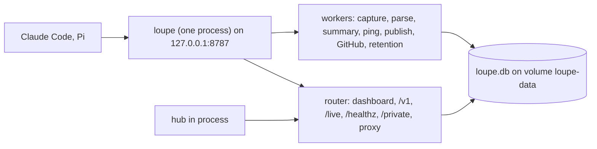
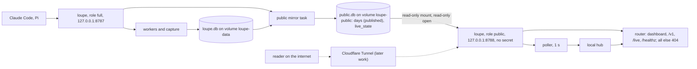
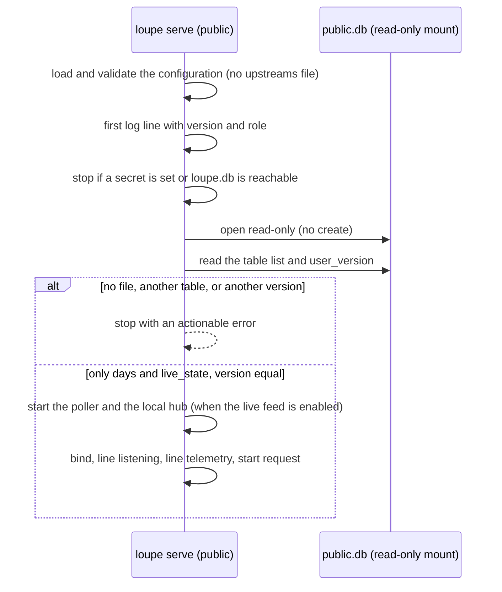
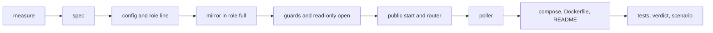

# Public instance

## Change Summary

`loupe serve` gets a role. The variable `LOUPE_ROLE` selects it. The value `full` is the default and keeps the behaviour of today, with one addition: a **public mirror**. The role `full` writes the file `<LOUPE_DATA_DIR>/public/public.db`. That file holds only two tables: the published day records, and one row of live counters of the current day. The value `public` gives a public, read-only process that has no access to non-public data. It reads only the public mirror, with the SQLite read-only flag, from a volume that the container mounts read-only. It cannot reach `loupe.db`, the spill files, or the logs of the role `full`, because its container does not mount the volume `loupe-data`. It stops at start when a secret is in its environment, because a secret such as `LOUPE_DATA_KEY` opens the sealed bodies. It serves the dashboard, its static files, the public API of `api.md`, `GET /live`, and `GET /healthz`. Every other path answers 404 with the body of an unknown path. It starts no worker. `compose.yaml` gets a second service `loupe-public` on `127.0.0.1:8788`, from the same image, with the mirror volume read-only and an optional env file `.env.public` that holds no secret. `README.md` gets a section on public hosting. A Cloudflare Tunnel in front of the public port is later work. This CR only prepares for it.

## Motivation and Background

The owner wrote, on 2026-10-25:

1. "I want to host the dashboard publicly for everyone to see"
2. "Author the CR for a public only / read-only mode that reads from the db the proxy process writes to"
3. "Write the CR for container based hosting like now. I'll publish through CF tunnel later."
4. "It's very important that the public readonly mode doesn't have access non-public information, i.e. raw session logs or raw requests"

These four points are the requirements. Point 1 is the goal. Point 2 gives the shape: a separate read-only process on data that the proxy process writes. Point 3 gives the deployment: containers on this machine, as today, and a Cloudflare Tunnel later. Point 4 is the security boundary, and it wins over point 2 where they collide: the public process must have no access to non-public data, not only no code path that reads it. Where a point leaves a detail open, this CR states a rule and names the detail a judgement call.

The first approved version of this CR, at commit `09b877b`, gave the public container the volume `loupe-data` and the env file `.env`. Thus that container could open `loupe.db`, with the table `exchanges` and its sealed bodies, and it held `LOUPE_DATA_KEY`, which opens those bodies. Point 4 rejects that design. This version replaces it. The section "Notes" records the amendment.

`README.md`, section "Scope", lists public hosting as out of scope "for now", to be "managed separately later". This CR moves the preparation for public hosting into scope. The tunnel, TLS, and the rate limit stay out of scope.

## Change Drivers

* The dashboard and the public API hold only public data (`README.md`, sections "Dashboard" and "Privacy model"). The page has no login, no cookie, and no state on the server. The owner wants everyone to see it.
* Today one process serves the public routes and the proxy, the private page, and the workers on one port. A tunnel to that port would expose the proxy and the private page to the internet.
* `loupe.db` holds non-public data: the table `exchanges` with the redacted headers, the paths, and the sealed bodies of each request; the tables `sessions`, `calls`, `accounts`, `proxy_tokens`, `session_summaries`, and the GitHub tables; and each day record that is not published (`pending_review` or `deleted`). The spill directory holds raw exchanges that wait for import. The log file of the role `full` holds request lines.
* `.env` holds `LOUPE_DATA_KEY`, which decrypts the sealed bodies, and the other secrets.
* A process that faces the internet can have a defect that reads any file it can open or any variable it holds. Only the absence of the data and of the secrets in that container removes the risk. A rule in the code alone does not.

## Current State

* `src/serve/mod.rs` runs one start sequence: it opens the database, applies the migrations, runs the bootstrap token step, starts the capture writer, the parser, the summary worker, the provider ping, the publisher with the GitHub fetch, and the retention worker, binds the port, and then starts the telemetry request (`operations.md`, section "Subcommands"; `telemetry.md`, section "Timing").
* `src/serve/router.rs` serves the static files, the private page when `LOUPE_ADMIN_TOKEN` is set, the live route, and the reserved names first. It gives every other path to the proxy (`proxy.md`, section "Routes"). A reserved name that no route serves answers 404 with the unknown-path body.
* `src/api/days.list.rs` and `src/api/days.get.rs` read only the table `days`, with `state = 'published'`. The envelope field `updated_at` is the highest `built_at` of the published rows.
* `src/day/store.rs` writes the table `days`. The publisher, `loupe aggregate`, and `loupe day` write it, and the last two can run as separate processes.
* `src/live/snapshot.rs` reads the totals of the current day from the table `calls` and the open segments from the table `sessions`. `src/live/route.rs` sends that snapshot, then the events of the in-process live hub. The capture and the parser send the events (`live.md`, sections "Live hub", "Senders", and "Snapshot"). The snapshot reads `in_flight` from the hub.
* The capture writes an exchange row once, when the exchange ends, with its end time set (`src/capture/insert.rs`).
* `src/store/open.rs` opens `loupe.db` read-write in WAL mode with a busy timeout of 5 seconds. `src/store/migrate.rs` applies the migrations and records each version in `schema_version`.
* `src/config/vars.rs` marks each secret variable: `LOUPE_DATA_KEY`, `LOUPE_ACCOUNT_KEY`, `LOUPE_BOOTSTRAP_TOKEN`, `LOUPE_ADMIN_TOKEN`, `CLAUDE_CODE_OAUTH_TOKEN`, `ANTHROPIC_API_KEY`, `OPENAI_API_KEY`, and the prefix `LOUPE_GITHUB_TOKEN_`.
* `loupe config show` prints each value with its source and has no role line (`configuration.md`, section "`loupe config show`").
* The first log line of `loupe serve` holds the version (`operations.md`, section "Logging"). The log file is `<LOUPE_DATA_DIR>/logs/loupe.log`.
* `compose.yaml` has one service `loupe` on `127.0.0.1:8787`, with the named volume `loupe-data` at `/data` and the env file `.env` (`operations.md`, section "Container").
* The `Dockerfile` makes `/data`, owned by the user `loupe`, declares it a volume, and has a `HEALTHCHECK` on `GET /healthz` at port 8787.

### Current State Diagram



## Proposed Change

1. Add the variable `LOUPE_ROLE` with the values `full` (default) and `public`.
2. In the role `full`, add the public mirror: one task writes `<LOUPE_DATA_DIR>/public/public.db` with the published day records and one row of live counters. The task copies only data that the public API or the live route already makes public.
3. In the role `public`, `loupe serve` opens only the public mirror, read-only. It stops at start when `loupe.db` is reachable, when a secret is set, when the mirror is absent, when the mirror holds a table other than the two public tables, or when the schema version of the mirror is not the version of the binary.
4. In the role `public`, `loupe serve` starts no worker, no capture, no ping, no bootstrap token step, no token gate, and no private page. It does not load `upstreams.toml`.
5. In the role `public`, the router serves only the public set of routes. Every other path answers 404 with the unknown-path body.
6. In the role `public`, a poller reads the live row of the mirror at a fixed interval. It feeds a local hub, so the live route and the client loop of today stay the same.
7. The first log line, `loupe config show`, and the private config route name the role.
8. `compose.yaml` gets the volume `loupe-public`, mounted read-write in the service `loupe` and read-only in the new service `loupe-public`. The service `loupe-public` does not mount `loupe-data` and does not read `.env`.
9. The `Dockerfile` makes `/data/public`, owned by the user `loupe`.
10. `README.md` gets the section "Public hosting".

### Proposed State Diagram



### Proposed Start Sequence of the Public Role



## Requirements

### Functional Requirements

**Role selection**

1. `loupe serve` **MUST** read the role from `LOUPE_ROLE`. The values are `full` and `public`. The default **MUST** be `full`.
2. The loader **MUST** resolve `LOUPE_ROLE` with the precedence of `configuration.md` (environment, then the file of the environment, then the default). The role has no command-line flag.
3. A value other than `full` or `public` **MUST** stop `loupe serve` and `loupe config show` before the port opens. The actionable error **MUST** name `LOUPE_ROLE`, the two values, the fix, `.env.example`, and the check `loupe config show`.
4. In the role `full`, the behaviour of `loupe serve` **MUST** stay as today, with the one addition of the public mirror (requirements 33 to 41).
5. The other subcommands (`aggregate`, `backfill`, `day`, `token`, `gen-key`, `summarize`, `parse`, `price`) **MUST** ignore `LOUPE_ROLE`.

**No access to non-public data in the role `public`**

6. In the role `public`, the process **MUST NOT** open `<LOUPE_DATA_DIR>/loupe.db` or any other file of the role `full`. It **MUST NOT** call `src/store/open.rs` or `src/store/migrate.rs`.
7. At start, before it opens a file, the role `public` **MUST** stop with an actionable error when `<LOUPE_DATA_DIR>/loupe.db` exists. The error **MUST** state that the private database is reachable from the public process, and name the fix: give the public process its own data directory with only the mirror volume, as in `compose.yaml`. The check is `loupe config show` and the list of the mounts of the service.
8. At start, before it opens a file, the role `public` **MUST** stop with an actionable error when a secret variable is set to a value that is not empty. The secret variables are each variable that `src/config/vars.rs` marks secret and each variable with the prefix `LOUPE_GITHUB_TOKEN_`. The error **MUST** name each set variable, **MUST NOT** hold a value, and **MUST** name the fix: remove the variable from the environment of the public process, and use `.env.public` with no secret, as `.env.public.example` shows. The check is `loupe config show`, which prints each secret as `unset`.
9. In the role `public`, the process **MUST NOT** hold a proxy state, a token gate, a private state, a data key, or an account key.
10. In the role `public`, `LOUPE_DATA_KEY` and `LOUPE_ACCOUNT_KEY` **MUST NOT** be required.

**Router of the public role**

11. In the role `public`, the router **MUST** serve exactly these routes, with the behaviour of today: `GET /` and the static files of the dashboard (`/assets/...` and `/favicon.ico`), the routes under `/v1/` of `api.md` with their methods, CORS, and cache headers, `GET /live`, and `GET /healthz`.
12. In the role `public`, every other path **MUST** answer 404 with the same body as an unknown path of today. This includes each path of the form `/<agent>/<upstream>/<path>`, each path of the form `/<token>/<agent>/<upstream>/<path>`, each path under `/private/` (the page, the login, the logout, and the API), and each path under `/live/` other than `/live`. The method does not change this answer.
13. The 404 body of the public role **MUST NOT** hold a token segment. When the first path segment starts with `lpt_`, the path in the body **MUST** be the path with that segment removed, as the rule of `proxy.tokens.md` (section "Privacy of the raw token", item 2) states for the logs.
14. In the role `public`, the router **MUST NOT** call the forwarder, the token gate, the capture, or the private routes.
15. In the role `public`, `LOUPE_LIVE_ENABLED=false` **MUST** make `GET /live` answer 404, as in the role `full`.
16. In the role `public`, the public API **MUST** read the table `days` of the mirror with the same statements and the same answers as today.

**Mirror access of the public role**

17. In the role `public`, `loupe serve` **MUST** open `<LOUPE_DATA_DIR>/public/public.db` with the SQLite read-only open flag, and without the create flag. It **MUST** also set the `query_only` pragma on each connection, and a busy timeout of 5 seconds.
18. The role `public` **MUST NOT** set the journal mode and **MUST NOT** open the mirror as immutable, so it sees each commit of the role `full`.
19. Each read of the role `public` (the API, the snapshot, and each poll pass) **MUST** be one short read transaction. No read transaction **MUST** stay open across an await point or across two poll passes.
20. A write through a connection of the role `public` **MUST** fail. A test **MUST** show that an insert fails with a read-only error.
21. At start, the role `public` **MUST** read the list of tables of the mirror from `sqlite_schema`. When the list holds a table other than `days` and `live_state`, the start **MUST** stop with an actionable error that names the extra tables and states that the file is not a public mirror.
22. At start, the role `public` **MUST** compare `PRAGMA user_version` of the mirror with the mirror version of the binary. When they differ, the start **MUST** stop with an actionable error that names the two versions and the fix: run the same image for the two services, and start the role `full` first, for example `docker compose up -d loupe`. The check is `GET /healthz` of the role `full`.
23. When `<LOUPE_DATA_DIR>/public/public.db` does not exist, the start **MUST** stop with an actionable error that names the path and the fix: start the role `full` first, with the volume `loupe-public` mounted. The role `public` **MUST NOT** create the file.
24. When a poll pass reads a `user_version` that differs from the mirror version of the binary, the role `public` **MUST** write the error of requirement 22 and stop. The restart policy of the service starts it again.

**Workers and start steps of the public role**

25. In the role `public`, `loupe serve` **MUST NOT** start these: the capture writer, the spill import, the parser, the price index load, the summary worker, the provider ping, the publisher, the GitHub fetch, the retention worker, the public mirror, a backfill, and the bootstrap token step.
26. In the role `public`, `loupe serve` **MUST NOT** load or validate the upstreams file. `LOUPE_UPSTREAMS_FILE` has no effect in the role `public`.
27. The validation of the values that are not secret **MUST** stay as today in the two roles.
28. The role `public` **MUST** write only its log file. It **MUST NOT** write under `<LOUPE_DATA_DIR>/public/`, and it **MUST NOT** make the spill directory.
29. The log file of the role `public` **MUST** be `<LOUPE_DATA_DIR>/logs/loupe-public.log`.

**Live route of the public role**

30. In the role `public`, when the live feed is enabled, the process **MUST** start one poller and one local hub. The poller wakes every 1 second through an injected clock. The live route and the client loop of `live.md` **MUST** read the local hub, with no change to the origin rule, the rate limit, the heartbeat, the connection limit, or the slow-client rule. The coalescing of `live.md` **MUST** take the poller events with the same rules: a `calls.batch` adds its counts to the pending sum, an `exchanges.batch` adds its `started` and `ended` to the pending batch, and a `snapshot` drops the pending frames of the client and is its next frame. The poller **MUST** set the in-flight count of the local hub at each pass, so the snapshot and each coalesced `exchanges.batch` carry that value.
31. The first frame of each socket **MUST** be a `snapshot` with the fields of `live.md` (section "Snapshot"), read from the row `live_state` of the mirror. When the row is absent, the snapshot **MUST** hold zero counts and the date of the current day in `LOUPE_TZ`. When the row is more than 15 seconds old by its `updated_at`, `in_flight` **MUST** be 0.
32. Each poll pass **MUST** read the row `live_state` in one read transaction, compare it with the last pass, and send these events to the local hub:
    1. When the date of the row is the date of the last pass and the call count grew: one `calls.batch` with `ts` (the time of the pass), `calls`, the five token counts, and `cost_usd`, each the difference from the last pass.
    2. When the open segment count changed: one `segments.open` with the new count.
    3. When the ended counter grew or the in-flight count changed: one `exchanges.batch` with `ended` (the growth of the ended counter), `in_flight` (the new count, after the stale rule of requirement 31), and `started` (the ended growth plus the change of the in-flight count, not less than zero).
    4. When the date of the row changed: no difference, and one `snapshot` of the new row to each client.
    5. When a counter of the row is lower than at the last pass on the same date, because the role `full` started again: no negative difference, and the row is the new base.

**Public mirror in the role `full`**

33. In the role `full`, `loupe serve` **MUST** make the directory `<LOUPE_DATA_DIR>/public/` when it is absent, and open or make `<LOUPE_DATA_DIR>/public/public.db` before the port opens.
34. The mirror **MUST** hold exactly two tables. `days` holds, for each published day, the columns `day`, `record`, `content_hash`, `built_at`, and `state` of the table `days` of `loupe.db`. A check constraint on `state` lets only the value `published`, so the statements of the API stay the same. `live_state` holds one row with the date of the current day in `LOUPE_TZ`, the call count, the five token counts and the cost of that day, the open segment count, the ended counter, the in-flight count, and `updated_at`. The mirror **MUST NOT** hold another table, a column of another table of `loupe.db`, an identifier, a hash, a path, a header, a body, a model name, an agent label, or a day record that is not published.
35. The role `full` **MUST** set `PRAGMA user_version` of the mirror to the mirror version of the binary. When the file holds another version or another table, the role `full` **MUST** drop the tables of the mirror and make them again in one transaction, then fill them from `loupe.db`. The mirror is derived data, so this loses nothing.
36. The role `full` **MUST** set the journal mode `DELETE` on the mirror, so a reader on a read-only mount can read it with no shared-memory file.
37. The mirror task **MUST** reconcile the table `days` at start and then every 5 seconds through an injected clock: it reads the day, the content hash, and `built_at` of each published row of `loupe.db`, writes each day that is new or changed, and deletes each day that is no longer published. It **MUST** write only when a difference exists, in one transaction. Thus a write of `loupe aggregate` or `loupe day` in another process reaches the mirror within 5 seconds.
38. A day record that is `pending_review` or `deleted` **MUST NOT** be in the mirror. A day that goes from `published` to `deleted` **MUST** leave the mirror within 5 seconds.
39. The mirror task **MUST** write the row `live_state` when a value changed, at most once per second, and at least every 5 seconds, through an injected clock. The totals **MUST** use the day rule of `snapshot.rs` today. `in_flight` **MUST** come from the hub. The ended counter **MUST** be the count of the exchanges that ended since the process started, from the hub. When the live hub is off, the two hub values **MUST** be 0.
40. The mirror task **MUST NOT** run in the request path and **MUST NOT** delay the proxy. At a clean shutdown, the task **MUST** write `in_flight` 0.
41. A failure of a mirror write **MUST** write one warning with an actionable fix and **MUST NOT** stop the role `full`. The next pass tries again.

**Start line, config show, health, and telemetry**

42. The first log line of `loupe serve` **MUST** hold the key field `role` with `full` or `public`, next to `version`.
43. `loupe config show` **MUST** print the line `role` with the value and its source. `GET /private/api/config` of the role `full` **MUST** show the same entry, from the same render.
44. In the role `public`, `loupe config show` **MUST NOT** require `LOUPE_DATA_KEY` or `LOUPE_ACCOUNT_KEY`. It **MUST** print each secret as `set` or `unset`, as today.
45. `GET /healthz` **MUST** keep its status and its body in the two roles. In the role `public`, it answers only after the checks of requirements 7, 8, 21, 22, and 23 passed.
46. The start request of `telemetry.md` **MUST** start in the two roles, with the same rules: after the line `listening`, one attempt, no effect on the start. The line `telemetry` **MUST** be written in the two roles.

**Container**

47. `compose.yaml` **MUST** have a named volume `loupe-public`. The service `loupe` **MUST** mount it read-write at `/data/public`, next to `loupe-data` at `/data`.
48. `compose.yaml` **MUST** have a second service `loupe-public` beside `loupe`. It **MUST** use the same image, set `LOUPE_ENV=container` and `LOUPE_ROLE=public`, mount the volume `loupe-public` read-only at `/data/public`, and mount its own named volume `loupe-public-logs` at `/data`.
49. The service `loupe-public` **MUST NOT** mount the volume `loupe-data` and **MUST NOT** read `.env`. Its env file **MUST** be `.env.public`, and that file **MUST** be optional, so the service starts when it is absent.
50. The service `loupe-public` **MUST** bind the host port as `127.0.0.1:8788` to the container port 8787. Thus `LOUPE_LISTEN` and the image `HEALTHCHECK` stay the same.
51. The service `loupe-public` **MUST** state a healthcheck that calls `GET /healthz` inside the container, with the values of the image `HEALTHCHECK`, **MUST** start after the service `loupe` is healthy, and **MUST** have the restart policy `unless-stopped`.
52. A comment in `compose.yaml` **MUST** state that the service `loupe-public` must never get the volume `loupe-data` or the file `.env`, because they hold the raw requests and the key that opens them.
53. The `Dockerfile` **MUST** make `/data/public`, owned by the user `loupe`, so a new volume `loupe-public` gets that owner.
54. `.env.public.example` **MUST** list the variables that the role `public` reads (`LOUPE_TZ`, the variables of the live feed, the log level, and the telemetry setting), with a comment that it must hold no secret. `.env.example` **MUST** list `LOUPE_ROLE` with no value and with a comment that `compose.yaml` sets it for `loupe-public` only. `.gitignore` **MUST** cover `.env.public`.

**Documentation**

55. `README.md` **MUST** have a section "Public hosting". It **MUST** state:
    1. The two services, their roles, and their ports: `loupe` on `127.0.0.1:8787` and `loupe-public` on `127.0.0.1:8788`.
    2. The port to expose: only 8788. The port to never expose: 8787, because it holds the proxy and the private page.
    3. What the public container can reach: only the public mirror, read-only, with the published days and the live counters. What it cannot reach: `loupe.db`, the raw requests, the session data, the spill files, the logs of the role `full`, and the secrets.
    4. The Cloudflare Tunnel as later work, with the rule that only the public port, or the service `loupe-public`, goes behind the tunnel. A tunnel on the compose network can reach the service `loupe`, so the tunnel configuration must name `loupe-public` only.
    5. That a rate limit and a cache in front of the public port are the job of the host, for example the rules of Cloudflare. The binary has no rate limit on the public routes beyond the live connection limit.
    6. That `LOUPE_LIVE_ALLOWED_ORIGIN` covers a front proxy that changes the `Host` header, that `LOUPE_LIVE_MAX_CONNECTIONS` limits the live sockets, and that these go in `.env.public`.
56. `README.md`, sections "Scope", "The `loupe` binary", "Configuration" (the table), "Dashboard", and "Privacy model", **MUST** name the role. The section "Privacy model" **MUST** name the public mirror and its two tables. The section "Scope" **MUST** state that the public instance is in scope and the tunnel is later work.

### Non-Functional Requirements

1. The page code **MUST NOT** change. `web.size.sh` **MUST** print the same `code_kib` before and after.
2. The public API **MUST NOT** change: the routes, the fields, the errors, the headers, and the version policy of `api.md` stay.
3. The proxy time to first byte of the role `full` **MUST NOT** grow by more than 1 ms at the 95th percentile with the mirror task.
4. The resident memory of the public process **MUST** be lower than the resident memory of the full process on the same data.
5. The poller and the mirror task **MUST** read time only through an injected clock, so the tests use a set clock and no wait (`operations.md`, section "Timers in tests").
6. The role `public` **MUST** hold no code path that writes a database. A review of the code of the role `public` finds no write statement.
7. The code of the role `public` **MUST** live in modules that do not import the capture, the proxy, the token, the private, the account, the session, the parse, or the store modules of `loupe.db`. A test **MUST** check the import list of these modules, so a later change that adds such an import fails early.

## Measurable Targets

| Metric | Method | Baseline | Threshold |
|---|---|---|---|
| Non-public data reachable from the public container | `docker compose exec loupe-public bash -c 'ls -A /data /data/public; env'` and `sqlite_schema` of the mirror | the first version of this CR: `loupe.db`, `spill/`, and `LOUPE_DATA_KEY` reachable | `/data` holds only `logs` and `public`; `/data/public` holds only `public.db` and, at most, its journal; `env` holds no secret variable; the mirror holds only `days` and `live_state` |
| Non-public rows in the mirror | the mirror test seeds days in each state, sessions, calls, exchanges, and accounts, runs the mirror, and reads each table and column of the mirror | none | 0 rows of a day that is not published; 0 columns outside requirement 34 |
| Mirror lag of a day change | the mirror test publishes, changes, and deletes a day through a second connection, with a set clock | none | each change in the mirror at the next pass, at most 5 seconds of the set clock |
| Routes that answer in the public role | the router test sends `GET` to a fixed list of paths: `/`, `/index.html` when served today, each file under `/assets/` that the page loads, `/favicon.ico`, `/v1/days`, `/v1/days/<published day>`, `/healthz`, and `/live` with a valid upgrade; count the answers that are not 404 | none, no public role | exactly the public set: 200 for each static path, each `/v1` path, and `/healthz`; 101 for `/live` |
| 404 paths in the public role | the router test sends each path and method of a fixed list of at least 20 entries: `/private/`, `/private/login` (GET and POST), `/private/logout` (POST), `/private/api/v1/report`, `/private/api/v1/sessions`, `/private/api/providers`, `/private/api/config`, `/claude-code/anthropic/v1/messages` (POST), `/pi/openai/v1/responses` (POST), `/lpt_<43 characters>/claude-code/anthropic/v1/messages` (POST), `/lpt_<43 characters>/v1/days`, `/live/x`, `/v1/other`, `/healthz/x`, `/unknown`, `/a/b/c`, and the same proxy paths with GET | none | each entry 404 with the unknown-path body; 0 bodies that hold `lpt_` |
| Resident memory of the public process | `docker stats --no-stream --format '{{.MemUsage}}'` for each service, 60 seconds after start with no client, then with 32 live clients | the full process, measured at the start of implementation | public at most 50 percent of the full process with no client, and at most 64 MiB with 32 clients |
| Live frame delay | the live test commits calls through the role `full` with a set clock and measures the delay to the `calls.batch` frame on the public route: one mirror write interval plus one poll interval plus one frame interval | none | at most 2.1 seconds of the set clock |
| Live frame delay in the scenario | the time from the end of a proxied call on 8787 to the change of the live card on 8788, minus the same time to the change of the live card on 8787 | none | at most 2.1 seconds |
| Start time of the public role | the time from the process start to the first 200 of `GET /healthz`, median of 5 starts | the same for the role `full`, measured at the start of implementation (146.5 ms on 2026-10-23 in the telemetry targets) | at most the median of the role `full` |
| Page code size | `.agents/scripts/web.size.sh` prints `code_kib` | measured at the start of implementation | the same value |
| Mirror write time with readers | the mirror test runs 10 readers that read the mirror every 100 ms while the mirror task writes 1 000 `live_state` rows | none | 95th percentile at most 50 ms; 0 busy errors |
| Proxy time to first byte with the mirror task, 95th percentile | `.agents/scripts/proxy.latency.sh --requests 200 --with-token` | the value at the start of implementation | at most 1 ms above the baseline |
| Writes by the public role | compare the mirror file and its `user_version` before and after a run of the role `public` with 100 API requests and 10 live clients for 60 seconds, with the role `full` stopped | none | the file is byte for byte the same |

## Affected Components

* `src/config/vars.rs`, `src/config/loader.rs`, `src/config/validate.rs`: the variable `LOUPE_ROLE`, its default and its check, and the keys that are not required in the role `public`.
* `src/config/show.rs`: the line `role`.
* `src/serve/mod.rs`: the branch of the start sequence by role, and the start of the mirror task in the role `full`. New modules under `src/serve/` for the start sequence, the guards of requirements 7 and 8, and the router of the role `public`.
* `src/serve/router.rs`: the 404 body with no token segment, shared with the router of the role `public`.
* A new module for the mirror: the schema and version of `public.db`, the read-only open, the table check, the reconcile of `days`, and the writer of `live_state`.
* `src/api/`: the public API reads the table `days` through a connection that the caller gives, so the role `public` gives a connection of the mirror. No change of the statements or the answers.
* `src/live/`: a new poller module and a source of the snapshot from `live_state`. `src/live/event.rs` and `src/live/hub.rs` get the poller events, a setter of the in-flight count, and the ended counter. `src/live/batch.rs` coalesces the poller events by the rules of requirement 30. `src/live/route.rs` and `src/live/client.rs` take the local hub with no change of their rules.
* `src/log/`: the log file name by role.
* `src/telemetry/`: no change of behaviour.
* `compose.yaml`: the volumes `loupe-public` and `loupe-public-logs` and the service `loupe-public`. `.env.example`: the line `LOUPE_ROLE`. `.env.public.example`: new. `.gitignore`: `.env.public`.
* `Dockerfile`: the directory `/data/public`.
* `README.md`: the section "Public hosting" and the sections of requirement 56.
* Tests: new and changed tests of "Test Strategy".
* `.agents/scenarios/public.instance.md`: the scenario.
* `docs/specification/configuration.md`: sections "Variables", "`loupe config show`", and a new section "Role".
* `docs/specification/operations.md`: sections "Subcommands", "Logging", "Storage", "Health", "Start request", "Container", and a new subsection of "Measurable targets" for the public instance.
* `docs/specification/proxy.md`: section "Routes" (the router of the role `public`).
* `docs/specification/proxy.tokens.md`: sections "Bootstrap token" and "Token gate" (not in the role `public`).
* `docs/specification/private-reports.md`: section "Admin token" (the private page is off in the role `public`).
* `docs/specification/live.md`: sections "Live hub", "Senders", and "Snapshot", and a new section "Public role" for the poller and the stale rule.
* `docs/specification/days.md`: section "Publisher" (the role `full` only), and a new section "Public mirror" for `public.db`, its two tables, its version, and the reconcile.
* `docs/specification/telemetry.md`: section "Start request" (the two roles).
* `docs/specification/api.md`: no change of the text of the routes. Section "Access" names the role `public` and the mirror as a host of the same routes.
* `docs/specification/index.md`: the index line of each changed file, if its summary changes.

## Scope Boundaries

### In Scope

* The role `public` of `loupe serve`, its guards, its router, its read-only access to the mirror, and its live poll.
* The public mirror and its task in the role `full`.
* The line `role` in the first log line and in `loupe config show`.
* The volumes and the service `loupe-public` in `compose.yaml`, the directory in the `Dockerfile`, `.env.public.example`, and the line in `.env.example`.
* The section "Public hosting" in `README.md`, and the specification sections of "Affected Components".
* The tests and the scenario of this CR.

### Out of Scope ("Here, But Not Further")

* A Cloudflare Tunnel, a `cloudflared` service, a DNS record, or a public host name. This is later work of the owner.
* TLS in the binary.
* A rate limit or a cache in the binary on the public routes. The live connection limit of `live.md` stays.
* A change to the page code under `web/`.
* A change to the public API of `api.md`.
* Cloudflare D1, a copy of the data off the machine, or a static export of the days.
* A private live feed.
* A public role for a release asset run outside a container. The guards of requirements 7 and 8 apply there too, but the README documents the container setup only.
* A change to the token gate, the private page, or the proxy in the role `full`.

## Alternative Approaches Considered

* **The public process on `loupe.db`, read-only, with the shared volume and `.env`.** This was the first approved version of this CR. Rejected by point 4 of the owner: the container could open the raw requests and held the key that opens their bodies. A rule in the code does not remove that access.
* **A tunnel to port 8787 with a path filter at Cloudflare.** Rejected. The proxy and the private page stay in the process that faces the internet, and one wrong rule exposes them.
* **A second listener in the one process.** Rejected. The public port would share the process, the secrets, and the data of the proxy.
* **A SQLite view or a second schema in `loupe.db`.** Rejected. Access to a view needs access to the file, and the file holds every table.
* **A static export of the days to a file host.** Rejected. It has no live card, and point 3 asks for container hosting as today.
* **JSON files that the role `full` replaces in one rename.** Rejected. The public API reads the table `days` with SQL today. A mirror in SQLite keeps the statements and the answers of the API.
* **The mirror in WAL mode on a read-write mount.** Rejected. A WAL reader must write the shared-memory file, so the mount must be read-write. With the journal mode `DELETE`, the mount of the public container is read-only, so the platform, not only the code, stops a write.
* **Ignore the secrets with an info line.** This was the first approved version. Rejected by point 4: a secret in the environment of a process that faces the internet is access, also when the code does not read it.
* **The in-flight count from the exchange rows with a null end time.** Rejected. The capture writes the row once, at the end, so the count is always 0. Also the public process must not read `exchanges`.
* **A different port inside the container.** Rejected. The image `HEALTHCHECK` names port 8787. A host port of 8788 mapped to 8787 needs no image change.

## Impact Assessment

### User Impact

A public reader gets the same dashboard and live card as the owner gets today, on a port that holds no proxy, no private page, no raw data, and no secret. The live card on the public port is up to 2.1 seconds behind the card on 8787. The owner keeps the proxy and the private page on 8787 with no change.

### Technical Impact

The role `full` gets one mirror task and one small file. A second process reads only that file. The router gets a second dispatch. The live route gets a second event source. The page and the public API do not change.

### Business Impact

The product goal of `README.md`, a public record of the work with AI agents, becomes possible with a tunnel and no new hosting.

## Implementation Approach

1. Measure the baselines of "Measurable Targets" on the current tree.
2. Update the specification files of "Affected Components".
3. Add `LOUPE_ROLE` to the configuration, the first log line, and `loupe config show`.
4. Add the mirror: its schema, its version, the reconcile of `days`, and the writer of `live_state`, in the role `full`.
5. Add the guards, the read-only open of the mirror, the table check, and the version check of the role `public`.
6. Add the start sequence and the router of the role `public`, with the API on the mirror.
7. Add the poller and the local hub in the role `public`.
8. Add the log file name by role.
9. Change `compose.yaml`, the `Dockerfile`, `.env.example`, `.env.public.example`, `.gitignore`, and `README.md`.
10. Add the tests, run the verdict, and run the scenario.

### Implementation Flow



## Test Strategy

### Tests to Add

* `tests/serve.role.rs`, the router in the role `public`: each path of the public list answers as the target states; each path and method of the 404 list answers 404 with the unknown-path body; no 404 body holds `lpt_`; the forwarder of a fake upstream gets no request.
* `tests/serve.role.rs`, the start: the first log line holds `role=public`; the log goes to `loupe-public.log`; no file appears under `spill/`; the start stops with the error of requirement 7 when `loupe.db` is in the data directory, and opens no file; the start stops with the error of requirement 8 for each secret variable and for `LOUPE_GITHUB_TOKEN_X`, and the error holds the name and not the value.
* `tests/serve.role.imports.rs`: reads the source of the modules of the role `public` and fails on an import of a module of non-functional requirement 7.
* `tests/mirror.rs`, with a set clock: the mirror holds only `days` and `live_state`, with the columns of requirement 34; a seeded day in each state gives only the published day in the mirror; a change, a publish, and a delete reach the mirror at the next pass; no write when nothing changed; a file with another version or another table is made again; the journal mode is `delete`; a write failure logs one warning and the role `full` continues; the write time with 10 readers meets its target.
* `tests/mirror.readonly.rs`: an insert through a connection of the role `public` fails with a read-only error; a missing file stops with the error of requirement 23 and makes no file; a file with an extra table stops with the error of requirement 21; another version stops with the error of requirement 22; a version change during a run stops the process with that error; a commit of the writer is in the next read of the role `public`.
* `tests/live.poll.rs`, with a set clock: a snapshot from a seeded `live_state` row; a snapshot with zero counts when the row is absent; a `calls.batch` with the differences after a change of the row; a `segments.open` on a change; an `exchanges.batch` from a change of the ended counter and of `in_flight`; `in_flight` 0 when the row is 16 seconds old; a new snapshot and no negative difference at a day change; no negative difference when the counters go down on the same date; each frame passes the allowlist test of `live.md`.
* `tests/live.state.rs`, with a set clock: the role `full` writes `live_state` on a change, at most once per second, at least every 5 seconds, and `in_flight` 0 at a clean shutdown.
* `tests/compose.public.rs`: reads `compose.yaml` and checks the volume `loupe-public` read-write at `/data/public` in `loupe`; the service `loupe-public` with the same image as `loupe`, `LOUPE_ENV=container`, `LOUPE_ROLE=public`, `loupe-public` read-only at `/data/public`, `loupe-public-logs` at `/data`, the optional env file `.env.public`, the port `127.0.0.1:8788:8787`, a healthcheck on `/healthz`, the start after `loupe` is healthy, and the restart policy. It fails when `loupe-public` mounts `loupe-data`, names `.env`, or binds an address other than `127.0.0.1`, and when any port of either service binds an address other than `127.0.0.1`.
* `tests/config.role.rs`: the default `full` with the source `default`; `public` from the environment; a bad value stops with the error of requirement 3; the role `public` starts with no `LOUPE_DATA_KEY` and no `LOUPE_ACCOUNT_KEY`.

### Tests to Modify

* `tests/config_show.rs` and `tests/private_config.rs`: the line `role`.
* `tests/serve_start.rs`: the first log line holds `role=full`; the mirror file exists after the start.
* `tests/live.route.rs`: the snapshot source by role.
* `tests/healthz.rs`: the same body in the role `public`.
* `tests/telemetry.send.rs`: one start request in the role `public`.
* The API tests: the same expected bodies, with the API on a connection of the mirror in the role `public`.

### Tests to Remove

None.

## Model-Based Testing

The change has a user surface: the dashboard on a second port, and a container setup. A model drives it with `docker compose`, `curl`, and the browser driver of `.agents/scripts/web.render.sh`. A human can do each step by hand. Persist the scenario as `.agents/scenarios/public.instance.md`.

1. Build the image and start the two services: `docker compose up -d --build`. Wait until both are healthy.
2. Run `docker compose exec loupe-public bash -c 'ls -A /data /data/public; env'`. Check that `/data` holds only `logs` and `public`, that `/data/public` holds only `public.db` and at most its journal, and that no secret variable is in `env`.
3. Run `docker compose exec loupe-public bash -c 'touch /data/public/x'`. Check that it fails with a read-only file system error.
4. Check that `curl -s http://127.0.0.1:8788/healthz` gives the same body as on 8787.
5. Check the first log line of `loupe-public`: it holds `role=public`. Check that `docker compose exec loupe-public loupe config show` prints `role: public` and each secret as `unset`.
6. Open `http://127.0.0.1:8788/` in the browser driver. Read the live card.
7. Connect Claude Code to 8787 with `agent.connect.sh` and run one call.
8. Check that the live card on 8788 shows one more call within the target delay of the card on 8787.
9. Run `docker compose exec loupe loupe aggregate --date today`. Check that `curl -s http://127.0.0.1:8788/v1/days/<today>` gives `calls` 1 or more within 5 seconds, and that the daily log on 8788 shows the day.
10. Send each path of the 404 list of "Measurable Targets" to 8788. Check that each answers 404 and that no body holds `lpt_`. Send the proxy path with the real token file to 8788 and check 404 and no new exchange row on 8787.
11. Stop `loupe`. Check that 8788 still serves `/v1/days` and the page, and that the live card shows in flight 0 within 15 seconds.
12. Start the service `loupe-public` once with `LOUPE_DATA_KEY` set in its environment. Check that it stops, and that the log names `LOUPE_DATA_KEY` and holds no value.
13. Read the memory and the start time of the two services.

Success condition: each check passes in 2 of 2 runs.

## Acceptance Criteria

### AC-1: The role variable selects the behaviour

```gherkin
Given no LOUPE_ROLE in the environment
When loupe config show runs
Then it prints role full with the source default
And loupe serve starts every worker as today and the public mirror

Given LOUPE_ROLE=public
When loupe config show runs
Then it prints role public with the source env

Given LOUPE_ROLE=reader
When loupe serve starts
Then it stops before the port opens
And the error names LOUPE_ROLE, the values full and public, .env.example, and loupe config show

Given LOUPE_ROLE=public
When loupe aggregate, loupe parse --once, or loupe token list runs
Then it behaves as with no LOUPE_ROLE

Given LOUPE_ROLE=public and LOUPE_LIVE_MAX_RATE=0
When loupe serve starts
Then it stops with the error of the role full

Given the role full with LOUPE_ADMIN_TOKEN set
When a client with the admin token reads GET /private/api/config
Then it holds the entry role with the value full and its source
```

### AC-2: The public role has no access to non-public data

```gherkin
Given LOUPE_ROLE=public and a loupe.db in LOUPE_DATA_DIR
When loupe serve starts
Then it stops before the port opens and before it opens a file
And the error states that the private database is reachable and names the fix

Given LOUPE_ROLE=public and LOUPE_DATA_KEY, LOUPE_ADMIN_TOKEN, or LOUPE_GITHUB_TOKEN_X set
When loupe serve starts
Then it stops before the port opens
And the error names each set variable and holds no value

Given LOUPE_ROLE=public, no secret, and no LOUPE_DATA_KEY and no LOUPE_ACCOUNT_KEY
When loupe serve starts and loupe config show runs
Then loupe serve starts and config show prints each secret as unset

Given a mirror file with a table other than days and live_state
When loupe serve starts in the role public
Then it stops and the error names the extra table

Given the modules of the role public
When the import test reads them
Then no module imports the capture, proxy, token, private, account, session, parse, or store modules of loupe.db
```

### AC-3: The mirror holds only public data

```gherkin
Given loupe.db with days in the states published, pending_review, and deleted, and exchanges, calls, sessions, and accounts
When the mirror task runs a pass
Then public.db holds only the tables days and live_state
And days holds only the published days, with day, record, content_hash, built_at, and state published
And live_state holds only the counters of requirement 34
And the journal mode of public.db is delete and user_version is the mirror version of the binary

Given a published day in the mirror
When loupe day sets it to deleted in another process and the clock moves 5 seconds
Then the day is not in the mirror

Given a day that loupe aggregate rebuilds in another process
When the clock moves 5 seconds
Then the mirror holds the new record

Given no change in loupe.db
When the clock moves 5 seconds
Then the mirror task writes nothing to days
```

### AC-4: The public role serves only the public routes

```gherkin
Given loupe serve in the role public with a published day in the mirror
When a client sends GET to /, to each page file, to /favicon.ico, to /v1/days, to /v1/days/<day>, and to /healthz
Then each answer is 200 with the headers and the bodies of the role full
And GET /live with a valid upgrade switches protocols

Given loupe serve in the role public with LOUPE_LIVE_ENABLED=false
When a client sends GET /live with a valid upgrade
Then the answer is 404 and no poller runs
```

### AC-5: Every other path answers 404

```gherkin
Given loupe serve in the role public and a fake upstream
When a client sends each path and method of the 404 list
Then each answer is 404 with the unknown-path body
And no body holds lpt_
And the fake upstream gets no request
And no path under /private/ shows a login form or a 401
```

### AC-6: The public role reads the mirror read-only and writes nothing

```gherkin
Given a mirror at the version of the binary
When the role public opens it
Then an insert through its connection fails with a read-only error
And each connection has query_only on and a busy timeout of 5 seconds
And a row that the role full commits after the open is in the next read of the role public
And the mirror file is byte for byte the same after 100 API requests and 10 live clients with the role full stopped
And no file appears under spill/ and logs/loupe.log does not change
And the log lines go to logs/loupe-public.log

Given a mirror at another version
When loupe serve starts in the role public
Then it stops and the error names the two versions and the fix

Given no mirror file
When loupe serve starts in the role public
Then it stops, the error names the path, and no file is made
```

### AC-7: The public role starts no worker

```gherkin
Given LOUPE_ROLE=public
When loupe serve runs for 60 seconds with a set clock past the publish time
Then no parse, price, summary, publish, retention, GitHub, ping, mirror, or spill import runs
And a fake provider and a fake GitHub get no request
And upstreams.toml is not read
```

### AC-8: The live route sends the public frames from a poll

```gherkin
Given the role public with a set clock and a live_state row
When a client connects to /live
Then the first frame is a snapshot with the counters of the row
When the role full writes the row with two more calls and the clock moves 1 second
Then the client gets one calls.batch with calls 2 and the sums of the two calls
When the open segment count of the row changes and the clock moves 1 second
Then the client gets one segments.open with the new count
When the poller sends three events in one pass
Then the client gets them within the rate limit, coalesced by the rules of requirement 30
And each frame holds only the fields of the public column of live.md

Given no live_state row
When a client connects to /live
Then the first frame is a snapshot with zero counts and the current day in LOUPE_TZ
```

### AC-9: The in-flight count crosses the process boundary

```gherkin
Given the role full with 3 open exchanges
When 1 second passes on its clock
Then live_state holds in_flight 3
And the role full writes live_state at most once per second and at least every 5 seconds
And the role public sends exchanges.batch with in_flight 3 at its next pass
When the role full stops cleanly
Then live_state holds in_flight 0
When the role full stops without a write and 16 seconds pass on the clock of the role public
Then the role public uses in_flight 0
When the role full starts again and its ended counter starts at 0
Then the role public sends no negative count
```

### AC-10: A day change sends a new snapshot

```gherkin
Given the role public with a client and calls on the current day
When the row live_state changes to the next date
Then the client gets a snapshot of the new day
And no frame of the old day follows the snapshot
And no frame holds a negative count
```

### AC-11: The start line, health, and telemetry

```gherkin
Given each role
When loupe serve starts
Then the first log line holds version and role
And GET /healthz answers 200 with the body {"status":"ok"}
And the line telemetry follows the line listening
And a binary built with a fake telemetry host sends one start request
```

### AC-12: The compose service

```gherkin
Given compose.yaml, the Dockerfile, .env.example, .env.public.example, and .gitignore
When the compose test reads them
Then the service loupe mounts loupe-data at /data and loupe-public read-write at /data/public
And the service loupe-public uses the image of the service loupe
And it mounts loupe-public read-only at /data/public and loupe-public-logs at /data
And it does not mount loupe-data and does not name .env
And its env file is .env.public and is optional
And it sets LOUPE_ROLE=public and LOUPE_ENV=container
And it binds 127.0.0.1:8788 to the container port 8787
And it has a healthcheck on /healthz, starts after loupe is healthy, and restarts unless stopped
And no port binds an address other than 127.0.0.1
And a comment states that loupe-public must never get loupe-data or .env
And the Dockerfile makes /data/public owned by loupe
And .env.example lists LOUPE_ROLE with no value
And .env.public.example lists no secret
And .gitignore covers .env.public
```

### AC-13: Two containers on this machine

```gherkin
Given docker compose up with the two services
When the scenario lists /data, /data/public, and env in the service loupe-public
Then it finds only the logs, the mirror, and no secret
And a write under /data/public fails with a read-only file system error
When an agent call goes through the proxy on 8787
Then the live card on 8788 shows the call within 2.1 seconds of the live card on 8787
When loupe aggregate --date today runs in the service loupe
Then GET /v1/days/<today> on 8788 holds the day within 5 seconds
And each path of the 404 list answers 404 on 8788
```

### AC-14: The page and the public API do not change

```gherkin
Given the tree before and after the change
When web.size.sh runs and the API tests run
Then code_kib is the same
And the files under web/ have no change
And the API tests pass with no change of their expected bodies
```

### AC-15: The README states the public hosting rules

```gherkin
Given README.md
When a reader opens the section Public hosting
Then it names the two services and their ports
And it states that only 8788 can be exposed and that 8787 is never exposed
And it states what the public container can reach and what it cannot reach
And it states the Cloudflare Tunnel as later work, with only loupe-public behind it
And it states that the rate limit and the cache in front are the job of the host
And it names LOUPE_LIVE_ALLOWED_ORIGIN, LOUPE_LIVE_MAX_CONNECTIONS, and .env.public
And the sections Scope, The loupe binary, the configuration table, Dashboard, and Privacy model name the role
And the section Privacy model names the public mirror and its two tables
```

### AC-16: The measured targets of the public instance

```gherkin
Given the baselines of "Measurable Targets" measured at the start of implementation
When proxy.latency.sh, the memory read, and the start time read run after the change
Then the proxy time to first byte at the 95th percentile is at most 1 ms above the baseline
And the resident memory of the public process is below that of the full process
And the poller and mirror tests use a set clock and no wait
And a review of the code of the role public finds no write statement
```

## Quality Standards Compliance

### Build & Compilation

`cargo build` passes. `docker compose build` passes with the one `Dockerfile` change of requirement 53.

### Linting & Code Style

`.agents/scripts/pipeline.lint.sh` and `.agents/scripts/pipeline.format.sh` pass.

### Test Execution

`.agents/scripts/pipeline.test.sh` passes, with the new tests. The poller, the mirror, and the `live_state` tests use a set clock and no wait of more than 1 second.

### Documentation

The specification sections of "Affected Components" change before the code. `README.md` changes with the compose service.

### Code Review

A reviewer agent checks blocking findings only.

### Verification Commands

```bash
.agents/scripts/pipeline.verdict.sh
.agents/scripts/web.size.sh
.agents/scripts/proxy.latency.sh --requests 200 --with-token
```

## Risks and Mitigation

### Risk 1: Two processes on one SQLite file

The two containers share one Linux kernel and one local file system on this machine, so the SQLite locks work across them. A network file system would break this. Mitigation: the README names a local named volume as the only supported setup; the scenario runs the two services on this machine. Only the mirror is shared; `loupe.db` has one process.

### Risk 2: A reader blocks a mirror write

In the journal mode `DELETE`, a commit waits until no reader holds a shared lock. Mitigation: requirement 19 keeps each read short; the busy timeout of 5 seconds; the target "Mirror write time with readers"; the mirror write is off the request path (requirement 40), so a wait does not delay the proxy.

### Risk 3: A writer crash leaves a hot journal

A read-only connection cannot roll back a hot journal, so the reads of the role `public` fail until the role `full` opens the mirror again. Mitigation: the restart policy of the service `loupe`; the role `full` opens the mirror at start, which rolls the journal back; the scenario step 11 stops the role `full` cleanly and checks that the role `public` still serves.

### Risk 4: A stale frame when the machine sleeps

When the machine sleeps, the poller and the mirror task stop. At wake, a client can keep an old in-flight count until the next pass. Mitigation: the stale rule of requirement 31; the heartbeat of `live.md`; the page connects again and gets a new snapshot when the socket closes.

### Risk 5: A public port exposed by mistake

An operator can bind 8787 to `0.0.0.0` or put the tunnel on the service `loupe`. Mitigation: the compose test fails on a bind address other than `127.0.0.1`; the README states the rule of the tunnel; the private page stays off without `LOUPE_ADMIN_TOKEN` in the role `full`, and the token gate stays in place.

### Risk 6: The private volume or `.env` added to the public service by mistake

An operator or a later change can add `loupe-data` or `.env` to the service `loupe-public`. Mitigation: the compose test fails on that change; the guards of requirements 7 and 8 stop the process at start when `loupe.db` or a secret is reachable; the comment of requirement 52.

### Risk 7: A non-public field added to the mirror by a later change

A later change can add a column or a table to the mirror. Mitigation: requirement 34 lists the columns; the mirror test fails on another column; the table check of requirement 21 stops the role `public` on another table.

### Risk 8: The mirror version of the two services differs after an upgrade

A new image can start the role `public` before the role `full` makes the mirror again. Mitigation: requirement 51 starts `loupe-public` after `loupe` is healthy; requirements 22 and 24 stop with an actionable error; the restart policy starts it again after the role `full` makes the mirror.

### Risk 9: The ownership of a new volume

A new named volume gets the owner of the directory in the image. Without `/data/public` in the image, the role `full` cannot write the mirror. Mitigation: requirement 53; the scenario step 1 starts from new volumes.

### Risk 10: Two start requests per start

The two services send two telemetry requests per `docker compose up` of a release image. Mitigation: none needed. The count is a signal and not an exact number (`telemetry.md`, section "Route", item 6).

## Dependencies

* CR-0013 (the live route, the live hub, the frames, the allowlist, the snapshot, and the rate limit).
* CR-0011 (the private page and its off state without the admin token).
* CR-0022 (the image, the container rules, and the release image that the two services use).
* CR-0026 (the start request and the line `telemetry` in each role).

## Estimated Effort

Medium to large: one configuration variable, one mirror with a reconcile and a live writer, two start guards, one start sequence, one router branch, a read-only open with a table check and a version check, one poller, a log file name, the compose services and volumes, one `Dockerfile` line, the README section, ten specification files, nine new test files, six changed test files, and one scenario.

## Decision Outcome

Approved on 2026-10-25, after the amendment, by a reviewer agent in a dynamic workflow, separate from the author. The reviewer found no blocking finding. It checked the mounts, the environment, the mirror contents, the code paths, the routes, the read-only access, the volume ownership, the optional env file, and the coverage of each requirement by an acceptance criterion.

## Open Questions

None. The owner's point 4 answers open question 2 of the first version (the secrets in the public container): the public container gets no secret. It also closes open question 1 (the in-flight source): the public process must not read `exchanges`, so the role `full` writes the count to the mirror.

## Judgement Calls

1. **The variable and its values.** `LOUPE_ROLE`, with `full` (default) and `public`. No command-line flag. A bad value stops the start.
2. **The port.** The host port `127.0.0.1:8788`, mapped to the container port 8787. `LOUPE_LISTEN` and the image `HEALTHCHECK` stay the same.
3. **The isolation by data, not by code.** The public container gets a separate file with only public data, because point 4 asks for no access, and a process can read any file it can open.
4. **The mirror path.** `<LOUPE_DATA_DIR>/public/public.db`, with no new variable. In the container, the two services both see `/data/public`, and only the service `loupe` sees the rest of `/data`.
5. **The mirror contents.** The published day records as the API serves them, and one row of the live counters, which the live route already sends to each reader. No other data.
6. **The mirror as derived data.** A version change or an unknown table makes the mirror again from `loupe.db`. No migration files for the mirror.
7. **The journal mode `DELETE` and a read-only mount.** The platform stops a write of the public process, in addition to the read-only open and `query_only`.
8. **The reconcile of `days` every 5 seconds.** It sees the writes of `loupe aggregate` and `loupe day` in other processes, with no change of those subcommands.
9. **The guards fail closed.** A reachable `loupe.db` or a set secret stops the start. A warning would let the access stay.
10. **The secret list.** The secret flag of `src/config/vars.rs` and the prefix `LOUPE_GITHUB_TOKEN_`, so a new secret variable joins the guard with no second list.
11. **The env file of the public service.** `.env.public`, optional, with an example file. The public role needs no secret, and all its values have defaults.
12. **The log directory of the public service.** Its own named volume `loupe-public-logs` at `/data`, so its log file persists and it shares no file with the role `full`.
13. **The poll interval.** 1 second, fixed, through an injected clock, with no new variable.
14. **The frames of the poll.** `calls.batch`, `segments.open`, and `exchanges.batch`, which the page reads today, and a `snapshot` at the start and at a day change.
15. **The 404 body.** The unknown-path body of today, with a leading token segment removed from the echoed path.
16. **The compose service name.** `loupe-public`, the name of the owner's request.
17. **The start order.** `loupe-public` starts after `loupe` is healthy, so the role `full` makes the mirror first.
18. **Telemetry in the two roles.** Two services send two requests per start, and the count stays a signal.
19. **The live feed switch.** `LOUPE_LIVE_ENABLED=false` removes `/live` in the role `public` too, and no poller starts. The mirror still writes `live_state` in the role `full`, with the hub values 0 when the hub is off.
20. **The import test.** A test on the import list of the modules of the role `public`, so a later change that reaches private data fails early.
21. **Target version.** `0.2.0`, the next minor version after `0.1.0` in `Cargo.toml`.

## Notes

The Layer 1 boundary holds: the CR names the files and the specification sections that change, and it inlines no file content, no code, and no YAML. The owner's four messages of 2026-10-25 are quoted in "Motivation and Background".

### Review notes, 2026-10-25, first version

The reviewer of the first version checked for blocking findings only and made five edits: `price` in requirement 5, the empty `-wal` file of a WAL reader, the coalescing rules of the poller events, the columns of `live_state`, and the Gherkin lines for the requirements that had no acceptance criterion. The amendment keeps the coalescing rules, the list of subcommands, and the coverage of each requirement by an acceptance criterion. The WAL rules do not apply to the mirror, which uses the journal mode `DELETE`.

### Amendment, 2026-10-25

The owner added point 4 after the approval. The first version gave the public container the volume `loupe-data` and the file `.env`, so it could open `loupe.db` and held `LOUPE_DATA_KEY`. This version:

1. Adds the public mirror in the role `full` (requirements 33 to 41) and points the role `public` at the mirror only.
2. Adds the guards of requirements 7 and 8, the table check of requirement 21, and the import test of non-functional requirement 7.
3. Changes the compose service: the mirror volume read-only, a log volume, `.env.public`, no `loupe-data`, and no `.env`. The `Dockerfile` gets `/data/public`.
4. Replaces the schema check of `loupe.db` with the version check of the mirror, and the WAL rules with the journal mode `DELETE`.
5. Changes the live delay targets from 1.1 to 2.1 seconds, because a frame now waits for one mirror write and one poll.
6. Sets the status back to `proposed` for a new review. The new review approved it with no finding.

### Implementation note, 2026-10-25

The statements of `src/api/days.list.rs` and `src/api/days.get.rs` filter on `state = 'published'`, and requirement 16 keeps them. Requirement 34 gave the mirror table `days` no column `state`, so the two requirements could not both hold. Edit: requirement 34 and AC-3 add the column `state`, with a check constraint that lets only `published`. The column holds no data that is not public.
