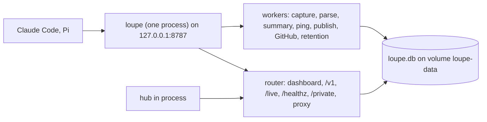
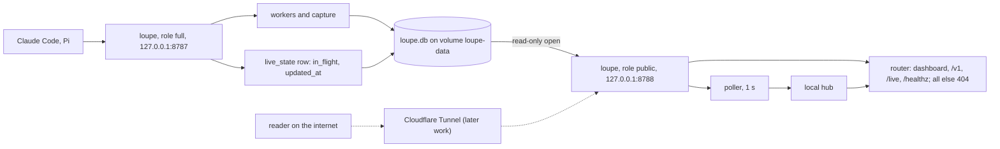
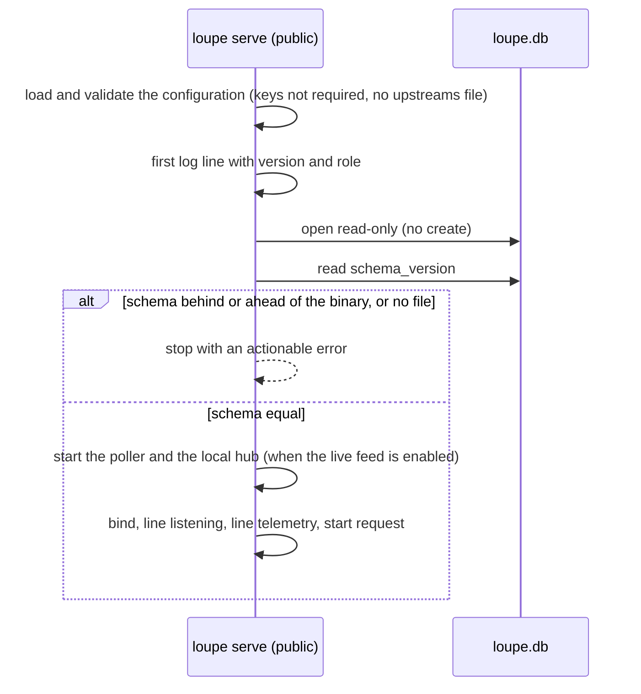
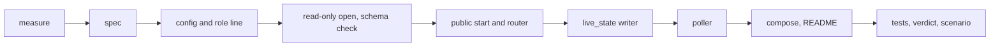

# Public instance

## Change Summary

`loupe serve` gets a role. The variable `LOUPE_ROLE` selects it. The value `full` is the default and keeps the behaviour of today. The value `public` gives a public, read-only process. That process serves the dashboard, its static files, the public API of `api.md`, `GET /live`, and `GET /healthz`. Every other path, the proxy, the token segment form, and the private page included, answers 404 with the body of an unknown path. The public role opens the database read-only, starts no worker, and never applies a migration. Its live route makes the same public frames as today from a poll of the database, because the live hub of the proxy process is not in this process. `compose.yaml` gets a second service `loupe-public` on `127.0.0.1:8788`, from the same image, on the same volume, with the same env file. `README.md` gets a section on public hosting. A Cloudflare Tunnel in front of the public port is later work. This CR only prepares for it.

## Motivation and Background

The owner wrote, on 2026-10-25:

1. "I want to host the dashboard publicly for everyone to see"
2. "Author the CR for a public only / read-only mode that reads from the db the proxy process writes to"
3. "Write the CR for container based hosting like now. I'll publish through CF tunnel later."

These three points are the requirements. Point 1 is the goal. Point 2 gives the shape: a separate read-only process on the database of the proxy process. Point 3 gives the deployment: containers on this machine, as today, and a Cloudflare Tunnel later. Where a point leaves a detail open, this CR states a rule and names the detail a judgement call.

`README.md`, section "Scope", lists public hosting as out of scope "for now", to be "managed separately later". This CR moves the preparation for public hosting into scope. The tunnel, TLS, and the rate limit stay out of scope.

## Change Drivers

* The dashboard and the public API hold only public data (`README.md`, sections "Dashboard" and "Privacy model"). The page has no login, no cookie, and no state on the server. The owner wants everyone to see it.
* Today one process serves the public routes and the proxy, the private page, and the workers on one port. A tunnel to that port would expose the proxy and the private page to the internet.
* A token mistake, a bug in the token gate, or a bug in the private authorization would then be an internet risk. A process that has no proxy, no private page, no secret in use, and no write access to the database removes these risks from the public port.
* The owner wants container hosting as today, so the change must fit `compose.yaml` and the existing image.

## Current State

* `src/serve/mod.rs` runs one start sequence: it opens the database, applies the migrations, runs the bootstrap token step, starts the capture writer, the parser, the summary worker, the provider ping, the publisher with the GitHub fetch, and the retention worker, binds the port, and then starts the telemetry request (`operations.md`, section "Subcommands"; `telemetry.md`, section "Timing").
* `src/serve/router.rs` serves the static files, the private page when `LOUPE_ADMIN_TOKEN` is set, the live route, and the reserved names first. It gives every other path to the proxy (`proxy.md`, section "Routes"). A reserved name that no route serves answers 404 with the unknown-path body.
* `src/store/open.rs` opens the database read-write and sets the WAL journal mode. `src/store/migrate.rs` applies the migrations and records each version in the table `schema_version` (`operations.md`, section "Storage").
* `src/live/route.rs` sends a snapshot from the database, then the events of the in-process live hub. The capture and the parser send the events (`live.md`, sections "Live hub", "Senders", and "Snapshot"). The snapshot reads `in_flight` from the hub.
* The capture writes an exchange row once, when the exchange ends, with its end time set (`src/capture/insert.rs`). No exchange row has a null end time.
* `loupe config show` prints each value with its source and has no role line (`configuration.md`, section "`loupe config show`").
* The first log line of `loupe serve` holds the version (`operations.md`, section "Logging"). Both the log file and stderr get each line. The log file is `<LOUPE_DATA_DIR>/logs/loupe.log`.
* `compose.yaml` has one service `loupe` on `127.0.0.1:8787`, with the named volume `loupe-data` at `/data` and the env file `.env` (`operations.md`, section "Container").
* The `Dockerfile` `HEALTHCHECK` calls `GET /healthz` on port 8787 inside the container.

### Current State Diagram



## Proposed Change

1. Add the variable `LOUPE_ROLE` with the values `full` (default) and `public`.
2. In the role `public`, `loupe serve` opens the database read-only, checks the schema version, and stops with an actionable error when the schema of the database is not the schema of the binary.
3. In the role `public`, `loupe serve` starts no worker, no capture, no ping, no bootstrap token step, no token gate, and no private page. It does not load `upstreams.toml`.
4. In the role `public`, the router serves only the public set of routes. Every other path answers 404 with the unknown-path body.
5. In the role `public`, a poller reads the current day from the database at a fixed interval. It feeds a local hub, so the live route and the client loop of today stay the same.
6. In the role `full`, one small task writes the in-flight count of the hub to a one-row table, so that the public role can read it. A new migration adds the table.
7. The first log line, `loupe config show`, and the private config route name the role.
8. `compose.yaml` gets the service `loupe-public`.
9. `README.md` gets the section "Public hosting".

### Proposed State Diagram



### Proposed Start Sequence of the Public Role



## Requirements

### Functional Requirements

**Role selection**

1. `loupe serve` **MUST** read the role from `LOUPE_ROLE`. The values are `full` and `public`. The default **MUST** be `full`.
2. The loader **MUST** resolve `LOUPE_ROLE` with the precedence of `configuration.md` (environment, then the file of the environment, then the default). The role has no command-line flag.
3. A value other than `full` or `public` **MUST** stop `loupe serve` and `loupe config show` before the port opens. The actionable error **MUST** name `LOUPE_ROLE`, the two values, the fix, `.env.example`, and the check `loupe config show`.
4. In the role `full`, the behaviour of `loupe serve` **MUST** stay as today, with the one addition of requirement 33.
5. The other subcommands (`aggregate`, `backfill`, `day`, `token`, `gen-key`, `summarize`, `parse`, `price`) **MUST** ignore `LOUPE_ROLE`.

**Router of the public role**

6. In the role `public`, the router **MUST** serve exactly these routes, with the behaviour of today: `GET /` and the static files of the dashboard (`/assets/...` and `/favicon.ico`), the routes under `/v1/` of `api.md` with their methods, CORS, and cache headers, `GET /live`, and `GET /healthz`.
7. In the role `public`, every other path **MUST** answer 404 with the same body as an unknown path of today. This includes each path of the form `/<agent>/<upstream>/<path>`, each path of the form `/<token>/<agent>/<upstream>/<path>`, each path under `/private/` (the page, the login, the logout, and the API), and each path under `/live/` other than `/live`. The method does not change this answer.
8. The 404 body of the public role **MUST NOT** hold a token segment. When the first path segment starts with `lpt_`, the path in the body **MUST** be the path with that segment removed, as the rule of `proxy.tokens.md` (section "Privacy of the raw token", item 2) states for the logs.
9. In the role `public`, the router **MUST NOT** call the forwarder, the token gate, the capture, or the private routes. The process **MUST NOT** hold a proxy state, a token gate, or a private state.
10. In the role `public`, `LOUPE_LIVE_ENABLED=false` **MUST** make `GET /live` answer 404, as in the role `full`.

**Database access of the public role**

11. In the role `public`, `loupe serve` **MUST** open `<LOUPE_DATA_DIR>/loupe.db` with the SQLite read-only open flag, and without the create flag. It **MUST** also set the `query_only` pragma on each connection.
12. The public role **MUST NOT** set the journal mode. The writer sets WAL in the file, and the mode stays in the file.
13. The public role **MUST NOT** open the database as immutable. SQLite then reads the WAL of the writer and uses the shared-memory file, which it needs to write. The volume stays mounted read-write for this reason.
14. Each read of the public role (the API, the snapshot, and each poll pass) **MUST** be one short read transaction. No read transaction **MUST** stay open across an await point or across two poll passes.
15. The public role **MUST** use a busy timeout of 5 seconds on each connection, the value of `src/store/open.rs` today.
16. In the role `public`, a write to the database **MUST** fail. A test **MUST** show that an insert through the connection of the public role fails with a read-only error.
17. In the role `public`, `loupe serve` **MUST NOT** apply a migration and **MUST NOT** write the table `schema_version`.
18. At start, the public role **MUST** compare the highest version in `schema_version` with the highest migration that the binary holds. When the database is behind the binary, the start **MUST** stop with an actionable error. The error **MUST** name the two versions and the fix: start the role `full` first, for example `docker compose up -d loupe`, then start the role `public` again. The check is `GET /healthz` of the role `full`.
19. When the database is ahead of the binary, the start **MUST** stop with an actionable error that names the two versions and the fix: run the same image for the two services.
20. When `<LOUPE_DATA_DIR>/loupe.db` does not exist, the start **MUST** stop with an actionable error that names the path and the fix: start the role `full` first. The public role **MUST NOT** create the file.

**Workers and start steps of the public role**

21. In the role `public`, `loupe serve` **MUST NOT** start these: the capture writer, the spill import, the parser, the price index load, the summary worker, the provider ping, the publisher, the GitHub fetch, the retention worker, a backfill, and the bootstrap token step.
22. In the role `public`, `loupe serve` **MUST NOT** load or validate the upstreams file. `LOUPE_UPSTREAMS_FILE` has no effect in the role `public`.
23. In the role `public`, `LOUPE_DATA_KEY` and `LOUPE_ACCOUNT_KEY` **MUST NOT** be required. The public role **MUST NOT** read them.
24. In the role `public`, the process **MUST** ignore these variables when they are set: `LOUPE_ADMIN_TOKEN`, `LOUPE_BOOTSTRAP_TOKEN`, each `LOUPE_GITHUB_TOKEN_<LABEL>`, `CLAUDE_CODE_OAUTH_TOKEN`, `ANTHROPIC_API_KEY`, `OPENAI_API_KEY`, `LOUPE_DATA_KEY`, `LOUPE_ACCOUNT_KEY`, and `LOUPE_UPSTREAMS_FILE`. It **MUST** write one info line `public role ignores` with the names of the set variables of this list. The line **MUST NOT** hold a value. It **MUST NOT** be a warning, because the shared env file is the documented setup and a normal start logs no warning (`operations.md`, section "Logging").
25. The validation of the other values **MUST** stay as today in the two roles. Thus one env file that is valid for the role `full` is valid for the role `public`.
26. The public role **MUST** write only these files on the volume: its log file of requirement 27, the shared-memory file (`-shm`) that SQLite needs for the read of a WAL database, and the empty `-wal` file that SQLite makes when it is absent at the open. It **MUST NOT** write the spill directory.
27. The log file of the public role **MUST** be `<LOUPE_DATA_DIR>/logs/loupe-public.log`, so the two processes do not write one file.

**Live route of the public role**

28. In the role `public`, when the live feed is enabled, the process **MUST** start one poller and one local hub. The poller wakes every 1 second through an injected clock. The live route and the client loop of `live.md` **MUST** read the local hub, with no change to the origin rule, the rate limit, the heartbeat, the connection limit, or the slow-client rule. The coalescing of `live.md` **MUST** take the poller events with the same rules: a `calls.batch` adds its counts to the pending sum, an `exchanges.batch` adds its `started` and `ended` to the pending batch, and a `snapshot` drops the pending frames of the client and is its next frame. The poller **MUST** set the in-flight count of the local hub to the value of requirement 34 at each pass, so the snapshot and each coalesced `exchanges.batch` carry that value.
29. The first frame of each socket **MUST** be a `snapshot` from the database, with the fields of `live.md` (section "Snapshot"). `in_flight` **MUST** come from requirement 34.
30. Each poll pass **MUST** read, in one read transaction, the totals of the current day in `LOUPE_TZ` with the day rule of `days.md`, the count of open segments, the count of exchanges that ended since the last pass, and the in-flight count of requirement 34. It **MUST** compare them with the last pass and send these events to the local hub:
    1. When the call count of the day grew: one `calls.batch` with `ts` (the time of the pass), `calls`, the five token counts, and `cost_usd`, each the difference from the last pass.
    2. When the open segment count changed: one `segments.open` with the new count.
    3. When the ended count is not zero or the in-flight count changed: one `exchanges.batch` with `ended` (the ended count), `in_flight` (the new count), and `started` (the ended count plus the change of the in-flight count, not less than zero).
31. When the date in `LOUPE_TZ` changes between two passes, the poller **MUST NOT** send a negative difference. It **MUST** take the new day as its base and send one `snapshot` of the new day to each client.
32. The frame kinds, the envelope, and the field allowlist of `live.md` **MUST NOT** change. The public role sends no `exchange.start`, `exchange.end`, or `call.stored` event, because these come from an in-process sender. The page code **MUST NOT** change.

**In-flight count across processes**

33. In the role `full`, when the live hub is on, one task **MUST** write the in-flight count of the hub and the time to the one-row table `live_state`. The task writes when the count changed, at most once per second, and at least every 5 seconds. The write **MUST NOT** run in the request path and **MUST NOT** delay the proxy. At a clean shutdown, the task writes the count 0. A new migration adds the table. The table holds only the in-flight count and the time of the write, and no identifier.
34. The public role **MUST** read `in_flight` from `live_state`. When the row is absent or its time is more than 15 seconds old, the public role **MUST** use 0.

**Start line, config show, health, and telemetry**

35. The first log line of `loupe serve` **MUST** hold the key field `role` with `full` or `public`, next to `version`.
36. `loupe config show` **MUST** print the line `role` with the value and its source. `GET /private/api/config` of the role `full` **MUST** show the same entry, from the same render.
37. In the role `public`, `loupe config show` **MUST NOT** require `LOUPE_DATA_KEY` or `LOUPE_ACCOUNT_KEY`. It **MUST** print each secret as `set` or `unset`, as today.
38. `GET /healthz` **MUST** keep its status and its body in the two roles. In the role `public`, it answers only after the read-only open and the schema check passed.
39. The start request of `telemetry.md` **MUST** start in the two roles, with the same rules: after the line `listening`, one attempt, no effect on the start. The line `telemetry` **MUST** be written in the two roles.

**Compose service**

40. `compose.yaml` **MUST** have a second service `loupe-public` beside `loupe`. It **MUST** use the same image, the same named volume `loupe-data` at `/data`, the same env file `.env`, and `LOUPE_ENV=container`. It **MUST** set `LOUPE_ROLE=public`.
41. The service `loupe-public` **MUST** bind the host port as `127.0.0.1:8788` to the container port 8787. Thus `LOUPE_LISTEN` and the image `HEALTHCHECK` stay the same.
42. The service `loupe-public` **MUST** state a healthcheck that calls `GET /healthz` inside the container, with the values of the image `HEALTHCHECK`.
43. The service `loupe-public` **MUST** start after the service `loupe` is healthy, and **MUST** have the restart policy `unless-stopped`.
44. A comment in `compose.yaml` **MUST** state that the volume is mounted read-write in the two services, and that the process of the role `public` enforces the read-only access.
45. `.env.example` **MUST** list `LOUPE_ROLE` with no value and with a comment that `compose.yaml` sets it for `loupe-public` only.

**Documentation**

46. `README.md` **MUST** have a section "Public hosting". It **MUST** state:
    1. The two services, their roles, and their ports: `loupe` on `127.0.0.1:8787` and `loupe-public` on `127.0.0.1:8788`.
    2. The port to expose: only 8788. The port to never expose: 8787, because it holds the proxy and the private page.
    3. The Cloudflare Tunnel as later work, with the rule that only the public port, or the service `loupe-public`, goes behind the tunnel. A tunnel on the compose network can reach the service `loupe`, so the tunnel configuration must name `loupe-public` only.
    4. That a rate limit and a cache in front of the public port are the job of the host, for example the rules of Cloudflare. The binary has no rate limit on the public routes beyond the live connection limit.
    5. That `LOUPE_LIVE_ALLOWED_ORIGIN` covers a front proxy that changes the `Host` header, and that `LOUPE_LIVE_MAX_CONNECTIONS` limits the live sockets.
    6. That an operator who wants no secret in the environment of the public container can give it a second env file with only the values that are not secret.
47. `README.md`, sections "Scope", "The `loupe` binary", "Configuration" (the table), "Dashboard", and "Privacy model", **MUST** name the role. The section "Scope" **MUST** state that the public instance is in scope and the tunnel is later work.

### Non-Functional Requirements

1. The page code **MUST NOT** change. `web.size.sh` **MUST** print the same `code_kib` before and after.
2. The public API **MUST NOT** change: the routes, the fields, the errors, the headers, and the version policy of `api.md` stay.
3. The proxy time to first byte of the role `full` **MUST NOT** grow by more than 1 ms at the 95th percentile with the `live_state` task.
4. The resident memory of the public process **MUST** be lower than the resident memory of the full process on the same data.
5. The poller and the `live_state` task **MUST** read time only through an injected clock, so the tests use a set clock and no wait (`operations.md`, section "Timers in tests").
6. The public role **MUST** hold no code path that writes the database. A review of `src/serve` for the role `public` finds no write statement.

## Measurable Targets

| Metric | Method | Baseline | Threshold |
|---|---|---|---|
| Routes that answer in the public role | the router test sends `GET` to a fixed list of paths: `/`, `/index.html` when served today, each file under `/assets/` that the page loads, `/favicon.ico`, `/v1/days`, `/v1/days/<published day>`, `/healthz`, and `/live` with a valid upgrade; count the answers that are not 404 | none, no public role | exactly the public set: 200 for each static path, each `/v1` path, and `/healthz`; 101 for `/live` |
| 404 paths in the public role | the router test sends each path and method of a fixed list of at least 20 entries: `/private/`, `/private/login` (GET and POST), `/private/logout` (POST), `/private/api/v1/report`, `/private/api/v1/sessions`, `/private/api/providers`, `/private/api/config`, `/claude-code/anthropic/v1/messages` (POST), `/pi/openai/v1/responses` (POST), `/lpt_<43 characters>/claude-code/anthropic/v1/messages` (POST), `/lpt_<43 characters>/v1/days`, `/live/x`, `/v1/other`, `/healthz/x`, `/unknown`, `/a/b/c`, and the same proxy paths with GET | none | each entry 404 with the unknown-path body; 0 bodies that hold `lpt_` |
| Resident memory of the public process | `docker stats --no-stream --format '{{.MemUsage}}'` for each service, 60 seconds after start with no client, then with 32 live clients | the full process, measured at the start of implementation | public at most 50 percent of the full process with no client, and at most 64 MiB with 32 clients |
| Live frame delay | the live poll test commits a call row through a second read-write connection and measures the time to the `calls.batch` frame on the public route, set clock off, 200 calls, 95th percentile | none | at most 1.1 seconds: the poll interval of 1 second plus one frame interval at the default `LOUPE_LIVE_MAX_RATE` of 10 |
| Live frame delay in the scenario | the time from the end of a proxied call on 8787 to the change of the live card on 8788, minus the same time to the change of the live card on 8787 | none | at most 1.1 seconds |
| Start time of the public role | the time from the process start to the first 200 of `GET /healthz`, median of 5 starts | the same for the role `full`, measured at the start of implementation (146.5 ms on 2026-10-23 in the telemetry targets) | at most the median of the role `full` |
| Page code size | `.agents/scripts/web.size.sh` prints `code_kib` | measured at the start of implementation | the same value |
| WAL size with a reader | the read-only test polls every 100 ms while a writer commits 10 000 rows in batches; read the size of the `-wal` file after a checkpoint of the writer | none | the WAL file resets after the checkpoint; at most 64 MiB at each read |
| Proxy time to first byte with the `live_state` task, 95th percentile | `.agents/scripts/proxy.latency.sh --requests 200 --with-token` | the value at the start of implementation | at most 1 ms above the baseline |
| Writes by the public role | count the changed rows of each table and the `schema_version` rows before and after a run of the public role with 100 API requests and 10 live clients for 60 seconds | none | 0 |

## Affected Components

* `src/config/vars.rs`, `src/config/loader.rs`, `src/config/validate.rs`: the variable `LOUPE_ROLE`, its default and its check, and the keys that are not required in the role `public`.
* `src/config/show.rs`: the line `role`.
* `src/serve/mod.rs`: the branch of the start sequence by role. A new module under `src/serve/` for the start sequence of the role `public`.
* `src/serve/router.rs`: the dispatch of the role `public` and its 404 body with no token segment.
* `src/store/open.rs`: a read-only open. `src/store/migrate.rs`: a read of the schema version and of the highest migration of the binary, with no apply.
* `migrations/`: a new migration for the table `live_state`.
* `src/live/`: a new poller module, a writer of `live_state` for the role `full`, and a source of `in_flight` for the snapshot in the role `public`. `src/live/event.rs` and `src/live/hub.rs` get the poller events and a setter of the in-flight count; `src/live/batch.rs` coalesces the poller events by the rules of requirement 28. `src/live/route.rs` and `src/live/client.rs` take the local hub with no change of their rules.
* `src/log/`: the log file name by role.
* `src/telemetry/`: no change of behaviour; the call stays after the line `listening` in the two roles.
* `compose.yaml`: the service `loupe-public`. `.env.example`: the line `LOUPE_ROLE`.
* `Dockerfile`: no change.
* `README.md`: the section "Public hosting" and the sections of requirement 47.
* Tests: new and changed tests of "Test Strategy".
* `.agents/scenarios/public.instance.md`: the scenario.
* `docs/specification/configuration.md`: sections "Variables", "`loupe config show`", and a new section "Role".
* `docs/specification/operations.md`: sections "Subcommands", "Logging", "Storage", "Health", "Start request", "Container", and a new subsection of "Measurable targets" for the public instance.
* `docs/specification/proxy.md`: section "Routes" (the router of the role `public`).
* `docs/specification/proxy.tokens.md`: sections "Bootstrap token" and "Token gate" (not in the role `public`).
* `docs/specification/private-reports.md`: section "Admin token" (the private page is off in the role `public`).
* `docs/specification/live.md`: sections "Live hub", "Senders", and "Snapshot", and a new section "Public role" for the poller, the `live_state` table, and the stale rule.
* `docs/specification/days.md`: section "Publisher" (the role `full` only).
* `docs/specification/telemetry.md`: section "Start request" (the two roles).
* `docs/specification/api.md`: no change of the text of the routes. Section "Access" names the role `public` as a host of the same routes.
* `docs/specification/index.md`: the index line of each changed file, if its summary changes.

## Scope Boundaries

### In Scope

* The role `public` of `loupe serve`, its router, its read-only database access, its schema check, and its live poll.
* The table `live_state` and its writer in the role `full`.
* The line `role` in the first log line and in `loupe config show`.
* The service `loupe-public` in `compose.yaml`, and the line in `.env.example`.
* The section "Public hosting" in `README.md`, and the specification sections of "Affected Components".
* The tests and the scenario of this CR.

### Out of Scope ("Here, But Not Further")

* A Cloudflare Tunnel, a `cloudflared` service, a DNS record, or a public host name. This is later work of the owner.
* TLS in the binary.
* A rate limit or a cache in the binary on the public routes. The live connection limit of `live.md` stays.
* A change to the page code under `web/`.
* A change to the public API of `api.md`.
* Cloudflare D1, a copy of the data off the machine, or a static export of the days.
* A private live feed.
* A public role for a release asset run outside a container. The role works there, but the README documents the container setup only.
* A change to the token gate, the private page, or the proxy in the role `full`.

## Alternative Approaches Considered

* **A tunnel to port 8787 with a path filter at Cloudflare.** Rejected. The proxy and the private page stay in the process that faces the internet, and one wrong rule exposes them. Point 2 of the owner asks for a separate read-only process.
* **A second listener in the one process.** Rejected. The public port would share the process, the secrets, and the write access of the proxy. Point 2 asks for a process that reads from the database of the proxy process.
* **A static export of the days to a file host.** Rejected. It has no live card, and point 3 asks for container hosting as today.
* **The in-flight count from the exchange rows with a null end time, as the owner wrote.** Rejected as the only source. The capture writes the row once, at the end, with the end time set, so the count is always 0. A write of a row at the start of each exchange changes the capture path, the parser, the retention, and the spill. The one-row table `live_state`, written off the request path, gives the same figure with a smaller change. Open question 1 asks the owner to confirm.
* **Refuse to start when a secret is set.** Rejected. The owner wants the same env file for the two services, and that file holds the secrets.
* **A read-only bind mount of the volume.** Rejected. SQLite needs to write the shared-memory file of a WAL database. An immutable open on a read-only mount does not see the WAL of the writer, so the page would show old data.
* **A different port inside the container.** Rejected. The image `HEALTHCHECK` names port 8787. A host port of 8788 mapped to 8787 needs no image change.

## Impact Assessment

### User Impact

A public reader gets the same dashboard and live card as the owner gets today, on a port that holds no proxy and no private page. The owner keeps the proxy and the private page on 8787 with no change.

### Technical Impact

A second process reads the SQLite file of the first. The role `full` gets one small timer task and one table. The router gets a second dispatch. The live route gets a second event source. The page and the public API do not change.

### Business Impact

The product goal of `README.md`, a public record of the work with AI agents, becomes possible with a tunnel and no new hosting.

## Implementation Approach

1. Measure the baselines of "Measurable Targets" on the current tree.
2. Update the specification files of "Affected Components".
3. Add `LOUPE_ROLE` to the configuration, the first log line, and `loupe config show`.
4. Add the read-only open and the schema check.
5. Add the start sequence and the router of the role `public`.
6. Add the migration and the `live_state` writer in the role `full`.
7. Add the poller and the local hub in the role `public`.
8. Add the log file name by role.
9. Change `compose.yaml`, `.env.example`, and `README.md`.
10. Add the tests, run the verdict, and run the scenario.

### Implementation Flow



## Test Strategy

### Tests to Add

* `tests/serve.role.rs`, the router in the role `public`: each path of the public list answers as the target states; each path and method of the 404 list answers 404 with the unknown-path body; no 404 body holds `lpt_`; the forwarder of a fake upstream gets no request.
* `tests/serve.role.rs`, the start: the first log line holds `role=public`; the line `public role ignores` names the set variables and holds no value; no warning line at a start with the full env file; no file appears under `spill/`; the log goes to `loupe-public.log`.
* `tests/store.readonly.rs`: an insert through the read-only connection fails with a read-only error; a start of the role `public` on a database one migration behind stops with the error of requirement 18 and leaves `schema_version` unchanged; a database ahead stops with the error of requirement 19; a missing file stops with the error of requirement 20 and creates no file; a reader that polls during 10 000 writes does not stop the WAL reset.
* `tests/live.poll.rs`, with a set clock: a snapshot from seeded calls, open segments, and a `live_state` row; a `calls.batch` with the sums of the calls committed after the last pass; a `segments.open` on a change; an `exchanges.batch` from seeded exchanges and a change of `live_state`; `in_flight` 0 when the row is 16 seconds old; a new snapshot and no negative difference at a day change; each frame passes the allowlist test of `live.md`.
* `tests/live.state.rs`, with a set clock: the role `full` writes `live_state` on a change, at most once per second, at least every 5 seconds, and 0 at a clean shutdown.
* `tests/compose.public.rs`: reads `compose.yaml` and checks the service `loupe-public`: the same image and build as `loupe`, the volume `loupe-data` at `/data`, the env file `.env`, `LOUPE_ENV=container`, `LOUPE_ROLE=public`, the port `127.0.0.1:8788:8787`, a healthcheck on `/healthz`, the start after `loupe` is healthy, and the restart policy. It also checks that no port of either service binds an address other than `127.0.0.1`.
* `tests/config.role.rs`: the default `full` with the source `default`; `public` from the environment; a bad value stops with the error of requirement 3; the role `public` starts with no `LOUPE_DATA_KEY` and no `LOUPE_ACCOUNT_KEY`.

### Tests to Modify

* `tests/config_show.rs` and `tests/private_config.rs`: the line `role`.
* `tests/serve_start.rs`: the first log line holds `role=full`.
* `tests/migrations.rs`: the new migration.
* `tests/live.route.rs`: the snapshot `in_flight` source by role.
* `tests/healthz.rs`: the same body in the role `public`.
* `tests/telemetry.send.rs`: one start request in the role `public`.

### Tests to Remove

None.

## Model-Based Testing

The change has a user surface: the dashboard on a second port, and a container setup. A model drives it with `docker compose`, `curl`, and the browser driver of `.agents/scripts/web.render.sh`. A human can do each step by hand. Persist the scenario as `.agents/scenarios/public.instance.md`.

1. Build the image and start the two services: `docker compose up -d --build`. Wait until both are healthy.
2. Check that `curl -s http://127.0.0.1:8788/healthz` gives the same body as on 8787.
3. Check the first log line of `loupe-public`: it holds `role=public`. Check the line `public role ignores`. Check that `docker compose exec loupe-public loupe config show` prints `role: public`.
4. Open `http://127.0.0.1:8788/` in the browser driver. Read the live card.
5. Connect Claude Code to 8787 with `agent.connect.sh` and run one call.
6. Check that the live card on 8788 shows one more call within the target delay of the card on 8787.
7. Run `docker compose exec loupe loupe aggregate --date today`. Check that `curl -s http://127.0.0.1:8788/v1/days/<today>` gives `calls` 1 or more, and that the daily log on 8788 shows the day.
8. Send each path of the 404 list of "Measurable Targets" to 8788. Check that each answers 404 and that no body holds `lpt_`. Send the proxy path with the real token file to 8788 and check 404 and no new exchange row on 8787.
9. Stop `loupe`. Check that 8788 still serves `/v1/days` and the page, and that the live card shows in flight 0 within 15 seconds.
10. Start the role `public` on a copy of the volume with a database one migration behind. Check the error and the fix in the log.
11. Read the memory and the start time of the two services.

Success condition: each check passes in 2 of 2 runs.

## Acceptance Criteria

### AC-1: The role variable selects the behaviour

```gherkin
Given no LOUPE_ROLE in the environment
When loupe config show runs
Then it prints role full with the source default
And loupe serve starts every worker as today

Given LOUPE_ROLE=public
When loupe config show runs
Then it prints role public with the source env

Given LOUPE_ROLE=reader
When loupe serve starts
Then it stops before the port opens
And the error names LOUPE_ROLE, the values full and public, .env.example, and loupe config show

Given LOUPE_ROLE=public
When loupe aggregate, loupe parse --once, or loupe token list runs
Then it behaves as with no LOUPE_ROLE

Given LOUPE_ROLE=public and no LOUPE_DATA_KEY and no LOUPE_ACCOUNT_KEY
When loupe serve starts and loupe config show runs
Then loupe serve starts and config show prints each secret as set or unset

Given LOUPE_ROLE=public and LOUPE_LIVE_MAX_RATE=0
When loupe serve starts
Then it stops with the error of the role full

Given the role full with LOUPE_ADMIN_TOKEN set
When a client with the admin token reads GET /private/api/config
Then it holds the entry role with the value full and its source
```

### AC-2: The public role serves only the public routes

```gherkin
Given loupe serve in the role public with a published day
When a client sends GET to /, to each page file, to /favicon.ico, to /v1/days, to /v1/days/<day>, and to /healthz
Then each answer is 200 with the headers of today
And GET /live with a valid upgrade switches protocols

Given loupe serve in the role public with LOUPE_LIVE_ENABLED=false
When a client sends GET /live with a valid upgrade
Then the answer is 404 and no poller runs
```

### AC-3: Every other path answers 404

```gherkin
Given loupe serve in the role public and a fake upstream
When a client sends each path and method of the 404 list
Then each answer is 404 with the unknown-path body
And no body holds lpt_
And the fake upstream gets no request
And no path under /private/ shows a login form or a 401
```

### AC-4: The public role holds no token gate and no private page

```gherkin
Given LOUPE_ROLE=public and LOUPE_ADMIN_TOKEN and LOUPE_BOOTSTRAP_TOKEN set
When loupe serve starts
Then it writes one info line public role ignores with the two names and no value
And it writes no warning
And it runs no bootstrap token step
And GET /private/ answers 404
And no file appears under spill/
And the log lines go to logs/loupe-public.log and logs/loupe.log does not change
```

### AC-5: The public role opens the database read-only

```gherkin
Given a database at the schema of the binary
When the role public opens it
Then an insert through its connection fails with a read-only error
And each connection has query_only on and a busy timeout of 5 seconds
And the journal mode of the file stays wal
And a row that a writer commits after the open is in the next read of the role public
And the row counts of each table and of schema_version stay the same after 100 API requests and 10 live clients
And the WAL file resets after a checkpoint of the writer while the role public polls
```

### AC-6: The public role never migrates

```gherkin
Given a database one migration behind the binary
When loupe serve starts in the role public
Then it stops before the port opens
And the error names the two versions and the fix: start the role full first
And schema_version is unchanged

Given a database ahead of the binary
When loupe serve starts in the role public
Then it stops and the error names the fix: run the same image for the two services

Given no database file
When loupe serve starts in the role public
Then it stops, the error names the path, and no file is made
```

### AC-7: The public role starts no worker

```gherkin
Given LOUPE_ROLE=public, a provider credential, and a GitHub token
When loupe serve runs for 60 seconds with a set clock past the publish time
Then no parse, price, summary, publish, retention, GitHub, ping, or spill import runs
And the fake provider and the fake GitHub get no request
And upstreams.toml is not read
```

### AC-8: The live route sends the public frames from a poll

```gherkin
Given the role public with a set clock and seeded calls, open segments, and a live_state row
When a client connects to /live
Then the first frame is a snapshot with the totals of the day and in_flight from live_state
When a writer commits two calls and the clock moves 1 second
Then the client gets one calls.batch with calls 2 and the sums of the two calls
When a segment opens and the clock moves 1 second
Then the client gets one segments.open with the new count
When the poller sends three events in one pass
Then the client gets them within the rate limit, coalesced by the rules of requirement 28
And each frame holds only the fields of the public column of live.md
```

### AC-9: The in-flight count crosses the process boundary

```gherkin
Given the role full with 3 open exchanges
When 1 second passes on its clock
Then live_state holds in_flight 3
And the role full writes live_state at most once per second and at least every 5 seconds
And the role public sends exchanges.batch with in_flight 3 at its next pass
When the role full stops cleanly
Then live_state holds in_flight 0
When the role full stops without a write and 16 seconds pass on the clock of the role public
Then the role public uses in_flight 0
```

### AC-10: A day change sends a new snapshot

```gherkin
Given the role public with a client and calls on the current day
When the clock passes midnight in LOUPE_TZ
Then the client gets a snapshot of the new day
And no frame of the old day follows the snapshot
And no frame holds a negative count
```

### AC-11: The start line, health, and telemetry

```gherkin
Given each role
When loupe serve starts
Then the first log line holds version and role
And GET /healthz answers 200 with the body {"status":"ok"}
And the line telemetry follows the line listening
And a binary built with a fake telemetry host sends one start request
```

### AC-12: The compose service

```gherkin
Given compose.yaml
When the compose test reads it
Then the service loupe-public uses the image, the volume loupe-data at /data, and the env file of the service loupe
And it sets LOUPE_ROLE=public and LOUPE_ENV=container
And it binds 127.0.0.1:8788 to the container port 8787
And it has a healthcheck on /healthz, starts after loupe is healthy, and restarts unless stopped
And no port binds an address other than 127.0.0.1
And a comment states that the volume is read-write in the two services and that the role public enforces the read-only access
And .env.example lists LOUPE_ROLE with no value
```

### AC-13: Two containers on this machine

```gherkin
Given docker compose up with the two services
When an agent call goes through the proxy on 8787
Then the live card on 8788 shows the call within 1.1 seconds of the live card on 8787
When loupe aggregate --date today runs in the service loupe
Then GET /v1/days/<today> on 8788 holds the day
And each path of the 404 list answers 404 on 8788
```

### AC-14: The page and the public API do not change

```gherkin
Given the tree before and after the change
When web.size.sh runs and the API tests run
Then code_kib is the same
And the files under web/ have no change
And the API tests pass with no change of their expected bodies
```

### AC-15: The README states the public hosting rules

```gherkin
Given README.md
When a reader opens the section Public hosting
Then it names the two services and their ports
And it states that only 8788 can be exposed and that 8787 is never exposed
And it states the Cloudflare Tunnel as later work, with only loupe-public behind it
And it states that the rate limit and the cache in front are the job of the host
And it names LOUPE_LIVE_ALLOWED_ORIGIN and LOUPE_LIVE_MAX_CONNECTIONS, and the second env file with no secret
And the sections Scope, The loupe binary, the configuration table, Dashboard, and Privacy model name the role
```

### AC-16: The measured targets of the public instance

```gherkin
Given the baselines of "Measurable Targets" measured at the start of implementation
When proxy.latency.sh, the memory read, and the start time read run after the change
Then the proxy time to first byte at the 95th percentile is at most 1 ms above the baseline
And the resident memory of the public process is below that of the full process
And the poller and live_state tests use a set clock and no wait
And a review of the code of the role public under src/serve finds no write statement
```

## Quality Standards Compliance

### Build & Compilation

`cargo build` passes. `docker compose build` passes with no change to the `Dockerfile`.

### Linting & Code Style

`.agents/scripts/pipeline.lint.sh` and `.agents/scripts/pipeline.format.sh` pass.

### Test Execution

`.agents/scripts/pipeline.test.sh` passes, with the new tests. The poller and the `live_state` tests use a set clock and no wait of more than 1 second.

### Documentation

The specification sections of "Affected Components" change before the code. `README.md` changes with the compose service.

### Code Review

A reviewer agent checks blocking findings only.

### Verification Commands

```bash
.agents/scripts/pipeline.verdict.sh
.agents/scripts/web.size.sh
.agents/scripts/proxy.latency.sh --requests 200 --with-token
```

## Risks and Mitigation

### Risk 1: Two processes on one SQLite file

The two containers share one Linux kernel and one local file system on this machine, so the SQLite locks and the shared memory work across them. A network file system would break this. Mitigation: requirement 13 keeps the normal open; the README names a local named volume as the only supported setup; the scenario runs the two services on this machine.

### Risk 2: The WAL checkpoint by the writer

The writer runs the automatic checkpoint. A reader that holds a read transaction stops the WAL reset, and the WAL file grows. Mitigation: requirement 14 keeps each read short; the WAL size target and its test measure the reset under a polling reader.

### Risk 3: A reader that blocks the checkpoint for a long time

A slow API request on 400 days, or a slow client, could hold a read. Mitigation: each API read is one statement on the `days` table, and the client loop sends from memory, not from an open transaction. The live slow-client rule of `live.md` stays.

### Risk 4: A writer crash leaves a WAL that needs recovery

A read-only connection cannot run the WAL recovery. Mitigation: the busy timeout of requirement 15; the restart policy of the two services; the scenario step 9 stops the role `full` and checks that the role `public` still serves.

### Risk 5: A stale frame when the machine sleeps

When the machine sleeps, the poller and the writer of `live_state` stop. At wake, a client can keep an old in-flight count until the next pass. Mitigation: the stale rule of requirement 34; the heartbeat of `live.md`; the page connects again and gets a new snapshot when the socket closes.

### Risk 6: A public port exposed by mistake

An operator can bind 8787 to `0.0.0.0` or put the tunnel on the service `loupe`. Mitigation: the compose test fails on a bind address other than `127.0.0.1`; the README states the rule of the tunnel; the private page stays off without `LOUPE_ADMIN_TOKEN` in the role `full`, and the token gate stays in place.

### Risk 7: Secrets in the environment of the public container

The shared env file puts the secrets in the environment of the public process, which faces the internet later. The process does not read them, but a code execution defect could read the environment. Mitigation: requirements 9, 21, 23, and 24 remove every use; the README names the second env file for an operator who wants no secret there.

### Risk 8: The schema of the two services differs after an upgrade

A new image can start the role `public` before the role `full` migrates. Mitigation: requirement 43 starts `loupe-public` after `loupe` is healthy; requirements 18 and 19 stop with an actionable error; the restart policy starts it again after the migration.

### Risk 9: Two start requests per start

The two services send two telemetry requests per `docker compose up` of a release image. Mitigation: none needed. The count is a signal and not an exact number (`telemetry.md`, section "Route", item 6).

## Dependencies

* CR-0013 (the live route, the live hub, the frames, the allowlist, the snapshot, and the rate limit).
* CR-0011 (the private page and its off state without the admin token).
* CR-0022 (the image, the container rules, and the release image that the two services use).
* CR-0026 (the start request and the line `telemetry` in each role).

## Estimated Effort

Medium: one configuration variable, one start sequence, one router branch, a read-only open and a schema check, one migration and one timer task, one poller, a log file name, the compose service, the README section, nine specification files, seven new test files, six changed test files, and one scenario.

## Decision Outcome

Approved on 2026-10-25 by a reviewer agent in a Pi session through the proxy, separate from the author.

## Open Questions

1. The owner wrote that the in-flight count comes from the exchanges that have no end time. The capture writes each exchange row at the end, so no row has a null end time. This CR uses the table `live_state` instead (judgement call 10). The owner confirms or asks for a write of the row at the start of each exchange.
2. The public role uses the same env file, as the owner wrote. The owner confirms that the secrets can stay in the environment of the public container, or asks the README to make the second env file the default.

## Judgement Calls

1. **The variable and its values.** `LOUPE_ROLE`, with `full` (default) and `public`. The prefix of the project and the names of the owner's request. No command-line flag, because the owner asked for one variable. A bad value stops the start.
2. **The port.** The host port `127.0.0.1:8788`, the next port after 8787, mapped to the container port 8787. `LOUPE_LISTEN` and the image `HEALTHCHECK` stay the same.
3. **The poll interval.** 1 second, fixed, through an injected clock, with no new variable. It keeps the delay near the live card of today and costs one short read per second.
4. **An older schema.** The role `public` stops with an actionable error that names the two versions and the fix (start the role `full` first). A newer schema also stops, with the fix to run the same image. A missing file stops, and the role makes no file.
5. **The token and admin variables in the role `public`.** Ignored, with one info line that names the set variables and holds no value. Not a refusal, because the owner wants the same env file, and that file holds them. Not a warning, because the shared env file is the documented setup and a normal start logs no warning.
6. **The two keys.** Not required in the role `public`, because the role decrypts nothing and hashes nothing. Thus a second env file with no secret works.
7. **The upstream file.** The role `public` does not load or validate it. The image always holds it, so a refusal on its presence is not possible, and the role has no proxy.
8. **The log line.** The first log line gets the key field `role` next to `version`, so one line names the version and the role. The info line `public role ignores` follows.
9. **The log file.** `loupe-public.log` for the role `public`, so the two processes do not write one file.
10. **The in-flight source.** The one-row table `live_state`, written by the role `full` off the request path, with a stale rule of 15 seconds. The owner's source (exchange rows with no end time) always gives 0 with the capture of today. This is the one change of the role `full`.
11. **The frames of the poll.** `calls.batch`, `segments.open`, and `exchanges.batch`, which the page reads today, and a `snapshot` at the start and at a day change. No `call.stored`, `exchange.start`, or `exchange.end`, because no in-process sender exists.
12. **The 404 body.** The unknown-path body of today, with a leading token segment removed from the echoed path, so a response never holds `lpt_`.
13. **The compose service name.** `loupe-public`, the name of the owner's request.
14. **The start order.** `loupe-public` starts after `loupe` is healthy, so the role `full` migrates first.
15. **The healthcheck.** Stated in the compose service with the values of the image `HEALTHCHECK`, as the owner asked, although the image also has it.
16. **The read-only open.** The SQLite read-only flag, no create flag, the `query_only` pragma, no journal mode change, and no immutable open. The volume stays read-write at the mount for the shared-memory file.
17. **Telemetry in the two roles.** The owner asked for it. Two services send two requests per start, and the count stays a signal.
18. **The live feed switch.** `LOUPE_LIVE_ENABLED=false` removes `/live` in the role `public` too, and no poller starts.
19. **The other subcommands.** They ignore `LOUPE_ROLE`, because the role is a role of `loupe serve`.
20. **The private config route.** The line `role` appears there too, because the route shows the same render as `loupe config show`.
21. **Target version.** `0.2.0`, the next minor version after `0.1.0` in `Cargo.toml`.

## Notes

The Layer 1 boundary holds: the CR names the files and the specification sections that change, and it inlines no file content, no code, and no YAML. The owner's three messages of 2026-10-25 are quoted in "Motivation and Background".

### Review notes, 2026-10-25

The reviewer checked for blocking findings only. Each finding got the smallest edit:

1. Requirement 5 left out the subcommand `price`, which `src/cli/mod.rs` has. Edit: `price` added to the list.
2. Requirement 26 said the public role writes only its log file and the `-shm` file. A read-only SQLite connection on a WAL database also makes an empty `-wal` file when it is absent at the open, for example when the role `full` stopped cleanly. Edit: the `-wal` file added to the list.
3. Requirement 28 kept "the coalescing" unchanged, but the hub of `src/live/hub.rs` carries only `exchange.start`, `exchange.end`, `call.stored`, and `segments.open`, and `src/live/batch.rs` sets `in_flight` of a coalesced `exchanges.batch` from the in-flight count of the hub. In the role `public` that count is 0, so a coalesced frame would carry a wrong `in_flight`, and a pending frame of the old day could follow a day-change snapshot. Edit: requirement 28 states the coalescing rules for the poller events, has the poller set the in-flight count of the local hub, and drops the pending frames at a snapshot. "Affected Components" names `src/live/event.rs`, `src/live/hub.rs`, and `src/live/batch.rs`.
4. Requirement 33 said `live_state` holds no field outside the allowlist of `live.md`, but its time column is not in that allowlist. Edit: the table holds only the in-flight count and the time of the write, and no identifier.
5. Requirements 5, 10, 11 to 15, 23, 25, 26, 27, 30.2, 33 (rate and shutdown), 36 (private config route), 37, 44, 45, 46.5, 46.6, 47, and the non-functional requirements 3 to 6 had no acceptance criterion. Edit: Gherkin lines added to AC-1, AC-2, AC-4, AC-5, AC-8, AC-9, AC-10, AC-12, and AC-15, and a new AC-16 for the measured targets.

No blocking finding stays open. The checks that found no finding: the router rules against `src/serve/router.rs` and `proxy.md` (the unknown-path body, the reserved names, `/v1/other`, `/healthz/x`), the private page paths against `private-reports.md`, the token segment rule against `proxy.tokens.md`, the read-only open and the 5-second busy timeout against `src/store/open.rs`, the schema check against `src/store/migrate.rs`, the frames against `live.md` and the page code under `web/assets/js/` (a later `snapshot` resets the state, `exchanges.batch` sets the in-flight count), the compose service and the health check against `compose.yaml` and the `Dockerfile`, the start line against `src/cli/serve.rs` and `operations.md`, the telemetry rules against `telemetry.md`, and the implemented CRs 0011, 0013, 0022, and 0026.
