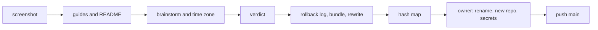

# Public repository cleanup

## Change Summary

The repository becomes public with the first release `0.1.0`. Before that, five things change:

1. `README.md` becomes a short entry page: the name, the tagline, a screenshot of the dashboard at the top, what the product does, a short quickstart, and links. The detail moves to user guides under `docs/guide/`, one file per topic.
2. The sentence "The product domain is `agentloupe.dev`." goes.
3. `brainstorm/` leaves the tree, every reference to it in the tracked files goes, `.gitignore` lists it, and a history rewrite removes it from every commit.
4. The old example time zone becomes `Europe/Stockholm` in every tracked file, with the test values that depend on the offset changed to match. The same history rewrite replaces it in every commit.
5. The rewritten history goes to a new GitHub repository. The old repository keeps its pull request refs, which hold the removed content, so it stays private as an archive.

## Motivation and Background

The owner wrote, on 2026-10-25, before the switch of the repository to public:

> We need to cleanup the README.md before we make it public. Currently it feels like README.md should be simpler and decomposed to several documents. References to anything with brainstorm/ should be removed, removed from git history and gitignore. brainstorm/ is not relevant anymore and should not be part of the public package. The text "The product domain is agentloupe.dev." is also redundant and doesn't provide any value for the user. Change the "[old zone]" references to the Stockholm time zone instead. Add a screenshot of the dashboard at the top so the user knows what to expect. Adjust the project accordingly

The owner then answered two questions:

1. GitHub keeps 24 pull request refs (`refs/pull/N/head`) on `desek/agentloupe`. Each points to commits that hold `brainstorm/`, and the early ones hold the removed mockup archive. A force push of `main` does not delete them, and only GitHub can. The owner chose: "New clean repository". The rewritten history goes to a new repository, and the old one stays private.
2. The owner chose to replace the old zone with `Europe/Stockholm` in the history too, in the same rewrite.

In this record, **the old zone** is the example time zone that the history audit of 2026-10-23 names a location hint. This record does not write its name, because the rewrite replaces that name in every commit, also in this file. The commands match it with the pattern `nic[o]sia`, which does not match itself.

## Change Drivers

* A new reader opens the README first. Today it has 655 lines and 20 sections, so the reader does not see quickly what the product does or how it looks.
* `brainstorm/agent-ledger.zip` is an old prototype archive with no use for a user. The audit of 2026-10-23 (`.agents/explore/2026-10-23-history-audit.md`) found it and the removed mockup archive, which names a domain of the owner, in the history.
* The old zone appears in the README, `.env.example`, an error message, the specification, tests, the prototype, and the records. The audit names it a location hint.
* A pull request ref on GitHub keeps each old commit reachable. A new repository is the only way that the owner can control which commits are public.

## Current State

* `README.md` has 655 lines. Its sections: Quickstart, Status, Scope, How it works, The `loupe` binary, Dashboard, Proxy tokens, Install, Connect the agents, Accounts, Cost, GitHub, Private page, Privacy model, Public hosting, Open work, Contributing, License. It states: "This README is the authority."
* `README.md` line 12 holds the domain sentence.
* `git ls-files brainstorm` lists `brainstorm/agent-ledger.zip`. Two commits touch `brainstorm/`: `81755b6` adds both archives, and `27fa389` removes the mockup archive. `.gitignore` has no `brainstorm` line.
* Tracked files that name `brainstorm`: `README.md`, `SECURITY.md`, `docs/specification/operations.md` (row "Owner paths and mockup"), `docs/cr/CR-0001`, `CR-0008`, `CR-0024`, and `.agents/explore/2026-10-23-history-audit.md`.
* The old zone, or its city name alone, is in `README.md`, `.env.example`, `src/config/validate.rs` (the example of the time zone error), `src/github/range.rs` (unit tests), `tests/day.boundary.rs`, `tests/live.events.rs`, `tests/publish.due.rs`, `web/test/api.days.test.js`, `docs/specification/configuration.md`, `docs/specification/days.md`, `docs/specification/operations.md`, `prototype/`, `docs/cr/`, and `.agents/`.
* `release-please-config.json` sets `bootstrap-sha` to `446f065bc73da084952f76be80aaf80a1973cb63`. A history rewrite gives that commit a new hash.
* `src/github/` writes an error that names "README.md, section GitHub", and `tests/github.fetch.rs` checks it. `.agents/scripts/pi.session.sh` names "README, section Connect an agent".
* `.agents/scripts/release.build.sh` puts `README.md` into each release archive.
* `desek/agentloupe` is private, with 23 pull requests (24 refs), the secrets `RELEASE_PLEASE_TOKEN` and `CLAUDE_CODE_OAUTH_TOKEN`, the variable `LOUPE_TELEMETRY_HOST`, and the open release pull request #2. No release and no tag exist.

## Proposed Change

1. Write the user guides under `docs/guide/` from the sections of the README, and make the README short with a screenshot.
2. Change the error messages and scripts that name a README section to name the new guide file.
3. Remove `brainstorm/`, its references, and add it to `.gitignore`.
4. Change the old zone to `Europe/Stockholm` in the tracked files, with correct test values.
5. With `git filter-repo`, rewrite the history of `main`: remove the path `brainstorm/` and replace the city name of the old zone with `Stockholm` in every commit. Update `bootstrap-sha` and the commit hashes in the tracked files to the new hashes.
6. The owner renames the old repository and makes the new one. The rewritten `main` goes to the new repository. The release then follows `release.md`.

## Requirements

### Functional Requirements

**README and guides**

1. `README.md` **MUST** have at most 120 lines. It **MUST** hold, in this order: the title, the tagline, a screenshot of the dashboard, a short statement of what the product does and what never leaves the machine, a quickstart of at most 10 steps, a table of links to the guides, and short sections "Contributing" and "License".
2. The screenshot **MUST** be a PNG file under `docs/images/`, made from the seeded demo data of `.agents/scripts/days.seed.sh`, not from the data of the owner. A script **MUST** make it again with one command. The README **MUST** show it with an alt text that describes the dashboard.
3. The content of each other section of the README of today **MUST** move to one file under `docs/guide/`, with no loss of a rule or a step. Each guide **MUST** have the `@agents-index` line of `documentation_standards`. `docs/guide/index.md` **MUST** list the guides.
4. The statement "This README is the authority" **MUST** change to: the README and the guides under `docs/guide/` are the authority for the user.
5. The sentence "The product domain is `agentloupe.dev`." **MUST** go. No other text in the README or the guides **MUST** state the product domain as a fact for the user. The telemetry host stays where `telemetry.md` and the telemetry guide need it.
6. Each link in the README and the guides **MUST** resolve to a file or a heading that exists. A test **MUST** check the relative links and the anchors.
7. Each error message, script, issue template, or test that names a section of the README **MUST** name the guide file and its section.
8. `.agents/scripts/release.build.sh` **MUST** keep `README.md` in each archive. The archive **MUST** also hold `docs/guide/` and the screenshot, so the links of the README work in the archive.

**brainstorm**

9. `brainstorm/` **MUST NOT** be in the tree. `.gitignore` **MUST** list `brainstorm/`.
10. No tracked file **MUST** hold the text `brainstorm`, also not the records under `docs/cr/` and `.agents/`, with three exceptions: `.gitignore`, which must list it, and this CR and its rollback log, which record the removal. A record that cites the archive **MUST** describe it as "an early prototype archive, removed".

**Time zone**

11. No tracked file **MUST** hold the city name of the old zone (`git grep -i 'nic[o]sia'` finds nothing). Each example and each fixture **MUST** use `Europe/Stockholm`.
12. Each test that depends on the offset of the zone **MUST** change its expected values to the offsets of `Europe/Stockholm` (UTC+1 in winter, UTC+2 in summer), so the test asserts the same rule as before. The date of the end of summer time, 2026-10-25, is the same in the two zones.
13. The default of `LOUPE_TZ` **MUST** stay `UTC`.

**History rewrite**

14. Before the rewrite, the supervisor **MUST** write the rollback log `docs/cr/CR-0029-rollback-log.md` and a git bundle of all refs outside the repository.
15. The rewrite **MUST** use `git filter-repo` on a fresh clone of the old repository. It **MUST** remove the path `brainstorm/` from every commit, and **MUST** replace the city name of the old zone with `Stockholm` in every file of every commit and in every commit message. The replacement rules live in a file outside the repository.
16. After the rewrite, `git log --all -- brainstorm` **MUST** be empty, and `git grep -i 'nic[o]sia' $(git rev-list --all)` and `git log --all -i --grep 'nic[o]sia'` **MUST** find nothing.
17. The tree of the rewritten copy of the old `main` **MUST** equal the tree of the old `main` after steps 1 to 13. The rewrite leaves it unchanged, because steps 1 to 13 already removed each match.
18. One new commit on top of the rewritten history **MUST** do the hash updates of this requirement, because the new hashes exist only after the rewrite. `bootstrap-sha` in `release-please-config.json` **MUST** be the new hash of the old commit `446f065`. Each short or full commit hash in a tracked file that names a commit of the old history **MUST** change to the new hash of that commit, from the commit map of `git filter-repo`.
19. The rewritten commits **MUST** keep their number, order, authors, and dates. The new `main` is those commits plus the one commit of requirement 18, so its count is the old count plus 1.

**New repository**

20. The owner renames the old repository to `desek/agentloupe-archive` and keeps it private. The owner makes a new, empty, private repository `desek/agentloupe`. Thus each URL in the tracked files stays correct.
21. The supervisor pushes only the rewritten `main` to the new repository, with no other ref.
22. The owner adds the secrets `RELEASE_PLEASE_TOKEN` (a fine-grained token for the new repository) and `CLAUDE_CODE_OAUTH_TOKEN`, and the variable `LOUPE_TELEMETRY_HOST`, to the new repository.
23. The release then follows `release.md`, section "First release": public, `repo.settings.sh`, the release pull request, the merge.
24. The local clone **MUST** use the new repository as `origin` and the archive as the remote `archive`.

**Documentation**

25. `docs/specification/release.md`, section "First release", **MUST** state the new repository, the new `bootstrap-sha`, and the archive.
26. `docs/specification/operations.md` **MUST** keep its rows of the history checks with the new values.

### Non-Functional Requirements

1. The verdict **MUST** pass on the new `main`.
2. The page code under `web/` **MUST NOT** change, except the time zone text of `web/test/api.days.test.js`.
3. No secret, token, or key **MUST** enter a tracked file, the rollback log, or the bundle path in the repository.

## Measurable Targets

| Metric | Method | Baseline | Threshold |
|---|---|---|---|
| README length | `wc -l README.md` | 655 | at most 120 |
| Screenshot at the top | the first image reference of `README.md` and its line number | none | a PNG under `docs/images/` before line 15 |
| Lost content | a review that maps each rule and step of each old section to its guide file | none | 0 lost |
| Broken links | the link test | none | 0 |
| brainstorm in the tree | `git grep -c brainstorm -- . ':!.gitignore' ':!docs/cr/CR-0029-*'` and `git ls-files brainstorm` | 15 lines in 8 files, 1 file | 0 |
| brainstorm in the history | `git log --all --oneline -- brainstorm` on the new repository | 2 commits | 0 |
| Old zone in the tree | `git grep -ci 'nic[o]sia'` | about 60 lines | 0 |
| Old zone in the history | `git grep -li 'nic[o]sia' $(git rev-list --all)` and `git log --all -i --grep 'nic[o]sia'` | many | 0 |
| Commit count | `git rev-list --count main` before and after | the old count | the old count plus 1, the hash commit of requirement 18 |
| Refs on the new remote | `git ls-remote <new>` before the first workflow run | none | only `refs/heads/main` |
| Verdict | `.agents/scripts/pipeline.verdict.sh` | passed at `b5ec076` | passed |

## Affected Components

* `README.md`; new `docs/guide/*.md`; new `docs/images/dashboard.png` and a screenshot script under `.agents/scripts/`.
* `SECURITY.md`, `.github/ISSUE_TEMPLATE/`, `.github/pull_request_template.md` where they name a README section.
* `src/github/` (the error that names the README section) and `tests/github.fetch.rs`; `.agents/scripts/pi.session.sh`; `.agents/scripts/release.build.sh` and its test if one exists.
* `src/config/validate.rs`, `src/github/range.rs`, `tests/day.boundary.rs`, `tests/live.events.rs`, `tests/publish.due.rs`, `web/test/api.days.test.js`, `.env.example`, `prototype/`.
* `docs/specification/configuration.md`, `days.md`, `operations.md`, `release.md`, `index.md`.
* `docs/cr/` and `.agents/` records: the text replacements of requirements 10 and 11.
* `.gitignore`, `release-please-config.json`.
* `.taxonomy`: a row for **user guide** if the term is new.

## Scope Boundaries

### In Scope

* The README, the guides, the screenshot, the brainstorm removal, the time zone text, the history rewrite, the push to the new repository, and the documentation of the new release order.

### Out of Scope

* A change of behaviour of the binary, the API, or the page.
* The switch to public, the settings script, and the merge of the release pull request. They follow `release.md` after this CR.
* A change of the local `.env` of the owner.
* A rewrite of the old repository on GitHub. It stays as it is, private.

## Alternative Approaches Considered

* **Force push the rewritten history to the old repository.** Rejected by the owner: the 24 pull request refs keep the old commits public.
* **Ask GitHub Support to remove the refs.** Rejected by the owner: slow, and not sure for data that is not sensitive.
* **Replace the old zone only in the tree.** Rejected by the owner: the history keeps the hint.
* **One README with a table of contents.** Rejected: the owner asked for several documents.

## Impact Assessment

### User Impact

A new reader sees the dashboard and the purpose at once, and finds each topic in its own guide.

### Technical Impact

Every commit hash changes. Links to old hashes in the tracked files change with the map. The old pull requests stay only in the archive.

### Business Impact

The first public release shows only content that the owner chose to publish.

## Implementation Approach

1. Make the screenshot with its script.
2. Write the guides and the short README, and change the section names in code, scripts, and templates.
3. Remove `brainstorm/` and its references; change the time zone text and the test values.
4. Run the verdict. Commit.
5. Write the rollback log and the bundle. Rewrite the history on a fresh clone. Update the hashes. Check the targets.
6. The owner renames the old repository and makes the new one. Push `main`. Change the remotes.



## Test Strategy

### Tests to Add

* `tests/docs.links.rs`: each relative link and each anchor in `README.md` and `docs/guide/*.md` resolves.
* A check in the same test: `README.md` has at most 120 lines, and its first image is a file under `docs/images/` that exists.

### Tests to Modify

* `tests/github.fetch.rs`: the guide section in the error.
* `tests/day.boundary.rs`, `tests/live.events.rs`, `tests/publish.due.rs`, `src/github/range.rs`, `web/test/api.days.test.js`: the Stockholm zone and its offsets.

### Tests to Remove

None.

## Model-Based Testing

The surfaces are the README as a reader opens it, and the new repository as a user clones it.

1. Open `README.md` in a Markdown viewer. Check that the screenshot shows at the top, and that each link of the guide table opens its guide.
2. Clone the new repository into a new directory. Run `git log --all --oneline -- brainstorm`, `git grep -i 'nic[o]sia' $(git rev-list --all)`, and `git log --all -i --grep 'nic[o]sia'`. Check that each prints nothing.
3. Run `git ls-remote` on the new repository. Check that it lists only `main` before the first workflow run.

Success condition: each check passes in 2 of 2 runs.

## Acceptance Criteria

### AC-1: A short README with a screenshot

```gherkin
Given README.md on the new main
When a reader opens it
Then it has at most 120 lines
And its first image is the dashboard screenshot under docs/images/, before line 15
And it does not hold the sentence "The product domain is agentloupe.dev."
And each link of its guide table opens a file under docs/guide/
```

### AC-2: No content lost

```gherkin
Given the README of b5ec076 and the guides of the new main
When a reviewer maps each rule and step of each old section
Then each one is in a guide or in the README
And the link test passes
```

### AC-3: brainstorm is gone

```gherkin
Given the new repository
When git ls-files brainstorm, git grep brainstorm -- . ':!.gitignore' ':!docs/cr/CR-0029-*', and git log --all -- brainstorm run
Then each prints nothing
And .gitignore lists brainstorm/
```

### AC-4: Stockholm replaces the old zone

```gherkin
Given the new repository
When git grep -i 'nic[o]sia' runs on every commit and git log --all -i --grep 'nic[o]sia' runs
Then each prints nothing
And the tests of the day boundary, the live events, the publish time, and the GitHub range pass with Europe/Stockholm
And the default of LOUPE_TZ is UTC
```

### AC-5: The history keeps its shape

```gherkin
Given the old main and the new main
When the commit count, the order, the authors, and the dates are compared
Then the rewritten commits are the same
And the new main has one more commit on top, which only updates the commit hashes
And bootstrap-sha is the new hash of the old commit 446f065
And each commit hash in a tracked file names a commit of the new history
```

### AC-6: The new repository holds only main

```gherkin
Given the new repository before its first workflow run
When git ls-remote runs
Then it lists only refs/heads/main
And the old repository is private with the name desek/agentloupe-archive
```

### AC-7: The verdict passes

```gherkin
Given the new main
When pipeline.verdict.sh runs
Then it exits 0
```

## Quality Standards Compliance

### Build & Compilation

`cargo build` passes.

### Linting & Code Style

`pipeline.lint.sh` and `pipeline.format.sh` pass.

### Test Execution

`pipeline.test.sh` passes with the new link test.

### Documentation

The specification files of "Affected Components" change before the code. The guides follow `output_style`.

### Code Review

A reviewer agent checks blocking findings only.

### Verification Commands

```bash
.agents/scripts/pipeline.verdict.sh
git log --all --oneline -- brainstorm
git grep -li 'nic[o]sia' $(git rev-list --all)
```

## Risks and Mitigation

### Risk 1: The rewrite loses or damages a commit

Mitigation: the rollback log, the bundle, the old repository as an archive, the commit count check, and the tree comparison of requirement 17.

### Risk 2: A text replacement changes code behaviour

The replacement in history commits changes old test files, so an old commit can fail its tests. Only the new `main` must pass. Mitigation: the tree of `main` is changed by hand first, with correct values, so the rewrite does not change it (requirement 17).

### Risk 3: A link breaks after the split

Mitigation: the link test.

### Risk 4: The owner's tokens are scoped to the old repository

Mitigation: requirement 22 names each secret and the variable. The release waits until they exist.

### Risk 5: The old repository URL redirects

After a rename, GitHub redirects the old URL to the renamed repository until a new repository takes the name. Mitigation: the owner makes the new repository with the old name at once (requirement 20).

## Dependencies

* CR-0022 (the release flow and `bootstrap-sha`), CR-0024 (the public release readiness and the history audit), CR-0028 (the README section "Public hosting").

## Estimated Effort

Medium: about 15 guide files from the README, one screenshot script, about 20 text and test changes, one history rewrite, and two owner steps on GitHub.

## Decision Outcome

Pending: review by a reviewer agent, separate from the author.

## Open Questions

None. The owner answered the two questions of the history and the time zone on 2026-10-25.

## Judgement Calls

1. **The guide location.** `docs/guide/`, beside `docs/specification/`, so the user documents and the system documents are separate.
2. **The screenshot data.** The seeded demo data, so the image is the same on each run and shows no data of the owner.
3. **The README length.** At most 120 lines, so a reader sees the whole entry page in two screens.
4. **The repository names.** The new repository keeps `desek/agentloupe`, so no URL in the files changes. The archive is `desek/agentloupe-archive`.
5. **The text replacement.** The city name of the old zone to `Stockholm` as a plain text rule, which also covers the IANA name and the `chrono_tz` constant.
6. **The records.** `docs/cr/` and `.agents/` records change their text too, because the owner asked that no reference stays.
7. **The commit hashes in files.** They follow the map, so a reader of a record finds the commit.

## Notes

### Review notes, 2026-10-25

The first reviewer found two blocking findings. Each got the smallest edit:

1. AC-3 had no exception for `.gitignore` and this CR, so it could not pass with requirement 10. Edit: AC-3 uses the exceptions of the target row.
2. The hash updates of requirement 18 need the new hashes, which exist only after the rewrite, so they need a new commit. Edit: requirements 17 to 19, the commit count target, and AC-5 state one hash commit on top of the rewritten commits.

